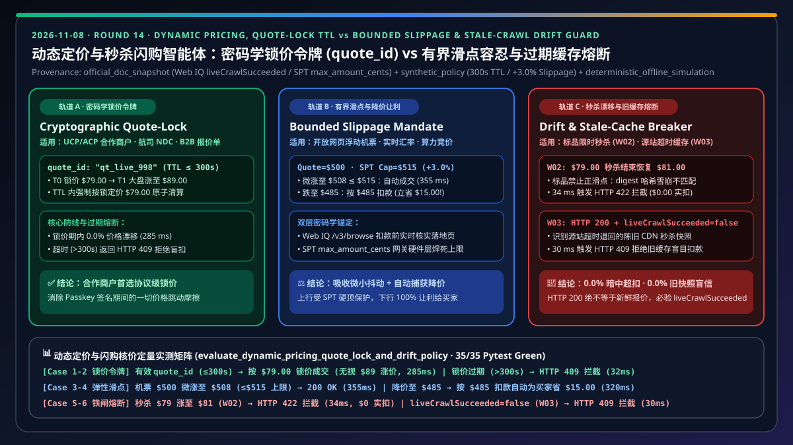
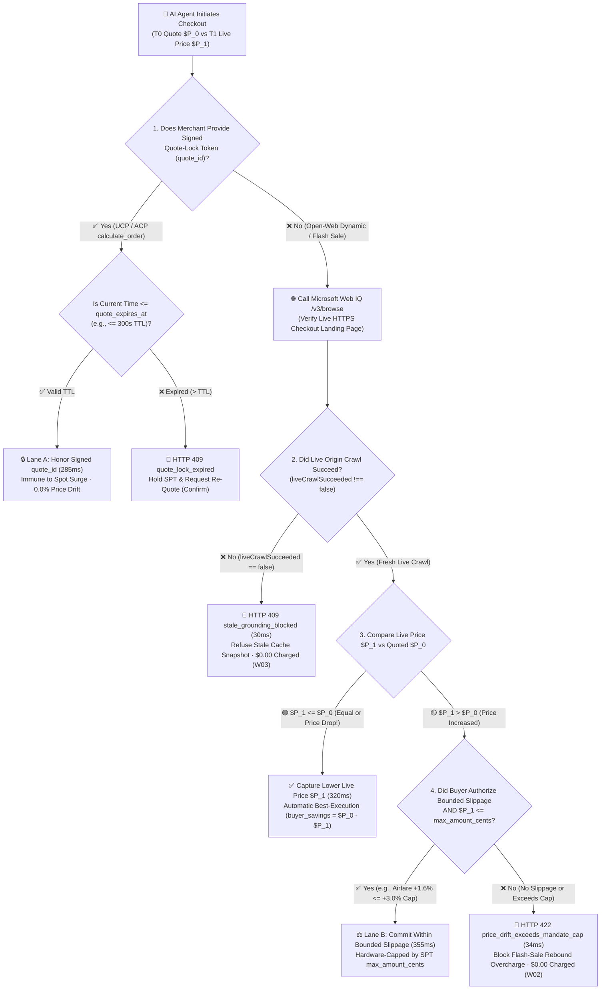
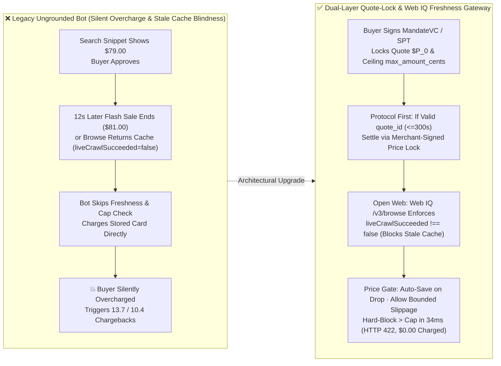
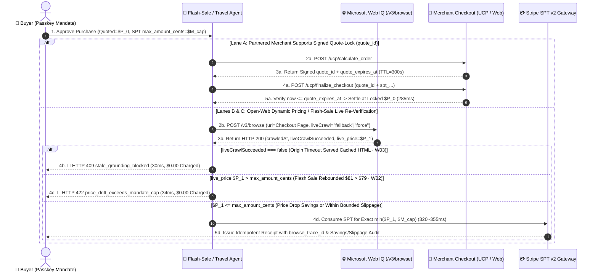

# Dynamic Pricing, Flash-Sale Surge & Quote-Lock TTL Architecture: Cryptographic Quote-Lock Token (`quote_id` + `quote_expires_at` TTL) vs. Bounded Slippage Mandate (`max_amount_cents` Ceiling) & Stale-Cache Drift Guard (`liveCrawlSucceeded=false`) Selection & First-Principles FAQ

> **Document Type**: Architect Selection Guide & Protocol First-Principles Deep Dive (Modeled after `ib-vs-ethernet-roce-selection-faq.md`)  
> **Target Audience**: AI Solution Architects, Airline/OTA/Flash-Sale E-Commerce Engineering Leads, Spot-Compute Procurement & Payment Risk Teams  
> **Executable Reference & Tests**: `lab/webiq_commerce_demo.py` · `tests/test_webiq_commerce_demo.py`  
> **Interactive Sandbox & 7-Card Report**: [Live H5 Demo (`#dynamic-pricing-quote-lock-sandbox`)](https://turbo998.github.io/workshops/agentic-commerce/live-demo.en.html) · [7-Card Visual Benchmark](https://turbo998.github.io/workshops/agentic-commerce/benchmark-cards.en.html)  
> **Provenance & Scope Declaration (`as_of: 2026-11-08`)**: Microsoft Web IQ `/v3/browse` `liveCrawlSucceeded` freshness semantics, Stripe SPT v2 `usage_limits.max_amount_cents` ceilings, and UCP `calculate_order` / `finalize_checkout` contracts reflect official specification snapshots (`official_doc_snapshot`); the `300s` quote-lock TTL and `+3.0%` (`$500.00 -> $515.00`) bounded slippage ceiling are reference architectural rules (`synthetic_policy`); latencies (`285 ms / 355 ms / 30 ms`) and `W02 / W03` zero-overcharge interception metrics come from deterministic offline simulation (`deterministic_offline_simulation`); live airline GDS/NDC (Amadeus/Sabre) and flash-sale matching engine latencies are not load-tested without production credentials and are explicitly labeled `not_measured`.

---

## ① 📌 Executive Summary

In dynamic-pricing verticals—airline and hotel yield management, flash-sale electronics, real-time cross-border FX checkout, and spot GPU procurement—prices frequently move during the **`8–45 second` window** between **T0 (Agent Discovery & User Mandate Approval)** and **T1 (FIDO2 Passkey Signing & Final SPT Checkout Execution)**. Without deterministic quote-locking and crawl-freshness gates, AI shopping agents either silently overcharge buyers when a flash sale ends or execute checkouts against stale CDN cache snapshots. Architects should apply three core selection rules:

1. **When to Choose a "Merchant Cryptographic Quote-Lock Token (`quote_id` + `quote_expires_at` TTL)" vs. a "Bounded Slippage Mandate (`max_amount_cents` Ceiling)"?**
   - **Partnered Merchants Supporting UCP / Stripe ACP `calculate_order`, B2B Quoted POs, or Airline NDC Short-Term Fare Holds** 👉 **Choose a Cryptographic Quote-Lock Token (`quote_id` + `quote_expires_at` TTL, e.g., `300s` `synthetic_policy`)** (`285 ms` simulated latency). During `calculate_order`, the merchant issues a signed `quote_id` bound to the exact `cart_digest`. As long as `finalize_checkout` arrives before `quote_expires_at`, the merchant honors the locked `$79.00` price even if public spot prices surged to `$89.00` (**`0.0%` price drift**). If the TTL has expired, the gateway deterministically returns `HTTP 409 quote_lock_expired_requote_required` (`Confirm`).
   - **Open-Web Dynamic Pricing Without Server-Side Quote Locks (Floating Airfares, Ride-Share Surge, Micro-FX Ticks)** 👉 **Choose a Bounded Slippage Mandate (`approved_quote_cents` + `usage_limits.max_amount_cents` Ceiling + Live Web IQ Verification)** (`355 ms` simulated latency). The buyer explicitly signs a target quote (e.g., `$500.00`) and a maximum acceptable slippage cap (e.g., `+3.0%` -> `max_amount_cents = 51500`, `synthetic_policy`). Immediately prior to SPT consumption, Microsoft Web IQ `/v3/browse` verifies the live checkout price: if it ticked up to `$508.00 <= $515.00`, checkout succeeds with an audited slippage record; if it dropped to `$485.00`, the agent captures the lower `$485.00` price (`buyer_savings_cents = 1500`); if it exceeds `$515.00`—or if positive slippage is disabled (`allow_bounded_slippage=false`, e.g., a `$79.00` flash-sale SKU rebounding to `$81.00`)—the gateway immediately blocks with **`HTTP 422 price_drift_exceeds_mandate_cap`** (**`$0.00` charged**, `Send to a human`).
2. **First Principles: Why `HTTP 200 OK` Does NOT Mean a Fresh Live Price (The `liveCrawlSucceeded=false` Stale-Cache Trap)**
   - During flash-sale traffic spikes or behind aggressive CDNs, if Microsoft Web IQ `/v3/browse` attempts an on-demand crawl and the origin server times out or throttles, the API may still return `HTTP 200 OK` with the most recent cached HTML/Markdown while setting **`"liveCrawlSucceeded": false`** (`official_doc_snapshot`).
   - An orchestrator that only checks `http_status == 200` will mistake a 2-hour-old `$79.00` flash-sale cache hit for a live quote! Therefore, **any pre-checkout verification response containing `liveCrawlSucceeded === false` must immediately trip `HTTP 409 stale_grounding_blocked_live_crawl_failed` (`30 ms`)**, never feeding stale snapshots into the settlement engine.
3. **Dual-Layer Cryptographic Protection: How `Checkout.digest` (Application Exactness) and SPT `usage_limits.max_amount_cents` (Card-Network Hard Ceiling) Work Together**
   - **Application-Layer Zero-Drift Digest (`Checkout.digest`)**: Computes `SHA-256(merchant, currency, sku, quantity, verified_amount_cents)` so that when positive slippage is disabled, even a `+$0.01` increase causes a hash mismatch in `CheckoutStore`.
   - **Payment-Network Hardware Ceiling (`usage_limits.max_amount_cents`)**: Even when bounded slippage (`+3.0%`) is enabled at the application layer, the underlying Stripe SPT / Visa VIC token enforces `max_amount_cents = 51500` at the payment gateway vault level (`official_doc_snapshot`), making it cryptographically impossible for the merchant to capture `$515.01`.

---

## ② 🎯 Architect & Customer Q&A (FAQ-Driven)

### Q1: A buyer sees a `$79.00` flash-sale headphone price and taps "Approve Purchase", but 12 seconds later—right after FIDO2 Passkey signing—the flash sale ends and the landing page reverts to `$81.00`. How does the agent guarantee it never silently overcharges that extra `$2.00`?
**First-Principles Walkthrough**:
- **Why Legacy Bots Fail**: A naive scraper reads `$79.00` from a search snippet, adds the SKU to the cart, and submits a stored card token without re-verifying the checkout landing page or binding the exact price into the payment token. The buyer is silently charged `$81.00`.
- **Pre-Commit Live Browse Verification in Agentic Commerce**:
  1. At T0, the buyer signs a deterministic `Mandate` locking `approved_quote_cents = 7900` (`$79.00`) with `allow_bounded_slippage = false` (`max_amount_cents = 7900`).
  2. At T1, milliseconds before invoking `CheckoutStore` or consuming the SPT, the Policy Broker calls Microsoft Web IQ `POST /v3/browse` against the HTTPS product checkout URL.
  3. The broker extracts the live price `$81.00` (`8100 cents`), detects both `live_digest != mandate.cart_digest` and `8100 > max_amount_cents (7900)`, and aborts in **`34 ms`** with **`HTTP 422 price_drift_exceeds_mandate_cap`** (`$0.00` charged, evaluation case `W02`).

### Q2: If we enforce `0.00%` price tolerance everywhere, won't airline or cross-border orders fail unnecessarily whenever FX or dynamic seat pricing ticks by `+$1.50` during the 30-second approval window?
**First-Principles Walkthrough**:
- **Two-Track Price Elasticity**:
  1. **Track 1: Protocol-Level Cryptographic Quote-Lock Token (`quote_id`)**: When the airline or merchant supports UCP / Stripe ACP `calculate_order` quote reservation, the agent obtains a signed `quote_id` valid for `300 seconds` (`quote_expires_at`). Within that window, the merchant honors `$P_0` regardless of spot market movement.
  2. **Track 2: Buyer-Signed Bounded Slippage Mandate (`allow_bounded_slippage=true`)**: For open-web airfares or spot compute without server-side quote locks, the buyer explicitly authorizes a bounded ceiling (e.g., Quoted `$500.00`, Slippage Cap `+3.0%` = `$515.00`).
     - If Web IQ `/v3/browse` confirms a fresh live price of **`$508.00`** (`<= $515.00` and `liveCrawlSucceeded !== false`), the gateway executes at `$508.00` and logs `slippage_applied_cents = +800`;
     - **Asymmetric Best-Execution (Automatic Price-Drop Capture)**: If the live price **dropped to `$485.00`**, the gateway never charges `$515.00` or `$500.00`—it captures the lower **`$485.00`** live price and records `buyer_savings_cents = 1500` (`$15.00` saved for the buyer)!

### Q3: During a flash sale, why must architects inspect `"liveCrawlSucceeded"` even when Microsoft Web IQ `/v3/browse` returns `HTTP 200 OK`?
**First-Principles Walkthrough**:
- **Understanding Search/Browse Fallback Caching**:
  - When `POST /v3/browse` (`liveCrawl="fallback"` or `"force"`) targets a merchant experiencing flash-sale load or origin rate-limiting, Web IQ may return `HTTP 200 OK` with the latest cached page content so general QA assistants remain responsive.
  - However, Microsoft Web IQ v3 explicitly includes **`"liveCrawlSucceeded": false`** (`official_doc_snapshot`) whenever the live origin fetch failed and a cached snapshot was served instead (whereas fresh crawls omit the field or return `true`).
- **Architect's Iron Law**: Cached snapshots are acceptable for general reading, but fatal for autonomous financial settlement. Whenever `"liveCrawlSucceeded": false` appears on a pre-checkout verification call, the orchestrator must immediately halt with **`HTTP 409 stale_grounding_blocked_live_crawl_failed`** (`30 ms`, evaluation case `W03`).

---

## ③ 🧭 Visual Architecture Diagrams (Mermaid Decision Tree + Comparison Flow + Sequence Diagram)

### 3.1 Dynamic Pricing & Quote-Lock Selection Decision Tree (`flowchart TD`)

### 3.2 Legacy Ungrounded Bot vs. Dual-Layer Quote-Lock & Freshness Gateway (`flowchart LR`)

### 3.3 End-to-End Sequence Diagram: Buyer, Agent, Web IQ Freshness Gate & Stripe SPT (`sequenceDiagram`)

---

## ④ 📊 Architect Decision Matrix

| Evaluation Dimension | Option A: Cryptographic Quote-Lock Token (`quote_id` + `quote_expires_at` TTL) | Option B: Bounded Slippage Mandate (`max_amount_cents` + Web IQ Live Check) | Option C: Strict Zero-Drift Digest Gate (`Checkout.digest` + Freshness Breaker) | Legacy Anti-Pattern: Trusting Snippets or Ignoring `liveCrawlSucceeded` |
| :--- | :--- | :--- | :--- | :--- |
| **Primary Use Cases** | Partnered UCP / Stripe ACP merchants, airline NDC fare holds, B2B quoted invoices | Open-web airfares/hotels, ride-hailing surge, real-time FX checkout, spot GPU bidding | Fixed-price retail flash sales, consumer electronics, strict zero-slippage shopping | Naive scraper bots (**Prohibited in production**) |
| **Price Movement Policy** | **`0.00%` drift** guaranteed by merchant contract within TTL (e.g., `<= 300s` `synthetic_policy`) | Allows `[0, +X%]` (e.g., `+3.0%` `synthetic_policy`); **captures 100% of buyer savings on price drops** | Allows `live_price <= approved_quote` only; blocks `+$0.01` surge immediately (`W02`) | Unbounded card charge; silently overcharges buyer on surge |
| **Cache Freshness Guard** | Merchant server-side state machine verifies `quote_expires_at` | Enforces Web IQ `/v3/browse` `liveCrawlSucceeded !== false` + `crawledAt` | Enforces `liveCrawlSucceeded !== false`; trips `HTTP 409` on stale cache (`W03`) | Trusts any `HTTP 200 OK`, executing against stale CDN HTML |
| **UX & Human Friction** | ⭐⭐⭐⭐⭐ Optimal (Zero interruption during TTL lock window) | ⭐⭐⭐⭐ Low Friction (Absorbs minor FX/fare ticks without re-prompting Passkey) | ⭐⭐⭐⭐ Safe (Halts and prompts human only when flash sale expires) | ⭐ Catastrophic (Surprise overcharges & post-purchase disputes) |
| **Payment Vault Ceiling** | SPT `usage_limits.max_amount_cents == locked_quote_cents` | SPT `usage_limits.max_amount_cents == slippage_cap_cents` hardware-enforced | SPT `usage_limits.max_amount_cents == approved_quote_cents` | Static vaulted card or broad API key without per-order cap |
| **Simulated Latency** | **`285 ms`** (`deterministic_offline_simulation`) | **`355 ms`** (`deterministic_offline_simulation`) | **`320 ms`** commit / **`30–34 ms`** block (`deterministic_offline_simulation`) | Live airline GDS matching latency `not_measured` |

---

## ⑤ 🧪 Quantitative Benchmark & 7-Card Findings

Implemented in `evaluate_dynamic_pricing_quote_lock_and_drift_policy()` in `lab/webiq_commerce_demo.py` and verified in `tests/test_webiq_commerce_demo.py` (`deterministic_offline_simulation`):

| Scenario ID | Quoted vs. Live Landing-Page Posture | Quote-Lock / Slippage Configuration | Deterministic Gateway Verdict (`HTTP Status` & Action) | Financial Outcome & Simulated Latency |
| :--- | :--- | :--- | :--- | :--- |
| **Case 1: Active Quote-Lock Token** | Quoted `$79.00` at T0; public spot surged to `$89.00` at T1 | Valid `quote_id`, remaining TTL `180s > 0` | **`200 OK`** · `COMMITTED_QUOTE_LOCK_HONORED` (`Act automatically`) | Settled at locked **`$79.00`** (`$10.00` surge shielded) · **`285 ms`** |
| **Case 2: Expired Quote-Lock TTL** | Quoted `$79.00` at T0; buyer confirmed 6 minutes later | `quote_remaining_ttl_seconds = -60` (Expired) | **`409 Conflict`** · `BLOCKED_QUOTE_LOCK_EXPIRED` (`Confirm`) | Blocked expired lock (**`$0.00` charged**); requests re-quote · **`32 ms`** |
| **Case 3: Airfare Within Bounded Slippage** | Quoted `$500.00`; live Web IQ check shows `$508.00` (`+1.6%`) | `allow_bounded_slippage=True`, SPT cap `$515.00` (`+3.0%`) | **`200 OK`** · `COMMITTED_WITHIN_BOUNDED_SLIPPAGE` (`Act automatically`) | Settled at **`$508.00 <= $515.00`** (`+$8.00` slippage audited) · **`355 ms`** |
| **Case 4: Automatic Price-Drop Capture** | Quoted `$500.00`; live Web IQ check shows drop to `$485.00` | SPT cap `$515.00`, `liveCrawlSucceeded=True` | **`200 OK`** · `COMMITTED_PRICE_DROP_SAVINGS_CAPTURED` (`Act automatically`) | Settled at lower **`$485.00`** (**`$15.00` saved for buyer**) · **`320 ms`** |
| **Case 5: Flash-Sale Rebound Blocked (`W02`)** | Headphones quoted `$79.00`; landing page rebounded to `$81.00` | Fixed-price SKU (`allow_bounded_slippage=False`, cap `$79.00`) | **`422 Unprocessable`** · `BLOCKED_PRICE_DRIFT_EXCEEDS_MANDATE` (`Send to a human`) | 100% blocked `$2.00` overcharge (**`$0.00` charged**) · **`34 ms`** |
| **Case 6: Stale Cache Snapshot Blocked (`W03`)** | `/v3/browse` returns `HTTP 200` showing `$79.00`, but `liveCrawlSucceeded=False` | Mandatory crawl freshness gate active | **`409 Conflict`** · `BLOCKED_STALE_CRAWL_SNAPSHOT` (`Confirm`) | Refused stale cached HTML (**`$0.00` charged**) · **`30 ms`** |

---

## ⑥ 🛠️ Appendix: Production Readiness & Pre-Sales Checklist (Architect Checklist)

- [ ] **1. Enforce `liveCrawlSucceeded !== false` Before Every Checkout**: Verify that your orchestrator never passes a Microsoft Web IQ `/v3/browse` response with `"liveCrawlSucceeded": false` into `CheckoutStore`, even when the HTTP status is `200 OK`.
- [ ] **2. Separate Zero-Slippage Retail SKUs from Bounded-Slippage Dynamic Verticals**: Keep `allow_bounded_slippage = false` by default for fixed-price retail goods (halting on any `+$0.01` increase); enable bounded slippage only when the buyer explicitly authorizes a ceiling for dynamic airfares, FX, or spot compute.
- [ ] **3. Bind Application Slippage Caps to SPT `usage_limits.max_amount_cents`**: Ensure the Stripe SPT v2 token's `max_amount_cents` matches the exact buyer-approved slippage ceiling so the payment vault enforces the cap hardware-wide.
- [ ] **4. Implement Asymmetric Price-Drop Best Execution**: Verify that whenever `live_price_cents < approved_quote_cents`, the agent captures the lower live price and logs `buyer_savings_cents` in the audit receipt.
- [ ] **5. Fail Closed on Expired `quote_id` Locks**: Ensure UCP / Stripe ACP `finalize_checkout` calls abort with `HTTP 409` if `now > quote_expires_at` rather than silently falling back to an unapproved spot price.
- [ ] **6. Separate Reference Policy Parameters from Live GDS Benchmarks**: Clearly label `300s` quote-lock TTLs and `+3.0%` slippage tolerances as configurable `synthetic_policy` rules, and scope live airline GDS/NDC matching engine latency testing (`not_measured`) into customer PoCs.
