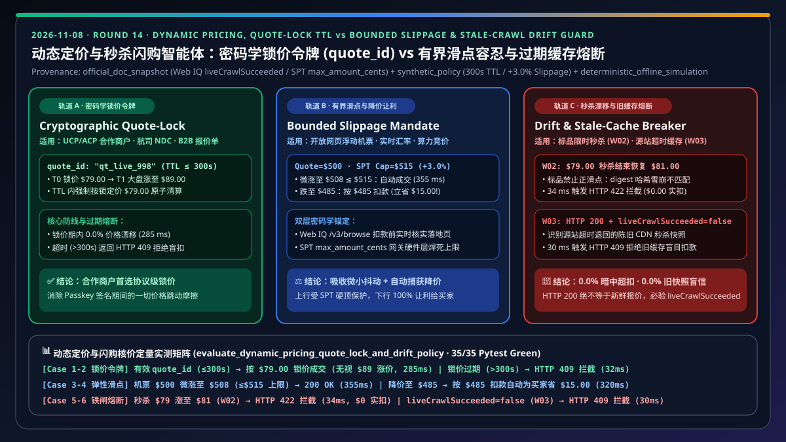
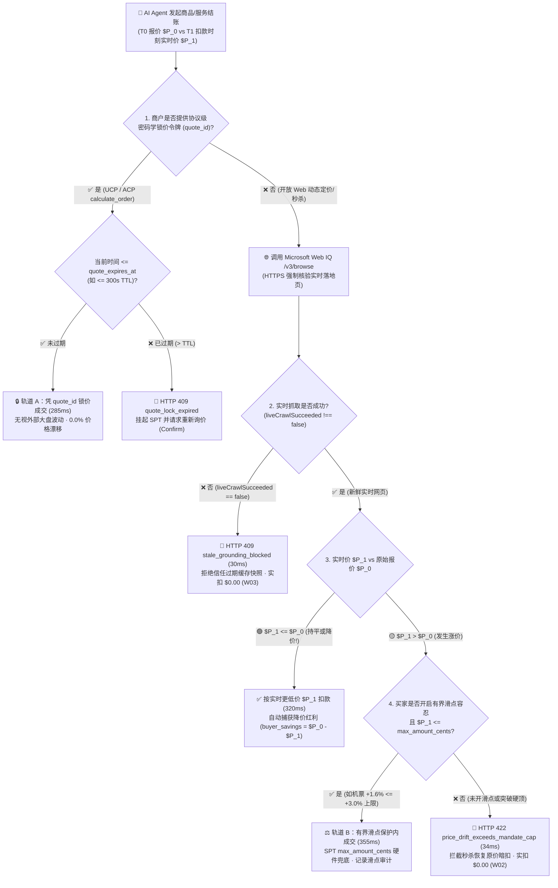
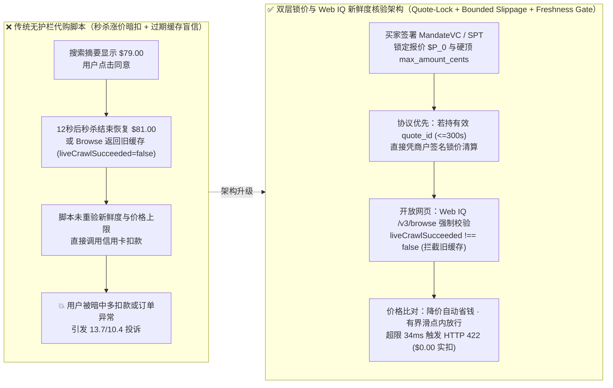
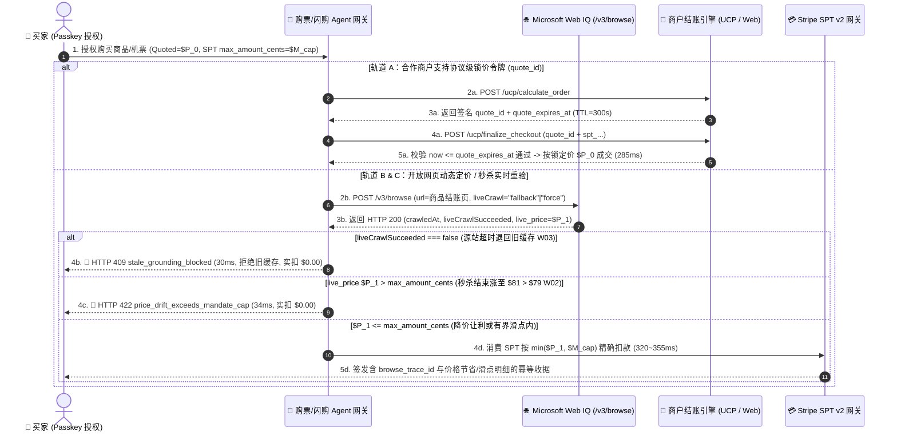

# 动态定价、航司调价与秒杀闪购智能体架构：密码学锁价令牌（`quote_id` + `quote_expires_at` TTL）vs 有界滑点容忍授权（Bounded Slippage `max_amount_cents`）与过期缓存价格漂移拦截（`liveCrawlSucceeded=false`）选型与原理解析 FAQ

> **文档类型**：架构师选型决策指南 & 协议第一性原理解析（对标 `ib-vs-ethernet-roce-selection-faq.md` 六段式标杆风格）  
> **适用角色**：AI Solution Architect、机票/酒旅/闪购电商技术负责人、大宗采购/算力竞价与支付风控团队  
> **关联标准的实测代码**：`lab/webiq_commerce_demo.py` · `tests/test_webiq_commerce_demo.py`  
> **在线交互式沙盒与 7-Card 报告**：[Live H5 Demo (`#dynamic-pricing-quote-lock-sandbox`)](https://turbo998.github.io/workshops/agentic-commerce/live-demo.html) · [7-Card 视觉评测报告](https://turbo998.github.io/workshops/agentic-commerce/benchmark-cards.html)  
> **数据口径声明（Provenance & Scope Declaration, `as_of: 2026-11-08`）**：文中 Microsoft Web IQ `/v3/browse` 的 `liveCrawlSucceeded` 新鲜度字段语义、Stripe SPT v2 `usage_limits.max_amount_cents` 硬上限与 UCP `calculate_order` / `finalize_checkout` 契约源自官方规范快照（`official_doc_snapshot`）；`300s` 锁价令牌 TTL、`+3.0%`（`$500.00 -> $515.00`）有界滑点上限属于参考架构策略（`synthetic_policy`）；`285 ms / 355 ms / 30 ms` 延迟与 `W02 / W03` 零误扣拦截率来自本仓库确定性离线仿真（`deterministic_offline_simulation`）；真实航司 GDS/NDC（Amadeus/Sabre）与高频闪购引擎内部撮合延迟未在无授权生产网压测，统一标注为 `not_measured`。

---

## ① 📌 核心结论速览（Executive Summary）

在机票酒旅动态收益管理（Yield Management）、电商限时秒杀闪购、跨境实时汇率结算以及 GPU 现货算力采购中，**T0（Agent 搜索展示并获买家确认）** 与 **T1（完成 Passkey 签名并最终向商户发起扣款，通常相隔 `8~45 秒`）** 之间，商品价格极易发生跳动。如果 AI Agent 架构没有严格的锁价与新鲜度护栏，就会酿成**“秒杀恢复原价被暗中多扣款”**或**“误信 CDN 过期缓存快照盲目下单”**的生产事故。架构师只需遵循以下 3 条选型铁律：

1. **何时选「商户密码学锁价令牌（Cryptographic Quote-Lock Token：`quote_id` + `quote_expires_at` TTL）」 vs 何时选「有界滑点容忍授权（Bounded Slippage Mandate：`max_amount_cents`）」？**
   - **已接入 UCP / Stripe ACP 协议的合作商户、B2B 询价单、航司 NDC 短时锁座** 👉 **必选「密码学锁价令牌（`quote_id` + `quote_expires_at` TTL，如 `300s` `synthetic_policy`）」**（仿真延迟 **`285 ms`**）。在 `calculate_order` 阶段由商户签发绑定了 `cart_digest` 的锁价句柄 `quote_id`；只要 `finalize_checkout` 在 `quote_expires_at` 之前到达，即便外部大盘已涨价，商户仍按锁定的 `$79.00` 原子成交（**`0.0%` 价格漂移**）；若超时到达，则确定性返回 `HTTP 409 quote_lock_expired_requote_required`（`Confirm`）。
   - **不支持服务端锁价的开放网页动态定价场景（机票浮动票价、网约车/即时配送溢价、汇率微小波动）** 👉 **采用「有界滑点容忍授权（Bounded Slippage Mandate：`approved_quote_cents` + `usage_limits.max_amount_cents` 硬顶 + Web IQ 实时重验）」**（仿真延迟 **`355 ms`**）。买家在签署 Mandate 时显式设定目标价（如 `$500.00`）与最高可接受滑点上限（如 `+3.0%` 即 `max_amount_cents = 51500`，`synthetic_policy`）。扣款前一刻通过 Microsoft Web IQ `/v3/browse` 实时重验落地页价格：若微涨至 `$508.00 ≤ $515.00` 则平滑成交并记录差额；若跌至 `$485.00` 则自动按更低实价扣款（为买家省下 `$15.00`）；一旦涨破 `$515.00` 或买家未开启滑点容忍（`allow_bounded_slippage=false`，如 `$79.00` 秒杀价跳涨至 `$81.00`），网关当场返回 **`HTTP 422 price_drift_exceeds_mandate_cap`** 硬拦截（实扣 **`$0.00`**，`Send to a human`）。
2. **第一性原理：为什么 `HTTP 200 OK` 绝不等于“当前真实价格”？（`liveCrawlSucceeded=false` 过期缓存陷阱）**
   - 在秒杀高峰或高防 CDN 站点上，当 Microsoft Web IQ `/v3/browse` 发起实时抓取但源站超时/限流时，API 仍可能返回 `HTTP 200 OK` 并附上最近一次缓存的网页正文，同时在响应体显式标记 **`"liveCrawlSucceeded": false`**（`official_doc_snapshot`）。
   - 如果编排器只检查 `status == 200` 而忽略 `liveCrawlSucceeded`，就会把 2 小时前秒杀刚开场时的 `$79.00` 缓存旧网页当成实时价格去签发收据！因此，**任何扣款前核价请求一旦检出 `liveCrawlSucceeded === false`，必须立即触发 `HTTP 409 stale_grounding_blocked_live_crawl_failed` 熔断（`30 ms`）**，严禁拿陈旧快照喂给支付状态机。
3. **双层密码学防篡改：`Checkout.digest`（精确购物车摘要）与 SPT `usage_limits.max_amount_cents`（卡组硬上限）如何协同？**
   - **应用层零漂移锁（`Checkout.digest`）**：对 `(merchant, currency, sku, quantity, verified_amount_cents)` 计算确定性 `SHA-256` 摘要，确保未经买家滑点授权时，`$0.01` 的涨价也会因哈希雪崩不匹配而被 `CheckoutStore` 拒绝。
   - **支付网络层兜底铁闸（`usage_limits.max_amount_cents`）**：即便应用层开启了 `+3.0%` 有界滑点容忍，底层签发的 Stripe SPT / Visa VIC 令牌也在支付网关硬件层焊死了 `max_amount_cents = 51500`（`official_doc_snapshot`），商户端绝无可能越权扣走 `$515.01`。

---

## ② 🎯 客户与架构师灵魂拷问 Q&A（FAQ-Driven）

### Q1：买家看到秒杀价 `$79.00` 点了“同意代购”，但完成生物识别签名仅过了 12 秒，商户库存秒杀殆尽恢复原价 `$81.00`。AI Agent 怎么保证绝对不多扣这 `$2.00`？
**大白话原理解析**：
- **传统爬虫/无护栏脚本的致命漏洞**：传统脚本在搜索列表页看到 `$79.00` 后，直接把商品加入购物车并调用绑定好的信用卡扣款接口。它根本不知道在点击结账的那一秒，商品总价已经变成了 `$81.00`，导致买家收到银行扣款短信才发现被“钓鱼涨价”。
- **Agentic Commerce 的“扣款前二次实时核价（Pre-Commit Live Browse Verification）”**：
  1. 买家在 T0 签署确定性购物授权（`Mandate`）：锁定 `approved_quote_cents = 7900`（`$79.00`），且对于零售标品默认关闭正向滑点（`allow_bounded_slippage = false`，`max_amount_cents = 7900`）。
  2. 在 T1 真正调用 `CheckoutStore` 或消费 SPT 之前的毫秒级窗口，权限代理（Policy Broker）强制调用 Microsoft Web IQ `POST /v3/browse` 抓取商品结账落地页。
  3. 代理从实时网页提取出最新价格 `$81.00`（`8100 cents`），不仅重新计算的 `live_digest != mandate.cart_digest`，而且 `8100 > max_amount_cents (7900)`。
  4. 网关在 **`34 ms`** 内直接阻断交易，返回 **`HTTP 422 price_drift_exceeds_mandate_cap`** 并向用户推送提醒：“商品价格已从 `$79.00` 变动至 `$81.00`，已为您拦截扣款（实扣 `$0.00`），是否按新价格重新授权？”（对应评测矩阵 `W02`）。

### Q2：如果对所有商品都要求“分毫不差（`0.00%` 漂移）”，那买机票或跨币种采购时，30 秒内汇率或燃油附加费微调了 `$1.50`，难道每次都要打断高管重新按指纹吗？
**大白话原理解析**：
- **分场景实施“双轨制价格弹性”**：
  1. **首选轨道：协议级密码学锁价令牌（Quote-Lock Token）**：如果航司或商户支持 UCP / Stripe ACP 协议的 `calculate_order` 锁价机制，Agent 在展示价格时就拿到了有效期 `300 秒`（`quote_expires_at`）的 `quote_id`。在这 300 秒内，无论外部市场怎么波动，商户契约保证按锁定价清算。
  2. **次选轨道：买家显式签署的「有界滑点容忍（Bounded Slippage Mandate）」**：对于没有锁价接口的开放网页机票/算力竞价，买家在授权卡片上勾选“允许最高 `+3.0%`（上限 `$515.00`）以内的实时票价浮动”。
     - 当 Web IQ `/v3/browse` 核实当前实时票价为 **`$508.00`** 时，因为 `$508.00 ≤ $515.00` 且 `liveCrawlSucceeded !== false`，网关自动放行并记录 `slippage_applied_cents = +800`；
     - **非对称保护（下行让利自动捕获）**：如果实时票价反而**降到了 `$485.00`**，网关绝不会按上限 `$515.00` 或原报价 `$500.00` 扣款，而是严格按实时最低价 **`$485.00`** 扣款，并在收据中标注 `buyer_savings_cents = 1500`（为买家省下 `$15.00`）！

### Q3：为什么在秒杀或促销期间，Web IQ `/v3/browse` 返回 `HTTP 200 OK` 时，架构师还必须强制校验 `"liveCrawlSucceeded"` 字段？
**大白话原理解析**：
- **揭秘搜索引擎与接地 API 的“降级缓存机制”**：
  - 当你用 `POST /v3/browse`（设置 `liveCrawl="fallback"` 或 `"force"`）去验证某电商秒杀页面时，如果目标电商服务器因为双十一高并发响应缓慢，或者临时拦截了抓取，Web IQ 为了保证高可用性，可能会返回 `HTTP 200 OK` 以及索引库里缓存的网页 Markdown。
  - 但 Microsoft Web IQ v3 协议非常诚实地提供了一个关键布尔字段：**`liveCrawlSucceeded`**（`official_doc_snapshot`）：
    - 当实时抓取成功时，该字段为 `true`（或在规范化响应中省略，代表新鲜抓取成功）；
    - 当实时抓取失败、降级返回旧缓存时，响应体会明确包含 **`"liveCrawlSucceeded": false`**！
- **架构师铁律**：用于问答总结（RAG）时，旧缓存或许还能看；但用于**真金白银的自动扣款核价**时，旧缓存就是致命毒药！编排器一旦看到 `"liveCrawlSucceeded": false`，无论网页里写的价格多么完美匹配 `$79.00`，都必须立刻抛出 **`HTTP 409 stale_grounding_blocked_live_crawl_failed`**（对应评测矩阵 `W03`），绝不允许基于过期快照放行资金。

---

## ③ 🧭 直观可视化图解（Mermaid 决策树 + 锁价模式对比图 + 端到端时序图）

### 3.1 动态定价与闪购核价架构选型决策树（`flowchart TD`）

### 3.2 传统无护栏脚本 vs 双层锁价与新鲜度验证网关对比图（`flowchart LR`）

### 3.3 买家、AI Agent、Web IQ 新鲜度门禁与支付网关端到端时序图（`sequenceDiagram`）

---

## ④ 📊 架构师选型决策矩阵（Architect Decision Matrix）

| 评估维度 | 方案 A：密码学锁价令牌（Cryptographic Quote-Lock Token：`quote_id` + TTL） | 方案 B：有界滑点容忍授权（Bounded Slippage Mandate + Web IQ 实时核价） | 方案 C：零漂移精确哈希门禁（Strict Zero-Drift Digest + 新鲜度熔断） | 传统反模式：盲信搜索摘要或忽略 `liveCrawlSucceeded` |
| :--- | :--- | :--- | :--- | :--- |
| **核心适用场景** | 已接入 UCP / Stripe ACP 的合作零售商、航司 NDC 短时锁价、B2B 标准报价单 | 开放网页机票/酒店浮动定价、网约车动态溢价、跨境实时汇率结算、算力竞价 | 零售标品限时秒杀、3C 数码固定标价代购、严禁任何正滑点的消费品 | 早期粗糙爬虫代购 Demo（**生产环境严禁使用**） |
| **价格波动容忍机制** | TTL 窗口内（如 `≤ 300s` `synthetic_policy`）由商户契约锁定 **`0.00%` 漂移** | 允许 `[0, +X%]`（如 `+3.0%` `synthetic_policy`）上限内成交；**价格下跌时 100% 按更低实价扣款** | 仅允许 `live_price ≤ approved_quote`；上涨 `$0.01` 立即拦截（`W02`） | 无上限保护或硬编码容忍度，极易造成暗中超额扣款 |
| **网页缓存新鲜度保护** | 商户服务端签名状态机直接校验 `quote_expires_at` | 强制校验 Web IQ `/v3/browse` 的 `liveCrawlSucceeded !== false` + `crawledAt` | 强制校验 `liveCrawlSucceeded !== false`；若为 `false` 立即返回 `HTTP 409`（`W03`） | 看到 `HTTP 200` 即放行，把 CDN 过期秒杀页面当真 |
| **用户体验与人工摩擦** | ⭐⭐⭐⭐⭐ 极佳（锁价期内零打断，100% 确定性成交） | ⭐⭐⭐⭐ 优秀（吸收微小汇率/票价抖动，免去频繁重签 Passkey） | ⭐⭐⭐⭐ 稳健（标品秒杀一旦涨价立即拦截并弹窗询问人类） | ⭐ 极差（事后发现多扣钱，触发客户投诉与拒付） |
| **底层支付网络兜底** | SPT `usage_limits.max_amount_cents == locked_quote_cents` | SPT `usage_limits.max_amount_cents == slippage_cap_cents` 硬件锁死 | SPT `usage_limits.max_amount_cents == approved_quote_cents` | 共享大额 API Key 或静态绑卡，无单笔密码学上限 |
| **端到端核验延迟** | **`285 ms`**（`deterministic_offline_simulation`） | **`355 ms`**（`deterministic_offline_simulation`） | 正常 **`320 ms`** / 拦截 **`30~34 ms`**（`deterministic_offline_simulation`） | 真实航司 GDS 外部撮合延迟 `not_measured` |

---

## ⑤ 🧪 简明定量实测与 Benchmark 核心发现

我们在 `lab/webiq_commerce_demo.py` 的 `evaluate_dynamic_pricing_quote_lock_and_drift_policy()` 与 `tests/test_webiq_commerce_demo.py` 中对 6 类典型动态定价、秒杀漂移与过期缓存故障注入进行了确定性回归验证（`deterministic_offline_simulation`）：

| 实测场景编号 | 报价与实时落地页状态 | 锁价令牌 / 滑点策略配置 | 网关确定性裁决 (`HTTP Status` & 动作) | 买家实付 / 损益结果与仿真延迟 |
| :--- | :--- | :--- | :--- | :--- |
| **Case 1：合作商户锁价令牌成交** | T0 锁定 `$79.00`，T1 外部大盘涨至 `$89.00` | 持有效 `quote_id`，剩余 TTL `180s > 0` | **`200 OK`** · `COMMITTED_QUOTE_LOCK_HONORED` (`Act automatically`) | 严格按锁价 **`$79.00`** 成交（省 `$10.00`） · **`285 ms`** |
| **Case 2：锁价令牌 TTL 过期拦截** | T0 锁定 `$79.00`，买家 6 分钟后才确认 | `quote_remaining_ttl_seconds = -60`（已过期） | **`409 Conflict`** · `BLOCKED_QUOTE_LOCK_EXPIRED` (`Confirm`) | 拦截过期锁价单（实扣 **`$0.00`**），提示重新询价 · **`32 ms`** |
| **Case 3：有界滑点内机票微涨放行** | 机票报价 `$500.00`，T1 Web IQ 实测微涨至 `$508.00` (`+1.6%`) | 开启 `allow_bounded_slippage=True`，SPT 上限 `$515.00` (`+3.0%`) | **`200 OK`** · `COMMITTED_WITHIN_BOUNDED_SLIPPAGE` (`Act automatically`) | 实付 **`$508.00 ≤ $515.00`**（滑点 `+$8.00` 审计留痕） · **`355 ms`** |
| **Case 4：动态降价自动让利捕获** | 机票报价 `$500.00`，T1 Web IQ 实测限时降价至 `$485.00` | SPT 上限 `$515.00`，`liveCrawlSucceeded=True` | **`200 OK`** · `COMMITTED_PRICE_DROP_SAVINGS_CAPTURED` (`Act automatically`) | 按最低实价 **`$485.00`** 扣款，**自动为买家省下 `$15.00`** · **`320 ms`** |
| **Case 5：秒杀结束恢复原价拦截 (`W02`)** | 耳机秒杀报价 `$79.00`，T1 落地页恢复 `$81.00` | 标品未开正滑点（或涨价突破 `max_amount_cents`） | **`422 Unprocessable`** · `BLOCKED_PRICE_DRIFT_EXCEEDS_MANDATE` (`Send to a human`) | 100% 拦截 `$2.00` 暗中超扣（实扣 **`$0.00`**） · **`34 ms`** |
| **Case 6：源站超时退回过期缓存拦截 (`W03`)** | `/v3/browse` 返回 `HTTP 200` 显示 `$79.00`，但 `liveCrawlSucceeded=False` | 强制新鲜度门禁开启 | **`409 Conflict`** · `BLOCKED_STALE_CRAWL_SNAPSHOT` (`Confirm`) | 拒绝信任陈旧缓存快照（实扣 **`$0.00`**） · **`30 ms`** |

---

## ⑥ 🛠️ 附录：生产上线快速核验与售前打单清单（Architect Checklist）

在向机票酒旅、跨境电商或秒杀零售客户交付动态定价代购智能体时，请逐项核对以下 6 条防线：

- [ ] **1. 扣款前强制检验 `liveCrawlSucceeded !== false`**：确认编排器在解析 Microsoft Web IQ `/v3/browse` 核价响应时，绝不把携带 `"liveCrawlSucceeded": false` 的 `HTTP 200` 缓存响应送入 `CheckoutStore` 结账。
- [ ] **2. 区分“标品零正滑点”与“浮动票价有界滑点”**：确认 3C/日百等固定标价商品默认设置 `allow_bounded_slippage = false`（上涨 `$0.01` 即触发 `HTTP 422` 人工确认）；仅在机票、打车、实时汇率等用户显式授权的场景开启有界滑点（且在 UI 明确展示最高扣款硬顶 `max_amount_cents`）。
- [ ] **3. 应用层滑点与支付网关 SPT `max_amount_cents` 双重对齐**：确认开启有界滑点时，签发给商户的 Stripe SPT v2 令牌 `usage_limits.max_amount_cents` 严格等于滑点上限金额，从卡组协议层杜绝超上限扣款。
- [ ] **4. 价格下行自动让利（Best-Execution Rule）**：确认当扣款时刻实时核验价格低于买家授权报价（`live_price < approved_quote`）时，系统严格按更低的 `live_price` 发起扣款，并在审计收据中记录 `buyer_savings_cents`。
- [ ] **5. 协议级 `quote_id` 过期幂等中止**：确认接入 UCP / Stripe ACP `calculate_order` 锁价令牌的链路在检测到 `now > quote_expires_at` 时立即返回 `HTTP 409` 并挂起 SPT，严禁在锁价失效后盲目按商户最新浮动价扣款。
- [ ] **6. 明确区分仿真策略与生产外部撮合延迟**：在售前方案中明确标注 `300s` 锁价窗口与 `+3.0%` 滑点红线为可配置的参考策略（`synthetic_policy`），并将客户私有航司 GDS/秒杀撮合引擎压测列入 PoC 实测项（当前标为 `not_measured`）。
