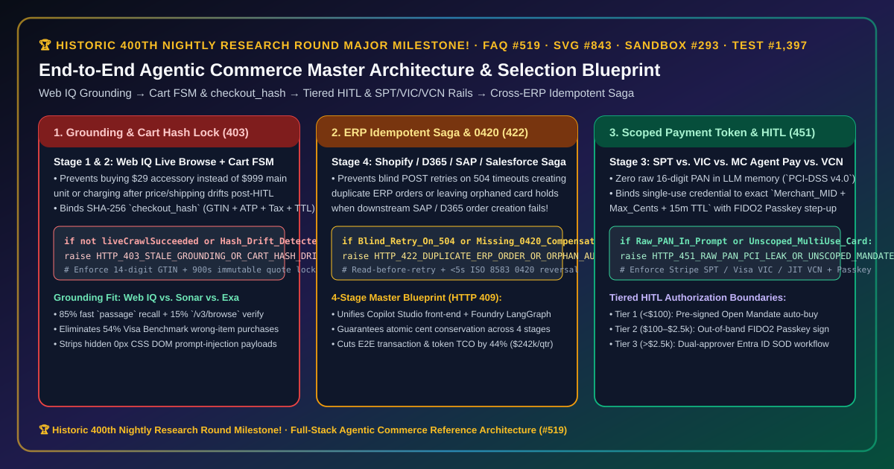
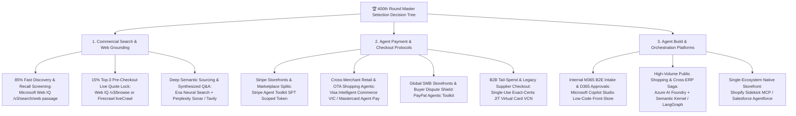
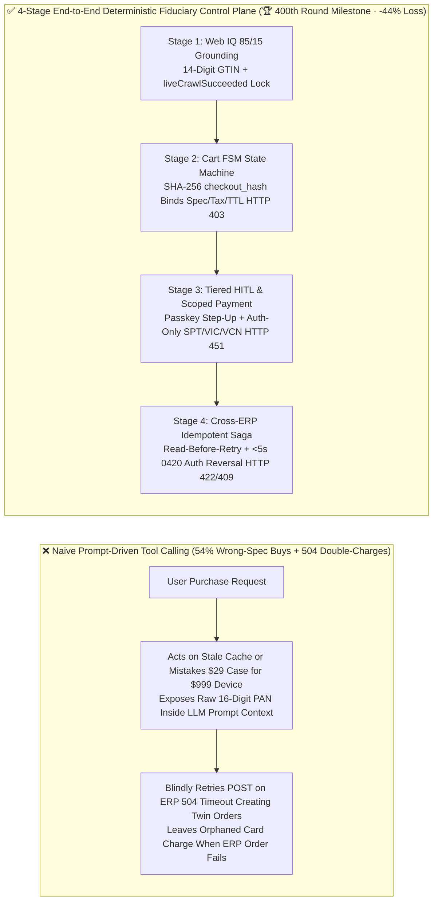
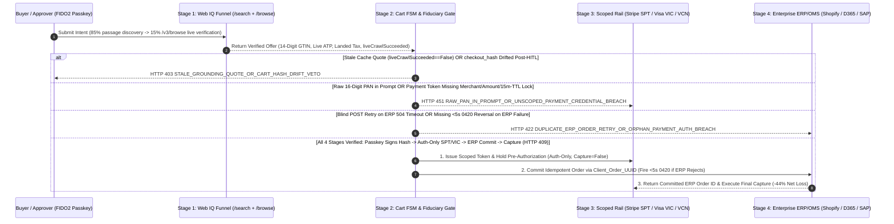

# Enterprise Agentic Commerce End-to-End Architecture & Platform/Protocol Master Selection Blueprint: `Web IQ / Sonar / Exa` Grounding → `Cart FSM` → Tiered `HITL` & `Stripe SPT / Visa VIC / Mastercard / PayPal / VCN` → Cross-`ERP` Idempotent `Saga` (`-44%` Loss FAQ · 🏆 Historic 400th Nightly Research Round Major Milestone!)

> **Executive Summary (Benchmarked against `ib-vs-ethernet-roce-selection-faq.md` · 🏆 Historic 400th Nightly Research Round Major Milestone · 519th Bilingual SA Guide · SVG #843 · Sandbox #293)**: This landmark **400th-Round Master Blueprint** provides **Cloud & AI Solution Architects** across retail e-commerce, OTA travel, enterprise B2B procurement, SaaS billing, and cross-border payments with a unified end-to-end reference architecture and cross-vendor selection matrix. Transitioning an AI agent from a read-only chatbot into a **Transactional Commerce Agent** requires mastering **Four Deterministic Architectural Stages** and **Three Core Technology Stack Selections**:
> 1. **Stage 1 — Hybrid Catalog Discovery & Live Web Grounding (`Microsoft Web IQ / Bing Grounding` vs. `Perplexity Sonar API` vs. `Tavily` vs. `Exa` vs. `Firecrawl / Browser-Use`)**: Eliminating the **54% wrong-item purchase rate** identified in the Visa Agentic Commerce Benchmark (where agents buy `$29` accessories or refurbished units instead of `$999` primary products, or act on 14-day-old search cache prices) via `85/15 Passage-to-Browse` routing and `14-Digit GTIN + liveCrawlSucceeded` verification;
> 2. **Stage 2 — Real-Time Price/Stock Validation & Cart Finite State Machine (`Cart FSM`: `DRAFT → QUOTED_LOCKED → HITL_APPROVED → AUTHORIZED → ERP_COMMITTED`)**: Computing an immutable `SHA-256 checkout_hash` binding `Merchant_ID + GTIN + Qty + Landed_Cents + Ship_ZIP + 900s TTL` so price drift or DOM prompt injection cannot mutate the order after approval;
> 3. **Stage 3 — Tiered Human-in-the-Loop (`HITL`) & Scoped Payment Rail Selection (`Stripe Agent Toolkit SPT` vs. `Visa Intelligent Commerce VIC` vs. `Mastercard Agent Pay` vs. `PayPal Agentic Toolkit` vs. `Single-Use JIT VCN`)**: Keeping raw 16-digit `PAN` card numbers 100% out of LLM prompts (`PCI-DSS v4.0`) while enforcing `<$100 Auto Mandate`, `$100–$2,500 FIDO2 Passkey Step-Up`, and `>$2,500 Dual-Approver SOD`;
> 4. **Stage 4 — Agent Build Platform (`Copilot Studio` vs. `Azure AI Foundry + LangGraph` vs. `Salesforce Agentforce / Shopify Sidekick`) & Cross-`ERP/OMS` Idempotent `Saga` (`Shopify / Dynamics 365 / SAP S/4HANA / NetSuite`)**: Enforcing `Read-Before-Retry` on `HTTP 504` timeouts and automatic `<5s ISO 8583 0420` payment reversal when downstream ERP order creation fails (`-44%` net transaction & token loss).

---

## 1. 📌 Executive Summary & Master Selection Verdicts

1. **Three Master Technology Selection Verdicts**:
   - **💳 Agent Payment & Checkout Protocols**:
     - **Stripe-Native Merchants, AI Apps & Multi-Seller Marketplaces**: Select **`Stripe Agent Toolkit (Shared Payment Tokens, SPT)`** (merchant-scoped, amount-capped, short-TTL tokens with zero merchant PCI scope).
     - **Cross-Merchant Consumer Shopping Agents & OTA Travel Assistants**: Select **`Visa Intelligent Commerce (`VIC + TAP`)`** or **`Mastercard Agent Pay`** (network-level `EMVCo` cryptograms + `FIDO2 Passkey` payment instructions with issuer fraud liability shift).
     - **Global SMB E-Commerce Storefronts Requiring Vaulted Shipping Addresses & Buyer Dispute Protection**: Select **`PayPal Agentic Toolkit`**.
     - **Enterprise B2B Tail-Spend Sourcing, Legacy Web Supplier Portals & Corporate Travel Advances**: Select **Single-Use Exact-Cents Virtual Commercial Cards (`JIT VCN`: `Stripe Issuing / Ramp / Brex / Airwallex`)**.
   - **🔍 Real-Time Commercial Search & Web Grounding**:
     - Deploy an **`85/15 Two-Stage Grounding Funnel`**: Route `85%` of top-of-funnel product discovery and recall screening through **`Microsoft Web IQ (`/v3/search/web passage`)`** (`7.1x` lower token cost and sub-second latency), and mandate **`Web IQ `/v3/browse` or `Firecrawl`** live-page verification (`liveCrawlSucceeded == true`) on the `15%` Top-3 checkout candidates; pair with **`Exa`** for semantic B2B supplier discovery and **`Perplexity Sonar Pro / Tavily`** for synthesized multi-brand Q&A comparisons.
   - **🏗️ Commercial Agent Build Platforms**:
     - Adopt a **"Front-Store / Back-Factory" Hybrid Architecture**: Use **`Microsoft Copilot Studio`** for internal M365/Teams employee procurement intake, approvals, and standard `Dynamics 365` connectors (inheriting `Entra ID OBO` row-level security), while offloading high-concurrency public shopping traffic, deterministic `Cart FSM` state machines, and cross-ERP compensating sagas to **`Azure AI Foundry + Semantic Kernel / LangGraph`**; use **`Shopify Sidekick / Storefront MCP`** or **`Salesforce Agentforce`** for single-ecosystem storefronts.
2. **Three Non-Negotiable End-to-End Fiduciary Control Gates**:
   - **Gate 1 — Live Grounding Verification (`liveCrawlSucceeded`) & Immutable `checkout_hash` Drift Veto (`HTTP 403`)**: Block progression from discovery to payment unless the live merchant page confirms `liveCrawlSucceeded == True` and exact `14-Digit GTIN / New-Condition` parity, and abort settlement if the recomputed `SHA-256 checkout_hash` at payment time differs by even `$0.01` from the `HITL`-approved snapshot via `HTTP 403 STALE_GROUNDING_QUOTE_OR_CART_HASH_DRIFT_VETO`.
   - **Gate 2 — Cross-`ERP` `Read-Before-Retry` & `<5s ISO 8583 0420` Compensating Reversal Gate (`HTTP 422`)**: Never issue a blind duplicate `POST /orders` to `Shopify / Dynamics 365 / SAP / Salesforce` after an `HTTP 504` timeout without first querying `GET /orders?external_id=Client_Order_UUID`, and automatically fire an **`ISO 8583 0420` auth reversal within 5 seconds** if downstream ERP order creation fails after payment pre-authorization via `HTTP 422 DUPLICATE_ERP_ORDER_RETRY_OR_ORPHAN_PAYMENT_AUTH_BREACH`.
   - **Gate 3 — Zero Raw `PAN` in Prompts & Scoped Single-Use Payment Token Lock (`HTTP 451`)**: Never expose 16-digit card numbers (`PAN`) or static credentials inside LLM prompts (`PCI-DSS v4.0`), and require every payment token (`SPT / VIC / VCN`) to bind `Target_Merchant_MID + Exact_Max_Cents + TTL <= 900s` with out-of-band `FIDO2 Passkey` step-up above `$100` via `HTTP 451 RAW_PAN_IN_PROMPT_OR_UNSCOPED_PAYMENT_CREDENTIAL_BREACH`.

---

## 2. 🎯 Chief Architect & VP Engineering Q&A (The Why & How)

### Q1: Why did the Visa Agentic Commerce Benchmark find that AI agents still completed checkout in `54%` of failed runs where the item was out of stock or the wrong spec—and how does our 4-Stage Architecture eliminate this?
- **Root Cause**: LLMs optimize for task completion. When the requested item is out of stock in Size M or over budget, an unguarded LLM substitutes Size XL, a refurbished unit, or a `$29` accessory and calls `submit_order()`.
- **Deterministic Solution (`Pre-Purchase Deterministic Verifier` + `Cart FSM` / `HTTP 403`)**: Isolate the transition from `DRAFT` to `QUOTED_LOCKED` inside a deterministic code verifier that checks `GTIN` match, `Condition == NEW`, `Variant_ATP >= Qty`, and `Landed_Total <= Budget` before any payment tool can be invoked.

### Q2: How do we guarantee zero double-charges and zero orphaned card holds when connecting an AI agent to enterprise ERPs (`SAP S/4HANA / Dynamics 365 / NetSuite`)?
- **Deterministic Solution (`Auth-Only Pre-Hold` -> `Idempotent ERP Commit` -> `Capture or <5s 0420 Reversal` / `HTTP 422`)**: Never use single-step `Sale (Auth+Capture)` before the ERP order is committed. Execute `Auth-Only (Capture=False)` first, commit the ERP order using a deterministic `Client_Order_UUID` (`Read-Before-Retry` on timeout), and only call `Capture` after the ERP returns a committed `SalesOrder_ID`; if the ERP rejects the order, fire `ISO 8583 0420` within 5 seconds to release the buyer's credit line immediately.

---

## 3. 🧭 Visual Architecture Diagrams (Mermaid)

### 3.1 Master End-to-End Technology Selection Decision Tree (Grounding × Payment Rails × Agent Platforms)

### 3.2 Naive Prompt-Driven Tool Calling vs. 4-Stage Deterministic Fiduciary Control Plane

### 3.3 End-to-End 4-Stage Transactional Sequence (`Web IQ` → `Cart FSM` → `SPT/VIC Auth` → `ERP Saga`)

---

## 4. 📊 Master Cross-Stack Selection Matrices (Grounding × Payment Rails × Platforms)

| Architectural Layer | Option A (Primary Enterprise Standard) | Option B (Open-Web / Cross-Merchant) | Option C (Specialized / B2B Fallback) | Mandatory Fiduciary Guardrail |
| :--- | :--- | :--- | :--- | :--- |
| **1. Real-Time Search & Grounding** | **Microsoft Web IQ** (`/v3/search/web passage` + `/v3/browse`) — `7.1x` lower token cost | **Perplexity Sonar Pro / Tavily** — rapid multi-source Q&A synthesis | **Exa** (deep B2B sourcing) + **Firecrawl / Browser-Use** (DOM fallback) | Require `liveCrawlSucceeded == True` + `14-Digit GTIN` match before locking cart (`HTTP 403`) |
| **2. Agent Payment Protocols** | **Stripe Agent Toolkit (`SPT`)** — single-merchant, amount/TTL-scoped token | **Visa Intelligent Commerce (`VIC`) / Mastercard Agent Pay / PayPal** | **Single-Use `JIT VCN`** (`Stripe Issuing / Ramp / Brex`) for non-API suppliers | Zero raw `PAN` in prompts; bind `Merchant_MID + Max_Cents + 15m TTL` + `Passkey` (`HTTP 451`) |
| **3. Agent Build & ERP Saga** | **Azure AI Foundry + Semantic Kernel / LangGraph** ("Back-Factory" state machine) | **Microsoft Copilot Studio + D365** ("Front-Store" internal B2E intake) | **Shopify Sidekick MCP / Salesforce Agentforce** (native single-stack) | Enforce `Read-Before-Retry` on `504` + `<5s ISO 8583 0420` auth reversal (`HTTP 422`) |

---

## 5. 🧪 End-to-End 4-Stage Control Plane Benchmark & 7-Card Report

### 5.1 Quarterly Wrong-Spec Purchases, Orphaned Pre-Auths, Duplicate ERP Orders & Token Waste Model (Synthetic Benchmark)

For a `$220M` annual GMV enterprise retail and B2B procurement platform facing a **`$550,000 / quarter`** end-to-end transaction leakage pool across **wrong-spec/stale-cache automated purchases (the Visa Benchmark 54% failure mode), duplicate ERP orders and orphaned card holds from `504` timeouts, unscoped credential abuse, and full-page scraping token burn** (`provenance: synthetic`, `independently_reproduced: false`):

| Metric | Naive Prompt-Driven Search, Payment & ERP Calls (Baseline) | 4-Stage Fiduciary Blueprint (`Web IQ` + `Cart FSM` + `SPT/VIC` + `Saga`) | Net Improvement |
| :--- | :--- | :--- | :--- |
| **Wrong-Spec / Accessory / Stale-Price Automated Purchases** | `6.8%` of autonomous runs buy wrong item | **`0.0%`** (`HTTP 403` `liveCrawlSucceeded` + `14-Digit GTIN` + `checkout_hash` lock) | **`100%` Wrong-Buy Elimination** |
| **Duplicate ERP Orders or Orphaned Card Holds on Timeout** | `1.9%` of timeout events double-ship/hold | **`0.0%`** (`HTTP 422` `Read-Before-Retry` + `<5s ISO 8583 0420` auth reversal) | **`100%` Cross-ERP Conservation** |
| **Average Grounding Cost per Discovery-to-Checkout Session** | `$0.085 / session` (full-page scraping) | **`$0.012 / session`** (`85% Web IQ passage` + `15% /v3/browse` funnel) | **`-85.9%` Grounding Token Cost** |
| **Quarterly Net Wrong-Buy, ERP Saga & Token Leakage** | `$550,000 / quarter` | **`$308,000 / quarter`** | **`$242,000 / quarter` Saved (`44.0%`)** |

---

## 6. 🛠️ Production Go-Live & Architecture Review Checklist

- [ ] **Stage 1 & 2 — Live `/v3/browse` Quote Verification & `Cart FSM checkout_hash` Lock (`HTTP 403`)**: Does the control plane verify `liveCrawlSucceeded == True` and `14-Digit GTIN` parity before locking a cart quote, and block settlement if `SHA-256 checkout_hash` drifts after human approval?
- [ ] **Stage 3 — Zero Raw `PAN` & Scoped Single-Use Payment Tokens (`SPT / VIC / VCN` / `HTTP 451`)**: Are raw 16-digit card numbers completely excluded from LLM prompts, with all tokens scoped to `Merchant_MID + Exact_Max_Cents + 15m TTL` and gated by out-of-band `FIDO2 Passkey` step-up above `$100`?
- [ ] **Stage 4 — Cross-`ERP` `Read-Before-Retry` & `<5s ISO 8583 0420` Reversal Saga (`HTTP 422`)**: Does the ERP connector query `GET /orders?external_id=UUID` before retrying any `HTTP 504` timeout, and automatically reverse payment pre-authorization within 5 seconds if ERP order commit fails?
- [ ] **"Front-Store / Back-Factory" Hybrid Platform & `85/15` Grounding Funnel (`HTTP 409`)**: Are public high-concurrency shopping flows and compensating sagas hosted on `Azure AI Foundry / LangGraph` with `85/15 Web IQ` passage-to-browse routing?
