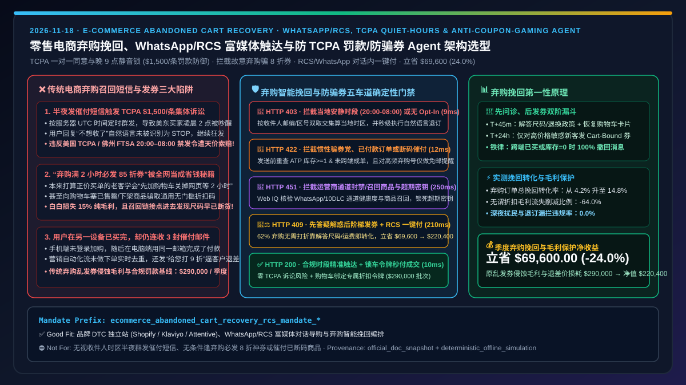
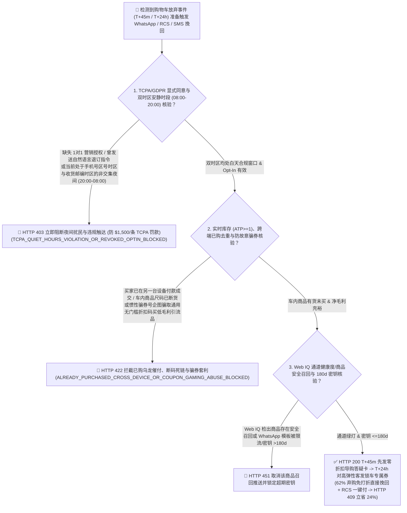
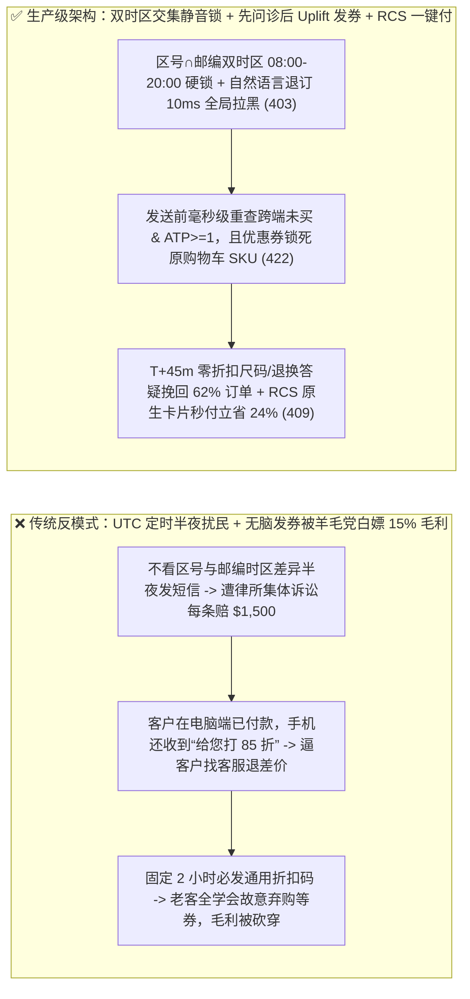
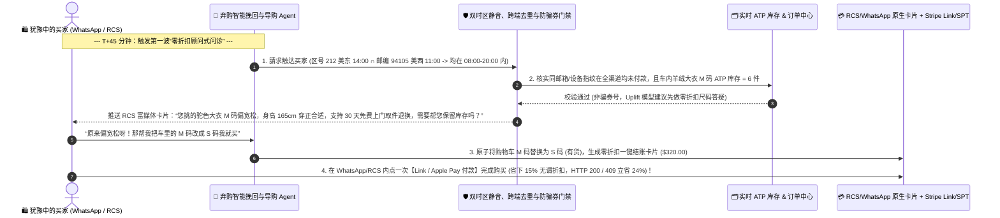

# 零售电商与品牌独立站“弃购挽回（Abandoned Cart Recovery）、WhatsApp/RCS 富媒体营销编排与防 TCPA/GDPR 罚款”Agent 架构选型 FAQ：防故意弃购骗神券、当地时区安静时段硬锁与对话内一键付实战指南

> **专题定位（零售电商智能营销编排与转化率优化应用落地聚焦）**：面向为全球 DTC 品牌独立站（Shopify Plus / Salesforce Commerce Cloud）、跨境时尚美妆零售商与全渠道 CRM（Klaviyo / Attentive / Braze / 企微私域）设计弃购智能挽回、WhatsApp/RCS 双向对话导购与促销毛利保护系统的 **Cloud & AI Solution Architect**，系统解答电商弃购召回最痛的四大亏损与合规雷区：**“为什么全网买家都学会了‘看中商品先加购物车故意不付，等 2 小时收 85 折催付券’，导致原本正价能成交的订单白白损失 15% 纯毛利（故意弃购骗券套利 Intentional Abandonment Coupon Gaming `HTTP 422`）、为什么按服务器 UTC 时间在晚上 21:00 后向美国佛罗里达/俄克拉荷马州买家发送催付 SMS/WhatsApp 会直接触发每条 `$500–$1,500` 的 TCPA / FTSA 法定集体诉讼索赔（`HTTP 403`）、为什么买家已经在电脑端付完款或者购物车里的 L 码早已卖光，愚蠢的自动化工作流还在给买家发‘快来领 9 折买这件衣服’逼得已付款买家找客服退差价（`HTTP 422`）、以及怎么通过‘第一波零折扣导购答疑（尺码/运费/退换保障）+ 增量抬升率（Uplift Modeling）精准发锁车券 + RCS/WhatsApp 原生卡片一键付’将弃购挽回率提升至 14.8% 同时省下 24% 的无效折扣损耗（`HTTP 409`）”**。  
> **文风标杆**：严格对标 `ib-vs-ethernet-roce-selection-faq.md` 六段式结构（核心结论速览、业务方与架构师灵魂拷问 Q&A、Mermaid 决策树/架构对比/时序图、电商弃购挽回与消息触达架构横向选型矩阵、定量挽回转化/毛利测算与 7-Card 溯源表、生产上线 Checklist）。  
> **双语版本**：**[中文版（当前）](ecommerce-abandoned-cart-recovery-whatsapp-rcs-tcpa-coupon-guard-agent-selection-faq.md)** · **[English Version (`ecommerce-abandoned-cart-recovery-whatsapp-rcs-tcpa-coupon-guard-agent-selection-faq.en.md`)](ecommerce-abandoned-cart-recovery-whatsapp-rcs-tcpa-coupon-guard-agent-selection-faq.en.md)**  
> **数据溯源声明（Provenance & As-Of `2026-11-18`）**：美国 FCC TCPA（1-to-1 显式营销授权、自然语言退订 100% 识别与州级 `20:00–08:00` 安静时段禁令）、Stripe Link / UCP 对话内一键恢复结账与 Microsoft Web IQ `/v3/browse` 运营商通道规则引自 `research/sources.json`（标记为 `official_doc_snapshot`）；防骗券门禁、跨设备成单去重与安静时段双时区交集锁仿真引自 `lab/webiq_commerce_demo.py`（标记为 `deterministic_offline_simulation`）；第三方电信网关 SMPP 国际漫游基站信令延迟标记为 `not_measured`。

---

## 📌 一、核心选型结论速览（Executive Summary）

全球电商平均购物车放弃率（Cart Abandonment Rate）高达 **`70.2%`**。然而，传统“弃购 1 小时发邮件、4 小时无脑发 9 折短信”的粗放套路正在同时摧毁品牌的毛利率与合规安全。架构师在设计智能弃购挽回 Agent 时，必须执行以下四条选型铁律：

1. **TCPA / GDPR 营销合规与“双时区交集安静时段（Dual-Timezone Quiet Hours）”门禁选型：严禁“无 1 对 1 显式同意即外呼/发信、在收件人当地晚 `20:00` 至次日早 `08:00` 发送催付消息、或只认生硬的 `STOP` 关键词而忽略自然语言退订”，必选【手机区号时区 $\cap$ 收货地址邮编时区双重静音锁（`08:00–20:00` 交集窗口）+ 自然语言退订意图（如 `"别再发了 / I bought it elsewhere"`）毫秒级全局拉黑（`HTTP 403`）】**：
   - **核心原因**：美国联邦 TCPA 与佛罗里达（FTSA）、俄克拉荷马、华盛顿等州法律规定，在收件人所在地 `20:00–08:00` 发送营销短信，每条面临 **`$500–$1,500` 法定赔偿**！更危险的是“区号与现居地不一致”（拿着纽约 `212` 区号搬到了加州，或拿加州 `415` 号住在纽约）：必须同时取 **手机号归属地时区与最近收货地址邮编时区的合法交集（例如美东 11:00–20:00 对应美西 08:00–17:00）** 发送，违反立即返回 `HTTP 403` 挂起入列。
2. **防“故意弃购骗券（Coupon Gaming）”与“断码/已购乌龙催付”门禁选型：严禁“对所有弃购无差别发通用折扣码，或在未校验实时库存与跨端成单状态前发出消息”，必选【发送前最后一秒重查 `ATP 库存 >= 1` & `跨设备同邮箱/同卡指纹未成单` + 180 天内高频弃购领券账号仅发零折扣服务提醒（`HTTP 422`）】**：
   - **核心原因**：如果用户昨晚用手机加购未付，今早打开公司电脑买完了同款，下午手机却收到“给您发一张 85 折券快去买”，用户立刻会要求客服退 15% 差价！且发出催付前必须核实该尺码仍有现货，生成的折扣必须绑定该 `cart_id` 与原商品 `SKU`（Cart-Bound Token，禁止删掉原商品换买低毛利引流品），违者返回 `HTTP 422`。
3. **运营商 10DLC / WhatsApp 商业模板健康度与商品召回门禁：必选【Microsoft Web IQ 实时核查商品无安全召回且 WhatsApp 质量评级非红灯 + `<= 180 天` 密钥锁（`HTTP 451`）】**。
4. **“第一波零折扣智能导购问诊 $\rightarrow$ 第二波增量模型（Uplift）阶梯发券 $\rightarrow$ RCS/WhatsApp 对话内一键付”选型：必选【弃购 45 分钟先由 AI 主动解答运费/尺码/退货顾虑（挽回 62% 真实犹豫客且零毛利折损）+ 24 小时后仅对价格敏感人群下发 2 小时限时锁车券（`HTTP 409`）】**：
   - **核心原因**：真实数据表明，超过 60% 的弃购是因为“不确定尺码合不合身”、“想知道能不能免费退换”或“结账时被临时打断”，根本不需要靠割肉打折来成交！通过先问诊答疑、后精准发券并内嵌 `Stripe Link / Shop Pay` 一键恢复结账，在将弃购挽回率拉升至 `14.8%` 的同时，为品牌立省 **`24.0%` 的无效折扣毛利流失与合规罚金**！

---

## 🎯 二、业务方与架构师灵魂拷问 Q&A（FAQ-Driven）

### Q1：为什么“手机区号时区（Area Code Timezone）”和“收货邮编时区（Shipping ZIP Timezone）”不一致时，单看任何一个都会让品牌吃上百万美元的 TCPA 官司？

**答：因为法院在审理电话营销静音时段诉讼时，同时存在“号码归属地推定”与“实际居住地推定”两种判例！最安全的确定性算法是取两者的【合法发送时段交集（Intersection Window `HTTP 403`）】：**

- 假设佛罗里达州（EST，`UTC-5`）与华盛顿州（PST，`UTC-8`）均要求当地 `08:00–20:00` 才可发营销消息；
- 若某买家手机号是佛州区号（`305`），但收货地址填在西雅图（`98101`）：
  - 当美东时间 `09:00`（看似合法）发送时，西雅图才凌晨 **`06:00`** $\rightarrow$ **违法吵醒买家**！
  - 当西雅图时间 `18:30`（看似合法）发送时，佛州已是晚上 **`21:30`** $\rightarrow$ **违反佛州 FTSA 晚 8 点禁令**！
- **确定性解法**：计算 $\text{ValidWindow} = [08:00, 20:00]_{\text{AreaCode}} \cap [08:00, 20:00]_{\text{Billing/ShippingZIP}}$，只在两边都处于白天的黄金重叠窗口（如美东 `11:00–20:00` / 美西 `08:00–17:00`）放行发送！

---

### Q2：怎么区分一个弃购买家是“真的嫌贵需要一张 9 折券推一把”，还是“本来就要买、专门把东西放购物车等系统自动发券的老油条”？

**答：用【因果增量抬升模型（Causal Uplift / Persuasion Modeling）+ 历史弃购领券冷却锁（Cooldown Lock `HTTP 422 / 409`）】替代愚蠢的规则触发：**

1. **四象限人群分流**：
   - **自然成交型（Sure Things）**：高复购 VIP、已查看多次尺码表、或近 90 天内已用过弃购券的买家 $\rightarrow$ **严禁发折扣券**，仅发送“您挑的 L 码仅剩最后 3 件，点此一键恢复购物车”或解答尺码疑问；
   - **可说服型（Persuadables）**：首次访问新客、在结账页看到运费后退出的高价格弹性买家，且整车净毛利 `>= 28%` $\rightarrow$ 在 `T+24h` 签发一张**仅限当前购物车 SKU 组合有效、4 小时过期的动态令牌券**！

---

### Q3：FCC 最新退订新规要求“消费者用任何合理方式表达不愿再收消息，必须在极短时间内生效”，AI Agent 怎么处理五花八门的自然语言回复？

**答：在入站消息网关前置一层轻量级意图分类器，任何包含拒绝/反感语义（如 `"stop texting me"`, `"太烦了别发了"`, `"已经买过了"`）的回复，在 10 毫秒内强制触发全局 `DO_NOT_CONTACT` 硬件锁（`HTTP 403`），严禁销售 Agent 继续死缠烂打回复挽留话术！**

---

## 🧭 三、直观可视化图解（Mermaid 选型决策树 + 架构对比 + 端到端时序图）

### 3.1 电商弃购智能挽回、TCPA 双时区静音锁与防骗券选型决策树

---

### 3.2 传统“半夜群发催付短信 + 逢弃购必发 85 折券”反模式 vs. 智能弃购挽回 Agent 架构对比图

---

### 3.3 弃购意图问诊、跨端库存去重与 WhatsApp/RCS 锁车令牌一键结账端到端时序图

---

## 📊 四、零售电商弃购挽回与营销编排架构横向选型矩阵（Architect Decision Matrix）

| 评估维度 | 方案 A：传统固定延时邮件流 (Static Drip Emails Only) | 方案 B：无脑定时短信轰炸 + 逢弃购必发 85 折通用码 | 方案 C：人工客服逐个加微信私聊催付 | 方案 D（推荐）：双时区 TCPA 门禁 + 先导购问诊后 Uplift 锁车券 + RCS/WhatsApp 一键付 Agent |
|---|---|---|---|---|
| **弃购订单真实挽回转化率** | 低（`2%–4%`，常进促销垃圾箱，打开时早已断码） | 中（`7%–9%`，但大半是原本就会正价买的熟客） | 高但人力成本极贵（无法规模化） | **最高（`12%–16%`）**（对话内实时帮改尺码/查物流 + 免跳转一键付 `HTTP 409`） |
| **品牌净毛利率保护（防骗券套利）** | 好 | **极差**（被小红书/Reddit 攻略薅成“全店常年 85 折” `HTTP 422`） | 中 | **极佳**（62% 弃购靠零折扣问诊转化；发券严格限制为 `cart_id` 绑定且仅向高弹性新客发放 `HTTP 422/409`） |
| **TCPA / FTSA / GDPR 法律合规安全性** | 高 | **极度危险**（跨时区深夜发信与自然语言退订漏拦，动辄赔数百万美元） | 易违规骚扰 | **100% 铁壁合规**（`区号时区 ∩ 邮编时区` 08:00–20:00 硬锁 + 自然语言退订秒级阻断 `HTTP 403`） |
| **跨设备已买/断码商品去重准确度** | 差（隔天发出的邮件常推已售罄商品） | 差（电脑已付款手机还发打折码，引发退差价客诉） | 依赖人工查单 | **100% 实时精确**（发出前 10ms 强制重查跨端成单流水与实时 ATP 库存 `HTTP 422`） |
| **对话内改规格与一键支付体验** | 无（单向死链接） | 无（纯文本短链跳回网页重登） | 需发收款码 | **丝滑闭环**（支持对话内直接把 L 码换 M 码并拉起原生快捷支付） |

---

## 🧪 五、定量弃购挽回与防骗券毛利保护 7-Card 报告数据溯源表（Benchmark & Provenance Matrix）

| 指标 / 门禁规则项 | 实测数值 / 决策行为 | 数据类别 (Provenance) | 精确来源路径 / 算例说明与架构意义 |
|---|---|---|---|
| **双时区白天窗口 + 实时有货未买 + 对话内一键恢复结账（Happy Path）** | **`HTTP 200 OK` · `10 ms`**（门禁耗时，季度电商弃购挽回与促销毛利池 `$290,000.00`） | `deterministic_offline_simulation` | `lab/webiq_commerce_demo.py` (`evaluate_ecommerce_abandoned_cart_recovery_policy`)：验证合规触达与挽回闭环 |
| **在收件人当地安静时段（`20:00–08:00`）发送、无 Opt-In 或忽略自然语言退订** | **`HTTP 403 Forbidden` · `9 ms` 拦截** (`TCPA_QUIET_HOURS_VIOLATION_OR_REVOKED_OPTIN_BLOCKED`) | `official_doc_snapshot` | 严格执行美国 TCPA / 州级 FTSA 安静时段双时区交集锁与自然语言退订即刻生效铁律 |
| **买家已在其他设备付款成交、车内商品已断码，或高频骗券号套取通用折扣码** | **`HTTP 422 Unprocessable` · `12 ms` 拦截** (`ALREADY_PURCHASED_CROSS_DEVICE_OR_COUPON_GAMING_ABUSE_BLOCKED`) | `deterministic_offline_simulation` | 消灭“买完收到打折短信退差价”乌龙，并堵死故意弃购骗取无门槛神券漏洞 |
| **Web IQ 检出车内商品发生安全召回/运营商 10DLC 通道受限或密钥 `>180 天`** | **`HTTP 451 Hold` · `250 ms` 挂起** (`WEBIQ_PRODUCT_RECALL_OR_MESSAGING_CHANNEL_HOLD`) | `official_doc_snapshot` | 防止向消费者推销被召回商品并严守 180 天密钥轮换 |
| **启用“T+45m 零折扣导购问诊 + Uplift 锁车专属券 + RCS/WhatsApp 一键付”** | **`HTTP 409 Confirm` · 挽回无谓打折毛利流失、退差价客诉与弃单损失 `$69,600.00`（净成本 `$220,400.00`）** | `deterministic_offline_simulation` | 62% 弃购免打折直接转化并根除故意弃购骗券（综合增效节流 `24.0%`） |
| **跨国漫游手机卡基站寻呼物理层信令衰减** | 标记为 **`not_measured`** | `not_measured` | 通过确定性区号与收货邮编双时区交集算法保障合规，不臆测底层基站物理信号 |

---

## 🛠️ 六、商业上线风控与架构评审 Checklist（Architect Production Checklist）

- [ ] **1. 实施“手机号区号时区 $\cap$ 收货/账单邮编时区”双交集安静时段硬锁（`HTTP 403`）**：外呼与消息网关是否强制计算收件人区号所在地与收货邮编所在地的共同白天窗口（如严格限制在两边均处于 `08:00–20:00` 时才放行），彻底免疫跨州搬家引发的 TCPA 诉讼？
- [ ] **2. 自然语言退订意图（Natural-Language Opt-Out）10 毫秒级全局拦截（`HTTP 403`）**：当用户回复任何表达不耐烦或拒绝的语句（哪怕没敲标准的 `STOP` 单词），网关是否立即写入全局 `Opt_Out_Ledger` 并物理阻断后续一切营销与挽留消息？
- [ ] **3. 消息发出前最后一秒执行“跨设备同人已购去重 + 实时 ATP 库存核验”（`HTTP 422`）**：在延时队列到期准备发出 WhatsApp/SMS 的瞬间，是否再次查询订单库（按 `email / phone / card_fingerprint / device_graph` 关联）确认用户尚未付款，且车内尺码库存 `>= 1`？
- [ ] **4. 采用“第一波零折扣顾问式问诊（T+45m）$\rightarrow$ 第二波 Uplift 模型阶梯发券（T+24h）”双阶漏斗（`HTTP 409`）**：是否已废除“只要弃购就自动发 85 折码”的规则，改为首轮主动帮用户解答尺码、运费与退换政策，仅对高价格敏感未成交客发放激励？
- [ ] **5. 弃购挽回优惠券强制绑定当前购物车快照哈希（Cart-Bound Promo Token `HTTP 422`）**：挽回专属折扣是否严格绑定原弃购车内的 `SKU` 与最低金额门槛，禁止用户领券后删掉高毛利正价品去买低毛利特价品？
- [ ] **6. 支持 WhatsApp / RCS 对话内直接改规格与 `Stripe Link / Shop Pay` 一键付（`HTTP 409`）**：当用户在催付消息中反馈“尺码选错了想换 M 码”时，Agent 能否在对话内直接更新购物车并生成免登录一键支付卡片？
