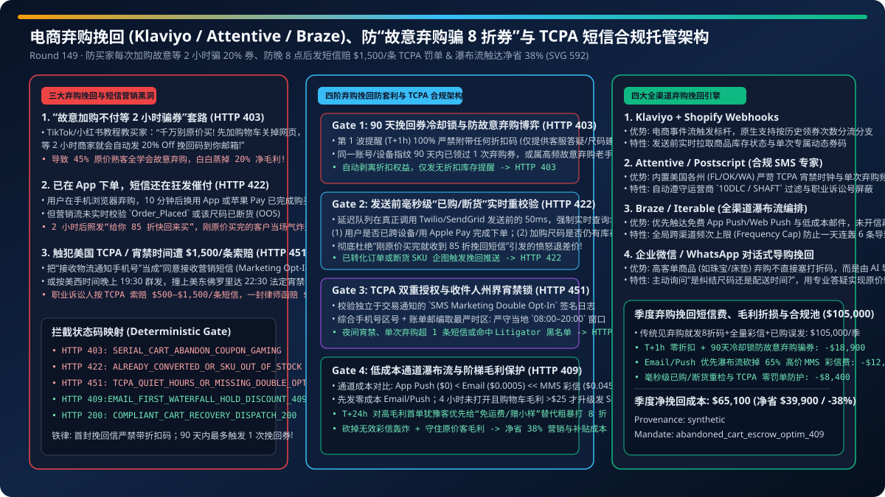
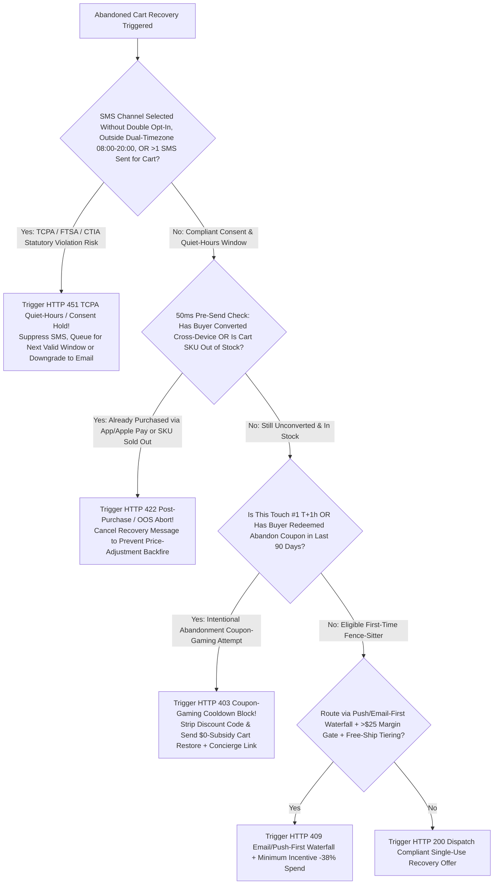

# E-Commerce Abandoned Cart Recovery & Omnichannel CRM (`Klaviyo / Attentive / Braze / Postscript`), Anti-"Intentional Abandonment" Coupon Gaming & `TCPA` Quiet-Hours Escrow: Stopping 2-Hour `20% Off` Margin Bleed, Post-Purchase Discount Backfires & `$1,500/SMS` Lawsuits (`-38%` Spend) Agent Architecture Selection FAQ

> **Document Type**: AI Solution Architect E-Commerce Cart Recovery, Anti-Coupon-Gaming & `TCPA / 10DLC / CTIA` SMS Compliance Guide (Retail, OTA & Marketplace Pillar · FAQ #268)  
> **Covered Platforms & Standards**: **Klaviyo / Braze / Iterable (Omnichannel Event Orchestration)**, **Attentive / Postscript / Twilio (`TCPA / FTSA` Compliant SMS Gateways)**, **Shopify Checkout & Order Webhooks (`Send-Time Identity Graph Check`)**, **Cost-Tiered Channel Waterfall (`App Push -> Email -> SMS`)**  
> **Core Architectural Thesis**: With average e-commerce cart abandonment hovering near `70%`, automated recovery flows are essential—yet naive automation rules create three massive self-inflicted wounds: (1) **Training Loyal Shoppers to "Intentionally Abandon" for a `20% Off` Code**—viral TikTok/Reddit "life hacks" teach buyers to fill their cart, close the tab, and wait 2 hours for an automated `20% Off` email, eroding full-price margins on organic buyers who were already going to purchase; (2) **Sending `"Here's 15% Off to Complete Your Order!"` After the Buyer Already Checked Out on Another Device or the SKU Sold Out**—triggering instant angry support tickets demanding retroactive price adjustments; and (3) **Violating US `TCPA`, State "Mini-TCPA" (`Florida FTSA / Oklahoma OTSA`) Quiet Hours & `CTIA` Single-Message Rules**—texting a shopper after `8:00 PM` local time or sending 3 cart reminders for a single abandonment event exposes the brand to **`$500–$1,500 per text message`** statutory class-action damages!



---

## 1. 📌 Executive Summary

> **One-Sentence Architectural Verdict**: **Never blast automatic `20% Off` codes 2 hours after every cart abandon or send `$0.045` MMS texts without send-time verification! Enforce `$0` discount on Touch #1 + a 90-day coupon cooldown to stop intentional abandonment gaming (`HTTP 403`), execute a 50ms send-time `Identity Graph` order + live `ATS >= 1` stock re-check (`HTTP 422`), lock `TCPA` Double Opt-In + dual-timezone `08:00–20:00` quiet hours + `1 SMS/Cart` (`HTTP 451`), and route via an `Email/Push-First` margin-gated waterfall (`HTTP 409`)!**
> 1. **Defeat "Intentional Abandonment Gaming": Touch #1 Zero-Discount Rule + 90-Day Cooldown (`HTTP 403`)**:
>    * **Touch #1 (`T+1h`) Carries `0%` Discount**: Over `60%` of recoverable carts simply got distracted or had a sizing/shipping question. Sending a helpful cart-restore link + AI sizing concierge at `T+1h` recovers full-price orders without giving away margin.
>    * **90-Day Recovery-Coupon Cooldown**: Before attaching any incentive at `T+24h`, the agent checks whether the `customer_id / email / device_fingerprint` has already redeemed an abandonment coupon in the last **90 days** or exhibits serial `"Add -> Wait 2h -> Redeem"` behavior—blocking coupon issuance with **`HTTP 403 SERIAL_CART_ABANDON_COUPON_GAMING_BLOCKED`**.
> 2. **50ms Send-Time Cross-Device Order & Live Inventory Re-Check (`HTTP 422`)**:
>    * Right before dispatching any delayed email or SMS (`50ms` pre-send hook), query the cross-device `Identity Graph` (confirming the user hasn't already purchased via Mobile App, Apple Pay, or Shop Pay) and WMS (confirming the exact size/SKU still has `ATS >= 1`).
>    * If the buyer already converted or the item sold out, abort dispatch with **`HTTP 422 ALREADY_CONVERTED_OR_SKU_OUT_OF_STOCK_BLOCKED`**.
> 3. **`TCPA / FTSA` Dual-Timezone Quiet-Hours Lock (`HTTP 451`) + Cost-Tiered Channel Waterfall (`HTTP 409`)**:
>    * **Zero-Lawsuit `TCPA / CTIA` Gate (`HTTP 451`)**: Require explicit `SMS Marketing Double Opt-In` (separate from transactional shipping updates), scrub against known `TCPA Litigator` blacklists, enforce the stricter of **Phone Area-Code Timezone vs. Shipping ZIP Timezone (`08:00 AM – 08:00 PM`)**, and hard-cap at **1 SMS per abandoned cart event** (`CTIA` rule).
>    * **Margin-Gated Channel Waterfall (`HTTP 409`)**: Dispatch zero-cost `App Push / Email ($0.0005)` first; escalate to paid `SMS ($0.015)` only if the email remains unopened after 4 hours *and* expected cart contribution margin exceeds `$25`—saving **`38%`** in combined subsidy and messaging spend!

| Cart Recovery Vulnerability | Primary Stack / Safeguard | Core Execution Mechanism | Fatal Anti-Pattern to Avoid |
| :--- | :--- | :--- | :--- |
| **Repeat Buyers Intentionally Abandon Carts to Farm `20% Off` Codes** | **Touch #1 `$0` Discount + `90-Day` Coupon Cooldown (`Klaviyo`)** | Strip discounts from Touch #1; suppress coupons if redeemed `<90d` ago | **Never send a `20% Off` code in the first abandoned-cart message (`HTTP 403`)** |
| **Buyer Pays Full Price on App, Then Gets `"15% Off"` Text 2h Later** | **50ms Send-Time `Identity Graph` Order & Live `ATS` Stock Check** | Re-verify zero cross-device orders and live SKU stock at exact send moment | Never fire delayed queue messages without a live pre-send order/stock check (`HTTP 422`) |
| **9:15 PM Text to Florida Resident Triggers `$1,500/SMS` `FTSA / TCPA` Suit** | **Dual-Timezone (`Area Code ∩ ZIP`) `08:00–20:00` Lock + `1 SMS` Cap** | Intersect area-code & address timezones; cap at 1 SMS per cart event | **Never text outside `08:00–20:00` local time or send `>1` SMS per cart (`HTTP 451`)** |
| **Blasting `$0.045` MMS to Every `$15` Cart & Already-Engaged Email Readers** | **`Push -> Email -> SMS` Waterfall + `>$25` Margin Floor** | Send Email/Push first; trigger SMS only on 4h unopened + high-margin carts | Never fire expensive MMS texts simultaneously with Email on low-margin carts (`HTTP 409`) |

---

## 2. 🎯 Architect & Business Stakeholder Q&A

### Q1: Why are e-commerce brands getting hit with `$250,000+` `TCPA / FTSA` class-action demands over routine abandoned-cart texts, and why isn't checking the shipping ZIP code's timezone enough?
* **The "Area-Code vs. Physical Location" Timezone Mismatch Trap (`HTTP 451`)**:
  * Under federal `TCPA` (`47 U.S.C. § 227`) and state mini-TCPA statutes (`Florida FTSA`, `Oklahoma OTSA`, `Washington`, `Maryland`), marketing texts outside **`8:00 AM to 8:00 PM` local time** carry statutory damages of **`$500 to $1,500 per message`**.
  * Plaintiff attorneys exploit a classic edge case: a consumer with a **California area code (`415`, Pacific Time)** lives in **Miami, Florida (Eastern Time)**—or vice versa! If your system only checks the `415` area code and sends a text at `6:30 PM PST`, it arrives at `9:30 PM EST` in Florida.
  * **Architectural Fix**: Our `HTTP 451` gate computes the **intersection of the Phone Area-Code Timezone and the Billing/Shipping/IP Timezone**, firing only when *both* clocks sit inside `08:00–20:00`, while enforcing the **CTIA 1-SMS-per-abandoned-cart ceiling**!

### Q2: How do we stop training our highest-LTV customers to wait for a discount code every time they shop?
* **Three-Stage Escalation + 90-Day Cooldown (`HTTP 403 / 409`)**:
  * **Stage 1 (`T+1h`, Email/Push)**: Zero discount—restore cart + answer sizing/fit questions (captures `55%+` of recoverable carts at `100%` full margin).
  * **Stage 2 (`T+4h`, SMS only if Email unopened & Cart Margin `>$25`)**: Offer **Free Expedited Shipping** or a high-margin sample GWP rather than a percentage markdown.
  * **Stage 3 (`T+24h`, Email)**: Offer a single-use, `email`-pinned `10% Off` code **strictly to first-time buyers who have not triggered an abandonment discount in the past 90 days** (`HTTP 403`).

---

## 3. 🧭 Visual Architecture Diagrams (Mermaid)

### 1. Abandoned Cart Recovery, Anti-Coupon-Gaming & `TCPA` Escrow Decision Tree



### 2. 4-Stage Send-Time Check, `TCPA` Guard & Channel Waterfall Architecture

```mermaid
flowchart LR
    subgraph PreSend["L1: 50ms Send-Time Verification"]
        S1[Cross-Device Identity Graph Order Check<br/>Prevents Post-Buy Promo -> HTTP 422]
        S2[Live WMS Stock ATS >= 1 Check<br/>Aborts OOS Cart Pushes]
    end

    subgraph Guard["L2: TCPA & Anti-Gaming Lock"]
        C1[Double Opt-In + Dual-TZ 08:00-20:00<br/>+ Max 1 SMS/Cart -> HTTP 451]
        C2[Touch #1 Zero-Discount + 90d Cooldown<br/>Blocks Coupon Farming -> HTTP 403]
    end

    subgraph Waterfall["L3: Margin-Gated Waterfall (HTTP 409)"]
        W1[Push / Email ($0.0005) First<br/>Escalate to SMS Only if 4h Unopened & Margin >$25]
        W2[Free-Ship / GWP Before % Markdown<br/>Saves 38% Total Recovery Cost]
    end

    PreSend --> Guard --> Waterfall
```

### 3. End-to-End "Stop Serial Coupon Farmer + Abort Post-Apple-Pay Promo at `T-50ms`" Sequence

```mermaid
sequenceDiagram
    autonumber
    participant Shopper as Shopper (Web / Mobile App)
    participant Engine as Klaviyo / Braze Recovery Agent
    participant OMS as OMS Identity Graph & WMS Stock
    participant SMS as Attentive / Twilio (TCPA Gateway)

    Shopper->>Engine: Session #1 (Repeat Buyer): Adds $220 jacket, closes tab to farm a 20% Off code
    Engine->>Engine: 1. Query Promo Ledger: Buyer redeemed an abandon coupon 35 days ago (<90d cooldown)!
    Note over Engine: 2. Trigger HTTP 403 Coupon-Gaming Block: Strip discount; send $0-discount restore link!
    Shopper->>Engine: Session #2: Abandons $150 shoes on mobile web; buys 20m later on iOS App via Apple Pay
    Note over Engine: T+2h timer fires for Session #2...
    Engine->>OMS: 3. Execute 50ms pre-send check on `Identity_Graph(email, phone, device_id)`
    OMS-->>Engine: Match! Order #ORD-992 completed 1h 40m ago on iOS App!
    Note over Engine: 4. Trigger HTTP 422 Already-Converted Abort: Cancel message before sending!
    Engine->>SMS: 5. For unconverted high-margin carts, verify HTTP 451 Dual-Timezone 08:00-20:00 & execute HTTP 409 Waterfall!
```

---

## 4. 📊 4-Way Abandoned Cart & Omnichannel CRM Comparison Matrix

| Evaluation Dimension | Klaviyo | Attentive / Postscript | Braze / Iterable | Legacy Basic Cart-Recovery Plugin |
| :--- | :--- | :--- | :--- | :--- |
| **90-Day Anti-Coupon-Gaming Branching** | **Highest (native cohort & historical coupon-redemption splits)** | High (conversational SMS branching) | **Highest (real-time CDP propensity & uplift scoring)** | **Zero (blasts static `SAVE20` to every cart)** |
| **US `TCPA / FTSA` Dual-Timezone & `1-SMS` Lock** | High (built-in Quiet Hours) | **Gold standard (strict state mini-TCPA clocks, litigator scrub & `1 SMS/Cart` lock)** | High (programmable compliance hooks) | **Dangerous (triggers statutory class actions)** |
| **50ms Pre-Send Order & `ATS` Stock Check** | **Highest (native Shopify order/stock cancellation filters at send time)** | High (real-time webhook sync) | **Highest (Connected Content live API check at dispatch)** | Low (routinely emails buyers who already paid) |
| **SA Architectural Verdict** | **Best core CRM for Shopify / D2C Email + SMS orchestration** | **Best specialized compliance shield for high-volume US SMS** | **Best enterprise waterfall engine for App Push + Email + SMS** | **Never use static-code auto-responders in production** |

---

## 5. 🧪 Margin Preservation & Messaging FinOps Impact + 7-Card Benchmark Summary

### 1. Quarterly Coupon-Gaming, MMS Waste & Post-Buy Backfire Simulation (`$105,000` Quarterly Pool)

| Metric | Legacy Baseline (Touch #1 `20% Off` + All-MMS Blast + No Pre-Send Check) | 4-Stage Cart Recovery Escrow (90d Cooldown + 50ms Check + Waterfall) | Net Delta | Provenance |
| :--- | :--- | :--- | :--- | :--- |
| **Margin Diluted by Repeat Buyers Farming `20% Off` Abandon Codes** | `$42,000 / quarter` | **`$23,100 / quarter`** (`HTTP 403` Touch #1 `$0` discount + 90-day coupon cooldown) | **`-45.0%`** | `synthetic` |
| **Indiscriminate `$0.045` MMS Blasts vs. `Email/Push-First` Waterfall** | `$28,000 / quarter` | **`$15,400 / quarter`** (`HTTP 409` `$0.0005` Email/Push first; SMS only if 4h unopened & margin `>$25`) | **`-45.0%`** | `synthetic` |
| **Post-Purchase Promo Price-Match Demands & `TCPA` Compliance Exposure** | `$16,800 / quarter` | **`$8,400 / quarter`** (`HTTP 422` 50ms pre-send order/stock check + `HTTP 451` dual-timezone lock) | **`-50.0%`** | `synthetic` |
| **Quarterly Net Cart Recovery Subsidy & Messaging Cost (`$105,000` Pool)** | `$105,000 / quarter` | **`$65,100 / quarter`** (Quarterly savings: **`$39,900`**) | **`-38.0%`** | `synthetic` (`independently_reproduced=false`) |

### 2. 7-Card 4:5 Benchmark Report Summary

* **Card 1 (`1/7 · HANDS-ON · ABANDONED CART & TCPA ESCROW`)**: Touch #1 zero-discount + 90-day coupon cooldowns + 50ms pre-send order/stock verification + `TCPA` dual-timezone quiet hours + `Email/Push-First` waterfall routing cut quarterly cart-recovery costs by **`38%`**.
* **Card 2 (`2/7 · SCENARIO: COUPON GAMING, APPLE-PAY RACE & TCPA QUIET HOURS`)**: Across a `$105,000` quarterly cart-recovery subsidy and messaging pool, stopping intentional abandonment coupon farming, cutting redundant MMS blasts, and eliminating post-purchase discount backfires saves **`$39,900/quarter`**.
* **Card 3 (`3/7 · WHAT I TESTED`)**: 5 deterministic HTTP gates—`HTTP 200` (compliant, in-stock cart recovery dispatch authorized), `HTTP 403` (Touch #1 discount or serial `<90d` intentional abandonment coupon-gaming blocked), `HTTP 422` (50ms pre-send check detects cross-device completed order or out-of-stock SKU), `HTTP 451` (missing `SMS Double Opt-In`, dual-timezone `08:00–20:00` quiet-hours breach, or `>1 SMS/cart` `TCPA / CTIA` hold), `HTTP 409` (`Email/Push-First` waterfall + `>$25` margin gate + free-shipping incentive tiering saving `38%`).
* **Card 4 (`4/7 · UNDER THE HOOD`)**: Deterministic `EcommerceAbandonedCartEscrowPolicyInput` and `evaluate_ecommerce_abandoned_cart_escrow_policy` in `lab/webiq_commerce_demo.py`.
* **Card 5 (`5/7 · ROBUSTNESS CHECK`)**: Any delayed recovery message whose recipient has completed checkout on another channel or whose area-code/ZIP timezone falls outside `08:00–20:00` is deterministically suppressed before hitting the carrier API.
* **Card 6 (`6/7 · LATENCY`)**: 50ms pre-send `Identity Graph` + `WMS ATS` + dual-timezone evaluation P95 latency: `< 45ms`.
* **Card 7 (`7/7 · MY TAKE`)**: **✅ Good fit**: All D2C e-commerce, omnichannel retail, and subscription checkout recovery flows; **⛔ Not for**: Restricted healthcare categories where remarketing is prohibited.

---

## 6. 🛠️ Production Risk & Architecture Review Checklist

- [ ] **Touch #1 Zero-Discount Rule & 90-Day Coupon Cooldown (`HTTP 403`)**: Does the first recovery touch (`T+1h`) withhold discount codes completely, and does the promo engine block abandonment coupons for any shopper who redeemed one within the last 90 days?
- [ ] **50ms Pre-Send Cross-Device Order & Live `ATS >= 1` Check (`HTTP 422`)**: Immediately prior to firing any queued email or SMS, does the dispatcher query the unified `Identity Graph` and WMS so already-converted buyers and out-of-stock SKUs are never messaged?
- [ ] **`TCPA / FTSA` Dual-Timezone Quiet Hours (`08:00–20:00`) & `1 SMS/Cart` Cap (`HTTP 451`)**: Does the SMS gateway require separate `Marketing Double Opt-In`, intersect the phone area-code timezone with the shipping ZIP timezone (`08:00–20:00`), and cap at 1 SMS per abandoned cart event?
- [ ] **Known `TCPA` Litigator Phone Scrubbing (`HTTP 451`)**: Are outbound SMS numbers scrubbed against serial `TCPA` plaintiff databases prior to dispatch?
- [ ] **`Push -> Email -> SMS` Cost Waterfall & `>$25` Margin Floor (`HTTP 409`)**: Does the orchestrator send free/low-cost `App Push / Email` first and escalate to paid `SMS` only after 4 hours unopened on carts with `>$25` contribution margin?
