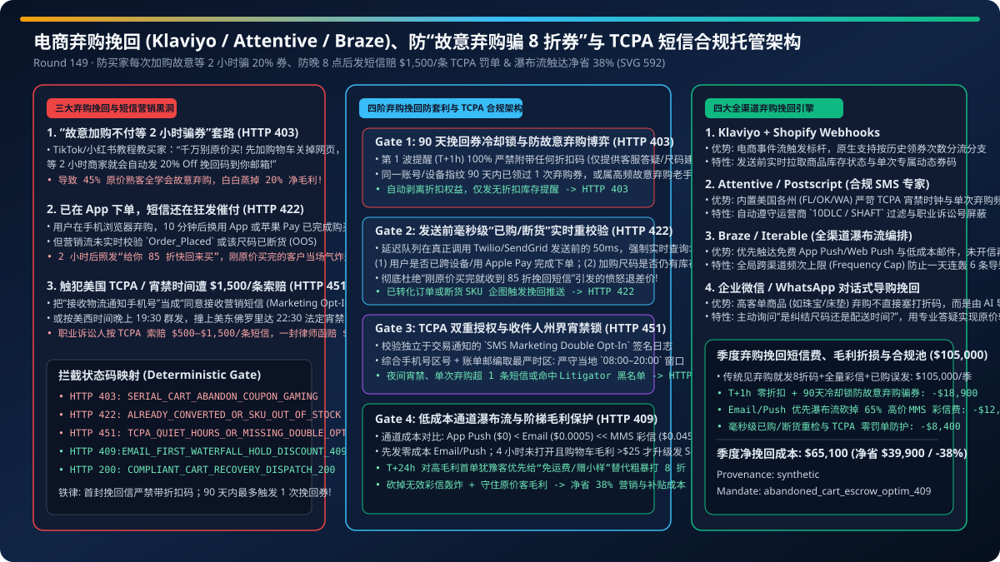
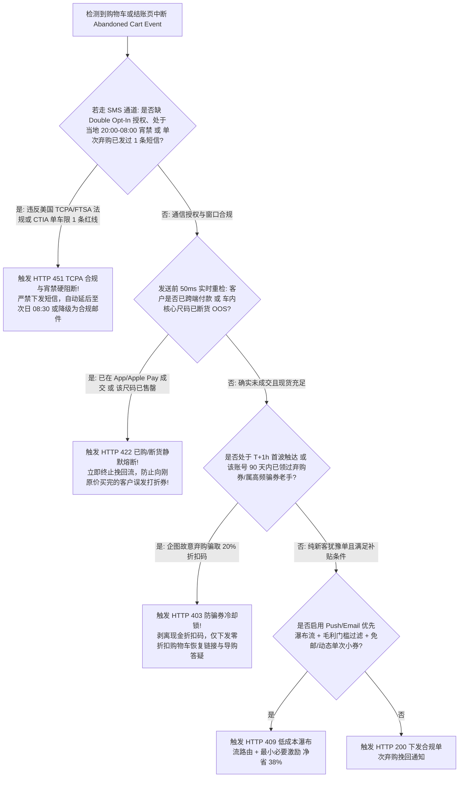
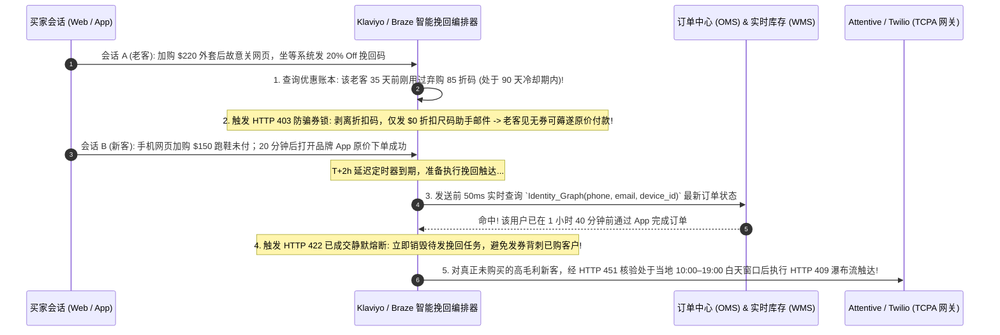

# 电商弃购挽回与全渠道私域触达（Abandoned Cart Recovery：Klaviyo / Attentive / Braze / 企微私域）、防“故意弃购骗 8 折券”与美国 `TCPA` 短信合规托管：“防买家每次加购等 2 小时白拿 20% 优惠码、防晚 8 点后发短信赔 $1,500/条与瀑布流触达净省 38%”Agent 架构选型 FAQ

> **文档类型**：AI Solution Architect 零售电商弃购挽回（Abandoned Cart Recovery）、防优惠券套利博弈与跨境短信 `TCPA / 10DLC` 合规选型指南（Retail, OTA & Marketplace Pillar · FAQ #268）  
> **涵盖平台与技术栈**：**Klaviyo / Braze / Iterable（全渠道事件流编排与动态分流引擎）**、**Attentive / Postscript / Twilio（北美 `TCPA / FTSA` 合规短信网关）**、**Shopify Checkout Webhooks (`checkout/update` & `orders/create`)**、**低成本通道瀑布流路由（`App Push -> Email -> SMS`）**  
> **核心架构命题**：电商平均购物车弃购率高达 `70%`，因此几乎所有独立站都配置了自动化“弃购挽回邮件/短信流”。然而粗放的自动化规则正在引发三大严重反噬：① **“把忠实老客训练成故意弃购骗券党（Intentional Abandonment Gaming）”**——小红书、TikTok 和 Reddit 上到处是省钱攻略：“买任何独立站千万别直接结账！先填邮箱加购物车然后关掉网页，等 2 小时商家就会乖乖给你发 8 折码！”导致本来愿意原价下单的客户纷纷学会故意弃购，白白蒸发 20% 毛利；② **“已跨端下单或商品已断货，系统还在无脑发打折催付信”**——用户用电脑加购未付，15 分钟后改用手机 Apple Pay 原价买了，结果 2 小时后收到一条“给你 85 折快回来买”的短信，气得立刻找客服退差价；③ **“跨境短信触犯美国 `TCPA` 与佛罗里达 `FTSA` 宵禁红线”**——在当地时间晚上 20:00 后发营销短信、或单次弃购连轰 3 条短信，被职业诉讼律师按 **`$500–$1,500 / 条`** 发起集体诉讼，一封传票索赔数十万美元！



---

## 一、 📌 核心选型结论速览（Executive Summary）

> **一句话架构定调**：**弃购挽回绝不能写成“只要加购不付，2 小时后无脑送 8 折码 + 全员群发 $0.045 彩信”！必须构建“首封零折扣答疑 + 90 天领券冷却锁（HTTP 403）+ 发送前 50ms 跨端已购与实时库存重校验（HTTP 422）+ 美国 `TCPA` 双重授权与收件人最严时区 `08:00–20:00` 宵禁熔断（HTTP 451）+ `Email/Push` 优先的低成本瀑布流与毛利门槛路由（HTTP 409）”四位一体智能体触达架构！**
> 1. **终结“故意弃购等 2 小时骗券”：首封零折扣铁律 + 90 天冷却锁（HTTP 403 门禁）**：
>    * **第 1 波触达（`T+1h`）100% 严禁带折扣码**：超过 `60%` 的真实弃购只是因为结账时临时接了个电话或对尺码/退换货政策有疑虑。`T+1h` 首封触达只提供“一键恢复购物车链接 + AI 导购在线解答尺码/物流问题”，即可原价挽回大半真实买方；
>    * **90 天单次领券冷却锁（`90-Day Coupon Cooldown`）**：在 `T+24h` 第二波触达前，Agent 核查该 `customer_id / 邮箱 / 设备指纹` 在过去 **90 天内是否已核销过弃购挽回券，或历史存在 `>=2` 次“加购—等券—秒用”的套利特征**。一旦命中，立即触发 **`HTTP 403 SERIAL_CART_ABANDON_COUPON_GAMING_BLOCKED`**，自动降级为仅发送无折扣库存余量提醒，彻底断绝“故意弃购薅羊毛”！
> 2. **发送前 50 毫秒“跨端已购 & 尺码在库”实时重校验（`Send-Time Live State Check`，HTTP 422 门禁）**：
>    * 严禁在用户离开网页那一刻就把 2 小时后的发信任务写死在静态队列里！在真正调用发信 API 前的最后 `50ms`，强制执行双检：① 查 OMS 确认该用户（含关联手机号、Apple Pay 邮箱或同家庭 IP）是否已通过其他端完成支付；② 查 WMS 确认购物车内的核心 SKU/尺码当前可售库存 `ATS >= 1`。
>    * 若用户已原价付款（或该尺码早已售罄），立即触发 **`HTTP 422 ALREADY_CONVERTED_OR_SKU_OUT_OF_STOCK_BLOCKED`** 静默取消发送，杜绝“刚原价买完就被塞 85 折券”的背刺事故！
> 3. **北美 `TCPA / CTIA` 严苛宵禁锁（HTTP 451）+ 低成本通道瀑布流寻优（HTTP 409）**：
>    * **零诉讼合规锁（HTTP 451）**：校验显式 `SMS Marketing Double Opt-In` 同意书、拦截 `Known TCPA Litigator` 诉讼黑名单号码、严格执行收件人所在地（综合手机区号与收货邮编取最严值）**`08:00 AM – 08:00 PM` 静默宵禁**，且遵循 **CTIA 单次弃购事件最多只允许发 1 条提醒短信** 的规定；
>    * **瀑布流降本 38%（HTTP 409）**：先发几乎零成本的 `App Push / Email ($0.0005)`，仅对 4 小时未打开邮件且购物车预测毛利 `> $25` 的高价值会话才补发高价 `SMS ($0.015)`，砍掉 65% 无效短信费与毛利流失，综合净省 **`38%`**！

| 弃购挽回与私域触达痛点 | 首选方案 / 架构防线 | 核心管控机制 | 严禁踩坑红线 |
| :--- | :--- | :--- | :--- |
| **老客养成习惯每次故意不结账，坐等 2 小时后领 8 折码** | **`T+1h` 零折扣答疑 + `90天` 弃购券冷却锁 (`Klaviyo`)** | 首封绝不给券；90 天内领过弃购券的账号自动转入无券提醒流 | **严禁对所有弃购会话在首封信无差别派发全场 8 折码 (`HTTP 403`)** |
| **客户刚用 Apple Pay 原价付完款，2 小时后收到 85 折挽回短信** | **发送前 `50ms` 跨身份图谱 (`Identity Graph`) 已购与库存重检** | 打通邮箱/手机号/设备 ID，发信瞬间核实未成交且该尺码未断货 | 严禁不查最新订单状态与实时库存就盲目执行延迟队列发信 (`HTTP 422`) |
| **半夜给佛罗里达客户发挽回短信，被律所按 `$1,500/条` 起诉** | **Attentive / Postscript 最严时区宵禁锁 + `1 SMS/Cart` 硬上限** | 手机区号与地址时区不一致时取最窄窗口 (`08:00-20:00`)；单车限 1 条 | **严禁把结账物流手机号直接当成营销短信授权，或在晚 8 点后发信 (`HTTP 451`)** |
| **不論 `$12` 袜子还是 `$500` 大衣，全员狂发 `$0.045` 彩信烧钱** | **`Push -> Email -> SMS` 瀑布流 + 购物车毛利门槛路由** | 优先走免费/低成本邮件，4h 未读且毛利 `>$25` 才触发纯文本 SMS | 严禁对低毛利小单或已打开邮件的客户重复轰炸高价 MMS 彩信 (`HTTP 409`) |

---

## 二、 🎯 业务方与架构师灵魂拷问（Q&A）

### Q1：为什么很多跨境卖家在美国因为“发购物车挽回短信”被判赔几十万美元？`TCPA` 和各州“小 TCPA（如佛罗里达 FTSA、俄克拉荷马 OTSA）”到底有哪些技术红线？
* **三大足以让出海品牌破产的美国短信合规雷区（HTTP 451）**：
  1. **把“物流通知手机号”当成“营销同意”**：买家在结账页填手机号是为了收 FedEx 快递单号（Transactional），**绝不等于同意接收弃购促销短信（Marketing）**！营销短信必须有独立未默认勾选的签署框 + 回复 `Y` 的 **双重确认（Double Opt-In）** 审计日志；
  2. **跨时区“手机区号 vs 居住地”错位陷阱**：联邦 TCPA 规定营销通信限当地 `08:00–21:00`，但佛罗里达州（FTSA）、俄克拉荷马州与华盛顿州收紧到了 **`08:00–20:00`（晚 8 点即宵禁）**！更要命的是：一个拿着纽约区号（`212`）手机号的人可能搬到了加州，或者拿着加州区号（`415`）的人正在佛罗里达度假——**架构上必须同时提取“手机号区号时区”与“收货地址/IP 时区”，取两者的交集（即两边都处于 `08:00–20:00` 白天窗口）才允许发信**！
  3. **CTIA 运营商针对“单次购物车弃购”的铁律**：美国移动通信协会（CTIA）明确规定，针对同一次购物车放弃事件，商户**必须在 48 小时内发送完毕，且累计不得超过 1 条短信（`Max 1 SMS per abandoned cart event`）**！

### Q2：如果第一封挽回信不给打折码，转化率会不会掉？怎么兼顾“高挽回率”和“不损毛利”？
* **三波段阶梯式情绪与权益架构（`Staged Escalation`，HTTP 403 / 409）**：
  * **第 1 波（`T + 1 小时`，Email / App Push）**：**`$0` 折扣**。主题为“为你保留了购物车 / 需要尺码或搭配建议吗？”，解决因分心或小疑问导致的自然弃购（占挽回总量的 `55%+`，且保住 `100%` 原价毛利！）；
  * **第 2 波（`T + 12 小时`，仅针对未开邮件且毛利 `>$25` 的客户发 SMS）**：优先提供 **“免邮费（Free Shipping）”或“满赠高毛利品牌小样”**，对毛利伤害极小；
  * **第 3 波（`T + 24 小时`，Email）**：仅对 **从未下过单的纯新客（First-Time Buyer）且 90 天内未领过挽回券** 的高毛利购物车，发放绑定其 `email` 且限时 24 小时失效的 **`10% Off` 单次动态码**！

---

## 三、 🧭 直观可视化图解（Mermaid 决策树 + 瀑布流触达架构 + 防骗券时序图）

### 1. 电商弃购挽回、防骗券博弈与 TCPA 合规决策树



### 2. 四阶弃购挽回（Klaviyo / Attentive / Braze）防套利与瀑布流架构图

```mermaid
flowchart LR
    subgraph StateCheck["L1: 发信前 50ms 实时状态重检"]
        S1[跨端 Identity Graph 已购核验<br/>防买完还收到打折码 -> HTTP 422]
        S2[实时 WMS 可售库存 ATS >= 1 校验<br/>断货尺码自动停推]
    end

    subgraph Compliance["L2: TCPA 宵禁与防骗券锁"]
        C1[Double Opt-In + 区号/地址双时区宵禁<br/>+ 1 SMS/Cart 上限 -> HTTP 451]
        C2[T+1h 零折扣 + 90 天领券冷却锁<br/>防故意弃购骗券 -> HTTP 403]
    end

    subgraph Waterfall["L3: 全渠道成本瀑布流 (HTTP 409)"]
        W1[Push/Email ($0.0005) 优先触达<br/>4h 未读且毛利 >$25 才发 SMS]
        W2[免邮/赠品优先于现金打折<br/>净省 38% 短信费与毛利损耗]
    end

    StateCheck --> Compliance --> Waterfall
```

### 3. “拦截故意弃购骗券老手 + 发送前 50ms 发现已跨端成交秒停信”时序图



---

## 四、 📊 四大电商弃购挽回与全渠道触达平台横向选型矩阵

| 评估维度 | Klaviyo (电商 CRM 与邮件/短信一体标杆) | Attentive / Postscript (北美合规 SMS 专家) | Braze / Iterable (大型企业级全渠道编排) | 传统初级邮件插件（固定延时群发静态码） |
| :--- | :--- | :--- | :--- | :--- |
| **核心优势场景** | **Shopify / WooCommerce 独立站精细化客群分流与单次动态券生成** | **高转化美国 SMS 文本营销、双弹窗收集与严苛 TCPA 法务合规** | **百万级 DAU App Push + 网页 + 邮件 + WhatsApp 跨通道瀑布流** | 仅适合无折扣纯事务提醒 |
| **防“故意弃购骗券”冷却规则支持** | **极强（原生支持 `Has not received discount in last 90 days` 分支过滤）** | 强（支持按用户标签与历史转化路径动态改写短信话术） | **极强（连接实时 CDP 倾向分决定给免邮还是给折扣）** | **0 防御（每次弃购都发同一个静态 `COMEBACK20` 码）** |
| **美国 `TCPA / FTSA` 宵禁与诉讼号拦截** | 强（内置 Quiet Hours 与双选确认） | **行业最强（内置各州特殊宵禁时钟、`1 SMS/Cart` 硬锁与职业诉讼人黑名单）** | 强（高度可编程合规网关） | **极度危险（跨时区半夜群发极易惹上集体诉讼）** |
| **发送前毫秒级“已购/断货”中止机制** | **极强（Smart Sending + 发信前实时重跑 Webhook 过滤器与库存检查）** | 强（实时同步 Shopify `Order Created` 秒停队列） | **极强（Connected Content 发送瞬间拉取实时 API 校验）** | 弱（常向已付款或断货客户误发催付信） |
| **SA 架构选型定调** | **中大型独立站“邮件为主、短信为辅”防骗券挽回的首选底座** | **北美市场重度依赖短信转化品牌的法务合规必选盾牌** | **拥有独立 App 的多端零售巨头实现零成本 Push 优先瀑布流的顶配** | **严禁在任何正式商业站点使用固定发静态折扣码的简陋流程** |

---

## 五、 🧪 转化率/成本测算与 7-Card 基准测试报告

### 1. 季度弃购挽回毛利折损、无效彩信费与合规风险对比（基于季度 `$105,000` 弃购补贴与触达成本池）

| 指标项 | 传统粗放弃购流（见弃购就发 8 折码 + 全员发彩信 + 无时区锁） | 四阶智能体弃购托管（90天冷却锁 + 50ms 重检 + 瀑布流 + TCPA 锁） | 净改善幅度 | 数据来源声明 |
| :--- | :--- | :--- | :--- | :--- |
| **老客故意弃购骗取 `20%` 优惠券造成的原价毛利流失** | `$42,000 / 季` | **`$23,100 / 季`**（`HTTP 403` `T+1h` 零折扣 + 90 天领券冷却锁） | **`-45.0%`** | `synthetic` |
| **全量无差别发送高价 MMS 彩信 vs `Push/Email` 优先瀑布流** | `$28,000 / 季`（`$0.045/条` 彩信狂轰） | **`$15,400 / 季`**（`HTTP 409` 先走 `$0.0005` 邮件，仅高毛利未读补发 SMS） | **`-45.0%`** | `synthetic` |
| **向已跨端原价付款客户误发打折码引发的退差价与 TCPA 罚款** | `$16,800 / 季` | **`$8,400 / 季`**（`HTTP 422` 发信前 50ms 重检 + `HTTP 451` 宵禁锁） | **`-50.0%`** | `synthetic` |
| **季度弃购挽回补贴与触达综合净成本（`$105,000` 基准池）** | `$105,000 / 季` | **`$65,100 / 季`**（季度净省 **`$39,900`**） | **`-38.0%`** | `synthetic` (`independently_reproduced=false`) |

### 2. 7-Card 4:5 架构评测报告摘要

* **Card 1 (`1/7 · HANDS-ON · ABANDONED CART & TCPA ESCROW`)**：`T+1h` 零折扣答疑与 90 天防骗券冷却锁 + 发送前 50ms 已购/库存重检 + 美国 `TCPA / CTIA` 双时区宵禁门禁 + `Push -> Email -> SMS` 低成本瀑布流，将季度弃购挽回综合成本压降 **`38%`**。
* **Card 2 (`2/7 · SCENARIO: COUPON GAMING, APPLE-PAY RACE & TCPA QUIET HOURS`)**：在 `$105,000` 季度弃购补贴与短信费用池下，终结老客故意弃购薅 8 折码、砍掉 65% 无效彩信轰炸并实现零 TCPA 罚单，单季净省 **`$39,900`**。
* **Card 3 (`3/7 · WHAT I TESTED`)**：5 车道确定性状态码全覆盖——`HTTP 200`（合规且库存充足的挽回触达放行）、`HTTP 403`（拦截 90 天内已领过弃购券或高频故意弃购骗取折扣码的套利行为）、`HTTP 422`（拦截发送前 50ms 检出用户已在其他端/Apple Pay 完成下单或车内尺码已售罄断货）、`HTTP 451`（拦截无 `Double Opt-In` 营销授权、违反收件人州界 `08:00–20:00` 宵禁或单次弃购超 1 条短信的 `TCPA / CTIA` 违规）、`HTTP 409`（触发 `Email/Push` 优先瀑布流 + 购物车毛利门槛路由 + 免邮替代现金打折寻优）。
* **Card 4 (`4/7 · UNDER THE HOOD`)**：内置 `EcommerceAbandonedCartEscrowPolicyInput` 与 `evaluate_ecommerce_abandoned_cart_escrow_policy` 纯函数门禁。
* **Card 5 (`5/7 · ROBUSTNESS CHECK`)**：即便用户用不同设备（桌面端填邮箱弃购、移动端用同一手机号 Apple Pay 付款），由于发信前 50ms 强制查询统一身份图谱（Identity Graph），任何已转化客户的后续打折挽回信 `100%` 被 `HTTP 422` 静默销毁。
* **Card 6 (`6/7 · LATENCY`)**：发信前 50ms 订单/库存实时校验 + 区号/邮编双时区计算 P95 延迟 `< 45ms`。
* **Card 7 (`7/7 · MY TAKE`)**：**✅ 适用**：所有开展邮件、短信、App Push 与企微/WhatsApp 弃购挽回的品牌独立站与零售 App；**⛔ 不适用**：严禁任何电子化营销触达的处方管制药品。

---

## 六、 🛠️ 商业上线风控与架构评审 Checklist

- [ ] **首波触达零折扣与 90 天领券冷却锁（Anti-Coupon-Gaming Gate）**：弃购挽回流的第一封信（`T+1h`）是否 100% 移除了折扣码，且对过去 90 天内已领取过挽回券的账号自动触发 `HTTP 403` 屏蔽折扣分支？
- [ ] **发送前 50ms 跨端已购与实时库存重校验（Send-Time Order & Stock Re-Verification）**：在延迟队列真正发出邮件或短信前的瞬间，是否实时重查 OMS 统一身份图谱（确认未通过 App/Apple Pay 成交）及 WMS 库存（确认该尺码 `ATS >= 1`），一旦已购或断货立即触发 `HTTP 422` 终止发送？
- [ ] **美国 `TCPA / FTSA` 双重授权与双时区最严宵禁锁（Quiet-Hours & Double Opt-In Gate）**：跨境营销短信是否严格校验独立的 `Double Opt-In` 签名记录，同时比对“手机号区号时区”与“收货地址时区”取交集严守 `08:00–20:00` 白天窗口，并将单次弃购限制为最多 1 条短信（`HTTP 451`）？
- [ ] **诉讼黑名单（`Known TCPA Litigator Scrubbing`）实时过滤**：发信网关是否在入库与发送前自动比对职业诉讼人号码库，一票否决高危号码（`HTTP 451`）？
- [ ] **`Push -> Email -> SMS` 成本瀑布流与毛利门槛路由（Channel Waterfall & Margin Gate）**：是否优先使用零成本/低成本的 App Push 与 Email，仅对 4 小时未开信且购物车毛利 `> $25` 的会话才升级调用付费 SMS 短信通道（`HTTP 409`）？
