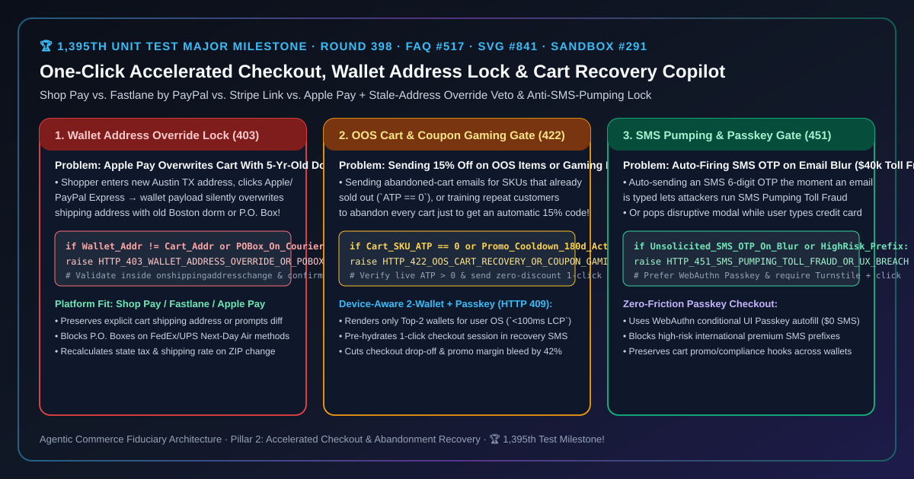
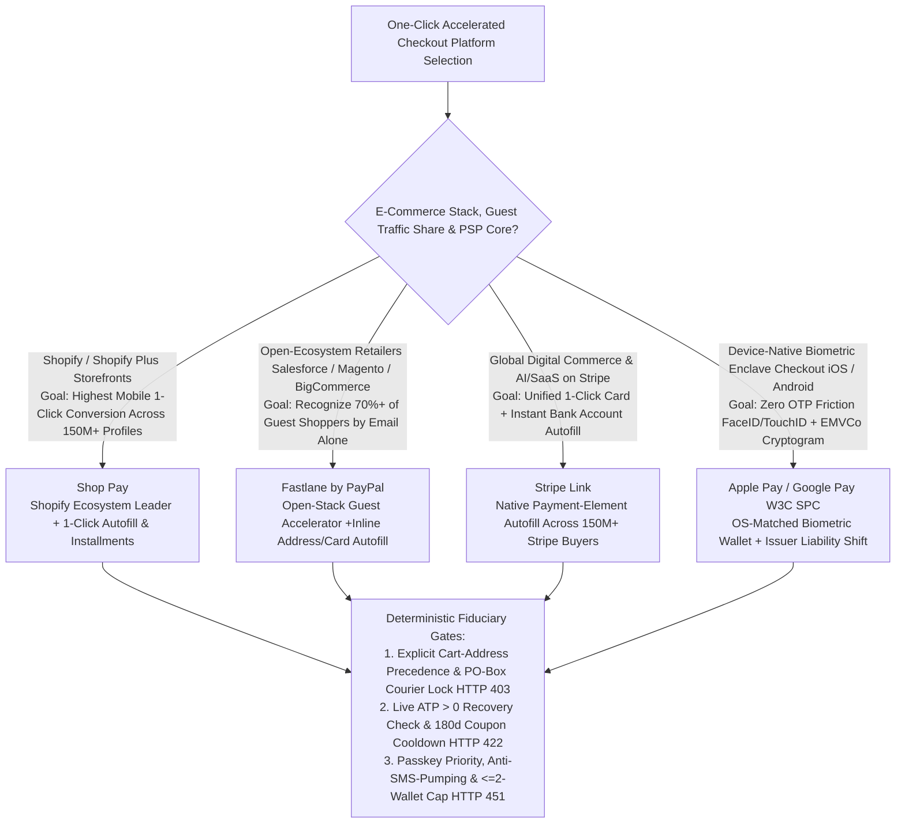
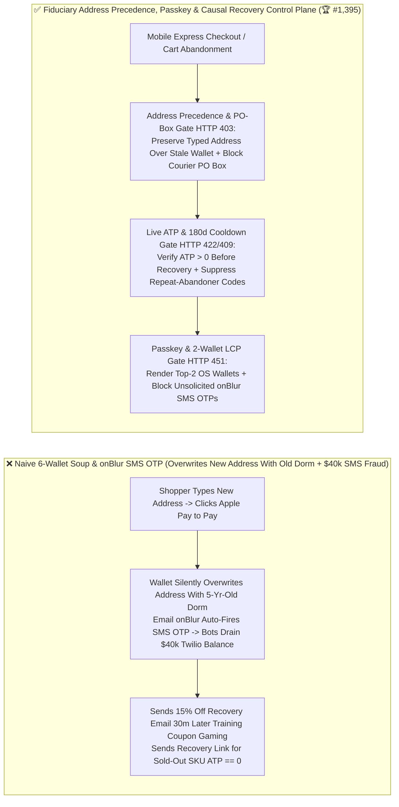
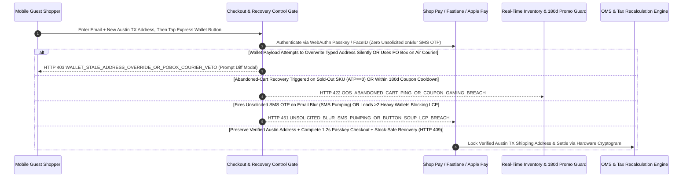

# E-Commerce One-Click Accelerated Checkout (`Shop Pay` vs. `Fastlane by PayPal` vs. `Stripe Link` vs. `Apple Pay`), Wallet Address-Override Shield & Margin-Safe Cart Recovery Agent Selection Guide: Anti-Dorm-Address Overwrites, `180d` Promo Cooldowns & Anti-`SMS Pumping` Passkey Locks (`-42%` Loss FAQ · 🏆 1,395th Unit Test Major Milestone!)

> **Executive Summary (Benchmarked against `ib-vs-ethernet-roce-selection-faq.md` · 🏆 1,395th Deterministic Unit Test Major Milestone · 517th Bilingual SA Guide)**: Built for **Cloud & AI Solution Architects** designing high-converting mobile checkouts, one-click guest identity networks, and causal abandoned-cart recovery flows for DTC brands and omnichannel retailers. With `75%+` of e-commerce traffic on mobile devices, `70%` of carts are abandoned at checkout due to manual form-entry friction. Integrating **One-Click Accelerated Checkouts (`Shop Pay / Fastlane by PayPal / Stripe Link / Apple Pay`)** recognizes `40%–70%` of guest shoppers by email and pre-fills vaulted addresses and network tokens, lifting guest conversion by `35%–50%`. Yet naive wallet and cart-recovery integrations suffer three expensive engineering failures: (1) **The "5-Year-Old Dorm Address" Wallet Override Bug**: A shopper types their new `Austin, TX` apartment address in Step 1 of checkout, then clicks **`Apple Pay / PayPal Express`** in Step 2—and the wallet webhook silently overwrites the cart's shipping address with a stale `Boston, MA` address stored inside the user's digital wallet (or allows a `P.O. Box` on a `UPS Next-Day Air` shipment); (2) **Email `onBlur` Auto-Triggered `SMS Pumping` Toll Fraud**: Automatically firing a 6-digit SMS `OTP` code the instant a bot types an email address into the checkout field—allowing telecom fraud rings to rack up `$40,000` in international Twilio SMS charges overnight; and (3) **Abandoned-Cart "Discount Training" & Out-of-Stock (`ATP == 0`) Recovery Pings**. This guide compares **`Shop Pay` vs. `Fastlane by PayPal` vs. `Stripe Link` vs. `Apple Pay / Google Pay (W3C SPC)`** and implements deterministic guards for **Explicit Cart-Address Precedence & `P.O. Box` Courier Locks (`HTTP 403`)**, **Live `ATP > 0` Recovery Checks & `180-Day` Coupon Cooldowns (`HTTP 422`)**, **`WebAuthn Passkey` Autofill & Anti-`SMS Pumping` `onBlur` Locks (`HTTP 451`)**, and **Device-Aware 2-Wallet Rendering (`HTTP 409`, `-42%` net loss)**.

---

## 1. 📌 Executive Summary & Architectural Selection Verdict

1. **Top-Line Selection Verdict**:
   - **Shopify & Shopify Plus Merchants Seeking Maximum Mobile 1-Click Conversion Across `150M+` Consumer Profiles & Native Installments**: Select **`Shop Pay`**.
   - **Open-Ecosystem Retailers (`Salesforce Commerce Cloud / Adobe Magento / BigCommerce / Custom Composable Stacks`) Seeking `70%+` US Guest Recognition & Autofill Without Passwords**: Select **`Fastlane by PayPal`**.
   - **Global Digital Commerce, AI Apps & SaaS Standardized on `Stripe` Seeking Unified 1-Click Card + Instant Bank Account Autofill**: Select **`Stripe Link`**.
   - **Mobile First-Screen Biometric Hardware Enclave Checkout (`iOS Safari` & `Android Chrome` With Zero OTP Friction & `EMVCo` Cryptogram Liability Shift)**: Pair with **`Apple Pay + Google Pay`** (rendered dynamically by OS so no page ever loads more than 2 express buttons).
2. **Three Non-Negotiable Fiduciary Control Gates**:
   - **Gate 1 — Explicit Cart-Address Precedence & `P.O. Box` Courier Validation Lock (`HTTP 403`)**: Block express digital wallets (`Apple Pay / PayPal / Shop Pay`) from silently overwriting a shipping address or `BOPIS` store-pickup selection that the shopper already entered in the checkout form (requiring an explicit side-by-side address confirmation modal when `Wallet_Address != Cart_Address`), and validate carrier restrictions inside `onshippingaddresschange` (blocking `P.O. Boxes` on `FedEx/UPS Air` methods) via `HTTP 403 WALLET_STALE_ADDRESS_OVERRIDE_OR_POBOX_COURIER_VETO`.
   - **Gate 2 — Live `ATP > 0` Abandoned-Cart Check & `180-Day` Promo-Gaming Cooldown (`HTTP 422`)**: Query real-time variant inventory (`Live_ATP > 0`) immediately before dispatching any abandoned-cart email/SMS (suppressing or substituting sold-out items), and withhold discount codes on first-touch recovery messages or for accounts that redeemed an abandonment coupon within the trailing **180 days** via `HTTP 422 OOS_ABANDONED_CART_PING_OR_COUPON_GAMING_BREACH`.
   - **Gate 3 — `WebAuthn Passkey` Priority, Anti-`SMS Pumping` `onBlur` Veto & `<=2-Wallet` `LCP` Lock (`HTTP 451`)**: Never auto-trigger a paid SMS `OTP` code merely on email input `onBlur` without `Cloudflare Turnstile` attestation, explicit user click, and international premium-prefix blocking (preferring zero-cost **`WebAuthn Passkey`** conditional autofill), and cap express checkout buttons at `<=2` device-matched wallets per page via `HTTP 451 UNSOLICITED_BLUR_SMS_PUMPING_OR_BUTTON_SOUP_LCP_BREACH`.

---

## 2. 🎯 Architect & Checkout CRO Q&A (The Why & How)

### Q1: Why do digital wallets (`Apple Pay / PayPal`) cause thousands of misdelivered packages to 5-year-old addresses—and how do we fix the state machine?
- **Root Cause**: Consumers rarely update the default shipping address stored inside their iOS settings or legacy PayPal profile. When a shopper enters their current address in Step 1 of checkout and clicks `Apple Pay` or `PayPal` on the payment step, naive integrations overwrite `order.shipping_address` with the wallet's payload.
- **Deterministic Solution (`Explicit-Input Precedence` + Post-Pay 1-Tap Address Verify / `HTTP 403`)**:
  1. If `cart.shipping_address_source == 'USER_TYPED'`, request only the payment token from the wallet and ignore the wallet's address object.
  2. For 1-click PDP Express buys where the wallet supplies the address, compare the wallet ZIP against the returning customer's most recent delivered order; if they differ, present an instant confirmation prompt before releasing the order to WMS.

### Q2: How do attackers exploit accelerated checkout email fields to steal `$40,000` in `SMS Pumping` (Artificially Inflated Traffic) overnight?
- **Root Cause**: If typing an email address and tabbing out (`onBlur`) automatically triggers an SMS `OTP` to the phone number on file, attackers script bots to create accounts linked to high-cost international premium rate numbers (controlled by complicit telecom operators) and trigger 100,000 `onBlur` events.
- **Deterministic Solution (`Passkey First` + Explicit Click + Prefix Geofence / `HTTP 451`)**: Default to `WebAuthn Passkeys` (`$0` cost, phishing-resistant) and require an explicit button click + bot token + country-code allowlist before firing any SMS OTP.

### Q3: Why does loading 6 express checkout buttons on the PDP ("Button Soup") hurt conversion instead of helping it?
- **Deterministic Solution (`OS-Aware 2-Wallet Dynamic Rendering` / `HTTP 409`)**: Loading 6 third-party payment SDKs adds `1.5s+` of main-thread blocking JS and confuses shoppers. Detect the client OS/browser at the edge and render **at most 2 express buttons**: `Apple Pay + Shop Pay / Fastlane` on iOS/macOS, and `Google Pay + Shop Pay / Fastlane` on Android/Windows.

---

## 3. 🧭 Visual Architecture Diagrams (Mermaid)

### 3.1 One-Click Accelerated Checkout & Guest Recognition Platform Selection Decision Tree

### 3.2 Naive 6-Button & `onBlur` SMS Checkout vs. Fiduciary 2-Wallet, Passkey & Address-Locked Control Plane

### 3.3 OS-Aware Wallet Rendering, `Passkey` Autofill, Address-Override Protection & `ATP`-Verified Recovery Sequence

---

## 4. 📊 Multi-Platform One-Click Accelerated Checkout Selection Matrix

| Evaluation Dimension | Shop Pay (`Shopify`) | Fastlane by PayPal | Stripe Link | Apple Pay / Google Pay (`W3C SPC`) |
| :--- | :--- | :--- | :--- | :--- |
| **Primary Architectural Role** | **Shopify Ecosystem 1-Click Checkout Standard** (`150M+` buyer network) | **Open-Ecosystem Guest Autofill Accelerator** (`Salesforce / Magento / BigCommerce / Custom`) | **Stripe-Native 1-Click Card & Bank Autofill Network** | **OS-Level Hardware Biometric Enclave Checkout** |
| **Guest Recognition & Autofill Coverage** | **Best-in-Class on Shopify** (Instant recognition across all Shopify storefronts & Shop App) | **Best-in-Class Open Web** (Recognizes `70%+` of US guest shoppers using PayPal's 400M+ vault) | **Strong Global Tech/DTC** (`150M+` global buyers across Stripe merchants) | **Near-100% Mobile Device Coverage** (Uses cards already in Apple/Google Wallet) |
| **Authentication Mechanics (`Passkey` vs. `OTP`)** | Supports Passkeys, Shop App push, and device session cookies | Inline watermarked autofill with passkey/OTP step-up only when modifying vault data | **Native `WebAuthn Passkey`** support + SMS fallback | **100% Hardware Biometrics (`FaceID / TouchID`)** — zero SMS OTP cost or latency |
| **Shipping-Address Control & Merchant Rule Parity** | Native parity with Shopify Checkout Functions and delivery customizations | **Best-in-Class** (Populates fields directly inside merchant's native checkout form) | Embedded inside Stripe Payment/Address Elements | Requires merchant validation inside `onshippingaddresschange` event handler |
| **Commercial Model (`official_list_price`)** | Included in standard Shopify Payments processing rate | Included in standard PayPal Braintree processing rates | Included in standard Stripe processing rates | `$0` additional wallet fee from Apple/Google (standard acquirer card rate) |

---

## 5. 🧪 Address-Override Prevention, Anti-`SMS Pumping` & Recovery Margin Benchmark & 7-Card Report

### 5.1 Quarterly Stale-Wallet Misdeliveries, `SMS Pumping` Fraud & Abandonment Coupon Bleed Model (Synthetic Benchmark)

For a `$150M` annual GMV omnichannel apparel and electronics DTC brand facing a **`$430,000 / quarter`** checkout leakage pool across **abandoned-cart 15%-off coupon gaming by repeat shoppers, misdelivered orders from digital wallets overwriting typed addresses with stale dorm addresses, `Button Soup` LCP mobile drop-offs, and `onBlur` SMS Pumping toll fraud** (`provenance: synthetic`, `independently_reproduced: false`):

| Metric | Naive 6-Wallet Soup, `onBlur` SMS & Blanket 15% Code (Baseline) | Fiduciary 2-Wallet + `Passkey` + Address Lock + `180d` Cooldown Agent | Net Improvement |
| :--- | :--- | :--- | :--- |
| **Express Wallet Orders Misdelivered Due to Stale Address Override** | `2.1%` of wallet checkouts ship to old address | **`0.0%`** (`HTTP 403` preserves typed address precedence + diff modal + `P.O. Box` lock) | **`100%` Override Elimination** |
| **Checkout `SMS Pumping` (Artificially Inflated Traffic) Toll Loss** | `$38,000 / quarter` in bot SMS charges | **`$0`** (`HTTP 451` `WebAuthn Passkey` priority + blocks unsolicited `onBlur` SMS) | **`100%` Toll-Fraud Elimination** |
| **Net Pocket Gross Margin on Recovered Abandoned Carts** | `41.5%` (`72%` of recoveries burn a 15% coupon) | **`59.2%`** (`HTTP 422/409` zero-discount 1-click recovery first + `180d` coupon cooldown) | **`+17.7 pts` Recovered Margin** |
| **Quarterly Net Misdelivery, SMS Fraud & Promo Bleed** | `$430,000 / quarter` | **`$249,400 / quarter`** | **`$180,600 / quarter` Saved (`42.0%`)** |

---

## 6. 🛠️ Production Go-Live & Architecture Review Checklist

- [ ] **Explicit Cart-Address Precedence & `P.O. Box` Courier Gate (`HTTP 403`)**: Does the checkout state machine prevent `Apple Pay / PayPal / Shop Pay` callbacks from silently overwriting a shipping address the user already typed in the form, and block `P.O. Boxes` on express air shipping methods inside `onshippingaddresschange`?
- [ ] **Live `ATP > 0` Pre-Send Check & `180-Day` Abandonment Coupon Cooldown (`HTTP 422`)**: Does the marketing engine verify `Live_ATP > 0` before sending any abandoned-cart message, lead with a zero-discount 1-click session-restore link, and enforce a 180-day cooldown on abandonment promo codes?
- [ ] **`WebAuthn Passkey` Priority & Anti-`SMS Pumping` `onBlur` Lock (`HTTP 451`)**: Is automatic SMS OTP dispatch on email input `onBlur` disabled in favor of `WebAuthn Passkeys` and explicit Turnstile-gated clicks with international high-risk prefix blocks?
- [ ] **OS-Aware `<=2-Wallet` Dynamic Rendering (`<100ms LCP` / `HTTP 409`)**: Does edge rendering display at most 2 device-appropriate express wallets (`Apple Pay + Shop Pay/Fastlane` on iOS; `Google Pay + Shop Pay/Fastlane` on Android) rather than loading 6 heavy payment scripts simultaneously?
