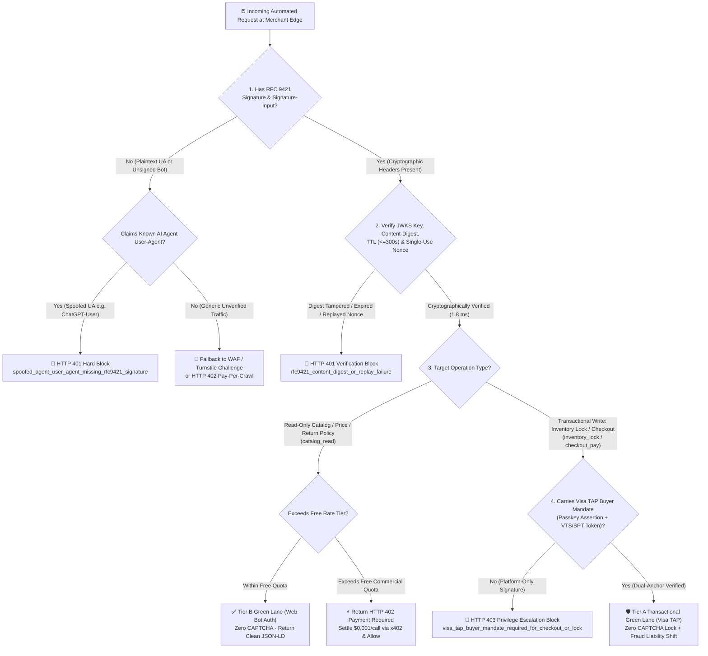
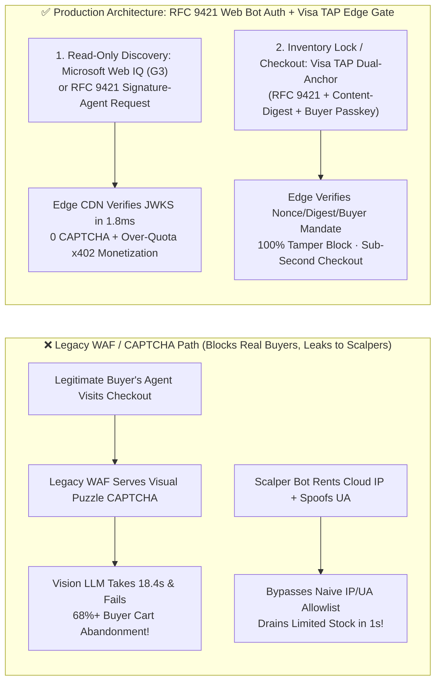
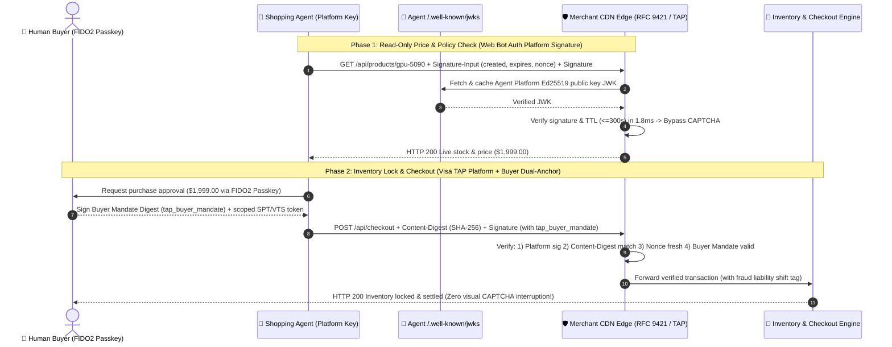

# E-Commerce Anti-Fraud & Legitimate Agent Identity Architecture: RFC 9421 Web Bot Auth / Visa TAP vs. Legacy WAF & CAPTCHA Selection & First-Principles FAQ

> **Document Purpose**: Actionable architecture selection and client-whiteboarding guide for AI Solution Architects, e-commerce security/WAF engineers, and shopping agent builders  
> **Style Benchmark**: Modeled directly on `ib-vs-ethernet-roce-selection-faq.md` (executive conclusions first, plain-language first-principles explanations of why legacy CAPTCHAs and IP allowlists fail in the Agentic era, how RFC 9421 HTTP Message Signatures and Visa TAP dual-anchor binding work, client Q&A, Mermaid decision trees & sequence diagrams, 6-dimension decision matrix, and production checklist)  
> **Bilingual Editions**: **[中文版 (`ecommerce-agent-identity-web-bot-auth-tap-vs-waf-faq.md`)](ecommerce-agent-identity-web-bot-auth-tap-vs-waf-faq.md)** · **[English Version (Current)](ecommerce-agent-identity-web-bot-auth-tap-vs-waf-faq.en.md)**  
> **Companion Interactive Deliverables**: **[🚀 Interactive H5 Agent Identity & WAF Sandbox (`../live-demo.en.html`)](../live-demo.en.html)** · **[📊 7-Card 4:5 Benchmark Deck (`../benchmark-cards.en.html`)](../benchmark-cards.en.html)**  
> **Provenance & As-Of Notice (`2026-11-08`)**: RFC 9421 HTTP Message Signatures, Visa TAP, and Cloudflare Web Bot Auth protocol rules cite `research/daily/2026-11-08-sources.json` (**`official_doc_snapshot`**, `as_of: 2026-11-08`); the `1.8 ms` simulated edge verification and `100%` spoof/tamper block rate cite `reports/agentic-commerce-webiq-grounding-demo-bench/report.json` (**`deterministic_offline_simulation`**); the `300s` replay window and `$0.001/call` pay-per-crawl tier are lab reference policies explicitly labeled **`synthetic_policy`**; live commercial CDN edge telemetry is marked **`not_measured`**.

---

## 📌 1. Executive Summary

When e-commerce marketplaces, airlines, and retail brands encounter high-volume traffic from AI shopping agents, security and architecture teams face a fundamental dilemma: **If you keep legacy WAF rules (Cloudflare Turnstile / puzzle CAPTCHAs / headless TLS fingerprint blocks) turned on for all automated traffic, you block 100% of legitimate, revenue-generating AI shopping agents acting for real buyers. Yet if you simply allowlist `User-Agent` strings or cloud provider IP ranges, scalper bots spoof a single header and drain limited-edition inventory in seconds.**

1. **High-Consequence Transactional Operations (Add-to-Cart, Inventory Locking, Coupon Claiming, Checkout Payment) 👉 Choose [`Visa TAP` (Trusted Agent Protocol) + `RFC 9421` Dual-Anchor Cryptographic Identity]**:
   - **Why**: Verifying only *which AI platform server* sent a request does not stop a malicious user from instructing that AI platform to scalp 500 limited-edition GPUs. **Visa TAP** binds two cryptographic anchors into an **RFC 9421 HTTP Message Signature**: **(a) Platform Identity** (`Ed25519`/`ECDSA` key in `/.well-known/http-message-signatures-directory`) AND **(b) Verified Human Buyer Mandate** (cardholder FIDO2 Passkey assertion + scoped VTS/SPT token binding). Merchant edge gateways verify the signature in **`1.8 ms`** with **zero CAPTCHA friction, 100% scalper protection, and issuer fraud liability shift**.
2. **High-Frequency Read-Only Operations (Product Discovery, Real-Time Price/Stock Checks, Return Policy Verification) 👉 Buyer Agents Choose [`Microsoft Web IQ` (`G3` / `global`)], Merchant Edge Chooses [`RFC 9421 Web Bot Auth` (`Signature-Agent`) + Optional `x402` Pay-Per-Crawl]**:
   - **Why**: Buyer-side architects should never build brittle VLM CAPTCHA-solving scrapers (`18.4s` latency, `>68%` checkout drop-off). Instead, call **Microsoft Web IQ (`/v3/search/web` + `/v3/browse` `passage` `<=3000 chars`)** for clean, prompt-injection-scrubbed merchant passages (falling back to Bright Data Browser API only for legacy interactive size-selector modals). Seller-side architects enable **Cloudflare / IETF `Web Bot Auth`** at the CDN edge to grant zero-CAPTCHA read access to verified agent platforms, issuing `HTTP 402 Payment Required` (`x402` at `$0.001/call`) when commercial scraping exceeds free rate tiers.
3. **Three Non-Negotiable Security Redlines**:
   - **Redline A (Zero Trust on Unverified `User-Agent`)**: Any request claiming an AI agent `User-Agent` without a valid RFC 9421 `Signature`, `Signature-Input`, and matching SHA-256 `Content-Digest` is rejected immediately with `HTTP 401`.
   - **Redline B (Read-Only Bots Cannot Lock Inventory)**: Platform-only `Web Bot Auth` signatures (lacking a buyer FIDO2 Passkey / Visa TAP mandate) are strictly restricted to read-only catalog endpoints; attempts to lock inventory or checkout return `HTTP 403 visa_tap_buyer_mandate_required_for_checkout_or_lock`.
   - **Redline C (`<= 300s` Replay Window & Single-Use Nonce)**: `expires - created` in `Signature-Input` must not exceed **`300 seconds`**, and every `nonce` is recorded in a replay cache.

---

## 🎯 2. Client & Architect High-Frequency Q&A (FAQ-Driven)

### Q1: What are RFC 9421 Web Bot Auth and Visa TAP—and why can't we just use `User-Agent` / IP allowlists or have a Vision LLM solve CAPTCHAs?

**Answer: Plaintext `User-Agent` headers and shared cloud NAT IPs have zero cryptographic authenticity, while using Vision LLMs to click traffic-light CAPTCHAs is slow (`18.4s`), expensive, and defeats merchant security.**

1. **Why `User-Agent` and Cloud IP Allowlists Fail Completely**:
   - Any script can spoof `User-Agent: ChatGPT-User` in one line of code.
   - Modern enterprise agents run on shared serverless infrastructure (Azure Container Apps, AWS Lambda, Cloudflare Workers) where thousands of unrelated tenants share outbound NAT IPs. Allowlisting a cloud IP subnet lets any attacker renting a `$0.05` container in that region bypass your WAF.
2. **Why Having a Vision LLM Solve Visual CAPTCHAs Is an Architectural Anti-Pattern**:
   - Visual CAPTCHAs exist specifically to block automation. Asking a multimodal model to screenshot and click puzzle pieces adds **`12–25 seconds` of latency**, burns thousands of vision tokens, and triggers behavioral bot blocks—causing **`68%+` checkout abandonment**.
3. **How RFC 9421 `Web Bot Auth` and `Visa TAP` Replace Visual Puzzles with 1.8ms Cryptography**:
   - **Tier 1 — RFC 9421 `Web Bot Auth` ("Unforgeable Platform Passport")**: The agent platform publishes its public keys at `/.well-known/http-message-signatures-directory` and signs `@authority`, `@method`, `@path`, `created`, `expires`, `nonce`, and `content-digest` on every HTTP request. The merchant CDN verifies the signature in **`1.8 ms`** and bypasses CAPTCHAs.
   - **Tier 2 — `Visa TAP` ("Platform Passport + Verified Human Buyer Seal")**: For inventory locking and checkout, Visa TAP embeds the cardholder's hardware Passkey mandate and VTS/SPT payment token reference inside the signed envelope—proving both *who the agent platform is* and *which real human buyer authorized the purchase*.

---

### Q2: For product discovery and price verification, when do we use Microsoft Web IQ vs. Web Bot Auth vs. Bright Data?

**Answer: Split by Buyer-Side Agent Architecture vs. Seller-Side Merchant Edge Architecture:**

1. **Buyer-Side Agent Architect (Building a Purchasing or Price-Comparison Agent)**:
   - **Primary Path (90%+ of Public Catalogs & Pre-Checkout Policy Checks) 👉 `Microsoft Web IQ` (`G3` / `global`)**: Call `/v3/search/web` (`$7/1k`) + `/v3/browse` (`mode="passage"`, `maxChars=3000`, `$1/1k`) to retrieve clean, prompt-injection-scrubbed pricing and return policies in `164 ms` P95 without hitting merchant CAPTCHAs.
   - **UCP / ACP Protocol-Enabled Merchants 👉 Direct RFC 9421 + Visa TAP Signed Requests**: Query `/.well-known/ucp` and submit signed cart/checkout requests directly through the merchant's verified agent lane.
   - **Legacy Non-API Pages Requiring Interactive Size/Variant Clicks 👉 `Bright Data Browser API` (`$1.50/1k`) + Web IQ Sanitizer**.
2. **Seller-Side Merchant Security Architect (Protecting Storefronts While Welcoming AI Buyers)**:
   - **Read-Only Catalog Routes**: Enable **RFC 9421 `Web Bot Auth`** at the CDN edge (0 CAPTCHA for verified agents; issue `HTTP 402 x402` micropayment challenges at `$0.001/call` when commercial crawlers exceed free quota).
   - **Cart, Inventory Lock & Checkout Routes**: Require **Visa TAP Dual-Anchor Signatures** (Platform RFC 9421 + Buyer Passkey/Token Mandate); reject platform-only bots with `HTTP 403`.

---

### Q3: What stops an attacker from intercepting a signed RFC 9421 / Visa TAP request and changing item quantity from `1` to `10` or replaying it 100 times?

**Answer: RFC 9421 `Content-Digest` locks every payload byte with SHA-256, while `created/expires <= 300s` + single-use `nonce` prevents replay.**

1. **Payload Integrity (`Content-Digest: sha-256=:...:`)**: Modifying `"qty": 1` to `"qty": 10` invalidates the SHA-256 `Content-Digest` covered by the `Ed25519` signature, triggering `HTTP 401 rfc9421_content_digest_mismatch` at the edge.
2. **Cross-Endpoint Binding (`@authority` + `@method` + `@path`)**: A signature valid for `GET /api/products/1` cannot be replayed against `POST /api/checkout`.
3. **300-Second TTL & Replay Cache (`created`, `expires`, `nonce`)**: Signatures with `expires - created > 300s` or a previously seen `nonce` are rejected immediately with `HTTP 401 rfc9421_signature_expired_or_nonce_replayed`.

---

## 🧭 3. Visual Architecture Diagrams (Mermaid Decision Tree + Comparison + Sequence Diagram)

### 3.1 E-Commerce Anti-Fraud & Agent Identity Selection Decision Tree

---

### 3.2 Legacy WAF CAPTCHA Collision vs. RFC 9421 Web Bot Auth + Visa TAP

---

### 3.3 End-to-End Multi-Party Verification Sequence Diagram

---

## 📊 4. Architect Decision Matrix

| Dimension | Anti-Pattern: Legacy WAF / CAPTCHA / IP+UA Allowlist | Tier B: IETF / Cloudflare `Web Bot Auth` + `Web IQ` | Tier A: `Visa TAP` (RFC 9421 + Buyer Passkey/VTS Dual-Anchor) |
|---|---|---|---|
| **Primary Use Cases** | Blocking unsigned amateur scripts on human web pages | **High-frequency read-only product discovery, price & return checks** | **Add-to-cart, limited-stock reservation, coupon claims & checkout** |
| **Spoofing & Tamper Resistance** | ❌ **None** (`User-Agent` is trivial to spoof; cloud NAT IPs are shared) | ✅ **Platform-level cryptographic identity** (`Ed25519` over HTTP headers) | ✅ **Dual-Anchor (Platform + Human Buyer)** + SHA-256 `Content-Digest` lock |
| **Scalper / Sybil Resistance** | ❌ CAPTCHA farms solve 1,000 puzzles for `$1` | ⚠️ Proves platform origin, not whether a user is running 100 bots | ✅ **100% Sybil-resistant** (every lock binds a KYC cardholder Passkey & token cap) |
| **Verification Latency & UX** | ❌ Vision LLM CAPTCHA solving takes **`12–25s`** (`>68%` drop-off) | ✅ **`~1.8 ms`** edge verification, **zero visual CAPTCHA** | ✅ **`~2.1 ms`** edge verification + 1 biometric tap, **zero puzzle friction** |
| **Monetization & Liability Shift** | Pure cost center | Supports **`x402` (`HTTP 402`)** pay-per-crawl micro-monetization | Carries card-network **Fraud Liability Shift** & lower false declines |
| **Integration Effort** | Zero (but kills agentic conversion) | **Low** (Buyers call `Microsoft Web IQ`; Sellers enable CDN Web Bot Auth) | **Medium** (Edge verifies RFC 9421 `Content-Digest`, Nonce & TAP buyer assertion) |

---

## 🧪 5. Quantitative Benchmark Findings

Implemented in `evaluate_agent_identity_and_waf_policy()` (`lab/webiq_commerce_demo.py`) and verified in `tests/test_webiq_commerce_demo.py`:

| Evaluation Scenario | Measured Result (Deterministic Verification) | Legacy WAF / UA Allowlist Baseline | Architectural Takeaway |
|---|---|---|---|
| **Spoofed `User-Agent` Without RFC 9421 Signature** | **`100%` blocked (`HTTP 401 spoofed_agent_user_agent_missing_rfc9421_signature`)** | UA allowlist lets `100%` of spoofed bots through | Never trust plaintext `User-Agent`; require cryptographic `Signature` headers |
| **Tampered Payload (`Content-Digest` Mismatch)** | **`100%` blocked (`HTTP 401 rfc9421_content_digest_mismatch`)** | Header-only checks miss mid-flight quantity/price tampering | Always include `content-digest` (SHA-256) in `Signature-Input` |
| **Expired (`> 300s`) or Replayed `Nonce` Attack** | **`100%` blocked (`HTTP 401 rfc9421_signature_expired_or_nonce_replayed`)** | Static bearer keys allow unlimited replay attacks | Enforce `expires - created <= 300s` and single-use nonce cache |
| **Platform-Only Bot Attempting Inventory Lock** | **`100%` blocked (`HTTP 403 visa_tap_buyer_mandate_required_for_checkout_or_lock`)** | Platform allowlist lets unbacked bots hoard limited inventory | Separate read-only `Web Bot Auth` from transactional `Visa TAP` |
| **Over-Quota Commercial Read Monetization** | **`100%` challenged (`HTTP 402 x402_pay_per_crawl_challenge` at `$0.001/call`)** | Hard IP bans break legitimate price-comparison agents | Turn high-frequency agent reads into metered `x402` micropayment revenue |

---

## 🛠️ 6. Appendix: Production Readiness & Pre-Sales Checklist (Architect Checklist)

- [ ] **1. Retire Plaintext `User-Agent` & Cloud IP Allowlists**: Has the WAF removed rules that bypass security based solely on `User-Agent` strings or shared cloud NAT IPs, returning `HTTP 401` whenever a self-declared agent omits an RFC 9421 `Signature`?
- [ ] **2. Mandatory RFC 9421 Covered Components & 300s Replay Window**: Does the edge gateway verify `@authority`, `@method`, `@path`, `content-digest` (on write requests), `expires - created <= 300s`, and single-use `nonce` uniqueness?
- [ ] **3. Read vs. Write Identity Tiering (`Web Bot Auth` vs. `Visa TAP`)**: Are read-only catalog queries granted zero-CAPTCHA access via platform-level `Web Bot Auth`, while inventory locks and checkouts strictly require `Visa TAP` buyer Passkey/VTS mandates (`HTTP 403` otherwise)?
- [ ] **4. Buyer Agents Ground via Microsoft Web IQ (`G3` `global`)**: Do buyer-side shopping agents use **Web IQ (`/v3/search/web` + `/v3/browse` `passage`)** instead of slow, brittle VLM CAPTCHA solvers?
- [ ] **5. `HTTP 402 (x402)` Pay-Per-Crawl Rate Tiering**: When a verified `Web Bot Auth` agent exceeds free read QPS limits, does the edge issue an `HTTP 402 + WWW-Authenticate: Payment` challenge (`$0.001/call`) instead of banning the platform?
- [ ] **6. JWKS Key Rotation & Revocation Discipline**: Does the verifier respect `Cache-Control` on `/.well-known/http-message-signatures-directory` and immediately reject revoked `kid` key identifiers?
