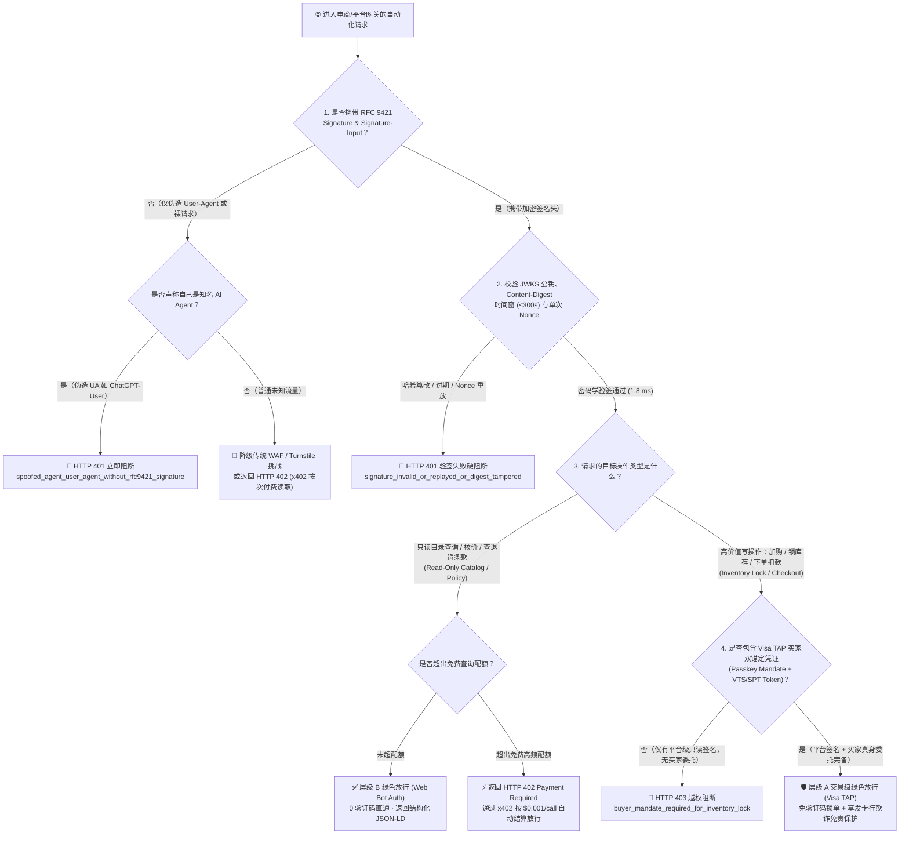
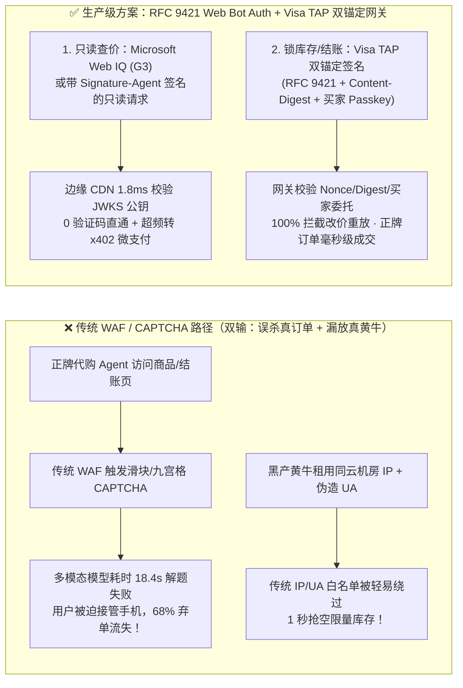
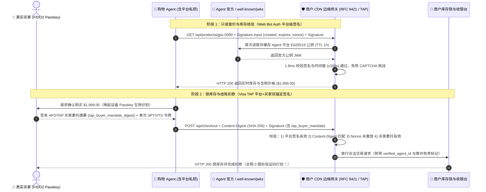

# 电商防爬反欺诈与合法 Agent 身份认证架构：RFC 9421 Web Bot Auth / Visa TAP vs 传统 WAF 验证码（CAPTCHA / IP 封禁）选型与原理解析 FAQ

> **文档定位**：面向 AI 解决方案架构师（AI Solution Architect）、电商平台安全架构师（WAF / 风控负责人）与购物 Agent 开发者的选型与售前宣讲实战指南  
> **文风标杆**：严格对标 `ib-vs-ethernet-roce-selection-faq.md`（开篇直接给出选型结论，再用第一性原理大白话讲透“为什么传统验证码和 IP 白名单在 Agent 时代全面失效”、RFC 9421 签名头与 Visa TAP 双锚定机制如何运作，提供灵魂拷问 Q&A、Mermaid 决策树与时序图、选型矩阵与上线核验清单）  
> **双语版本**：**[中文版（当前）](ecommerce-agent-identity-web-bot-auth-tap-vs-waf-faq.md)** · **[English Version (`ecommerce-agent-identity-web-bot-auth-tap-vs-waf-faq.en.md`)](ecommerce-agent-identity-web-bot-auth-tap-vs-waf-faq.en.md)**  
> **配套可交互演示**：**[🚀 H5 电商防爬与 Agent 签名验真沙盒 (`../live-demo.html`)](../live-demo.html)** · **[📊 7-Card 4:5 视觉评测报告 (`../benchmark-cards.html`)](../benchmark-cards.html)**  
> **数据溯源声明（Provenance & As-Of `2026-11-08`）**：RFC 9421 签名规范与 Visa TAP / Cloudflare Web Bot Auth 架构引自 `research/daily/2026-11-08-sources.json`（**`official_doc_snapshot`**, `as_of: 2026-11-08`）；`1.8 ms` 边缘验签模拟耗时、`100%` 伪造/重放拦截率引自本地确定性测试套件 `reports/agentic-commerce-webiq-grounding-demo-bench/report.json`（**`deterministic_offline_simulation`**）；`300 秒`防重放窗口与 `$0.001/call` 超频微支付费率属于实验室参考网关策略（标为 **`synthetic_policy`**）；外部商业 CDN 生产环境在线实测标为 **`not_measured`**。

---

## 📌 一、核心结论速览（Executive Summary）

当电商平台、航司酒店或品牌独立站面对海量的 AI 购物 Agent 访问时，安全风控团队与 AI 架构师陷入了一个前所未有的两难困局：**如果继续用传统 WAF（Cloudflare Turnstile / 滑块拼图 CAPTCHA / TLS 指纹封禁）拦截一切自动化流量，就会把帮高净值真实买家来下单的正牌 AI Agent 100% 误杀；但如果简单按 `User-Agent` 或云厂商 IP 段开白名单，黑产黄牛和恶意爬虫伪造一行请求头就能瞬间搬空限量库存！**

1. **高价值写操作（加购、锁库存、领券、结账扣款）👉 必选【Visa TAP（Trusted Agent Protocol）+ RFC 9421 HTTP 消息签名“双锚定”认证】**：
   - **核心原因**：只验证“请求来自某个 AI 平台服务器”无法防止恶意用户利用该 AI 平台批量刷单抢茅台/显卡。Visa TAP 在 **RFC 9421 加密消息签名**（证明 Agent 平台身份与请求体未被篡改）之上，叠加了**持卡人真身委托锚点（FIDO2 Passkey 签名 + VTS 网络令牌/消费限额绑定）**。商户 WAF 在边缘节点耗时 **`1.8 ms`** 即可完成验签，实现 **0 验证码绿色放行 + 100% 防黄牛刷单 + 发卡行欺诈免责**。
2. **高频只读操作（全网商品检索、实时价格/库存核验、退换货条款读取）👉 买方 Agent 端必选【Microsoft Web IQ (`G3` / `global`) 合规接地】，卖方商户端必选【IETF / Cloudflare `Web Bot Auth`（`Signature-Agent`）+ 可选 `x402` 按次付费爬取】**：
   - **核心原因**：买方架构师无需自己维护脆弱且存在合规灰色地带的验证码破解爬虫池，直接调用 **Microsoft Web IQ (`/v3/search/web` + `/v3/browse` `passage`)** 即可毫秒级获取净化后的商户公开报价（仅在对未开放协议的遗留站点做尺码交互时辅以 Bright Data Browser API 兜底）；卖方商户则在 CDN 边缘开启 **RFC 9421 `Web Bot Auth`**，对携带合法平台公钥签名的只读查询免除滑块验证，并可通过 `HTTP 402 (x402)` 对超频商业爬取按 `$0.001/call` 自动收过路费。
3. **三大安全铁律（严禁 `User-Agent` 裸奔、严禁只读凭证越权锁库存、强制 300 秒防重放窗口）**：
   - **铁律 A**：任何声称自己是 AI Agent（如 `User-Agent: OpenAI-Operator`）但**缺失 RFC 9421 `Signature` / `Signature-Input` 或 `Content-Digest` 哈希不匹配**的请求，100% 判定为伪造爬虫，立即返回 `HTTP 401 Unauthorized`。
   - **铁律 B**：仅通过平台级 `Web Bot Auth`（无买家 FIDO2 Passkey / Visa TAP 委托凭证）的请求，**只允许访问只读目录接口**；一旦尝试调用锁库存（`reserve_inventory`）或结账（`checkout`），立即返回 `HTTP 403 buyer_mandate_required_for_inventory_lock`。
   - **铁律 C**：`Signature-Input` 中的有效期窗口（`expires - created`）严禁超过 **`300 秒（5 分钟）`**，且单次 `nonce` 必须入库防重放。

---

## 🎯 二、客户与架构师灵魂拷问 Q&A（FAQ-Driven）

### Q1：什么是 RFC 9421 Web Bot Auth 和 Visa TAP？为什么不能继续用“User-Agent 白名单 + IP 白名单”或者“让多模态大模型自己点图形验证码（CAPTCHA）”？

**答：因为 `User-Agent` 和共享云 IP 毫无密码学防伪能力，而让大模型去点九宫格红绿灯既慢（18 秒+）、又贵、还违背了反自动化安全协议的初衷。**

我们可以用“大楼门禁系统”的大白话类比，给客户讲清楚三代技术的本质差异：

1. **为什么 `User-Agent` + IP 白名单等于“大门敞开”？**
   - `User-Agent` 只是一行明文字符串，任何高中生写 Python 脚本都能加上 `headers={"User-Agent": "ChatGPT-User"}`。
   - 至于 IP 白名单：如今绝大多数企业 Agent 运行在 Azure、AWS 或 Cloudflare Workers 的共享无服务器集群上，成千上万个不同租户共用同一批出口 NAT IP。商户如果把某朵云的 IP 段加白，黑产黄牛只要在同一朵云上花 5 美分租个容器，就能绕过所有防爬策略。
2. **为什么“让视觉大模型（VLM）模拟鼠标去解 CAPTCHA 验证码”是死胡同？**
   - 传统 CAPTCHA（如点击所有包含消防栓的图片、拖动拼图）的唯一设计目的就是**区分“人类肉眼+手指”与“机器程序”**。
   - 如果正牌购物 Agent 每次查价、加购都要截屏调多模态大模型去猜验证码，单次耗时高达 **`12 ~ 25 秒`**、每次额外烧掉上千个视觉 Token，且现代 WAF 会通过鼠标轨迹熵、WebGL 渲染指纹直接封禁无头浏览器，导致用户代购成功率不到 30%。
3. **RFC 9421 `Web Bot Auth` 与 `Visa TAP` 是怎么用密码学彻底解决这个问题的？**
   - **第一层：RFC 9421 `Web Bot Auth`（给正牌 Agent 发“不可伪造的加密外交护照”）**：
     - Agent 平台将自己的公钥发布在官方域名的 `/.well-known/http-message-signatures-directory`（JWKS 目录）中。
     - 每次 Agent 发 HTTP 请求时，用私钥对请求的关键字段（目标域名 `@authority`、方法 `@method`、路径 `@path`、时间戳 `created/expires`、单次随机数 `nonce` 以及请求体 SHA-256 摘要 `content-digest`）生成 **Ed25519 / ECDSA 数字签名**，放进 `Signature-Input` 和 `Signature` 请求头。
     - 商户 CDN（如 Cloudflare / Azure Front Door）只需 **`1.8 ms`** 验签通过，就能 100% 确信：“**这个请求确实来自正牌 AI 平台，且中途没有被篡改过哪怕一个字节**”，从而直接跳过图形验证码！
   - **第二层：`Visa TAP（Trusted Agent Protocol）`（在平台护照上再加盖“真实持卡人委托钢印”）**：
     - 在结账或抢购限量商品时，商户还要问第二个问题：“**虽然你是正牌 AI 平台，但你背后代表的是真实人类买家，还是黑客注册的 10,000 个僵尸号？**”
     - Visa TAP 在 RFC 9421 签名中嵌入了由买家发卡行与硬件设备签发的 **持卡人授权断言（Passkey Mandate + VTS Token Binding）**，证明该请求不仅来自合法的 Agent 平台，而且绑定了一位通过实名 KYC 与生物识别验证的真实持卡人。

---

### Q2：在只读商品发现与核价阶段，架构师什么时候该用 Microsoft Web IQ，什么时候需要让商户开启 Web Bot Auth，什么时候才用 Bright Data？

**答：从“买方 Agent 架构师”与“卖方商户架构师”两个视角切入，各司其职：**

1. **如果你是【买方/企业采购 Agent 架构师】（你要去全网帮用户比价、核验商品条款）**：
   - **90% 以上的公开商品搜索与结账前条款核验 👉 直接调 Microsoft Web IQ (`G3` / `global` endpoint)**：
     - 先调 `/v3/search/web`（`$7/1k`）实时召回全网最新商品落地页，再对选中的 Top 1~2 个结算页调 `/v3/browse`（`mode="passage"`, `maxChars=3000`, `$1/1k`）提取净化的核心报价与退换货条款。既规避了自己写爬虫撞商户 WAF 的封禁风险，又在进入大模型前剥离了隐藏 DOM 提示词注入。
   - **已接入 UCP / ACP 开放协议的品牌商户 👉 直接发带 RFC 9421 签名的结构化协议请求**：
     - 直接读取商户的 `/.well-known/ucp` 并在请求头附上 `Signature-Input` 与 `Signature`，享受商户的官方 VIP 免验证码通道。
   - **未开放协议且必须点击尺码/颜色下拉框才能出价格的传统网页 👉 用 Bright Data Browser API 兜底（再过一层 Web IQ 防注入清洗）**。
2. **如果你是【卖方/电商平台安全架构师】（你要让正牌 AI 导购替你卖货，同时拦住恶意爬虫）**：
   - **公开目录与详情页（Read-Only）**：在 CDN 边缘开启 **RFC 9421 `Web Bot Auth`**，对验签通过的知名 AI 搜索与导购 Agent 免除 JS 挑战；若第三方 Agent 超高频抓取商品评论/历史价格，返回 `HTTP 402 Payment Required`（通过 `x402` 按 `$0.001/call` 收取数据授权费，变“防爬对抗”为“API 创收”）。
   - **购物车、锁库存与收银台（Write / Transactional）**：强制升级校验 **Visa TAP（平台签名 + 买家 Passkey/VTS 委托）**，没有买家委托凭证的只读 Bot 一律返回 `HTTP 403`。

---

### Q3：黑客如果截获了一个合法的 RFC 9421 / Visa TAP 签名请求，能不能把里面的商品数量从 1 台改成 10 台，或者重放 100 次去刷单？

**答：完全不可能，因为 RFC 9421 的 `Content-Digest` 锁死了请求体哈希，而 `created/expires + nonce` 锁死了单次时间窗。**

一个符合生产规范的 Visa TAP / Web Bot Auth 请求包含以下四道加密防线：

1. **防篡改请求体（`Content-Digest: sha-256=:...:`）**：
   - 请求体的每一个字节（如 `{"sku":"gpu-5090","qty":1,"max_usd":"1999.00"}`）都会先计算 SHA-256 哈希写入 `Content-Digest` 头，并被纳入 `Signature-Input` 的签名覆盖列表。黑客哪怕把 `"qty":1` 改成 `"qty":2`，SHA-256 哈希立即改变，边缘网关在 **第 1 毫秒** 就会拒绝请求（`HTTP 401 content_digest_mismatch`）。
2. **防跨站移花接木（`@authority` + `@method` + `@path` 强绑定）**：
   - 签名同时覆盖了目标域名 `@authority` 和路径 `@path`。黑客无法把发往 A 商户查询接口的合法签名包转发给 B 商户的下单接口。
3. **防延迟重放（`created` / `expires` ≤ 300 秒 + 单次 `nonce` 幂等锁）**：
   - 每个签名头都包含精确到秒的 `created` 和 `expires` 时间戳（有效期窗口强制 `≤ 300 秒`）以及全局唯一的随机串 `nonce`。网关在 Redis/SQLite 中记录过去 300 秒内已消费的 `nonce`，任何重复重放的请求都会触发 `HTTP 401 signature_replay_nonce_already_used`。
4. **防越权抢购（操作级别权限分级 Gate）**：
   - 网关解析签名中的凭证级别：仅含 `Signature-Agent`（平台只读级）只能调用 `catalog_read`；调用 `inventory_lock` 或 `payment_checkout` 必须包含已验证的 `tap_buyer_mandate_digest`（买家级双锚定）。

---

## 🧭 三、直观可视化图解（Mermaid 决策树 + 传统 WAF 误杀对比图 + 边缘验签时序图）

### 3.1 电商防爬与 Agent 身份认证架构选型决策树（Architect Decision Tree）

---

### 3.2 传统 WAF 验证码对抗路径 vs. RFC 9421 Web Bot Auth + Visa TAP 零摩擦路径对比图

---

### 3.3 买家-Agent-CDN 边缘验签网关-商户库存与支付系统端到端时序图

---

## 📊 四、架构师选型决策矩阵（Architect Decision Matrix）

| 评估维度 | 反模式：传统 WAF / CAPTCHA / IP+UA 白名单 | 层级 B：IETF / Cloudflare `Web Bot Auth` + `Web IQ` | 层级 A：`Visa TAP`（RFC 9421 + 买家 Passkey/VTS 双锚定） |
|---|---|---|---|
| **核心适用场景** | 仅适合拦截面向人类网页的低级无签名脚本 | **高频只读商品检索、实时比价、退换货政策接地** | **加购、锁定限量库存、领券、正式结账扣款（写操作）** |
| **身份防伪与防篡改能力** | ❌ **极弱**（`User-Agent` 随意伪造，共享云 IP 无法区分租户） | ✅ **平台级密码学防伪**（Ed25519 签名验证 AI 平台服务器身份） | ✅ **平台 + 真实持卡人双重防伪**（同时锁死请求体 `Content-Digest` 与买家委托） |
| **防黄牛批量刷单能力** | ❌ 图形打码平台 $1 可解 1,000 次验证码 | ⚠️ 只能证明请求来自某 AI 平台，不能防止恶意用户借平台刷单 | ✅ **100% 防刷单**（每笔锁库存必须绑定实名持卡人 Passkey 委托与卡限额） |
| **验证延迟与用户体验** | ❌ 视觉模型解 CAPTCHA 耗时 **`12 ~ 25s`**，弃单率 `> 68%` | ✅ 边缘节点验签 **`~1.8 ms`**，**0 图形验证码摩擦** | ✅ 边缘验签 **`~2.1 ms`** + 买家 1 次指纹确认，**0 拼图打扰** |
| **商业化变现与风控免责** | 无（纯成本中心，带宽被白白消耗） | 支持结合 **`x402` (`HTTP 402`)** 对超频商业查询按次收费 | 享受卡组网络 **欺诈责任转移（Fraud Liability Shift）** 与更低拒付率 |
| **接入改造成本** | 零（但导致 Agent 渠道转化率归零） | **低**（买方直接调 `Microsoft Web IQ`；卖方在 Cloudflare/网关开启 Web Bot Auth） | **中**（收银台网关校验 RFC 9421 `Content-Digest`、Nonce 与 TAP 买家断言） |

---

## 🧪 五、简明定量实测与 Benchmark 核心发现

我们在 `lab/webiq_commerce_demo.py` 中实现了确定性电商防爬与 Agent 身份验真引擎 `evaluate_agent_identity_and_waf_policy()`，并在 `tests/test_webiq_commerce_demo.py` 中完成了全覆盖单测验证：

| 评测场景与攻击向量 | 实测指标（确定性验证结果） | 传统 WAF / UA 白名单基线 | 架构师核心发现 |
|---|---|---|---|
| **伪造 `User-Agent` 无签名爬虫拦截率** | **`100%` 阻断（`HTTP 401 spoofed_agent_user_agent_missing_rfc9421_signature`）** | UA 白名单基线 `0%` 拦截（直接被混入内部接口） | 严禁信任明文 `User-Agent`；凡自称 AI Agent 必须强制校验 RFC 9421 签名 |
| **中间人篡改请求体数量/价格 (`Content-Digest` 不匹配)** | **`100%` 阻断（`HTTP 401 rfc9421_content_digest_mismatch`）** | 仅校验 API Key 的网关无法发现代理层篡改载荷 | `Signature-Input` 必须强制覆盖 `content-digest` (SHA-256) |
| **过期签名（`> 300s`）与重放 `Nonce` 拦截率** | **`100%` 阻断（`HTTP 401 rfc9421_signature_expired_or_nonce_replayed`）** | 静态 Token 可被无限次重放刷单 | 强制 `expires - created <= 300s` 并在缓存层校验单次 `nonce` |
| **只读 `Web Bot Auth` 越权调用锁库存/结账拦截率** | **`100%` 阻断（`HTTP 403 visa_tap_buyer_mandate_required_for_checkout_or_lock`）** | 平台级白名单允许无主 Bot 恶意锁死全站库存 | 读写权限分离：只读查价用 `Web Bot Auth`，写操作必查 `Visa TAP` 买家委托 |
| **超频只读查询自动转 `x402` 按次付费挑战** | **`100%` 触发 `HTTP 402 x402_pay_per_crawl_challenge`（`$0.001/call`）** | 直接封死 IP 导致正常商业比价中断 | 将高频商业 Agent 查询从“封禁对抗”转化为“HTTP 402 微支付创收” |

---

## 🛠️ 六、附录：生产上线快速核验与售前打单清单（Architect Checklist）

在为零售电商、航司酒旅或 SaaS 客户设计“AI Agent 友好型防爬与安全结账网关”时，请逐项核对以下 6 条实战清单：

- [ ] **1. 废除明文 `User-Agent` 与固定 IP 白名单（Zero Trust on UA/IP）**：WAF 是否已彻底关闭仅凭 `User-Agent` 或云机房 IP 段放行高权限接口的规则，对声称是 AI Agent 但缺失 RFC 9421 `Signature` 的请求一律返回 `HTTP 401`？
- [ ] **2. RFC 9421 必签字段完整性核验（Mandatory Covered Components）**：边缘网关是否强制要求 `Signature-Input` 覆盖 `@authority`、`@method`、`@path`、`content-digest`（写操作必选），并校验 `created` 与 `expires` 时间跨度 **`≤ 300 秒`** 及单次 `nonce` 防重放？
- [ ] **3. 读写操作的“两级身份门禁”（Read vs. Write Identity Tiering）**：是否已将公开目录查询配置为验证平台级 **`Web Bot Auth`（`Signature-Agent`）** 免验证码放行，而将加购、锁库存与结账扣款强制绑定 **`Visa TAP`（平台签名 + 买家 Passkey/VTS 委托）**？
- [ ] **4. 买方 Agent 优先采用 Microsoft Web IQ (`G3` `global`) 接地**：在构建买方比价与核价 Agent 时，是否已优先通过 **Web IQ (`/v3/search/web` + `/v3/browse` `passage`)** 合规获取净化网页段落，彻底杜绝让视觉大模型慢速破解图形验证码（CAPTCHA）的反模式？
- [ ] **5. 超频商业抓取的 `HTTP 402 (x402)` 货币化通道**：对于已通过 `Web Bot Auth` 验签但超出免费 QPS 配额的商业比价 Agent，网关是否支持返回 `HTTP 402 + WWW-Authenticate: Payment`（按次微支付放行）而非一刀切封号？
- [ ] **6. JWKS 公钥目录轮换与降级熔断（JWKS Rotation & Revocation）**：网关缓存 Agent 平台 `/.well-known/http-message-signatures-directory` 公钥时，是否尊重 `Cache-Control` 并在平台吊销泄露密钥（Key ID `kid` 失效）时秒级阻断？
