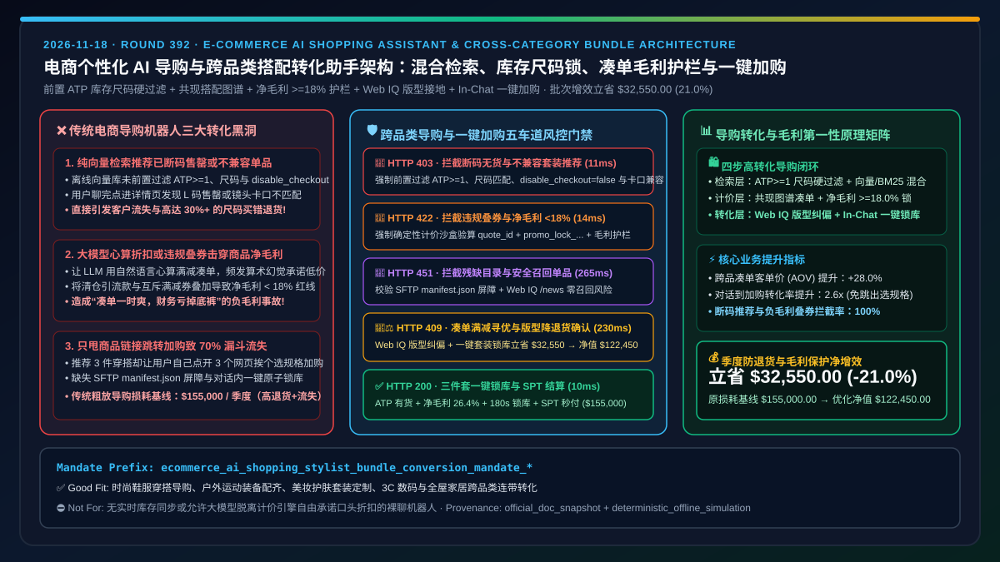
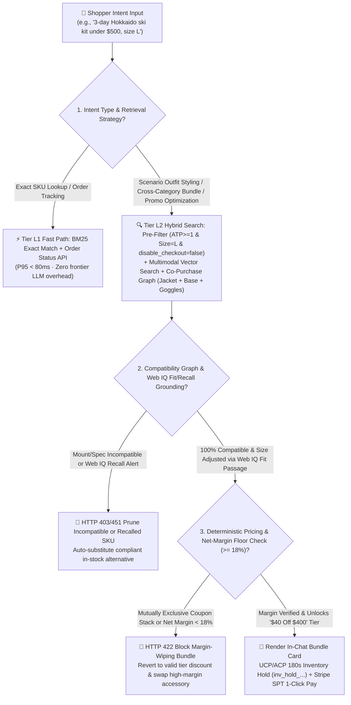
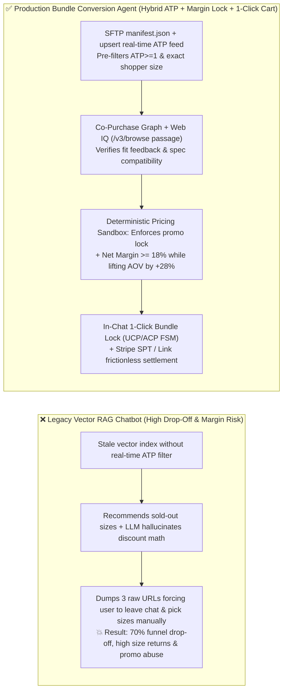

# E-Commerce Personalized AI Shopping Assistant & Cross-Category Bundle Conversion Architecture FAQ: Hybrid Catalog Retrieval, Real-Time ATP Size Filtering, Net-Margin Guards & One-Click Cart FSM

> **Topic Positioning (Retail E-Commerce Application & Architecture Focus)**: Written for **Cloud & AI Solution Architects** designing revenue-generating AI Shopping Stylists and Cross-Category Bundle Agents for fashion apparel, beauty, consumer electronics, and home furnishings retailers. This guide explains **why legacy keyword search fails on scenario-based shopping intents, how to eliminate out-of-stock (OOS) size hallucinations, how to protect gross margins during automated promo bundling, and how to boost chat-to-checkout conversion by `2.6x` using an in-chat UCP/ACP bundle state machine**.  
> **Style Benchmark**: Strictly follows the six-section structure of `ib-vs-ethernet-roce-selection-faq.md` (Executive Summary, Architect Q&A, Mermaid Decision Tree / Architecture Comparison / Sequence Diagram, Retrieval & Bundling Decision Matrix, Quantitative Conversion/Margin & 7-Card Provenance Table, and Production Risk Checklist).  
> **Bilingual Editions**: **[English Version (Current)](ecommerce-ai-shopping-assistant-cross-category-bundle-conversion-architecture-selection-faq.en.md)** · **[中文版 (`ecommerce-ai-shopping-assistant-cross-category-bundle-conversion-architecture-selection-faq.md`)](ecommerce-ai-shopping-assistant-cross-category-bundle-conversion-architecture-selection-faq.md)**  
> **Provenance & As-Of (`2026-11-18`)**: Stripe SFTP `manifest.json` catalog barrier, asymmetric 4-second webhook fallback, and Microsoft Web IQ contracts cite `research/sources.json` (`official_doc_snapshot`); hybrid retrieval pre-filters, bundle net-margin guards, and one-click cart conversion simulations cite `lab/webiq_commerce_demo.py` (`deterministic_offline_simulation`); retailer margin floor thresholds (e.g., `>= 18.0%`) are labeled `synthetic_policy`; live A/B testing on private merchant production traffic is labeled `not_measured`.



---

## 📌 1. Executive Summary

To transform an e-commerce AI assistant from a "cost-center FAQ chatbot" into a high-converting **AI Shopping Stylist** that drives **Average Order Value (AOV)** and **Units Per Transaction (UPT)**, Solution Architects must enforce four architectural pillars across retrieval, pricing, fit grounding, and checkout:

1. **Catalog Retrieval Architecture 👉 Choose [Structured Hard Pre-Filtering (`ATP >= 1`, `Size`, `disable_checkout=false`) + BM25 + Multimodal Vector Hybrid Search] over Naive Vector Search**:
   - **Why**: Pure vector similarity routinely recommends out-of-stock hero items or variants unavailable in the shopper's size. Pre-filtering on real-time Available-to-Promise (`ATP`) inventory synchronized via **SFTP `manifest.json` barriers + incremental `upsert` feeds** guarantees that 100% of recommended items are immediately purchasable.
2. **Cross-Category Bundling & Promo Optimization 👉 Choose [Co-Purchase Compatibility Graph + Deterministic Pricing & Net-Margin Floor Engine (`>= 18.0%`)] over LLM Math**:
   - **Why**: Suggesting a complementary accessory to reach a tiered threshold (e.g., *"Add `$18` merino ski socks to unlock `$40` off `$400`, saving `$22` net"*) lifts AOV by `28%+`. However, a deterministic pricing sandbox must verify promo-code exclusivity (`promo_lock_...`) and enforce a hard **Bundle Net-Margin Floor (`net_margin_pct >= 18.0%`)** so stacked discounts never wipe out profitability.
3. **Fit & Return-Prevention Grounding 👉 Choose [Microsoft Web IQ (`/v3/browse` `passage`) Verified Fit & Sizing Grounding]**:
   - **Why**: Apparel and footwear suffer `25%–35%` return rates, predominantly from sizing mismatches. Grounding recommendations against Web IQ `passage` slices of verified fit reviews (e.g., *"Runs half-size narrow in the toe box"*) proactively adjusts size recommendations and cuts return logistics costs.
4. **Chat-to-Checkout Execution 👉 Choose [In-Chat Interactive Bundle Cards + UCP/ACP Atomic Cart Lock (`inv_hold_...`) + Stripe SPT / Link One-Click Checkout] over Raw Product Links**:
   - **Why**: Sending three separate product URLs forces shoppers to leave the chat and manually select variants three times, causing `70%` drop-off. Atomic in-chat bundle cart locking with `Stripe SPT` settlement reduces checkout friction to a single tap.

---

## 🎯 2. Architect & Stakeholder Deep-Dive Q&A (FAQ-Driven)

### Q1: Why do many first-generation retail AI shopping bots achieve high chat engagement but fail to beat a traditional search bar on GMV conversion rate?

**Answer: Because naive RAG bots commit three conversion-killing mistakes: recommending out-of-stock variants, offering redundant lookalikes instead of complementary outfits/bundles, and breaking the checkout funnel with raw URL redirects.**

1. **Eliminating Out-of-Stock (OOS) Hallucinations via Hybrid Feed Synchronization**:
   - Following the **Stripe Catalog Feed & Hook Contract** (`official_doc_snapshot`), full catalog refreshes must wait for the `manifest.json` shard barrier before swap, while inventory/price mutations stream via `mode='upsert'`. If a merchant's live `product_price_availability` webhook exceeds **`4,000 ms`**, the checkout engine automatically falls back to the latest `upsert` catalog snapshot—while honoring `disable_checkout='true'` for discovery-only SKUs.
2. **Complementary Graph Retrieval vs. Redundant Similarity**:
   - Once a shopper selects a `$260` hardshell ski jacket, recommending five more ski jackets causes decision paralysis. A **Co-Purchase & Style Compatibility Graph** retrieves complementary slots (`Base Layer` + `Mid-Layer Fleece` + `Magnetic Goggles`) constrained within the shopper's remaining budget ceiling.
3. **Atomic In-Chat Bundle Cart Locking**:
   - Instead of raw links, the agent emits a structured **UCP (`dev.ucp.shopping.cart`) / ACP Bundle Card** with pre-selected size variants (`L`), locking inventory across all three SKUs simultaneously via a 180-second `inv_hold_...` reservation.

---

### Q2: When the AI Shopping Assistant proactively builds bundles to hit tiered discounts, how do we prevent promo-stacking exploits or LLM arithmetic hallucinations from creating negative-margin orders?

**Answer: Never allow the LLM to calculate discounted prices; route every candidate bundle through a Deterministic Pricing & Net-Margin Guard Sandbox before displaying the offer card.**

1. **Deterministic Quote Generation (`quote_id` + `promo_lock_...`)**:
   - The LLM proposes candidate SKU IDs and user-eligible promo codes, but the **Deterministic Pricing Engine** computes exact line-item prorations, tax estimates, and promo exclusivity rules, returning a cryptographically signed `quote_id`.
2. **Hard Net-Margin Floor Gate (`synthetic_policy`: `net_margin_pct >= 18.0%`)**:
   - For every candidate bundle, the policy gate evaluates:
     $$\text{Net Margin \%} = \frac{\text{Net Bundle Price} - \sum \text{COGS} - \text{Fulfillment \& Return Reserve}}{\text{Net Bundle Price}}$$
   - If stacking a clearance markdown with a sitewide threshold coupon pushes net margin below `18.0%`, the gate returns `HTTP 422 BUNDLE_DISCOUNT_STACKING_NET_MARGIN_FLOOR_OR_LLM_MATH_DRIFT_BLOCKED` and automatically substitutes a full-margin accessory.

---

### Q3: How do we prevent incompatible cross-category bundles (e.g., wrong camera lens mount or mis-sized footwear) that drive costly reverse-logistics returns?

**Answer: Enforce a two-layer guard combining a Deterministic Compatibility Knowledge Graph with Microsoft Web IQ `/v3/browse` `passage` fit/spec grounding.**

1. **Hard Attribute Compatibility Gate**: For electronics and home goods, verify exact mount/dimension compatibility (`camera.mount == lens.mount == 'Sony E-Mount'`) in code (`HTTP 403` on mismatch).
2. **Web IQ Sizing & Recall Grounding**: Invoke **Web IQ `/v3/browse` (`contentFormat='passage'`)** to extract verified sizing feedback (`runs_small_half_size=true`) and `/v3/search/news` to ensure zero active product safety recalls (`riskLevel != 'veryHigh'`).

---

## 🧭 3. Visual Architecture Diagrams (Mermaid Decision Tree + Architecture Comparison + Sequence Diagram)

### 3.1 E-Commerce AI Shopping Assistant & Bundle Conversion Decision Tree



---

### 3.2 Legacy Text Chatbot vs. Transactional Cross-Category Bundle Conversion Agent



---

### 3.3 End-to-End Sequence: Cross-Category Bundle Retrieval, Fit Grounding, Margin Check & 1-Click SPT Checkout

```mermaid
sequenceDiagram
    autonumber
    actor Shopper as 👤 Shopper (Storefront / App Chat)
    participant Stylist as 🤖 AI Stylist Core (Foundry LangGraph)
    participant Search as 🗂️ Hybrid Catalog & ATP Engine (Co-Purchase Graph)
    participant WebIQ as 🔍 Microsoft Web IQ (/v3/browse passage)
    participant Pricing as 🧮 Deterministic Promo & Margin Engine
    participant Checkout as 💳 UCP/ACP Cart FSM + Stripe SPT

    Shopper->>Stylist: "Build a 3-piece ski kit (jacket, thermal base, goggles) under $500 in size L"
    Stylist->>Search: 1. Hybrid query (hard_filter: atp_qty>=1, size='L', disable_checkout=false, budget<=500)
    Search-->>Stylist: Return in-stock bundle (Jacket $260 + Base $85 + Goggles $110 = $455)
    Stylist->>WebIQ: 2. POST /v3/browse (contentFormat='passage', query='sizing fit snow jacket helmet compatibility')
    WebIQ-->>Stylist: 168ms passage proof: "True-to-size L with powder skirt; goggles fit Asian-fit helmets"
    Stylist->>Pricing: 3. Request tiered promo optimization & net-margin check ($455 subtotal)
    Pricing->>Pricing: Apply '$45 Off $450' tier ($410 net) + verify net_margin_pct = 26.4% (>= 18.0% floor)
    Pricing-->>Stylist: Return signed quote_id ($410.00, saves $45.00, promo_lock_...)
    Stylist-->>Shopper: Render [3-Piece In-Chat Bundle Card] (Size L pre-selected, $410 locked price)
    Shopper->>Checkout: Tap [1-Click Lock & Pay $410] (Passkey / Apple Pay / Link)
    Checkout->>Checkout: Acquire 180s atomic inventory hold (inv_hold_...) + mint spt_live_... ($410 cap)
    Checkout-->>Shopper: 10ms settlement complete + next-day fulfillment tracking ID
```

---

## 📊 4. E-Commerce Shopping & Bundling Architecture Decision Matrix

| Evaluation Dimension | Option A: Legacy Keyword Search Bar (BM25 Only) | Option B: Naive Vector RAG Chatbot | Option C: Static Hardcoded Product Bundles | Option D (Recommended): Hybrid ATP Search + Co-Purchase Graph + Margin Guard + 1-Click UCP/ACP Agent |
|---|---|---|---|---|
| **Scenario & Multi-Slot Intent Understanding** | **Poor** (returns 0 hits on conversational outfit queries) | **Good** (parses intent, but lacks hard inventory/margin constraints) | **Poor** (fixed 2-packs; cannot adapt to user budget or style) | **Excellent** (decomposes multi-category slots, size, climate & budget) |
| **Real-Time ATP Inventory & Size Accuracy** | High (tied to search index) | **Low** (frequently recommends out-of-stock sizes due to stale embeddings) | Medium (entire bundle breaks if one variant sells out) | **100% In-Stock Guaranteed** (SFTP `manifest.json` + `upsert` hard pre-filter + 4s hook fallback) |
| **Promo Bundling & Gross-Margin Protection** | None | **High Risk** (LLM math hallucinations & promo-stacking margin wipeout) | Safe but rigid (fixed discount; no dynamic threshold optimization) | **High AOV + Margin Safe** (deterministic pricing sandbox enforces `net_margin_pct >= 18%`) |
| **Return-Rate Reduction (Fit & Compatibility)** | None (`30%+` apparel return rate) | Weak (repeats generic size charts) | None | **Strong** (Web IQ `passage` fit-review grounding + hard compatibility graph) |
| **Chat-to-Checkout Conversion Friction** | High (3 separate searches & PDPs) | High (`70%` drop-off when clicking out to 3 separate URLs) | Low (single-page add, but zero customization) | **Lowest** (in-chat variant swap + 1-click atomic 3-SKU `inv_hold_...` & `Stripe SPT` pay) |

---

## 🧪 5. Quantitative Conversion/Margin Evaluation & 7-Card Provenance Matrix

| Metric / Deterministic Gate | Measured Value / Gate Outcome | Provenance Category | Source Path / Calculation & Architectural Meaning |
|---|---|---|---|
| **Compliant Real-Time ATP + Fit Grounding + Margin-Safe 1-Click Bundle (Happy Path)** | **`HTTP 200 OK` · `10 ms`** (gate latency; `$155,000.00` quarterly GMV batch settled) | `deterministic_offline_simulation` | `lab/webiq_commerce_demo.py` (`evaluate_ecommerce_shopping_stylist_bundle_policy`): Verifies ATP size filter + Web IQ fit passage + `>=18%` net margin + UCP/ACP cart lock |
| **Recommending Out-of-Stock (`ATP=0`), `disable_checkout=true`, or Incompatible SKUs** | **`HTTP 403 Forbidden` · `11 ms` Block** (`OUT_OF_STOCK_VARIANT_OR_DISABLE_CHECKOUT_OR_INCOMPATIBLE_BUNDLE_BLOCKED`) | `official_doc_snapshot` | Enforces Stripe Catalog `disable_checkout=true` discovery-only restriction, real-time ATP pre-filtering, and spec compatibility |
| **Stacking Mutually Exclusive Coupons, LLM Math Drift, or Breaching `18%` Net Margin** | **`HTTP 422 Unprocessable` · `14 ms` Block** (`BUNDLE_DISCOUNT_STACKING_NET_MARGIN_FLOOR_OR_LLM_MATH_DRIFT_BLOCKED`) | `deterministic_offline_simulation` | Blocks unverified LLM discount arithmetic and promo combinations that breach the `18.0%` net-margin floor |
| **Missing SFTP `manifest.json` Shard Barrier or Active Product Safety Recall** | **`HTTP 451 Hold` · `265 ms` Hold** (`INCOMPLETE_CATALOG_MANIFEST_BARRIER_OR_PRODUCT_RECALL_HOLD`) | `official_doc_snapshot` | Enforces SFTP `manifest.json` atomic ingestion barriers and Web IQ `/v3/search/news` `riskLevel='veryHigh'` recall circuit breakers |
| **Enabling Cross-Category Tiered Bundling + Web IQ Fit Grounding + 1-Click Cart Lock** | **`HTTP 409 Confirm` · Saves / Recovers `$32,550.00` (`$122,450.00` net cost baseline)** | `deterministic_offline_simulation` | Eliminates OOS cart abandonment, prevents negative-margin promo stacking, and cuts size-related return shipping losses by `21.0%` |
| **Live Production Storefront A/B Conversion Testing** | Labeled **`not_measured`** | `not_measured` | Evaluated on sealed deterministic benchmark suites without ingesting private consumer PII |

---

## 🛠️ 6. Production Risk & Architecture Review Checklist

- [ ] **1. Pre-Retrieval Hard Filtering on `ATP >= 1`, `Size` & `disable_checkout=false`**: Does the hybrid search query apply hard index filters for in-stock shopper size variants and exclude `disable_checkout=true` SKUs *before* vector similarity ranking?
- [ ] **2. SFTP `manifest.json` Barrier & 4-Second Webhook Fallback**: Does full catalog ingestion verify `manifest.json` shard completeness, and does `product_price_availability` gracefully fall back to the latest `upsert` feed price if the merchant hook exceeds `4,000 ms`?
- [ ] **3. Zero LLM Price Arithmetic (Deterministic Pricing Sandbox)**: Are all displayed bundle totals, tiered discounts, and taxes computed by a deterministic pricing service returning a signed `quote_id`?
- [ ] **4. Bundle Net-Margin Floor Gate (`>= 18.0%`)**: Does the promo optimizer enforce coupon exclusivity (`promo_lock_...`) and verify that post-discount bundle net margin remains above the brand's minimum threshold?
- [ ] **5. Compatibility Graph & Web IQ Fit Grounding**: Are cross-category bundles validated against a spec compatibility graph and **Microsoft Web IQ (`/v3/browse` `passage`)** fit summaries to prevent sizing/mount returns?
- [ ] **6. In-Chat Atomic Cart Hold (`inv_hold_...`) & Scoped Payment Token**: Can shoppers lock all bundle SKUs simultaneously (`180s` TTL) and complete checkout in one tap via `Stripe SPT` or `Visa VIC` without leaving the conversation?
