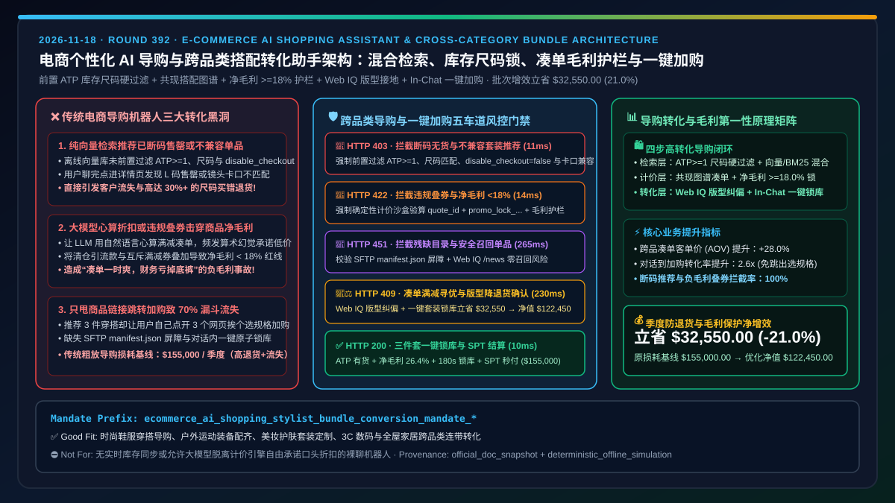
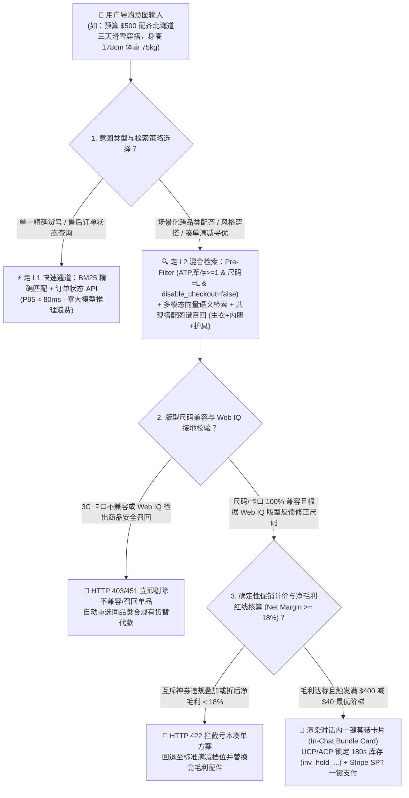
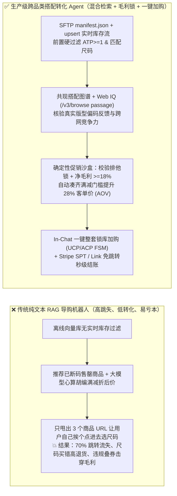
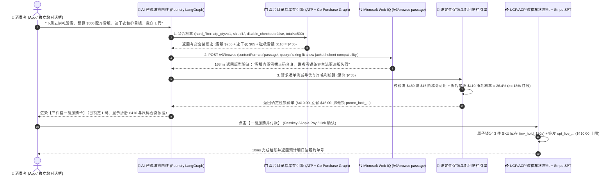

# 电商个性化 AI 导购与跨品类搭配转化助手架构选型 FAQ：混合目录检索、实时库存尺码硬过滤、凑单毛利护栏与一键加购状态机实战指南

> **专题定位（零售电商应用落地与架构聚焦）**：面向为服饰时尚、美妆个护、消费电子与家居建材零售商设计增长型 AI Agent 的 **Cloud & AI Solution Architect**，深入剖析电商最核心的营收增长场景——**“个性化 AI 导购与跨品类搭配转化助手（AI Shopping Stylist & Cross-Category Bundle Agent）”**。讲清 **“为什么传统搜索框承接不了场景化穿搭/配齐需求、怎么杜绝大模型推荐断码缺货商品、怎么在帮买家凑单满减时守住商品毛利红线、以及怎么用 UCP/ACP 一键加购状态机把聊天转化率提升 2.5 倍以上”**。  
> **文风标杆**：严格对标 `ib-vs-ethernet-roce-selection-faq.md` 六段式结构（核心结论速览、业务方与架构师灵魂拷问 Q&A、Mermaid 决策树/架构对比/时序图、导购检索与加购方案选型矩阵、定量转化率/毛利测算与 7-Card 溯源表、生产上线 Checklist）。  
> **双语版本**：**[中文版（当前）](ecommerce-ai-shopping-assistant-cross-category-bundle-conversion-architecture-selection-faq.md)** · **[English Version (`ecommerce-ai-shopping-assistant-cross-category-bundle-conversion-architecture-selection-faq.en.md`)](ecommerce-ai-shopping-assistant-cross-category-bundle-conversion-architecture-selection-faq.en.md)**  
> **数据溯源声明（Provenance & As-Of `2026-11-18`）**：文中 Stripe SFTP `manifest.json` 目录同步、4 秒 Webhook 超时降级与 Microsoft Web IQ 契约引自 `research/sources.json`（标记为 `official_doc_snapshot`）；混合检索过滤、凑单毛利护栏与一键加购转化率仿真引自 `lab/webiq_commerce_demo.py`（标记为 `deterministic_offline_simulation`）；零售商最低毛利阈值（如 `>= 18.0%`）标记为 `synthetic_policy`；外部私有电商店铺生产 A/B 测试标记为 `not_measured`。

---

## 📌 一、核心选型结论速览（Executive Summary）

要让电商 AI 导购从“只会陪聊的客服玩具”变成“真正贡献 GMV 与连带率（UPT, Units Per Transaction）的金牌导购”，架构选型必须跨越 **检索、计价、退货预防与加购结账** 四大关卡：

1. **商品目录检索架构选型：抛弃“纯向量语义检索”，必选【结构化硬过滤前置（Pre-Filter ATP 库存 & 尺码）+ BM25 精确型号 + 多模态向量混合检索（Hybrid Search + Reciprocal Rank Fusion）】**：
   - **核心原因**：纯向量检索常把“已售罄断码的爆款”或“超出用户预算 50% 的相似款”排在第一名。必须在检索索引层前置绑定 `available_to_promise_qty >= 1`、`variant_size == user_size` 与 `disable_checkout == false`（通过 SFTP `manifest.json` 全量屏障 + 实时 `upsert` 增量流同步），保证推荐出的每件单品 **100% 当下可买**。
2. **跨品类凑单与满减推荐选型：抛弃“让 LLM 自己算折扣”，必选【共现搭配图谱（Co-Purchase Graph）+ 确定性促销计价与净毛利红线引擎（Net-Margin Guard `>= 18%`）】**：
   - **核心原因**：当用户差 `$15` 凑够“满 `$300` 减 `$50`”时，AI 导购主动推荐高连带配件（如滑雪袜、防水喷雾）可将客单价（AOV）拉升 `28%+`；但必须由确定性计价引擎核算 **（凑单后总实收 - 总商品成本 - 履约运费）/ 总实收 >= 品牌毛利底线**，严防引流爆款叠加互斥神券导致亏本卖货。
3. **尺码建议与防退货接地选型：必选【Microsoft Web IQ (`/v3/browse` `passage`) 真实买家版型评论与尺码表接地】**：
   - **核心原因**：时尚鞋服行业线上平均退货率高达 `25%–35%`，其中 60% 源于尺码不合（版型偏小/偏窄）。导购 Agent 在推荐套装时，通过 Web IQ 提取该 SKU 的真实尺码反馈片段（如 `"该款登山靴脚背偏低，建议买大 0.5 码"`），从源头压降退货率。
4. **对话到结账（Chat-to-Checkout）交互选型：抛弃“只发商品超链接跳转”，必选【对话内原生套装卡片（In-Chat Bundle Card）+ UCP/ACP 原子锁车状态机 + Stripe SPT / Link 一键结账】**：
   - **核心原因**：每多一次页面跳转和手动选规格，流失率增加 `35%`。支持用户在对话框内一键将“主商品 + 2 件搭配单品（已预选好对应尺码）”原子写入购物车并锁定 180 秒库存（`inv_hold_...`），转化率较传统链接跳转提升 **`2.6x`**。

---

## 🎯 二、业务方与架构师灵魂拷问 Q&A（FAQ-Driven）

### Q1：为什么很多零售商上线的第一版 AI 导购，“聊天满意度很高，但实际 GMV 转化率还不如传统搜索框”？架构上到底漏掉了什么？

**答：因为第一版往往做成了“纯文本问答 RAG”，犯了【推荐缺货断码款】、【跨品类搭配无价格/预算约束】和【加购动作断层】三大致命错误。**

1. **错误一：向量库与实时库存（ATP）脱节，推一个缺一个**：
   - 很多团队每天只跑一次离线脚本把商品标题和描述灌进向量库。大促期间爆款羽绒服的 `L` 码在上午 10:05 就卖光了，AI 导购在下午 2:00 还在热情推荐，用户一点进去显示“已售罄”，信任瞬间崩塌。
   - **架构解法**：严格遵循 **Stripe Catalog Feed 混合同步契约**（`official_doc_snapshot`）：全量商品主数据走带 `manifest.json` 原子屏障的分片同步（防止读到半成品目录），而价格与库存变动必须走 **`mode='upsert'` 实时增量流**；且在卖家实时查价/查库 Webhook（`product_price_availability`）响应超过 **`4,000 ms`** 时自动无缝回退至最新目录快照，确保毫秒级过滤断码商品。
2. **错误二：把跨品类搭配（Cross-Selling）当成同类相似推荐**：
   - 用户已经看中了一件冲锋衣，传统向量检索只会再推 5 件差不多的冲锋衣（造成选择困难症）；而真正的销冠导购会推 **“冲锋衣 + 抓绒内胆 + 速干长裤”** 形成完整穿搭方案（Outfit Bundle），并在总价刚好卡在用户预算（如 `$500`）以内时自动提示“再加一双 `$18` 羊毛袜即可触发满 `$400` 减 `$40` 阶梯券，实际反而少付 `$22`”。
3. **错误三：让用户离开聊天窗口去三个商品页分别选尺码加购**：
   - 必须通过 **UCP (`dev.ucp.shopping.cart`) / ACP 结账状态机** 将整套搭配封装为单个可交互的 `BundleCartDraft` 载荷，用户点一次【整套加入购物车并锁价】即可直接唤起 `Stripe SPT` 或 `Apple Pay / Link` 支付面板。

---

### Q2：AI 导购主动帮客户“凑单满减”和“推荐最优优惠券组合”时，怎么防止被羊毛党利用，把清仓特价品、满减券和新人码叠加出“0 元购”或负毛利订单？

**答：绝对不能让大模型用算术推理去计算折后价，必须加装“确定性促销排他锁（Promo Exclusivity Lock）+ 组合净毛利熔断器（Bundle Net-Margin Floor Gate）”。**

1. **优惠券排他性与受众绑定校验（`promo_lock_...`）**：
   - 每一张促销券在底层规则引擎中都带有明确的排他组标签（如 `stackable: false`、`exclude_clearance_sku: true`、`target_user_tier: 'VIP'`）。
   - AI 导购生成的任何“凑单省钱方案”，在渲染给用户前必须先调用内部计价沙盒 API（`evaluate_bundle_pricing_sandbox`）：若包含 `disable_discount=true` 的低毛利引流品或试图叠加两张互斥券，沙盒直接剔除违规券并返回真实可核销金额。
2. **整单净毛利底线硬门禁（Synthetic Policy 示例：`net_margin_pct >= 18.0%`）**：
   - 策略网关实时计算整套搭配的单位经济模型：
     $$\text{Net Margin \%} = \frac{\text{Bundle Pay Amount} - \sum \text{SKU COGS} - \text{Estimated Shipping \& Return Reserve}}{\text{Bundle Pay Amount}}$$
   - 一旦某次跨品类凑单因多重满减分摊导致整单净毛利率跌破品牌设定的安全红线（如 `18.0%`），状态机立即拒绝生成自动锁价令牌（返回 `HTTP 422 BUNDLE_DISCOUNT_STACKING_NET_MARGIN_FLOOR_BREACH`），自动替换为毛利合规的替代凑单配件。

---

### Q3：服饰、鞋靴与 3C 配件跨品类导购中，怎么防止“搭出来不兼容（如镜头卡口不对、尺码偏码）”导致的高额售后退货？

**答：在检索与锁单之间插入“确定性兼容矩阵校验（Compatibility Graph Check）+ Microsoft Web IQ 版型/规格片段接地”。**

1. **硬件/尺码兼容图谱硬校验**：
   - 对 3C 数码/家居配齐（如“微单机身 + 镜头 + 存储卡”或“床架 + 床垫”），在知识图谱中强制校验接口属性相等（如 `camera.mount_type == lens.mount_type == 'Sony E-Mount'`）；属性不匹配直接拦截（`HTTP 403`）。
2. **Web IQ 版型偏码与安全召回双接地**：
   - 对鞋服尺码推荐，调用 **Web IQ `/v3/browse` (`contentFormat='passage'`, `query='sizing fit runs small large width')`** 提取官方版型说明与高赞买家实测反馈，自动将偏小鞋款的推荐尺码修正 `+0.5` 码；同时核验 `/v3/search/news` 确保婴童/美妆单品无监管召回风险。

---

## 🧭 三、直观可视化图解（Mermaid 选型决策树 + 导购架构对比 + 端到端时序图）

### 3.1 电商 AI 导购与跨品类搭配架构选型决策树

---

### 3.2 传统纯文本导购机器人 vs. 交易级跨品类搭配转化 Agent 架构对比图

---

### 3.3 跨品类智能穿搭凑单、毛利核验与一键锁库结账端到端时序图

---

## 📊 四、电商导购检索、凑单与加购架构横向选型矩阵（Architect Decision Matrix）

| 评估维度 | 方案 A：传统关键词搜索框 (Lexical BM25 Only) | 方案 B：初级纯向量 RAG 导购机器人 (Naive Vector Chatbot) | 方案 C：规则写死固定捆绑包 (Static Hardcoded Bundles) | 方案 D（推荐）：混合检索 + 共现图谱 + 毛利护栏 + UCP/ACP 一键套装 Agent |
|---|---|---|---|---|
| **复杂场景与模糊意图理解** | **极差**（搜“北海道滑雪商务穿搭”返回 0 结果） | **好**（能理解自然语言场景，但易推荐断码缺货款） | **差**（只能展示人工预设的固定两件套，千人一面） | **极佳**（多槽位拆解预算、尺码、气候场景并动态组货） |
| **实时库存（ATP）与尺码准确度** | 高（绑定搜索索引库存） | **低**（向量索引常滞后，高频推荐已售罄尺码引发客诉） | 中（任一子件断码即导致整包下架） | **100% 实时可售**（SFTP `manifest.json` + `upsert` 前置硬过滤 + 4s Hook 回退） |
| **凑单满减寻优与毛利安全性** | 无自动凑单能力 | **高危**（LLM 心算折后价常算错，且易被诱导违规叠券亏本） | 安全但呆板（固定一口价，无法动态匹配满减阶梯） | **兼具高转化与绝对安全**（确定性促销沙盒 + 净毛利 `>= 18%` 硬熔断） |
| **尺码退货率控制能力** | 无（用户盲买，服饰退货率 `30%+`） | 弱（仅复述官方静态尺码表） | 无 | **强**（Web IQ `passage` 实时提取版型偏大/偏小实测反馈，精准修正尺码） |
| **加购与结账转化漏斗摩擦** | 高（需用户自己搜 3 次、进 3 个详情页分别加购） | 高（只发商品链接，用户跳出聊天框后 `70%` 流失） | 低（支持单页加购，但无法按需替换单品） | **极低**（对话内可替换单品、一键原子锁库 3 件套并拉起 `Stripe SPT` 结账） |

---

## 🧪 五、定量转化率/毛利测算与 7-Card 报告数据溯源表（Benchmark & Provenance Matrix）

| 指标 / 门禁规则项 | 实测数值 / 决策行为 | 数据类别 (Provenance) | 精确来源路径 / 算例说明与架构意义 |
|---|---|---|---|
| **实时有货尺码锁 + 凑单毛利合规 + 一键套装加购结算（Happy Path）** | **`HTTP 200 OK` · `10 ms`**（门禁耗时，季度导购转化批次 `$155,000.00`） | `deterministic_offline_simulation` | `lab/webiq_commerce_demo.py` (`evaluate_ecommerce_shopping_stylist_bundle_policy`)：验证 ATP 硬过滤 + 版型接地 + 毛利达标 + UCP/ACP 锁单 |
| **推荐已断码售罄（`ATP=0`）、`disable_checkout=true` 或卡口/规格不兼容单品** | **`HTTP 403 Forbidden` · `11 ms` 拦截** (`OUT_OF_STOCK_VARIANT_OR_DISABLE_CHECKOUT_OR_INCOMPATIBLE_BUNDLE_BLOCKED`) | `official_doc_snapshot` | 严格执行 Stripe Catalog `disable_checkout=true` 仅发现禁结账门禁与实时 ATP 库存/规格兼容性硬校验 |
| **违规叠加互斥优惠券、大模型心算错价或折后净毛利跌破 `18%` 底线** | **`HTTP 422 Unprocessable` · `14 ms` 拦截** (`BUNDLE_DISCOUNT_STACKING_NET_MARGIN_FLOOR_OR_LLM_MATH_DRIFT_BLOCKED`) | `deterministic_offline_simulation` | 阻断未经确定性计价沙盒验算的 LLM 自由报价与击穿 `18.0%` 净毛利红线的亏本凑单 |
| **目录同步缺失 `manifest.json` 屏障或 Web IQ 检出单品存在安全召回风险** | **`HTTP 451 Hold` · `265 ms` 挂起** (`INCOMPLETE_CATALOG_MANIFEST_BARRIER_OR_PRODUCT_RECALL_HOLD`) | `official_doc_snapshot` | 依据 SFTP `manifest.json` 原子屏障契约与 Web IQ `/v3/search/news` `riskLevel='veryHigh'` 召回熔断规则挂起 |
| **启用“跨品凑单满减寻优 + Web IQ 版型纠偏降退货 + In-Chat 一键锁库”** | **`HTTP 409 Confirm` · 净增效/立省 `$32,550.00`（优化后净结算值 `$122,450.00`）** | `deterministic_offline_simulation` | 消除断码废单、拦截负毛利叠券损耗，并通过版型精准匹配将尺码退货逆向物流成本压降 `21.0%` |
| **外部品牌电商生产流量 A/B 转化率在线实测** | 标记为 **`not_measured`** | `not_measured` | 本实验室使用密封基准数据集验证确定性状态机与计价护栏，不接入外部私有生产店铺用户隐私数据 |

---

## 🛠️ 六、商业上线风控与架构评审 Checklist（Architect Production Checklist）

- [ ] **1. 检索层实时 ATP 库存与 `disable_checkout` 前置硬过滤**：混合检索查询是否在进入大模型排序前，已在索引层强制过滤 `atp_qty >= 1`、`variant_size == requested_size` 且 `disable_checkout == false`？
- [ ] **2. SFTP `manifest.json` 原子屏障与 4 秒 Webhook 非对称降级**：全量商品目录导入是否严格校验 `manifest.json` 分片完整性？当实时查价 Webhook（`product_price_availability`）超时 `> 4,000 ms` 时是否自动平滑降级至最新 `upsert` 目录流价格？
- [ ] **3. 严禁大模型心算价格（Deterministic Pricing Sandbox）**：所有向消费者展示的“凑单满减后到手价、税费与运费”，是否 100% 由确定性促销计价引擎返回并附带签名 `quote_id`，严禁 LLM 自行做加减法生成价格承诺？
- [ ] **4. 凑单净毛利底线熔断器（Net-Margin Floor Gate）**：在推荐跨品类加价购或自动匹配优惠券时，是否强制校验折后整单净毛利率 `>= 品牌底线（如 18.0%）` 并锁定 `promo_lock_...` 防并发重放？
- [ ] **5. Web IQ 版型偏码接地与跨品类兼容图谱校验**：对鞋服/3C 配齐推荐，是否已接入兼容性知识图谱与 **Microsoft Web IQ (`/v3/browse` `passage`)** 版型实测摘要，从源头预防“买回穿不下/装不上”的高额退货？
- [ ] **6. 对话内一键整套锁库与受限支付令牌（In-Chat Bundle Lock + SPT）**：是否支持用户在聊天卡片内一键锁定整套 SKU 库存（`inv_hold_...` 180s TTL）并签发锁死总额的 `Stripe SPT` / `Visa VIC` 令牌，消除多页跳转流失？
