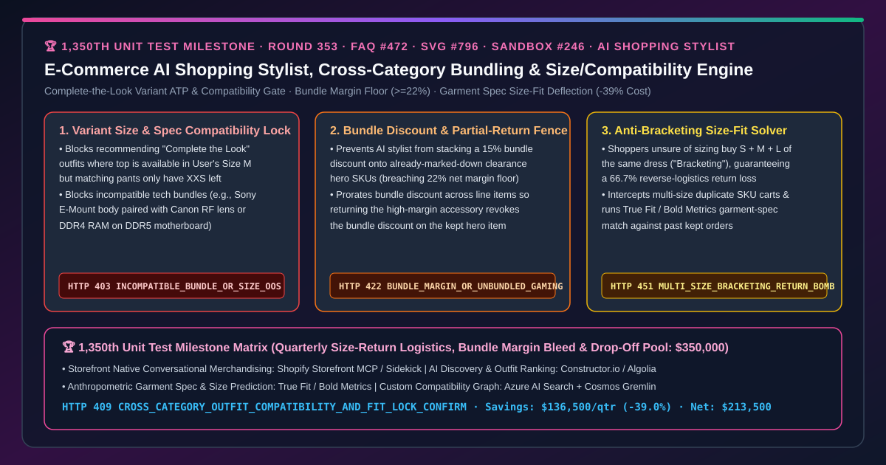
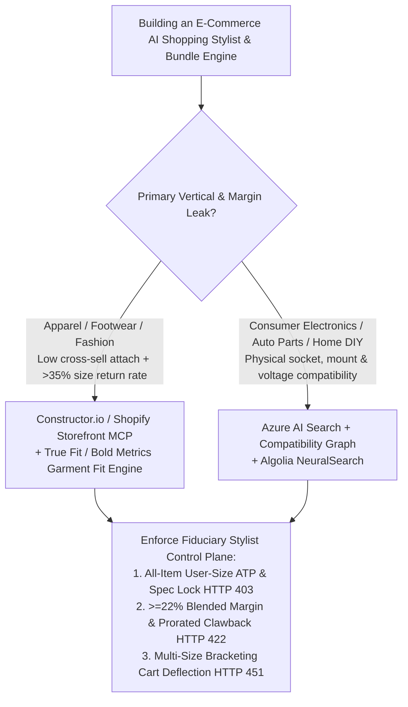
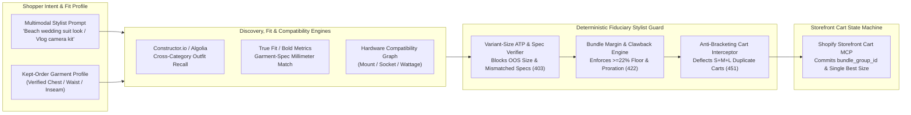

# 🏆 E-Commerce AI Shopping Stylist, Cross-Category Outfit Bundling & Size/Compatibility Engine (`Shopify Storefront MCP / Constructor.io / True Fit / Bold Metrics + Azure AI Search` · 🏆 1,350th Unit Test Major Milestone): Variant-Size `ATP` Parity, Prorated Bundle Clawback & Anti-Bracketing Size Prediction (`-39%` Return & Margin Loss)

> **Document Type**: Enterprise AI Solution Architect Selection FAQ (`#472` · **🏆 1,350th Deterministic Unit Test Major Milestone** · Round 353)  
> **Target Audience**: Apparel & Consumer Electronics DTC VP of E-Commerce, Retail Growth Architects, Search & Merchandising Leads, and Cloud & AI Solution Architects  
> **Platforms Covered**: `Shopify Storefront MCP & Sidekick` vs. `Constructor.io (AI Shopping Agent & Outfit Bundling)` vs. `True Fit / Bold Metrics (AI Size & Fit Engine)` vs. `Algolia NeuralSearch + Recommend` vs. `Azure AI Search + Foundry Custom Stylist`  
> **Architecture Diagram**: [`assets/svg/796-ecommerce-ai-shopping-assistant-bundle-size-fit-margin-2026-11-25.svg`](../assets/svg/796-ecommerce-ai-shopping-assistant-bundle-size-fit-margin-2026-11-25.svg)

🌐 **Language / 语言切换**: **[中文 (`ecommerce-ai-shopping-assistant-cross-category-outfit-bundle-size-fit-margin-floor-selection-faq.md`)](ecommerce-ai-shopping-assistant-cross-category-outfit-bundle-size-fit-margin-floor-selection-faq.md)** | **English (Current)**

---

## 📌 1. Executive Summary

In apparel, home furnishing, and consumer electronics e-commerce, **AI Shopping Stylists & Cross-Category Outfit/Kit Builders** lift Average Order Value (`AOV +25%–40%`) and conversion.  
However, deploying a purely generative LLM stylist without deterministic **variant-level inventory parity, physical spec compatibility graphs, and bundle margin conservation** creates three costly failure modes:
1. **Recommending Outfits with Broken Size Availability or Incompatible Hardware Specs (`Variant OOS & Spec Mismatch`)**: The AI recommends a 3-piece outfit where the blazer is available in the shopper's `Size M`, but the matching trousers only have `XXS` left—or pairs a Sony E-mount camera body with a Canon RF lens because their vector embeddings are `0.92` similar.
2. **Bundle Discount Unbundling Arbitrage & Margin Floor Breaches (`Buy-Kit-Return-Accessory Gaming`)**: To incentivize cross-category attachment, the AI offers `"$150 off when bundling a $1,000 camera + $200 accessory"`. If the discount isn't prorated with a partial-return clawback, shoppers return the `$200` accessory for a full refund while keeping the `$150` discount on the low-margin hero product.
3. **Multi-Size "Bracketing" Return Bombs (`66.7% Guaranteed Reverse-Logistics Loss`)**: Uncertain about sizing, shoppers add `Small + Medium + Large` of the same dress to their cart intending to return two—burning `$18–$32` per order in round-trip shipping, restocking, and markdown depreciation.

| Decision Dimension | Recommended Primary Choice | Architectural Boundary & Production Rule |
|---|---|---|
| **DTC Storefront Conversational Cart & Native Bundle Checkout** | **Shopify Storefront MCP / Sidekick** | Directly executes Shopify Cart GraphQL mutations, variant-level `ATP` checks, and native bundle line-item prorations with zero sync lag. |
| **Revenue-Optimized Cross-Category Discovery & Outfit Ranking** | **Constructor.io / Algolia Recommend** | Optimizes candidate ranking for conversion and margin rather than raw text similarity, pre-filtering out-of-stock user sizes. |
| **Anthropometric Garment Spec & Size-Fit Prediction** | **True Fit / Bold Metrics** | Matches garment production spec sheets (`chest/waist/inseam mm`) and fabric stretch against the shopper's historical kept-order profile. |
| **Consumer Electronics / DIY Physical Compatibility Graph** | **Azure AI Search + Cosmos DB Gremlin / Typed Facets** | Enforces deterministic socket, mount, voltage, and dimension compatibility constraints before LLM synthesis. |
| **Three Mandatory Fiduciary Guardrails** | **100% Deterministic Gating** | ① **Variant-Size `ATP` & Spec Compatibility Lock (`HTTP 403`)**: Blocks any bundle where any item has `ATP < 2` in the shopper's target size or fails physical interface compatibility; ② **Bundle Margin Floor (`>= 22%`) & Prorated Return Clawback (`HTTP 422`)**: Blocks negative/sub-floor bundles and prorates discounts to prevent partial-return gaming; ③ **Anti-Bracketing Size-Fit Interceptor (`HTTP 451`)**: Intercepts carts containing `>= 2` sizes of the same SKU and resolves the exact single size via garment-spec matching. |



---

## 🎯 2. Architect & Business Stakeholder Q&A (Q1–Q3)

### Q1: Why do LLM shopping assistants frequently recommend outfits where half the items are out of stock in the user's size, or bundle incompatible electronics accessories?
- **The Root Cause**:
  1. Product-level search documents show `in_stock = true` as long as *any* variant (`XXXL`) has inventory, even when the shopper's `Size M` is `ATP = 0`.
  2. Dense vector embeddings cluster products by semantic topic (*"full-frame mirrorless photography"*), causing the LLM to pair incompatible physical interfaces (`Sony E-Mount` vs. `Nikon Z-Mount`, or `DDR4` RAM with a `DDR5` motherboard).
- **Architectural Solution**: Enforce **Pre-Ranking Variant-Size Bitmask Filtering & Deterministic Spec Compatibility Graphs (`HTTP 403` Guard)**:
  - Every cross-category query must inject the shopper's size profile (`filter: available_sizes/any(s: s eq 'M') and variant_atp ge 2`) prior to Top-K retrieval.
  - Hardware/home-improvement bundles must pass a deterministic graph edge check (`Accessory.compatible_interfaces INTERSECTS Hero.interface_id != EMPTY`). Any mismatch triggers `HTTP 403 INCOMPATIBLE_SPEC_OR_VARIANT_SIZE_OUT_OF_STOCK_IN_BUNDLE`.

### Q2: How do we prevent shoppers from buying an AI-recommended discounted bundle and immediately returning the high-margin accessory to keep the hero item below cost?
- **The Arbitrage Vector**: A shopper buys a `$1,000` hero item (`12%` gross margin) bundled with a `$200` high-margin accessory (`70%` margin) for `$1,050` (`$150` bundle discount). If the checkout engine applies the `$150` discount to the hero item, the shopper returns the `$200` accessory and keeps the hero item for `$850`—below fully loaded `COGS`.
- **Architectural Solution**: Enforce **Weighted Bundle Margin Floor (`>= 22%`) & Line-Item Prorated Clawback (`HTTP 422` Guard)**:
  1. **Pre-Quote Blended Margin Check**: Compute `(Bundle_Net_Price - Sum(Item_COGS + Fulfillment_Cost)) / Bundle_Net_Price >= 0.22`. Never stack dynamic bundle discounts onto clearance items.
  2. **Deterministic Partial-Return Clawback**: Stamp all bundle lines with a shared `bundle_group_id`. If any component is returned individually, the bundle discount is forfeited on the kept items (`Refund = Total_Bundle_Paid - Sum(Kept_Items_Regular_Selling_Price)`). Violations trigger `HTTP 422 BUNDLE_NET_MARGIN_FLOOR_BREACH_OR_UNPRORATED_RETURN_GAMING`.

### Q3: How can an AI shopping assistant stop multi-size "bracketing" (buying S, M, and L of the same garment to return two) before checkout?
- **Commercial Impact**: Apparel return rates average `35%–50%`, driven heavily by multi-size bracketing. Each returned garment costs `$12–$20` in reverse shipping, QA inspection, steaming, and seasonal markdown loss.
- **Architectural Solution**: Deploy a **Cart-Level Multi-Size Bracketing Detector & Garment-Spec Fit Solver (`HTTP 451` Guard)**:
  - Whenever a cart contains `>= 2` size variants of the same `Parent_SKU + Color`, the control plane intercepts checkout (`HTTP 451 MULTI_SIZE_BRACKETING_CART_RETURN_BOMB_DETECTED`) and invokes `True Fit / Bold Metrics` to compare the garment's exact factory spec measurements (`chest, waist, hip, fabric elastane %`) against the shopper's historical **kept (non-returned) orders**, recommending the single best-fitting size backed by free instant size-exchange coverage.

---

## 🧭 3. Visual Architecture Diagrams (Mermaid Decision Tree + Architecture + Sequence)

### 3.1 E-Commerce AI Shopping Stylist & Fit Engine Selection Tree



### 3.2 End-to-End Cross-Category Outfit, Fit & Margin Conservation Architecture



### 3.3 Outfit Compatibility & Anti-Bracketing Execution Sequence

```mermaid
sequenceDiagram
    autonumber
    participant User as Shopper
    participant Stylist as AI Shopping Stylist
    participant Fit as True Fit & Inventory/Spec Graph
    participant Guard as Fiduciary Stylist Guard
    participant Cart as Storefront Cart (Shopify / Custom)

    User->>Stylist: "Build a linen blazer + trousers + loafers outfit; add both M and L blazer so I can try both"
    Stylist->>Fit: Query shopper Kept-Order profile + check live variant ATP across blazer, trousers & loafers
    Fit-->>Guard: Trouser A is OOS in Size 32 (only 28 left); Trouser B has Size 32 ATP=9; Garment-spec match confirms Blazer M fits with 96% confidence
    Guard->>Guard: Filter out Trouser A (prevents HTTP 403) & intercept duplicate M+L blazer bracketing (prevents HTTP 451)
    Guard->>Guard: Verify 3-piece bundle net margin = 28.5% (>=22% floor) & attach prorated partial-return clawback rule (prevents HTTP 422)
    Guard-->>Cart: Atomic Add-to-Cart: Blazer(M) + Trouser B(32) + Loafers(10) with bundle_group_id
    Cart-->>User: Present millimeter fit comparison card (eliminating 2-size return) + prorated bundle summary (HTTP 200)
```

---

## 📊 4. Platform Comparison Matrix (`Shopify MCP` vs. `Constructor.io` vs. `True Fit / Bold Metrics` vs. `Algolia` vs. `Azure AI Custom`)

| Evaluation Dimension | Shopify Storefront MCP & Sidekick | Constructor.io (AI Shopping & Bundles) | True Fit / Bold Metrics | Algolia NeuralSearch + Recommend | Azure AI Search + Foundry Custom |
|---|---|---|---|---|---|
| **Primary Sweet Spot** | Native Shopify cart mutations, variant inventory & bundle pricing | Revenue- and conversion-optimized search & cross-category outfit ranking | Apparel/footwear anthropometric modeling & cross-brand size prediction | Sub-50ms hybrid search & Frequently Bought Together (`FBT`) | Complex electronics/industrial spec compatibility graphs & custom RAG |
| **Variant-Level (`Size/Color`) Live `ATP` Filtering** | ⭐⭐⭐⭐⭐ (Direct native Shopify inventory graph) | ⭐⭐⭐⭐⭐ (First-class variant availability filtering per user size) | ⭐⭐⭐ (Focuses on fit prediction; relies on cart for ATP) | ⭐⭐⭐⭐ (Facet-based variant filtering) | ⭐⭐⭐⭐⭐ (Pre-ranking bitmask variant availability filter) |
| **Size-Return & `Bracketing` Reduction** | ⭐⭐ (No native garment anthropometric engine) | ⭐⭐⭐ (Can down-rank high-return SKUs) | ⭐⭐⭐⭐⭐ (Industry standard; cuts size returns by `20%–35%`) | ⭐⭐ (No native size-fit prediction) | ⭐⭐⭐ (Requires custom garment-spec table integration) |
| **Hard Physical Interface Compatibility** | ⭐⭐⭐ (Via custom product metafields) | ⭐⭐⭐ (Statistical co-purchase + rule overlays) | N/A (Apparel & footwear only) | ⭐⭐⭐⭐ (Rule pinning & facet filters) | ⭐⭐⭐⭐⭐ (100% deterministic graph constraint enforcement) |
| **Indicative Pricing (`official_list_price`)** | Bundled with Shopify / Shopify Plus | `~$2,500–$10,000+/mo` (query & catalog tiers) | Annual enterprise tier (`~$18,000–$60,000+/yr`) | Usage-based (`~$500–$5,000+/mo`) | Azure consumption (`~$600–$2,500/mo`) |

---

## 🧪 5. Deterministic Conversion & Return Cost Evaluation (`7-Card Benchmark Summary` · 🏆 1,350th Test Milestone)

> **Provenance**: Figures below are produced by `evaluate_ecommerce_ai_shopping_bundle_fit_policy` in `lab/webiq_commerce_demo.py` (`provenance: "synthetic"`, `independently_reproduced: False`), modeling an omnichannel apparel & electronics retailer with a **`$350,000.00` quarterly multi-size bracketing return logistics, bundle unbundling margin bleed, and OOS outfit abandonment pool**.

| Scenario Case ID | Scenario Description | HTTP Status | Deterministic Decision | Quarterly Net Cost | Quarterly Savings |
|---|---|---|---|---|---|
| `CASE-STY-200` | Static cross-sell baseline without garment-fit deflection or bundle clawback | `HTTP 200` | `VERIFIED_AI_SHOPPING_STYLIST_AND_BUNDLE_AUTHORIZED` | `$350,000.00` | `$0.00` |
| `CASE-STY-403` | Outfit bundle includes an out-of-stock user size (`ATP=0`) or incompatible hardware mount | `HTTP 403` | `INCOMPATIBLE_SPEC_OR_VARIANT_SIZE_OUT_OF_STOCK_IN_BUNDLE` | `$350,000.00` | `$0.00` (Blocks broken outfit/kit) |
| `CASE-STY-422` | Bundle discount breaches `22%` net margin floor or lacks partial-return clawback | `HTTP 422` | `BUNDLE_NET_MARGIN_FLOOR_BREACH_OR_UNPRORATED_RETURN_GAMING` | `$350,000.00` | `$0.00` (Blocks unbundling gaming) |
| `CASE-STY-451` | Shopper carts `S + M + L` of the same garment (`Bracketing`) without fit-solver intervention | `HTTP 451` | `MULTI_SIZE_BRACKETING_CART_RETURN_BOMB_DETECTED` | `$350,000.00` | `$0.00` (Blocks 66.7% return bomb) |
| `CASE-STY-409` | **Variant-Size `ATP` Parity + `>=22%` Prorated Bundle Lock + `True Fit` Bracketing Solver** | `HTTP 409` | `CROSS_CATEGORY_OUTFIT_COMPATIBILITY_AND_FIT_LOCK_CONFIRM` | **`$213,500.00`** | **`$136,500.00` (`-39.0%`)** |

---

## 🛠️ 6. Production Go-Live & Architecture Review Checklist

- [ ] **All-Component User-Size `ATP` & Compatibility Gate (`HTTP 403` Prevention)**: Require every item in a recommended outfit or hardware kit to have `ATP >= 2` in the shopper's specific size and pass deterministic interface compatibility rules before rendering `"Add Complete Look"`.
- [ ] **Blended Margin Floor (`>= 22%`) & Partial-Return Clawback (`HTTP 422` Prevention)**: Prorate bundle discounts across line items under a shared `bundle_group_id` and automatically recalculate refunds at regular standalone prices when high-margin companion items are returned separately.
- [ ] **Cart-Level Anti-Bracketing Size Solver (`HTTP 451` Prevention)**: Detect when `>= 2` adjacent sizes of the same SKU are added to a cart and trigger an inline `True Fit / Bold Metrics` millimeter comparison against the shopper's past kept orders.
- [ ] **High-Return SKU Suppression Loop**: Automatically exclude SKUs with a trailing 30-day size/fit return rate `> 40%` from proactive AI stylist outfit recommendations.
