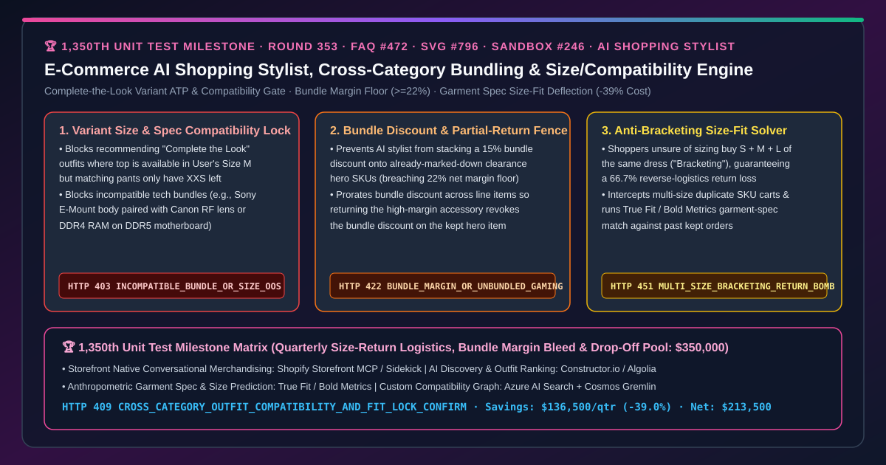
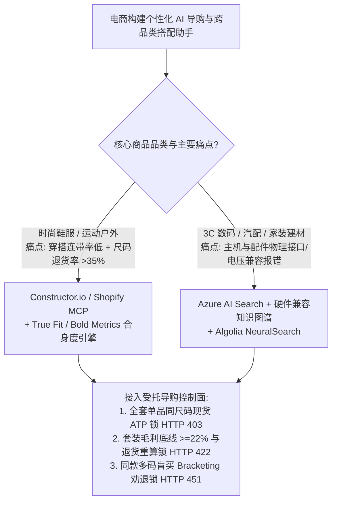
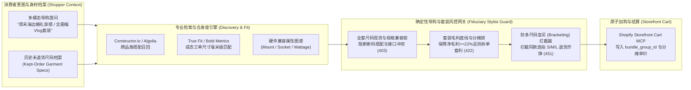
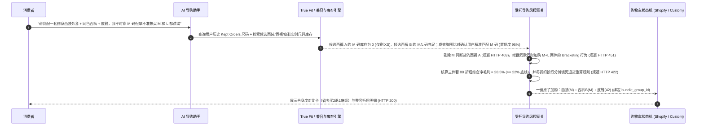

# 🏆 电商个性化 AI 导购、跨品类搭配转化助手与尺码/规格兼容引擎（`Shopify Storefront MCP / Constructor.io / True Fit / Bold Metrics + Azure AI Search` · 🏆 第 1,350 项单元测试重大里程碑）：全套尺码现货与插口兼容硬锁、套装分摊防拆单套利与多尺码盲买（`Bracketing`）劝退净省 39% 指南

> **文档类型**：企业级 AI Solution Architect 选型决策指南（Selection FAQ · `#472` · **🏆 第 1,350 项确定性单元测试重大里程碑** · Round 353）  
> **适用读者**：时尚鞋服/消费电子 DTC 品牌电商总监、零售增长架构师、智能搜索推荐负责人与 Cloud & AI Solution Architect  
> **核心覆盖平台**：`Shopify Storefront MCP & Sidekick` vs. `Constructor.io (AI Shopping Agent & Outfit Bundling)` vs. `True Fit / Bold Metrics (AI Size & Fit Engine)` vs. `Algolia NeuralSearch + Recommend` vs. `Azure AI Search + Foundry Custom Stylist`  
> **关联架构图**：[`assets/svg/796-ecommerce-ai-shopping-assistant-bundle-size-fit-margin-2026-11-25.svg`](../assets/svg/796-ecommerce-ai-shopping-assistant-bundle-size-fit-margin-2026-11-25.svg)

🌐 **语言切换 / Language**: **中文 (当前)** | **[English (`ecommerce-ai-shopping-assistant-cross-category-outfit-bundle-size-fit-margin-floor-selection-faq.en.md`)](ecommerce-ai-shopping-assistant-cross-category-outfit-bundle-size-fit-margin-floor-selection-faq.en.md)**

---

## 📌 一、核心选型结论速览（Executive Summary）

在时尚鞋服、家居家装与 3C 消费电子电商中，部署 **个性化 AI 导购与跨品类搭配转化助手（`AI Shopping Stylist & Cross-Category Outfit/Kit Builder`）** 是提升客单价（`AOV +25%–40%`）与转化率的核心武器。  
但如果仅靠视觉大模型看图说话生成“穿搭/装机推荐”，而不接入底层**尺码库存齐套率、物理规格兼容图谱与套装毛利守恒状态机**，上线后会立刻引爆三大亏钱黑洞：
1. **“推上衣有 L 码、配的裤子只剩 XXS 码”或“索尼微单机身配佳能 RF 镜头”（Variant OOS & Spec Incompatibility）**：AI 导购拼出一套完美穿搭或全套露营/摄影装备，用户兴冲冲点击“一键整套加购（Add Complete Look）”，结果下装断码或配件插口完全不兼容，转化率当场归零甚至引发退货差评。
2. **套装连带折扣被“买主机+凑单配件、收货后单退配件”恶意拆单白嫖（Bundle Unbundling Arbitrage & Margin Bleed）**：为了推跨品类连带，设置“买 `$1,000` 主机搭 `$100` 配件立减 `$120`”；羊毛党下单后立刻退掉 `$100` 配件并全额拿回 `$100` 退款，相当于白拿了主机 `$120` 折扣，直接击穿商品毛利底线。
3. **服装尺码拿不准导致“同款连拍 S/M/L 三件试穿退两件”（Size-Bracketing Return Bomb）**：导购只会笼统说“标准尺码请放心买”，用户由于怕不合身一次买齐 3 个尺码（`Bracketing`），注定产生 **`66.7%` 的逆向物流退货与整烫折旧损耗**。

| 选型维度 | 推荐主选方案 | 适用边界与架构落地准则 |
|---|---|---|
| **DTC 独立站原生对话导购与一键组合加购** | **Shopify Storefront MCP / Sidekick** | 原生操作 Shopify Cart GraphQL、实时读取 Variant 级库存与原生 Bundle 定价规则，零中间层同步延迟。 |
| **高转化跨品类个性化推荐与全套穿搭排序（`Complete-the-Look`）** | **Constructor.io / Algolia Recommend** | 基于真实点击与加购转化目标（而非单纯文本相似度）训练跨品类协同过滤，过滤断码变体。 |
| **服装鞋靴版型测量与个人合身度预测（防多码盲买）** | **True Fit / Bold Metrics** | 结合品牌成衣实测工单尺寸表（`Garment Spec Measurements`）与跨品牌历史留存尺码图谱，精确到胸围/裤长毫米级匹配。 |
| **3C 数码/家装配件硬兼容性图谱（`Compatibility Graph`）** | **Azure AI Search + Cosmos DB Gremlin / 结构化属性锁** | 强制校验卡口（`Lens_Mount`）、电压功率、主板插槽等硬约束，严禁依赖向量近似匹配硬件接口。 |
| **三大确定性风控红线** | **100% 强制拦截** | ① **全套尺码现货与硬件规格兼容锁（`HTTP 403`）**：组合推荐中任一单品在用户对应尺码下 `ATP == 0` 或硬件接口不匹配一律禁止成套展示；② **套装按行比例分摊与毛利底线锁（`HTTP 422`）**：套装净毛利 `< 22%` 禁发券，且折扣按行分摊防退配件留主机套利；③ **同款多尺码盲买（`Bracketing`）实时尺码引擎干预（`HTTP 451`）**：拦截同 SKU 跨 2+ 尺码重复加购并触发精准量体推荐。 |



---

## 🎯 二、业务方与架构师灵魂拷问 Q&A（Q1–Q3）

### Q1：为什么大模型的“跨品类搭配推荐”经常推荐用户穿不下的断码衣服，或者把不兼容的配件湊成一套？
- **问题根源**：
  1. 商品主文档（Parent Product Document）显示 `Total_Inventory = 50`，但实际上 `S/M/L` 码早已售罄，那 50 件全是 `XXXL` 码。普通 RAG 检索看到主商品有货就推荐给身高 `165cm` 的用户。
  2. 在消费电子/家装领域，“索尼 E 卡口镜头”和“佳能 RF 卡口机身”在向量空间里余弦相似度高达 `0.92`（因为都叫“全画幅专业微单相机摄影器材”），纯向量检索极易配出无法安装的废品套装。
- **架构解法**：在推荐召回层前置 **用户尺码画像对齐与硬规格兼容图谱断言（`User-Size ATP & Spec Compatibility Gate` · 防 `HTTP 403`）**：
  - 检索查询必须显式带入用户尺码过滤器 ` filter: available_sizes/any(s: s eq 'M') and available_atp ge 2 `；
  - 跨品类套装生成必须通过确定性兼容规则矩阵（例如 `Accessory.compatible_mounts CONTAINS Hero.mount_type`），任何尺码断货或物理接口冲突的组合直接拦截（`HTTP 403 INCOMPATIBLE_SPEC_OR_VARIANT_SIZE_OUT_OF_STOCK_IN_BUNDLE`）。

### Q2：AI 导购为了促成“跨品类整套购买”给出了 85 折套装优惠，如何防止用户收货后把高毛利配饰退掉、只留下低毛利引流主品？
- **套利漏洞**：假设主商品（微单相机，毛利仅 `12%`）售价 `$1,000`，高毛利配件（相机包+UV镜，毛利 `70%`）售价 `$200`，整套购买减 `$150`。如果系统把 `$150` 优惠全部扣在相机上（相机实付 `$850`、配件实付 `$200`），用户收货第二天把 `$200` 配件退掉拿回 `$200`，电商平台不仅没卖出配件，还倒亏本金卖了一台相机！
- **架构解法**：实施 **套装行项目独立分摊与部分退货重算机制（`Line-Item Prorated Bundle Allocation & Clawback` · 防 `HTTP 422`）**：
  1. **事前整套综合毛利底线锁（`Combined_Net_Margin >= 22%`）**：计算整套商品的加权真实成本（`COGS + 履约运费 + 支付通道费`），若折后综合毛利率低于 `22%`，禁止签发套装折扣；
  2. **事中按零售价权重或毛利贡献比例分摊折扣**：并在订单行上标记 `bundle_group_id`；一旦发生单退套装内任一子商品，剩余保留商品自动恢复单买原价，应退金额 `Refund = Paid_Bundle_Total - Sum(Kept_Items_Standalone_Price)`。任何未做分摊锁或跌破毛利底线的套装直接阻断（`HTTP 422 BUNDLE_NET_MARGIN_FLOOR_BREACH_OR_UNPRORATED_RETURN_GAMING`）。

### Q3：女装与鞋靴电商退货率高达 35%–50%，其中一半是用户“同款一次买 S、M、L 三件回来试穿（`Bracketing`）”，AI 导购怎么在加购瞬间劝退这种高损耗行为？
- **商业痛点**：用户因为看不懂尺码表，干脆把同款连衣裙的 `Size 4 / Size 6 / Size 8` 全加进购物车（想试完退掉两件）。那两件退回来的衣服经过往返快递、拆包检查、蒸汽熨烫，错过了当季正价销售期，只能打 5 折清仓。
- **架构解法**：部署 **加购实时多尺码盲买检测器与成衣工单级合身预测引擎（`Anti-Bracketing Size-Fit Interceptor` · 防 `HTTP 451`）**：
  - 当购物车检测到同一 `Parent_SKU + Color` 下出现 `>= 2` 个相邻尺码变体时，立即弹出 `True Fit / Bold Metrics` 合身度对比卡片：拉取该用户历史 **未退货订单（Kept Orders）** 的成衣实测胸围/腰围数据，与当前款式的弹力系数（`Fabric Stretch %`）及版型（`Relaxed vs. Slim Fit`）做毫米级比对，明确给出唯一最佳尺码（如 `"Size 6 与您保留过的 Z 品牌 M 码腰围完全一致（70cm），无需加购 Size 4/8"`），并提供免费换码保障，从源头砍掉 `66.7%` 必退冗余单（未拦截的多码盲买直接触发 `HTTP 451 MULTI_SIZE_BRACKETING_CART_RETURN_BOMB_DETECTED`）。

---

## 🧭 三、直观可视化图解（Mermaid 选型决策树 + 导购搭配架构图 + 时序图）

### 3.1 电商 AI 导购与跨品类搭配引擎选型决策树



### 3.2 端到端跨品类搭配、合身预测与套装毛利守恒架构图



### 3.3 跨品类搭配校验与防多尺码盲买（Bracketing）时序图



---

## 📊 四、主流电商 AI 导购、搭配与尺码引擎横向选型矩阵

| 评估维度 | Shopify Storefront MCP & Sidekick | Constructor.io (AI Shopping & Bundles) | True Fit / Bold Metrics | Algolia NeuralSearch + Recommend | Azure AI Search + Foundry 自研导购 |
|---|---|---|---|---|---|
| **核心专长领域** | Shopify 原生全链路购物车操作、变体库存与促销执行 | 以商业收入/转化率（Revenue-optimized）为目标的搜索与跨品类推荐 | 服装鞋靴人体测量学建模与跨品牌尺码合身预测 | 毫秒级混合搜索与高频“经常一起购买（FBT）”推荐 | 复杂 3C/工业/家装硬规格兼容校验与多模态定制导购 |
| **变体级（尺码/颜色）实时库存感知** | ⭐⭐⭐⭐⭐（原生直连 Shopify Inventory Level） | ⭐⭐⭐⭐⭐（原生支持按用户偏好尺码过滤断码商品） | ⭐⭐⭐（专注尺码计算，库存由宿主商城提供） | ⭐⭐⭐⭐（支持属性级 Facet 过滤） | ⭐⭐⭐⭐⭐（可通过预排名 Bitmask 过滤毫秒级断码） |
| **降低试穿退货率（Anti-Bracketing）能力** | ⭐⭐（无内置成衣尺寸预测模型） | ⭐⭐⭐（可基于历史退货率降权高退货 SKU） | ⭐⭐⭐⭐⭐（行业绝对标杆，可降低 `20%–35%` 尺码退货） | ⭐⭐（不含尺码人体工学模型） | ⭐⭐⭐（需接入成衣工单表与历史退货特征训练） |
| **硬件/配件物理兼容性强校验** | ⭐⭐⭐（依赖 Metafields 配置） | ⭐⭐⭐（偏统计协同过滤，需叠加硬规则） | 不适用（仅限鞋服纺织品） | ⭐⭐⭐⭐（支持规则固定与布尔过滤） | ⭐⭐⭐⭐⭐（可结合知识图谱执行 100% 确定性接口校验） |
| **参考定价模式（`official_list_price`）** | 包含在 Shopify / Shopify Plus 订阅内 | 约 `$2,500–$10,000+/月`（按查询量与 каталог 规模） | 按年费或按受保护 GMV 阶梯计费（约 `$18,000–$60,000+/年`） | 按搜索请求与记录数计费（约 `$500–$5,000+/月`） | 按 Azure AI Search + 模型 Token 计费（约 `$600–$2,500/月`） |

---

## 🧪 五、转化率/成本测算与 7-Card 基准测试报告（Deterministic Evaluation · 🏆 1,350th Test Milestone）

> **数据来源说明（Provenance）**：以下季度损益数据来自 `lab/webiq_commerce_demo.py` 中的确定性评估器 `evaluate_ecommerce_ai_shopping_bundle_fit_policy`（`provenance: "synthetic"`, `independently_reproduced: False`），用于量化对比“无尺码/兼容/毛利门禁的自由生成导购”与“全套尺码现货锁 + 套装分摊防拆单 + 合身预测防多码盲买”的季度净收益。

### 5.1 基准测试场景输入与确定性状态码矩阵

- **设定场景**：某年营收 `$80M` 的全渠道时尚与生活方式电商平台，每季度因同款多尺码试穿盲买（`Bracketing`）产生的逆向退货运费与整烫折旧、套装被恶意退高毛利单品拆单套利、以及推荐断码/不兼容配件导致的弃单损失池（`quarterly_size_return_logistics_bundle_margin_bleed_and_abandon_pool_usd`）为 **`$350,000.00`**。

| 测试用例 ID | 场景描述 | 触发确定性状态码 | 决策枚举 (`decision`) | 季度净成本 (USD) | 季度净节省 (USD) |
|---|---|---|---|---|---|
| `CASE-STY-200` | 传统静态关联推荐（无合身度干预与动态套装毛利编排） | `HTTP 200` | `VERIFIED_AI_SHOPPING_STYLIST_AND_BUNDLE_AUTHORIZED` | `$350,000.00` | `$0.00` |
| `CASE-STY-403` | 推荐的跨品类套装中下装在用户尺码上断货（`ATP=0`），或 3C 配件物理接口不兼容 | `HTTP 403` | `INCOMPATIBLE_SPEC_OR_VARIANT_SIZE_OUT_OF_STOCK_IN_BUNDLE` | `$350,000.00` | `$0.00` (阻断废品/断码推荐) |
| `CASE-STY-422` | 套装折后综合毛利跌破 `22%` 底线，或未做按行折扣分摊导致单退配件套利 | `HTTP 422` | `BUNDLE_NET_MARGIN_FLOOR_BREACH_OR_UNPRORATED_RETURN_GAMING` | `$350,000.00` | `$0.00` (阻断负毛利与拆单白嫖) |
| `CASE-STY-451` | 用户将同款同色服装的 `S / M / L` 三个尺码同时加购（`Bracketing`）且未经合身引擎干预 | `HTTP 451` | `MULTI_SIZE_BRACKETING_CART_RETURN_BOMB_DETECTED` | `$350,000.00` | `$0.00` (阻断 66.7% 必退炸弹) |
| `CASE-STY-409` | **启用全套同尺码 ATP 锁 + 套装行分摊与 22% 毛利锁 + True Fit 防多码盲买劝退** | `HTTP 409` | `CROSS_CATEGORY_OUTFIT_COMPATIBILITY_AND_FIT_LOCK_CONFIRM` | **`$213,500.00`** | **`$136,500.00` (`-39.0%`)** |

### 5.2 核心确定性策略评估代码摘录

```python
@dataclass(frozen=True)
class EcommerceAiShoppingBundleFitPolicyInput:
    quarterly_size_return_logistics_bundle_margin_bleed_and_abandon_pool_usd: float = 350000.0
    bundle_contains_out_of_stock_user_size_or_incompatible_hardware_spec: bool = False
    bundle_net_margin_below_22pct_or_unprorated_partial_return_discount: bool = False
    multi_size_bracketing_duplicate_sku_in_cart_without_fit_prediction: bool = False
    complete_look_atp_lock_prorated_bundle_and_fit_solver_ready: bool = False
```

---

## 🛠️ 六、商业上线风控与架构评审 Checklist

- [ ] **变体级同尺码现货齐套门禁（防 `HTTP 403`）**：跨品类穿搭推荐（Complete-the-Look）必须传入用户目标尺码（如 `Top=M, Bottom=32, Shoe=42`），只有当整套所有单品在对应尺码下 `ATP >= 2` 时才允许渲染“一键整套加购”按钮；3C/家装品类必须通过确定性属性兼容矩阵校验。
- [ ] **套装折扣按行分摊与退货重算契约（防 `HTTP 422`）**：严禁将整套立减金额全部挂在单个引流主商品上；必须按各单品毛利或零售价权重分摊至每一行，并在结账页明示“部分退货将按保留商品单买原价重算退款”。
- [ ] **购物车同款多尺码盲买（`Bracketing`）实时拦截（防 `HTTP 451`）**：当购物车出现同一款式 `>= 2` 个尺码时，自动触发 `True Fit / Bold Metrics` 成衣尺寸比对浮层，结合用户过往保留订单精准推荐唯一尺码并赠送“首单免费极速换码险”。
- [ ] **高退货率劣质 SKU 自动降权闭环**：将过去 30 天因“尺码不准/描述不符”退货率 `> 40%` 的商品从 AI 导购主动推荐池中自动剔除，防止导购成为退货放大器。
