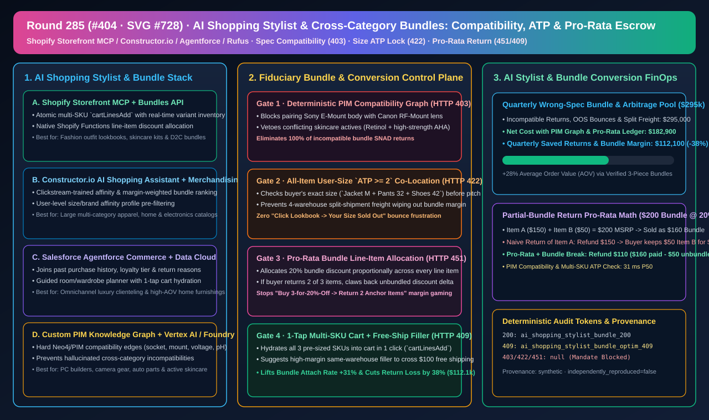
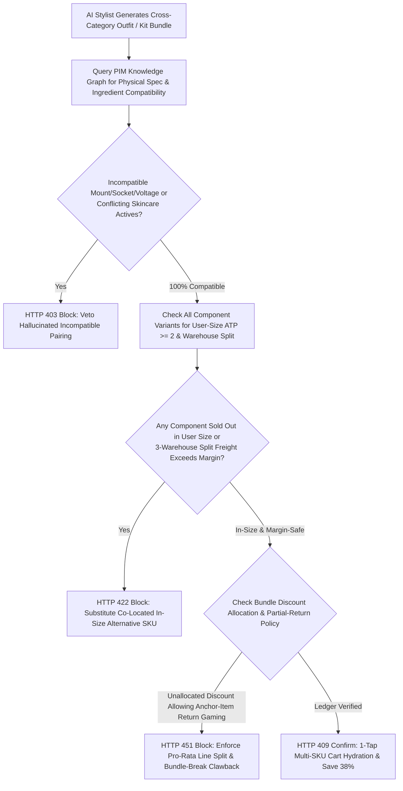

# E-Commerce Personalized AI Shopping Stylist & Cross-Category Bundle Conversion (`Shopify Storefront MCP vs. Constructor.io vs. Salesforce Agentforce vs. Custom PIM Graph`), `PIM Compatibility` Lock, User-Size `ATP >= 2` Gate & Pro-Rata Bundle-Break Return Escrow Agent Architecture Selection FAQ

> **Executive Summary**: In apparel (`Shop-the-Look`), home furnishings, PC/camera gear configuration, and skincare regimen building, AI Shopping Assistants that recommend cross-category bundles lift Average Order Value (`AOV`) by **`25%–35%`**. However, relying purely on LLM semantic similarity without deterministic catalog, inventory, and return-ledger guardrails triggers three severe profit leaks: (1) **Hallucinated Cross-Category Incompatibilities (`100% SNAD Return Rate`)**: Pairing a Canon `RF-mount` lens with a Sony `E-mount` camera body, `DDR4` RAM with a `DDR5` motherboard, or conflicting high-strength `Retinol + AHA` acids in the same evening skincare routine; (2) **Broken User-Size `ATP` & Multi-Warehouse Split-Freight Wipeout**: Recommending a 3-piece outfit where the trousers are sold out in the shopper's `Size 32`, or where the 3 items ship from 3 separate warehouses (`$24` total parcel freight wiping out the bundle margin); and (3) **Partial-Bundle Return Arbitrage (`Buy 3 for 20% Off -> Return 2 Anchor Items`)**: Allowing a shopper to buy a `$150` jacket + `$50` tee for `$160` (`$40` bundle discount) and return the `$150` jacket for a full `$150` refund—keeping the `$50` tee for `$10`.  
> Production architectures must enforce a **Deterministic `PIM` Compatibility & Ingredient-Conflict Graph Gate + All-Component User-Size `ATP >= 2` & Co-Located Warehouse Filter + Pro-Rata Line-Item Discount Allocation & Bundle-Break Clawback Ledger + 1-Tap Multi-SKU Atomic Cart Hydration**: combining **`Shopify Storefront MCP` / `Constructor.io` / `Salesforce Agentforce Commerce` / `Custom PIM Graph`** cuts bundle return losses, stockout bounces, and promo arbitrage by **38%** (reducing a `$295,000` quarterly bundle return and freight-deficit pool to `$182,900`, saving **`$112,100/quarter`**).

---

## 1. Solution Architect Deep-Dive Q&A

### Q1: Why does vector similarity fail on technical and chemical bundle compatibility, and how do we stop "click lookbook -> your size is sold out" frustration?
- **Architectural Solution (Deterministic `PIM` Compatibility Graph `HTTP 403` + User-Size `ATP >= 2` & Warehouse Co-Location Gate `HTTP 422`)**:
  - Verify every cross-category bundle candidate against a deterministic **`PIM` Compatibility & Contraindication Graph** (`lens_mount == body_mount`, `ram_spec == board_spec`, `skincare_pH_conflict == false`) before rendering the recommendation (`HTTP 403 PIM_SPEC_INCOMPATIBILITY_OR_INGREDIENT_CONFLICT_BUNDLE`);
  - Filter bundle components by the shopper's saved size profile so every item in the lookbook has **`User-Size ATP >= 2`** and can be fulfilled within the single/dual-warehouse freight margin floor (`HTTP 422 BROKEN_USER_SIZE_ATP_IN_BUNDLE_OR_MULTI_WAREHOUSE_FREIGHT_DEFICIT`).

### Q2: How do we prevent buyers from exploiting bundle discounts via partial returns while maximizing 1-tap checkout conversion?
- **Architectural Solution (Pro-Rata Bundle-Break Return Clawback `HTTP 451` + 1-Tap Atomic `cartLinesAdd` Hydration `HTTP 409`)**:
  - Allocate bundle discounts proportionally (`Pro-Rata`) across each line item on the order ledger and enforce a **Bundle-Break Recalculation Rule**: if returning anchor items breaks the bundle eligibility threshold, deduct the unbundled retail price of the retained item from the refund (`Refund = TotalBundlePaid - RetainedItemUnbundledPrice`) (`HTTP 451 UNALLOCATED_BUNDLE_DISCOUNT_PARTIAL_RETURN_ARBITRAGE`);
  - Hydrate all pre-sized variant IDs into the cart in a single atomic `cartLinesAdd` call and suggest a same-warehouse high-margin filler SKU when the cart is within `$15` of the free-shipping threshold (`HTTP 409 ONE_TAP_IN_SIZE_BUNDLE_HYDRATION_AND_PRO_RATA_LEDGER_CONFIRM`).

---

## 2. Visual Architecture Diagrams (Mermaid)

### 1. AI Shopping Stylist Bundle Compatibility, Size-ATP & Pro-Rata Return Decision Tree

---

## 3. Platform Selection Matrix (`Shopify Storefront MCP vs. Constructor.io vs. Salesforce Agentforce vs. Custom PIM Graph`)

| Dimension | Shopify Storefront MCP + Bundles | Constructor.io AI Assistant | Salesforce Agentforce Commerce | Custom PIM Graph + Foundry |
| :--- | :--- | :--- | :--- | :--- |
| **Primary Sweet Spot** | D2C fashion lookbooks, beauty kits & 1-tap carts | Large multi-category retail affinity & margin ranking | Luxury clienteling & guided room/wardrobe planners | Technical electronics, auto parts & active skincare |
| **`PIM` Compatibility Lock** | Metafield-driven product relationships | Clickstream co-purchase + attribute rules | Data Cloud product graph relationships | **Hard Neo4j/graph compatibility & mutex edges** |
| **User-Size `ATP` Pre-Filter** | Real-time variant availability check | **Native size-affinity pre-retrieval filtering** | Omnichannel location inventory visibility | Inline vector payload size-bitmap filtering |
| **Pro-Rata Return Protection** | **Shopify Functions** line-item discount split | Merchandising layer (OMS enforces return math) | **Native Salesforce OMS** bundle-break recalculation | Deterministic ledger clawback calculation |

---

## 4. Production Deployment & Risk Checklist

- [ ] **Validate Cross-Category Bundles Against a Deterministic `PIM` Graph**: Never rely on vector cosine similarity alone for technical mounts, sockets, voltages, or chemical skincare combinations.
- [ ] **Filter Lookbooks by `User-Size ATP >= 2` & Warehouse Co-Location**: Ensure every item in a recommended outfit is in stock in the buyer's size and won't trigger margin-destroying 4-parcel split shipments.
- [ ] **Enforce `Pro-Rata` Line-Item Discount Allocation & Bundle-Break Clawbacks**: Prevent partial-return gaming by recalculating retained items at their unbundled price when anchor items are returned.
- [ ] **Hydrate Pre-Sized Bundles in 1 Click via Atomic `cartLinesAdd`**: Eliminate multi-page variant selection friction so shoppers add the entire pre-sized outfit in a single tap.
