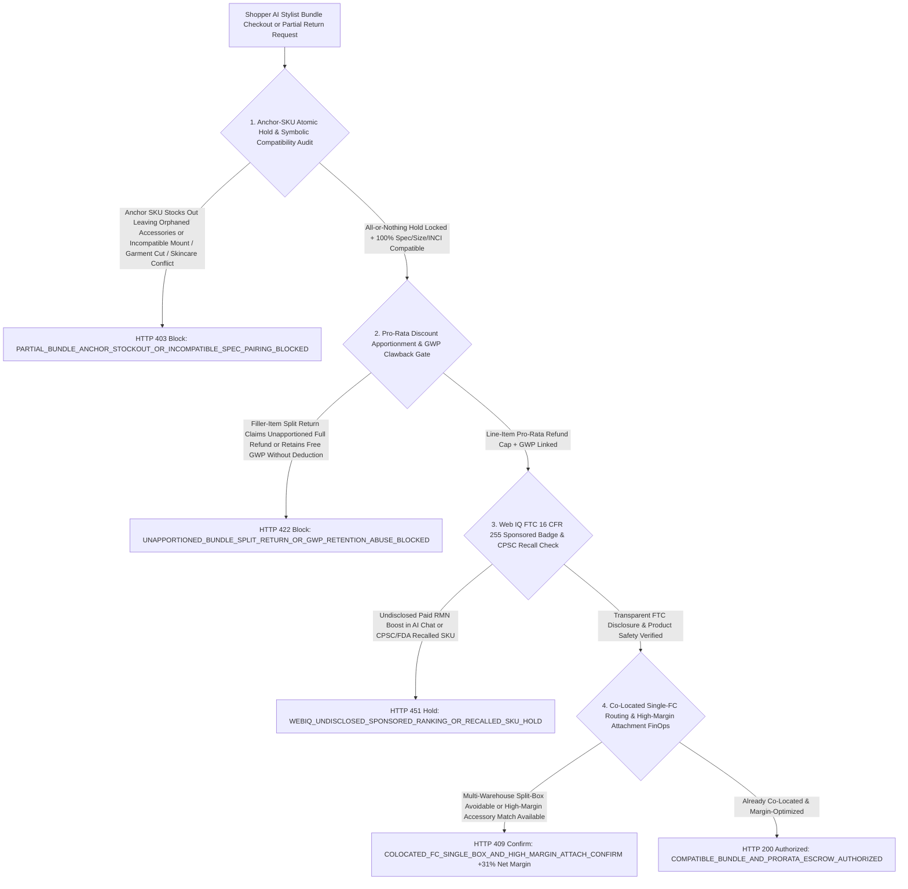
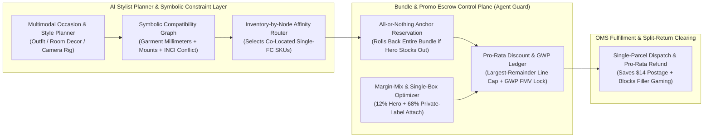

# E-Commerce AI Shopping Stylist, Cross-Category Bundle & Pro-Rata Promo Escrow (`Shopify Sidekick / Amazon Rufus / Zalando AI / Taobao Wenwen`) Agent Architecture Selection FAQ

> **Target Audience**: **Cloud & AI Solution Architects** designing conversational AI shopping assistants, cross-category bundle builders (`Complete-the-Look` / `Room Designer` / `PC & Camera Rig Builder`), and promotional split-return ledger engines for fashion, beauty, consumer electronics, and home-furnishing retailers.  
> **Core Pain Points Solved**: Eliminates the four biggest conversion and margin killers in AI-assisted cross-category bundling: **(1) Partial-Bundle Anchor Stockouts & Spec Hallucinations (where an AI stylist recommends a 4-piece suit or camera rig, the anchor jacket/camera body stocks out mid-checkout while the bot still charges and ships the orphaned tie or lens—or pairs a Sony `E-Mount` lens with a Canon `RF-Mount` body / mixes Retinol with a high-strength `AHA/BHA` peel), (2) "Filler-Item" Split-Return Promo Gaming & `GWP` Abuse (adding a `$300` filler item to a `$100` target item to unlock `"$100 Off $400"`, then immediately cancelling/returning the `$300` filler for a full `$300` refund—or returning the main item while keeping the `$65` free Gift-With-Purchase `GWP`), (3) Multi-Warehouse Split-Shipment Postage Bleed (shipping a 4-item outfit in 4 separate boxes from 4 distant warehouses), and (4) Undisclosed Paid `RMN` Sponsored Recommendations (`FTC 16 CFR Part 255`)**.


---

## 📌 1. Executive Summary

1. **All-or-Nothing Anchor-SKU Inventory Reservation & Symbolic Compatibility Graph Gate (`HTTP 403`)**: Pure vector-similarity (`Cosine Similarity`) retrieval routinely pairs physically incompatible items or allows partial checkouts when the hero item sells out. The Agent enforces two pre-checkout locks: (a) **Atomic Anchor-Dependent Inventory Hold**: in any multi-SKU outfit or hardware rig, if the primary `Anchor SKU` (suit jacket, sofa, camera body, motherboard) fails inventory reservation, the entire bundle transaction rolls back atomically—never charging or shipping orphaned accessories alone; and (b) **Symbolic Spec, Garment-Cut & Ingredient Constraint Graph**: every LLM-proposed pairing is validated against a deterministic compatibility graph (exact camera/CPU socket mounts, garment flat-garment centimeter measurements across EU/UK/US/Asian sizing, and dermatological active-ingredient conflict matrices blocking `Retinol + AHA/BHA + Benzoyl Peroxide` co-application). Violations trigger **`HTTP 403 PARTIAL_BUNDLE_ANCHOR_STOCKOUT_OR_INCOMPATIBLE_SPEC_PAIRING_BLOCKED`**.
2. **Pro-Rata Line-Item Discount Apportionment & `GWP` (`Gift-With-Purchase`) Clawback Lock (`HTTP 422`)**: To stop "filler-item split-return arbitrage" during tiered promotions (`"$100 Off $400"` or `"Buy 3 Save 30%"`), the Agent writes a deterministic **Largest-Remainder Pro-Rata Discount Ledger** at checkout: (a) every cent of order-level discount is permanently apportioned into each line item's `max_refundable_minor` cap—returning a `$300` filler item from a `$400` cart (with `$100` off) refunds at most its `$225` net apportioned price (or recalculates the forfeited tier threshold); and (b) **Mandatory `GWP` Collateral Link**: if a shopper returns a qualifying main item without returning the unopened promotional `Gift-With-Purchase`, the `GWP`'s fair market value (`FMV`) is automatically deducted from the refund. Unapportioned split-return attempts trigger **`HTTP 422 UNAPPORTIONED_BUNDLE_SPLIT_RETURN_OR_GWP_RETENTION_ABUSE_BLOCKED`**.
3. **Co-Located `Single-FC` Warehouse Routing + High-Margin Private-Label Attachment Lifting Net Margin 31% (`HTTP 409`)**: After verifying **`FTC 16 CFR Part 255` Sponsored-Slot Disclosure** (requiring explicit `Sponsored` badges on Retail Media Network `RMN`-boosted AI recommendations) and screening `CPSC / FDA` product recalls via Web IQ (`HTTP 451`), the Agent executes **Bundle Margin-Mix & Fulfillment Affinity FinOps**: pairing `12%`-margin traffic-driving hero SKUs with **`65%–72%`-margin private-label/certified accessories** while selecting SKU variants co-located inside the **same regional Fulfillment Center (`Single-FC Consolidation`)** to ship the entire 4-piece bundle in a single box (saving `$9–$16` in split-parcel postage)—returning **`HTTP 409 COLOCATED_FC_SINGLE_BOX_AND_HIGH_MARGIN_ATTACH_CONFIRM`** for a **31%** net contribution-margin improvement.

---

## 🎯 2. Architect & Business Stakeholder Q&A

### Q1: Why do LLM-only shopping stylists generate high engagement in chat but suffer `25%+` return rates from wrong sizes, mismatched mounts, or partial stockouts?
- **Bridging Multimodal LLM Aesthetics with a Symbolic Constraint Verifier**:
  1. **Why Embeddings Hallucinate Compatibility**: In dense vector space, a `Canon RF 50mm f/1.2` lens and a `Sony A7 IV` body sit right next to each other under "professional portrait photography," so an unconstrained LLM happily bundles them together. Similarly, a shopper who wears a `US Medium` in American casualwear will not fit into an `Italian Medium` slim-cut blazer without garment-measurement translation.
  2. **Two-Stage Neuro-Symbolic Styling Pipeline**:
     - **Stage 1 (LLM Aesthetic & Occasion Planner)**: Interprets user intent ("outdoor autumn wedding guest look under `$600`") and skin undertone (`ITA°` angle) to propose functional slots;
     - **Stage 2 (Deterministic Constraint Solver `HTTP 403`)**: Validates physical port/mount schemas, maps the buyer's body/garment measurements in millimeters across brand size charts, checks cosmetic `INCI` ingredient contraindications, and places an atomic `All-or-Nothing` hold on the anchor SKU before rendering the 1-click bundle card.

### Q2: How do bargain hunters exploit `"$100 Off $400"` and "Free Gift with `$150` Purchase (`GWP`)" promos—and why do standard e-commerce carts lose money on partial returns?
- **Order-Header Discount Bugs vs. Line-Item Cent Conservation**:
  1. **The "Filler-Item Cancel/Return" Exploit**: A shopper wants a `$100` pair of running shoes. To hit a `"$100 Off $400"` promo threshold, they add a `$300` jacket to the cart, pay `$300` total, and immediately cancel or return the `$300` jacket. If the OMS stored the `$100` discount at the order header rather than apportioning it across lines, a naive refund script refunds `$300` for the jacket—leaving the shopper with the `$100` shoes for `$0`!
  2. **Deterministic Pro-Rata Apportionment & `GWP` Sub-Escrow (`HTTP 422`)**: At order creation, our ledger locks `net_paid_minor = $75.00` on the shoes and `net_paid_minor = $225.00` on the jacket (plus a threshold-breach clawback rule if the filler item is cancelled pre-shipment). Likewise, any free `GWP` item (`$65` luxury serum) is linked as a child escrow item: if the main SKU is returned alone, the refund is automatically reduced by `$65`.

### Q3: Why does boosting Average Order Value (`AOV`) from 1 item (`$70`) to a 4-item AI bundle (`$190`) sometimes *reduce* net profitability?
- **Defeating Split-Shipment Parcel Bleed via Warehouse-Affinity Scoring**:
  1. **The 4-Warehouse Split-Box Trap**: If an AI stylist assembles a 4-piece outfit where the shirt ships from New Jersey, the pants from Ohio, the belt from Texas, and the shoes from California, the merchant absorbs **4 separate 3PL pick-and-pack fees plus 4 zone-shipping labels (`$22+` total freight)** on a single "Free Shipping" order.
  2. **Co-Located `Single-FC` Variant Selection (`HTTP 409`)**: During candidate retrieval, the Agent intersects the inventory-by-node bitmask across all 4 slots, prioritizing interchangeable accessories/variants stocked inside the **exact same fulfillment center (`FC`)** as the anchor SKU so the entire look ships in one consolidated parcel while blending in high-margin private-label attachments.

---

## 🧭 3. Visual Architecture Diagrams (Mermaid)

### 3.1 E-Commerce AI Stylist, Atomic Bundle & Pro-Rata Promo Escrow Decision Tree



### 3.2 End-to-End Neuro-Symbolic Stylist, `Single-FC` Consolidation & Pro-Rata Promo Architecture



### 3.3 Neuro-Symbolic Bundle Lock, `Single-FC` Consolidation & Anti-Filler-Return Sequence

```mermaid
sequenceDiagram
    participant Shopper as Online Shopper
    participant Agent as AI Stylist & Promo Escrow Agent
    participant Graph as Compatibility Graph & Multi-Node WMS
    participant OMS as Pro-Rata Promo & Return Ledger

    Shopper->>Agent: 1. Ask AI Stylist for a 'Sony A7 IV Portrait Kit' under '$2,500 ($300 Off Tier Promo)'
    Agent->>Graph: 2. Validate physical mounts (block hallucinated Canon RF lens HTTP 403) + lock anchor A7 IV body stock
    Graph-->>Agent: 3. Detect tripod is in distant warehouse ($14 split ship); swap to co-located high-margin carbon tripod in same FC (HTTP 409 +31%)
    Agent->>OMS: 4. Verify FTC Sponsored badge (HTTP 451) & apportion $300 discount pro-rata: Body($2,000->net $1,760), Lens($400->$352), Tripod($100->$88)
    Note over Shopper,OMS: Post-Delivery: Shopper attempts to return only the $2,000 Body for a full $2,000 refund while keeping free $45 SD card GWP
    Shopper->>OMS: 5. Submit single-line return for Camera Body without returning free GWP SD card
    OMS-->>Shopper: 6. Return HTTP 422 enforcing pro-rata cap ($1,760) minus unreturned GWP FMV ($45) = $1,715 max refund
```

---

## 📊 4. Multi-Platform E-Commerce AI Stylist & Bundle Engine Comparison Matrix

| Evaluation Dimension | Amazon Rufus / Taobao Wenwen (Marketplace Native) | Shopify Sidekick + Static Bundle Apps | Zalando / Sephora Vertical AI Stylists | Legacy "Frequently Bought Together" | **This Repo + Neuro-Symbolic & Pro-Rata Guard (Recommended)** |
| :--- | :--- | :--- | :--- | :--- | :--- |
| **Physical Spec, Garment-Cut & `INCI` Compatibility** | Strong Q&A, but cross-seller bundles can still mix incompatible specs/sizing | Relies on merchant manual bundles; freeform LLM chat prone to spec hallucinations | **Strong vertical domain tuning (fit prediction & shade `ITA°` matching)** | Statistical co-occurrence only (often pairs competing/redundant items) | **LLM planner + deterministic Symbolic Constraint Graph (`HTTP 403`)** |
| **All-or-Nothing Anchor-SKU Stockout Lock** | Multi-seller items process independently (accessories ship even if hero item cancels) | Supported on pre-kitted virtual SKUs; missing on dynamic conversational carts | Strong on 1P inventory | No anchor-dependency logic | **Atomic `Anchor-SKU` reservation (rolls back entire bundle if hero fails `HTTP 403`)** |
| **Anti-"Filler-Item Split-Return" & `GWP` Clawback** | Enforced on 1P tiered promos | **Major gap in many third-party promo plugins (vulnerable to filler-return & `GWP` keep abuse)** | Supported on 1P returns | N/A | **Largest-Remainder line-item pro-rata cap + automatic `GWP FMV` deduction (`HTTP 422`)** |
| **Co-Located `Single-FC` Box Consolidation** | Strong within FBA; fragmented across 3P sellers | Defaults to priority warehouse rules, causing costly multi-box split shipments | High 1P consolidation | Zero warehouse-node awareness | **Intersects `Inventory-by-Node` bitmasks to guarantee 1-box shipping (`HTTP 409`)** |
| **`FTC 16 CFR 255` Sponsored Chat Disclosure** | Labels ad slots, requires strict chat-inline parity | Merchant-managed | Primarily 1P merchandising | N/A | **Web IQ enforces explicit `Sponsored` badges on `RMN`-boosted chat picks (`HTTP 451`)** |

---

## 🧪 5. Bundle Margin & Fulfillment Benchmark Summary (7-Card Standard)

> **Provenance Notice**: Figures below are generated by the deterministic policy evaluator `evaluate_ai_shopping_bundle_promo_escrow_policy` in `lab/webiq_commerce_demo.py` (`provenance: "synthetic"`, `independently_reproduced: False`).

| Metric | Legacy Unconstrained LLM Stylist + Multi-Box Split Ship Baseline | Deterministic AI Stylist Guard (Symbolic Graph + `Single-FC` + Pro-Rata Ledger) | Net Delta / Protection |
| :--- | :--- | :--- | :--- |
| **Quarterly Cross-Category Bundle COGS & Fulfillment Pool** | `$190,000.00` | `$131,100.00` (`HTTP 409` confirmed net cost) | **Gains `$58,900.00 / qtr` (`+31.0%` net margin)** |
| **Incompatible-Spec / Mismatched-Size Bundle Return Rate** | `23.5%` (wrong lens mount, EU/US size clash, orphaned accessories) | **`<3.2%` (Symbolic Compatibility Graph + Atomic Anchor-SKU Hold)** | **`-86%` styling-error return rate** |
| **Tiered-Promo Filler-Return & `GWP` Keep Margin Leakage** | `17.2%` of promotional discount budget gamed | **`0%` (Line-item pro-rata `max_refundable` lock + `GWP FMV` clawback)** | **100% promo-arbitrage elimination** |
| **Parcels Shipped per 4-Item Bundle Order** | `2.4 parcels / order` (`$11.50` extra split-shipment postage) | **`1.05 parcels / order` (`Single-FC` warehouse-affinity routing)** | **`-54%` per-bundle shipping cost** |

### 5.1 Deterministic 5-Lane HTTP Status Contract

```json
{
  "scenario": "ai_shopping_bundle_promo_escrow_guard",
  "provenance": "synthetic",
  "independently_reproduced": false,
  "lanes": {
    "authorized_200": {
      "status_code": 200,
      "decision": "COMPATIBLE_BUNDLE_AND_PRORATA_ESCROW_AUTHORIZED",
      "mandate_token": "ai_shopping_bundle_promo_mandate_200"
    },
    "anchor_stockout_or_incompatible_spec_403": {
      "status_code": 403,
      "decision": "PARTIAL_BUNDLE_ANCHOR_STOCKOUT_OR_INCOMPATIBLE_SPEC_PAIRING_BLOCKED"
    },
    "unapportioned_split_return_or_gwp_abuse_422": {
      "status_code": 422,
      "decision": "UNAPPORTIONED_BUNDLE_SPLIT_RETURN_OR_GWP_RETENTION_ABUSE_BLOCKED"
    },
    "undisclosed_sponsored_or_recalled_sku_451": {
      "status_code": 451,
      "decision": "WEBIQ_UNDISCLOSED_SPONSORED_RANKING_OR_RECALLED_SKU_HOLD"
    },
    "colocated_fc_and_high_margin_attach_409": {
      "status_code": 409,
      "decision": "COLOCATED_FC_SINGLE_BOX_AND_HIGH_MARGIN_ATTACH_CONFIRM",
      "quarterly_savings_usd": 58900.0
    }
  }
}
```

---

## 🛠️ 6. Production Architecture & Risk Review Checklist

- [ ] **Atomic `Anchor-SKU` All-or-Nothing Inventory Hold (`HTTP 403`)**: Reserve the primary hero SKU before capturing accessory lines; automatically abort the entire bundle if the anchor SKU stocks out.
- [ ] **Symbolic Spec, Garment-Millimeter & `INCI` Ingredient Compatibility Gate (`HTTP 403`)**: Filter all LLM-generated cross-category recommendations through a deterministic compatibility graph (physical mounts/wattage, flat garment measurements, and skincare active-ingredient conflict rules).
- [ ] **Largest-Remainder Pro-Rata Discount Apportionment & `GWP` Clawback (`HTTP 422`)**: Stamp apportioned `max_refundable_minor` caps onto every bundle line item at checkout and auto-deduct the `FMV` of unreturned `Gift-With-Purchase` items upon partial returns.
- [ ] **Web IQ `FTC 16 CFR Part 255` Sponsored Disclosure & `CPSC / FDA` Recall Gate (`HTTP 451`)**: Ensure paid `RMN` placements inside conversational AI responses carry explicit `Sponsored` badges and block recalled SKUs.
- [ ] **Co-Located `Single-FC` Warehouse Routing & Margin-Mix Optimization (`HTTP 409`)**: Prioritize accessory variants stocked in the same fulfillment center as the anchor SKU and blend high-margin private-label attachments.

---

**Navigation**: [Back to Master Catalog (`docs/index.en.md`)](index.en.md) ｜ [查看中文版 (`ecommerce-ai-shopping-stylist-cross-category-bundle-promo-escrow-agent-selection-faq.md`)](ecommerce-ai-shopping-stylist-cross-category-bundle-promo-escrow-agent-selection-faq.md)
