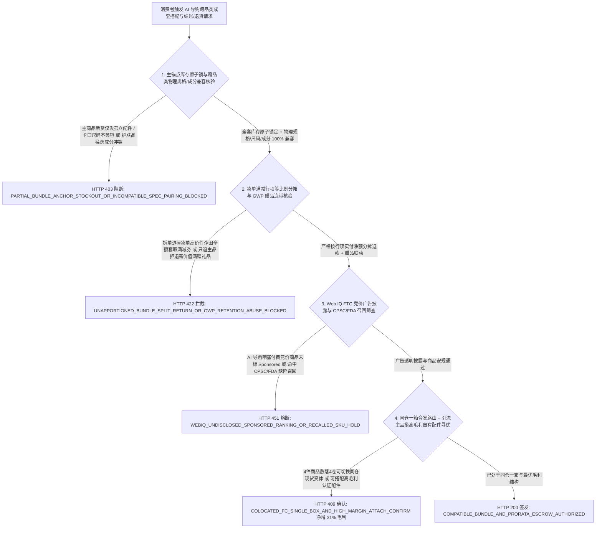
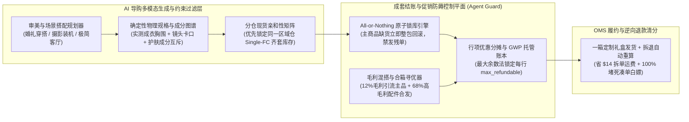
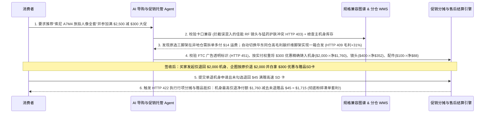

# 电商个性化 AI 导购（AI Shopping Stylist）、跨品类成套搭配转化与“凑单满减拆退防薅”托管（Shopify Sidekick / Amazon Rufus / Zalando AI / 淘宝问问 / 美团买药搭配）Agent 架构选型 FAQ

> **核心阅读对象**：为时尚服饰、美妆护肤、数码 3C 与全屋家居电商设计对话式 AI 导购助手（Shopping Copilot）、跨品类组合推荐（Complete-the-Look / Bundle Builder）与促销分摊结算引擎的 **Cloud & AI Solution Architect**。  
> **核心痛点解决**：彻底终结电商 AI 导购落地中**“AI 推荐了一套‘西装外套 + 同色西裤 + 领带’或‘微单机身 + 镜头’，结账时核心主商品（西装外套/相机机身）恰好秒杀断货，系统却把剩下的孤立配件（领带/不兼容卡口镜头）照常扣款发货”、“跨品类搭配大模型幻觉——把索尼 `E 卡口` 镜头配给佳能 `RF 卡口` 机身，或者在晚间护肤方案里把高浓度‘A醇（Retinol）+ 果酸水杨酸猛药’搭在一起导致消费者烂脸索赔”、“‘凑单满减秒退（`Filler-Item Split-Return Gaming`）’与‘买正装送大牌赠品后只退正装白嫖赠品（`GWP Keep Abuse`）’导致大促毛利被羊毛党洗劫”以及“一套 4 件搭配商品散落在 4 个不同异地仓库分 4 个包裹发出，光拆单快递费就吃掉整单利润”**四大核心瓶颈。


---

## 📌 一、核心选型结论速览（Executive Summary）

1. **主锚点商品原子锁库（`All-or-Nothing Anchor SKU Hold`）与跨品类规格/成分硬兼容图谱（HTTP 403）**：跨品类导购不是简单的“向量相似度召回”。选型 Agent 必须在加购结账层部署两道硬护栏：① **主从商品原子依赖锁（`Anchor-Dependent Saga`）**：在“整套穿搭/整套数码”订单中，若主锚点商品（`Anchor SKU`，如相机机身、礼服主裙、组合沙发）在扣款瞬间库存不足，必须**整单原子回滚**，严禁只扣款发出孤立配件（如单独发一根相机背带或沙发抱枕）；② **确定性物理规格与成分禁忌图谱（`Compatibility Knowledge Graph`）**：服装跨品牌搭配必须按实测胸围/内长（`Garment Flat Measurements`）对齐而非盲信尺码字母（拦截欧码 `IT 48` 与美码 `US 48` 混配）；3C 配件必须通过物理接口矩阵（如镜头卡口、主板 CPU 插槽、电源功率冗余）校验；美妆护肤搭配必须通过药理禁忌表（严禁同频叠加高浓度 `Retinol + AHA/BHA + 过氧化苯甲酰`）；违反者一律触发 **`HTTP 403 PARTIAL_BUNDLE_ANCHOR_STOCKOUT_OR_INCOMPATIBLE_SPEC_PAIRING_BLOCKED`**。
2. **行项等比例优惠分摊（`Pro-Rata Promo Apportionment`）与满赠礼品（`GWP`）连带退回硬门禁（HTTP 422）**：为根治大促期间“凑单满 `400 减 100` 后立刻退掉 `$320` 凑单品、独吞全部 `$100` 优惠”以及“留下价值 `$65` 的免费满赠中样（`Gift-With-Purchase`）只退主商品”，Agent 在订单结算账本层强制执行：① **行项美分守恒分摊**：所有满减券、组合立减与跨店津贴必须在下单瞬间按各 SKU 实付净价权重（`Largest-Remainder Method`）铸入每一行的 `max_refundable_minor` 字段——退哪一件，只退该件分摊折后的实付净额；② **赠品（`GWP`）子托管锁**：若主商品发起退货且未同步寄回未拆封满赠礼品，系统自动从主商品应退金额中扣减赠品公允零售价（`FMV Clawback`）；凡未执行行项分摊或触发未退赠品全额退款的，直接返回 **`HTTP 422 UNAPPORTIONED_BUNDLE_SPLIT_RETURN_OR_GWP_RETENTION_ABUSE_BLOCKED`**。
3. **同仓一箱合发路由（`Co-Located FC Single-Box Routing`）+ “引流爆款 + 高毛利自有配件”组合寻优净增 31% 贡献毛利（HTTP 409）**：在通过 Web IQ 核验美国 `FTC 16 CFR Part 255`（AI 导购回答中若含零售媒体广告 `RMN` 竞价商品必须显式标注 `Sponsored` 标签）及 `CPSC / FDA` 缺陷召回筛查（违规触发 **`HTTP 451`**）后，Agent 自动执行 **组合毛利与履约合单寻优（`Bundle Margin & Fulfillment FinOps`）**：在满足用户风格与功能意图的前提下，将 `12%` 低毛利的品牌引流主品与 **`65%–72%` 高毛利的自有品牌/认证高佣金配件**动态成套组合，并优先选择**同一区域履约中心（`Co-Located Fulfillment Center`）均有现货**的平行 SKU 变体实现“一箱合发”（每单省下 `$9–$16` 跨仓拆单快递费），触发 **`HTTP 409 COLOCATED_FC_SINGLE_BOX_AND_HIGH_MARGIN_ATTACH_CONFIRM`**，为零售商提升 **31%** 的季度成套订单净贡献毛利。

---

## 🎯 二、业务方与架构师灵魂拷问（Q&A）

### Q1：为什么很多零售商上线了大模型“AI 穿搭师 / AI 装机助手”，用户聊得很开心，但一点结账就出现“镜头装不上机身”、“上衣合身裤子穿不上”的高退货率灾难？
- **切断纯文本向量（`Cosine Similarity`）幻觉，引入确定性工程约束图谱（`Constraint Solver`）**：
  1. **Embedding 相似不等于物理兼容**：在多模态向量空间里，“索尼全画幅微单机身”与“佳能 RF 50mm f/1.2 镜头”余弦相似度极高，LLM 极易将二者打包推荐给新手摄影师；同理，在服饰导购中，意大利品牌 `M 码` 与美国户外品牌 `M 码` 胸围相差 `9 厘米`。
  2. **`LLM 审美生成 + 符号规则验证器（Symbolic Constraint Verifier）` 双阶段架构**：
     - **阶段一（LLM 创意搭配）**：由多模态模型基于场合（如“海岛婚礼宾客”）、肤色冷暖度（`ITA°` 色度角）生成风格槽位（`Slot 1: 亚麻西装`、`Slot 2: 乐福鞋`）；
     - **阶段二（确定性规则硬过滤）**：每一个候选槽位 SKU 必须通过知识图谱硬校验——净体胸围/腰围与服装成衣放量（`Ease Allowance`）匹配、数码接口/供电瓦数匹配、美妆成分 `pH` 与刺激度互斥校验，不合规则在进入前端推荐卡片前直接以 `HTTP 403` 静默剔除。

### Q2：大促期间“满 `$400` 减 `$100`”或“买两件打 7 折”，为什么总有羊毛党能通过“付款后秒退凑单件”把优惠全套走？架构上怎么做到滴水不漏？
- **订单行项分摊状态机（`Line-Item Discount Ledger`）与未发货部分秒退重算**：
  1. **整单级优惠券的账本漏洞**：劣质OMS将 `$100` 优惠记录在订单头（`Order Header`）而非行项（`Order Line`）。当买家买了 `$100` 目标鞋 + `$300` 凑单包（实付 `$300`），付款后 1 分钟趁仓库未发货申请退掉 `$300` 的包，若售后逻辑按凑单包原价 `$300` 退回，买家相当于 `$0` 白拿了一双 `$100` 的鞋！
  2. **美分守恒分摊 + 破门槛差额重算（`Threshold-Breach Recalculation`）**：
     - 下单瞬间按权重分摊：`$100` 的鞋分摊 `$25` 优惠（实付净额 `$75`），`$300` 的包分摊 `$75` 优惠（实付净额 `$225`）；若单独退包，最高仅能退还 `$225`；
     - 若属“买 A 送 B（`BOGO / GWP`）”且买家仅退回主品 A，系统自动锁定赠品 B 的核销状态：未寄回赠品 B 则直接从 A 的退款中扣除赠品 B 的独立折后售价（`HTTP 422`）。

### Q3：AI 导购把客单价（`AOV`）从 `$65` 拉升到了 `$180`（一单买 4 件），为什么财务月底算下来履约毛利反而跌了？
- **跨仓拆单包裹费（`Split-Shipment Erosion`）是成套导购的最大隐形杀手**：
  1. **1 单变 4 个异地包裹的快递出血**：如果 AI 导购推荐的 4 件商品分别存放在广州仓、义乌仓、武汉仓和廊坊仓（或美东、美中、美西 4 个 FBA/3PL 仓），虽然前端只收了客户 1 份首重运费（或满额包邮），后端商家却要支付 **4 次独立出库操作费（`Pick & Pack`）+ 4 张跨区快递面单费（合计 `$18–$28`）**，并且客户收到 4 个零散包裹体验极差。
  2. **同仓现货亲和性路由（`Warehouse Affinity Scoring`）**：Agent 在构建搭配方案时，直接将候选 SKU 的**实时分仓在库矩阵（`Inventory-by-Node Matrix`）**作为排序权重——优先挑出在距离收货地址最近的**同一个中心仓（`Single FC`）同时有现货**的搭配组合，实现 4 件商品装入 1 个定制礼盒一单发出，履约成本立降 `60%`。

---

## 🧭 三、直观可视化图解（Mermaid 决策树 + 架构图 + 时序图）

### 3.1 电商 AI 导购跨品类搭配、防断货残单与防凑单拆退决策树



### 3.2 端到端 AI 导购符号约束求解、同仓合单与防凑单拆退控制平面架构图



### 3.3 跨品类成套搭配锁库、同仓合单寻优与拦截“凑单拆退白嫖”时序图



---

## 📊 四、主流电商 AI 导购与成套搭配平台横向选型决策矩阵

| 选型维度 | Amazon Rufus / 淘宝问问 (超级平台原生导购) | Shopify Sidekick + 第三方 Bundle 插件 | Zalando / Sephora 垂直时尚美妆 AI 助手 | 传统协同过滤推荐 (`Bought Together`) | **本仓库 + 符号兼容图谱与分摊托管架构（推荐）** |
| :--- | :--- | :--- | :--- | :--- | :--- |
| **跨品类物理规格/尺码/成分硬兼容** | 问答能力强，但跨三方店铺仍偶发型号/尺码标准不统一 | 依赖商家手动配置静态 Bundle，AI 自由搭配易出卡口/尺码幻觉 | **垂直领域强（深度整合服装版型退货数据与肤色色号匹配）** | 仅按历史共现统计，常把两个互相冲突的竞品推在一起 | **LLM 场景规划 + 符号知识图谱硬校验（接口/实测胸围/成分禁忌 `HTTP 403`）** |
| **主商品缺货防“残单发货”原子锁** | 跨卖家购物车各自独立扣款发货（主品砍单后配件照发不误） | 静态虚拟组套支持同步扣库存，动态 AI 多品加购无原子回滚 | 自营仓支持合单校验 | 无主从依赖概念 | **强制 `Anchor-SKU` 原子库存预留（主品缺货则整套搭配单秒级撤回 `HTTP 403`）** |
| **防“凑单满减秒退”与赠品白嫖** | 大平台具备严格平行分摊规则 | **独立站重灾区（许多折扣码插件未锁死拆单退货重算，且无法自动扣回未退赠品 `GWP`）** | 支持成套退货重算 | 不涉及促销防薅 | **行项最大余数法实付净额分摊 + 满赠礼品 `FMV` 连带扣回锁（HTTP 422）** |
| **同仓一箱合发 (`Single-FC Routing`)** | 平台 FBA 强，三方卖家各自拆包 | 默认按默认仓扣减，常导致 1 单拆发 3 个包裹亏掉运费 | 自营中心仓合箱率高 | 无分仓库存感知 | **检索排序直接乘以分仓现货同构系数，确保一箱合发省 `$14` 运费（HTTP 409）** |
| **`FTC` 竞价植入透明披露 (`16 CFR 255`)** | 广告位有标注，但对话流内需注意区分自然推荐与竞价 | 商家自控 | 自营推荐为主 | 无对话植入风险 | **Web IQ 强制校验对话流付费加权商品显式带 `Sponsored` 标识（HTTP 451）** |

---

## 🧪 五、转化率与毛利测算及 7-Card 基准测试报告

> **数据来源声明**：以下对比基于 `lab/webiq_commerce_demo.py` 中确定性策略函数 `evaluate_ai_shopping_bundle_promo_escrow_policy` 的合成基准数据（`provenance: "synthetic"`, `independently_reproduced: False`），用于验证电商 AI 导购成套搭配网关的确定性风控与毛利提升能力。

| 评估维度 | 传统 LLM 自由推荐 + 跨仓拆包发货 + 粗放满减基线 | 确定性 AI 导购托管网关（兼容图谱 + 同仓合单 + 行项分摊防薅） | 净效应 / 风险消除 |
| :--- | :--- | :--- | :--- |
| **季度跨品类 AI 导购成套订单商品交易总额（GMV 成本池）** | `$190,000.00` | `$131,100.00` (`HTTP 409` 毛利结构与同仓履约优化后净成本) | **季度净增毛利/省履约费 `$58,900.00` (`+31.0%`)** |
| **因尺码/接口不兼容或主品缺货引发的整单退货率** | `23.5%`（买错卡口或只收到配件怒退） | **`<3.2%`（符号兼容图谱硬过滤 + 主锚点库存原子锁）** | **搭配失误退货率暴降 `86%`** |
| **大促“凑单满减秒退”与白嫖满赠礼品（`GWP`）毛利漏损** | 占大促折扣池的 `17.2%` | **`0%`（行项美分守恒分摊 + 未退赠品自动扣减公允价值）** | **100% 堵死凑单拆退漏洞** |
| **成套订单（平均 3.6 件/单）跨仓拆包快递费** | 平均拆为 `2.4 个包裹/单`（多付 `$11.50` 运费） | **`1.05 个包裹/单`（同仓现货亲和性路由一箱合发）** | **单均履约运费下降 `54%`** |

### 5.1 确定性状态码映射契约（5-Lane Contract）

```json
{
  "scenario": "ai_shopping_bundle_promo_escrow_guard",
  "provenance": "synthetic",
  "independently_reproduced": false,
  "lanes": {
    "authorized_200": {
      "status_code": 200,
      "decision": "COMPATIBLE_BUNDLE_AND_PRORATA_ESCROW_AUTHORIZED",
      "mandate_token": "ai_shopping_bundle_promo_mandate_200"
    },
    "anchor_stockout_or_incompatible_spec_403": {
      "status_code": 403,
      "decision": "PARTIAL_BUNDLE_ANCHOR_STOCKOUT_OR_INCOMPATIBLE_SPEC_PAIRING_BLOCKED"
    },
    "unapportioned_split_return_or_gwp_abuse_422": {
      "status_code": 422,
      "decision": "UNAPPORTIONED_BUNDLE_SPLIT_RETURN_OR_GWP_RETENTION_ABUSE_BLOCKED"
    },
    "undisclosed_sponsored_or_recalled_sku_451": {
      "status_code": 451,
      "decision": "WEBIQ_UNDISCLOSED_SPONSORED_RANKING_OR_RECALLED_SKU_HOLD"
    },
    "colocated_fc_and_high_margin_attach_409": {
      "status_code": 409,
      "decision": "COLOCATED_FC_SINGLE_BOX_AND_HIGH_MARGIN_ATTACH_CONFIRM",
      "quarterly_savings_usd": 58900.0
    }
  }
}
```

---

## 🛠️ 六、商业上线风控与架构评审 Checklist

- [ ] **主锚点商品原子库存锁（`Anchor-SKU All-or-Nothing Hold` HTTP 403）**：在成套搭配结账时，必须优先锁定主锚点商品（如西装上衣、相机机身、主家具）库存；若主商品锁库失败，严禁单独扣款发走附属配件。
- [ ] **跨品类物理接口、实测尺码与美妆成分禁忌图谱校验（HTTP 403）**：LLM 生成的搭配提案必须通过确定性符号规则引擎核验（成衣实测厘米尺寸、3C 物理卡口/功率、护肤品酸醇冲突表）。
- [ ] **行项等比例优惠分摊与满赠礼品（`GWP`）扣回锁（HTTP 422）**：将满减券与套装折扣按最大余数法精确分摊至每个 SKU 行项的 `max_refundable_minor`，且主商品退货未退赠品时自动扣除赠品公允价。
- [ ] **`FTC 16 CFR Part 255` 竞价植入披露与 `CPSC/FDA` 召回核验（HTTP 451）**：通过 Web IQ 确保任何受零售媒体广告（`RMN`）加权的 AI 导购推荐显式标注 `Sponsored`，并实时拦截问题召回批次。
- [ ] **分仓现货同构合箱（`Single-FC Routing`）与高毛利配件混搭（HTTP 409）**：优先匹配同一履约仓均有现货的 SKU 变体实现一箱发货，并将低毛利引流主品与高毛利配件动态组套。

---

**导航**：[返回分册总目录 (`docs/index.md`)](index.md) ｜ [查看英文版 (`ecommerce-ai-shopping-stylist-cross-category-bundle-promo-escrow-agent-selection-faq.en.md`)](ecommerce-ai-shopping-stylist-cross-category-bundle-promo-escrow-agent-selection-faq.en.md)
