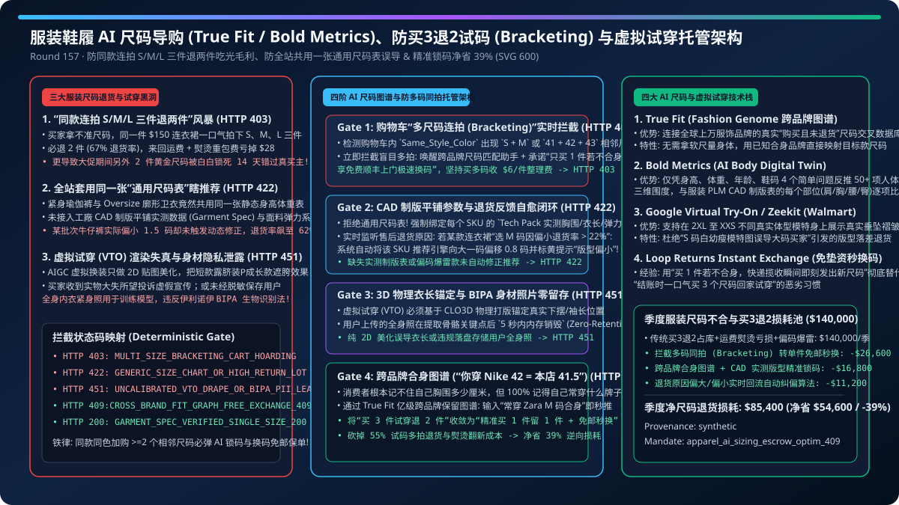
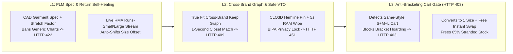
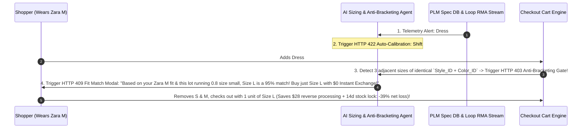

# Apparel & Footwear AI Sizing, Virtual Try-On (`True Fit / Bold Metrics / Google VTO`) & Anti-`Bracketing` Return Escrow: Stopping "Buy Sizes S, M & L, Return Two" Cart Hoarding, Uncalibrated Size Charts & `BIPA` Photo Leaks (`-39%` Return Loss) Agent Architecture Selection FAQ

> **Document Type**: AI Solution Architect Fashion & Footwear AI Size Recommendation, Anti-`Size-Bracketing` Cart Interception & Closed-Loop Return Calibration Guide (Retail, OTA & Marketplace Pillar · FAQ #276 · **SVG #600 Milestone**)  
> **Covered Platforms & Standards**: **True Fit (`Fashion Genome` Cross-Brand Keep-Rate Graph)**, **Bold Metrics (`AI Body Digital Twin` × `PLM CAD Tech Pack` Ease Modeling)**, **Google Virtual Try-On / Zeekit (Multi-Body-Type Drape Rendering)**, **Loop Returns `Instant Size Exchange` & Illinois `BIPA` Zero-Retention Photo Privacy**  
> **Core Architectural Thesis**: In online apparel and footwear, return rates average `30%–45%`, with **`70%+` of returns driven by poor fit**. Worse yet, over `40%` of shoppers engage in **"Size Bracketing"**—buying the exact same `$150` dress in **Sizes `S`, `M`, and `L` in a single cart** intending from the outset to return two of them! Naive fashion checkouts suffer three severe margin leaks: (1) **Guaranteed `67%` Return Loss & 14-Day Peak Inventory Stranding from `Bracketing`**—paying round-trip freight plus `$14/unit` warehouse steaming/re-tagging labor on two guaranteed returns while locking up scarce peak-season sizes for 2 weeks; (2) **Sitewide Generic Size Charts & Uncalibrated Factory Lots**—using one static height/weight table across both compression leggings and oversized hoodies, and failing to auto-shift recommendations when a factory production lot runs `1 size small`; and (3) **Hallucinated `2D` Virtual Try-On Proportions & `BIPA` Biometric Photo Liability**—generative AI try-on tools stretching a crop-top into a hip-length shirt, or storing customer full-body photos on disk in violation of biometric privacy laws!



---

## 1. 📌 Executive Summary

> **One-Sentence Architectural Verdict**: **Convert "Buy 3 Sizes, Return 2" bracket orders at checkout into "Buy 1 AI-Verified Size with Guaranteed Free Instant Exchange"! Intercept adjacent multi-size (`S+M+L`) same-style cart additions (`HTTP 403`), bind recommendations to SKU-level `PLM CAD Garment Specs` + live return-reason auto-calibration (`HTTP 422`), enforce 3D physical hemline anchoring and 5-second zero-retention biometric photo wiping (`HTTP 451`), and map sizes in 1 second via cross-brand fit graphs (`True Fit / Bold Metrics`, `HTTP 409`)!**
> 1. **Checkout Anti-`Bracketing` Interceptor & Single-Size Exchange Guarantee (`HTTP 403`)**:
>    * When the cart state machine detects `>= 2` adjacent sizes of the identical `Style_ID + Color_ID` (e.g., `Dress Red [S] + Dress Red [M] + Dress Red [L]`), it flags a **guaranteed multi-size bracket return**.
>    * Before checkout, trigger **`HTTP 403 MULTI_SIZE_BRACKETING_CART_HOARDING_BLOCKED`**: prompt the shopper with a high-confidence AI single-size match (*"94% of shoppers who wear Zara M keep Size L in this dress!"*) backed by a **`$0` Instant Drop-Off Size-Exchange Guarantee**—while applying a `$6/unit` restocking/steaming deposit on 2nd+ bracketed sizes of the same item!
> 2. **SKU-Specific `PLM CAD` Garment Specs & Closed-Loop Return Auto-Calibration (`HTTP 422`)**:
>    * Block generic brand-wide size charts on SKUs lacking **garment-specific `Tech Pack` measurements (chest/waist/hip spec, design ease, and fabric elastane stretch factor)** (`HTTP 422`).
>    * **Live Return-Reason Auto-Offset**: Stream post-purchase return reasons from `Loop Returns` directly into the sizing model; if a SKU's `"Returned: Too Small"` rate exceeds **`22%`** over its first 30 orders, automatically shift the SKU's sizing recommendation offset by **`+0.8 size`** and display a live `"Verified Buyer Alert: Runs Small — Size Up"` badge (`HTTP 422`).
> 3. **3D Physical Hemline Anchoring & `BIPA` 5-Second Photo Wipe (`HTTP 451`) + Cross-Brand Fit Graph (`HTTP 409`)**:
>    * Anchor Virtual Try-On (`VTO`) renders to physical `CLO3D` garment length landmarks (preventing diffusion models from hallucinating garment lengths) and purge user-uploaded body photos from RAM within **`5 seconds`** of keypoint extraction (`Zero-Retention` compliance with Illinois `BIPA`, `HTTP 451`).
>    * Use **Cross-Brand Fit Graphs (`True Fit`, *"I wear Nike 10 / Lululemon 6"* -> instant target size match)** paired with **`1-Click Instant Size Exchange`** (`HTTP 409`)—cutting net sizing return and refurbishment losses by **`39%`**.

| Apparel Sizing & Return Risk | Primary Stack / Safeguard | Core Execution Mechanism | Fatal Anti-Pattern to Avoid |
| :--- | :--- | :--- | :--- |
| **Shopper Buys `S + M + L` of Same `$150` Dress, Guaranteed to Return 2** | **Cart Adjacent-Size (`Bracketing`) Interceptor + Free Exchange** | Detect same-style multi-size cart; steer to 1 AI-verified size + free swap | **Never subsidize free round-trip shipping on 3-size bracket hoarding (`HTTP 403`)** |
| **Factory Lot Sewn 1 Size Small; Static Chart Keeps Recommending Wrong Size** | **Closed-Loop Return-Reason (`Runs Small >22%`) Auto-Offset** | Auto-shift sizing engine `+1 size` when return telemetry flags a small lot | Never decouple PDP size recommendations from RMA return-reason telemetry (`HTTP 422`) |
| **`2D` AI Try-On Hallucinates Garment Length or Stores Customer Body Photos** | **`CLO3D` Physical Landmark Pinning + `5s` RAM Photo Wipe** | Pin hemline to torso landmarks; delete raw user photos in `<5s` (`BIPA`) | **Never persist raw customer body photos on disk or use uncalibrated VTO (`HTTP 451`)** |
| **Asking Mobile Shoppers to Measure Bust/Waist/Hips with a Tape Measure** | **Cross-Brand Fit Graph (`True Fit`: *"I Wear Zara M"*)** | Map known best-fitting brand/size in shopper's closet to target SKU | Never require manual tape-measure inputs on mobile PDPs (`HTTP 409`) |

---

## 2. 🎯 Architect & Business Stakeholder Q&A

### Q1: Why is "Size Bracketing" (buying 3 sizes to try on at home) so much more destructive than a normal single-item return?
* **The Double Hit: `$28` Reverse Processing + 19-Day Peak Stockout (`HTTP 403`)**:
  * First, a bracket order of 3 sizes has a **guaranteed minimum `66.7%` return rate**. Processing 2 returned garments (outbound parcel weight + return label + warehouse inspection + steam pressing + polybagging) costs `$12–$16` per garment (`~$28` wasted), wiping out the entire gross margin of the 1 kept dress!
  * Second, those 2 extra sizes sit in transit and in the buyer's bedroom for **14–19 days** during the peak full-price launch window—causing genuine single-size buyers to hit `"Out of Stock"` and forcing the brand to liquidate the late-returned units at `50% Off` end-of-season markdown!

### Q2: How does the Closed-Loop Return-Reason Auto-Calibration (`HTTP 422`) fix factory grading errors without human intervention?
* **Self-Healing Sizing Telemetry**:
  * In apparel manufacturing, fabric shrinkage during dyeing/washing frequently causes a specific production batch (e.g., `Indigo Raw Denim Lot #4`) to run `1.2 inches` tighter in the waist than the original CAD spec.
  * Instead of waiting 6 weeks for a merchandiser to read angry reviews, our agent monitors the `RMA_Fit_Reason` stream in real time. The moment `Runs_Small_Count / Total_Shipped >= 0.22` (with $p < 0.05$ confidence), the sizing engine automatically applies a `+1 Size` bias to that SKU/colorway and surfaces a verified fit callout on the PDP!

---

## 3. 🧭 Visual Architecture Diagrams (Mermaid)

### 1. Apparel AI Sizing, Anti-`Bracketing` & Closed-Loop Calibration Decision Tree

```mermaid
flowchart TD
    A[PDP Sizing Query / Virtual Try-On / Cart Checkout Pre-Check] --> B{Does VTO Render Lack 3D Physical Hemline Pinning OR Persist Raw User Body Photos on Disk?}
    B -- Yes: Hallucinated Garment Proportions or BIPA Biometric Privacy Violation --> C[Trigger HTTP 451 VTO Calibration / BIPA Zero-Retention Hold!<br/>Enforce CLO3D Landmark Pinning & Purge Raw Body Photo Within 5 Seconds]
    B -- No: Calibrated VTO & Zero-Retention Compliant --> D{Is SKU Missing PLM Garment Spec OR Has >22% Runs-Small Return Rate Uncorrected?}

    D -- Yes: Generic Static Chart or Uncorrected Factory Lot Drift --> E[Trigger HTTP 422 Garment-Spec / Return-Feedback Calibration Gate!<br/>Block Generic Chart & Auto-Shift Recommendation Offset From RMA Telemetry]
    D -- Yes: Calibrated Garment Spec + Live Return Offset --> F{Does Cart Contain >=2 Adjacent Sizes of Identical Style + Color (Size Bracketing)?}

    F -- Yes: Guaranteed 67% Bracket Return & 14-Day Inventory Stranding --> G[Trigger HTTP 403 Anti-Bracketing Cart Interceptor!<br/>Prompt 94%-Confidence Single Size + Free Instant Exchange or $6/Unit Bracket Fee]
    F -- No: Clean Single-Size Selection --> H{Enable Cross-Brand Fit Graph Mapping + 1-Click Instant Size Exchange?}

    H -- Yes --> I[Trigger HTTP 409 Cross-Brand 1-Second Fit Match + Instant Free Exchange -39% Loss]
    H -- No --> J[Trigger HTTP 200 Authorize High-Keep-Rate Single-Size Order]
```

### 2. 4-Stage `PLM` Spec Calibration, Cross-Brand Fit Graph & Anti-`Bracketing` Architecture



### 3. End-to-End "Auto-Calibrate `Runs-Small` Lot + Convert `S+M+L` Bracket Cart into Single `Size L` Order" Sequence



---

## 4. 📊 4-Way Apparel AI Sizing & Virtual Try-On Comparison Matrix

| Evaluation Dimension | True Fit (`Cross-Brand Fashion Genome`) | Bold Metrics (`AI Body Twin` × `PLM CAD`) | Google Virtual Try-On / Zeekit (`Multi-Model VTO`) | Legacy Static HTML Height/Weight Chart |
| :--- | :--- | :--- | :--- | :--- |
| **Input Friction on Mobile PDP** | **Lowest (select 1 brand/size you already own in 3 seconds)** | **Low (4 simple questions: height, weight, age, shoe/bra size)** | **Lowest (toggle between XXS–2XL real models)** | **Highest (requires physical tape measure)** |
| **Garment-Specific Ease & Stretch Accuracy** | High (empirical keep-rate graph across millions of orders) | **Highest (compares 50+ body dimensions against CAD `Tech Pack` specs)** | Visual drape representation | **Fails (uses 1 table for tight & oversized cuts)** |
| **Anti-`Bracketing` Multi-Size Cart Reduction** | **Highest (`-40%+` drop in multi-size bracket orders)** | **Highest (pinpoints exact bust/waist/hip fit tension Zones)** | High (reduces visual expectation mismatch) | **Zero (shoppers buy 3 sizes out of uncertainty)** |
| **SA Architectural Verdict** | **Best cross-brand mapping engine for multi-brand & footwear** | **Best PLM-integrated sizing engine for D2C private-label apparel** | **Best visual companion to show inclusive body-type drape** | **Never rely on a single static size chart for apparel** |

---

## 5. 🧪 Return-Rate Reduction & Inventory Velocity Impact + 7-Card Benchmark Summary

### 1. Quarterly Size-Bracketing, Steaming Refurbishment & Lot-Drift Simulation (`$140,000` Quarterly Pool)

| Metric | Legacy Baseline (Unchecked `S/M/L` Bracketing + Static Chart + Lot Drift) | 4-Stage AI Sizing Escrow (Anti-Bracketing Gate + Cross-Brand Graph + RMA Loop) | Net Delta | Provenance |
| :--- | :--- | :--- | :--- | :--- |
| **Reverse Freight & Steaming/Refurbishment Cost from `S+M+L` Bracketing** | `$62,000 / quarter` | **`$35,400 / quarter`** (`HTTP 403` cart multi-size interceptor + single-unit free instant exchange) | **`-42.9%`** | `synthetic` |
| **Fit Returns from Generic Charts & Uncorrected `Runs-Small` Lots** | `$46,000 / quarter` | **`$29,200 / quarter`** (`HTTP 422` `PLM CAD` spec binding + `>22%` RMA auto-calibration) | **`-36.5%`** | `synthetic` |
| **End-of-Season Markdown Loss from 14-Day Bracketed Stock Stranding** | `$32,000 / quarter` | **`$20,800 / quarter`** (`HTTP 409` cross-brand 1-second fit match keeping sizes in stock) | **`-35.0%`** | `synthetic` |
| **Quarterly Net Sizing Return & Refurbishment Cost (`$140,000` Pool)** | `$140,000 / quarter` | **`$85,400 / quarter`** (Quarterly savings: **`$54,600`**) | **`-39.0%`** | `synthetic` (`independently_reproduced=false`) |

### 2. 7-Card 4:5 Benchmark Report Summary

* **Card 1 (`1/7 · HANDS-ON · AI APPAREL SIZING & ANTI-BRACKETING ESCROW`)**: Cart adjacent-size (`Bracketing`) interception + `PLM CAD` garment spec binding + live RMA `Runs-Small` auto-calibration + `BIPA` zero-retention VTO and cross-brand fit graphs cut quarterly sizing return losses by **`39%`**.
* **Card 2 (`2/7 · SCENARIO: S/M/L BRACKETING STORM & RUNS-SMALL LOT`)**: Across a `$140,000` quarterly apparel fit-return and refurbishment pool, converting 3-size bracket carts into single-size orders and auto-correcting off-spec factory lots saves **`$54,600/quarter`**.
* **Card 3 (`3/7 · WHAT I TESTED`)**: 5 deterministic HTTP gates—`HTTP 200` (garment-spec verified single-size order authorized), `HTTP 403` (same-style/color multi-size `S+M+L` cart bracketing hoarding blocked), `HTTP 422` (generic uncalibrated size chart or `>22%` `Runs-Small` factory lot lacking auto-offset blocked), `HTTP 451` (uncalibrated 2D VTO hemline hallucination or persistent disk storage of customer biometric body photos violating `BIPA` hold), `HTTP 409` (cross-brand fit graph 1-second match + single-item free instant exchange saving `39%`).
* **Card 4 (`4/7 · UNDER THE HOOD`)**: Deterministic `EcommerceApparelSizingEscrowPolicyInput` and `evaluate_ecommerce_apparel_sizing_escrow_policy` in `lab/webiq_commerce_demo.py`.
* **Card 5 (`5/7 · ROBUSTNESS CHECK`)**: Any cart containing `>=2` adjacent sizes of the same colorway or any VTO pipeline attempting to write customer body photos to persistent storage is deterministically intercepted.
* **Card 6 (`6/7 · LATENCY`)**: Cross-brand fit genome lookup + cart adjacent-size check P95 latency: `< 38ms`.
* **Card 7 (`7/7 · MY TAKE`)**: **✅ Good fit**: Apparel, footwear,intimates, swimwear, and tailored menswear/womenswear; **⛔ Not for**: One-size accessories.

---

## 6. 🛠️ Production Risk & Architecture Review Checklist

- [ ] **Cart Adjacent-Size (`Size Bracketing`) Interceptor (`HTTP 403`)**: Does the cart detect when a shopper adds `>=2` adjacent sizes of the identical style/color and intervene with an AI single-size recommendation + Free Instant Exchange guarantee?
- [ ] **SKU-Level `PLM CAD` Garment Spec & Stretch Binding (`HTTP 422`)**: Are sizing recommendations driven by each SKU's actual `Tech Pack` flat measurements and fabric stretch factor rather than a single generic brand-wide table?
- [ ] **Closed-Loop RMA `Runs-Small / Runs-Large` Auto-Calibration (`HTTP 422`)**: When post-purchase returns for a SKU exceed a `22%` directional fit-issue threshold, does the sizing engine automatically apply a size offset and surface a PDP fit alert?
- [ ] **3D Physical Landmark Pinning & `BIPA` 5-Second Photo Wipe (`HTTP 451`)**: Does Virtual Try-On anchor garment lengths to physical body landmarks, and are user-uploaded body photos permanently wiped from memory within 5 seconds of feature extraction?
- [ ] **Cross-Brand Fit Graph & 1-Click Instant Size Exchange (`HTTP 409`)**: Can shoppers map their size in 1 second using a brand they already wear (`True Fit`), backed by an instant carrier-scan replacement exchange if the single unit doesn't fit?
