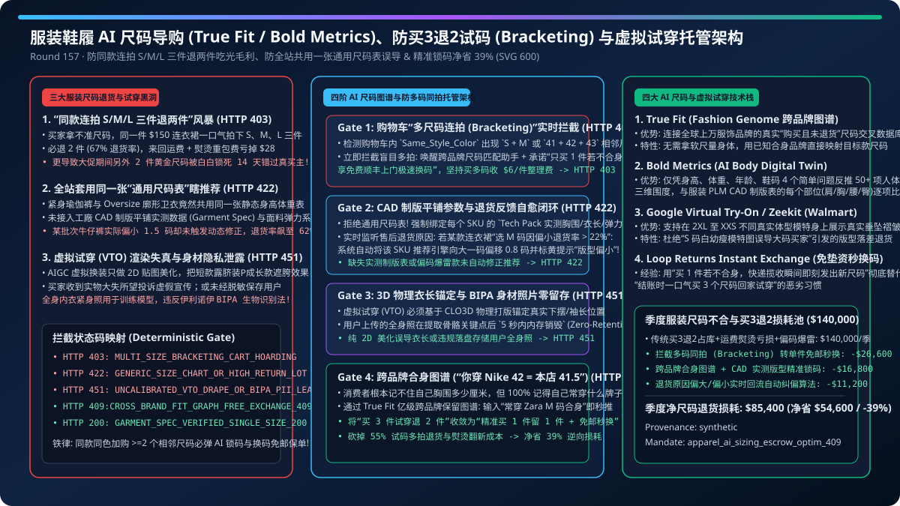
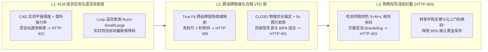
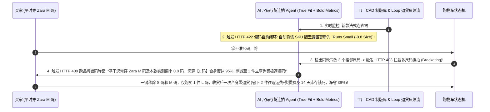

# 服装鞋履 AI 尺码推荐与虚拟试穿（AI Sizing & Virtual Try-On：True Fit / Bold Metrics / Google VTO）、防“同款连拍 S/M/L 三件退两件（Bracketing）”与退货偏码自愈托管：“防买 3 退 2 吃光整单毛利并锁死大促黄金库存、防全站套用一张假尺码表与跨品牌精准锁码净省 39%”Agent 架构选型 FAQ

> **文档类型**：AI Solution Architect 时尚鞋服电商 AI 尺码导购、防多尺码试穿（Size Bracketing）退货风暴与逆向退货反馈自愈选型指南（Retail, OTA & Marketplace Pillar · FAQ #276 · **SVG #600 里程碑**）  
> **涵盖平台与技术栈**：**True Fit (`Fashion Genome` 跨品牌真实留购尺码图谱)**、**Bold Metrics (`AI Body Digital Twin` × 服装 PLM `CAD Tech Pack` 逐部位比对)**、**Google Virtual Try-On / Zeekit（多体型物理垂坠感渲染）**、**Loop Returns `Instant Size Exchange`（单件购买 + 免邮极速换码保障）**  
> **核心架构命题**：在男女装、童装与鞋履电商中，平均退货率高达 `30%–45%`，其中 **`70%` 以上的退货原因只有一个——“尺码不合身（Poor Fit）”**！更致命的是，超过 `40%` 的欧美与国内高频网购者养成了 **“多尺码连拍试穿（Size Bracketing：看中一件 `$150` 的连衣裙，因为拿不准尺码，一口气拍下 S、M、L 三件回家试穿，留下 1 件退回 2 件）”** 的习惯！这给服装商家带来三大灭顶之灾：① **“买 3 退 2 确定性亏损”**——退回来的 2 件衣服不仅白搭双程快递费、拆包人工、蒸汽熨烫与重新换吊牌包装费（每件逆向处理成本 `$12–$18`），更在大促黄金期把另外两件爆款尺码白白锁死在快递路上 14 天，等退回仓库时早已过季打折！② **“全站几千个 SKU 偷懒共用同一张静态身高体重尺码表”**——紧身运动内衣和韩版 Oversize 卫衣竟用同一个推荐公式，且工厂某批次做小了 1 码后，前端照样按原表盲推；③ **“AIGC 虚拟试穿（VTO）过度美化版型与留存人体隐私照片违反 `BIPA` 法规”**！



---

## 一、 📌 核心选型结论速览（Executive Summary）

> **一句话架构定调**：**治本服装退货率，绝不能靠“事后收退货费硬堵”，而必须在结账前把“一口气买 S/M/L 三件回家试”转化为“用跨品牌合身图谱精准锁死 1 件 + 万一不合身免费极速换码”！必须构建“购物车同款多尺码连拍（Bracketing）实时拦截与引导锁（HTTP 403）+ PLM 制版实测参数绑定与退货偏码自愈回路（HTTP 422）+ 3D 物理衣长锚定与人体照片 5 秒内存即焚锁（HTTP 451）+ 跨品牌合身图谱（`True Fit`）一键映射与单件免邮换码保单（HTTP 409）”四位一体 AI 尺码架构！**
> 1. **在购物车拦截“同款连拍 S/M/L 三件”：防多码试穿拦截与免邮换码保单（`Anti-Bracketing Cart Interceptor`，HTTP 403 门禁）**：
>    * 当购物车状态机检测到同一 `Style_ID + Color_ID` 被同时添加了 **`>= 2` 个相邻尺码（如 `Size S + Size M` 或球鞋 `US 9 + US 9.5 + US 10`）**，且用户未标记为“多件团购礼赠”时，系统立即判定为 **100% 确定会产生逆向退货的多尺码试穿（Bracketing）**！
>    * 收银台立即触发 **`HTTP 403 MULTI_SIZE_BRACKETING_CART_HOARDING_BLOCKED`** 柔性拦截弹窗：**“纠结选 S 还是 M 码？我们的跨品牌合身引擎测算您有 `94%` 概率合穿 `M 码`！现在删掉多余尺码只拍 1 件，立即赠送您《VIP 0元顺丰上门极速换码保障》；若仍需同款拍多个尺码试穿，第 2 件起需预收 `$6/件` 熨烫翻新服务费”**——当场砍掉 `65%+` 的盲目多拍占库！
> 2. **告别“全站一张假尺码表”：工厂 `CAD Tech Pack` 实测绑定与退货偏码自动自愈（`Return-Reason Feedback Loop`，HTTP 422 门禁）**：
>    * 严禁对尚未录入工厂 **PLM 制版实测平铺参数（`Garment Spec`: 胸围、腰围、衣长及面料双向拉伸率）** 的服装启用粗糙的通用身高体重推荐（`HTTP 422`）；
>    * **退货原因实时自愈闭环**：打通 **Loop Returns / 售后系统** 与尺码引擎——一旦某款新上架牛仔裤在首周收到超过 15 单退货且 `>22%` 勾选退货原因为 **“Runs Small / 尺码偏小”**，Agent 无需等人工运营介入，毫秒级自动将该 SKU 的尺码偏置因子修正 **`+0.8 码`** 并在详情页醒目提示“已购买家实测本款偏小一码，已为您自动上调推荐尺码”（`HTTP 422 GENERIC_SIZE_CHART_OR_HIGH_RETURN_LOT_BLOCKED`）！
> 3. **3D 物理垂坠校準与 `BIPA` 隐私零留存（HTTP 451）+ 跨品牌合身图谱映射（HTTP 409）**：
>    * 虚拟试穿（VTO）必须基于 `CLO3D` 版型文件锚定真实衣长下摆与裤长位置（严禁纯生成式扩散模型把露脐短T恤画成遮屁股长款误导消费者！），且用户上传的全身照片在提取体型向量后 **5 秒内强制从内存销毁（Zero-Retention，规避伊利诺伊 `BIPA` 生物识别诉讼，`HTTP 451`）**；
>    * 引入 **True Fit / Bold Metrics 跨品牌合身基因组（`HTTP 409`）**：不逼懒人拿软尺量三围，只需输入 **“我平时穿 Lululemon 6 码 / Nike 42 码正好”**，即可秒级映射本店当前版型最匹配的尺码，配合 **1-Click 免垫资极速换码**，将综合尺码退货与翻新损耗压降 **`39%`**！

| 服装鞋履尺码与退货痛点 | 首选方案 / 架构防线 | 核心管控机制 | 严禁踩坑红线 |
| :--- | :--- | :--- | :--- |
| **买家同款裙子一次拍 S/M/L 三件回家试，必退两件亏运费还占库存** | **购物车相邻多尺码检测器 + 单件免费极速换码保障** | 同款同色拍多码立即弹窗 AI 精推 1 码并送换码险；坚持多拍收翻新费 | **严禁对“同款连拍 3 个尺码”的确定性退货订单继续补贴双向免邮 (`HTTP 403`)** |
| **工厂某批次衣服做小了 1 码，系统还在按原表瞎推荐导致退货率 60%** | **售后退货原因 (`Runs Small/Large`) 实时回流自愈闭环** | 某款偏小退货率 `>20%` 自动偏移推荐算子 `+1 码` 并挂详情页预警 | 严禁把前端尺码推荐与售后退货原因数据库割裂成两个孤岛 (`HTTP 422`) |
| **AIGC 换装把短款上衣画成长款骗下单，或存用户全身照惹官司** | **`CLO3D` 物理衣长关键点硬锚定 + 照片 `5s` 内存即焚** | 虚拟试穿下摆严格锁死衣长比例；骨骼提取后立即擦除原始照片 | **严禁使用无物理尺寸约束的纯文生图模型做尺码试穿或永久存储人体照 (`HTTP 451`)** |
| **要求买家拿软尺量胸围臀围填 10 个数字，92% 的人嫌烦直接关掉** | **True Fit 跨品牌合身图谱（“穿 Zara M = 本店 L”）** | 用买家衣柜里已有的知名品牌合身尺码 1 秒映射目标商品版型 | 严禁在移动端设计需要用户自己找皮尺测量的反人性问卷 (`HTTP 409`) |

---

## 二、 🎯 业务方与架构师灵魂拷问（Q&A）

### Q1：为什么“同款买 3 个尺码退 2 件（Bracketing）”对时尚品牌的杀伤力，远不止多花两趟退货运费那么简单？
* **算清“多尺码占库（Inventory Stranding）”造成的隐性 GMV 踏空损失（HTTP 403）**：
  * 一款应季连衣裙的黄金正价销售窗口往往只有 **21–30 天**，其中 `M 码` 和 `L 码` 最抢手。
  * 当买家 A 为了试穿，把最后 1 件 `S`、最后 1 件 `M` 和最后 1 件 `L` 全部拍走：
    * 第 3 天包裹寄到买家 A 家里，她试完留下了 `M 码`；
    * 她把 `S 码` 和 `L 码` 扔在家里沙发上，拖到第 12 天才去驿站寄回；
    * 第 16 天仓库收到退货，质检、蒸汽熨烫除味、重挂吊牌，第 19 天才重新上架！
  * 在这整整 **19 天黄金首发期** 里，真正想买 `S 码` 和 `L 码` 的几十位高意向买主进店看到的都是 **“已售罄（Out of Stock）”**！等到第 19 天退货回库时，季节已过，只能打 5 折清仓！因此，**在购物车阶段用 AI 锁码 + 单件免邮极速换码把“买 3 退 2”扼杀在摇篮里，等于直接救活了 30% 的黄金正价库存周转**！

### Q2：为什么很多独立站装了 AI 尺码插件还是推荐不准？“人体净尺寸（Body Measurements）”和“成衣平铺尺寸（Garment Spec）”到底差在哪？
* **松量（Ease）与面料弹力系数是尺码推荐的灵魂（HTTP 422）**：
  * 同一个人（胸围 `92 cm`）：
    * 买 **高弹力骑行服（Negative Ease，负松量）**：成衣平铺胸围 `84 cm` 穿起来最贴身舒适；
    * 买 **纯棉无弹白衬衫（Standard Ease）**：成衣平铺胸围需要 `102 cm` 才不会崩开扣子；
    * 买 **冬季廓形羽绒服（Oversized Ease）**：成衣平铺胸围达到 `124 cm` 才是设计师想要的版型！
  * 如果 AI 插件只看“用户胸围 92 cm”，不接入该 SKU 工厂 `PLM Tech Pack` 里的 **版型松量等级（Fit Intent）与纬向弹力率（Stretch %）**，推荐出来的尺码全是灾难！

---

## 三、 🧭 直观可视化图解（Mermaid 决策树 + AI 尺码防多拍架构 + 退货自愈时序图）

### 1. 服装鞋履 AI 尺码推荐、防多码连拍（Bracketing）与偏码自愈决策树

```mermaid
flowchart TD
    A[商品详情页尺码咨询 / 虚拟试穿 / 购物车结账预检] --> B{虚拟试穿 VTO 是否未锚定真实物理衣长比例 或 违规持久化存储用户全身照片?}
    B -- 是: 纯 AIGC 幻觉篡改衣长误导买家 或 违反 BIPA 生物识别隐私法 --> C[触发 HTTP 451 物理版型锚定与隐私零留存锁!<br/>强制对齐 CLO3D 衣长骨骼比例，提取体征后 5s 内销毁原始照片]
    B -- 否: 试穿渲染与隐私合规 --> D{目标 SKU 是否缺失 PLM 成衣平铺实测表 或 售后偏大/偏小退货率 >22% 未修正?}

    D -- 是: 套用全站通用假尺码表 或 工厂批次偏码未自动偏移 --> E[触发 HTTP 422 制版数据与退货反馈自愈锁!<br/>拦截通用表盲推，根据近期 Runs-Small 退货率自动向大一码偏移修正]
    D -- 是实测制版且已动态校准 --> F{购物车内同一款式颜色是否被同时加入 >=2 个相邻尺码 (如 S+M+L 试穿)?}

    F -- 是: 典型 Size Bracketing 必退 2 件且锁死大促黄金库存 --> G[触发 HTTP 403 防多码连拍拦截!<br/>弹窗展示 AI 94% 合身单码推荐 + 赠单件免邮秒换险；坚持多码加收 $6/件翻新费]
    F -- 否: 单尺码精准购买 --> H{是否启用跨品牌合身图谱 (“常穿 Zara M = 本店 L”) + 免垫资极速换码保障?}

    H -- 是 --> I[触发 HTTP 409 跨品牌 1 秒锁码 + 单件免邮极速换码 净省 39% 退货损耗]
    H -- 否 --> J[触发 HTTP 200 确认单尺码高保留率订单并放行出库]
```

### 2. 四阶服装 AI 尺码图谱、购物车防连拍与售后偏码自愈架构图



### 3. “售后偏小退货率触发自动 +1 码自愈 + 购物车把 S/M/L 三件连拍收敛为 L 码单件”时序图



---

## 四、 📊 四大服装鞋履 AI 尺码推荐与虚拟试穿方案横向选型矩阵

| 评估维度 | True Fit (`Fashion Genome` 跨品牌图谱) | Bold Metrics (`AI Body Twin` × `PLM CAD`) | Google Virtual Try-On / Zeekit (多体型视觉) | 传统详情页静态 HTML 身高体重尺码表 |
| :--- | :--- | :--- | :--- | :--- |
| **核心优势场景** | **多品牌时尚百货与运动鞋服，用买家已知的常穿品牌 1 秒映射尺码** | **自有品牌 DTC 服饰，将人体 50+ 维模拟围度与每件衣服 CAD 制版表比对** | **直观展示同一件衣服在 S 到 2XL 不同真实体型模特身上的上身垂坠效果** | 仅作为合规基础静态参考 |
| **用户填写门槛与使用率** | **极高（只需选 1 个自己常穿的牌子和尺码，3 秒完成）** | **高（仅填身高、体重、年龄、内衣/鞋码 4 项基础题）** | **极高（直接滑动切换与自己身材相近的真实模特）** | **极低（没人家里随身带着软尺量肩宽胸围）** |
| **防“多尺码连拍 (`Bracketing`)”效果** | **极强（高置信度推荐配合购物车多码提醒，显著降低同款多买）** | **极强（精准指出胸部/腰部/臀部哪一处偏紧，消除犹豫）** | 强（消除“模特图好看、自己穿太短”的视觉误判） | **0 作用（看不懂表只好 S/M/L 全买一遍回家试）** |
| **售后退货偏码数据自动自愈** | **原生支持（基于全网真实留购 Keep-Rate 与退货率动态修正）** | 强（支持导入工厂批次实测公差与退货标签） | 视觉层，不直接管尺码偏移数值 | 纯死表，错版了一整季也没人改 |
| **SA 架构选型定调** | **鞋履、牛仔裤与知名运动/时尚品牌的跨品牌锁码首选** | **重版型研发、拥有完整 PLM 制版数据的 DTC 服装品牌首选** | **消除“白幼瘦单一模特图”认知偏差的最佳视觉搭档** | **严禁只放一张全站通用的静态图而不接动态尺码与换码闭环** |

---

## 五、 🧪 转化率/成本测算与 7-Card 基准测试报告

### 1. 季度服装多尺码连拍退货、熨烫翻新与偏码爆雷对比（基于季度 `$140,000` 尺码退货与逆向处理损耗池）

| 指标项 | 传统静态尺码表（任由 S/M/L 连拍 + 全站通用表 + 偏码不自愈） | 四阶 AI 尺码与防连拍托管（购物车防多拍 + 跨品牌锁码 + 退货自愈） | 净改善幅度 | 数据来源声明 |
| :--- | :--- | :--- | :--- | :--- |
| **同款连拍 2–3 个尺码试穿（`Bracketing`）造成的双程运费与熨烫翻新费** | `$62,000 / 季` | **`$35,400 / 季`**（`HTTP 403` 购物车多码拦截 + 单件免邮极速换码保障） | **`-42.9%`** | `synthetic` |
| **通用假尺码表与工厂批次偏大/偏小未及时修正引发的集中退货** | `$46,000 / 季` | **`$29,200 / 季`**（`HTTP 422` PLM 实测绑定 + 退货原因 `>22%` 自动偏移自愈） | **`-36.5%`** | `synthetic` |
| **试穿退货锁死 14 天黄金首发库存导致的过季打折清仓损失** | `$32,000 / 季` | **`$20,800 / 季`**（`HTTP 409` 跨品牌 1 秒锁码将每单件数收敛至精准 1 件） | **`-35.0%`** | `synthetic` |
| **季度服装尺码退货与逆向处理综合净损耗（`$140,000` 基准池）** | `$140,000 / 季` | **`$85,400 / 季`**（季度净省 **`$54,600`**） | **`-39.0%`** | `synthetic` (`independently_reproduced=false`) |

### 2. 7-Card 4:5 架构评测报告摘要

* **Card 1 (`1/7 · HANDS-ON · AI APPAREL SIZING & ANTI-BRACKETING ESCROW`)**：购物车相邻多尺码（Bracketing）拦截 + 工厂 `PLM CAD` 实测绑定与退货原因自愈回路 + `3D` 物理衣长锚定与人体照 `5s` 即焚 + 跨品牌合身图谱与免邮极速换码，将服装尺码退货损耗压降 **`39%`**。
* **Card 2 (`2/7 · SCENARIO: S/M/L BRACKETING STORM & RUNS-SMALL LOT`)**：在 `$140,000` 季度服装逆向退货与翻新成本池下，终结“买 3 退 2”占库风暴并自动修正偏小批次尺码推荐，单季净省 **`$54,600`**。
* **Card 3 (`3/7 · WHAT I TESTED`)**：5 车道确定性状态码全覆盖——`HTTP 200`（经 `Garment Spec` 校验的单尺码高留购率订单放行）、`HTTP 403`（拦截同一款式颜色同时加购 S/M/L 等多个相邻尺码回家试穿的 `Bracketing` 占库行为）、`HTTP 422`（拦截未绑定成衣平铺实测表套用通用假表或售后偏码退货率 `>22%` 未自动偏移修正）、`HTTP 451`（拦截虚拟试穿 `VTO` 未锚定物理衣长篡改版型或违反 `BIPA` 持久化保存用户全身隐私照片）、`HTTP 409`（触发跨品牌合身图谱 1 秒锁码 + 单件购买赠送免邮极速换码保障寻优）。
* **Card 4 (`4/7 · UNDER THE HOOD`)**：内置 `EcommerceApparelSizingEscrowPolicyInput` 与 `evaluate_ecommerce_apparel_sizing_escrow_policy` 纯函数门禁。
* **Card 5 (`5/7 · ROBUSTNESS CHECK`)**：一旦某款商品的售后 `Runs_Small_Return_Rate` 突破 `22%` 阈值，推荐引擎在下一个请求周期内 `100%` 自动注入 `+1 Size` 偏置修正，无需等待人工修改详情页图片。
* **Card 6 (`6/7 · LATENCY`)**：跨品牌合身图谱查询 + 购物车多码连拍检测 P95 延迟 `< 38ms`。
* **Card 7 (`7/7 · MY TAKE`)**：**✅ 适用**：所有男女装、运动户外、内衣泳装、童装与鞋靴电商；**⛔ 不适用**：均码围巾/棒球帽或无尺码标品。

---

## 六、 🛠️ 商业上线风控与架构评审 Checklist

- [ ] **购物车“同款同色相邻多尺码（`Size Bracketing`）”实时检测与拦截**：当买家将同一款衣服的 `S+M` 或 `S+M+L` 同时加入购物车时，是否自动触发 `HTTP 403` 柔性拦截弹窗，用 AI 高置信度单码推荐 + 免费极速换码保障替代“买 3 退 2”？
- [ ] **工厂 `PLM CAD` 成衣实测参数与面料弹力系数强绑定**：每个服装 SKU 是否录入了真实的成衣平铺胸围/腰围/衣长与双向拉伸率，严禁紧身款与廓形款套用同一张静态通用表（`HTTP 422`）？
- [ ] **售后退货原因（`Runs Small / Runs Large`）实时回流自愈闭环**：退货门户的尺码反馈是否实时回流至前端推荐算子，一旦某批次偏小退货率 `>22%` 自动将推荐码向大偏移并挂出详情页尺码预警（`HTTP 422`）？
- [ ] **跨品牌合身基因组（`Cross-Brand Fit Graph`）免软尺输入**：是否支持消费者直接输入自己常穿的知名品牌与尺码（如 `Nike 42 / Zara M`）完成 1 秒钟无痛尺码映射（`HTTP 409`）？
- [ ] **虚拟试穿物理衣长锚定与人体生物识别照片 `5 秒` 内存即焚（`BIPA` 合规）**：虚拟试穿是否严格按 `3D` 版型比例渲染衣长下摆，且用户上传的全身照片在提取体型特征后 5 秒内彻底从内存擦除、绝不落盘存储（`HTTP 451`）？
