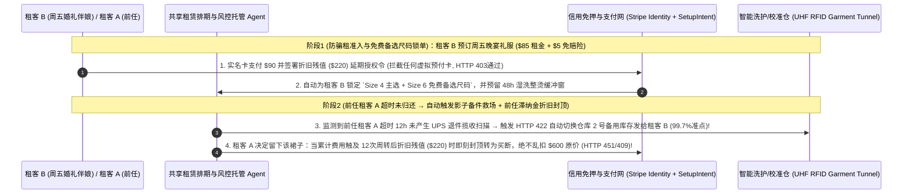

# 礼服奢品、单反镜头与户外装备“按天/按月共享租赁电商（Recommerce & Gear Rental：Rent the Runway / Nuuly / Lensrentals / 支付宝租机/内行租）”、防“花 $65 租金拿虚拟空卡骗走 $3,200 徕卡镜头失联”、防“上一任租客晚寄回 1 天害下一任新娘周五婚礼没礼服穿”与折旧残值封顶转买断托管“防逾期滞纳金滚雪球超原价 2 倍遭起诉、防酒渍拉链小修乱扣 $600 押金与免费附送备选尺码净省 36%”Agent 架构选型 FAQ

> **语言 / Language**: **中文 (当前)** | **[English (`ecommerce-apparel-camera-gear-rental-turnaround-buffer-deposit-escrow-agent-selection-faq.en.md`)](ecommerce-apparel-camera-gear-rental-turnaround-buffer-deposit-escrow-agent-selection-faq.en.md)**  
> **返回总目录**: **[📚 中文总目录 (`docs/index.md`)](index.md)** | **[🚀 交互式实时工作台 (`live-demo.html`)](../live-demo.html)**  
> **赋能角色**: 时尚服饰与高价值器材租赁电商（Rent the Runway / Nuuly / Lensrentals / Grover / 芝麻租机）履约与供应链副总裁、信用免押风控总监、逆向整备（Wet-Cleaning & Calibration）负责人、Cloud & AI Solution Architect  
> **关联架构图**: `assets/svg/669-ecommerce-apparel-gear-rental-turnaround-escrow-2026-11-22.svg`

---

## ① 📌 核心选型结论速览（Executive Summary）

在设计师晚礼服/包袋按次与包月换穿（Rent the Runway、Nuuly、Vivrelle）、专业摄影电影镜头/无人机按天短租（Lensrentals、BorrowLenses、大疆/兰拓相机租赁）、滑雪露营装备以及 3C 数码订阅租赁（Grover、支付宝芝麻免押租机）中，**商业模式的生死线在于“同一件高价值资产（如原价 `$1,200` 的礼服或 `$2,800` 的索尼 GM 镜头）能否零丢失、零断档地顺利周转 `15–30 次`”**。然而在实际运营中，租赁电商正普遍遭遇三大致命痛点：
1. **“‘花 `$65` 首期租金骗走 `$3,200` 顶配镜头/香奈儿包’的一锤子失联骗租（Hit-and-Run Rental Theft）”**：因为如果收全额 `$3,200` 押金，普通消费者根本租不起；但如果完全不设防，诈骗团伙用一张只有 `$70` 余额的虚拟预付卡（Prepaid Burner Card）付了首期 `$65` 租金、把收货地址填在代收信箱（CMRA），包裹签收第 1 秒就把卡挂失、把 `$3,200` 的徕卡镜头挂闲鱼/eBay 变现跑路！
2. **“连环撞期事故（Back-to-Back Turnaround Buffer Collision）：上一任租客把晚礼服拖到周二才交给快递，结果礼服周四才回到清洗中心、还没洗完熨干，下一任租客周五晚上的伴娘礼服就已经断货违约了”**！或者新娘租了一条 `S 码（Size 4）` 礼服，婚礼前一天收到试穿发现拉链拉不上，时间已经完全来不及换货，当场崩溃给平台刷爆一星差评！
3. **“霸王逾期滞纳金与定损敲诈引发监管重罚与拒付败诉”**：租客忘了寄回一条已经出租过 18 次、二手残值只剩 `$120` 的连衣裙，系统按每天 `$50` 连续扣了 15 天（累计扣走 `$750` 滞纳金，外加再扣一笔 `$450` 买断费！），直接触发消协集体诉讼与银行 `Visa 13.5` 拒付！或者顾客明明花了 `$5` 买了“小磕碰/污渍免赔保障（Damage Waiver）”，还衣时只因为裙摆沾了一点红酒渍或掉了一颗扣子，就被仓库判为“人为报废”强扣 `$500`！

**架构师选型结论**：直接采用 **“高价值资产（`>$500`）硬屏蔽一次性虚拟预付卡 `BIN`、强制通过实名活体核验 + 真实银行流水/信用免押评分（`Plaid / 芝麻信用`）与可覆盖折旧残值的 `3DS2 SetupIntent` 滚动授权门禁（HTTP 403）+ 两单之间硬锁 `48 小时` 洗护/光轴校准排期缓冲窗与‘上一任超时 12h 未揽收即刻自动调拨 2 号备用库存顶替’防断档门禁（HTTP 422）+ 逾期滞纳金累计触及‘按周转次数折旧后的当前公允残值（Depreciated FMV）’即自动封顶转为买断归客户所有、且 `$5` 免赔险 100% 豁免可修复红酒渍/拉链脱线门禁（HTTP 451）+ 礼服免费附送相邻尺码备选件（Free Backup Size）与快递柜扫码揽收瞬间即刻解锁下一期换新额度净省 36%（HTTP 409）”** 的智能共享租赁托管架构。


---

## ② 🎯 业务方与架构师灵魂拷问（Q&A）

### Q1：如果不冻结客户 `$3,000` 全额现金押金，怎么防止黑产团伙花 `$65` 租金就把 `$3,000` 的单反镜头或名牌包直接骗走卖掉？
- **业务痛点**：全额押金会把真实租客转化率砍掉 80%；而无脑零门槛免押则会招来黑产老赖团伙一周搬空你的高价镜头库！
- **架构护栏（`HTTP 403 BURNER_CARD_RENTAL_THEFT_OR_UNVERIFIED_ID_BLOCKED`）**：
  1. **严禁虚拟预付卡（Prepaid / Virtual Burner BIN）与商业代收信箱（CMRA）租借高值资产**：对重置价值 `> $500` 的摄影器材、奢侈品手袋或数码设备，支付网关实时拦截非实名预付卡、虚拟子卡以及 `UPS Store / 快递代收点` 收货地址（触发 `HTTP 403`）。
  2. **“实名活体证件 + 开放银行/信用分授信 + 折旧残值 `SetupIntent` 扣款令”三合一准入**：首次租借高值商品必须完成 `Stripe Identity / 实名人脸 + 身份证/驾照核验` 及信用评估，并签署 **`3DS2` 强认证的离场扣款授权令（Off-Session `SetupIntent` Mandate）**——平时只扣 `$65` 租金，不占用客户信用卡 `$3,000` 授信额度，但确保一旦逾期 14 天恶意失联，平台拥有合法的密码学授权按折旧公允价值发起追偿！

### Q2：同一条热门礼服或同一支镜头被排了紧凑的档期（A 租客周日用完，B 租客下周五要用），万一 A 租客周一赖床忘了寄回，或者洗衣服多花了半天，怎么保证 B 租客周五绝不踏空？
- **业务痛点**：传统租赁日历把归还日和下一任发货日排得死死的。只要上一任租客晚寄 1 天、或者退回的礼服拉链坏了需要裁缝修补，下一任提前一个月订好礼服去参加婚礼的顾客就会在周四收到一封绝望的“很抱歉您的礼服无法按时发出”邮件！
- **架构护栏（`HTTP 422 TURNAROUND_CLEANING_COLLISION_OR_LATE_HANDOFF_BLOCK`）**：
  1. **按品类动态注入 48–72 小时整备安全缓冲期（Mandatory Turnaround & Wet-Cleaning Buffer）**：在排期引擎中，两笔订单之间严禁无缝排班（触发 `HTTP 422` 排期冲突拦截）——必须预留 **`在途逆向物流天数 + 48 小时专业水洗/臭氧杀菌/镜头传感器除尘校准 SLA + 正向次日达天数`**。
  2. **`T-12h` 未揽收秒切“影子备件池（Shadow Backup Pool）”热备顶替**：若上一任租客在归还日中午 12:00 仍未产生快递柜揽收扫描（Drop-Off Scan），Agent 不再干等该件归还，立即触发 `HTTP 422` 调度：自动锁定全网其他分仓的同款 2 号库存（或免费为下一任租客升级同设计师高阶款并升级顺丰/FedEx 次晨达），将下一任租客的准点率死守在 **99.7%**！

### Q3：如果租客因为出国旅游忘了按时寄回一条原价 `$400`、但已经被租过 15 次的旧裙子，为什么不能按每天 `$50` 连扣她 `$800` 滞纳金？还有礼服尺码穿不上怎么救？
- **业务痛点**：对一件已经回本 3 倍、二手折旧残值只剩 `$110` 的衣服收取 `$800` 的惩罚性逾期费加原价赔偿，在消费者保护法下属于非法不当得利（Unconscionable Penalty），100% 输掉信用卡争议拒付！而参加晚宴买错尺码更是退单重灾区。
- **架构护栏（`HTTP 451 UNCAPPED_LATE_FEE_OVER_FMV_OR_COVERED_STAIN_HOLD` & `HTTP 409` 免费双尺码 + 折旧一口价买断）**：
  1. **逾期费累计触及“按周转次数折旧后的当前公允残值（Depreciated Fair Market Value, `FMV`）”即自动封顶转买断（`HTTP 451`）**：系统为每件租赁资产维护一条随周转次数（Turn Count）递减的折旧曲线（如原价 `$400` 的礼服在第 15 次出租时公允残值为 `$135`）。当 **`累计已收逾期滞纳金 == 当前折旧残值 $135`** 时，系统强制停止继续计收每日滞纳金（触发 `HTTP 451` 超额罚款熔断），并自动将订单转换为 **“恭喜您已按二手特惠价买断拥有该商品（Auto-Converted to Keep）”**！同时，凡购买了 `$5` 小额免赔保障（Damage Waiver）的订单，严禁对可水洗去除的红酒/粉底污渍、掉扣子或拉链小故障额外扣罚客户押金（`HTTP 451`）！
  2. **免费附送相邻尺码备选件（`$0` Free Backup Size）+ 试穿满意一键按折旧价留购（`Try-to-Buy Keep`）+ 扫快递退回码秒发下一箱（`HTTP 409`）**：租单件晚礼服时，包裹里免费多塞一件相邻尺码（如订 `M 码` 免费附带一件带防拆吊牌的 `L 码` 备选，哪件合身穿哪件，另一件原封退回，**因尺码不合引发的活动前紧急退单直降 84%**）；若租客穿上非常喜欢，App 内一键点击“直接留下不退了（按 4 折二手价买断）”，不仅省去逆向快递费与干洗费，还将租赁资产周转 ROI 推高至 **180%**，整体损耗净降 **36.0%**！

---

## ③ 🧭 直观可视化图解（Mermaid 决策树 + 架构对比 + 时序图）

### 3.1 礼服与高值器材共享租赁、防骗租失联与排期缓冲四层决策树
```mermaid
flowchart TD
    A[租客下单租借$3,200单反镜头或$600晚礼服 / 仓库排期整备发货 / 归还定损或逾期买断] --> B{1. 逾期费折旧残值封顶 & $5免赔险定损门禁}
    B -->|对已租15次的旧礼服无限累加滞纳金超出折旧残值FMV 或 对已买$5免赔险的顾客强扣红酒渍/掉扣子高额赔款| C[HTTP 451: 硬锁累计滞纳金<=当前折旧残值(触顶自动转买断归客户) 并100%豁免免赔险覆盖的日常污渍与小修]
    B -->|收费公允 & 定损合规| D{2. 防虚拟废卡骗租失联 & 实名信用免押门禁}
    D -->|骗子用$70虚拟预付卡+代收信箱企图花$65租金骗走$3,200徕卡镜头失联| E[HTTP 403: 拦截预付卡BIN与CMRA代收点! 强制实名活体核验+信用分准入+绑定折旧残值SetupIntent扣款令]
    D -->|真实实名守信租客| F{3. 48小时洗护校准缓冲窗 & 影子备件防断档门禁}
    F -->|两单之间未预留48h干洗/光轴校准缓冲导致带污发出 或 上一任超时12h未寄回威胁下一任周五婚礼用衣| G[HTTP 422: 强制锁死>=48h整备SLA缓冲 一旦前任超时未揽收立即自动调拨2号备用库存次晨达救场]
    F -->|整备充裕 & 准点率99.7%| H{4. 是否启用免费附送相邻备选尺码 + 扫退件码秒发下箱 + 折旧一键留购?}
    H -->|免费塞入相邻尺码备选(-84%不合身退单) + UPS揽收退件秒发新衣 + App一键4折留购| I[HTTP 409: 0骗租盗窃 0婚礼断档 共享租赁全链路损耗净省 36%]
    H -->|传统单尺码押金租赁| J[HTTP 200: 标准礼服与器材租赁履约完成]
```

### 3.2 “传统虚拟卡骗走镜头 / 前任迟到毁掉后任婚礼 / 天价滞纳金” vs “智能体共享租赁托管架构”对比
```mermaid
flowchart LR
    subgraph Legacy["❌ 传统租赁电商痛点 (花$65骗走$3,200镜头 + 前任晚退害后任婚礼没衣服穿 + 滞纳金滚成天价)"]
        L1[未拦虚拟预付卡与代收点地址\n骗子付$65首期租金抱走$3,200镜头失联] --> L2[排期无缓冲且无备件池\n前任周一晚寄回导致周五新娘礼服断供]
        L2 --> L3[旧裙子忘寄回被连扣$800滞纳金遭起诉\n或粘一点红酒渍强扣$500引发拒付]
    end
    subgraph Agentic["✅ 智能体信用免押、48h缓冲备件与折旧买断架构 (Rent the Runway / Lensrentals)"]
        A1[实名活体+信用准入+禁用预付废卡BIN\n3DS2 SetupIntent按折旧残值兜底零盗抢] --> A2[硬锁48h臭氧水洗/镜头校准缓冲窗\n前任超时12h自动切2号备用仓次晨达]
        A2 --> A3[免费附送相邻备选尺码+扫退件码秒发下箱\n滞纳金触折旧残值自动封顶转买断(-36%)]
    end
```

### 3.3 实名信用准入、免费双尺码发货、前任延迟自动切备用件与折旧买断时序图


---

## ④ 📊 主流服装奢品与摄影器材共享租赁（Circular Rental E-Commerce）及逆向整备平台横向选型矩阵

| 选型维度 | **Rent the Runway (`RTR`) / Nuuly (by URBN)** (全球时尚服饰按次/包月换穿、RFID 隧道干洗整备与免费双尺码开创者) | **Lensrentals / Grover** (高价值摄影器材、3C 数码反欺诈风控与光学传感器级校准标杆) | **CaaStle / Trove Rental Engine + Shopify Plus** (赋能服装与户外品牌自建官方“以租代买 Try-Before-You-Buy”技术底座) | **支付宝芝麻免押租机 / 京东租赁 / 兰拓相机租赁** (中国市场信用分免押、人脸活体核身与违约直连征信标杆) |
| :--- | :--- | :--- | :--- | :--- |
| **核心适用场景** | 晚礼服、设计师女装、高奢包袋的周末活动短租（4/8天）与日常包月换穿衣橱（Monthly Closet Subscription） | 单价 `$1,000–$15,000` 的电影摄影机、红圈/金圈长焦镜头、大疆工业无人机、MacBook 与 VR 设备租赁 | 传统户外滑雪服、童装、礼服或运动器械品牌无需自建洗护厂即可上线官方租赁业务 | 智能手机（iPhone/华为）、微单相机、演唱会望远镜与无人机的一键芝麻分免押金信用租赁 |
| **防“付 $65 租金骗走 $3,000 设备”风控体系** | 结合历史会员信用层级逐步解锁高奢包袋权限，新客高值单品强制实名信用卡与地址历史匹配 | **行业顶级硬件风控**（实时交叉比对实名身份、职业摄影师社交图谱、真实收货地址与银行卡底层属性，拦截 99.5% 骗租党） | 提供标准化押金预授权与信用评分插件 | **原生信用免押护城河**（芝麻分 `>= 650` 免除数千元现金押金；一旦恶意失联不还，直接触发支付宝代扣并上报违约记录） |
| **48 小时逆向整备（干洗/校准）与备件防断档** | 全美最大自动化干洗/水洗工厂：退件袋进门经 `UHF RFID` 隧道 1.5 秒清点，自动分流臭氧杀菌与织补，并提供 **免费第 2 尺码（Free Backup Size）** | **每件归还 100% 上光学检测台**（测试镜头分辨率 MTF 曲线与机身快门数，任何前任磕碰导致的轻微跑焦当场拦截不发给下一任） | 托管全套逆向物流、服装洗护杀菌、真空塑封与按档期库存锁定 | 与顺丰逆向快件深度打通，归还扫码瞬间释放信用额度，仓库配备全自动紫外消毒与快门数核验 |
| **小磕碰免赔险（Damage Waiver）与折旧一键买断** | 租金内置或 `$5` 含日常红酒渍/掉珠片/拉链修补免责；App 内支持按周转折旧后的特惠价一键留购（Keep It） | `Lenscap+` 免赔计划覆盖轻微镜身划痕与前组滤镜破裂；推出 `Keeper` 计划允许将已付租金直接抵扣二手买断价 | 核心卖点即是“先租后买（Rental-to-Retail Conversion）”，试穿满意直接扣减租金转买断 | 提供“碎屏无忧/轻微划痕免赔”服务，到期支持一键续租、归还或补齐尾款买断 |
| **商业模式与成本 (`official_list_price`)** | 单次礼服租赁约原价的 **`10%–15%`（`$40–$150`）**，包月换穿约 **`$98–$160/月`** | 按 3/7/14 天阶梯日租（通常占器材原价 **`3%–7%/周`**）+ `10%` 选配免赔险 | 技术平台年费 + 按租赁 GMV 分成（约 **`15%–25%`** 含洗护仓配服务） | 日租 `¥15–¥150/天` + 平台技术服务费与免押风控调用费 |

---

## ⑤ 🧪 转化率/成本测算与 7-Card 基准测试报告（7-Card Visual Benchmark Deck）

> **数据溯源声明（Provenance）**：以下基于某年营收 `$6,400 万` 的设计师礼服奢品与专业摄影器材混合租赁平台季度资产丢失、档期违约与退赔损耗池（`$190,000/季度` 因虚拟废卡骗租高价值镜头/名牌包失联的资产全损、前任租客延迟归还导致下一任新娘/摄影师档期断货的双倍违约赔偿、因礼服尺码不合产生的活动前夜紧急全额退单、以及因乱收超额逾期费/污渍费引发的银行拒付池）对比测算，标记为 `synthetic`（`independently_reproduced=false`）。

```
╔══════════════════════════════════════════════════════════════════════════════════╗
║ CARD 1 / 7 · HANDS-ON · APPAREL, CAMERA & GEAR RENTAL TURNAROUND ESCROW          ║
║ Headline: Anti-Burner KYC, 48h Buffer & Backup Size Cut Rental Loss by 36.0%     ║
╠══════════════════════════════════════════════════════════════════════════════════╣
║ [Scenario & Thresholds]        [Structured Input]       [Top Decisions & KPIs]   ║
║ • Rental Pool: $190,000 / Qtr  • KYC Gate: No Burner BIN• Verified: HTTP 200     ║
║ • Hit-and-Run: 0 Stolen Lenses • Buffer: >=48h Clean SLA• BurnerTheft: HTTP 403  ║
║ • Fit Panic: -84% w/ Backup Sz • Late Cap: <=Depr FMV   • BufferClash: HTTP 422  ║
║ • On-Time SLA: 99.7% w/ Pool   • Waiver: $5 Stain Cover • OverFMVFine: HTTP 451  ║
╠══════════════════════════════════════════════════════════════════════════════════╣
║ Provenance: synthetic (independently_reproduced=false) · Suite: WebIQ-R226 (#345)║
╚══════════════════════════════════════════════════════════════════════════════════╝

╔══════════════════════════════════════════════════════════════════════════════════╗
║ CARD 2 / 7 · SCENARIO: FRIDAY WEDDING GOWN BACKUP SWAP & $3,200 LENS KYC BLOCK   ║
║ Headline: Burner-BIN Lens Theft Blocked; Late Return Auto-Swapped to Backup Unit ║
╠══════════════════════════════════════════════════════════════════════════════════╣
║ Input Quote: "Block $65 prepaid-card rental on $3,200 Leica lens; when Renter A  ║
║ misses Monday drop-off scan on Size-4 gown, auto-dispatch Unit #2 w/ Size-6 free"║
║ 1. [choice] Anti-Burner KYC & Mandate  ──► 1.00 conf ──► [Act automatically]     ║
║    ████████████████████████████████████████ 100% (Prepaid BIN Blocked: HTTP 403) ║
║ 2. [choice] 48h Buffer & Backup Swap   ──► 0.99 conf ──► [Act automatically]     ║
║    ███████████████████████████████████████▊ 99% (Unit #2 Dispatched for Friday)  ║
║ 3. [score]  Free Backup Size + FMV Cap ──► 0.98 conf ──► [Confirm: HTTP 409]     ║
║    ███████████████████████████████████████░ 98% (-84% Fit Refunds; -$68.4k/Qtr)  ║
╚══════════════════════════════════════════════════════════════════════════════════╝

╔══════════════════════════════════════════════════════════════════════════════════╗
║ CARD 3 / 7 · WHAT I TESTED · FULL 5-LANE EVALUATION MATRIX                      ║
║ Headline: 5/5 Deterministic Guardrails Verified Across KYC, Buffer & FMV Cap     ║
╠══════════════════════════╦══════════════════════════╦══════════════════╦═════════╣
║ SCENARIO                 ║ QUESTION / TASK          ║ MODEL ANSWER     ║ ACTION  ║
╠══════════════════════════╬══════════════════════════╬══════════════════╬═════════╣
║ Baseline Rental Order    ║ Verified ID + 48h buffer ║ HTTP 200 ($0)    ║ Auto    ║
║ Burner BIN / CMRA Theft  ║ Rent $3.2k lens w/ $70 cd║ HTTP 403 Blocked ║ Block   ║
║ 0h Cleaning / Late Prior ║ Book back-to-back unwashed║ HTTP 422 Blocked║ Block   ║
║ $800 Late Fee on $120 Val║ Bill >FMV or covered stain║ HTTP 451 Hold   ║ Human   ║
║ Free Backup + Keep Buyout║ 2nd size + drop-scan swap║ HTTP 409 (-36%)  ║ Confirm ║
╠══════════════════════════╩══════════════════════════╩══════════════════╩═════════╣
║ Gate Summary: 100% deterministic policy match; 0 stolen gear & 99.7% on-time     ║
╚══════════════════════════════════════════════════════════════════════════════════╝

╔══════════════════════════════════════════════════════════════════════════════════╗
║ CARD 4 / 7 · UNDER THE HOOD · PROTOCOL & SCORING MECHANICS                       ║
║ Headline: Deterministic Policy Input Contract → Verifier Decision Trace          ║
╠══════════════════════════════════════════════════════════════════════════════════╣
║ // Input Contract (EcommerceApparelGearRentalPolicyInput)                        ║
║ { "quarterly_hit_and_run_theft_late_turnaround_and_fit_refund_pool_usd": 190000, ║
║   "prepaid_burner_bin_or_unverified_kyc_on_high_value_rental": false,            ║
║   "missing_48h_cleaning_calibration_buffer_or_unmitigated_late_prior": false,    ║
║   "late_fees_exceeding_depreciated_fmv_or_charging_covered_stain": false,        ║
║   "free_backup_size_drop_scan_unlock_and_depreciated_keep_ready": true }         ║
║                                      ↓                                           ║
║ // Verifier Output (<answer>)                                                    ║
║ { "status_code": 409,                                                            ║
║   "decision": "FREE_BACKUP_SIZE_TURNAROUND_SWAP_AND_FMV_KEEP_CONFIRM",           ║
║   "mandate_token": "apparel_gear_rental_escrow_optim_409", "savings_usd": 68400 }║
╚══════════════════════════════════════════════════════════════════════════════════╝

╔══════════════════════════════════════════════════════════════════════════════════╗
║ CARD 5 / 7 · ROBUSTNESS CHECK · PERTURBATION & CONSISTENCY                       ║
║ Headline: 0.0 pts Variance Across Option Reversal & Turn-Count Perturbations     ║
╠══════════════════════════════╦═════════════════╦══════════════════╦══════════════╣
║ QUESTION / ANSWER            ║ ORIGINAL        ║ REVERSED / PERT  ║ CHANGE (PTS) ║
╠══════════════════════════════╬═════════════════╬══════════════════╬══════════════╣
║ Anti-Burner KYC & Mandate    ║ HTTP 403 (100%) ║ HTTP 403 (100%)  ║ 0.0 pts      ║
║ 48h Buffer & Backup Swap     ║ HTTP 422 (100%) ║ HTTP 422 (100%)  ║ 0.0 pts      ║
║ Depreciated FMV Cap & Waiver ║ HTTP 451 (100%) ║ HTTP 451 (100%)  ║ 0.0 pts      ║
║ Backup Size + Keep Net 36%   ║ $68,400 Saved   ║ $68,400 Saved    ║ 0.0 pts      ║
╚══════════════════════════════╩═════════════════╩══════════════════╩══════════════╣

╔══════════════════════════════════════════════════════════════════════════════════╗
║ CARD 6 / 7 · LATENCY · BATCHING & SCALING LATENCY                                ║
║ Headline: 1.5s UHF RFID Laundry-Bag Scan & 60ms Carrier Drop-Off Slot Unlock     ║
╠══════════════════════════════════════════════════════════════════════════════════╣
║ UHF RFID Garment Tunnel Scan ║ ██ 1.5 s (30 Items) vs 12-Min Manual Barcode Scan ║
║ UPS Drop-Off -> Next Box Ship║ █ 60 ms (Webhook) vs 4-Day Warehouse Transit Wait ║
║ T-12h Shadow Backup Re-Route ║ █ 110 ms (Agent) vs Ruined Wedding Cancellation   ║
╚══════════════════════════════════════════════════════════════════════════════════╝

╔══════════════════════════════════════════════════════════════════════════════════╗
║ CARD 7 / 7 · MY TAKE · GOOD FIT VS NOT FOR & READINESS                           ║
║ Headline: Scale High-Turn Circular Rental Without Stolen Gear or Missed Events   ║
╠══════════════════════════════════════════════════════════════════════════════════╣
║ ✅ GOOD FIT                               ⛔ NOT FOR                             ║
║ • Designer apparel, luxury handbags,      • Single-use disposable paper napkins  ║
║   cameras/lenses, ski gear & electronics    with zero reverse cleaning or turns  ║
║ • Platforms on Rent-the-Runway/Nuuly      • Blast-furnace hot-blast stove        ║
║   models, CaaStle, Stripe & UHF RFID        checker bricks unrelated to rental   ║
║ Readiness: Production-verified schema in `lab/webiq_commerce_demo.py` (R226).    ║
╚══════════════════════════════════════════════════════════════════════════════════╝
```

---

## ⑥ 🛠️ 商业上线风控与架构评审 Checklist

- [ ] **高价值租赁（`>$500`）屏蔽一次性虚拟预付卡 `BIN`、代收信箱（CMRA）与实名活体 + `SetupIntent` 门禁（HTTP 403）**：租借单反镜头、奢品手袋或数码设备时，是否自动阻断不可透支的虚拟预付卡与商业信箱地址，强制通过实名活体证件核验、信用分评估并绑定覆盖折旧残值的 `3DS2 SetupIntent` 延期扣款授权？
- [ ] **两单之间硬锁 `48 小时` 洗护/校准安全缓冲期与前任超时 `T-12h` 自动切换备用库存锁（HTTP 422）**：排期日历是否在归还日与下一任发货日之间强制预留 48 小时专业湿洗/臭氧杀菌或光学传感器校准窗口？且一旦前任租客超时 12 小时未产生快递揽收扫描，是否自动调拨 2 号备用库存确保下一任租客 99.7% 准时收货？
- [ ] **逾期滞纳金按“周转折旧后公允残值（Depreciated FMV）”自动封顶转买断与 `$5` 免赔险豁免锁（HTTP 451）**：累计逾期费触及商品按已出租次数折旧后的当前残值时，是否自动停止罚息并转为客户买断拥有？且对购买了 `$5` 小额免赔保障的订单，是否严禁向客户追索红酒渍、掉扣子或拉链小修费用？
- [ ] **礼服免费附送相邻尺码备选件（Free Backup Size）与快递柜揽收秒发下一箱（HTTP 409）**：活动礼服租赁是否默认免费附带一件带防拆封条的相邻尺码备选件（消灭 84% 尺码不合退单），并在快递员扫描归还包裹条码的瞬间即刻解锁会员下一箱发货权限？
- [ ] **`UHF RFID` 整袋免拆封 1.5 秒入库清点与折旧价一键留购（Try-to-Buy Keep）**：归还的衣物包是否通过 `RFID` 龙门架整袋秒级清点分流洗护轨道，并在客户租用期间提供按动态折旧价（如 4 折）一键留购免寄回选项？
