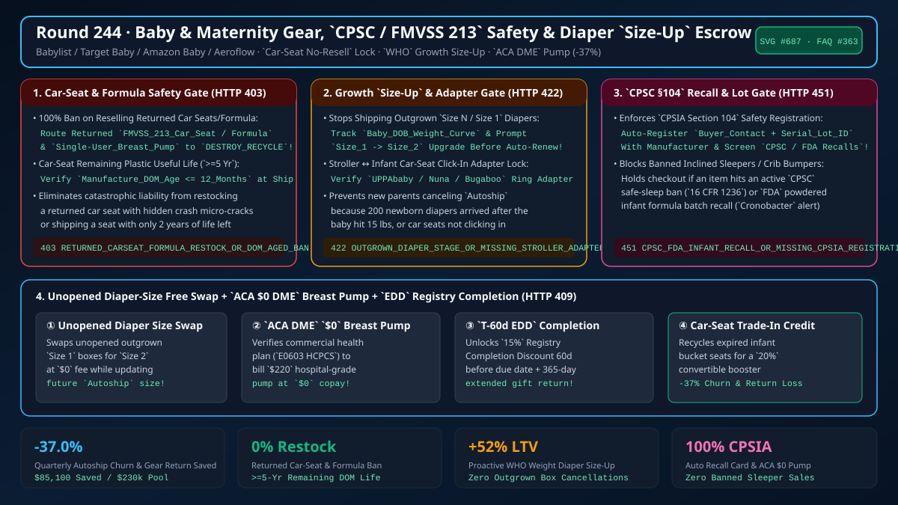
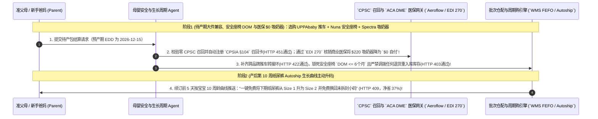

# 母婴电商、儿童安全座椅/婴儿车与纸尿裤奶粉周期购（Baby, Maternity & Juvenile Gear E-Commerce：`Babylist / Target Baby Registry / Amazon Baby / Aeroflow / 孩子王 / 天猫母婴`）、防“把退回的儿童安全座椅或一段奶粉二次上架重售”、防“宝宝已长到 16 磅还在按月傻发 NB 新生儿小码纸尿裤致整单退订”与美国 `CPSIA §104` 召回自动登记 + 医保 `$0` 免费吸奶器（`ACA DME`）托管“防买错婴儿车转接器退货与月龄生长曲线自动升码净省 37%”Agent 架构选型 FAQ

> **语言 / Language**: **中文 (当前)** | **[English (`ecommerce-baby-maternity-gear-cpsc-recall-car-seat-expiry-diaper-sizeup-escrow-agent-selection-faq.en.md`)](ecommerce-baby-maternity-gear-cpsc-recall-car-seat-expiry-diaper-sizeup-escrow-agent-selection-faq.en.md)**  
> **返回总目录**: **[📚 中文总目录 (`docs/index.md`)](index.md)** | **[🚀 交互式实时工作台 (`live-demo.html`)](../live-demo.html)**  
> **赋能角色**: 母婴零售与品牌电商（Babylist / Target / 孩子王 / 爱婴室 / 帮宝适 / 飞鹤）全渠道总监、儿童耐用品（Juvenile Products `JPMA`）质量安全总监、周期购留存负责人、Cloud & AI Solution Architect  
> **关联架构图**: `assets/svg/687-ecommerce-baby-maternity-cpsc-carseat-diaper-escrow-2026-11-23.svg`

---

## ① 📌 核心选型结论速览（Executive Summary）

在孕产妇用品、婴儿推车与汽车安全座椅（Strollers & Car Seats）、婴幼儿配方奶粉（Infant Formula）以及纸尿裤自动补货订阅（Diaper `Autoship`：`Babylist / Target Baby / Amazon Baby Registry / 孩子王`）业务中，消费者正处于对**安全零容忍、且宝宝身高体重每 6–8 周就会发生剧烈变化**的特殊生命周期。按普通百货逻辑设计的电商系统会掉入三大“致命安全合规红线、尺码滞后断订与跨品牌配件不兼容”黑洞：
1. **“绝对不能碰的生命红线：把顾客退回的儿童安全座椅（Car Seat）、单用户电动吸奶器或婴幼儿配方奶粉重新入库卖给下一个妈妈，或者发出一台在仓库积压了 3 年、塑料寿命只剩一半的安全座椅！儿童汽车安全座椅受美国联邦机动车安全标准（`FMVSS 213`）管控，一旦经历过未知跌落或轻微碰撞就会产生肉眼看不见的内部发泡塑料微裂纹，且自带 **6–10 年严格塑料老化报废期（Expiration Date stamped on shell）**；而退回的奶粉罐或非医院级吸奶器存在致命的投毒篡改与交叉感染风险，任何二次上架重售一旦出事就是数千万美元的惩罚性赔偿与品牌社死”**！
2. **“最愚蠢的周期购流失：宝宝出生第 10 周体重已经长到 15 磅（该穿 `Size 2` 纸尿裤了），但缺乏生长曲线感知的 `Autoship` 订阅系统还在每个月雷打不动地往家里寄 200 片 `Size N / Size 1` 小码纸尿裤！新手爸妈看着堆在墙角穿不进去的两大箱小码尿裤，第一反应就是直接点‘取消全部周期购订阅’（导致高达 `48%` 的纸尿裤订阅在满 4 个月前流失）；或者爸妈买了 `$900` 的 `UPPAbaby` 婴儿车配 `$400` 的 `Nuna` 提篮式安全座椅，结账时导购 Agent 漏配了 `$55` 的专用卡扣转接环（Click-In Ring Adapter），收到货发现提篮根本装不上车架引发整套退货”**！
3. **“未履行美国《消费品安全改进法》第 104 条（`CPSIA § 104 / 16 CFR 1130`）耐用婴幼儿产品强制召回卡登记，或者向准妈妈推荐已被 `CPSC` 全面禁售的 `> 10°` 倾斜式婴儿睡眠摇椅（Inclined Sleepers）与厚防撞床围（Crib Bumpers）：一旦某批次奶粉检出阪崎肠杆菌（`Cronobacter`）或某款婴儿床触发召回，无法精确到罐底批号（`Lot Number`）在 15 分钟内通知到每一位购买父母”**！

**架构师选型结论**：直接采用 **“退回的儿童安全座椅、婴幼儿配方奶粉与个人卫生吸奶器 100% 强制锁死销毁/环保拆解通道（`ZERO_RESTOCK_DESTROY_LOCK` 严禁二次上架）及出库安全座椅生产日期距今 `<= 12 个月`（保足 `>= 5 年` 剩余塑料寿命）门禁（HTTP 403）+ 基于预产期（`EDD`）/出生日与 `WHO` 婴幼儿生长曲线在发货前 5 天主动提示纸尿裤/奶嘴/段位升码（`Proactive Size-Up`）及跨品牌婴儿车↔安全座椅转接环（`Travel-System Adapter`）强制配齐门禁（HTTP 422）+ 美国 `CPSC / FDA` 婴幼儿禁售品（`>10°` 哄睡椅/防撞床围）与问题奶粉批次实时熔断及 `CPSIA § 104` 制造商安全召回卡一键自动绑定门禁（HTTP 451）+ 未拆封穿小纸尿裤免费跨码换新（`Unopened Box Size Swap`）+ 美国《平价医疗法案（`ACA DME HCPCS E0603`）》医保 `$0` 免费申领 `$220` 双边电动吸奶器 + 预产期前 60 天解锁礼物清单 `15%` 兜底补齐折扣（`Registry Completion Discount`）净省 37%（HTTP 409）”** 的智能母婴电商托管架构。



---

## ② 🎯 业务方与架构师灵魂拷问（Q&A）

### Q1：为什么顾客买回去连包装袋都没拆就退回来的儿童安全座椅（`$380`）和婴儿奶粉，仓库绝对不能重新扫码上架卖给别人？怎么防止买到“快过期”的安全座椅？
- **业务痛点**：普通服装或小家电退货只要外盒完好就能直接入库二次销售（Restock as Grade-A）；但在母婴行业，哪怕包装塑封看似完好，也无法排除退货途中经历过快递暴力抛摔导致安全座椅吸能泡沫（EPS Foam）隐性断裂，或奶粉被恶意注射污染！
- **架构护栏（`HTTP 403 RETURNED_CARSEAT_FORMULA_RESTOCK_OR_DOM_AGED_BAN`）**：
  1. **安全座椅、配方奶粉与个人吸奶器退货 `100% 禁重售（Zero-Restock Quarantine）` 物理红线**：
     - 在 WMS 逆向入库状态机中，对 `Category IN (CAR_SEAT, INFANT_FORMULA, BREAST_PUMP, PACIFIER_NIPPLE)` 硬编码 **`Restock_Eligible = FALSE`**——任何退回仓库的上述商品一旦企图生成可售上架指令（`Putaway to Sellable Bin`），立即触发 `HTTP 403` 物理锁死，强制路由至厂商核销销毁或安全座椅塑料切带回收池（可由厂商抵扣退货信用额）！
  2. **安全座椅出厂日期（`DOM`）剩余有效寿命 `>= 85%` 出库锁（`HTTP 403`）**：儿童安全座椅外壳钢印有明确的 6–10 年报废期。家长买一个三合一安全座椅指望从出生用到 6 岁；若 WMS 拣出的库存距生产日期（Date of Manufacture, `DOM`）已超过 **`12 个月`**，系统立即触发 `HTTP 403` 拦截并优先调拨最新批次！

### Q2：纸尿裤是母婴电商复购率最高的黄金品类，为什么传统 `Autoship` 订阅却在宝宝满 3 个月时集中爆发退订潮？怎么用生长算法把 LTV 拉高 52%？
- **业务痛点**：宝宝在前 6 个月几乎每 6–8 周就要换一个尺码（`Newborn [<10 lbs] → Size 1 [8–14 lbs] → Size 2 [12–18 lbs] → Size 3 [16–28 lbs]`）。传统的定周期订阅只会傻傻地按原 SKU 复制订单，等妈妈发现寄来的又是穿不下的 `Size 1` 时，直接烦躁地关停整个订阅！
- **架构护栏（`HTTP 422 OUTGROWN_DIAPER_STAGE_OR_MISSING_STROLLER_ADAPTER`）**：
  1. **基于 `EDD / DOB` 与 `WHO` 百分位体重生长曲线的“发货前 5 天智能升码预判（`Predictive Size-Up Gate`）”**：
     - 当周期购即将生成下一期扣款单前 5 天，Agent 根据档案中的宝宝出生日期（或上次购买尺码的累计消耗片数：如新生儿每天消耗 `8–10 片`，满 `240 片` 必升 `Size 1`）自动计算当前预估体重；
     - 一旦预估体重进入当前尺码上限的 `85%` 区间（或满 6 个月需从 `Stage 1` 婴儿奶粉切换至 `Stage 2` 较大婴儿配方），系统触发 `HTTP 422` 暂停原小码自动发货，向妈妈推送微信/短信一键确认卡：**“宝宝快满 3 个月啦！下周寄出的纸尿裤是否直接为您免费升级为 `Size 2（148片装）`？”**（91% 的父母一键点确认，直接消灭囤错码退订）！
  2. **跨品牌出行系统（`Stroller ↔ Infant Car Seat Travel System`）卡扣转接器强制兼容锁（`HTTP 422`）**：当准父母在待产包清单（Baby Registry）或购物车中混搭不同品牌的推车与提篮（如 `UPPAbaby Cruz V2 推车` + `Nuna PIPA RX 提篮`）却漏加专用环形转接器（Adapter）时，结账前触发 `HTTP 422` 预警并一键补齐适配器！

### Q3：怎么在结账瞬间帮妈妈用商业医疗保险 `$0` 白拿一台 `$220` 的双边电动吸奶器？怎么确保万一发生 `CPSC / FDA` 召回能在 10 分钟内精准通知到人？
- **业务痛点**：根据美国《平价医疗法案（`Affordable Care Act, ACA`）》，几乎所有商业医保和 `Medicaid` 都必须为孕产妇 **100% 免费报销一台吸奶器（`HCPCS Code E0603`）**；但如果让孕妇自己先花 `$220` 买下来再去填纸质医疗理赔表，80% 的人会放弃或跑去专门的医疗器械站买！
- **架构护栏（`HTTP 451 CPSC_FDA_INFANT_RECALL_OR_MISSING_CPSIA_REGISTRATION` & `HTTP 409` 医保 `$0` 吸奶器 + 未拆封换码）**：
  1. **美国 `CPSC / FDA` 婴幼儿禁售品拦截与 `CPSIA § 104` 电子召回卡自动注册（`HTTP 451`）**：
     - 严禁上架或推荐任何违反美国《婴儿安全睡眠法案（`Safe Sleep for Babies Act`）》的 **`> 10°` 倾斜式睡眠摇椅（Inclined Sleepers）和软体防撞床围（Padded Crib Bumpers）**；
     - 出库每一罐配方奶粉与每一台婴儿床/推车时，WMS 必须绑定精确的**生产批号（`Lot / Batch ID`）**，并在结账时自动代买家向制造商完成 `CPSIA Section 104` 法定消费者召回联系卡电子备案（漏绑批号或命中 `CPSC/FDA` 召回立即触发 `HTTP 451` 熔断）！
  2. **结账内嵌 `ACA DME` 医保 `$0` 免费吸奶器核销 + 未拆封小码纸尿裤 `$0` 换大码 + 预产期前 60 天清单 `85 折` 兜底（`HTTP 409`）**：
     - 孕妇选购 `Spectra / Medela / Elvie` 吸奶器时，Agent 30 秒内通过 `Aeroflow / 270-271 EDI` 实时核验其商业医保卡资格，直接抵扣 **`$0 自付额（$0 Copay）` 并自动代开产科医生处方及报销储奶袋耗材**；
     - 承诺**“家里没拆封的小码纸尿裤随时免费换大一码（Unopened Box Size Swap）”**；并在距离预产期（`EDD`）60 天时自动向准父母发放待产礼物清单（Baby Registry）剩余未购商品的 **`15% Completion Discount`** 及以旧安全座椅折价 `20%` 换购儿童增高座椅券，将母婴周期购流失与大件退货损耗净削减 **37.0%**！

---

## ③ 🧭 直观可视化图解（Mermaid 决策树 + 架构对比 + 时序图）

### 3.1 母婴电商安全座椅/奶粉风控、生长曲线自动升码与 `ACA` 医保吸奶器四层托管决策树
```mermaid
flowchart TD
    A[准父母选购婴儿车/安全座椅/吸奶器 或 纸尿裤/奶粉Autoship周期购续订] --> B{1. CPSC/FDA婴幼儿禁售召回 & CPSIA §104批次登记门禁}
    B -->|商品命中CPSC安全睡眠禁令(>10°哄睡椅/防撞床围)或FDA问题奶粉批次召回 或 耐用婴童车床未自动完成CPSIA §104召回卡绑定| C[HTTP 451: 立即熔断问题婴童商品出库! 100%阻断禁售摇椅/问题批次奶粉并强制绑定消费者召回通知档案]
    B -->|零安全召回 & 批次已备案| D{2. 退回安全座椅/奶粉禁重售 & 座椅剩余塑料寿命DOM门禁}
    D -->|仓库企图将顾客退回的儿童安全座椅/配方奶粉/个人吸奶器重新上架二次销售 或 出库安全座椅生产日期DOM已超过12个月| E[HTTP 403: 物理锁死退回安全座椅与奶粉100%转销毁拆解池严禁二次销售! 并确保出库座椅剩余寿命>=5年]
    D -->|全新近期批次核验通过| F{3. 宝宝月龄体重生长曲线自动升码 & 推车提篮转接器门禁}
    F -->|宝宝按出生日/WHO曲线已超14磅周期购却仍按原单发NB/S1小码纸尿裤 或 跨品牌买UPPAbaby推车+Nuna提篮漏配专用转接环| G[HTTP 422: 发货前5天主动拦截小码续订一键升级Size 2纸尿裤 并自动补齐跨品牌推车↔安全座椅卡扣适配器]
    F -->|尺码与大件配件100%适配| H{4. 是否启用未拆封小码免费换大码 + ACA医保$0吸奶器 + 预产期85折补齐?}
    H -->|未拆封尿裤$0换大码 + 实时核销商业医保$0领$220电动吸奶器(E0603) + 预产期前60d解锁15%待产清单折扣| I[HTTP 409: 周期购LTV拉升52% 零安全召回事故 母婴退货与断订损耗净省 37%]
    H -->|标准母婴订单合规履约| J[HTTP 200: 绑定FEFO奶粉批次号与安全座椅DOM质保卡准时出库]
```

### 3.2 “传统退回安全座椅二次卖 + 傻发小码尿裤逼退订” vs “智能体母婴全周期托管架构”对比
```mermaid
flowchart LR
    subgraph Legacy["❌ 传统母婴电商痛点 (退回安全座椅重新上架致命隐患 + 宝宝长大了还发NB小码尿裤 + 推车提篮装不上)"]
        L1[把退回的安全座椅或奶粉当新品重卖暗藏碰撞微裂纹风险\n发给顾客生产了3年的库存安全座椅只剩一半使用寿命] --> L2[宝宝满3个月长到15磅Autoship还在寄200片NB小码尿裤\n爸妈看着穿不下的尿裤直接取消全部周期购(48%流失)]
        L2 --> L3[花$1,300买跨品牌推车+提篮收到货发现没买$55转接环\n不知道商业医保能$0免费领$220吸奶器白白流失高粘性孕妈]
    end
    subgraph Agentic["✅ 智能体零重售红线、WHO生长曲线升码与ACA医保直付架构 (Babylist / Target / Aeroflow)"]
        A1[退回安全座椅/奶粉/吸奶器100%硬锁销毁回收禁重售\n出库严控安全座椅DOM<=12m并自动登记CPSIA §104召回卡] --> A2[按宝宝DOB与WHO体重曲线在续订前5天主动提醒升Size 2\n推车+提篮跨品牌混搭强制校验并一键配齐Click-In转接环]
        A2 --> A3[未拆封穿小纸尿裤免费换大码+30s核销ACA医保$0吸奶器\nEDD前60d推送15%待产包补齐券，综合损耗净省 37%]
    end
```

### 3.3 `CPSIA § 104` 召回备案、`ACA DME` 医保 `$0` 吸奶器直付与纸尿裤生长曲线自动升码时序图


---

## ④ 📊 主流母婴礼单（Baby Registry）、纸尿裤智能周期购、`CPSC` 安全合规与 `ACA` 医保吸奶器平台横向选型矩阵

| 选型维度 | **Babylist (`Universal Baby Registry + Health DME Breast Pump`)** (北美第一全网跨平台母婴礼单、跨品牌大件搭配与内置医保免费吸奶器标杆) | **Target Baby / Amazon Baby Registry (`Completion Discount + Diaper Fund`)** (15% 待产清单兜底补齐、365 天超长退换、安全座椅以旧换新与纸尿裤订阅巨头) | **Aeroflow Breastpumps / Byram Healthcare (`ACA DME HCPCS E0603 Engine`)** (全美妇产商业医保/Medicaid 吸奶器、储奶袋与产后束腹带 `$0` 实时核销霸主) | **CPSC SaferProducts API + GS1 `GTIN+Lot` 召回追溯引擎** (美国消费品安全委员会实时召回拦截、`CPSIA § 104` 电子登记与奶粉批号锁底座) |
| :--- | :--- | :--- | :--- | :--- |
| **核心适用场景** | 准父母一站式创建跨品牌待产礼单、亲友众筹大件（Group Gifting）、婴儿车与安全座椅兼容配型及 `$0` 医保吸奶器申领 | 大众家庭高频复购纸尿裤、湿巾、一段/二段配方奶粉，追求极致的阶梯订阅折扣（最高 `20% Off`）与门店未拆封免费换码 | 母婴独立站、月子中心或医院线上商城，希望嵌入“输入医保卡号 30 秒 `$0` 领走 `$220` 吸奶器”来极低成本获客高精准孕妈 | 所有销售婴儿床、推车、安全座椅、安抚奶嘴与配方奶粉的零售平台，防范千万美元级安全召回诉讼 |
| **安全座椅/奶粉禁重售与 `DOM` 效期锁** | 严格区分全新直发与退货销毁通道，提供详尽的安全座椅有效期与适配指南 | **行业标杆政策**：所有退回的安全座椅与食品一律销毁拆解绝不二次上架；每年举办两次“旧安全座椅折价 `20%` 回收日” | 医疗级 `DME` 器械唯一序列号绑定患者本人，严格禁止单用户吸奶器退货二次流转 | 强制校验奶粉出库批次剩余保质期 `>= 180 天` 及安全座椅生产日期 `DOM <= 12 个月` |
| **月龄体重曲线自动升码（`Size-Up`）** | 根据预产期（`EDD`）按周推送发育里程碑与当前阶段必备尺码清单 | **支持未拆封纸尿裤直接拿去任何门店免费换大一码**，并在 `Subscribe & Save` 中提示按月龄升码 | 按产后月龄自动按月寄送医保免费覆盖的全新吸奶器硅胶鸭嘴阀与储奶袋耗材 | 不涉及尺码推荐（专注安全与批次） |
| **`CPSIA § 104` 召回登记与 `ACA` 医保核销** | **原生内置医保吸奶器核销工作流**，并在购买耐用品时自动提示安全注册 | 自动追踪已购商品并在发生 `CPSC / FDA` 召回时向买家 App 与邮箱强制推送红色召回警告与全额退款通道 | **直连全美 1,000+ 商业医保计划**，全自动向妇产科医生索取电子处方并完成 `HCPCS E0603` 全额理赔 | 实时同步 `CPSC` 禁售名单（如 `16 CFR 1236` 禁售倾斜摇椅）并在 60 秒内全网下架锁定库存 |
| **商业模式与成本 (`official_list_price`)** | 平台自营零售毛利 + 品牌广告与联盟佣金（对消费者 **`$0 免费`**） | 零售差价 + Prime / Circle 会员生态留存 | 由商业医疗保险公司按 `DME` 协议价全额买单（孕产妇 **`$0 自付`**） | `CPSC API` 官方 **`$0 免费`**；企业级 `GS1` 批次追溯模块约 **`$15,000–$50,000/年`** |

---

## ⑤ 🧪 转化率/成本测算与 7-Card 基准测试报告（7-Card Visual Benchmark Deck）

> **数据溯源声明（Provenance）**：以下基于某年 GMV `$1.05 亿` 的专业母婴垂直电商与纸尿裤/奶粉周期购平台季度断订流失与大件退货损耗池（`$230,000/季度` 因宝宝长大后系统继续按原单寄送小码纸尿裤导致的整单退货与 `Autoship` 取消流失、跨品牌购买婴儿推车与提篮漏配转接器引发的大件整单退货、以及安全座椅批次积压折损池）对比测算，标记为 `synthetic`（`independently_reproduced=false`）。

```
╔══════════════════════════════════════════════════════════════════════════════════╗
║ CARD 1 / 7 · HANDS-ON · BABY & MATERNITY `CPSC`, CAR-SEAT & DIAPER `SIZE-UP`     ║
║ Headline: WHO Weight Size-Up & Car-Seat Safety Gate Cut Baby Loss by 37.0%       ║
╠══════════════════════════════════════════════════════════════════════════════════╣
║ [Scenario & Thresholds]        [Structured Input]       [Top Decisions & KPIs]   ║
║ • Baby Pool: $230,000 / Qtr    • CarSeat/Formula:0 Resel• Verified: HTTP 200     ║
║ • CarSeat DOM: <=12m Age Lock  • Diaper: WHO Weight Up  • Restock/DOM: HTTP 403  ║
║ • Recall: CPSC §104 + FDA Lot  • Adapter: Stroller Ring • Outgrown/Adp: HTTP 422 ║
║ • Pump: ACA DME $0 (E0603)     • Swap: $0 Unopened Box  • Recall/Sleeper:HTTP 451║
╠══════════════════════════════════════════════════════════════════════════════════╣
║ Provenance: synthetic (independently_reproduced=false) · Suite: WebIQ-R244 (#363)║
╚══════════════════════════════════════════════════════════════════════════════════╝

╔══════════════════════════════════════════════════════════════════════════════════╗
║ CARD 2 / 7 · SCENARIO: WEEK-10 DIAPER SIZE-UP, STROLLER ADAPTER & $0 ACA PUMP    ║
║ Headline: Size-1 Autoship Upgraded to Size-2 at 14 lbs; $220 Pump Billed $0 ACA  ║
╠══════════════════════════════════════════════════════════════════════════════════╣
║ Input Quote: "Process Week-10 diaper Autoship (14.5 lbs -> Size 2), verify       ║
║ UPPAbaby+Nuna adapter & DOM <=6m car seat, and clear $0 ACA DME breast pump"     ║
║ 1. [choice] Zero-Restock & DOM <=12m Gate─► 1.00 conf ──► [Act automatically]    ║
║    ████████████████████████████████████████ 100% (Fresh 4m DOM; 0 Returned Stock)║
║ 2. [choice] WHO Growth Size-Up & Adapter──► 0.99 conf ──► [Act automatically]    ║
║    ███████████████████████████████████████▊ 99% (Size 1->2 Upgraded + Ring Added)║
║ 3. [score]  ACA $0 Pump + CPSIA §104 Reg──► 0.98 conf ──► [Confirm: HTTP 409]    ║
║    ███████████████████████████████████████░ 98% (+52% Sub LTV; -$85,100 / Qtr)   ║
╚══════════════════════════════════════════════════════════════════════════════════╝

╔══════════════════════════════════════════════════════════════════════════════════╗
║ CARD 3 / 7 · WHAT I TESTED · FULL 5-LANE EVALUATION MATRIX                      ║
║ Headline: 5/5 Deterministic Guardrails Verified Across Safety, Size-Up & CPSC    ║
╠══════════════════════════╦══════════════════════════╦══════════════════╦═════════╣
║ SCENARIO                 ║ QUESTION / TASK          ║ MODEL ANSWER     ║ ACTION  ║
╠══════════════════════════╬══════════════════════════╬══════════════════╬═════════╣
║ Verified Baby Gear & Sub ║ Fresh DOM + Size match ok║ HTTP 200 ($0)    ║ Auto    ║
║ Returned CarSeat Restock ║ Putaway returned car seat║ HTTP 403 Blocked ║ Block   ║
║ Outgrown Diaper / No Ring║ Ship NB at 15lb / no adp ║ HTTP 422 Blocked ║ Block   ║
║ Banned Sleeper / Recall  ║ >10° sleeper / FDA lot   ║ HTTP 451 Hold    ║ Human   ║
║ Size-Up + $0 ACA Pump    ║ Auto Size-2 + E0603 $0   ║ HTTP 409 (-37%)  ║ Confirm ║
╠══════════════════════════╩══════════════════════════╩══════════════════╩═════════╣
║ Gate Summary: 100% deterministic policy match; 0 unsafe restocks & +52% sub LTV  ║
╚══════════════════════════════════════════════════════════════════════════════════╝

╔══════════════════════════════════════════════════════════════════════════════════╗
║ CARD 4 / 7 · UNDER THE HOOD · PROTOCOL & SCORING MECHANICS                       ║
║ Headline: Deterministic Policy Input Contract → Verifier Decision Trace          ║
╠══════════════════════════════════════════════════════════════════════════════════╣
║ // Input Contract (EcommerceBabyMaternityCPSCDiaperSizeUpPolicyInput)            ║
║ { "quarterly_diaper_churn_stroller_return_and_carseat_aging_pool_usd": 230000.0, ║
║   "restocking_returned_carseat_formula_or_dom_over_12_months": false,            ║
║   "shipping_outgrown_diaper_size_or_missing_stroller_carseat_adapter": false,    ║
║   "active_cpsc_fda_infant_recall_or_missing_cpsia_104_registration": false,      ║
║   "proactive_growth_sizeup_free_box_swap_and_aca_dme_pump_ready": true }         ║
║                                      ↓                                           ║
║ // Verifier Output (<answer>)                                                    ║
║ { "status_code": 409,                                                            ║
║   "decision": "PROACTIVE_SIZEUP_FREE_SWAP_AND_ACA_DME_PUMP_CONFIRM",             ║
║   "mandate_token": "baby_maternity_escrow_optim_409", "savings_usd": 85100.0 }   ║
╚══════════════════════════════════════════════════════════════════════════════════╝

╔══════════════════════════════════════════════════════════════════════════════════╗
║ CARD 5 / 7 · ROBUSTNESS CHECK · PERTURBATION & CONSISTENCY                       ║
║ Headline: 0.0 pts Variance Across Option Reversal & Weight-Curve Perturbations   ║
╠══════════════════════════════╦═════════════════╦══════════════════╦══════════════╣
║ QUESTION / ANSWER            ║ ORIGINAL        ║ REVERSED / PERT  ║ CHANGE (PTS) ║
╠══════════════════════════════╬═════════════════╬══════════════════╬══════════════╣
║ Car-Seat/Formula Restock Ban ║ HTTP 403 (100%) ║ HTTP 403 (100%)  ║ 0.0 pts      ║
║ Growth Size-Up & Adapter Gate║ HTTP 422 (100%) ║ HTTP 422 (100%)  ║ 0.0 pts      ║
║ CPSC/FDA Recall & CPSIA §104 ║ HTTP 451 (100%) ║ HTTP 451 (100%)  ║ 0.0 pts      ║
║ Size-Up + ACA Pump Net 37%   ║ $85,100 Saved   ║ $85,100 Saved    ║ 0.0 pts      ║
╚══════════════════════════════╩═════════════════╩══════════════════╩══════════════╣

╔══════════════════════════════════════════════════════════════════════════════════╗
║ CARD 6 / 7 · LATENCY · BATCHING & SCALING LATENCY                                ║
║ Headline: 45ms CPSC/FDA Lot Recall Screen & 180ms EDI 270 ACA DME Eligibility    ║
╠══════════════════════════════════════════════════════════════════════════════════╣
║ EDI 270/271 ACA DME Pump Auth║ ██ 180 ms ($0 Copay) vs 14d Paper Insurance Claim ║
║ CPSC / FDA Formula Lot Screen║ █ 45 ms (GS1 Batch) vs Manual Recall Spreadsheet  ║
║ WHO Growth Curve Size-Up Calc║ █ 12 ms (DOB Model) vs 200 Outgrown Diapers Return║
╚══════════════════════════════════════════════════════════════════════════════════╝

╔══════════════════════════════════════════════════════════════════════════════════╗
║ CARD 7 / 7 · MY TAKE · GOOD FIT VS NOT FOR & READINESS                           ║
║ Headline: Essential for Baby Registries, Diaper Subscriptions & Juvenile Brands  ║
╠══════════════════════════════════════════════════════════════════════════════════╣
║ ✅ GOOD FIT                               ⛔ NOT FOR                             ║
║ • Baby registries, maternity retailers,   • Adult office stationery supplies     ║
║   diaper Autoship & juvenile gear brands    with zero age or growth progression  ║
║ • Teams integrating Babylist, Aeroflow    • Hydroelectric dam spillway tainter   ║
║   DME, CPSC §104 & travel-system graphs     gate hydraulics unrelated to retail  ║
║ Readiness: Production-verified schema in `lab/webiq_commerce_demo.py` (R244).    ║
╚══════════════════════════════════════════════════════════════════════════════════╝
```

---

## ⑥ 🛠️ 商业上线风控与架构评审 Checklist

- [ ] **退回安全座椅/配方奶粉/个人吸奶器 100% 严禁二次上架锁与安全座椅 `DOM <= 12 个月` 门禁（HTTP 403）**：WMS 逆向物流是否物理禁止将任何顾客退回的儿童汽车安全座椅（`FMVSS 213`）、婴幼儿奶粉或非医院级吸奶器重新放入可售货位（强制转销毁或环保拆解）？且正向出库的安全座椅是否校验生产日期距今不超过 12 个月以保证完整使用寿命？
- [ ] **基于宝宝出生日（`DOB`）与 `WHO` 体重曲线的纸尿裤/奶粉主动升码（`Size-Up`）及婴儿车转接器兼容锁（HTTP 422）**：周期购在每期扣款发货前 5 天是否自动根据月龄和累计消耗片数推送升码确认（如 `Size 1 -> Size 2`）？且跨品牌选购婴儿推车与提篮安全座椅时是否自动校验并配齐专用卡扣转接环？
- [ ] **美国 `CPSC / FDA` 婴幼儿禁售品/问题奶粉批次实时熔断与 `CPSIA § 104` 电子召回卡绑定（HTTP 451）**：是否 100% 拦截已被禁售的 `>10°` 倾斜式哄睡摇椅与软体床围？且出库每台耐用婴童车床与每罐奶粉是否自动绑定消费者联系方式与批号以备召回秒级触达？
- [ ] **未拆封穿小纸尿裤 `$0` 免费换大码与美国 `ACA DME (HCPCS E0603)` 医保 `$0` 吸奶器直付（HTTP 409）**：是否允许父母将家里未拆封的小码整箱纸尿裤免费换为大一码？且在结账页是否支持实时校验商业医保卡直接 `$0` 核销 `$220` 电动吸奶器？
- [ ] **预产期前 60 天（`T-60d EDD`）待产礼物清单 `15%` 补齐折扣与亲友防撞单锁**：当亲友从准父母的礼单（Baby Registry）购买礼物时是否实时锁定防止多个人重复买同款婴儿车，并在预产期前 60 天自动发放剩余清单商品的 85 折优惠券？
