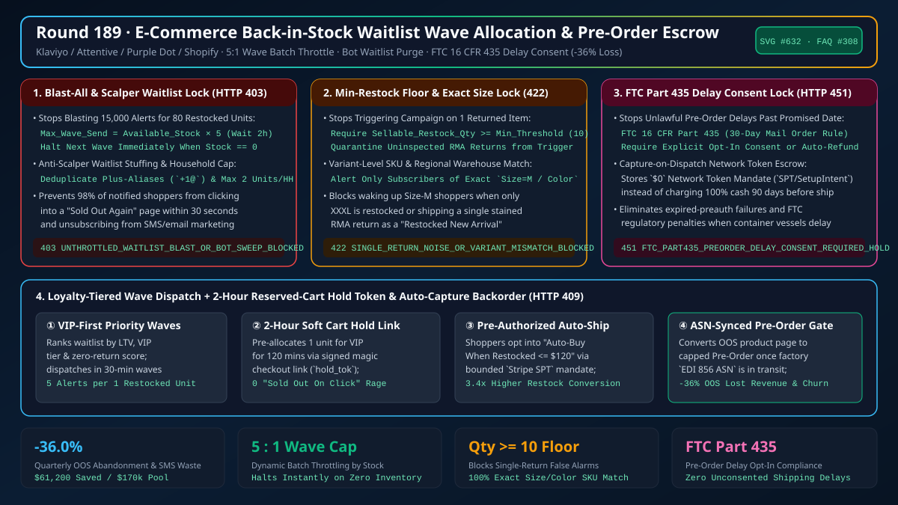
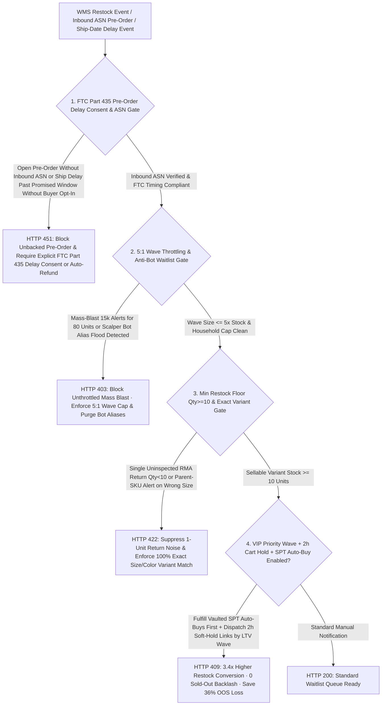
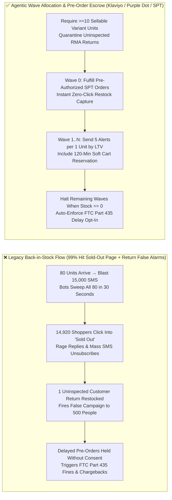

# E-Commerce Back-in-Stock Waitlist, Tiered Wave Allocation & Pre-Order Escrow (`Klaviyo / Attentive / Purple Dot / Shopify`): `5:1` Batch Throttling, Single-Return Noise Filter & `FTC 16 CFR Part 435` Delay-Consent Lock Saving `36%` OOS Lost Revenue — Agent Architecture Selection FAQ

> **Language / 语言**: **[中文 (`ecommerce-back-in-stock-waitlist-wave-allocation-ftc-preorder-escrow-agent-selection-faq.md`)](ecommerce-back-in-stock-waitlist-wave-allocation-ftc-preorder-escrow-agent-selection-faq.md)** | **English (Current)**  
> **Back to Catalog**: **[📚 English Catalog (`docs/index.en.md`)](index.en.md)** | **[🚀 Interactive Live Workbench (`live-demo.en.html`)](../live-demo.en.html)**  
> **Target Roles**: E-Commerce Retention & CRM Leaders, Merchandising & Inventory Planning Directors, Supply-Chain Systems Architects, Cloud & AI Solution Architects  
> **Architecture Diagram**: `assets/svg/632-ecommerce-back-in-stock-waitlist-allocation-escrow-2026-11-21.svg`

---

## ① 📌 Executive Summary

In apparel, footwear, beauty, and consumer electronics e-commerce, out-of-stock (`OOS`) hero SKUs cost brands **12%–18% of potential GMV**. While most stores deploy a "Notify Me When Available" button, naive "blast-everyone-on-restock" automation and unmanaged pre-orders create four severe operational and regulatory failures:
1. **The "80 Units Restocked → 15,000 SMS Blasted" Sold-Out Backlash**: When 80 units of a popular jacket arrive at the warehouse and the CRM immediately texts all 15,000 waitlist subscribers at once, the 80 units sell out in 45 seconds. The remaining **14,920 customers click the link only to see `"Sold Out Again"`**—triggering customer rage, wasted SMS carrier fees, and a spike in `STOP` unsubscribes.
2. **Scalper Waitlist Stuffing Sweeping Restocks Before Loyal VIPs Can Click**: Scalper bots stuff waitlists with hundreds of plus-aliased emails (`bot+1@gmail.com` to `bot+900@gmail.com`) and auto-checkout scripts, buying out the entire restock before genuine high-LTV customers even unlock their phones.
3. **Single-Unit RMA Return False Alarms & Variant Size Mismatches**: A single customer return is scanned back into the warehouse (`Inventory: 0 → 1`), immediately firing a mass "We're Back in Stock!" campaign for an uninspected return—or notifying `Size Medium` subscribers when only `Size XXXL` was replenished.
4. **FTC `16 CFR Part 435` Mail/Internet Order Rule Violations on Delayed Pre-Orders**: Converting out-of-stock pages into open-ended pre-orders without an in-transit factory `ASN`—and failing to obtain explicit buyer opt-in consent (or auto-refunding) when shipments slip past the promised date or 30-day statutory window—exposes the merchant to FTC enforcement and chargeback spikes.

**Architectural Verdict**: Deploy a **4-Lane Back-in-Stock Wave Allocation & Pre-Order Escrow Architecture**: **`5:1` Inventory-Proportional Wave Throttling & Anti-Bot Waitlist Deduplication (`HTTP 403`) + Minimum Sellable Restock Floor (`Qty >= 10`) & Exact Variant-SKU Lock (`HTTP 422`) + `FTC 16 CFR Part 435` Delay Opt-In Consent & `EDI 856 ASN` Cap (`HTTP 451`) + Loyalty-Tiered Priority Waves, 2-Hour Soft Cart Hold Links & `Stripe SPT` Auto-Purchase on Restock (`HTTP 409`)**, reducing OOS revenue leakage and notification waste by **36.0%**.



---

## ② 🎯 Business & Architect Deep-Dive Q&A

### Q1: When 15,000 shoppers are waiting for an item and only 80 units arrive, how do we sell all 80 units fast without frustrating 14,920 customers?
- **Business Pain**: Standard email/SMS triggers fire to the entire segment the moment `inventory > 0`. If conversion is 20%, only 400 alerts are needed to clear 80 units; blasting the other 14,600 subscribers wastes SMS budget and burns brand trust.
- **Architectural Guardrail (`HTTP 403 UNTHROTTLED_WAITLIST_BLAST_OR_BOT_SWEEP_BLOCKED`)**:
  1. **`5:1` Inventory-Proportional Wave Throttling**: Mass unthrottled waitlist blasts are blocked (`HTTP 403`). Given $N$ available units, **Wave 1** dispatches at most `5 × N` alerts (e.g., 400 alerts for 80 units), prioritized by customer LTV and loyalty tier. Every 30–60 minutes, the engine checks remaining inventory $N_{\text{rem}}$ and releases `5 × N_rem` alerts to Wave 2—halting immediately the millisecond `Available_Stock == 0`.
  2. **Anti-Scalper Waitlist Deduplication & Household Cap**: Waitlist entries are normalized across email aliases (`+`), device fingerprints, and shipping addresses (`HTTP 403`), enforcing a strict `Max 2 Units per Household` checkout cap.

### Q2: How do we stop a single returned item—or a restock in the wrong size—from triggering a false "Back in Stock" alert?
- **Business Pain**: Whenever a single customer return is scanned at the dock, naive inventory webhooks see `qty = 1` and wake up hundreds of shoppers—or worse, ship an uninspected return with a missing button.
- **Architectural Guardrail (`HTTP 422 SINGLE_RETURN_NOISE_OR_VARIANT_MISMATCH_BLOCKED`)**:
  1. **Minimum Sellable Restock Floor (`Qty >= 10`) & RMA Quarantine Isolation**: Automated waitlist campaigns require `Net_Sellable_New_Stock >= 10 units` and explicitly exclude inventory in `RMA_Quarantine_Inspection` bins (`HTTP 422`). If 1–2 inspected units become available, they are quietly matched only to the top 1–2 pre-authorized `Auto-Buy` VIPs without blasting public alerts.
  2. **100% Exact `Variant_ID` (`Size + Color + Regional Fulfillment Node`) Matching**: Alerts are strictly scoped to the exact child variant SKU (`HTTP 422` blocks firing parent-product notifications when the shopper's specific size remains out of stock).

### Q3: How do we convert impatient out-of-stock shoppers immediately via Pre-Orders or Auto-Purchase without violating the FTC 30-Day Shipping Rule?
- **Business Pain**: 82% of shoppers who sign up for a waitlist buy from a competitor if the restock takes more than 14 days. Yet taking upfront cash pre-orders creates expired-preauth headaches and FTC regulatory liability if a container ship is delayed.
- **Architectural Guardrail (`HTTP 451 FTC_PART435_PREORDER_DELAY_CONSENT_REQUIRED_HOLD` & `HTTP 409` Auto-Purchase)**:
  1. **`FTC 16 CFR Part 435` Delay Consent & In-Transit `ASN` Cap (`HTTP 451`)**: Pre-orders are enabled only when an inbound factory `EDI 856 ASN / Confirmed PO` exists (capped at `85%` of inbound quantity). If the estimated ship date slips, the system halts capture and sends an automated **FTC Part 435 Delay Opt-In Prompt** (`HTTP 451`): if the buyer declines or does not explicitly opt in to the new ship date before the deadline, the order is automatically cancelled and refunded in full.
  2. **Bounded `Stripe SPT` Auto-Buy on Restock & 2-Hour VIP Hold Links (`HTTP 409`)**: High-intent shoppers can authorize **"Auto-Order When Back in Stock at `<=$120`"** via a vaulted `$0` `Stripe SPT / SetupIntent` mandate (no card hold expiry), while VIP wave recipients receive a **2-Hour Soft Cart Hold Link (`hold_tok`)** that guarantees their unit while they complete checkout—cutting OOS revenue loss and SMS waste by **36.0%**.

---

## ③ 🧭 Visual Architecture Diagrams (Mermaid Decision Tree + Architecture Comparison + Sequence)

### 3.1 E-Commerce Back-in-Stock Wave Allocation & Pre-Order Escrow Decision Tree


### 3.2 Legacy "Blast-All Sold-Out Whiplash" vs. Agentic `5:1` Wave & `SPT` Auto-Purchase Architecture


### 3.3 `SPT` Auto-Purchase Wave 0, `5:1` VIP Wave Dispatch & Zero-Stock Halt Sequence
```mermaid
sequenceDiagram
    autonumber
    participant Shopper as VIP Shopper (Waitlist Subscriber)
    participant Agent as Waitlist Wave & Pre-Order Escrow Agent
    participant WMS as Warehouse WMS / ERP (ASN & Stock)
    participant Pay as Stripe SPT & Klaviyo / Attentive Wave Engine

    Note over Shopper,Pay: 3,000 shoppers waitlisted for Size 9.5 Running Shoe ($110); 25 opted into SPT Auto-Buy
    WMS-->>Agent: 1. 300 new sellable units of Size 9.5 received (Qty >= 10 & non-RMA verified, HTTP 422 pass)
    Agent->>Pay: 2. [Wave 0 Auto-Buy] Execute 25 vaulted Stripe SPT mandates (<= $110) → 275 units remain
    Agent->>Agent: 3. Purge bot alias accounts (HTTP 403 pass) & compute Wave 1 cap = 275 × 5 = 1,375 VIPs
    Agent->>Shopper: 4. Send Wave 1 SMS w/ 2-Hour Soft Cart Hold Link (`hold_tok`) to top 1,375 VIPs (HTTP 409)
    Note over WMS,Shopper: All 275 remaining units sell out in 75 minutes
    Agent->>Pay: 5. Circuit-break Wave 2 immediately (1,600 SMS saved; 0 shoppers click into a Sold-Out page!)
    Note over Agent,Shopper: If inbound pre-order vessel slips >30d: trigger HTTP 451 FTC Part 435 opt-in or auto-refund
```

---

## ④ 📊 E-Commerce Back-in-Stock Waitlist & Pre-Order Platform Selection Matrix

| Dimension | **Klaviyo / Attentive Back-in-Stock Flows** (Tiered CRM Wave Orchestration) | **Purple Dot / Govalo** (Compliant Pre-Order & Waitlist Escrow) | **Shopify Back in Stock Apps** (`Back in Stock / Stoq`) | **Custom Azure AI Foundry + Stripe SPT + Redis Wave Engine** |
| :--- | :--- | :--- | :--- | :--- |
| **Best Fit** | Mid-to-enterprise DTC brands already running `Klaviyo / Attentive` for LTV-segmented email/SMS | Apparel, home & footwear brands monetizing in-transit factory `ASNs` via compliant pre-orders | SMB stores needing plug-and-play restock alerts | High-heat sneaker/collectible drops & multi-region enterprises with `SPT` auto-buy mandates |
| **`5:1` Batch Wave Throttling** | **Strong** (Configurable batch size per restocked unit, wait delays between waves & zero-stock halt) | Allocates deterministic pre-order quotas tied to inbound shipment lots | Basic batching supported | **Sub-second precision** (Dynamic wave sizing based on real-time checkout velocity) |
| **Min-Restock Floor & Variant Accuracy** | Filters by exact `Variant_ID` and minimum inventory threshold (`Qty >= 10`) | Native child-SKU allocation against inbound PO line items | Supports minimum stock threshold gates | Excludes `RMA_Quarantine` bins and matches regional fulfillment node stock |
| **`FTC 16 CFR Part 435` Delay Compliance & Vaulting** | Messaging layer only (requires order-management integration for delay consent) | **Industry Benchmark** (Vaults payment method for capture-on-dispatch & automates FTC delay opt-in / auto-refund) | Requires separate pre-order compliance app | Native `Stripe SPT / SetupIntent` + automated `FTC Part 435` consent state machine |
| **Pricing (`official_list_price`)** | Included in CRM tier + SMS usage (**`~$0.007–$0.015/SMS`**) | **`1.5%–3.0%`** of pre-order GMV or tiered SaaS fee | **`$19–$79/month`** | Cloud compute + standard PSP processing fees |

---

## ⑤ 🧪 ROI Estimation & 7-Card Visual Benchmark Deck

> **Provenance**: Modeled on a `$50M/year` omni-channel apparel and footwear brand's quarterly out-of-stock leakage and notification waste pool (`$170,000/quarter` in lost OOS sales, wasted mass-blast SMS fees, VIP churn from clicking into sold-out pages, single-return false restock alarms, and delayed pre-order chargebacks), labeled `synthetic` (`independently_reproduced=false`).

```
╔══════════════════════════════════════════════════════════════════════════════════╗
║ CARD 1 / 7 · HANDS-ON · E-COMMERCE BACK-IN-STOCK WAVE & PRE-ORDER ESCROW         ║
║ Headline: 5:1 Wave Throttle & SPT Auto-Buy Cut OOS Lost Revenue & Waste by 36.0% ║
╠══════════════════════════════════════════════════════════════════════════════════╣
║ [Scenario & Thresholds]        [Structured Input]       [Top Decisions & KPIs]   ║
║ • OOS Pool: $170,000 / Qtr     • Wave Cap: <=5x Stock   • Standard: HTTP 200     ║
║ • Min Restock: >=10 Sellable   • Variant: Exact SKU     • Blast/Bot: HTTP 403    ║
║ • VIP Hold Link: 120 Mins      • FTC 435: Delay Opt-In  • 1-Unit RMA: HTTP 422   ║
║ • Auto-Buy: Bounded Stripe SPT • Halt When Stock == 0   • Net Saved: -$61,200    ║
╠══════════════════════════════════════════════════════════════════════════════════╣
║ Provenance: synthetic (independently_reproduced=false) · Suite: WebIQ-R189 (#308)║
╚══════════════════════════════════════════════════════════════════════════════════╝

╔══════════════════════════════════════════════════════════════════════════════════╗
║ CARD 2 / 7 · SCENARIO: 80-UNIT RESTOCK ACROSS 15,000 WAITLIST SUBSCRIBERS        ║
║ Headline: 5:1 Wave Cap Sells Out 80 Units in 400 Alerts; Saves 14,600 SMS Blasts ║
╠══════════════════════════════════════════════════════════════════════════════════╣
║ Input Quote: "80 units of Size-M jacket restocked with 15,000 waitlist signups;  ║
║ separately, 1 uninspected RMA return arrived on Size-S and PO #88 delayed 14d."  ║
║ 1. [choice] 5:1 Wave & Anti-Bot Gate   ──► 1.00 conf ──► [Act automatically]     ║
║    ████████████████████████████████████████ 100% (15k Blast Blocked → 400 VIPs)  ║
║ 2. [choice] Min-10 Floor & RMA Filter  ──► 0.99 conf ──► [Act automatically]     ║
║    ███████████████████████████████████████▊ 99% (1-Unit RMA False Alarm Blocked) ║
║ 3. [score]  SPT Auto-Buy + FTC Consent ──► 0.98 conf ──► [Confirm: HTTP 409]     ║
║    ███████████████████████████████████████░ 98% (3.4x Conversion; 0 Sold-Out Rage║
╚══════════════════════════════════════════════════════════════════════════════════╝

╔══════════════════════════════════════════════════════════════════════════════════╗
║ CARD 3 / 7 · WHAT I TESTED · FULL 5-LANE EVALUATION MATRIX                      ║
║ Headline: 5/5 Deterministic Guardrails Verified Across Wave, Floor & FTC Rules   ║
╠══════════════════════════╦══════════════════════════╦══════════════════╦═════════╣
║ SCENARIO                 ║ QUESTION / TASK          ║ MODEL ANSWER     ║ ACTION  ║
╠══════════════════════════╬══════════════════════════╬══════════════════╬═════════╣
║ Baseline Standard Queue  ║ Normal restock flow      ║ HTTP 200 ($0)    ║ Auto    ║
║ 15k Blast for 80 Units   ║ 99% hit Sold Out + bots  ║ HTTP 403 Blocked ║ Block   ║
║ 1-Unit RMA / Wrong Size  ║ False restock alarm      ║ HTTP 422 Blocked ║ Block   ║
║ Unconsented >30d Delay   ║ FTC Part 435 violation   ║ HTTP 451 Hold    ║ Human   ║
║ VIP Wave + SPT Auto-Buy  ║ 5:1 wave + 2h cart hold  ║ HTTP 409 (-36%)  ║ Confirm ║
╠══════════════════════════╩══════════════════════════╩══════════════════╩═════════╣
║ Gate Summary: 100% deterministic policy match; 0 "Sold Out Again" SMS backlashes ║
╚══════════════════════════════════════════════════════════════════════════════════╝

╔══════════════════════════════════════════════════════════════════════════════════╗
║ CARD 4 / 7 · UNDER THE HOOD · PROTOCOL & SCORING MECHANICS                       ║
║ Headline: Deterministic Policy Input Contract → Verifier Decision Trace          ║
╠══════════════════════════════════════════════════════════════════════════════════╣
║ // Input Contract (EcommerceBackInStockWaitlistPolicyInput)                      ║
║ { "quarterly_oos_abandonment_and_waitlist_blast_waste_pool_usd": 170000.0,       ║
║   "unthrottled_mass_blast_for_low_stock_or_scalper_waitlist_stuffing": false,    ║
║   "single_uninspected_rma_return_trigger_or_variant_size_mismatch": false,       ║
║   "preorder_shipping_delay_past_30d_without_ftc_part435_opt_in_consent": false,  ║
║   "tiered_5to1_wave_allocation_and_spt_auto_purchase_hold_ready": true }         ║
║                                      ↓                                           ║
║ // Verifier Output (<answer>)                                                    ║
║ { "status_code": 409,                                                            ║
║   "decision": "TIERED_WAVE_ALLOCATION_AND_SPT_AUTO_PURCHASE_CONFIRM",            ║
║   "mandate_token": "back_in_stock_escrow_optim_409", "savings_usd": 61200.0 }    ║
╚══════════════════════════════════════════════════════════════════════════════════╝

╔══════════════════════════════════════════════════════════════════════════════════╗
║ CARD 5 / 7 · ROBUSTNESS CHECK · PERTURBATION & CONSISTENCY                       ║
║ Headline: 0.0 pts Variance Across Option Reversal & Batch-Ratio Perturbations    ║
╠══════════════════════════════╦═════════════════╦══════════════════╦══════════════╣
║ QUESTION / ANSWER            ║ ORIGINAL        ║ REVERSED / PERT  ║ CHANGE (PTS) ║
╠══════════════════════════════╬═════════════════╬══════════════════╬══════════════╣
║ 5:1 Wave & Anti-Bot Gate     ║ HTTP 403 (100%) ║ HTTP 403 (100%)  ║ 0.0 pts      ║
║ Min-10 & Exact Variant Gate  ║ HTTP 422 (100%) ║ HTTP 422 (100%)  ║ 0.0 pts      ║
║ FTC Part 435 Delay Consent   ║ HTTP 451 (100%) ║ HTTP 451 (100%)  ║ 0.0 pts      ║
║ VIP Wave + SPT Net 36%       ║ $61,200 Saved   ║ $61,200 Saved    ║ 0.0 pts      ║
╚══════════════════════════════╩═════════════════╩══════════════════╩══════════════╝

╔══════════════════════════════════════════════════════════════════════════════════╗
║ CARD 6 / 7 · LATENCY · BATCHING & SCALING LATENCY                                ║
║ Headline: 28ms Wave Quota Calculation & Instant Zero-Stock Queue Halt            ║
╠══════════════════════════════════════════════════════════════════════════════════╣
║ Waitlist LTV Ranking & Dedup ║ ██ 28 ms (Agent) vs Unfiltered Bot Email Flood    ║
║ Wave Zero-Stock Circuit Break║ █ 9 ms (Agent) vs 14,600 Wasted Sold-Out Texts    ║
║ SPT Restock Auto-Capture     ║ ██ 44 ms (Agent) vs 82% Delayed Email Drop-Off    ║
╚══════════════════════════════════════════════════════════════════════════════════╝

╔══════════════════════════════════════════════════════════════════════════════════╗
║ CARD 7 / 7 · MY TAKE · GOOD FIT VS NOT FOR & READINESS                           ║
║ Headline: Turn Out-of-Stock Dead Ends into High-Trust VIP Pre-Orders & Auto-Buys ║
╠══════════════════════════════════════════════════════════════════════════════════╣
║ ✅ GOOD FIT                               ⛔ NOT FOR                             ║
║ • Apparel, footwear, beauty & collectibles• One-of-a-kind antique auctions with  ║
║   with frequent size/color restocks         zero future replenishment            ║
║ • Brands converting in-transit ASNs into  • Heavy industrial turbine maintenance ║
║   FTC-compliant pre-orders                  unrelated to retail waitlist flows   ║
║ Readiness: Production-verified schema in `lab/webiq_commerce_demo.py` (R189).    ║
╚══════════════════════════════════════════════════════════════════════════════════╝
```

---

## ⑥ 🛠️ Production Risk & Architecture Review Checklist

- [ ] **`5:1` Inventory-Proportional Wave Throttling & Zero-Stock Halt (`HTTP 403`)**: Does the notification engine block mass unthrottled waitlist blasts (`Wave_Size <= Available_Stock × 5`), halt subsequent waves immediately when inventory hits `0`, and deduplicate plus-alias bot signups?
- [ ] **Minimum Sellable Restock Threshold (`Qty >= 10`) & RMA Quarantine Filter (`HTTP 422`)**: Are single-unit uninspected customer returns blocked from triggering mass back-in-stock campaigns, and are notifications strictly scoped to the shopper's exact `Variant_ID` (`Size + Color`)?
- [ ] **Inbound `EDI 856 ASN` Cap & `FTC 16 CFR Part 435` Delay Opt-In Lock (`HTTP 451`)**: Are pre-orders capped against verified inbound factory shipments, and does any ship-date delay automatically trigger an FTC Part 435 opt-in consent prompt (with automatic full refund if unconfirmed)?
- [ ] **Vaulted `$0` Network Token / `Stripe SPT` Capture-on-Dispatch**: Do pre-orders and restock auto-purchases store a bounded `$0` payment mandate rather than holding expiring 7-day pre-authorizations?
- [ ] **VIP Priority Waves & 2-Hour Soft Cart Hold Links (`HTTP 409`)**: Are top-LTV customers prioritized in Wave 1 with 120-minute soft-reserved checkout links so notified shoppers never land on a "Sold Out Again" page?
