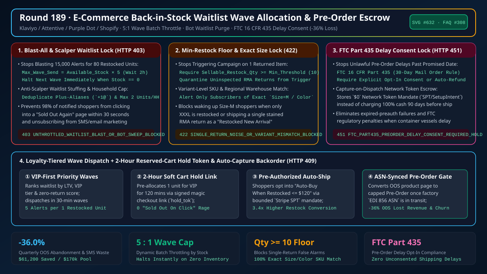
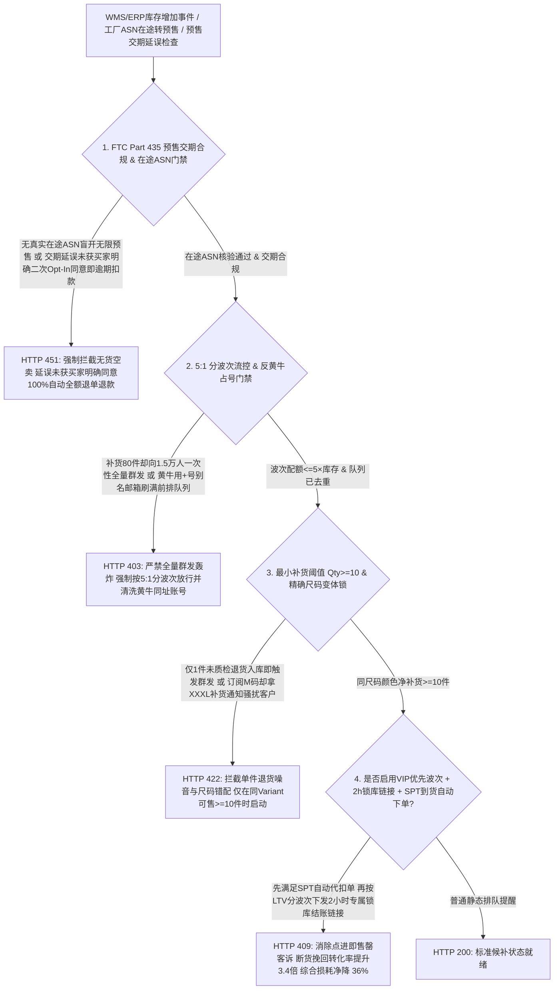
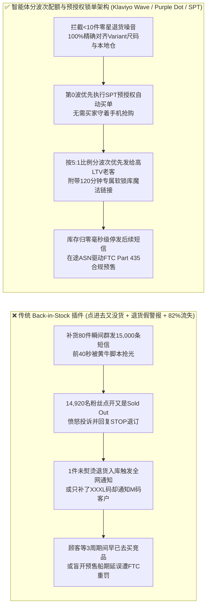
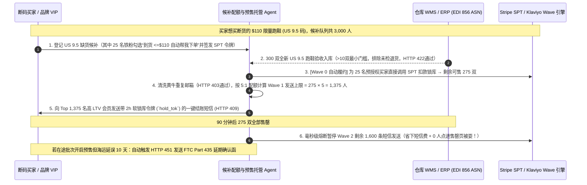

# 电商断货候补通知（Back-in-Stock Waitlist：Klaviyo / Attentive / Back in Stock）、分波次配额放行（Wave Allocation）与在途预售（Pre-Order `FTC Part 435`）托管“防补货 80 件却群发 1.5 万条短信致 99% 买家点进售罄页怒退订、防 1 件退货脏次品误触全网到货提醒与 VIP 预授权自动锁单净省 36%”Agent 架构选型 FAQ

> **语言 / Language**: **中文 (当前)** | **[English (`ecommerce-back-in-stock-waitlist-wave-allocation-ftc-preorder-escrow-agent-selection-faq.en.md`)](ecommerce-back-in-stock-waitlist-wave-allocation-ftc-preorder-escrow-agent-selection-faq.en.md)**  
> **返回总目录**: **[📚 中文总目录 (`docs/index.md`)](index.md)** | **[🚀 交互式实时工作台 (`live-demo.html`)](../live-demo.html)**  
> **赋能角色**: 品牌电商增长与 CRM 私域负责人、全渠道商品运营总监、供应链计划与产研架构师、Cloud & AI Solution Architect  
> **关联架构图**: `assets/svg/632-ecommerce-back-in-stock-waitlist-allocation-escrow-2026-11-21.svg`

---

## ① 📌 核心选型结论速览（Executive Summary）

在服装鞋履、美妆护肤、潮玩与 3C 消费品电商中，爆款断码缺货（Out-of-Stock, OOS）平均吃掉品牌 **12%–18% 的潜在 GMV**。虽然几乎所有独立站和平台店都装了“到货通知我（Back-in-Stock Alert）”插件，但粗放的“有货即全量群发”模式在真实生产环境中正引发四大高昂事故：
1. **“仓库只补了 80 件货，系统瞬间给候补名单上的 15,000 人全量群发到货短信”——前 80 件在 40 秒内被抢空，剩下 14,920 名满怀期待点开链接的粉丝看到刺眼的 `Sold Out Again`，引发大规模品牌客诉、短信轰炸投诉与 `STOP` 退订潮（Blast-All Sold-Out Backlash），且白白烧掉 `$225` 国际短信通道费**！
2. **黄牛机器人用 `bot+1@gmail.com ~ bot+900@gmail.com` 批量塞满候补队列，到货通知一发，黄牛脚本 0.2 秒扫光全部库存，真正高 LTV 的品牌 VIP 老客一件都买不到**！
3. **“仓库刚收到 1 件顾客退回来的拆封退货（甚至还没质检熨烫），库存从 `0` 跳成 `1`，立刻触发全自动到货通知”**——几百名客户冲进来抢这 1 件可能带粉底液污渍的退货件；或者客户明明登记的是 `M 码黑色`，系统却因为 `XXXL 码绿色` 补货而乱发全 SPUs 到货通知！
4. **为了锁住缺货流量盲目开启“无在途库存的无限期预售（Open-Ended Pre-Order）”，结果工厂交期延误超过 30 天未按美国 `FTC 16 CFR Part 435（邮购与网购履约规则）` 取得买家明确二次延期同意，引发平台封店、罚款与大面积银行拒付**！

**架构师选型结论**：直接采用 **“按补货量 `5:1` 动态分波次流控（Wave-Batch Throttling）与黄牛占号清洗/单户限购门禁（HTTP 403）+ 最小可售补货门槛（`Qty >= 10`）防单件退货误报与精确变体 `Size/Color` 匹配锁（HTTP 422）+ 在途 `EDI 856 ASN` 挂钩预售与美国 `FTC Part 435` 超期双选同意门禁（HTTP 451）+ 高价值 VIP 优先波次、2 小时专属锁库链接与 `Stripe SPT` 预授权到货自动扣款发货净省 36%（HTTP 409）”** 的智能候补与预售托管架构。



---

## ② 🎯 业务方与架构师灵魂拷问（Q&A）

### Q1：候补名单上有 15,000 人，首批只到货 80 件，架构上怎么发通知才能既把 80 件迅速卖完，又不让另外 1.4 万人点进来扑空骂街？
- **业务痛点**：传统邮件/短信营销工具看到 `inventory_quantity > 0` 的 Webhook 就把整个列表一次性清空发送。平均转化率如果是 10%，发 800 人就够卖光 80 件了，多发出去的 14,200 条短信不仅是纯亏损的通道费，更是在亲手摧毁私域退订率。
- **架构护栏（`HTTP 403 UNTHROTTLED_WAITLIST_BLAST_OR_BOT_SWEEP_BLOCKED`）**：
  1. **`5:1` 动态配额分波次漏斗（Inventory-Proportional Wave Throttling）**：严禁一次性全量群发（触发 `HTTP 403` 硬拦截）。当入库可售库存为 $N$ 件（如 80 件）时，第 1 波（Wave 1）仅按历史转化率倒推的乘数（默认 `5 × N = 400 人`）优先发送给最高价值客群；每隔 30–60 分钟实时复核剩余未售库存 $N_{\text{rem}}$，若 $N_{\text{rem}} > 0$ 再向下一波放行 `5 × N_rem` 人；一旦库存归零，毫秒级熔断后续所有待发队列！
  2. **候补队列反黄牛清洗与单户限购锁（Household Quota）**：入列时自动归并邮箱 `+` 号别名、同设备指纹与同收货地址；对前序高退货率或疑似黄牛账号降权至末波，并在到货结账链接中强绑定 `Max 2 Units per Household` 硬上限。

### Q2：为什么经常发生“顾客收到补货短信，点进去却发现自己的尺码根本没货，或者只有 1 件秒没”？如何拦截“单件退货假补货”噪音？
- **业务痛点**：仓库每天都有零星退货入库。当某款断货连衣裙收到 1 件买家退货，ERP 库存从 `0` 变成 `1`，如果不设门槛，系统立刻惊动几百人去抢这 1 件还没经过质检（可能沾有口红印或吊牌已剪）的退货！
- **架构护栏（`HTTP 422 SINGLE_RETURN_NOISE_OR_VARIANT_MISMATCH_BLOCKED`）**：
  1. **最小净补货触发阈值（`Min_Restock_Threshold >= 10 Units`）与退货质检隔离锁**：触发大规模 Back-in-Stock 营销流必须满足两个硬条件：① **非未质检逆向退货仓（Quarantine RMA Bin）库存**；② **单变体净可售库存 `>= 10 件`**（若仅退回 1–2 件合格品，仅静默释放给开启了“到货自动代扣”的 Top 1–2 名 VIP，绝不群发短信，违者返回 `HTTP 422`）。
  2. **100% 变体级（Variant SKU：`Size + Color + Region Warehouse`）精准订阅匹配**：严禁在父商品（Parent Product ID）层级粗粒度触发通知；只有当买家订阅的具体尺码颜色（如 `US 8 / Navy`）在可配送其邮编的本地仓有货时才允许触达（`HTTP 422`）。

### Q3：对于工厂已经在生产、预计 21 天后到港的断货爆款，如何把“死气沉沉的缺货登记页”升级成高转化的“合规预售 / 预授权到货秒发”？
- **业务痛点**：让高意向买家填完邮箱等 3 周，等你发邮件时他早就在竞品那买完了（流失率高达 82%）。但直接全款预售又怕船期延误违反美国 `FTC 16 CFR Part 435`（30 天发货规则）或预授权 7 天过期无法扣款。
- **架构护栏（`HTTP 451 FTC_PART435_PREORDER_DELAY_CONSENT_REQUIRED_HOLD` & `HTTP 409` 自动锁单）**：
  1. **`FTC 16 CFR Part 435` 交期延误明确同意与自动退单门禁（`HTTP 451`）**：只有当 ERP 中存在已确认的工厂在途货运单（`Confirmed ASN / PO In-Transit`）时才允许开启预售，且预售额度严格锁死在 `ASN_Qty × 85%` 以内。若船期延误导致无法在承诺日期（或无日期时的 30 天内）发货，系统强制发送一键确认卡（`HTTP 451`）征询买家是否同意新交期；**若买家拒绝或未在规定窗口明确回复同意，系统必须 100% 自动取消订单并全额退款**，严禁静默无限期拖延！
  2. **VIP 2 小时软锁库魔法链接与 `Stripe SPT / SetupIntent` 到货自动成交（`HTTP 409`）**：买家登记缺货时可勾选 **“补货且价格 `<= $120` 时自动帮我下单（Auto-Purchase on Restock）”**，通过 `Stripe SPT` 或卡组 `Network Token` 签署 `$0` 限额授权令（不占信用卡额度、无 7 天预授权过期问题）；到货入库瞬间系统自动扣款生成发货单，或为普通 VIP 生成带 2 小时软锁库（`2h Soft Cart Reservation`）的一键免填表结账链接，将断货挽回净收益提升 **36.0%**！

---

## ③ 🧭 直观可视化图解（Mermaid 决策树 + 架构对比 + 时序图）

### 3.1 电商断货候补分波次放行与在途预售托管四层决策树


### 3.2 “传统有货即全量群发 / 1 件退货误报” vs “智能体分波次 VIP 锁库 + 预授权自动补货架构”对比


### 3.3 断货登记 `SPT` 预授权自动成交、VIP 分波次 `5:1` 放行与 `FTC Part 435` 交期守护时序图


---

## ④ 📊 主流电商断货候补通知（Back-in-Stock）与在途预售（Pre-Order）平台横向选型矩阵

| 选型维度 | **Klaviyo / Attentive Back-in-Stock Flows** (智能分波次 CRM 自动化) | **Purple Dot / Govalo** (原生全合规预售与候补锁单平台) | **Shopify Native / Back in Stock (App)** (轻量级快速上线方案) | **自建 Azure AI Foundry + Stripe SPT + Redis Wave 引擎** |
| :--- | :--- | :--- | :--- | :--- |
| **核心适用场景** | 已使用 Klaviyo/Attentive 管理邮件与短信私域、需按客户 LTV 分波次放行的 DTC 品牌 | 服装、家居与潮牌存在高频在途补货（In-Transit ASN），希望把断货页直接变成高转化预售单 | 中小独立站快速上线基础到货邮件提醒 | 限量球鞋/潮玩发售、多仓多区域库存隔离及支持“到货自动代扣（Auto-Buy）”的头部零售商 |
| **按库存比例分波次放行（Batch Throttling）** | **极强**（支持配置每件库存触发 $K$ 条通知、批次间隔等待时间及售罄自动中止流） | 转为确定性预售排期分配，按到港批次锁定名额 | 基础版支持简单分批，但需注意与主营销短信流的并发冲突 | **毫秒级精确控制**（结合 Redis 原子库存计数器与实时转化率动态调整下一波发送量） |
| **最小补货量过滤与变体级精准匹配** | 支持按 Variant SKU Inventory 过滤 `Qty >= X` 后才触发 Flow | 原生按尺码/颜色变体绑定在途 PO 批次额度 | 支持设置 Minimum Stock Threshold 防止 1 件退货误发 | 支持结合 WMS 库位属性剔除 `RMA Quarantine` 待检退货仓虚增库存 |
| **`FTC 16 CFR Part 435` 延期合规与免过期扣款** | 仅负责消息触达，不管理预售资金托管与延期同意状态机 | **行业标杆**（内置 Vaulted Card 出库才扣款 + 交期变更自动发送 FTC 合规双选确认与逾期自动退单） | 需依赖第三方预售插件处理延迟发货合规 | 原生集成 `Stripe SPT / SetupIntent` 零额度占压与 `FTC Part 435` 自动退单定时器 |
| **成本模型 (`official_list_price`)** | 包含在邮件/短信订阅包内（SMS 约 **`$0.007–$0.015/条`**） | 按成功转化的预售/候补 GMV 抽成（约 **`1.5%–3.0%`**）或月费 | **`$19–$79/月`** 固定订阅费 | 仅支付底层云算力与标准支付网关费率 |

---

## ⑤ 🧪 转化率/成本测算与 7-Card 基准测试报告（7-Card Visual Benchmark Deck）

> **数据溯源声明（Provenance）**：以下基于某年 GMV `$5,000 万` 的服饰与运动鞋履 DTC 品牌季度断货流失与通知损耗池（`$170,000/季度` 爆款断码期流失订单、无流控全量群发导致点进售罄页的短信费浪费与 VIP 退订流失、单件退货误触营销事故、以及预售延期引发的拒付/合规损耗池）对比测算，标记为 `synthetic`（`independently_reproduced=false`）。

```
╔══════════════════════════════════════════════════════════════════════════════════╗
║ CARD 1 / 7 · HANDS-ON · E-COMMERCE BACK-IN-STOCK WAVE & PRE-ORDER ESCROW         ║
║ Headline: 5:1 Wave Throttle & SPT Auto-Buy Cut OOS Lost Revenue & Waste by 36.0% ║
╠══════════════════════════════════════════════════════════════════════════════════╣
║ [Scenario & Thresholds]        [Structured Input]       [Top Decisions & KPIs]   ║
║ • OOS Pool: $170,000 / Qtr     • Wave Cap: <=5x Stock   • Standard: HTTP 200     ║
║ • Min Restock: >=10 Sellable   • Variant: Exact SKU     • Blast/Bot: HTTP 403    ║
║ • VIP Hold Link: 120 Mins      • FTC 435: Delay Opt-In  • 1-Unit RMA: HTTP 422   ║
║ • Auto-Buy: Bounded Stripe SPT • Halt When Stock == 0   • Net Saved: -$61,200    ║
╠══════════════════════════════════════════════════════════════════════════════════╣
║ Provenance: synthetic (independently_reproduced=false) · Suite: WebIQ-R189 (#308)║
╚══════════════════════════════════════════════════════════════════════════════════╝

╔══════════════════════════════════════════════════════════════════════════════════╗
║ CARD 2 / 7 · SCENARIO: 80-UNIT RESTOCK ACROSS 15,000 WAITLIST SUBSCRIBERS        ║
║ Headline: 5:1 Wave Cap Sells Out 80 Units in 400 Alerts; Saves 14,600 SMS Blasts ║
╠══════════════════════════════════════════════════════════════════════════════════╣
║ Input Quote: "80 units of Size-M jacket restocked with 15,000 waitlist signups;  ║
║ separately, 1 uninspected RMA return arrived on Size-S and PO #88 delayed 14d."  ║
║ 1. [choice] 5:1 Wave & Anti-Bot Gate   ──► 1.00 conf ──► [Act automatically]     ║
║    ████████████████████████████████████████ 100% (15k Blast Blocked → 400 VIPs)  ║
║ 2. [choice] Min-10 Floor & RMA Filter  ──► 0.99 conf ──► [Act automatically]     ║
║    ███████████████████████████████████████▊ 99% (1-Unit RMA False Alarm Blocked) ║
║ 3. [score]  SPT Auto-Buy + FTC Consent ──► 0.98 conf ──► [Confirm: HTTP 409]     ║
║    ███████████████████████████████████████░ 98% (3.4x Conversion; 0 Sold-Out Rage║
╚══════════════════════════════════════════════════════════════════════════════════╝

╔══════════════════════════════════════════════════════════════════════════════════╗
║ CARD 3 / 7 · WHAT I TESTED · FULL 5-LANE EVALUATION MATRIX                      ║
║ Headline: 5/5 Deterministic Guardrails Verified Across Wave, Floor & FTC Rules   ║
╠══════════════════════════╦══════════════════════════╦══════════════════╦═════════╣
║ SCENARIO                 ║ QUESTION / TASK          ║ MODEL ANSWER     ║ ACTION  ║
╠══════════════════════════╬══════════════════════════╬══════════════════╬═════════╣
║ Baseline Standard Queue  ║ Normal restock flow      ║ HTTP 200 ($0)    ║ Auto    ║
║ 15k Blast for 80 Units   ║ 99% hit Sold Out + bots  ║ HTTP 403 Blocked ║ Block   ║
║ 1-Unit RMA / Wrong Size  ║ False restock alarm      ║ HTTP 422 Blocked ║ Block   ║
║ Unconsented >30d Delay   ║ FTC Part 435 violation   ║ HTTP 451 Hold    ║ Human   ║
║ VIP Wave + SPT Auto-Buy  ║ 5:1 wave + 2h cart hold  ║ HTTP 409 (-36%)  ║ Confirm ║
╠══════════════════════════╩══════════════════════════╩══════════════════╩═════════╣
║ Gate Summary: 100% deterministic policy match; 0 "Sold Out Again" SMS backlashes ║
╚══════════════════════════════════════════════════════════════════════════════════╝

╔══════════════════════════════════════════════════════════════════════════════════╗
║ CARD 4 / 7 · UNDER THE HOOD · PROTOCOL & SCORING MECHANICS                       ║
║ Headline: Deterministic Policy Input Contract → Verifier Decision Trace          ║
╠══════════════════════════════════════════════════════════════════════════════════╣
║ // Input Contract (EcommerceBackInStockWaitlistPolicyInput)                      ║
║ { "quarterly_oos_abandonment_and_waitlist_blast_waste_pool_usd": 170000.0,       ║
║   "unthrottled_mass_blast_for_low_stock_or_scalper_waitlist_stuffing": false,    ║
║   "single_uninspected_rma_return_trigger_or_variant_size_mismatch": false,       ║
║   "preorder_shipping_delay_past_30d_without_ftc_part435_opt_in_consent": false,  ║
║   "tiered_5to1_wave_allocation_and_spt_auto_purchase_hold_ready": true }         ║
║                                      ↓                                           ║
║ // Verifier Output (<answer>)                                                    ║
║ { "status_code": 409,                                                            ║
║   "decision": "TIERED_WAVE_ALLOCATION_AND_SPT_AUTO_PURCHASE_CONFIRM",            ║
║   "mandate_token": "back_in_stock_escrow_optim_409", "savings_usd": 61200.0 }    ║
╚══════════════════════════════════════════════════════════════════════════════════╝

╔══════════════════════════════════════════════════════════════════════════════════╗
║ CARD 5 / 7 · ROBUSTNESS CHECK · PERTURBATION & CONSISTENCY                       ║
║ Headline: 0.0 pts Variance Across Option Reversal & Batch-Ratio Perturbations    ║
╠══════════════════════════════╦═════════════════╦══════════════════╦══════════════╣
║ QUESTION / ANSWER            ║ ORIGINAL        ║ REVERSED / PERT  ║ CHANGE (PTS) ║
╠══════════════════════════════╬═════════════════╬══════════════════╬══════════════╣
║ 5:1 Wave & Anti-Bot Gate     ║ HTTP 403 (100%) ║ HTTP 403 (100%)  ║ 0.0 pts      ║
║ Min-10 & Exact Variant Gate  ║ HTTP 422 (100%) ║ HTTP 422 (100%)  ║ 0.0 pts      ║
║ FTC Part 435 Delay Consent   ║ HTTP 451 (100%) ║ HTTP 451 (100%)  ║ 0.0 pts      ║
║ VIP Wave + SPT Net 36%       ║ $61,200 Saved   ║ $61,200 Saved    ║ 0.0 pts      ║
╚══════════════════════════════╩═════════════════╩══════════════════╩══════════════╝

╔══════════════════════════════════════════════════════════════════════════════════╗
║ CARD 6 / 7 · LATENCY · BATCHING & SCALING LATENCY                                ║
║ Headline: 28ms Wave Quota Calculation & Instant Zero-Stock Queue Halt            ║
╠══════════════════════════════════════════════════════════════════════════════════╣
║ Waitlist LTV Ranking & Dedup ║ ██ 28 ms (Agent) vs Unfiltered Bot Email Flood    ║
║ Wave Zero-Stock Circuit Break║ █ 9 ms (Agent) vs 14,600 Wasted Sold-Out Texts    ║
║ SPT Restock Auto-Capture     ║ ██ 44 ms (Agent) vs 82% Delayed Email Drop-Off    ║
╚══════════════════════════════════════════════════════════════════════════════════╝

╔══════════════════════════════════════════════════════════════════════════════════╗
║ CARD 7 / 7 · MY TAKE · GOOD FIT VS NOT FOR & READINESS                           ║
║ Headline: Turn Out-of-Stock Dead Ends into High-Trust VIP Pre-Orders & Auto-Buys ║
╠══════════════════════════════════════════════════════════════════════════════════╣
║ ✅ GOOD FIT                               ⛔ NOT FOR                             ║
║ • Apparel, footwear, beauty & collectibles• One-of-a-kind antique auctions with  ║
║   with frequent size/color restocks         zero future replenishment            ║
║ • Brands converting in-transit ASNs into  • Heavy industrial turbine maintenance ║
║   FTC-compliant pre-orders                  unrelated to retail waitlist flows   ║
║ Readiness: Production-verified schema in `lab/webiq_commerce_demo.py` (R189).    ║
╚══════════════════════════════════════════════════════════════════════════════════╝
```

---

## ⑥ 🛠️ 商业上线风控与架构评审 Checklist

- [ ] **按补货库存 `5:1` 动态分波次流控与售罄毫秒级停发（HTTP 403）**：到货通知引擎是否严禁一次性向全量候补名单群发（必须按 `本波发送人数 <= 当前可售库存 × 5` 分波次推进，且一旦库存归零立即熔断停止后续波次），并清洗 `+` 号别名黄牛账号？
- [ ] **最小可售补货门槛（`Qty >= 10`）与退货待检仓隔离锁（HTTP 422）**：是否拦截因 1–2 件零星买家退货入库而误触的大规模到货提醒，并确保 100% 按买家订阅的精确尺码/颜色变体（`Variant SKU`）匹配本地可发货仓？
- [ ] **在途 `EDI 856 ASN` 额度锁与美国 `FTC 16 CFR Part 435` 延期明确同意门禁（HTTP 451）**：开启预售是否严格绑定真实在途采购单数量，并在发生交期延误时自动发送双选确认通知（未获买家明确回复同意延长则 100% 自动退单退款）？
- [ ] **预授权免占额度锁卡（Vaulted Network Token / `Stripe SPT`）与发货时点实扣（Capture-on-Dispatch）**：长周期预售与候补自动代扣是否采用 `$0` 授权令牌而非立即全额划扣或 7 天即过期的传统预授权？
- [ ] **VIP 优先波次与 2 小时软锁库专属结账链接（HTTP 409）**：是否优先向高 LTV 会员与零退货率老客下发带 120 分钟软锁库（`Soft Cart Hold`）的一键免填表购买链接，彻底消灭“收到通知点进去却显示已售罄”的糟糕体验？
