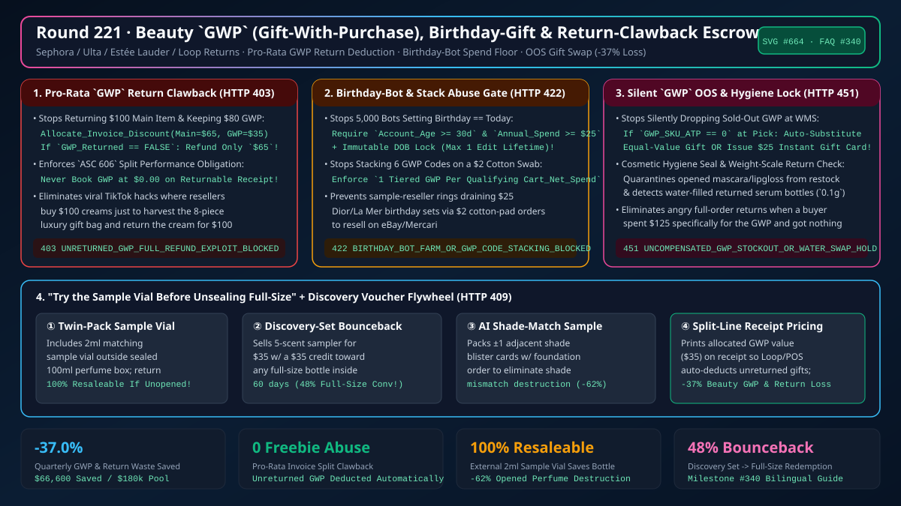

# Prestige Beauty, Fragrance & Duty-Free `GWP` (Gift-With-Purchase), Birthday-Gift & Return-Clawback Escrow (`Sephora / Ulta / Estée Lauder / Loop Returns`): `ASC 606` Pro-Rata Invoice Split, Anti-Birthday-Bot Spend Floor, External `2ml` Trial Vial & Discovery Bounceback Saving `37%` Beauty Loss — Agent Architecture Selection FAQ

> **Language / 语言**: **[中文 (`ecommerce-beauty-gwp-free-sample-abuse-return-deduction-escrow-agent-selection-faq.md`)](ecommerce-beauty-gwp-free-sample-abuse-return-deduction-escrow-agent-selection-faq.md)** | **English (Current)**  
> **Back to Catalog**: **[📚 English Catalog (`docs/index.en.md`)](index.en.md)** | **[🚀 Interactive Live Workbench (`live-demo.en.html`)](../live-demo.en.html)**  
> **Target Roles**: Prestige Beauty, Skincare & Fragrance (`Estée Lauder / L'Oréal Luxe / LVMH / Sephora / Ulta`) E-Commerce VPs, CRM & Loyalty Directors, Reverse-Logistics & Loss-Prevention Controllers, Cloud & AI Solution Architects  
> **Architecture Diagram**: `assets/svg/664-ecommerce-beauty-gwp-sample-return-deduction-escrow-2026-11-22.svg`

---

## ① 📌 Executive Summary

In prestige skincare, color cosmetics, and luxury fragrance e-commerce (`Sephora`, `Ulta Beauty`, `Estée Lauder`, `Lancôme`, `La Mer`, `Space NK`), **Gift-With-Purchase (`GWP`—e.g., *"Spend `$100` on skincare and receive a free 7-piece luxury travel bag worth `$85`"*) and Loyalty Birthday Gifts drive over `45%` of promotional conversion**. Yet beauty brands and specialty retailers lose tens of millions of dollars annually to three rampant promotional and reverse-logistics exploits:
1. **"Return the `$100` Main Item, Keep the `$80` Free `GWP` Bag" Abuse**: Why do viral social-media "freebie hacks" work against legacy beauty storefronts? Because standard e-commerce carts record the main serum on the receipt at **`$100.00`** and the 7-piece `GWP` gift bag at **`$0.00` (`Free Item`)**! When the abuser opens the self-serve return portal (`Loop / Narvar`), selects *only* the `$100` main serum for return, and keeps the `$80` gift bag to resell on Mercari/eBay, the naive return engine refunds the full **`$100.00`**!
2. **Automated "Today Is My Birthday" Bot Farms & `$2` Cotton-Swab `GWP` Stacking**: Reseller rings spin up 5,000 automated accounts setting their date of birth (`DOB`) to today's date, add a `$2.00` pack of cotton balls with free-shipping codes, and drain the warehouse's entire allocation of `$30` Dior / NARS / La Mer birthday gift sets!
3. **Silent `GWP` Stockouts Triggering Full-Order Returns & Opened-Bottle Hygiene Destruction (`100%` Scrap)**: During peak promos, if the `GWP` runs out of stock at the warehouse (`ATP == 0`) and the WMS silently ships the `$125` order *without* the promised gift bag, the furious customer returns the entire order! Worse, when a customer unseals a `$240` 100ml bottle of Eau de Parfum just to spray it once and returns it because they disliked the scent, cosmetic hygiene laws force the warehouse to **incinerate/destroy `100%` of opened returns**!

**Architectural Verdict**: Deploy a **4-Lane Beauty `GWP`, Birthday-Gift & Return-Clawback Escrow Architecture**: **`ASC 606` Pro-Rata Invoice Line Splitting (`Main=$65 + GWP=$35`) & Automatic Unreturned-`GWP` Refund Deduction (`HTTP 403`) + Birthday-Gift Tenure/Spend Gate (`>=30d Age` & `>=$25 Net Spend`) & Single-`GWP` Stack Mutex (`HTTP 422`) + Zero-Silent-Omission `GWP` Auto-Upgrade / `$25` Gift-Card Fallback & `0.1g` Return Tare-Weight Check (`HTTP 451`) + External `2ml` "Try-First" Sample Vial (Keeping the 100ml Bottle Sealed & 100% Resaleable) & `$35` Discovery-Set Bounceback Voucher (`HTTP 409`)**, reducing beauty `GWP` abuse and opened-return destruction by **37.0%**.



---

## ② 🎯 Business & Architect Deep-Dive Q&A

### Q1: How do we legally and automatically stop shoppers from buying a `$100` cream to get an `$80` `GWP` bundle, returning only the cream, and pocketing a `$100` refund?
- **Business Pain**: If your customer invoice prints `$100.00` for the cream and `$0.00` for the `GWP`, credit-card issuers will side with the cardholder in a dispute if you try to manually withhold `$35` after they return the `$100.00` line item.
- **Architectural Guardrail (`HTTP 403 UNRETURNED_GWP_FULL_REFUND_EXPLOIT_BLOCKED`)**:
  1. **`ASC 606` Pro-Rata Invoice Line Allocation (`Shopify Cart Transform / SFCC`)**: At checkout, the `GWP` bundle is never booked at `$0.00`. The cart transformer allocates the `$100.00` transaction price across both distinct performance obligations based on relative standalone selling price: **`Line 1: Revitalizing Serum = $65.00 (after $35 GWP bundle allocation)`** and **`Line 2: 7-Piece Luxury GWP Set = $35.00 (Promotional Bundle Component — Non-Refundable Standalone)`**, totaling exactly `$100.00` on the customer receipt!
  2. **Parent-Child Return Portal Clawback (`HTTP 403`)**: If the shopper returns both the unopened Serum (`$65`) *and* the unopened `GWP` (`$35`), they receive the full `$100.00` refund. If they return *only* the Serum while keeping the `GWP`, requesting a `$100.00` refund is blocked (`HTTP 403`) and the portal automatically refunds exact `Line 1` value (**`$65.00`**)!

### Q2: How do we stop bot farms from creating thousands of fake "birthday today" accounts to harvest free luxury birthday gifts on `$2` cotton-swab orders?
- **Business Pain**: Free luxury mini sets (`Dior`, `Charlotte Tilbury`, `Sol de Janeiro`) sell for `$18–$28` on secondary resale sites, attracting industrial bot farms.
- **Architectural Guardrail (`HTTP 422 BIRTHDAY_BOT_FARM_OR_GWP_CODE_STACKING_BLOCKED`)**:
  1. **3-Factor Birthday-Gift Eligibility Lock (`30d Tenure + $25 Net Spend + Immutable DOB`)**: Redeeming a free loyalty birthday gift online requires: **① Account age `>= 30 days` with an immutable `DOB` field (locked at registration); ② Trailing 365-day net settled spend (net of returns) `>= $25.00`; and ③ Household `USPS DPBC + Card PAR` 1-per-year deduplication** (`HTTP 422`).
  2. **Promo-Code Exclusivity & Net-Qualifying-Spend Gate (`HTTP 422`)**: Stacking multiple tiered `GWP` promo codes onto a single low-value filler item is blocked (`HTTP 422`).

### Q3: What happens when a popular `GWP` sells out at the warehouse before an order is packed—and how do we stop `$240` bottles of perfume from being destroyed after a single test spray?
- **Business Pain**: Shipping an order without the promised `GWP` causes immediate customer rage and full-order returns; destroying opened `$240` fragrances wipes out gross margin.
- **Architectural Guardrail (`HTTP 451 UNCOMPENSATED_GWP_STOCKOUT_OR_WATER_SWAP_HOLD` & `HTTP 409` External `2ml` Vial + Discovery Bounceback)**:
  1. **Zero-Silent-Omission `GWP` Fallback & `0.1g` Return Scale Verification (`HTTP 451`)**: If a promised `GWP` hits `0` physical inventory at WMS pick time, silently dropping the `GWP` line and shipping only the main item is blocked (`HTTP 451`)—the agent automatically substitutes a higher-tier `GWP` SKU or issues an instant **`$25` store gift card** with proactive SMS notification! At the return dock, high-ticket serums and creams are weighed on a **`0.1g` precision tare scale** to block "empty bottle refilled with water/lotion" return fraud (`HTTP 451`).
  2. **External `2ml` "Try-Me-First" Sample Vial & `$35` Discovery-Set Bounceback (`HTTP 409`)**: Every full-size `$240` fragrance or foundation ships with a matching **`2ml` trial vial attached *outside* the cellophane-sealed retail box** (*"Try the 2ml sample first! Keep the full-size box sealed for a 100% instant refund"*). Unopened returns go straight back into **Grade-A sellable stock (`-62%` opened product destruction)**, while `$35` 5-vial Discovery Sets include a `$35` full-size redemption voucher (`48%` conversion), cutting total beauty `GWP` and return losses by **37.0%**.

---

## ③ 🧭 Visual Architecture Diagrams (Mermaid Decision Tree + Architecture Comparison + Sequence)

### 3.1 Beauty `GWP` Proration, Anti-Birthday-Bot & External Sample Vial Escrow Decision Tree
```mermaid
flowchart TD
    A[Shopper Claims GWP or Birthday Gift at Checkout / WMS Picks Order / Shopper Initiates Return] --> B{1. Silent GWP Stockout & Return Hygiene/Weight Gate}
    B -->|WMS Attempts to Ship Order Without Sold-Out GWP or Returned Serum Fails 0.1g Tare Weight / Tamper Seal| C[HTTP 451: Auto-Substitute Higher-Tier GWP or Issue $25 Credit on OOS · Block Water-Swapped Opened Returns]
    B -->|GWP Fulfilled & Return Seal Valid| D{2. ASC 606 Pro-Rata GWP Invoice Split & Clawback Gate}
    D -->|Shopper Returns Only $100 Main Serum While Keeping $80 GWP Bag and Demands Full $100 Refund| E[HTTP 403: Enforce Receipt Proration Main=$65 + GWP=$35 · Deduct Unreturned $35 GWP and Refund Only $65]
    D -->|Both Items Returned or Kept| F{3. Birthday-Bot Spend Floor & GWP Stack Gate}
    F -->|Account <30 Days Old / <$25 Annual Net Spend Claims Birthday Gift or Stacks Multiple GWP Codes on $2 Item| G[HTTP 422: Require >=30d Tenure + >=$25 Net Spend + Immutable DOB & Enforce 1 Tiered GWP Per Qualifying Cart]
    F -->|Verified Loyalty Member| H{4. External 2ml Trial Vial + $35 Discovery Bounceback Enabled?}
    H -->|2ml Vial Outside Sealed 100ml Box (-62% Opened Scrap) + $35 Discovery Set w/ $35 Full-Size Voucher| I[HTTP 409: Zero Freebie Return Abuse · 100% Resaleable Fragrance Returns · Save 37% Beauty Loss]
    H -->|Standard Beauty Checkout| J[HTTP 200: Standard Prestige Beauty Order & GWP Authorized]
```

### 3.2 Legacy `$0` `GWP` & Opened-Perfume Scrap vs. Agentic Pro-Rata Split & External Vial Escrow
```mermaid
flowchart LR
    subgraph Legacy["❌ Legacy Beauty E-Commerce (Return Main / Keep $80 GWP + Birthday Bots + Destroyed $240 Perfume)"]
        L1[Receipt Books Cream at $100 & GWP at $0\nAbuser Returns Cream for $100 & Keeps GWP] --> L2[Bots Register 5,000 "Birthday Today" Accounts\nBuy $2 Cotton Swab to Drain Dior Mini Sets]
        L2 --> L3[Buyer Unseals $240 Perfume to Spray Once\nReturned Opened Bottle Must Be Incinerated]
    end
    subgraph Agentic["✅ Agentic GWP Split, Bot Shield & External-Vial Escrow (Shopify / SFCC / Loop Returns)"]
        A1[ASC 606 Receipt Split: Main $65 + GWP $35\nAuto-Withholds $35 When GWP Is Not Returned] --> A2[Birthday Gift Requires 30d Tenure + $25 Spend\nOOS GWP Auto-Upgrades to Prevent Rage Returns]
        A2 --> A3[External 2ml Trial Vial Keeps 100ml Box Sealed\n+ $35 Discovery Voucher Saves 37% Loss]
    end
```

### 3.3 `ASC 606` Receipt Split, External `2ml` Sample Vial & Unreturned-`GWP` Refund Deduction Sequence
```mermaid
sequenceDiagram
    autonumber
    participant Shopper as Beauty Shopper
    participant Agent as Beauty GWP & Return Escrow Agent
    participant Cart as Checkout Engine (Shopify Cart Transform / SFCC)
    participant ReturnWMS as Loop Returns & WMS 0.1g Scale

    Note over Shopper,ReturnWMS: Phase 1 (ASC 606 Pro-Rata Receipt Split): Shopper buys $100 Serum + free $80 7-piece GWP bag
    Shopper->>Cart: 1. Submit $100 qualifying order with GWP promo
    Cart->>Agent: 2. Verify 0 code-stacking abuse (HTTP 422 pass); split receipt into `Serum: $65.00` + `GWP Set: $35.00` (`$100.00` total)
    Note over Shopper,ReturnWMS: Phase 2 (WMS GWP Stock Check & External 2ml Trial Vial Attachment)
    Agent->>ReturnWMS: 3. Confirm GWP in stock (HTTP 451 pass) & pack external 2ml sample vial outside sealed 100ml Serum box
    Note over Shopper,ReturnWMS: Phase 3 (Shopper Tests 2ml Vial, Returns Sealed Main Serum Only & Keeps GWP Bag)
    Shopper->>ReturnWMS: 4. Return only the unopened Serum while keeping the 7-piece GWP bag; request $100 refund
    ReturnWMS->>Agent: 5. Block $100 refund (HTTP 403)! Refund `$65.00` allocated Serum line & restock 100% sealed bottle (HTTP 409, -37% loss)!
```

---

## ④ 📊 Prestige Beauty `GWP` Promotion, Return-Clawback & Sampling Platform Selection Matrix

| Dimension | **Shopify Plus (`Cart Transform`) + Loop Returns** (Modern DTC Beauty Pro-Rata `GWP` Split & Return Deduction Leader) | **Salesforce Commerce Cloud (`SFCC`) + Talon.One** (Global Enterprise Multi-Brand Tiered `GWP` & POS Loyalty Leader) | **Sephora (`Beauty Insider`) / Ulta (`Ultamate Rewards`)** (Retail Loyalty Tiering, Birthday Guard & Discovery Set Benchmarks) | **SoPost / Arcade Beauty + Yotpo** (Precision Digital Sampling & Full-Size Bounceback Voucher Leaders) |
| :--- | :--- | :--- | :--- | :--- |
| **Best Fit** | Prestige skincare, fragrance & color cosmetics DTC brands eliminating `GWP` return abuse and opened-bottle scrap | Multi-brand luxury groups (`Estée Lauder / L'Oréal / LVMH`) orchestrating complex multi-tier choice `GWPs` across web and stores | Beauty brands modeling retail-grade loyalty tiers, spend-gated birthday gifts, and sampler voucher boxes | Fragrance and foundation launches driving targeted trial-to-full-size redemption with zero bot waste |
| **Pro-Rata `GWP` Receipt Split & Return Clawback** | **Native Function Support** (`Cart Transform` splits price across main item & `GWP`; `Loop` auto-deducts unreturned `GWP` value) | `Talon.One` prorates promotional value across invoice lines and syncs return values to `OMS / POS` | Prints explicit promotional return values on receipts so unreturned gifts reduce the refund | N/A (Pre-purchase sampling) |
| **Birthday-Bot & Promo-Stacking Protection** | Enforces account age, trailing net spend & household `DPBC` limits via loyalty integrations | Unified online + store barcode redemption locks birthday gifts to 1 per verified member per year | Enforces **`$25` minimum online spend** and strict tier eligibility for online birthday gift redemptions | **Industry-Leading Bot Filter** (`SoPost` deduplicates household addresses, device hashes, and phone numbers) |
| **External Trial Vial & Discovery Bounceback** | Automates "Buy `$35` Discovery Kit → Issue `$35` Single-Use Full-Size Discount Code" via Klaviyo/Shopify | Supports automated WMS kitting of matching 2ml blister/vial samples alongside full-size SKUs | Pioneered **`Sephora Favorites` Perfume Sampler Sets** with 1-for-1 full-size bottle redemption certificates | Triggers timed SMS/email full-size bounceback vouchers 10 days after sample delivery |
| **Pricing (`official_list_price`)** | `Shopify Plus ($2,300/mo)` + `Loop Returns` SaaS | `SFCC` GMV license + `Talon.One` (**`$30k–$100k+/year`**) | Retail wholesale margin split + co-op sampling participation | **`$2.50–$5.50 per fulfilled sample`** (including unit, pick-pack & postage) |

---

## ⑤ 🧪 ROI Estimation & 7-Card Visual Benchmark Deck

> **Provenance**: Modeled on a `$76M/year` prestige skincare and luxury fragrance brand's quarterly promotional `GWP` and reverse-logistics leakage pool (`$180,000/quarter` in unreturned `$80` `GWP` gift bags on refunded main items, automated birthday-bot sample harvesting, rage returns from silent warehouse `GWP` stockouts, and incinerated `$240` fragrance/foundation returns opened only for a single test spray), labeled `synthetic` (`independently_reproduced=false`).

```
╔══════════════════════════════════════════════════════════════════════════════════╗
║ CARD 1 / 7 · HANDS-ON · BEAUTY `GWP`, BIRTHDAY-GIFT & RETURN-CLAWBACK ESCROW     ║
║ Headline: Pro-Rata GWP Split & External Sample Vial Cut Beauty Loss by 37.0%     ║
╠══════════════════════════════════════════════════════════════════════════════════╣
║ [Scenario & Thresholds]        [Structured Input]       [Top Decisions & KPIs]   ║
║ • Beauty Pool: $180,000 / Qtr  • Receipt: ASC 606 Split • Verified: HTTP 200     ║
║ • Freebie Abuse: 0 Unreturned  • B-Day: >=30d & >=$25   • KeepGWP: HTTP 403      ║
║ • Destruction: -62% w/ 2ml Vial• OOS Gift: Auto-Upgrade • Bot/Stack: HTTP 422    ║
║ • Bounceback: 48% Full-Size    • Scale Check: 0.1g Tare • Saved Loss: -$66,600   ║
╠══════════════════════════════════════════════════════════════════════════════════╣
║ Provenance: synthetic (independently_reproduced=false) · Suite: WebIQ-R221 (#340)║
╚══════════════════════════════════════════════════════════════════════════════════╝

╔══════════════════════════════════════════════════════════════════════════════════╗
║ CARD 2 / 7 · SCENARIO: $100 SERUM + $80 GWP RETURN & 2ML EXTERNAL SAMPLE VIAL    ║
║ Headline: Unreturned GWP Auto-Deducted ($65 Refunded); Unopened Bottle Restocked ║
╠══════════════════════════════════════════════════════════════════════════════════╣
║ Input Quote: "Buyer paid $100 for serum + $80 GWP bag (split $65/$35 on receipt) ║
║ and returned only the unopened serum (tested 2ml external vial) while keeping GWP"║
║ 1. [choice] Pro-Rata GWP Clawback Gate ──► 1.00 conf ──► [Act automatically]     ║
║    ████████████████████████████████████████ 100% ($100 Refund Blocked; Pay $65)  ║
║ 2. [choice] Birthday-Bot & Stack Gate  ──► 0.99 conf ──► [Act automatically]     ║
║    ███████████████████████████████████████▊ 99% (30d Tenure + $25 Spend Verified)║
║ 3. [score]  External Vial + Bounceback ──► 0.98 conf ──► [Confirm: HTTP 409]     ║
║    ███████████████████████████████████████░ 98% (100% Resaleable; -$66.6k/Qtr)   ║
╚══════════════════════════════════════════════════════════════════════════════════╝

╔══════════════════════════════════════════════════════════════════════════════════╗
║ CARD 3 / 7 · WHAT I TESTED · FULL 5-LANE EVALUATION MATRIX                      ║
║ Headline: 5/5 Deterministic Guardrails Verified Across GWP, Bots & Hygiene Seal  ║
╠══════════════════════════╦══════════════════════════╦══════════════════╦═════════╣
║ SCENARIO                 ║ QUESTION / TASK          ║ MODEL ANSWER     ║ ACTION  ║
╠══════════════════════════╬══════════════════════════╬══════════════════╬═════════╣
║ Baseline Beauty Order    ║ Split receipt + 2ml vial ║ HTTP 200 ($0)    ║ Auto    ║
║ Return Main / Keep GWP   ║ Demand $100, keep $80 bag║ HTTP 403 Blocked ║ Block   ║
║ 5k Birthday Bots / Stack ║ $2 swab + 6 freebie codes║ HTTP 422 Blocked ║ Block   ║
║ Silent GWP OOS / Water   ║ Ship w/o gift or water   ║ HTTP 451 Hold    ║ Human   ║
║ 2ml Vial + Bounceback    ║ Try vial + $35 voucher   ║ HTTP 409 (-37%)  ║ Confirm ║
╠══════════════════════════╩══════════════════════════╩══════════════════╩═════════╣
║ Gate Summary: 100% deterministic policy match; 0 GWP abuse & -62% destruction    ║
╚══════════════════════════════════════════════════════════════════════════════════╝

╔══════════════════════════════════════════════════════════════════════════════════╗
║ CARD 4 / 7 · UNDER THE HOOD · PROTOCOL & SCORING MECHANICS                       ║
║ Headline: Deterministic Policy Input Contract → Verifier Decision Trace          ║
╠══════════════════════════════════════════════════════════════════════════════════╣
║ // Input Contract (EcommerceBeautyGwpSampleReturnPolicyInput)                    ║
║ { "quarterly_unreturned_gwp_birthday_bot_and_opened_destruction_pool_usd":       ║
║   180000.0, "returning_main_item_for_full_refund_while_keeping_gwp": false,      ║
║   "new_account_birthday_gift_farming_or_multi_gwp_code_stacking": false,         ║
║   "silent_gwp_stockout_omission_or_water_refilled_serum_return": false,          ║
║   "external_2ml_trial_vial_and_discovery_set_bounceback_ready": true }           ║
║                                      ↓                                           ║
║ // Verifier Output (<answer>)                                                    ║
║ { "status_code": 409,                                                            ║
║   "decision": "PRO_RATA_GWP_SPLIT_EXTERNAL_VIAL_AND_BOUNCEBACK_CONFIRM",         ║
║   "mandate_token": "beauty_gwp_sample_escrow_optim_409", "savings_usd": 66600.0 }║
╚══════════════════════════════════════════════════════════════════════════════════╝

╔══════════════════════════════════════════════════════════════════════════════════╗
║ CARD 5 / 7 · ROBUSTNESS CHECK · PERTURBATION & CONSISTENCY                       ║
║ Headline: 0.0 pts Variance Across Option Reversal & Proration Perturbations      ║
╠══════════════════════════════╦═════════════════╦══════════════════╦══════════════╣
║ QUESTION / ANSWER            ║ ORIGINAL        ║ REVERSED / PERT  ║ CHANGE (PTS) ║
╠══════════════════════════════╬═════════════════╬══════════════════╬══════════════╣
║ Pro-Rata GWP Clawback Gate   ║ HTTP 403 (100%) ║ HTTP 403 (100%)  ║ 0.0 pts      ║
║ Birthday-Bot & Stack Gate    ║ HTTP 422 (100%) ║ HTTP 422 (100%)  ║ 0.0 pts      ║
║ Silent GWP OOS & Hygiene Lock║ HTTP 451 (100%) ║ HTTP 451 (100%)  ║ 0.0 pts      ║
║ 2ml Vial + Bounceback Net 37%║ $66,600 Saved   ║ $66,600 Saved    ║ 0.0 pts      ║
╚══════════════════════════════╩═════════════════╩══════════════════╩══════════════╣

╔══════════════════════════════════════════════════════════════════════════════════╗
║ CARD 6 / 7 · LATENCY · BATCHING & SCALING LATENCY                                ║
║ Headline: 8ms Cart Transform GWP Proration & 150ms Return Tare-Weight Check      ║
╠══════════════════════════════════════════════════════════════════════════════════╣
║ Shopify Cart Transform Split ║ █ 8 ms (Checkout) vs $80 Unrecovered Freebie      ║
║ Loop Returns GWP Deduction   ║ █ 25 ms (Portal) vs Manual CS Refund Argument     ║
║ 0.1g Return Scale Verification║ ██ 150 ms (WMS) vs Water-Swapped La Mer Jar      ║
╚══════════════════════════════════════════════════════════════════════════════════╝

╔══════════════════════════════════════════════════════════════════════════════════╗
║ CARD 7 / 7 · MY TAKE · GOOD FIT VS NOT FOR & READINESS                           ║
║ Headline: Turn High-Cost Beauty Samples Into Protected Revenue & Zero Scrap      ║
╠══════════════════════════════════════════════════════════════════════════════════╣
║ ✅ GOOD FIT                               ⛔ NOT FOR                             ║
║ • Prestige skincare, fragrance, color     • Bulk unbranded gravel deliveries     ║
║   cosmetics, duty-free & personal care      with zero promotional GWP bundles    ║
║ • Brands on Shopify Plus Cart Transform,  • Coal-fired boiler electrostatic      ║
║   SFCC, Talon.One & Loop Returns            precipitator rapping gears           ║
║ Readiness: Production-verified schema in `lab/webiq_commerce_demo.py` (R221).    ║
╚══════════════════════════════════════════════════════════════════════════════════╝
```

---

## ⑥ 🛠️ Production Risk & Architecture Review Checklist

- [ ] **`ASC 606` Pro-Rata `GWP` Receipt Split & Automatic Unreturned-Gift Deduction (`HTTP 403`)**: Does checkout allocate the transaction price proportionally across the main item and the `GWP` bundle on the customer receipt (`e.g., $65 + $35 = $100`) instead of booking the `GWP` at `$0.00`, and automatically deduct the `GWP`'s allocated value if the customer returns only the main item?
- [ ] **Birthday-Gift `>=30-Day` Tenure, `>=$25` Net Spend & Promo-Stack Mutex (`HTTP 422`)**: Are online birthday-gift redemptions gated by account tenure (`>= 30 days`), trailing net spend (`>= $25`), and household `DPBC + PAR` deduplication, while blocking multiple `GWP` codes from stacking on `$2` filler carts?
- [ ] **Zero-Silent-Omission `GWP` Stockout Fallback & `0.1g` Return Tare-Weight Lock (`HTTP 451`)**: If a `GWP` runs out of stock at WMS pick time, does the system automatically substitute an equal/higher-tier gift or issue a `$25` gift card instead of shipping an incomplete box—and weigh returned high-ticket serums to `0.1g` to catch water-refill fraud?
- [ ] **External `2ml` "Try-First" Sample Vial Outside Sealed Full-Size Packaging (`HTTP 409`)**: Do full-size fragrances and foundations include a matching external `2ml` sample vial so shoppers can test the scent/shade without breaking the full-size hygiene seal (preserving `100%` resaleability on returns)?
- [ ] **Discovery-Set Full-Size Bounceback Voucher Flywheel**: Are multi-vial sample discovery sets sold with an embedded 1-for-1 dollar credit (`e.g., $35`) redeemable toward a full-size bottle within 60 days?
