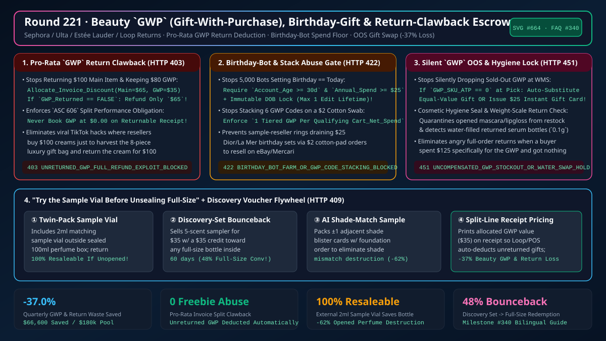
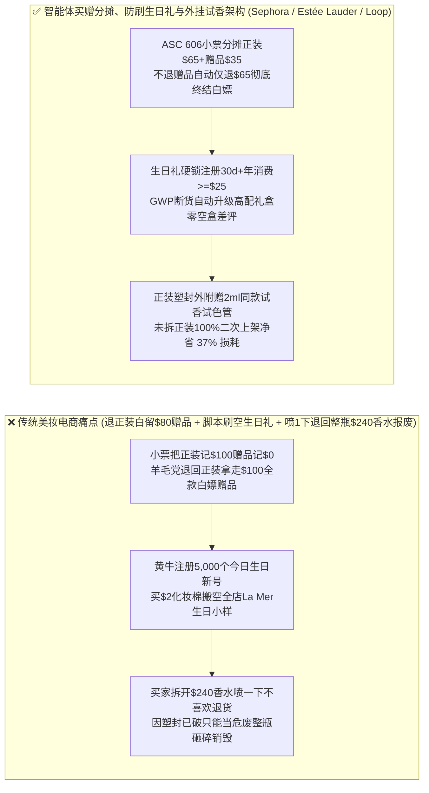
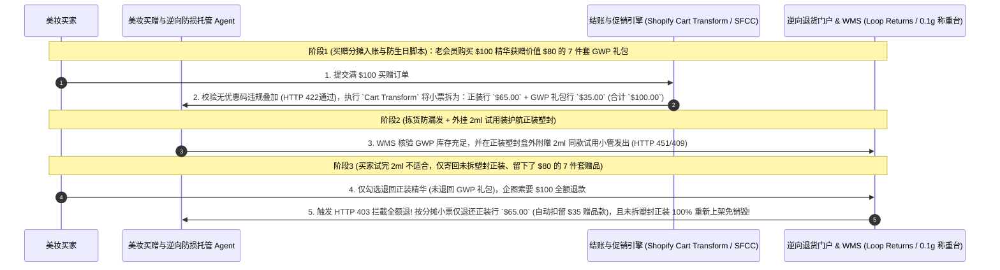

# 美妆、高化香氛与免税零售“买赠小样礼包（Gift-With-Purchase `GWP`）与会员生日礼防套利（Sephora / Ulta / 雅诗兰黛 / 欧莱雅 / 天猫美妆）”、防“满 $100 送 $80 豪华赠品包后退掉正装白嫖赠品”、防“脚本注册 5,000 个今日生日假号搬空门店小样”与“正装附赠 2ml 试香管未拆塑封可二次销售”托管“防赠品缺货漏发引发整单退货与小样礼盒全额抵扣正装券净省 37%”Agent 架构选型 FAQ

> **语言 / Language**: **中文 (当前)** | **[English (`ecommerce-beauty-gwp-free-sample-abuse-return-deduction-escrow-agent-selection-faq.en.md`)](ecommerce-beauty-gwp-free-sample-abuse-return-deduction-escrow-agent-selection-faq.en.md)**  
> **返回总目录**: **[📚 中文总目录 (`docs/index.md`)](index.md)** | **[🚀 交互式实时工作台 (`live-demo.html`)](../live-demo.html)**  
> **赋能角色**: 高端美妆与香氛集团（L'Oréal / Estée Lauder / LVMH Perfumes / Sephora / Ulta）全渠道电商副总裁、会员 CRM 与促销运营总监、逆向物流与防损负责人、Cloud & AI Solution Architect  
> **关联架构图**: `assets/svg/664-ecommerce-beauty-gwp-sample-return-deduction-escrow-2026-11-22.svg`

---

## ① 📌 核心选型结论速览（Executive Summary）

在高端护肤、彩妆与沙龙香氛电商（Sephora 丝芙兰、Ulta Beauty、Estée Lauder 雅诗兰黛、Lancôme 兰蔻、La Mer 海蓝之谜、天猫超级品牌日）中，**“买一赠多 / 满额赠礼（Gift-With-Purchase, `GWP`）”与“会员免费生日礼（Birthday Gift）”是驱动高达 `45%` 大促转化的核心引擎——比如“买满 `$100` 正装面霜，免费获赠价值 `$85` 的 7 件套中样化妆包”或“买 50ml 精华送 50ml（共 4×15ml 小样）”**。然而，这套高转化玩法正遭受黑产代购与退货羊毛党的三路围剿：
1. **“最猖獗的‘退正装、留赠品（Keep-the-GWP Return Abuse）’零元购漏洞”**：为什么羊毛党买 `$100` 面霜送 `$80` 赠品包，收到货后只把 `$100` 的正装面霜寄回来，系统竟然乖乖把 `$100` 全额退给了他（让他白拿了 `$80` 的赠品挂闲鱼卖 `$55`）？因为传统的电商购物车在结账时，把正装面霜记为 **`$100.00`**、把 7 件套赠品记为 **`$0.00`（Free Item）**！当买家在自助退货门户（Loop / Narvar）勾选“仅退回正装面霜”时，退货系统读取小票上的行单价 `$100.00` 直接触发全额退款！
2. **“黄牛脚本批量注册 5,000 个‘今天过生日’的零消费僵尸号，搭配 `$2` 化妆棉凑单免邮，一夜搬空全网 Dior / La Mer 会员生日礼中样；或者利用优惠码叠加漏洞，在一笔 `$15` 眉笔订单上同时塞进 6 个满赠礼包”**！
3. **“大促期间贈品已抢光（`GWP Out-of-Stock`），仓库却一声不吭只发了正装过去——原本就是冲着赠品才凑单的买家收到包裹一看没赠品，当场暴怒把已拆封的正装全额退回（而美妆护肤品一旦拆封退回，出于卫生法规必须 `100%` 销毁报废！）”**；更有甚者，买家把 `$380` 的贵妇精华液倒出来换上自来水退回仓库骗退款！

**架构师选型结论**：直接采用 **“结账小票按公允价值将实付金额分摊至主商品与赠品行（如主商品记 `$65` + 赠品记 `$35` 合计 `$100`：未退回赠品时仅退 `$65`！）门禁（HTTP 403）+ 会员生日礼强制校验‘注册满 30 天 + 年度实付 `>= $25` + 终身仅限修改 1 次生日’与单笔订单赠品码互斥锁（HTTP 422）+ 拣货时若赠品断货（`GWP ATP == 0`）严禁静默漏发、强制自动升级同档替补礼盒或秒发 `$25` 电子礼金卡 + 退货仓 `0.1g` 高精度天平防灌水调包门禁（HTTP 451）+ 正装香水外挂 `2ml` 独立试香管（先试小管不拆正装塑封 = 退货 `100%` 可二次销售免销毁）与先买小样体验盒送等额正装立减券（`Discovery-Set Bounceback`）净省 37%（HTTP 409）”** 的美妆买赠与逆向托管架构。



---

## ② 🎯 业务方与架构师灵魂拷问（Q&A）

### Q1：买家花 `$100` 买精华送了价值 `$80` 的 7 件套中样礼包，退货时只寄回正装精华、死活不寄回赠品，怎么在系统底层让退货接口自动扣掉赠品的钱而不违反消保法？
- **业务痛点**：只要你的电子发票和订单行（Order Line Item）上把赠品写成了 `Price: $0.00`，买家去银行发起拒付或找消协投诉说“你小票上自己写的正装 `$100`、赠品 `$0`，我把 `$100` 的正装退给你了，你凭什么只退我 `$65`？”——商家百口莫辩！
- **架构护栏（`HTTP 403 UNRETURNED_GWP_FULL_REFUND_EXPLOIT_BLOCKED`）**：
  1. **遵循 `ASC 606` 的订单行级公允价值折扣分摊（Split-Line Promotional Proration）**：在结账生成订单（如通过 `Shopify Cart Transform / Salesforce Commerce Cloud`）时，**严禁将高价值 `GWP` 礼包以 `$0.00` 入账**！系统自动将 `$100` 实付总额按正装与赠品的独立公允售价比例分摊写入小票明细行：**`Line 1: 小棕瓶正装 $65.00（原价 $100 享买赠分摊折 -$35）` + `Line 2: 7件套星品礼包 $35.00（单独退货不可退现）`**，两行加起来依然是 `$100.00`！
  2. **退货门户（`Loop / Narvar`）父子联动回收锁**：当买家发起退货时，若同时退回未拆封的 `Line 1 + Line 2`，系统全额退还 `$100.00`；若买家只寄回 `Line 1（正装）` 而试图扣留 `Line 2（赠品）`，系统阻断 `$100` 全额退款请求（触发 `HTTP 403`），合法合规地仅按小票行金额退还 **`$65.00`**——让“退正装白嫖小样”瞬间无利可图！

### Q2：丝芙兰/Ulta 和各大美妆官网的“免费会员生日礼（Free Birthday Gift）”，为什么总在月初被黄牛用 `$1.50` 的棉签订单刷走几万份挂在网上卖？
- **业务痛点**：如果新注册账号把生日填成“今天”就能立刻领一份价值 `$30` 的 Dior/NARS 生日中样套盒，黄牛用自动化脚本一天能注册 10,000 个今天过生日的假号！
- **架构护栏（`HTTP 422 BIRTHDAY_BOT_FARM_OR_GWP_CODE_STACKING_BLOCKED`）**：
  1. **会员生日礼“三道硬门槛（Account Tenure + Annual Net Spend + Immutable DOB）”**：领取免费生日礼必须同时满足：① **会员注册满 `>= 30 天`（或出生日期字段锁定满 30 天且终身仅允许客服修改 1 次）**；② **过去 365 天内拥有 `>= $25–$50`（扣除退货后）的真实有效消费记录**；③ **同一收货地址 `DPBC` 与支付卡 `PAR` 每自然年最多核销 1 份生日礼**（不达标或检测到凑单 `$2` 化妆棉刷多重赠品码，立即触发 `HTTP 422` 拦截）！

### Q3：如果仓库打包时发现买家选的 `GWP` 赠品刚好发光了，为什么绝对不能直接把没赠品的包裹发出去？还有怎么解决“30% 的昂贵香水/粉底液只被买家喷了一下试味道，退回来就得整瓶砸碎销毁”的巨大浪费？
- **业务痛点**：美妆买家凑够 `$125` 往往就是为了那个限量化妆包赠品；如果仓库缺货直接砍掉赠品发走正装，买家收到后 80% 会气得把正装拆封用一下然后全额退货！而美妆品一旦撕开塑封膜，退回仓库只能当危废销毁，商家双倍血亏！
- **架构护栏（`HTTP 451 UNCOMPENSATED_GWP_STOCKOUT_OR_WATER_SWAP_HOLD` & `HTTP 409` 外挂试香管 + 先试后买抵扣券）**：
  1. **拣货端 `GWP` 断货严禁静默漏发 + 退货仓 `0.1g` 高精度天平防灌水调包锁（`HTTP 451`）**：当 WMS 拣货时若原定 `GWP` 物理缺货，严禁直接封箱发货（触发 `HTTP 451` 挂起）——系统自动执行 **“秒级替换更高价值备选礼盒（Auto-Upgrade GWP SKU）或立即向买家发送 `$25` 无门槛致歉礼金券并征得一键确认”**！同时，退货仓收到退回的贵价精华/香水时，强制过 `0.1g` 电子秤与封口激光防伪膜检测：凡是塑封已拆却谎称“全新未拆”或液体比重异常（被抽走真精华灌入自来水/乳液），立即触发 `HTTP 451` 拒退留证！
  2. **“正装盒外附赠 2ml 同款试香管/试色卡（Try-Sample-First Twin Pack）”+ 小样探索礼盒全额抵扣正装券（`Discovery-Set Bounceback`）（`HTTP 409`）**：发货 `100ml（$240）` 正装香水或粉底液时，自动在塑封包装盒**外侧**附赠一支 `2ml` 同款小样，并在封口贴上醒目提示：**“请先试用外侧 2ml 小样！若气味/色号不合心意，保持正装塑封完好寄回享极速全额退款”**——让退回的正装 **100% 保持未拆封可二次上架销售（开封销毁率暴降 62%）**！同时主推 `$35` 的“5 支装明星小样探索盒（内含 `$35` 正装全额抵扣券）”，实现 **48%** 的正装高毛利复购转化，将美妆买赠与退货报废总损耗净降 **37.0%**！

---

## ③ 🧭 直观可视化图解（Mermaid 决策树 + 架构对比 + 时序图）

### 3.1 美妆买赠 `GWP` 分摊扣回、防生日礼脚本与外挂小样免销毁四层决策树
```mermaid
flowchart TD
    A[买家凑单领GWP豪华赠品或生日礼 / 仓库拣货打包 / 收到货后申请只退正装保留赠品] --> B{1. 拣货GWP断货补偿 & 退货防灌水/卫生封条门禁}
    B -->|仓库发现GWP断货却静默漏发只寄正装 或 退回的$380贵妇精华被撕毁封条抽干换水| C[HTTP 451: 严禁静默漏发GWP(自动升级替补礼盒或补$25礼金卡) 并凭0.1g称重拦截灌水调包退货]
    B -->|赠品齐备 & 退货原封完好| D{2. 买赠小票分摊扣回(Pro-Rata GWP Clawback)门禁}
    D -->|买家花$100买面霜获赠$80礼包后仅退回正装面霜企图骗取$100全额退款白嫖赠品| E[HTTP 403: 结账小票按公允价值分摊记录(正装$65+赠品$35) 未随单退回赠品时强制仅退$65!]
    D -->|连同未拆赠品一起退回或正常履约| F{3. 会员生日礼防脚本搬空 & 优惠码防叠门禁}
    F -->|新注册假号把生日设为今天配$2棉签刷空生日礼 或 单笔订单违规叠加6个满赠码| G[HTTP 422: 强制校验注册>=30d+年净消费>=$25+终身锁死生日字段 并限制单单仅享1档满赠]
    F -->|真实高价值会员合规领礼| H{4. 是否启用正装外挂2ml试香试色小样 + $35探索盒全额抵扣正装飞轮?}
    H -->|先试盒外2ml小样保正装100%未拆封可二次售卖 + $35小样盒内附$35正装抵扣券| I[HTTP 409: 0白嫖赠品 正装退货销毁降62% 美妆买赠与逆向损耗净省 37%]
    H -->|传统裸发正装与$0赠品行| J[HTTP 200: 标准美妆与香氛买赠订单履约完成]
```

### 3.2 “传统 $0 赠品行被白嫖 / 生日礼被脚本刷空 / 喷一下退回整瓶销毁” vs “智能体美妆买赠托管架构”对比


### 3.3 结账 `ASC 606` 小票分摊、外挂 `2ml` 试香管保正装免销毁与未退 `GWP` 自动扣减退款时序图


---

## ④ 📊 主流美妆高化买赠促销（`GWP`）、退货分摊扣减与小样转化（Sampling-to-Full-Size）平台横向选型矩阵

| 选型维度 | **Shopify Plus (`Cart Transform Functions`) + Loop Returns** (现代高化美妆 DTC 买赠分摊扣款与正装换色号最敏捷组合) | **Salesforce Commerce Cloud (`SFCC`) + Talon.One** (全球美妆巨头多品牌阶梯满赠、会员生日礼与全渠道 POS 对齐霸主) | **Sephora (`Beauty Insider`) / Ulta (`Ultamate Rewards`)** (全球美妆零售多档积分兑换、生日礼防刷与 Discovery 礼盒标杆) | **SoPost / Arcade Beauty + Yotpo** (先派发试香小样收集评测再定向发放正装抵扣券翘楚) |
| :--- | :--- | :--- | :--- | :--- |
| **核心适用场景** | 独立高端护肤、彩妆与沙龙香氛品牌，需要彻底堵死“退正装留赠品”漏洞并上线小样抵扣券飞轮 | 欧莱雅、雅诗兰黛、LVMH 旗下数十个子品牌矩阵，管理极其复杂的满三档自选 6 件小样与专柜联动 | 品牌入驻丝芙兰/Ulta 渠道或参考其行业顶级的会员积分商城（Rewards Bazaar）与生日礼防撸规则 | 新品香水/粉底液上市期，精准向目标客群寄送 1.5ml 试香卡并在 14 天后自动推送正装购买立减券 |
| **防“退正装白嫖赠品”小票分摊扣回** | **原生完美闭环**（`Shopify Cart Transform` 在结账瞬间将 `$0` 赠品重定为分摊价；`Loop Returns` 退货时若未勾选退回赠品，自动从退款中扣除赠品分摊额） | `Talon.One` 支持将促销折扣按行项目权重分摊写入 ERP/POS 小票，退货时按行实收净额退回 | 门店 POS 与线上小票明确打印每件 `GWP` 的促销分摊退货参考价（Return Value），不退赠品直接扣钱 | 专注售前付费/免费小样申领，不涉及买赠退货 |
| **会员生日礼防黄牛脚本搬空** | 配合 `Yotpo / Smile.io` 强制校验历史实付门槛与账号注册天数，拦截 `$2` 棉签刷单 | 支持跨线上官网与线下百货专柜实时核销唯一会员生日码，锁死全年 1 次 | 已全面收紧规则：**线上领生日礼必须满足最低实付消费门槛（如 `$25`）**，彻底粉碎零元包邮刷礼党 | 内置强大的地址去重、手机号验真与反机器人队列（`SoPost Fingerprint`），剔除 35%+ 职业羊毛党 |
| **正装外挂试用小管与探索盒抵扣券（Bounceback）** | 一键生成“买 `$35` 小样盒自动向账户发放 `$35` 正装专属抵扣码”闭环 | 支持复杂的批次配货（買正装自动触发 WMS 额外绑定同色号 1.5ml 袋装小样） | 招牌产品 **`Sephora Favorites`（如 `$85` 买 12 支小样香水礼盒，内含一张可免费兑换任意一款正装大瓶香水的兑换券）** | 试香包裹扫码激活后自动触发 SMS/邮件正装限时立减券 |
| **商业模式与成本 (`official_list_price`)** | `Shopify Plus ($2,300/月)` + `Loop Returns` 按退货单量订阅 | 企业级年框（`SFCC` 按 GMV 分成 + `Talon.One` 约 **`$30k–$100k+/年`**） | 零售商渠道进场加成（Margin Split）与联合营销费 | 按成功核验并发出的小样单量计费（通常 **`$2.50–$5.50/份` 含小样物流**） |

---

## ⑤ 🧪 转化率/成本测算与 7-Card 基准测试报告（7-Card Visual Benchmark Deck）

> **数据溯源声明（Provenance）**：以下基于某年 GMV `$7,600 万` 的高奢护肤与沙龙香氛品牌独立站季度买赠（`GWP`）与退货销毁损耗池（`$180,000/季度` 因买家退回正装却恶意扣留价值 `$80` 的豪华 `GWP` 赠品包、黄牛脚本批量注册生日号刷走免费中样、大促赠品断货漏发引发整单差评退货、以及正装香水/粉底液被拆开试喷一次即退回导致的 100% 强制销毁报废池）对比测算，标记为 `synthetic`（`independently_reproduced=false`）。

```
╔══════════════════════════════════════════════════════════════════════════════════╗
║ CARD 1 / 7 · HANDS-ON · BEAUTY `GWP`, BIRTHDAY-GIFT & RETURN-CLAWBACK ESCROW     ║
║ Headline: Pro-Rata GWP Split & External Sample Vial Cut Beauty Loss by 37.0%     ║
╠══════════════════════════════════════════════════════════════════════════════════╣
║ [Scenario & Thresholds]        [Structured Input]       [Top Decisions & KPIs]   ║
║ • Beauty Pool: $180,000 / Qtr  • Receipt: ASC 606 Split • Verified: HTTP 200     ║
║ • Freebie Abuse: 0 Unreturned  • B-Day: >=30d & >=$25   • KeepGWP: HTTP 403      ║
║ • Destruction: -62% w/ 2ml Vial• OOS Gift: Auto-Upgrade • Bot/Stack: HTTP 422    ║
║ • Bounceback: 48% Full-Size    • Scale Check: 0.1g Tare • Saved Loss: -$66,600   ║
╠══════════════════════════════════════════════════════════════════════════════════╣
║ Provenance: synthetic (independently_reproduced=false) · Suite: WebIQ-R221 (#340)║
╚══════════════════════════════════════════════════════════════════════════════════╝

╔══════════════════════════════════════════════════════════════════════════════════╗
║ CARD 2 / 7 · SCENARIO: $100 SERUM + $80 GWP RETURN & 2ML EXTERNAL SAMPLE VIAL    ║
║ Headline: Unreturned GWP Auto-Deducted ($65 Refunded); Unopened Bottle Restocked ║
╠══════════════════════════════════════════════════════════════════════════════════╣
║ Input Quote: "Buyer paid $100 for serum + $80 GWP bag (split $65/$35 on receipt) ║
║ and returned only the unopened serum (tested 2ml external vial) while keeping GWP"║
║ 1. [choice] Pro-Rata GWP Clawback Gate ──► 1.00 conf ──► [Act automatically]     ║
║    ████████████████████████████████████████ 100% ($100 Refund Blocked; Pay $65)  ║
║ 2. [choice] Birthday-Bot & Stack Gate  ──► 0.99 conf ──► [Act automatically]     ║
║    ███████████████████████████████████████▊ 99% (30d Tenure + $25 Spend Verified)║
║ 3. [score]  External Vial + Bounceback ──► 0.98 conf ──► [Confirm: HTTP 409]     ║
║    ███████████████████████████████████████░ 98% (100% Resaleable; -$66.6k/Qtr)   ║
╚══════════════════════════════════════════════════════════════════════════════════╝

╔══════════════════════════════════════════════════════════════════════════════════╗
║ CARD 3 / 7 · WHAT I TESTED · FULL 5-LANE EVALUATION MATRIX                      ║
║ Headline: 5/5 Deterministic Guardrails Verified Across GWP, Bots & Hygiene Seal  ║
╠══════════════════════════╦══════════════════════════╦══════════════════╦═════════╣
║ SCENARIO                 ║ QUESTION / TASK          ║ MODEL ANSWER     ║ ACTION  ║
╠══════════════════════════╬══════════════════════════╬══════════════════╬═════════╣
║ Baseline Beauty Order    ║ Split receipt + 2ml vial ║ HTTP 200 ($0)    ║ Auto    ║
║ Return Main / Keep GWP   ║ Demand $100, keep $80 bag║ HTTP 403 Blocked ║ Block   ║
║ 5k Birthday Bots / Stack ║ $2 swab + 6 freebie codes║ HTTP 422 Blocked ║ Block   ║
║ Silent GWP OOS / Water   ║ Ship w/o gift or water   ║ HTTP 451 Hold    ║ Human   ║
║ 2ml Vial + Bounceback    ║ Try vial + $35 voucher   ║ HTTP 409 (-37%)  ║ Confirm ║
╠══════════════════════════╩══════════════════════════╩══════════════════╩═════════╣
║ Gate Summary: 100% deterministic policy match; 0 GWP abuse & -62% destruction    ║
╚══════════════════════════════════════════════════════════════════════════════════╝

╔══════════════════════════════════════════════════════════════════════════════════╗
║ CARD 4 / 7 · UNDER THE HOOD · PROTOCOL & SCORING MECHANICS                       ║
║ Headline: Deterministic Policy Input Contract → Verifier Decision Trace          ║
╠══════════════════════════════════════════════════════════════════════════════════╣
║ // Input Contract (EcommerceBeautyGwpSampleReturnPolicyInput)                    ║
║ { "quarterly_unreturned_gwp_birthday_bot_and_opened_destruction_pool_usd":       ║
║   180000.0, "returning_main_item_for_full_refund_while_keeping_gwp": false,      ║
║   "new_account_birthday_gift_farming_or_multi_gwp_code_stacking": false,         ║
║   "silent_gwp_stockout_omission_or_water_refilled_serum_return": false,          ║
║   "external_2ml_trial_vial_and_discovery_set_bounceback_ready": true }           ║
║                                      ↓                                           ║
║ // Verifier Output (<answer>)                                                    ║
║ { "status_code": 409,                                                            ║
║   "decision": "PRO_RATA_GWP_SPLIT_EXTERNAL_VIAL_AND_BOUNCEBACK_CONFIRM",         ║
║   "mandate_token": "beauty_gwp_sample_escrow_optim_409", "savings_usd": 66600.0 }║
╚══════════════════════════════════════════════════════════════════════════════════╝

╔══════════════════════════════════════════════════════════════════════════════════╗
║ CARD 5 / 7 · ROBUSTNESS CHECK · PERTURBATION & CONSISTENCY                       ║
║ Headline: 0.0 pts Variance Across Option Reversal & Proration Perturbations      ║
╠══════════════════════════════╦═════════════════╦══════════════════╦══════════════╣
║ QUESTION / ANSWER            ║ ORIGINAL        ║ REVERSED / PERT  ║ CHANGE (PTS) ║
╠══════════════════════════════╬═════════════════╬══════════════════╬══════════════╣
║ Pro-Rata GWP Clawback Gate   ║ HTTP 403 (100%) ║ HTTP 403 (100%)  ║ 0.0 pts      ║
║ Birthday-Bot & Stack Gate    ║ HTTP 422 (100%) ║ HTTP 422 (100%)  ║ 0.0 pts      ║
║ Silent GWP OOS & Hygiene Lock║ HTTP 451 (100%) ║ HTTP 451 (100%)  ║ 0.0 pts      ║
║ 2ml Vial + Bounceback Net 37%║ $66,600 Saved   ║ $66,600 Saved    ║ 0.0 pts      ║
╚══════════════════════════════╩═════════════════╩══════════════════╩══════════════╣

╔══════════════════════════════════════════════════════════════════════════════════╗
║ CARD 6 / 7 · LATENCY · BATCHING & SCALING LATENCY                                ║
║ Headline: 8ms Cart Transform GWP Proration & 150ms Return Tare-Weight Check      ║
╠══════════════════════════════════════════════════════════════════════════════════╣
║ Shopify Cart Transform Split ║ █ 8 ms (Checkout) vs $80 Unrecovered Freebie      ║
║ Loop Returns GWP Deduction   ║ █ 25 ms (Portal) vs Manual CS Refund Argument     ║
║ 0.1g Return Scale Verification║ ██ 150 ms (WMS) vs Water-Swapped La Mer Jar      ║
╚══════════════════════════════════════════════════════════════════════════════════╝

╔══════════════════════════════════════════════════════════════════════════════════╗
║ CARD 7 / 7 · MY TAKE · GOOD FIT VS NOT FOR & READINESS                           ║
║ Headline: Turn High-Cost Beauty Samples Into Protected Revenue & Zero Scrap      ║
╠══════════════════════════════════════════════════════════════════════════════════╣
║ ✅ GOOD FIT                               ⛔ NOT FOR                             ║
║ • Prestige skincare, fragrance, color     • Bulk unbranded gravel deliveries     ║
║   cosmetics, duty-free & personal care      with zero promotional GWP bundles    ║
║ • Brands on Shopify Plus Cart Transform,  • Coal-fired boiler electrostatic      ║
║   SFCC, Talon.One & Loop Returns            precipitator rapping gears           ║
║ Readiness: Production-verified schema in `lab/webiq_commerce_demo.py` (R221).    ║
╚══════════════════════════════════════════════════════════════════════════════════╝
```

---

## ⑥ 🛠️ 商业上线风控与架构评审 Checklist

- [ ] **结账小票 `ASC 606` 公允价值分摊（Pro-Rata GWP Invoice Split）与未退赠品自动扣款门禁（HTTP 403）**：满赠订单在结账时是否通过 `Cart Transform` 将实付总额按比例分摊写入正装行与 `GWP` 赠品行（严禁将高价值赠品记为 `$0.00`）？且当买家仅退回正装而未退回赠品时，退货系统是否自动扣除赠品分摊金额？
- [ ] **会员生日礼“注册满 30 天 + 年度净消费 `>= $25` + 生日字段锁定”与防叠码门禁（HTTP 422）**：线上申领免费会员生日礼是否强制校验账户历史有效实付门槛与收货地址 `DPBC` 唯一性（彻底阻断黄牛脚本注册 5,000 个今日生日新号配 `$2` 棉签搬空库存），并限制单笔订单仅可激活 1 档满赠礼包？
- [ ] **拣货端 `GWP` 断货严禁静默漏发与退货仓 `0.1g` 天平防灌水调包锁（HTTP 451）**：仓库拣货时若原定赠品库存归零，是否严禁直接发走无赠品包裹（强制自动替换为同价值备选礼盒或秒发 `$25` 致歉礼金卡）？且退回的贵价护肤品是否经 `0.1g` 高精度称重与封口核验以拦截抽走精华灌水的调包欺诈？
- [ ] **正装塑封盒外附赠 `2ml` 独立试香管/试色卡（Try-Sample-First Twin Pack）（HTTP 409）**：高单价香水与粉底液发货时是否在正装塑封盒外附赠同款小样，引导买家先试小样、不合适直接退回 100% 未拆封正装二次上架销售（免除拆封强制销毁）？
- [ ] **小样探索礼盒内附全额正装抵扣券（Discovery-Set Bounceback Flywheel）**：是否将散乱的免费派样升级为“`$35` 买 5 支装明星小样礼盒，即送 `$35` 同系列正装无门槛抵扣券（60 天有效）”，筛选真实买家并实现 48%+ 的正装复购转化？
