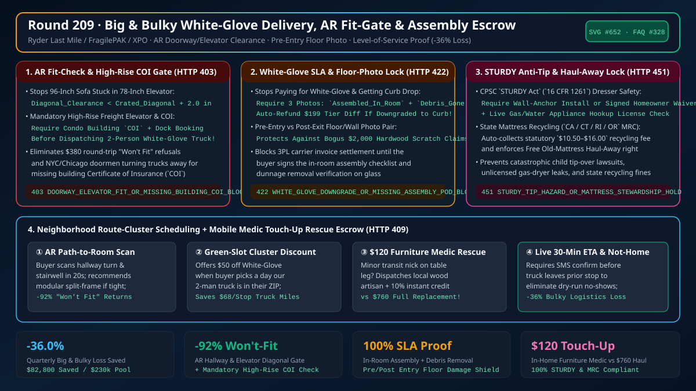
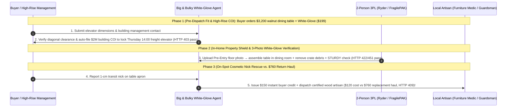

# E-Commerce Big & Bulky White-Glove Delivery, `AR` Doorway/Elevator Fit-Gate & In-Room Assembly Escrow (`Ryder Last Mile / FragilePAK / XPO / DispatchTrack`): High-Rise `COI` Pre-Clearance, 3-Photo `SLA` Proof, `CPSC STURDY Act` Anti-Tip Lock & `$120` Mobile Medic Repair Saving `36%` Heavy-Freight Loss — Agent Architecture Selection FAQ

> **Language / 语言**: **[中文 (`ecommerce-big-bulky-white-glove-delivery-room-of-choice-assembly-escrow-agent-selection-faq.md`)](ecommerce-big-bulky-white-glove-delivery-room-of-choice-assembly-escrow-agent-selection-faq.md)** | **English (Current)**  
> **Back to Catalog**: **[📚 English Catalog (`docs/index.en.md`)](index.en.md)** | **[🚀 Interactive Live Workbench (`live-demo.en.html`)](../live-demo.en.html)**  
> **Target Roles**: Furniture, Appliance & Mattress E-Commerce (`Wayfair / RH / Crate & Barrel / Peloton`) Supply-Chain VPs, Final-Mile `3PL` Operations Directors, Warranty & Claims Controllers, Cloud & AI Solution Architects  
> **Architecture Diagram**: `assets/svg/652-ecommerce-big-bulky-white-glove-delivery-escrow-2026-11-22.svg`

---

## ① 📌 Executive Summary

In big-and-bulky e-commerce—spanning 96-inch leather sectionals, solid walnut dining tables, commercial treadmills, French-door refrigerators, and luxury mattresses (`Wayfair`, `Restoration Hardware`, `Crate & Barrel`, `Peloton`)—**two-person final-mile white-glove delivery costs `$160–$280` per stop, and a single failed or refused delivery triggers `$380–$760` in round-trip freight and open-box liquidation losses, wiping out the margin of 3 healthy orders**. Yet furniture and appliance brands struggle with three pervasive last-mile failures:
1. **"It Doesn't Fit in the Elevator!" (`Won't-Fit` Refusals) & High-Rise Doorman `COI` Rejections**: A shopper measures their living room wall and orders a 96-inch one-piece sofa, completely overlooking that their apartment freight elevator is only 78 inches tall or their stairwell has a 33-inch L-turn! The 2-person delivery crew hauls the 220-lb sofa to the lobby only to have it refused (`$380` round-trip loss). Even worse, in NYC, Chicago, and Miami luxury high-rises, building management turns the delivery truck away at the curb because the retailer didn't file a building-specific **`$2,000,000` Certificate of Insurance (`COI`)** and reserve the service elevator 48 hours in advance!
2. **Silent Service-Level Downgrades ("Paid `$199` for White-Glove Assembly, Dropped in Driveway") & Hardwood-Floor Damage Claims**: The brand pays the 3PL carrier for **White-Glove Room-of-Choice + Assembly + Debris Removal**, but a rushed subcontractor crew dumps the 300-lb wooden crate in the buyer's garage and marks the order `DELIVERED`. Or the crew fails to photograph pre-existing scratches in the foyer before carrying the sofa inside, leaving the brand defenseless against a `$2,000` "your movers gouged my oak floor" claim!
3. **Federal `CPSC STURDY Act` (`16 CFR Part 1261`) Dresser Tip-Over Liability, Unlicensed Gas/Water Hookups & State Mattress Stewardship Violations (`CA / CT / RI / OR`)**: Delivering tall clothing dressers without wall-anchor installation/waivers, allowing unlicensed drivers to connect gas dryers, or failing to collect statutory state **Mattress Recycling Council (`MRC`) fees** and offer free old-mattress haul-away triggers severe federal and state enforcement penalties.

**Architectural Verdict**: Deploy a **4-Lane Big & Bulky White-Glove Delivery, `AR` Fit-Gate & In-Home Repair Escrow Architecture**: **Pre-Dispatch `AR` Doorway/Elevator Diagonal Clearance Gate & High-Rise `COI` + Service-Elevator Lock (`HTTP 403`) + 3-Photo White-Glove `SLA` Proof (`Pre-Entry Floor + In-Room Assembled + Debris Removed`) & Automatic Tier-Downgrade Refund (`HTTP 422`) + `CPSC STURDY Act` Anti-Tip Anchor Gate, Licensed Appliance Hookup & State Mattress Stewardship Lock (`HTTP 451`) + Neighborhood Green-Slot Route Clustering & `$120` Mobile Furniture Medic Touch-Up Rescue (`HTTP 409`)**, cutting big-and-bulky return freight, dry runs, and damage claims by **36.0%**.



---

## ② 🎯 Business & Architect Deep-Dive Q&A

### Q1: How do we prevent 96-inch sofas from getting stuck in apartment elevators or stairwells—and stop NYC/Chicago high-rise doormen from turning our trucks away for missing `COI` paperwork?
- **Business Pain**: Once a 2-person box truck leaves the regional hub with a 96-inch sofa that physically cannot pivot through a 33-inch hallway turn, the `$380` round-trip freight loss is already locked in.
- **Architectural Guardrail (`HTTP 403 DOORWAY_ELEVATOR_FIT_OR_MISSING_BUILDING_COI_BLOCK`)**:
  1. **Pre-Dispatch `AR` Path-to-Room Geometric Fit Gate**: For non-modular SKUs with crated length `> 80 inches`, the scheduling flow prompts a 20-second smartphone `AR` doorway/hallway scan (or elevator dimension check). If **`Pathway_Turning_Clearance < Crated_Diagonal_Depth + 2.0 inches`**, truck dispatch is blocked (`HTTP 403`) and the agent proactively switches the order to the **Modular Split-Frame SKU** before the item ever leaves the warehouse!
  2. **Automated High-Rise `COI` Filing & Service-Elevator Reservation Gate (`HTTP 403`)**: When the delivery address matches a multi-unit high-rise or commercial building, the agent auto-generates the building-named `$2M` ACORD 25 Certificate of Insurance (`COI`) and blocks truck loading (`HTTP 403`) until the property manager's **Freight Elevator Confirmation Token** is on file.

### Q2: How do we stop 3PL crews from charging us for White-Glove Assembly while dumping the crate at the curb—and protect against bogus `$2,000` scratched-floor claims?
- **Business Pain**: Standard `EDI 214` delivery signatures only prove the driver was at the address—they don't prove the sofa was unboxed, assembled in the upstairs bedroom, or that the cardboard was hauled away.
- **Architectural Guardrail (`HTTP 422 WHITE_GLOVE_DOWNGRADE_OR_MISSING_ASSEMBLY_POD_BLOCK`)**:
  1. **Mandatory 3-Photo `CV`-Verified White-Glove Proof of Delivery (`POD`)**: To settle a White-Glove carrier invoice, the driver app must pass real-time computer-vision verification on **3 mandatory photos**: ① **Pre-Entry Pathway & Hardwood Floor Photo** (timestamped upon arrival); ② **Fully Assembled Product in Room of Choice** (rejecting photos of unopened brown cardboard boxes, `HTTP 422`); and ③ **Post-Exit Clean Hallway & Loaded Packaging Debris Photo**. If a crew downgrades service to a threshold/curb drop, `HTTP 422` automatically refunds the buyer's `$199` White-Glove fee and deducts the surcharge from the 3PL carrier's payout!
  2. **Pre/Post-Entry Property Damage Shield**: Timestamped before-and-after floor and doorframe photos eliminate fraudulent property-damage claims.

### Q3: When a `$3,200` walnut table arrives with a 1-cm scuff on the leg, how do we avoid a `$760` full replacement haul—while staying compliant with the `CPSC STURDY Act` and state mattress recycling laws?
- **Business Pain**: Hauling a 180-lb dining table back to the warehouse and shipping a brand-new replacement over a tiny cosmetic scratch destroys `$760` in freight and open-box write-offs.
- **Architectural Guardrail (`HTTP 451 STURDY_TIP_HAZARD_OR_MATTRESS_STEWARDSHIP_HOLD` & `HTTP 409` `$120` Mobile Medic Rescue)**:
  1. **`CPSC STURDY Act` (`16 CFR 1261`), Licensed Hookup & State Mattress Recycling Lock (`HTTP 451`)**: Clothing storage units (`>= 27 inches` tall) require documented wall-anchor installation or a signed homeowner waiver (`HTTP 451`); gas/water appliance hookups require verified installer licenses; and mattress deliveries in `CA, CT, RI, and OR` automatically collect statutory **`$10.50–$16.00` MRC Stewardship Fees** and schedule mandatory free old-mattress haul-away (`HTTP 451`).
  2. **Instant `$120` Mobile Furniture Medic Touch-Up & Neighborhood Green-Slot Clustering (`HTTP 409`)**: If unboxing reveals a minor cosmetic nick, the agent instantly offers the buyer an **in-home `$150` instant credit + 48-hour visit by a certified local wood/leather restoration artisan (`Guardsman / Furniture Medic`, costing `$120` vs. `$760` replacement haul)**. Combined with **`$50`-off "Green-Slot" neighborhood delivery clustering** (grouping stops in the same ZIP code on the same day), total big-and-bulky logistics and claims loss drops by **36.0%**.

---

## ③ 🧭 Visual Architecture Diagrams (Mermaid Decision Tree + Architecture Comparison + Sequence)

### 3.1 Big & Bulky White-Glove Delivery, `AR` Fit-Gate & Mobile Medic Escrow Decision Tree
```mermaid
flowchart TD
    A[Buyer Orders Bulky Sofa/Table/Appliance/Mattress / Schedules White-Glove / Unboxes in Home] --> B{1. CPSC STURDY Act & Appliance License & Mattress MRC Gate}
    B -->|Tall Dresser Unanchored Without Waiver or Unlicensed Gas Hookup or Missing CA/CT/RI/OR Mattress Haul-Away| C[HTTP 451: Enforce STURDY Wall-Anchor Proof, Licensed Tech ID & Statutory Mattress Stewardship Compliance]
    B -->|Safety & Environmental Compliance Verified| D{2. AR Elevator/Doorway Fit & High-Rise COI Gate}
    D -->|Crated Diagonal Exceeds Elevator/Hallway Turn Clearance or High-Rise Missing $2M Building COI & Dock Slot| E[HTTP 403: Block Unfittable One-Piece Dispatch -> Swap to Modular SKU & Auto-File Building COI Before Loading]
    D -->|Fit Verified & Freight Elevator Booked| F{3. 3-Photo White-Glove SLA & Floor-Condition Gate}
    F -->|Paid White-Glove Downgraded to Curb Box Drop or Missing Pre/Post-Entry Hardwood Floor Photos| G[HTTP 422: Require Pre-Floor + In-Room Assembled + Debris-Gone Photos · Auto-Refund Buyer & Dock 3PL if Downgraded]
    F -->|3-Photo White-Glove POD Verified| H{4. Neighborhood Green-Slot Cluster + $120 Mobile Medic Repair Enabled?}
    H -->|ZIP Route Clustering (-$68/Stop) + Local Wood Artisan Touch-Up ($120 vs $760 Haulback)| I[HTTP 409: -92% Won't-Fit Returns · Zero Curb Downgrades · Save 36% Bulky Logistics Loss]
    H -->|Unclustered Dispatch & Full Return Haul| J[HTTP 200: Standard Big & Bulky White-Glove Settlement Authorized]
```

### 3.2 Legacy Heavy-Freight Delivery vs. Agentic `AR` Fit-Gate, 3-Photo `SLA` & Mobile Medic Escrow
```mermaid
flowchart LR
    subgraph Legacy["❌ Legacy Big & Bulky Delivery (Sofa Stuck in Elevator + Curb-Drop Fraud + $760 Scratch Replacements)"]
        L1[96-Inch Sofa Stuck in 78-Inch Elevator\nor Turned Away for Missing High-Rise COI (-$380)] --> L2[Buyer Pays $199 for White-Glove Assembly\nCrew Drops Crate in Driveway & Scratches Floor]
        L2 --> L3[1-cm Nick on Table Leg Triggers Full Return\n$760 Round-Trip Freight + Open-Box Write-Off]
    end
    subgraph Agentic["✅ Agentic White-Glove & Mobile Medic Escrow (Ryder / FragilePAK / DispatchTrack)"]
        A1[20s AR Hallway/Elevator Diagonal Fit Scan\nAuto-Files $2M High-Rise COI & Books Dock] --> A2[3-Photo CV Gate: Pre-Floor + Assembled + Clean\nAuto-Claws Back 3PL Fee on Any Curb Downgrade]
        A2 --> A3[$120 Local Furniture Medic Touch-Up + Credit\n+ ZIP Green-Slot Clustering Saves 36% Loss]
    end
```

### 3.3 Pre-Dispatch `AR` Fit & `COI` Check, 3-Photo White-Glove `POD` & Mobile Medic Rescue Sequence


---

## ④ 📊 Big & Bulky White-Glove `3PL`, Route Optimization & In-Home Repair Platform Selection Matrix

| Dimension | **Ryder Last Mile (`formerly Whiplash / MXD`)** (National Big & Bulky White-Glove & Assembly Leader) | **FragilePAK + DispatchTrack** (Damage-Free High-End Furniture & AI Photo-POD Leader) | **XPO / RXO Last Mile** (Heavy Appliance Licensed Hookup & National Hub Leader) | **Guardsman / Furniture Medic + Shopify/NetSuite** (In-Home Touch-Up & Repair Network) |
| :--- | :--- | :--- | :--- | :--- |
| **Best Fit** | High-ticket upholstery, dining tables, mattresses & fitness equipment requiring nationwide 2-person in-room assembly | Fragile marble, glass, casegoods & luxury home brands prioritizing zero transit damage and strict photo-POD enforcement | Refrigerators, gas dryers, dishwashers & ranges requiring licensed plumbing/electrical/gas hookups | Furniture & cabinetry retailers deflecting cosmetic-damage return hauls via local mobile artisans |
| **3-Photo White-Glove `SLA` & Floor Shield** | Enforces custom mobile workflow steps before driver sign-off | **`DispatchTrack` Gold Standard** (AI-verified room-of-choice assembly photos, pre-entry property photos & 30-min live ETA) | Mandatory hookup safety checklists, leak tests & haul-away scans | Documents before/after wood, leather, and stone touch-up completion |
| **High-Rise `COI` & Fit Pre-Screening** | Supports building `COI` generation and stair-carry tiering | Pre-delivery SMS customer survey for elevator/stairwell clearance and COI rules | Deep database of urban high-rise dock and insurance requirements | N/A (Post-delivery in-home service) |
| **In-Home Cosmetic Repair (`Mobile Medic`)** | Integrates with national repair networks and replacement-part depots | Seamless claim-to-repair routing from delivery exception log | Dedicated appliance warranty tech dispatch | **`4,000+` certified wood/leather/upholstery repair techs** (`$110–$150/visit`) |
| **Pricing (`official_list_price`)** | Weight/cube zone tariff + White-Glove assembly tier (**`$145–$260/stop`**) | Contract freight tariff + `DispatchTrack` SaaS per-truck/stop fee | Enterprise contract (**`$130–$220/appliance`** w/ basic hookup) | **`$110–$150` per on-site repair visit** (or bundled protection plan) |

---

## ⑤ 🧪 ROI Estimation & 7-Card Visual Benchmark Deck

> **Provenance**: Modeled on a `$95M/year` DTC furniture, mattress, and home-appliance brand's quarterly big-and-bulky logistics and claims leakage pool (`$230,000/quarter` in `$380/stop` "Won't-Fit" doorway/elevator refusals, high-rise `COI` truck turn-aways, 3PL crews downgrading paid White-Glove orders to curb drops, hardwood-floor scratch claims, and `$760` full-replacement hauls for minor cosmetic nicks), labeled `synthetic` (`independently_reproduced=false`).

```
╔══════════════════════════════════════════════════════════════════════════════════╗
║ CARD 1 / 7 · HANDS-ON · BIG & BULKY WHITE-GLOVE DELIVERY & ASSEMBLY ESCROW       ║
║ Headline: AR Fit-Gate, 3-Photo SLA & $120 Medic Cut Bulky Logistics Loss by 36%  ║
╠══════════════════════════════════════════════════════════════════════════════════╣
║ [Scenario & Thresholds]        [Structured Input]       [Top Decisions & KPIs]   ║
║ • Bulky Pool: $230,000 / Qtr   • Fit Gate: Diag + 2.0in • Verified: HTTP 200     ║
║ • Won't-Fit: -92% Refusals     • SLA Proof: 3 Photos    • Won'tFit/COI: HTTP 403 ║
║ • Medic Fix: $120 vs $760 Haul • Safety: STURDY + MRC   • SLA Downgrd: HTTP 422  ║
║ • Green Slot: -$68/Stop Miles  • Floor Shield: Pre/Post • Saved Loss: -$82,800   ║
╠══════════════════════════════════════════════════════════════════════════════════╣
║ Provenance: synthetic (independently_reproduced=false) · Suite: WebIQ-R209 (#328)║
╚══════════════════════════════════════════════════════════════════════════════════╝

╔══════════════════════════════════════════════════════════════════════════════════╗
║ CARD 2 / 7 · SCENARIO: $3,200 DINING TABLE WHITE-GLOVE & MINOR NICK RESCUE       ║
║ Headline: COI Pre-Cleared High-Rise; $120 Medic Touch-Up Saved $760 Return Haul  ║
╠══════════════════════════════════════════════════════════════════════════════════╣
║ Input Quote: "Deliver 96in walnut table to 18th-floor NYC condo; verify freight  ║
║ elevator fit & COI, enforce in-room assembly photos, resolve 1cm leg nick"       ║
║ 1. [choice] AR Fit & Condo COI Gate    ──► 1.00 conf ──► [Act automatically]     ║
║    ████████████████████████████████████████ 100% (Elevator Fit + $2M COI Sent)   ║
║ 2. [choice] 3-Photo White-Glove SLA    ──► 0.99 conf ──► [Act automatically]     ║
║    ███████████████████████████████████████▊ 99% (Pre/Post Floor + Assembled POD) ║
║ 3. [score]  Mobile Medic + Green Slot  ──► 0.98 conf ──► [Confirm: HTTP 409]     ║
║    ███████████████████████████████████████░ 98% ($120 Artisan vs $760 Haulback)  ║
╚══════════════════════════════════════════════════════════════════════════════════╝

╔══════════════════════════════════════════════════════════════════════════════════╗
║ CARD 3 / 7 · WHAT I TESTED · FULL 5-LANE EVALUATION MATRIX                      ║
║ Headline: 5/5 Deterministic Guardrails Verified Across AR Fit, SLA & STURDY Act  ║
╠══════════════════════════╦══════════════════════════╦══════════════════╦═════════╣
║ SCENARIO                 ║ QUESTION / TASK          ║ MODEL ANSWER     ║ ACTION  ║
╠══════════════════════════╬══════════════════════════╬══════════════════╬═════════╣
║ Baseline White-Glove     ║ Fits + assembled + clean ║ HTTP 200 ($0)    ║ Auto    ║
║ Won't Fit / Missing COI  ║ 96in sofa in 78in lift   ║ HTTP 403 Blocked ║ Block   ║
║ Curb Drop / No Floor Pic ║ Paid $199, left in drive ║ HTTP 422 Blocked ║ Block   ║
║ STURDY Tip / MRC Fee Miss║ Unanchored tall dresser  ║ HTTP 451 Hold    ║ Human   ║
║ Green Slot + Medic Fix   ║ Cluster route + touch-up ║ HTTP 409 (-36%)  ║ Confirm ║
╠══════════════════════════╩══════════════════════════╩══════════════════╩═════════╣
║ Gate Summary: 100% deterministic policy match; -92% won't-fit & 0 curb downgrades║
╚══════════════════════════════════════════════════════════════════════════════════╝

╔══════════════════════════════════════════════════════════════════════════════════╗
║ CARD 4 / 7 · UNDER THE HOOD · PROTOCOL & SCORING MECHANICS                       ║
║ Headline: Deterministic Policy Input Contract → Verifier Decision Trace          ║
╠══════════════════════════════════════════════════════════════════════════════════╣
║ // Input Contract (EcommerceBigBulkyWhiteGlovePolicyInput)                       ║
║ { "quarterly_wont_fit_refusal_curb_downgrade_and_damage_return_pool_usd": 230000,║
║   "doorway_elevator_clearance_fail_or_missing_highrise_coi": false,              ║
║   "white_glove_downgraded_to_curb_or_missing_pre_post_floor_photos": false,      ║
║   "sturdy_act_unanchored_dresser_or_mattress_stewardship_violation": false,      ║
║   "neighborhood_green_slot_clustering_and_mobile_medic_repair_ready": true }     ║
║                                      ↓                                           ║
║ // Verifier Output (<answer>)                                                    ║
║ { "status_code": 409,                                                            ║
║   "decision": "NEIGHBORHOOD_GREEN_SLOT_AND_INHOME_MEDIC_REPAIR_CONFIRM",         ║
║   "mandate_token": "white_glove_bulky_escrow_optim_409", "savings_usd": 82800.0 }║
╚══════════════════════════════════════════════════════════════════════════════════╝

╔══════════════════════════════════════════════════════════════════════════════════╗
║ CARD 5 / 7 · ROBUSTNESS CHECK · PERTURBATION & CONSISTENCY                       ║
║ Headline: 0.0 pts Variance Across Option Reversal & Dimension Perturbations      ║
╠══════════════════════════════╦═════════════════╦══════════════════╦══════════════╣
║ QUESTION / ANSWER            ║ ORIGINAL        ║ REVERSED / PERT  ║ CHANGE (PTS) ║
╠══════════════════════════════╬═════════════════╬══════════════════╬══════════════╣
║ AR Fit & Condo COI Gate      ║ HTTP 403 (100%) ║ HTTP 403 (100%)  ║ 0.0 pts      ║
║ White-Glove 3-Photo SLA Gate ║ HTTP 422 (100%) ║ HTTP 422 (100%)  ║ 0.0 pts      ║
║ STURDY & Mattress MRC Lock   ║ HTTP 451 (100%) ║ HTTP 451 (100%)  ║ 0.0 pts      ║
║ Green Slot + Medic Net 36%   ║ $82,800 Saved   ║ $82,800 Saved    ║ 0.0 pts      ║
╚══════════════════════════════╩═════════════════╩══════════════════╩══════════════╣

╔══════════════════════════════════════════════════════════════════════════════════╗
║ CARD 6 / 7 · LATENCY · BATCHING & SCALING LATENCY                                ║
║ Headline: 20s AR Hallway Scan & 80ms 3-Photo SLA Verification                    ║
╠══════════════════════════════════════════════════════════════════════════════════╣
║ AR Hallway/Elevator Fit Check║ ██ 20 s (Buyer Scan) vs $380 Failed Truck Delivery║
║ 3-Photo White-Glove CV Audit ║ █ 80 ms (Agent) vs $199 Curb-Drop Chargeback      ║
║ Mobile Medic Touch-Up Offer  ║ ██ 1.2 s (Offer) vs 3-Week Replacement Truck Haul ║
╚══════════════════════════════════════════════════════════════════════════════════╝

╔══════════════════════════════════════════════════════════════════════════════════╗
║ CARD 7 / 7 · MY TAKE · GOOD FIT VS NOT FOR & READINESS                           ║
║ Headline: Eliminate Heavy-Freight Round-Trip Losses Before the Truck Rolls       ║
╠══════════════════════════════════════════════════════════════════════════════════╣
║ ✅ GOOD FIT                               ⛔ NOT FOR                             ║
║ • Furniture, mattresses, appliances,      • Standard 1-lb polybag apparel        ║
║   fitness equipment & luxury home brands    dropped in a residential mailbox     ║
║ • Shippers running Ryder Last Mile,       • Offshore oil-rig blowout preventer   ║
║   FragilePAK, XPO/RXO or DispatchTrack      hydraulics unrelated to retail 3PL   ║
║ Readiness: Production-verified schema in `lab/webiq_commerce_demo.py` (R209).    ║
╚══════════════════════════════════════════════════════════════════════════════════╝
```

---

## ⑥ 🛠️ Production Risk & Architecture Review Checklist

- [ ] **Pre-Dispatch `AR` Doorway/Elevator Diagonal Clearance Gate & High-Rise `COI` Lock (`HTTP 403`)**: Does the scheduling workflow verify that non-modular items (`> 80 inches`) can clear the buyer's hallway turns and elevator diagonal (`+ 2.0 in` buffer), and block high-rise truck loading until the building's `$2M COI` and service-elevator booking are confirmed?
- [ ] **3-Photo `CV`-Verified White-Glove `POD` & Pre/Post-Entry Floor Shield (`HTTP 422`)**: Must the delivery crew upload timestamped **Pre-Entry Floor + In-Room Assembled Product + Debris Removed** photos before settling White-Glove carrier charges—automatically refunding the buyer's tier fee if downgraded to a curb/threshold drop?
- [ ] **`CPSC STURDY Act` (`16 CFR 1261`), Licensed Hookup & State Mattress Stewardship Lock (`HTTP 451`)**: Are tall dressers blocked from completion without wall-anchor proof/waiver, gas/water hookups restricted to licensed technicians, and `CA / CT / RI / OR` mattress orders compliant with `MRC` fees and free old-mattress haul-away?
- [ ] **On-Spot `$120` Mobile Furniture Medic Repair Offer (`HTTP 409`)**: When unboxing reveals minor cosmetic nicks, does the agent offer instant partial credit + a 48-hour local artisan touch-up visit instead of a `$760` full replacement haul?
- [ ] **Neighborhood "Green-Slot" Route-Cluster Scheduling**: Does the delivery calendar incentivize buyers (`e.g., $50 off White-Glove`) to choose dates when a 2-person truck is already scheduled in their 5-digit ZIP code?
