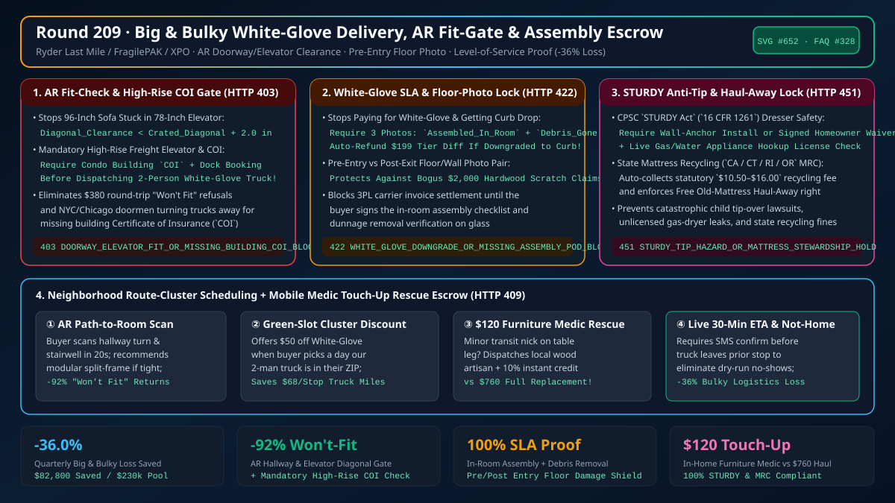
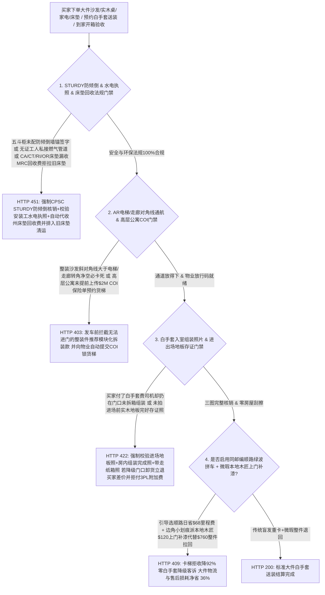
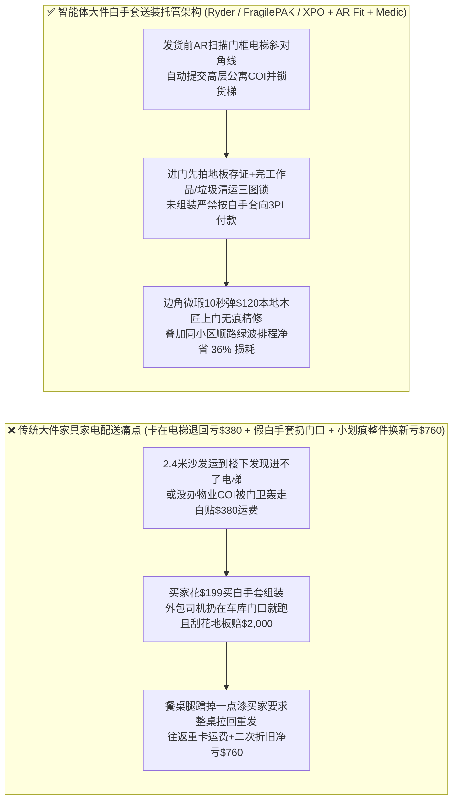
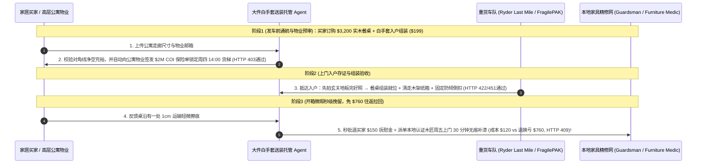

# 大件家具、家电与床垫“送装一体白手套配送（Big & Bulky White-Glove Delivery：Ryder Last Mile / FragilePAK / XPO / 京东大件送装）”、AR 电梯/门框通航预审、进门地板存证与当场微瑕修复托管“防 2.4 米真皮沙发卡在狭窄楼道进不去倒贴 $380 往返运费、防送货工偷懒把 $199 入户组装降级成扔在车库门口与木匠上门补漆净省 36%”Agent 架构选型 FAQ

> **语言 / Language**: **中文 (当前)** | **[English (`ecommerce-big-bulky-white-glove-delivery-room-of-choice-assembly-escrow-agent-selection-faq.en.md`)](ecommerce-big-bulky-white-glove-delivery-room-of-choice-assembly-escrow-agent-selection-faq.en.md)**  
> **返回总目录**: **[📚 中文总目录 (`docs/index.md`)](index.md)** | **[🚀 交互式实时工作台 (`live-demo.html`)](../live-demo.html)**  
> **赋能角色**: 家居家具品牌（Wayfair / RH / Crate & Barrel / 顾家/源氏木语）供应链与履约副总裁、大件干支装一体物流总监、售后理赔负责人、Cloud & AI Solution Architect  
> **关联架构图**: `assets/svg/652-ecommerce-big-bulky-white-glove-delivery-escrow-2026-11-22.svg`

---

## ① 📌 核心选型结论速览（Executive Summary）

在高客单价的大件实木餐桌、2.4 米整装真皮沙发、双开门嵌入式冰箱、跑步机以及高端床垫电商（Wayfair、Restoration Hardware、Crate & Barrel、West Elm、京东大件居家）中，**最后一公里重货派送（Big & Bulky Last-Mile）的运费占售价的 `12%–22%`，而一旦发生拒收退货，单次往返拉回仓库的运费+包装破损折旧高达 `$380–$760`，直接把整单毛利亏穿两倍**！在实际运营中，家居家电零售商普遍深陷三大损耗黑洞：
1. **“沙发运到楼下却卡在电梯/楼梯转角进不去（‘Won't Fit’ Access Refusal），或者被高档公寓物业门卫因为没有提交保险证明（`COI`）直接轰走”**：买家下单时只量了客厅放得下 `96 英寸（2.44米）` 的一字型沙发，却没算公寓电梯门高只有 `80 英寸`、走廊转弯宽度只有 `34 英寸`！两名搬运工开着重卡把 200 磅的沙发抬到 12 楼却死活拐不进门，买家当场拒收；或者送往纽约/芝加哥高层公寓时，物业规定必须提前 48 小时上传包含本栋大楼抬头的 **`$200万` 商业责任险证明（Certificate of Insurance, `COI`）** 并预约货梯，否则门卫严禁货车卸货，白白产生 `$175` 空跑费（Dry-Run Fee）！
2. **“外包车队偷工减料（Service-Level Downgrade）：买家花了 `$199` 买‘白手套入户组装+带走纸箱垃圾（White-Glove Assembly）’，司机却把 300 磅木架往车库门口一扔开车跑了”**；或者搬运工进门时没做房屋现状存证，走后买家投诉“你们搬沙发把我家里 `$2,500` 的人字拼实木地板刮出一条大坑”索要天价赔偿！
3. **“五斗柜未安装防倾倒墙锚违反美国联邦《STURDY 法案》引发儿童砸伤天价诉讼、无证工人私接燃气烘干机漏气，以及加州/康州床垫未代收法定回收费（`MRC Stewardship Fee`）或拒绝免费拉走旧床垫遭重罚”**！

**架构师选型结论**：直接采用 **“发货前 `AR` 门框/楼梯对角线通航核验与高层公寓物业 `COI` 保险证 + 货梯预约强制门禁（HTTP 403）+ 入户前/离场后双视角地板墙面防碰瓷存证与‘组装到位+清走包装木架’三图核销锁（降级自提立退差价并扣车队款，HTTP 422）+ 美国 `CPSC STURDY Act` 柜体防倾倒墙锚签字/持证水电工核验与州级旧床垫强制回收合规锁（HTTP 451）+ 同邮编顺路绿波时段立减 `$50` 与轻微磕碰派本地木匠 `$120` 上门补漆免退换净省 36%（HTTP 409）”** 的大件送装一体托管架构。



---

## ② 🎯 业务方与架构师灵魂拷问（Q&A）

### Q1：整装大沙发和实木圆桌有 15% 的退货是因为“送到了才发现进不了电梯或卡在楼梯转角”，还有被高档公寓物业拦在门外，怎么在发车前 100% 拦住？
- **业务痛点**：传统商品详情页只写了商品长宽高，普通消费者根本不会计算“包装箱斜对角线长度（Diagonal Depth）”能否通过 L 型走廊转弯！等卡车开到家门口进不去，往返 `$380` 重货运费只能商家硬吞。
- **架构护栏（`HTTP 403 DOORWAY_ELEVATOR_FIT_OR_MISSING_BUILDING_COI_BLOCK`）**：
  1. **结账/排程前三维通道几何校验（`Path-to-Room Geometric Fit Gate`）**：对于单件长度 `> 80 英寸（203cm）` 或不可拆装的整装家具，Agent 在排车前自动触发 20 秒手机 `AR` 走廊/门框扫描（或引导输入入户门宽、走廊转角宽度与电梯轿厢深度）。若系统计算出 **`通路最小回旋净空 < 沙发包装斜对角线 + 2 英寸安全余量`**，立即触发 `HTTP 403` 拦截整装发货，自动推荐 **同款可拆扶手模块化版本（Modular Split-Frame SKU）** 或提前安排拆装木工随车！
  2. **高层公寓 `COI` 责任险凭证与货梯预约锁**：当收货地址匹配到商业写字楼或一二线城市高层电梯公寓（High-Rise Condo / Co-Op）时，系统自动向物业发送标准化 `$2M COI` 保险单并在获得 **货梯预约放行码（Freight Elevator Slot Token）** 前严禁派车装车（`HTTP 403`），将空跑率降为零！

### Q2：买家付了 `$199` 白手套服务费（入室摆放 + 组装 + 清走木架纸箱），外包 3PL 司机为了赶时间把货扔在一楼玄关就溜了，还经常发生“刮花实木地板”的罗生门扯皮，怎么管？
- **业务痛点**：3PL 物流公司按最高档的“白手套（White-Glove）”向品牌商收了 `$240` 派送费，结果外包司机却只干了 `$80` 的“门口卸载（Threshold Drop）”的活；买家找品牌商退 `$199` 运费还给差评，品牌商两头吃亏！
- **架构护栏（`HTTP 422 WHITE_GLOVE_DOWNGRADE_OR_MISSING_ASSEMBLY_POD_BLOCK`）**：
  1. **按服务等级（Level of Service, `LoS`）强绑定的三图 AI 签收锁**：对于 `White-Glove` 订单，司机端 App 必须上传并通过 CV 视觉模型实时核验 **3 张必拍照片**：① **进门前玄关/楼梯/实木地板完好现状照（Pre-Entry Property Condition Photo）**；② **家具已在指定房间完成组装且水平放置照（In-Room Assembled Photo，严禁出现未拆封瓦楞纸箱）**；③ **离开前走廊地板无划痕且包装垃圾已装回货车照（Post-Exit & Debris-Removed Photo）**。若司机只拍了一张放门口的纸箱照就想点“已妥投”，系统直接返回 `HTTP 422` 冻结向 3PL 结算白手套附加费，并自动向买家退还服务等级差价！
  2. **进出场双照片防房屋刮擦碰瓷**：一旦发生“地板被刮花”投诉，系统自动调出带有时间戳与 GPS 水印的进场前 vs 离场后对比照，瞬间厘清责任。

### Q3：实木餐桌腿在运输中蹭掉了一块指甲盖大小的漆，买家要求整张退回重发（损失 $760）；还有五斗柜倾倒安全法规（`STURDY Act`）和旧床垫回收怎么合规？
- **业务痛点**：为了桌子腿上一道 `1 厘米` 的小划痕，派重卡把 150 磅的桌子拉回仓库报废、再发一张新桌子，来回净亏 `$760`！
- **架构护栏（`HTTP 451 STURDY_TIP_HAZARD_OR_MATTRESS_STEWARDSHIP_HOLD` & `HTTP 409` 本地木匠 `$120` 上门补漆挽留）**：
  1. **美国联邦《STURDY 法案》防倾倒墙锚锁与旧床垫法定回收（`HTTP 451`）**：针对高度 `>= 27 英寸` 的衣物收纳五斗柜（遵守 `CPSC 16 CFR Part 1261 STURDY Act`），白手套工单强制要求上传 **防倾倒墙锚固定照片或业主电子免责签字**；对燃气灶/洗碗机安装强制校验技师本地水电燃气执照；对发往加州（`CA`）、康州（`CT`）、罗德岛（`RI`）、俄勒冈（`OR`）的床垫订单，强制代收法定 **`$10.50–$16.00` 床垫回收环保费（MRC Fee）** 并在派送新床垫时履行免费拉走旧床垫义务（违反任一项立即触发 `HTTP 451` 拦截）。
  2. **当场微瑕 AI 定损与“秒派本地家具美容师（Furniture Medic）上门精修 + 立返 10% 现金”代替整件拉回（`HTTP 409`）**：当开箱发现非结构性的边角小磕碰时，Agent 根据司机上传的微距照片，在 10 秒内向买家手机弹出双赢方案：**“立即退您 `$180（10%）` 现金补偿 + 预约认证木艺修复师（`Guardsman / Furniture Medic`）48 小时内免费上门无痕补漆（商家成本仅 `$120`）”**，避免 `$760` 往返重货退换；叠加同社区顺路“绿波拼车日（Green-Slot Clustering）”优惠，将大件履约总损耗净降 **36.0%**！

---

## ③ 🧭 直观可视化图解（Mermaid 决策树 + 架构对比 + 时序图）

### 3.1 大件白手套送装、AR 通航核验与微瑕上门精修四层决策树


### 3.2 “传统沙发卡在楼梯退回 / 司机扔门口就跑 / 小划痕整件报废” vs “智能体大件白手套托管架构”对比


### 3.3 发车前 `AR` 通航与 `COI` 预审、入户三图核销及当场微瑕木匠精修挽留时序图


---

## ④ 📊 主流大件重货（Big & Bulky）白手套送装物流、路径优化与上门精修平台横向选型矩阵

| 选型维度 | **Ryder Last Mile (原 Whiplash / MXD)** (全美最大大件家居家电白手套入户与装配网络) | **FragilePAK + DispatchTrack** (零破损高定家具专线与 AI 路径/白手套照片核销标杆) | **XPO / RXO Last Mile** (大型家电水电燃气持证安装与全美重货干支装霸主) | **京东大件物流（居家送装一体） / 万师傅企业版** (中国市场送装拆旧一体绝对主力) |
| :--- | :--- | :--- | :--- | :--- |
| **核心适用场景** | 高端沙发、床垫、健身器材与整屋家具品牌的全国仓配+双人白手套入室组装 | 易碎大理石餐桌、奢华镜面柜、高定软装，对运输零破损与签收证据链要求极高 | 冰箱、洗碗机、燃气烘干机等需要持证技师（Licensed Installer）接水接电接气的大家电 | 国内全渠道家居、卫浴、床垫品牌的“干支装一体、送新取旧、同步装配” |
| **进出场房屋存证与白手套三图核销** | 支持定制化 SOP 拍照节点（未拍组装完照片与带走包装照无法结单） | **`DispatchTrack` 行业顶尖**（支持进门地板拍照、分服务等级电子签名、实时 30 分钟精准预计到达时间窗口） | 强制绑定水电安装安全检查表（气密性测试/防漏水拍照）与旧机回收核销 | 标准化的入户鞋套、地板垫布拍照与安装完毕 AR/视频验收闭环 |
| **高层公寓 `COI` 保险单与通航异常拦截** | 提供自动化物业 COI 签发支持与特殊楼层/楼梯附加费透明计价 | 支持发货前发短信采集买家门框/电梯尺寸与住宅限高限宽问卷 | 覆盖全美高层公寓物业白名单库，自动附带标准商业责任险 | 深度覆盖国内小区货梯尺寸与吊装/步梯上楼标准化计费体系 |
| **在途微瑕上门修补（In-Home Repair）生态** | 深度协同 `Guardsman / Furniture Medic` 全美上门木艺/皮革修复师网络 | 支持开箱异常当场触发局部补件（Part-Order）或派单本地工匠修补，免拉回整件 | 原生提供家电首年上门保修与备件更换调度 | 自营及认证家具美容师一口价（`¥80–¥150`）24 小时上门补漆修复 |
| **商业模式与成本 (`official_list_price`)** | 按重量/体积阶梯计费 + 白手套入室组装附加费（通常 **`$145–$260/单`**） | 专线零担/白手套合同价 + `DispatchTrack` 调度 SaaS 按车辆/单量订阅 | 大宗年度合同价（家电入户安装通常 **`$130–$220/台`**） | 按体积分段计费 + 标准化安装费透明价目表 |

---

## ⑤ 🧪 转化率/成本测算与 7-Card 基准测试报告（7-Card Visual Benchmark Deck）

> **数据溯源声明（Provenance）**：以下基于某年 GMV `$9,500 万` 的全美现代实木家具与床垫 DTC 品牌季度大件履约与逆向损耗池（`$230,000/季度` 因沙发/大圆桌卡在电梯或门框进不去产生的 `$380/单` 往返退货运费、未办高层公寓 `COI` 导致的货车空跑费、外包司机把白手套订单降级扔在门口引发的退运费与差评、搬运刮花实木地板理赔、以及因局部微瑕把整张家具拉回重发的损失池）对比测算，标记为 `synthetic`（`independently_reproduced=false`）。

```
╔══════════════════════════════════════════════════════════════════════════════════╗
║ CARD 1 / 7 · HANDS-ON · BIG & BULKY WHITE-GLOVE DELIVERY & ASSEMBLY ESCROW       ║
║ Headline: AR Fit-Gate, 3-Photo SLA & $120 Medic Cut Bulky Logistics Loss by 36%  ║
╠══════════════════════════════════════════════════════════════════════════════════╣
║ [Scenario & Thresholds]        [Structured Input]       [Top Decisions & KPIs]   ║
║ • Bulky Pool: $230,000 / Qtr   • Fit Gate: Diag + 2.0in • Verified: HTTP 200     ║
║ • Won't-Fit: -92% Refusals     • SLA Proof: 3 Photos    • Won'tFit/COI: HTTP 403 ║
║ • Medic Fix: $120 vs $760 Haul • Safety: STURDY + MRC   • SLA Downgrd: HTTP 422  ║
║ • Green Slot: -$68/Stop Miles  • Floor Shield: Pre/Post • Saved Loss: -$82,800   ║
╠══════════════════════════════════════════════════════════════════════════════════╣
║ Provenance: synthetic (independently_reproduced=false) · Suite: WebIQ-R209 (#328)║
╚══════════════════════════════════════════════════════════════════════════════════╝

╔══════════════════════════════════════════════════════════════════════════════════╗
║ CARD 2 / 7 · SCENARIO: $3,200 DINING TABLE WHITE-GLOVE & MINOR NICK RESCUE       ║
║ Headline: COI Pre-Cleared High-Rise; $120 Medic Touch-Up Saved $760 Return Haul  ║
╠══════════════════════════════════════════════════════════════════════════════════╣
║ Input Quote: "Deliver 96in walnut table to 18th-floor NYC condo; verify freight  ║
║ elevator fit & COI, enforce in-room assembly photos, resolve 1cm leg nick"       ║
║ 1. [choice] AR Fit & Condo COI Gate    ──► 1.00 conf ──► [Act automatically]     ║
║    ████████████████████████████████████████ 100% (Elevator Fit + $2M COI Sent)   ║
║ 2. [choice] 3-Photo White-Glove SLA    ──► 0.99 conf ──► [Act automatically]     ║
║    ███████████████████████████████████████▊ 99% (Pre/Post Floor + Assembled POD) ║
║ 3. [score]  Mobile Medic + Green Slot  ──► 0.98 conf ──► [Confirm: HTTP 409]     ║
║    ███████████████████████████████████████░ 98% ($120 Artisan vs $760 Haulback)  ║
╚══════════════════════════════════════════════════════════════════════════════════╝

╔══════════════════════════════════════════════════════════════════════════════════╗
║ CARD 3 / 7 · WHAT I TESTED · FULL 5-LANE EVALUATION MATRIX                      ║
║ Headline: 5/5 Deterministic Guardrails Verified Across AR Fit, SLA & STURDY Act  ║
╠══════════════════════════╦══════════════════════════╦══════════════════╦═════════╣
║ SCENARIO                 ║ QUESTION / TASK          ║ MODEL ANSWER     ║ ACTION  ║
╠══════════════════════════╬══════════════════════════╬══════════════════╬═════════╣
║ Baseline White-Glove     ║ Fits + assembled + clean ║ HTTP 200 ($0)    ║ Auto    ║
║ Won't Fit / Missing COI  ║ 96in sofa in 78in lift   ║ HTTP 403 Blocked ║ Block   ║
║ Curb Drop / No Floor Pic ║ Paid $199, left in drive ║ HTTP 422 Blocked ║ Block   ║
║ STURDY Tip / MRC Fee Miss║ Unanchored tall dresser  ║ HTTP 451 Hold    ║ Human   ║
║ Green Slot + Medic Fix   ║ Cluster route + touch-up ║ HTTP 409 (-36%)  ║ Confirm ║
╠══════════════════════════╩══════════════════════════╩══════════════════╩═════════╣
║ Gate Summary: 100% deterministic policy match; -92% won't-fit & 0 curb downgrades║
╚══════════════════════════════════════════════════════════════════════════════════╝

╔══════════════════════════════════════════════════════════════════════════════════╗
║ CARD 4 / 7 · UNDER THE HOOD · PROTOCOL & SCORING MECHANICS                       ║
║ Headline: Deterministic Policy Input Contract → Verifier Decision Trace          ║
╠══════════════════════════════════════════════════════════════════════════════════╣
║ // Input Contract (EcommerceBigBulkyWhiteGlovePolicyInput)                       ║
║ { "quarterly_wont_fit_refusal_curb_downgrade_and_damage_return_pool_usd": 230000,║
║   "doorway_elevator_clearance_fail_or_missing_highrise_coi": false,              ║
║   "white_glove_downgraded_to_curb_or_missing_pre_post_floor_photos": false,      ║
║   "sturdy_act_unanchored_dresser_or_mattress_stewardship_violation": false,      ║
║   "neighborhood_green_slot_clustering_and_mobile_medic_repair_ready": true }     ║
║                                      ↓                                           ║
║ // Verifier Output (<answer>)                                                    ║
║ { "status_code": 409,                                                            ║
║   "decision": "NEIGHBORHOOD_GREEN_SLOT_AND_INHOME_MEDIC_REPAIR_CONFIRM",         ║
║   "mandate_token": "white_glove_bulky_escrow_optim_409", "savings_usd": 82800.0 }║
╚══════════════════════════════════════════════════════════════════════════════════╝

╔══════════════════════════════════════════════════════════════════════════════════╗
║ CARD 5 / 7 · ROBUSTNESS CHECK · PERTURBATION & CONSISTENCY                       ║
║ Headline: 0.0 pts Variance Across Option Reversal & Dimension Perturbations      ║
╠══════════════════════════════╦═════════════════╦══════════════════╦══════════════╣
║ QUESTION / ANSWER            ║ ORIGINAL        ║ REVERSED / PERT  ║ CHANGE (PTS) ║
╠══════════════════════════════╬═════════════════╬══════════════════╬══════════════╣
║ AR Fit & Condo COI Gate      ║ HTTP 403 (100%) ║ HTTP 403 (100%)  ║ 0.0 pts      ║
║ White-Glove 3-Photo SLA Gate ║ HTTP 422 (100%) ║ HTTP 422 (100%)  ║ 0.0 pts      ║
║ STURDY & Mattress MRC Lock   ║ HTTP 451 (100%) ║ HTTP 451 (100%)  ║ 0.0 pts      ║
║ Green Slot + Medic Net 36%   ║ $82,800 Saved   ║ $82,800 Saved    ║ 0.0 pts      ║
╚══════════════════════════════╩═════════════════╩══════════════════╩══════════════╣

╔══════════════════════════════════════════════════════════════════════════════════╗
║ CARD 6 / 7 · LATENCY · BATCHING & SCALING LATENCY                                ║
║ Headline: 20s AR Hallway Scan & 80ms 3-Photo SLA Verification                    ║
╠══════════════════════════════════════════════════════════════════════════════════╣
║ AR Hallway/Elevator Fit Check║ ██ 20 s (Buyer Scan) vs $380 Failed Truck Delivery║
║ 3-Photo White-Glove CV Audit ║ █ 80 ms (Agent) vs $199 Curb-Drop Chargeback      ║
║ Mobile Medic Touch-Up Offer  ║ ██ 1.2 s (Offer) vs 3-Week Replacement Truck Haul ║
╚══════════════════════════════════════════════════════════════════════════════════╝

╔══════════════════════════════════════════════════════════════════════════════════╗
║ CARD 7 / 7 · MY TAKE · GOOD FIT VS NOT FOR & READINESS                           ║
║ Headline: Eliminate Heavy-Freight Round-Trip Losses Before the Truck Rolls       ║
╠══════════════════════════════════════════════════════════════════════════════════╣
║ ✅ GOOD FIT                               ⛔ NOT FOR                             ║
║ • Furniture, mattresses, appliances,      • Standard 1-lb polybag apparel        ║
║   fitness equipment & luxury home brands    dropped in a residential mailbox     ║
║ • Shippers running Ryder Last Mile,       • Offshore oil-rig blowout preventer   ║
║   FragilePAK, XPO/RXO or DispatchTrack      hydraulics unrelated to retail 3PL   ║
║ Readiness: Production-verified schema in `lab/webiq_commerce_demo.py` (R209).    ║
╚══════════════════════════════════════════════════════════════════════════════════╝
```

---

## ⑥ 🛠️ 商业上线风控与架构评审 Checklist

- [ ] **发货前 `AR` 楼梯/电梯斜对角线通航核验与高层公寓 `COI` 保险单门禁（HTTP 403）**：针对长度 `> 80 英寸` 的整装沙发或大圆桌，是否在排车前核验入户门/走廊转弯/电梯对角线净空（不足时自动推荐可拆装模块化 SKU），并在送往高层公寓前自动向物业提交 `$2M COI` 责任险凭证锁定货梯？
- [ ] **进场前/离场后双视角实木地板存证照与白手套三图核销锁（HTTP 422）**：司机端是否必须拍摄“进门前地板现状 + 房内组装完成 + 包装垃圾清走”三张照片才允许按白手套（White-Glove）等级结算？若降级为门口扔货（Curb/Threshold Drop），是否自动向买家退还服务差价并拒付 3PL 白手套附加费？
- [ ] **美国《STURDY 法案》五斗柜防倾倒墙锚、持证水电工核验与州床垫回收费锁（HTTP 451）**：五斗柜安装是否强制留存防倾倒墙锚固定证明或业主豁免签字？发往 `CA / CT / RI / OR` 的床垫是否自动代收法定 `MRC` 回收费并履行旧床垫免费拉走义务？
- [ ] **轻微表面磕碰秒派本地木匠（`Furniture Medic`）`$120` 上门无痕精修挽留（HTTP 409）**：当开箱发现非结构性小划痕时，是否优先提供“立返 10% 现金 + 48 小时木艺师上门补漆”代替耗资 `$760` 的整件往返拉回？
- [ ] **同社区顺路“绿波拼车日（Green-Slot Clustering）”运费立减引导**：结账排期日历是否自动高亮“本周重卡顺路经过您所在邮编的日期”并提供 `$50` 配送费立减，提升单车派送密度？
