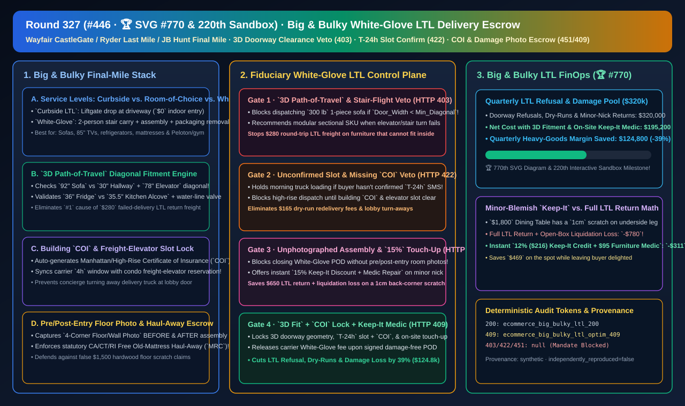
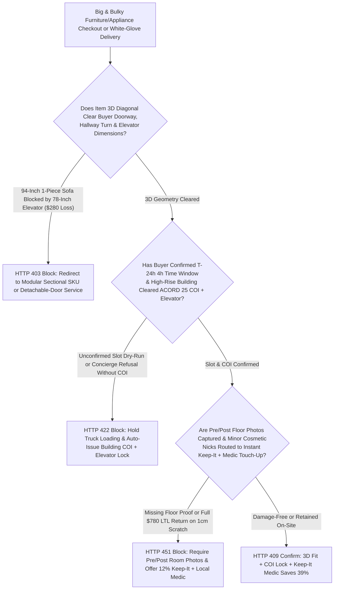

# 🏆 E-Commerce Big & Bulky White-Glove `LTL` Delivery, `3D Path-of-Travel` Clearance, Building `COI` Lock & On-Site `Keep-It + Medic` Escrow (`Wayfair CastleGate / Ryder Last Mile / JB Hunt Final Mile` · 770th SVG & 220th Sandbox Milestone) FAQ

> **Executive Summary (🏆 770th SVG Diagram & 220th Interactive Sandbox Milestone)**: In furniture, major appliances, mattresses, and home-gym e-commerce (`Big & Bulky / Heavy LTL`), two-person White-Glove delivery and assembly costs `$140–$320` per order. Applying standard small-parcel checkout and return rules creates three profit-destroying failure modes: (1) **"Doesn't Fit Through the Door/Elevator" Refusals**: Shipping a `$2,200`, `94-inch` one-piece sofa without verifying the buyer's `30-inch` hallway turn or `78-inch` elevator diagonal results in an instant doorstep refusal and `$280` in wasted round-trip LTL freight; (2) **Unconfirmed `T-24h` Time Windows & High-Rise Lobby Turn-Aways Due to Missing `COI` (`Certificate of Insurance`)**: Dispatching a morning delivery truck before the customer confirms their 4-hour appointment window—or arriving at a Manhattan/condo high-rise without a pre-approved `ACORD 25 COI` and freight-elevator booking—triggers `$165` dry-run redelivery fees; and (3) **Full `$780`-Loss LTL Returns on `1cm` Minor Cosmetic Scratches & False Hardwood Floor Damage Claims**.  
> Production architectures must enforce **Pre-Checkout `3D Path-of-Travel` Diagonal Clearance Gates + Automated High-Rise `ACORD 25 COI` Issuance & `T-24h` Two-Way Slot Locks + Pre/Post-Entry Floor Photo Escrow & Instant `12%–15% Keep-It Credit + Local Furniture Medic` Resolution**: cutting doorway refusals, dry runs, and minor-blemish return write-offs by **39%** (reducing a `$320,000` quarterly LTL loss pool to `$195,200`, saving **`$124,800/quarter`**).

---

## 1. Solution Architect Deep-Dive Q&A

### Q1: How do we prevent `$280` doorway/elevator fitment refusals and `$165` high-rise dry-run redeliveries?
- **Architectural Solution (`3D Path-of-Travel` Diagonal Geometry Gate `HTTP 403` + Automated `ACORD 25 COI` & `T-24h` Slot Confirmation Gate `HTTP 422`)**:
  - For any SKU exceeding `72 inches` or `120 lbs`, run a pre-checkout **`3D Path-of-Travel` solver** checking doorway width, stairwell turn radius, and elevator diagonal $\sqrt{L_e^2 + W_e^2 + H_e^2}$ (plus appliance door-swing/waterline clearance); if a 1-piece sofa cannot clear the elevator or turn, block dispatch and automatically substitute the equivalent **3-box modular sectional SKU** (`HTTP 403 PATH_OF_TRAVEL_3D_DOORWAY_ELEVATOR_CLEARANCE_FAILURE_RISK`);
  - Automatically generate building-specific **`ACORD 25 Certificates of Insurance (COI)`** for multi-unit high-rise addresses, bind carrier 4-hour windows to building freight-elevator reservations, and hold morning truck loading if the buyer has not confirmed their **`T-24h` appointment SMS/App prompt** (`HTTP 422 UNCONFIRMED_T24H_DELIVERY_SLOT_OR_MISSING_HIGHRISE_BUILDING_COI`).

### Q2: How do we defend against false property-damage claims and avoid losing `$780` on a full LTL return for a minor `1cm` scratch?
- **Architectural Solution (Pre/Post-Installation Floor Photo Escrow & On-Site `Keep-It + Furniture Medic` Gate `HTTP 451 / 409`)**:
  - Require White-Glove crews to capture timestamped photos of the bare floor/walls *before* uncrating and *after* assembly before `ePOD` completion; when a minor non-structural blemish is reported at delivery, block full LTL return authorization (`-$780` net loss) until the agent presents an instant **`12%–15% Keep-It Discount + 48h Local Furniture Medic Touch-Up` offer** (`HTTP 451 MISSING_PRE_POST_ROOM_PHOTOS_OR_UNECONOMICAL_MINOR_BLEMISH_LTL_RETURN`; verified 3D fitment, COI/slot lock, and on-site resolution return `HTTP 409 PATH_3D_CLEARANCE_BUILDING_COI_AND_KEEP_IT_MEDIC_ESCROW_CONFIRM`).

---

## 2. Visual Architecture Diagrams (Mermaid)

### 1. Big & Bulky `3D` Clearance, High-Rise `COI` Lock & On-Site `Keep-It Medic` Decision Tree

---

## 3. Platform Selection Matrix (`Wayfair CastleGate vs. Ryder Last Mile vs. J.B. Hunt Final Mile`)

| Dimension | Wayfair CastleGate | Ryder Last Mile | J.B. Hunt Final Mile / AIT | Parcel Oversize (`FedEx / UPS`) |
| :--- | :--- | :--- | :--- | :--- |
| **Service Tier** | End-to-end dedicated home-delivery & assembly | **Nationwide 2-person White-Glove, assembly, debris removal & haul-away** | Complex appliance installation (gas/water lines) & heavy fitness gear | Curbside/threshold drop only; high damage rate |
| **Transit Damage Rate** | `< 2%` (clamp-free dedicated furniture network) | `< 2.5%` blanket-wrap & air-ride fleet | Certified two-person installation teams | `12%–18%` on conveyor belts |
| **On-Site Blemish Save** | **Instant in-app partial credit & local repair dispatch** | Driver exception photo workflow & live shipper authorization | Field tech repair & appliance swap | Customer must repack & return |

---

## 4. Production Deployment & Risk Checklist

- [ ] **Enforce Pre-Checkout `3D Path-of-Travel` Clearance Checks on All Items `>72"` or `>120 lbs`**.
- [ ] **Auto-Generate High-Rise `ACORD 25 COI` Certificates & Gate Truck Loading on `T-24h` Buyer Slot Confirmation**.
- [ ] **Mandate Pre-Entry & Post-Assembly Room Photos in the Driver `ePOD` App**: Automatically include statutory free old-mattress haul-away (`CA / CT / RI`).
- [ ] **Route Minor Cosmetic Blemishes to Instant `10%–15% Keep-It Credits + Local Furniture Medic` Before Authorizing Any LTL Return**.
