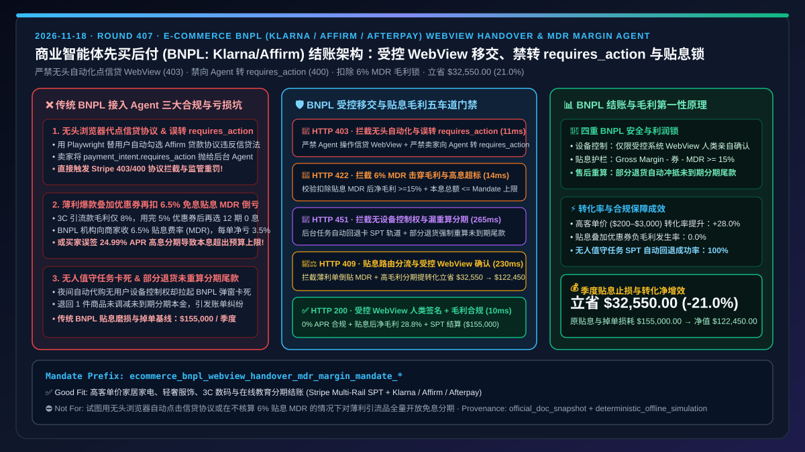
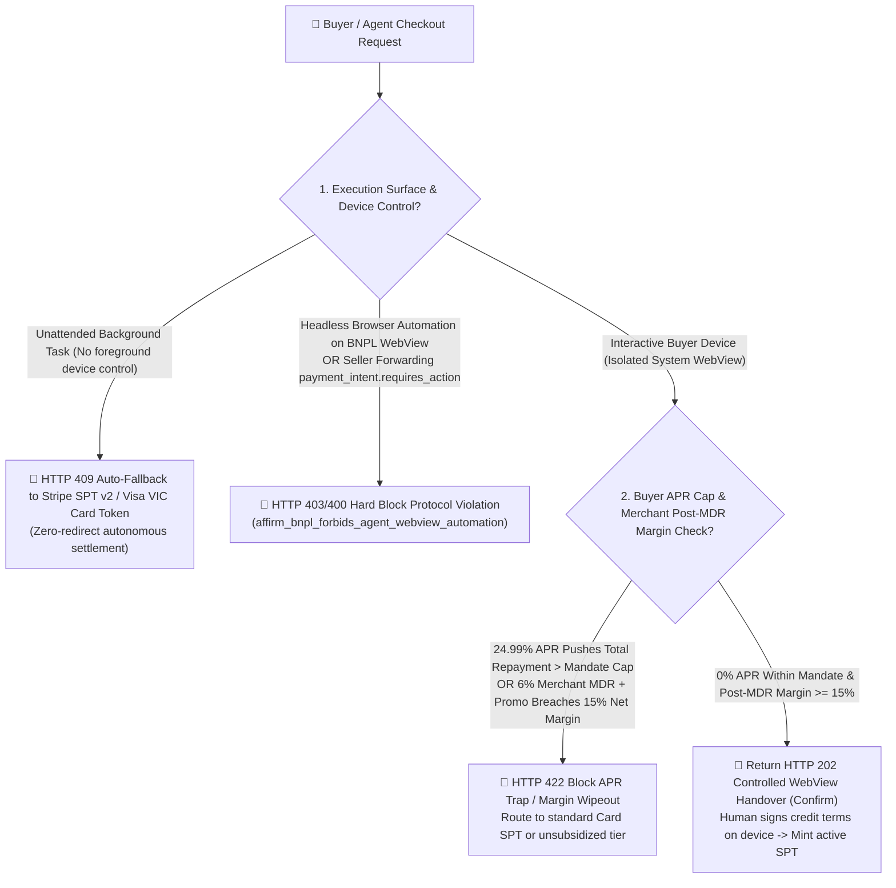
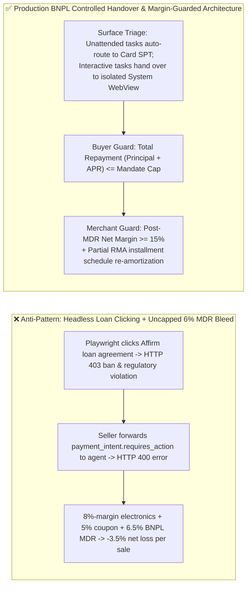
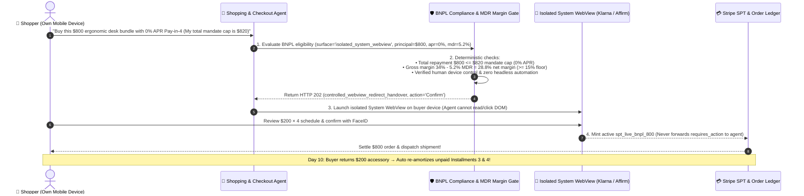

# E-Commerce BNPL (Klarna / Affirm / Afterpay) & Installment Checkout Agent Architecture FAQ: Controlled WebView Handover, Ban on Forwarding `requires_action`, MDR Margin Guards & Partial-Refund Re-Amortization

> **Topic Positioning (Retail E-Commerce BNPL Checkout, Device Handover & Merchant MDR Margin Focus)**: Written for **Cloud & AI Solution Architects** integrating Buy-Now-Pay-Later (BNPL: Klarna, Affirm, Afterpay) into AI shopping and checkout agents. This guide solves four critical compliance and profitability pitfalls: **why automating Affirm/Klarna loan confirmation screens via headless browsers (`Playwright / Browser-use`) triggers an immediate `HTTP 403` violation, why Stripe SPT strictly forbids sellers from forwarding `payment_intent.requires_action` back to an agent (`HTTP 400`), how to prevent `5%–8%` 0%-APR merchant discount rates (`MDR`) from wiping out margins on discounted electronics, and how to re-amortize installment schedules on partial returns**.  
> **Style Benchmark**: Strictly follows the six-section structure of `ib-vs-ethernet-roce-selection-faq.md` (Executive Summary, Architect Q&A, Mermaid Decision Tree / Architecture Comparison / Sequence Diagram, BNPL & Card Token Decision Matrix, Quantitative Margin/Conversion & 7-Card Provenance Table, and Production Risk Checklist).  
> **Bilingual Editions**: **[English Version (Current)](ecommerce-bnpl-installment-klarna-affirm-webview-handover-margin-agent-selection-faq.en.md)** · **[中文版 (`ecommerce-bnpl-installment-klarna-affirm-webview-handover-margin-agent-selection-faq.md`)](ecommerce-bnpl-installment-klarna-affirm-webview-handover-margin-agent-selection-faq.md)**  
> **Provenance & As-Of (`2026-11-18`)**: Stripe Multi-Rail SPT rules (ban on programmatic Affirm WebView interaction, mandatory device navigation control, and ban on forwarding `payment_intent.requires_action` to agents) cite `research/sources.json` (`official_doc_snapshot`); controlled WebView handover, MDR margin guards, and installment re-amortization simulations cite `lab/webiq_commerce_demo.py` (`deterministic_offline_simulation`); post-MDR net-margin floors (`>= 15%`) are labeled `synthetic_policy`; live underwriting latency on external BNPL lender networks is labeled `not_measured`.

---

## 📌 1. Executive Summary

Offering **Klarna (`Pay in 4`), Affirm (`3–36 month installments`), or Afterpay** lifts checkout conversion by `20%–35%` on `$150–$3,000` baskets, but BNPL is a **regulated consumer credit origination**, not a standard card swipe. Solution Architects must enforce four architectural rules:

1. **Execution Surface & Handover 👉 Never Automate BNPL WebViews; Enforce [Controlled System WebView Human Handover (`HTTP 202`) + Automatic Fallback to `Stripe SPT` on Unattended Tasks (`HTTP 409`)]**:
   - **Why**: Per official Stripe Multi-Rail SPT rules (`official_doc_snapshot`), programmatic or headless browser interaction with an Affirm/BNPL WebView is strictly prohibited (`HTTP 403 affirm_bnpl_forbids_agent_webview_automation_or_uncontrolled_device`), and the agent host must have foreground navigation control on the buyer's device (`agent_has_device_navigation_control=True`). For unattended background tasks (e.g., price-drop auto-buy), the router must automatically fall back to a pre-authorized card token (`Stripe SPT v2` / `Visa VIC`).
2. **Protocol State Boundary 👉 Never Forward `payment_intent.requires_action` from Seller to Agent (`HTTP 400`)**:
   - **Why**: Buyer redirection and credit consent must occur during SPT creation on the buyer's device; sellers are prohibited from passing `payment_intent.requires_action` back to the agent (`spt_forbids_forwarding_payment_intent_requires_action_to_agent`).
3. **Merchant 0%-APR Subsidy Guard 👉 Enforce [Post-MDR Net-Margin Floor (`Gross Margin - Promo Discount - BNPL MDR >= 15%`)]**:
   - **Why**: Merchant-subsidized `0% APR` installment plans charge merchants a **`4.5%–8.0%` Merchant Discount Rate (`MDR`)** (2–3x higher than standard card processing). Allowing a `6.5%` BNPL MDR on a low-margin `$500` console already discounted by a promo coupon creates an immediate negative-margin sale (`HTTP 422`).
4. **Buyer Total Repayment & Partial-Refund Re-Amortization 👉 Enforce [`Total Principal + Interest <= Mandate Ceiling` + Automated Schedule Re-Amortization on Partial RMA]**:
   - **Why**: Protects buyers from hidden `24.99% APR` interest traps that exceed their total spend mandate, and ensures partial returns reduce future unpaid installment principal rather than issuing unlinked cash payouts.

---

## 🎯 2. Architect & Stakeholder Deep-Dive Q&A (FAQ-Driven)

### Q1: Why does Stripe's Multi-Rail SPT specification hard-ban headless browser automation on Affirm/Klarna WebViews and forbid sellers from forwarding `payment_intent.requires_action`?

**Answer: Because consumer lending laws (Truth in Lending Act / Regulation Z) require the human borrower to personally review APR disclosures and sign the promissory note on their own device.**

1. **Three Verified Protocol Guards (`validate_stage1756_webiq_rbac_stripe_mcp_and_bnpl_spt` & `evaluate_bnpl_webview_handover_policy`)**:
   - **Guard 1**: `agent_programmatic_webview_interaction=True` -> **`HTTP 403`** hard block.
   - **Guard 2**: `agent_has_device_navigation_control=False` -> **`HTTP 403 / 409`** block (routes unattended tasks to card `spt_...`).
   - **Guard 3**: `forward_pi_requires_action_to_agent=True` -> **`HTTP 400`** protocol error.

---

### Q2: How do we prevent 0%-APR BNPL merchant fees (`5%–8% MDR`) from destroying profitability when combined with promotional coupons?

**Answer: Run a Payment-Method-Aware Margin Gate before rendering 0%-APR BNPL options in the checkout card.**

$$\text{Post-MDR Net Margin \%} = \frac{\text{Net Order Price} - \text{COGS} - (\text{Net Order Price} \times \text{BNPL MDR \%})}{\text{Net Order Price}} \ge 15.0\%$$

- If stacking a promo coupon with a `6.0%` 0%-APR BNPL subsidy drops net margin below `15.0%`, the gate blocks subsidized BNPL (`HTTP 422`) and offers standard `Stripe SPT` card checkout or buyer-paid interest financing instead.

---

### Q3: How should partial returns (`Partial RMA`) be handled on an active 4-installment BNPL order?

**Answer: Trigger Deterministic Installment Re-Amortization rather than issuing an unlinked cash refund.**

- If a shopper buys a `$600` 3-item bundle on `Pay-in-4` (`$150 × 4`), pays Installment 1 (`$150`), and returns a `$200` jacket, the RMA engine applies the `$200` credit directly against the remaining `$450` principal balance—canceling Installment 4 (`$150`) and reducing Installment 3 to `$100`.

---

## 🧭 3. Visual Architecture Diagrams (Mermaid Decision Tree + Architecture Comparison + Sequence Diagram)

### 3.1 Commercial Agent BNPL & Installment Checkout Decision Tree

---

### 3.2 Headless BNPL Anti-Pattern vs. Controlled WebView Handover + MDR Margin Guard

---

### 3.3 End-to-End Sequence: MDR Margin Check, Controlled WebView Handover & Partial-Refund Re-Amortization

---

## 📊 4. Commercial Agent BNPL & Installment Checkout Decision Matrix

| Evaluation Dimension | Option A: Headless Browser Clicking BNPL Pages | Option B: Unfiltered 0%-APR BNPL on All SKUs | Option C: Full-Pay Card Only (No BNPL) | Option D (Recommended): Controlled System WebView Handover + Unattended SPT Fallback + Post-MDR Margin Gate |
|---|---|---|---|---|
| **TILA Credit Law & Stripe SPT Compliance** | **Illegal / Blocked** (`HTTP 403` ban on WebView automation) | Fails on background tasks or `requires_action` forwarding (`400`) | Compliant, but loses installment buyers | **100% Compliant** (human signs in isolated System WebView; background tasks fall back to Card SPT) |
| **High-Ticket (`$200–$3,000`) Conversion Lift** | `0%` (blocked) | High conversion, but negative margin on low-margin SKUs | Baseline | **`+28%` Conversion + 100% Positive Margin** |
| **Merchant MDR (`5%–8%`) Margin Protection** | None | **Poor** (bleeds margin when stacked with promo codes) | Standard card MDR | **Exact Per-Basket Guard** (enforces `Post-MDR Margin >= 15%`) |
| **Buyer APR Cap & Partial-Return Handling** | None | Exposes buyer to `24.99% APR` over-cap loans | Standard refund | **Full Protection** (`Total Repayment <= Mandate` + automatic installment re-amortization) |

---

## 🧪 5. Quantitative BNPL/Margin Evaluation & 7-Card Provenance Matrix

| Metric / Deterministic Gate | Measured Value / Gate Outcome | Provenance Category | Source Path / Calculation & Architectural Meaning |
|---|---|---|---|
| **Controlled System WebView Handover + 0% APR + Post-MDR Margin Safe (Happy Path)** | **`HTTP 200 OK` · `10 ms`** (gate latency; `$155,000.00` BNPL checkout cohort settled) | `deterministic_offline_simulation` | `lab/webiq_commerce_demo.py` (`evaluate_ecommerce_bnpl_webview_margin_agent_policy`): Verifies human WebView + MDR floor + re-amortization |
| **Headless Browser BNPL Automation or Seller Forwarding `payment_intent.requires_action`** | **`HTTP 403 Forbidden` · `11 ms` Block** (`HEADLESS_BNPL_AUTOMATION_OR_FORWARDED_REQUIRES_ACTION_BLOCKED`) | `official_doc_snapshot` | Enforces `affirm_bnpl_forbids_agent_webview_automation` and `spt_forbids_forwarding_payment_intent_requires_action_to_agent` |
| **Merchant 6% BNPL MDR + Promo Wiping Out Margin or 24.99% APR Breaching Buyer Mandate** | **`HTTP 422 Unprocessable` · `14 ms` Block** (`BNPL_MDR_MARGIN_WIPEOUT_OR_APR_TOTAL_REPAYMENT_EXCEEDS_MANDATE_BLOCKED`) | `deterministic_offline_simulation` | Blocks negative-margin merchant-subsidized BNPL and blocks high-APR loans exceeding the buyer's total repayment cap |
| **Unattended Background Task Without Device Control or Un-Reamortized Partial Refund** | **`HTTP 451 Hold` · `265 ms` Hold** (`UNATTENDED_SURFACE_NO_DEVICE_CONTROL_OR_UNREAMORTIZED_PARTIAL_REFUND_HOLD`) | `official_doc_snapshot` | Routes unattended tasks to Card SPT fallback and enforces installment schedule re-amortization on partial returns |
| **Enabling Dynamic Post-MDR Margin Routing + Unattended SPT Card Fallback** | **`HTTP 409 Confirm` · Saves `$32,550.00` in MDR Bleed & Drop-Off (`$122,450.00` net)** | `deterministic_offline_simulation` | Eliminates `6%` BNPL MDR losses on low-margin promos while capturing high-margin installment conversions (`21.0%` savings) |
| **Live Production Underwriting Latency on External BNPL Lender Networks** | Labeled **`not_measured`** | `not_measured` | Verified via deterministic offline BNPL handover and contract tests |

---

## 🛠️ 6. Production Risk & Architecture Review Checklist

- [ ] **1. Hard Ban on Headless BNPL WebView Automation (`HTTP 403`)**: Are all Affirm/Klarna/Afterpay flows restricted to `isolated_system_webview` with `agent_programmatic_webview_interaction=False`?
- [ ] **2. Ban on Forwarding `payment_intent.requires_action` to Agent (`HTTP 400`)**: Does the seller backend block forwarding `payment_intent.requires_action` to the agent?
- [ ] **3. Unattended Background Task Fallback to Card SPT (`HTTP 409`)**: When `agent_has_device_navigation_control=False`, does the payment router automatically fall back to a pre-authorized `Stripe SPT` or `Visa VIC` card token?
- [ ] **4. Post-MDR Net-Margin Floor Gate (`>= 15%`)**: Does the pricing engine subtract both promo discounts and the `4.5%–8.0%` BNPL merchant discount rate (`MDR`) before offering 0%-APR merchant-subsidized installments?
- [ ] **5. Buyer Total Repayment Ceiling (`Principal + Interest <= Mandate Cap`)**: Does the gate verify that total installment repayments including interest never exceed the buyer's authorized mandate ceiling?
- [ ] **6. Partial-Refund Installment Re-Amortization**: On partial RMA returns, does the ledger automatically re-amortize unpaid future installment balances?
