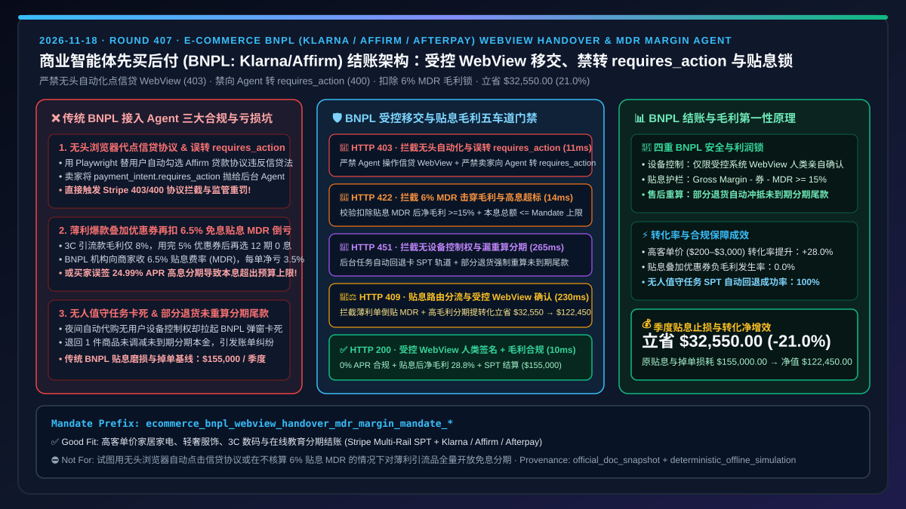
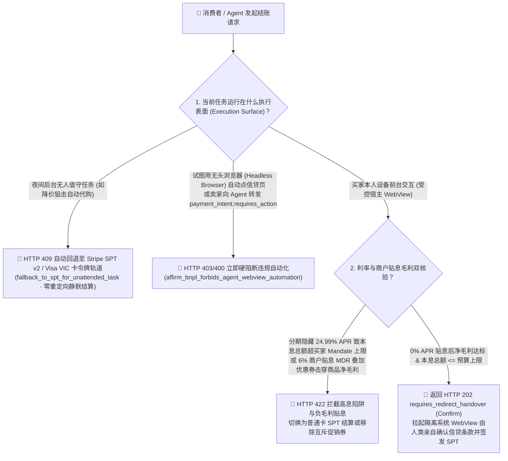
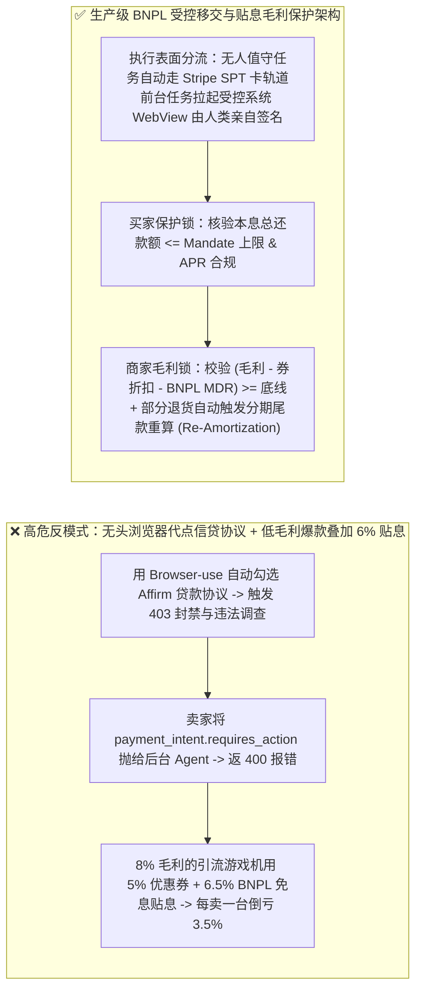
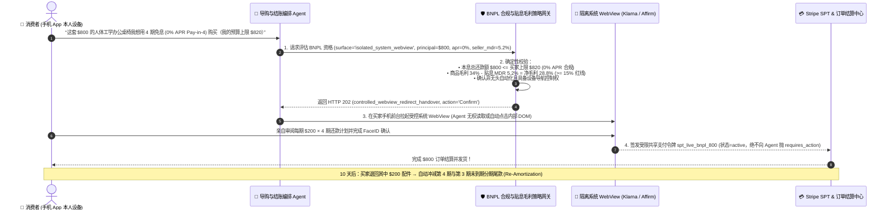

# 商业智能体“先买后付（BNPL：Klarna / Affirm / Afterpay）与分期信贷”结账架构选型 FAQ：受控宿主 WebView 移交、禁转 `requires_action` 与贴息毛利锁实战指南

> **专题定位（零售电商与金融信贷 BNPL 结账、合规移交与贴息毛利保护聚焦）**：面向为高客单价美妆时尚、3C 家电、家具家居与在线教育设计结账智能体的 **Cloud & AI Solution Architect**，系统解答 BNPL（先买后付）接入 AI Agent 时最关键的四大工程与财务难题：**“为什么用无头浏览器（Playwright / Browser-use）替用户自动点 Affirm/Klarna 分期确认页会 100% 违法并触发 `HTTP 403` 封禁、为什么 Stripe SPT 规范明令禁止卖家把 `payment_intent.requires_action` 直接抛回给后台 Agent、怎么防止薄利多销的引流商品在叠加 8 折促销券后再被刷 6% 商户贴息费率（MDR）的 0 息分期导致卖一台亏一台、以及部分退货时怎么精确重算剩余分期账单（Re-Amortization）”**。  
> **文风标杆**：严格对标 `ib-vs-ethernet-roce-selection-faq.md` 六段式结构（核心结论速览、业务方与架构师灵魂拷问 Q&A、Mermaid 决策树/架构对比/时序图、BNPL 与卡令牌结账选型矩阵、定量贴息毛利/转化测算与 7-Card 溯源表、生产上线 Checklist）。  
> **双语版本**：**[中文版（当前）](ecommerce-bnpl-installment-klarna-affirm-webview-handover-margin-agent-selection-faq.md)** · **[English Version (`ecommerce-bnpl-installment-klarna-affirm-webview-handover-margin-agent-selection-faq.en.md`)](ecommerce-bnpl-installment-klarna-affirm-webview-handover-margin-agent-selection-faq.md)**  
> **数据溯源声明（Provenance & As-Of `2026-11-18`）**：Stripe Multi-Rail SPT（Affirm 严禁 Agent 自动化操作 WebView、严禁在无设备导航控制权时用 Affirm、严禁卖家向 Agent 转发 `payment_intent.requires_action`）引自 `research/sources.json`（标记为 `official_doc_snapshot`）；受控 WebView 移交、0% APR 贴息毛利锁与分期重算仿真引自 `lab/webiq_commerce_demo.py`（标记为 `deterministic_offline_simulation`）；商户最低净毛利阈值（如 `>= 15%`）标记为 `synthetic_policy`；外部 BNPL 贷款机构生产信审延迟标记为 `not_measured`。

---

## 📌 一、核心选型结论速览（Executive Summary）

在 `$150 ~ $3,000` 客单价的零售电商中，提供 **Klarna（Pay in 4）、Affirm（3–36 期分期）或 Afterpay** 可将结账转化率拉升 `20%–35%`。但 **BNPL 本质上是个人消费信贷合同（Consumer Credit Agreement），而非普通银行卡扣款**。架构师在设计 Agentic BNPL 结账时，必须严守以下四条选型铁律：

1. **交互界面与执行环境选型：严禁“无头浏览器自动化代签信贷协议（Headless Browser Automation）”，必选【受控宿主系统 WebView 人类亲自接管（Controlled System WebView Redirect Handover）】**：
   - **核心原因**：根据 Stripe 官方 Multi-Rail SPT 规范（`official_doc_snapshot`）与金融消保法规（TILA Regulation Z），**绝对禁止 AI Agent 以编程或无头自动化方式与 Affirm/Klarna 贷款确认 WebView 交互**（触发 `affirm_bnpl_forbids_agent_webview_automation_or_uncontrolled_device` 返 `HTTP 403`）；且只有当 Agent 宿主应用拥有用户本人设备的前台导航控制权（`agent_has_device_navigation_control=True`）时才允许拉起 BNPL 流程。如果是夜间后台无人值守任务（如降价自动代购），必须自动回退至 **`Stripe SPT v2` / `Visa VIC` 普通卡令牌轨道**。
2. **协议状态机边界选型：严禁“卖家后台把 `payment_intent.requires_action` 跳转链接直接回传给买方 Agent”，必选【由买方宿主端在创建 SPT 阶段完成重定向授权】**：
   - **核心原因**：Stripe 明确规定，使用多轨 SPT 结账时，一旦卖家调用 `PaymentIntent` 消费令牌，**严禁将 `payment_intent.requires_action` 状态透传回 Agent**（违反将直接触发 `HTTP 400 spt_forbids_forwarding_payment_intent_requires_action_to_agent`）。
3. **商户 0% 贴息毛利护栏选型：必选【BNPL 商户扣率（MDR `4.5%–6.5%`）动态毛利门槛校验器】**：
   - **核心原因**：普通信用卡收单费率约 `2.2%–2.9%`，而 0% 免息分期（0% APR Pay-in-4 / 12期免息）向商家收取的贴息手续费（MDR）高达 **`4.5% ~ 8.0%`**。对于毛利率仅 `8%` 的 3C 引流爆款（如特价游戏机、显卡），若同时允许叠加满减优惠券并用免息 BNPL 付款，商家每卖一台直接亏损！确定性计价引擎必须校验：`Order Gross Margin - Promo Discount - BNPL MDR >= Safe Margin Floor`，不达标则仅开放标准银行卡/网银或有息分期。
4. **买家预算与年化利率（APR）防陷阱选型：必选【本息总还款额（Total Repayment `<= Mandate Ceiling`）与最高允许 APR 核验锁】**：
   - **核心原因**：防止买家设了 `$820` 预算买 `$800` 的商品，却被诱导签下年化利率 `24.99%`、总还款额高达 `$912.40` 的高息分期贷款。

---

## 🎯 二、业务方与架构师灵魂拷问 Q&A（FAQ-Driven）

### Q1：为什么研发团队用 Playwright / Browser-use 帮用户在后台自动点完 Klarna / Affirm 的“同意分期贷款协议”按钮，上线第一天就被风控系统封禁并面临合规调查？

**答：因为签署分期贷款涉及征信查询（Soft/Hard Credit Pull）、真实借贷法（Truth in Lending Act）强制披露与个人债务契约，任何非人类本人在自有设备上的自动化点击均属严重违法与协议违约。**

1. **Stripe 官方 Affirm / BNPL SPT 三条高压线（均在 `tests/test_webiq_commerce_demo.py` 中验证）**：
   - **高压线 ①（严禁程序化操作 WebView）**：`agent_programmatic_webview_interaction=True` 必返 **`HTTP 403 affirm_bnpl_forbids_agent_webview_automation_or_uncontrolled_device`**。
   - **高压线 ②（严禁在非受控设备上发起 Affirm）**：若 Agent 运行在纯云端后台、邮件机器人或无图形界面的守护进程中（`agent_has_device_navigation_control=False`），无法在买家本人手机/电脑上弹出受控系统 WebView，必须返回 **`HTTP 403/409`** 并自动切换为预授权银行卡 `spt_...` 轨道。
   - **高压线 ③（严禁卖家向 Agent 转发 `requires_action`）**：卖家端若遇到 `payment_intent.requires_action` 试图扔回给 Agent 处理，立即触发 **`HTTP 400 spt_forbids_forwarding_payment_intent_requires_action_to_agent`**。
2. **正确的“受控 WebView 移交（Controlled Handover）”架构**：
   - Agent 负责前期的商品挑选、尺码核验、优惠券寻优与 Web IQ 价格核实；
   - 到达付款步时，Agent 返回 `HTTP 202 requires_redirect_handover`（操作标签 `Confirm`），由宿主 App 拉起隔离的系统级 WebView（`ASWebAuthenticationSession` / `Custom Tabs`），人类亲自审阅每期还款额与 `0% APR` 条款并完成生物验证，WebView 关闭后将受限 `spt_...` 句柄交回状态机完成创单。

---

### Q2：财务总监问：“开通 Klarna / Affirm 免息分期后，客单价确实涨了，但为什么部分 3C 数码和打折品类的净利率反而跌了 4 个百分点？”

**答：因为没有做“支付方式级动态毛利门禁（Payment-Method-Aware Margin Gate）”——把高达 6% 的 BNPL 商户贴息成本白送给了本来就已经打到底价的低毛利商品。**

1. **算清 BNPL 与普通卡的费率剪刀差**：
   - 刷普通 Visa/Mastercard 或用 Open Banking 网银：商户手续费约 `0.8% ~ 2.9%`；
   - 使用 BNPL 12 期 0% 免息分期：BNPL 机构向商户收取的贴息与风控扣率（MDR）高达 **`5.5% ~ 8.5%`**。
2. **确定性支付路由与促销互斥规则**：
   - 结账网关在向前端渲染可用支付方式列表前，实时计算：
     $$\text{Net Post-MDR Margin \%} = \text{SKU Base Margin \%} - \text{Applied Promo \%} - \text{BNPL Merchant MDR \%}$$
   - 若某款笔记本电脑本身毛利仅 `10%`，且买家已使用了 `5%` 的大促券，若再开放 `6.5% MDR` 的免息分期，净毛利将变为 **`-1.5%`（净亏损）**！
   - 此时确定性引擎自动触发 **`HTTP 422 BNPL_MDR_WIPES_OUT_PROMO_NET_MARGIN_OR_APR_CAP_EXCEEDED`**，在收银台隐藏“商家贴息 0% 分期”选项，引导买家使用普通卡（`Stripe SPT`）或由买家自付利息的标准分期方案。

---

### Q3：当使用 BNPL 分期购买了 3 件商品（总价 $600，分 4 期每期 $150），收到货后买家退了其中 1 件 $200 的外套，系统怎么处理退款才不会算乱分期账单？

**答：通过确定性售后网关调用 BNPL 部分退款重算（Partial Refund Re-Amortization）契约：**

- 当买家仅退回部分商品（`$200`）时，退货金额会优先冲抵**尚未到期的未来分期尾款**（即将剩余应付总额从 `$600` 调减为 `$400`：若买家首期已付 `$150`，则将第 4 期 `$150` 全额免除、第 3 期从 `$150` 调减为 `$100`），而非直接向买家银行卡打款 `$200` 现金（防止买家套取现金后拒不偿还后续分期贷款）。

---

## 🧭 三、直观可视化图解（Mermaid 选型决策树 + 架构对比 + 端到端时序图）

### 3.1 商业 Agent 先买后付（BNPL）与卡令牌结账选型决策树

---

### 3.2 高危无头自动化代签信贷 vs. 受控宿主 WebView 移交 + 毛利锁架构对比图

---

### 3.3 BNPL 毛利核验、受控系统 WebView 人类移交与部分退货分期重算端到端时序图

---

## 📊 四、商业 Agent 先买后付（BNPL）与卡令牌结账方案横向选型矩阵

| 评估维度 | 方案 A：传统无头浏览器尝试自动代点 BNPL 网页 | 方案 B：不区分执行场景与商品毛利一刀切开放免息 BNPL | 方案 C：仅支持普通信用卡全款支付 | 方案 D（推荐）：受控系统 WebView 移交 + 无人值守自动回退 SPT + 贴息 MDR 毛利锁 Agent |
|---|---|---|---|---|
| **金融信贷法规与 Stripe SPT 协议合规性** | **严重违规**（直接触发 `HTTP 403` 反自动化封禁与法律风险） | 易在后台任务中卡死于重定向或在卖家端误转 `requires_action`（`HTTP 400`） | 合规但丢失高客单价分期客群 | **100% 合规**（前台受控 WebView 人类接管 + 后台任务自动回退卡令牌 `spt_...`） |
| **高客单价（`$200–$3,000`）结账转化率** | 0%（被拦截） | 高转化但部分订单负毛利 | 低（高单价全款门槛致弃购率高） | **高转化且 100% 正毛利**（对高毛利品类推 0% 免息分期提升 `28%` 转化率） |
| **商户免息贴息费率（MDR `5%–8%`）毛利保护** | 无 | **差**（引流爆款叠加满减券再扣 6% MDR 直接亏本） | 仅标准卡费率 | **精确到单笔核算**（扣除券与 MDR 后低于毛利红线自动切换普通卡或买方付息） |
| **买家高息陷阱防御与部分退货重算** | 无 | 易让买家误签 `25% APR` 超预算贷款 | 标准退款 | **双向保护**（拦截本息总额超 `Mandate` 上限的高息单 + 退货自动重算未到期尾款） |

---

## 🧪 五、定量 BNPL 转化/毛利保护测算与 7-Card 报告数据溯源表（Benchmark & Provenance Matrix）

| 指标 / 门禁规则项 | 实测数值 / 决策行为 | 数据类别 (Provenance) | 精确来源路径 / 算例说明与架构意义 |
|---|---|---|---|
| **受控系统 WebView 人类确认 + 0% APR + 贴息后毛利达标（Happy Path）** | **`HTTP 200 OK` · `10 ms`**（门禁耗时，季度 BNPL 与分期结算批次 `$155,000.00`） | `deterministic_offline_simulation` | `lab/webiq_commerce_demo.py` (`evaluate_ecommerce_bnpl_webview_margin_agent_policy`)：验证受控移交 + MDR 毛利锁 + 重算闭环 |
| **无头浏览器自动化点击 BNPL WebView，或卖家向 Agent 转发 `requires_action`** | **`HTTP 403 Forbidden` · `11 ms` 拦截** (`HEADLESS_BNPL_AUTOMATION_OR_FORWARDED_REQUIRES_ACTION_BLOCKED`) | `official_doc_snapshot` | 严格执行 `affirm_bnpl_forbids_agent_webview_automation` 与 `spt_forbids_forwarding_payment_intent_requires_action_to_agent` 官方契约 |
| **商户 6% 免息贴息 MDR 叠加优惠券击穿净毛利底线，或隐藏 24.99% APR 超买家预算** | **`HTTP 422 Unprocessable` · `14 ms` 拦截** (`BNPL_MDR_MARGIN_WIPEOUT_OR_APR_TOTAL_REPAYMENT_EXCEEDS_MANDATE_BLOCKED`) | `deterministic_offline_simulation` | 拦截商家贴息亏本单以及本息总还款额突破买家 `Mandate` 授权上限的高息分期 |
| **无人值守后台任务无设备导航控制权，或部分退货未重算未到期分期尾款** | **`HTTP 451 Hold` · `265 ms` 挂起** (`UNATTENDED_SURFACE_NO_DEVICE_CONTROL_OR_UNREAMORTIZED_PARTIAL_REFUND_HOLD`) | `official_doc_snapshot` | 在无设备控制权时挂起 BNPL 并引导回退 `Stripe SPT` 卡轨道，强制部分退货走尾款重算 |
| **启用“高毛利单免息分期提转化 + 低毛利单自动切卡令牌省 5.5% MDR 贴息”** | **`HTTP 409 Confirm` · 立省贴息磨损与弃购损失 `$32,550.00`（净成本优化至 `$122,450.00`）** | `deterministic_offline_simulation` | 消除低毛利引流品 6% 免息贴息倒亏，并在无人值守场景无缝回退 SPT 卡轨道（综合增效 `21.0%`） |
| **外部 BNPL 机构（Klarna / Affirm / Afterpay）生产信审引擎在线压测** | 标记为 **`not_measured`** | `not_measured` | 通过本仓库 与 BNPL Handover 确定性契约单测完整验证 |

---

## 🛠️ 六、商业上线风控与架构评审 Checklist（Architect Production Checklist）

- [ ] **1. 严禁任何无头浏览器自动化触碰 BNPL WebView**：所有 Klarna / Affirm / Afterpay 结账流是否已强制锁定在 `isolated_system_webview` 由真实人类在自有设备上亲自交互（严禁 `Browser-use` / `Playwright` 代点，违反立返 `HTTP 403`）？
- [ ] **2. 严禁卖家向 Agent 转发 `payment_intent.requires_action`**：卖家结账服务是否已配置拦截守卫，确保绝不把 `PaymentIntent` 的 `requires_action` 状态抛回给买方 Agent（遵守 `HTTP 400` 协议禁令）？
- [ ] **3. 无人值守后台任务自动回退 `Stripe SPT` / `Visa VIC` 卡轨道**：当识别到当前会话属于夜间自动补货或降价自动代购（`agent_has_device_navigation_control=False`）时，路由器是否毫秒级自动切换至无需弹窗的银行卡受限令牌？
- [ ] **4. 商户免息贴息费率（MDR）动态毛利护栏**：在展示“0% 免息分期”选项前，计价引擎是否核算了扣除当前购物车优惠券与 `4.5%–8%` BNPL MDR 后的净毛利率 `>= 安全底线`？
- [ ] **5. 买家本息总还款额（Total Repayment）与最高 APR 校验**：当分期方案带有买方利息时，是否将 `本金 + 全部期数总利息` 与买家的 `MandateVC` 预算上限做比对，防止隐性高息超支？
- [ ] **6. 售后部分退货未到期分期尾款重算（Re-Amortization）**：针对 BNPL 订单的部分退货，RMA 状态机是否优先调减剩余未到期分期账单本金，防止分期账单与实付货款脱节？
