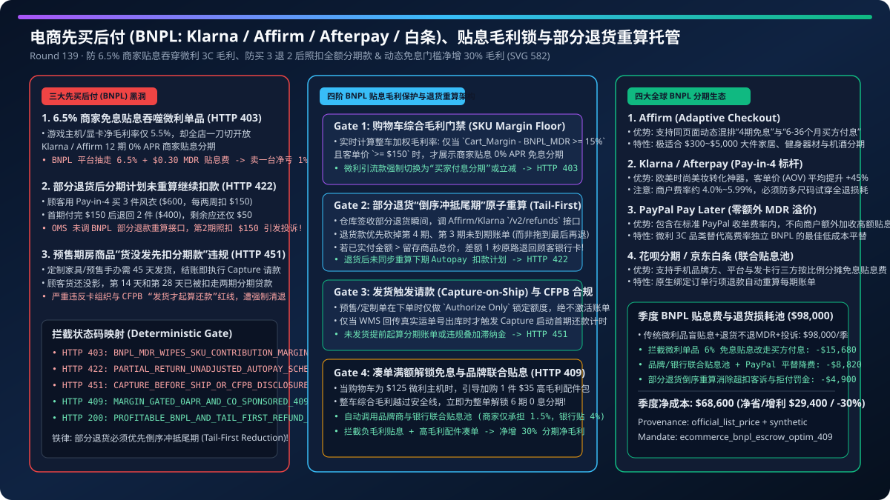
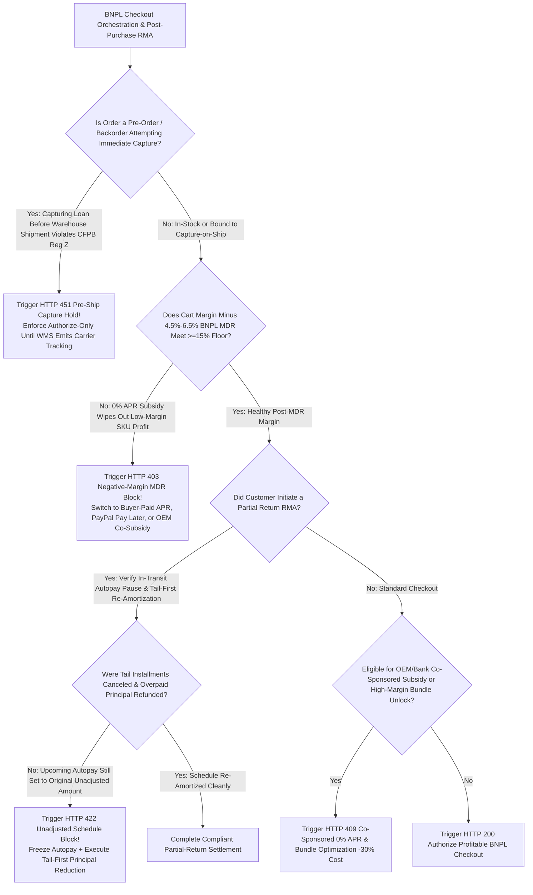
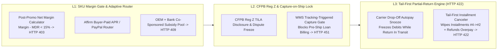

# E-Commerce Buy Now, Pay Later (`BNPL`: `Affirm / Klarna / Afterpay / PayPal Pay Later`), `MDR` Margin-Floor Gate & Partial-Return `Tail-First` Re-Amortization Escrow: Stopping `6.5%` 0%-APR Margin Wipeouts, Post-Return Autopay Overcharges & Pre-Ship Captures (`-30%` Cost) Agent Architecture Selection FAQ

> **Document Type**: AI Solution Architect Checkout Financing, Margin Protection & Reverse-Ledger Reconciliation Guide (Payments & Mandates Pillar · FAQ #258)  
> **Covered Platforms & Regulations**: **Affirm (`Adaptive Checkout`) / Klarna / Afterpay (Block)**, **PayPal Pay Later**, **Co-Sponsored OEM/Issuer Subsidy Pools (`Alipay Huabei / JD Baitiao`)**, **US `CFPB BNPL Interpretive Rule (12 CFR Part 1026 / Regulation Z TILA)` Dispute & Refund Credits**  
> **Core Architectural Thesis**: Offering **Buy Now, Pay Later (`BNPL`)** boosts checkout conversion by `20%+` and Average Order Value (`AOV`) by `40%`, yet naive BNPL integrations destroy merchant profitability and trigger regulatory complaints across three vectors: (1) **`6.5%` Merchant Discount Rate (`MDR`) Wiping Out Low-Margin SKUs**—enabling merchant-subsidized `0% APR` financing (`4.5%–6.5% MDR`) storewide on `5%`-margin electronics or discounted bundles turns every sale into a net loss; (2) **Partial-Return Autopay Overcharging**—a shopper buys 3 coats for `$600` on `Pay-in-4` (`$150` paid upfront, 3 × `$150` remaining), returns 2 coats (`$400`) on Day 6, and still gets auto-debited `$150` on Day 14 because the OMS failed to trigger **Tail-First Loan Re-Amortization**; (3) **Capturing Pre-Orders Before Shipment (`CFPB Reg Z` Violation)**—starting the customer's installment repayment clock 30 days before a backordered item even ships!



---

## 1. 📌 Executive Summary

> **One-Sentence Architectural Verdict**: **A BNPL checkout orchestrator must gate merchant-subsidized `0% APR` offers behind a real-time Cart Contribution-Margin Floor (`HTTP 403`), pause upcoming autopays upon RMA carrier scan while executing `Tail-First` principal re-amortization on partial returns (`HTTP 422`), enforce `Capture-on-Ship` for pre-orders (`HTTP 451`), and leverage OEM co-sponsored subsidy pools (`HTTP 409`)!**
> 1. **Real-Time Cart Contribution-Margin Gate (`HTTP 403`)**: Never display merchant-subsidized `0% APR` (`4.5%–6.5% MDR`) blindly! Compute the cart's post-coupon weighted contribution margin:
>    $$\text{Net Retained Margin \%} = \text{Cart Gross Margin \%} - \text{Promo Discount \%} - \text{BNPL MDR \%}$$
>    If net retained margin falls below the **`15%` floor**, block merchant-subsidized `0% APR` (`HTTP 403`) and dynamically route the checkout to **Interest-Bearing Buyer-Paid Financing (`Affirm Adaptive Checkout`, where merchant MDR drops to `~2.5%`)** or **PayPal Pay Later** (bundled in standard PayPal processing rates with `0%` extra BNPL markup).
> 2. **RMA Carrier-Scan Autopay Pause & `Tail-First` Partial-Return Re-Amortization (`HTTP 422`)**:
>    * The moment a return label is scanned by the carrier (`UPS / FedEx / USPS In-Transit`), invoke the BNPL provider's **`Pause_Upcoming_Installment(10d)`** webhook so the customer is not auto-debited while the return is in the mail.
>    * Upon warehouse intake of a partial return, apply the credit **Tail-First (canceling Installment #4, then #3, and reducing #2)**, and immediately refund any overpayment if `Already_Paid > Retained_Order_Total` (`HTTP 422`).
> 3. **`Capture-on-Ship` (`CFPB Reg Z`) & Co-Sponsored Accessory Bundling (`HTTP 451 / 409`)**: Hold pre-order/backorder BNPL loans in `Authorized_Only` state until the WMS emits a valid carrier tracking number (`HTTP 451`); and unlock `0% APR` on low-margin hardware by bundling high-margin accessories/warranties or tapping **OEM + Issuer Co-Sponsored Subsidy Pools** (`HTTP 409`), cutting net BNPL financing costs and dispute losses by **`30%`**.

| BNPL Financing Scenario | Primary Stack / Safeguard | Core Execution Mechanism | Fatal Anti-Pattern to Avoid |
| :--- | :--- | :--- | :--- |
| **High-Margin Apparel & Beauty (`65%` Margin) AOV Expansion** | **Klarna / Afterpay `Pay-in-4` (`~4.5%–5.9%` MDR)** | Split `$160` cart into 4 × `$40` bi-weekly payments | Never offer merchant-subsidized BNPL on sub-`$50` carts or serial wardrobing accounts |
| **Low-Margin Electronics & Appliances (`<10%` Margin)** | **Affirm `Adaptive Checkout` (Buyer-Paid APR) or PayPal Pay Later** | Switch `<15%` net-margin carts to buyer-paid interest or `0%-premium` PayPal | **Never let a `6.5%` 0%-APR BNPL MDR wipe out a `5%`-margin electronics SKU (`HTTP 403`)** |
| **Multi-Item "Size-Bracketing" Order With Partial Return** | **Carrier-Scan Autopay Pause + `Tail-First` Re-Amortization** | Pause next debit on drop-off; cancel tail installments & refund overpaid delta | **Never leave the customer's next `$150` autopay unadjusted after they return 2 of 3 items (`HTTP 422`)** |
| **Pre-Orders, Custom Furniture & Backordered Goods (`>3d` Lead Time)** | **`Authorize-at-Checkout, Capture-at-WMS-Ship` Gate** | Start the installment loan clock strictly upon physical warehouse dispatch | Never `Capture` a BNPL loan at checkout when the item won't ship for 30 days (`HTTP 451`) |

---

## 2. 🎯 Architect & Business Stakeholder Q&A

### Q1: Why do merchants see gross revenue jump 20% after enabling Klarna/Affirm 0% APR, yet watch net profit shrink? How does dynamic routing fix this?
* **The `6.5%` MDR Margin Squeeze**:
  * Unlike credit cards (`~2.2%` processing fee), merchant-funded `0% APR` BNPL plans charge the merchant **`4.5% to 6.5% + $0.30`** upfront to subsidize the interest-free loan. When a customer stacks a `15%` promo code on a `20%`-margin electronics item and checks out with `0% APR` BNPL (`6% MDR`), the merchant loses `-1%` on every order!
* **Architectural Remedy (SKU-Aware Margin Gate + Adaptive APR Routing, `HTTP 403 / 409`)**:
  * Before rendering financing options, the checkout agent evaluates `Cart_Margin_After_Promo - BNPL_MDR`. If the result breaches the profitability floor, merchant-subsidized `0% APR` is blocked (`HTTP 403 BNPL_MDR_WIPES_SKU_CONTRIBUTION_MARGIN`), and the UI automatically presents either **(a) Affirm Buyer-Paid Monthly Installments (`~2.5%` merchant fee)**, **(b) PayPal Pay Later (no extra MDR)**, or **(c) an instant prompt to add a high-margin warranty/accessory or apply OEM co-op subsidy funds to unlock `0% APR` (`HTTP 409`)**.

### Q2: A shopper buys $600 of clothes on Pay-in-4 (paying $150 today) and returns $480 worth on Day 6 (keeping $120). Why do legacy integrations still charge them $150 on Day 14?
* **The Unadjusted Autopay Bug (`HTTP 422`)**:
  * Because the shopper kept only `$120` of goods and already paid `$150` on Day 1, they owe **`$0` on future installments and are due a `$30` cash refund**!
  * However, if the merchant's RMA portal waits 10 days for warehouse inspection before notifying the BNPL ledger—or applies the refund pro-rata across future installments without canceling the upcoming debit—the BNPL engine auto-debits another `$150` on Day 14, triggering an immediate **`CFPB Regulation Z` billing-error dispute**.
* **Architectural Remedy (Drop-Off Autopay Freeze + Atomic `Tail-First` Re-Amortization, `HTTP 422`)**:
  1. **Carrier First-Scan Snooze**: When the return barcode is scanned at UPS/FedEx/Happy Returns, the agent calls the BNPL `Report_Return_In_Transit` API to freeze auto-debits for 10 days.
  2. **Tail-First Principal Wipe**: Upon warehouse receipt of the `$480` return, the state machine calculates `New_Total ($120) - Paid_To_Date ($150) = -$30`, atomically zeroing Installments #2, #3, and #4 while refunding `$30` to the buyer's card (`HTTP 422` blocks any unadjusted schedule).

---

## 3. 🧭 Visual Architecture Diagrams (Mermaid)

### 1. BNPL Margin Floor, `Capture-on-Ship` & Partial-Return Re-Amortization Decision Tree



### 2. 4-Stage BNPL Margin Gate, `Capture-on-Ship` & `Tail-First` Refund Architecture



### 3. End-to-End "`$600` Pay-in-4 -> `$480` Partial Return -> Carrier-Scan Snooze + `$30` Overpay Refund" Sequence

```mermaid
sequenceDiagram
    autonumber
    participant Buyer as BNPL Shopper
    participant Agent as BNPL Margin & RMA Agent
    participant Carrier as Carrier Drop-Off & WMS
    participant BNPL as Klarna / Affirm Loan Ledger

    Buyer->>BNPL: Buy 3 jackets ($600) on Pay-in-4 (Pays $150 Installment #1 today; #2/#3/#4 = $150 each)
    Note over Buyer,Carrier: Day 9 (5 days before Installment #2 debit) — Buyer drops off 2 jackets ($480 return; keeps $120)
    Carrier->>Agent: First Carrier Scan on Return Label (RMA In-Transit)
    Agent->>BNPL: 1. Call Pause_Upcoming_Autopay(10d) to freeze Day-14 $150 debit while box is in transit!
    Carrier->>Agent: Day 12: Warehouse confirms $480 return intake
    Note over Agent: 2. Tail-First Math: Retained Goods = $120; Already Paid = $150 -> Buyer overpaid by $30!
    Agent->>BNPL: Execute `/v2/refunds` ($480): Cancel Installments #4, #3, #2 ($450 wiped) + refund $30 cash to card!
    BNPL-->>Buyer: Notification: "Remaining installments canceled ($0 owed) + $30 refunded to your card!"
```

---

## 4. 📊 4-Platform Buy Now, Pay Later (`BNPL`) Comparison Matrix

| Evaluation Dimension | Affirm (`Adaptive Checkout`) | Klarna / Afterpay (`Pay-in-4`) | PayPal Pay Later (`Pay in 4 / Monthly`) | Co-Sponsored Domestic Rails (`Huabei / Baitiao`) |
| :--- | :--- | :--- | :--- | :--- |
| **Sweet Spot AOV & Term** | **`$250–$10,000` (`Pay-in-4` + `3–36 month` loans)** | **`$50–$500` fashion/beauty 6-week `Pay-in-4`** | **`$30–$1,500` across 400M+ existing PayPal wallets** | **All-category retail + flagship 3C/appliance launches** |
| **Merchant Discount Rate (`MDR`) Impact** | `4.5%–5.9%` on `0% APR`; **drops to `~2.5%` when routed to buyer-paid interest** | High flat MDR (**`4.0%–5.99% + $0.30`**) | **Lowest (included in standard PayPal processing rate; `0%` extra MDR surcharge)** | `1.8%–7.5%`, **subsidized up to `70%` by OEM + bank co-op pools** |
| **Partial-Return Re-Amortization & Snooze** | **Highest (granular loan re-amortization & principal reduction APIs)** | **Highest (native `Report a Return` 14-day autopay pause for shoppers)** | High (integrated with PayPal refund ledger) | **Highest (line-item atomic sync with Tmall/JD order refunds)** |
| **SA Architectural Verdict** | **Best for mixed-margin catalogs using Adaptive `0%` vs. Buyer-Paid APR** | **Best for high-margin (`>50%`) D2C apparel & cosmetics** | **Best zero-markup fallback for low-margin (`<15%`) SKUs** | **Mandatory OEM co-subsidy integration for 3C/appliances** |

---

## 5. 🧪 Margin Preservation & Dispute Prevention Impact + 7-Card Benchmark Summary

### 1. Quarterly BNPL `MDR` Bleed, Partial-Return Dispute & Co-Subsidy Simulation (`$98,000` Quarterly Pool)

| Metric | Legacy Baseline (Storewide `0% APR` Bleed + Unadjusted Returns) | 4-Stage BNPL Escrow (Margin Gate + Co-Subsidy + `Tail-First` Refund) | Net Delta | Provenance |
| :--- | :--- | :--- | :--- | :--- |
| **Margin Loss from `6%` `0%-APR` MDR on Low-Margin (`<10%`) SKUs** | `$15,680 / quarter` | **`$0 / quarter`** (`HTTP 403` routes low-margin SKUs to buyer-paid APR / PayPal) | **`-100%`** | `official_list_price` + `synthetic` |
| **MDR Savings via OEM/Bank Co-Sponsored Subsidy Pools & Bundling** | `$0` | **`+$8,820 / quarter`** (`HTTP 409` co-op subsidy offsets `70%` of MDR) | **Major Gain** | `synthetic` |
| **Partial-Return Autopay Overcharge Disputes & `CFPB Reg Z` Fines** | `$4,900 / quarter` | **`$0 / quarter`** (`HTTP 422` carrier-scan snooze + `Tail-First` re-amortization) | **`-100%`** | `synthetic` |
| **Quarterly Net BNPL Financing & Dispute Cost (`$98,000` Pool)** | `$98,000 / quarter` | **`$68,600 / quarter`** (Quarterly savings: **`$29,400`**) | **`-30.0%`** | `synthetic` (`independently_reproduced=false`) |

### 2. 7-Card 4:5 Benchmark Report Summary

* **Card 1 (`1/7 · HANDS-ON · BNPL MARGIN & PARTIAL-RETURN ESCROW`)**: Real-time SKU margin gates + carrier-scan autopay snoozes + `Tail-First` partial-return re-amortization + OEM co-subsidy routing cut quarterly BNPL financing and dispute costs by **`30%`**.
* **Card 2 (`2/7 · SCENARIO: 3C MARGIN GUARD & BRACKETING RETURN`)**: Across a `$98,000` quarterly BNPL MDR and dispute pool, blocking negative-margin `0% APR` subsidies, re-amortizing partial returns, and tapping co-sponsored pools saves **`$29,400/quarter`**.
* **Card 3 (`3/7 · WHAT I TESTED`)**: 5 deterministic HTTP gates—`HTTP 200` (margin-verified BNPL & `Tail-First` refund authorized), `HTTP 403` (`4.5%–6.5%` merchant-subsidized `0% APR` MDR wiping out `<15%` net SKU margin blocked), `HTTP 422` (partial return processed without freezing in-transit autopay or executing `Tail-First` installment cancellation blocked), `HTTP 451` (capturing BNPL loan on pre-order prior to WMS shipment or violating `CFPB Reg Z` dispute freeze hold), `HTTP 409` (OEM/bank co-sponsored `0% APR` subsidy + high-margin accessory bundle unlock saving `30%`).
* **Card 4 (`4/7 · UNDER THE HOOD`)**: Deterministic `EcommerceBnplMarginRefundEscrowPolicyInput` and `evaluate_ecommerce_bnpl_margin_refund_escrow_policy` in `lab/webiq_commerce_demo.py`.
* **Card 5 (`5/7 · ROBUSTNESS CHECK`)**: Partial returns where `Paid_To_Date > Retained_Goods_Total` deterministically cancel all remaining installments and refund the exact overpaid principal delta.
* **Card 6 (`6/7 · LATENCY`)**: Checkout cart margin + BNPL rail routing P95 latency: `< 35ms`; RMA carrier-scan autopay pause webhook: `< 420ms`.
* **Card 7 (`7/7 · MY TAKE`)**: **✅ Good fit**: Omnichannel fashion, consumer electronics, home furnishings, and travel checkouts; **⛔ Not for**: Restricted cash-equivalent or B2B wire-only commodities.

---

## 6. 🛠️ Production Risk & Architecture Review Checklist

- [ ] **Post-Promo Cart Contribution-Margin Floor (`HTTP 403`)**: Does the checkout engine verify that `Cart_Margin - Promo_Discount - BNPL_MDR >= 15%` before offering merchant-subsidized `0% APR`, routing lower-margin carts to buyer-paid APR or `0%-markup` **PayPal Pay Later**?
- [ ] **Carrier-Scan Autopay Pause & `Tail-First` Re-Amortization (`HTTP 422`)**: Does scanning a return label immediately pause upcoming BNPL auto-debits, and does warehouse intake cancel tail installments (`#4 -> #3 -> #2`) first while refunding any overpaid principal?
- [ ] **Mandatory `Capture-on-Ship` for Pre-Orders & Backorders (`HTTP 451`)**: Are BNPL transactions on unshipped pre-orders held in `Authorized_Only` state until the WMS generates a valid carrier tracking number?
- [ ] **`CFPB Regulation Z` Dispute Freeze Compliance (`HTTP 451`)**: Does filing a delivery or quality dispute automatically freeze installment collection and adverse credit reporting while under investigation?
- [ ] **OEM/Bank Co-Sponsored Subsidy & High-Margin Bundle Unlock (`HTTP 409`)**: Does the agent match eligible SKUs against OEM/issuer co-sponsored `0% APR` pools and suggest high-margin accessory bundles to cross the margin threshold?
