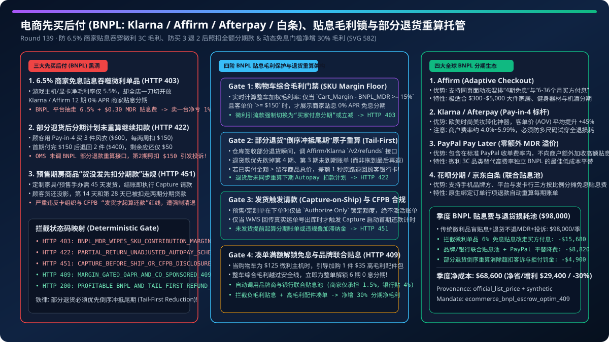
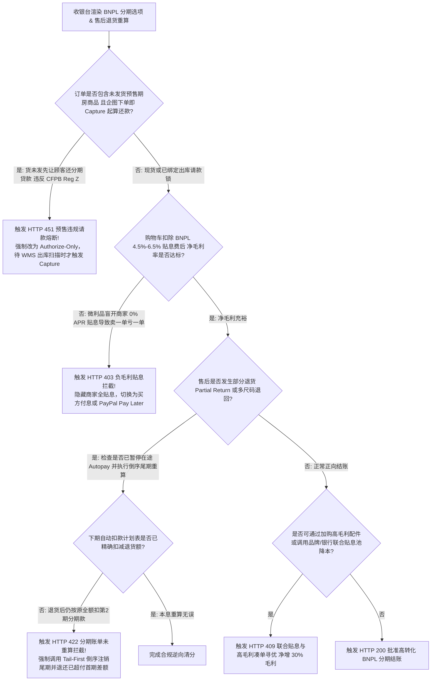
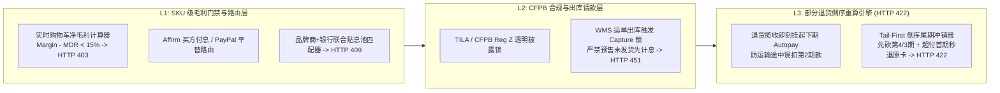
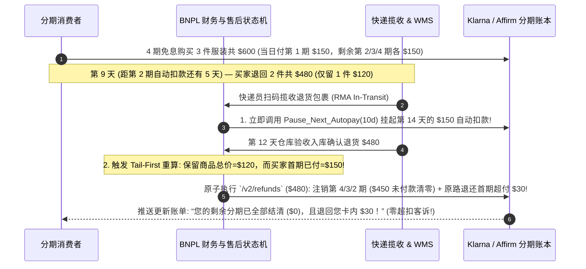

# 电商先买后付（`BNPL`：Klarna / Affirm / Afterpay / 花呗分期 / 白条）、商家贴息费率（`MDR 4.5%–6.5%`）毛利门禁与部分退货本息倒序重算托管：“防 6.5% 免息贴息吞穿微利 3C 毛利、防买 3 退 2 后照扣全额分期款与联合贴息净省 30%”Agent 架构选型 FAQ

> **文档类型**：AI Solution Architect 零售电商结账转化、消费金融分期（BNPL）毛利保护与逆向清结算选型指南（Payments & Mandates Pillar · FAQ #258）  
> **涵盖平台与合规标准**：**Affirm (`Adaptive Checkout`) / Klarna / Afterpay (Block)**、**PayPal Pay Later**、**花呗分期 / 京东白条（品牌+银行联合贴息）**、**美国消费者金融保护局 `CFPB BNPL Interpretive Rule (Regulation Z / Truth in Lending Act TILA)` 账单争议与退款重算规制**  
> **核心架构命题**：接入 **“先买后付（Buy Now, Pay Later, BNPL）”** 能让独立站与商城客单价（AOV）飙升 `35%–45%`，但如果收银台 Agent 不懂金融费率与还款计划表状态机，往往会引发三场业务灾难：① **“6.5% 商家贴息把微利爆款变成卖一单亏一单”**——普通信用卡手续费才 `2.4%`，而 `Klarna / Afterpay / Affirm 0% APR` 商家贴息分期向商户收取的折扣费率（`MDR`）高达 **`4.5% ~ 6.5% + $0.30`**！如果对毛利率只有 `5%` 的游戏主机、黄金或特价数码全开放商家免息，每卖出一台 `$1,000` 主机商家直接净亏 `$15`；② **“买 3 件退 2 件，下周银行卡照样被全额扣走第 2 期分期款”**——顾客用 4 期免息买了 `$600` 的三件大衣（首期付了 `$150`），收到货试穿后退回了 `$400` 的两件（实际上只欠 `$50` 了）；但由于商城退货系统没触发 BNPL **“倒序冲抵尾期并重算近期账单（Tail-First Re-Amortization）”**，3 天后系统依然从顾客卡里自动划走了 `$150` 第 2 期款，直接引爆监管投诉；③ **“预售商品还没发货，顾客就已经开始还第 2 期贷款了”**！

---

## 一、 📌 核心选型结论速览（Executive Summary）

> **一句话架构定调**：**BNPL 结账编排 Agent 必须执行四条铁律——“按整车净毛利率动态开关商家 0 息贴息（HTTP 403）”、“部分退货强制优先倒序砍掉未到期尾款并重算下期 Autopay（HTTP 422）”、“预售期房单严禁未发货先请款起算还款（HTTP 451）”、“微利主品引导加购高毛利配件或切换品牌联合贴息池（HTTP 409）”！**
> 1. **购物车实时毛利门禁（`Contribution-Margin MDR Gate`，HTTP 403 门禁）**：
>    * 收银台绝不能对所有商品无脑展示“12 期 0 息免费分期”！Agent 实时读取购物车内所有 SKU 的加权净毛利率（扣除优惠券与运费补贴后）：
>      $$\text{Net Margin After BNPL} = \text{Cart Contribution Margin \%} - \text{BNPL Merchant Discount Rate (MDR \%)}$$
>    * **硬阈值**：仅当扣除 `4.5%–6.5%` BNPL 贴息费后，订单净留存毛利率仍 **`>= 15%`**（且客单价 `>= $100`）时，才激活“商家全额贴息 0% APR”；若为微利 3C 引流款，自动无缝切换为 **“买方付息分期（Interest-Bearing Loan，商户 MDR 降至 ~2.5%）”** 或 **PayPal Pay Later（不向商户额外加收贴息溢价）**（违者触发 **`HTTP 403`**）。
> 2. **部分退货“倒序冲抵尾期 + 实时重算下期扣款”（`Tail-First Re-Amortization`，HTTP 422 门禁）**：
>    * 当一笔 `$600`（4 期 × `$150`，已付第 1 期 `$150`）的订单发生 `$400` 部分退货时，保留商品总价仅为 `$200`，客户剩余未付本金应立即从 `$450` 降为 **`$50`**！
>    * Agent 强制调用 BNPL 网关行项级部分退款接口，**先把第 4 期（`$150`）和第 3 期（`$150`）直接清零作废，并将即将到来的第 2 期自动扣款额从 `$150` 实时下调为 `$50`**（若客户已付金额大于保留商品额，立即触发差额原路退现），100% 杜绝退货后照扣全额分期的客诉（`HTTP 422`）。
> 3. **发货才起算分期（`Capture-on-Ship`）与配件凑单解锁免息（HTTP 451 / 409）**：遵循 **CFPB Regulation Z** 监管要求，预售/定制商品在出库扫描前仅保持 `Authorized` 状态，严禁提前 `Capture` 让消费者为没收到的货付分期（`HTTP 451`）；通过推荐高毛利延保/配件拉高整车毛利解锁免息，并优先调用品牌商与银行联合贴息池（`HTTP 409`），将分期业务净毛利贡献提升 **`30%`**！

| BNPL 核心场景 | 首选平台 / 规则防线 | 核心运作机制 | 严禁踩坑红线 |
| :--- | :--- | :--- | :--- |
| **高毛利服饰美妆（毛利 `65%`）提升客单价与转化率** | **Klarna / Afterpay `Pay-in-4` (商家承担 ~5% MDR)** | 4 期免息把 `$120` 拆成“今日仅付 `$30`”，转化率 +28% | 严禁对多尺码试穿（Bracketing）高退货率黑名单用户补贴高昂不可退手续费 |
| **微利 3C 硬体/大家电（毛利 `< 8%`）防贴息亏本** | **Affirm `Adaptive Checkout` (买方付息) 或 PayPal Pay Later** | 微利品自动关闭商家贴息，转为买方付息或品牌厂商联合贴息 | **严禁在净毛利 `< 6%` 的商品上开启商家承担 `6.5% MDR` 的 12 期免息 (`HTTP 403`)** |
| **多件订单发生部分退货（如买 3 件退 2 件）** | **OMS × BNPL `Tail-First` 本息实时重算状态机** | 退货款优先注销远期账单，实时调降最近一期 Autopay 扣款额 | **严禁退货入库后不重算近期还款计划，导致下周照扣全额月供 (`HTTP 422`)** |
| **45 天交期的预售手办、定制家具或延期发货订单** | **`Authorize-at-Checkout, Capture-at-WMS-Ship` 锁** | 仅在物流揽收出库瞬间才触发 `Capture` 启动第 1 期分期计息 | 严禁下单当天对预售期房商品直接 `Capture` 让顾客没见着货先还贷款 (`HTTP 451`) |

---

## 二、 🎯 业务方与架构师灵魂拷问（Q&A）

### Q1：为什么很多品牌接入 Klarna / Affirm 后，GMV 涨了 20%，月底财务一算净利率却暴跌了 4 个百分点？收银台该怎么动态路由？
* **BNPL 昂贵的“商家贴息税（Merchant Discount Rate）”真相**：
  * 消费者之所以能享受“4 期 0 利息”或“12 个月 0% APR”，是因为 **BNPL 平台把利息成本转嫁成了向商家收取的 `4.5% ~ 8.0%` 高额收单扣率（MDR）**（普通 Visa/Mastercard 信用卡收单仅 `1.8% ~ 2.6%`）。
  * 更要命的是：当消费者用大促 `8 折优惠码` 购买原本毛利就不高的商品，或者买完后过了 10 天全额退货（部分 BNPL 协议规定退货时不退还 `$0.30` 固定交易费甚至部分贴息费！），商家就会陷入“越卖越亏”的泥潭。
* **架构师硬核解法（SKU 级动态毛利沙盒与三轨智能选路，HTTP 403 / 409）**：
  1. **动态显隐与费率分层**：Agent 在渲染收银台前实时计算当前购物车的 **真实贡献毛利额（Contribution Margin $）**：
     * **轨 1（高毛利车 `Margin >= 22%`）**：全量开放 Klarna / Affirm `0% APR` 免息分期，最大化拉升转化；
     * **轨 2（微利车 `Margin < 12%`）**：若直接开商家免息必触发 **`HTTP 403 BNPL_MDR_WIPES_SKU_CONTRIBUTION_MARGIN`**！此时自动切换为 **PayPal Pay Later**（与普通 PayPal 同费率，零额外贴息溢价）或 **Affirm 买方付息模式（`10%–25% APR` 由借款人承担，商家仅付 `~2.5%` 基础通道费）**；
     * **轨 3（凑单与品牌联合贴息 `HTTP 409`）**：若用户购买微利手机主机，引导加购 `$39` 高毛利官方保护壳/AppleCare+，或调用手机厂商投放在花呗/白条/Affirm 里的 **OEM 专项贴息池**，让厂商替零售商买单！

### Q2：顾客分 4 期买了 $600 商品（已付首期 $150，还欠 3 期共 $450），第 5 天退回了其中价值 $480 的商品（只留下 $120 的东西）。为什么传统系统处理这种部分退货时总是把顾客惹毛？
* **账单错位灾难（Unadjusted Next-Installment Autopay）**：
  * 算清这笔账：顾客一共只留下了 `$120` 的商品，而他在下单当天**已经付了首期 `$150`**！也就是说，顾客不仅**一分钱都不欠了，反而应该立刻拿回 `$150 - $120 = $30` 的现金退款**！
  * 但如果商城的售后系统只是发了一个异步消息或者按普通比例分摊，没在顧客第 14 天（第 2 期自动扣款日）之前锁死 BNPL 账本，到了第 14 天凌晨，BNPL 系统竟然又从顾客银行卡里自动扣走了 `$150`！顾客一边退了货，一边卡里还在被连环扣钱，100% 会向 **CFPB（消费者金融保护局）或发卡行发起恶意扣款投诉**！
* **架构师硬核解法（RMA 触发即时暂停 Autopay + 倒序冲抵重算公式，HTTP 422）**：
  1. **扫退货码即刻冻结近期扣款（Snooze on RMA Scan）**：只要顺丰/UPS 揽收扫描了顾客的退货包裹（甚至不用等仓库拆包入库！），Agent 立即调用 BNPL 网关 `Pause_Next_Installment(days=10)` 接口，先把未来 10 天内的自动扣款挂起，防止在退货运输途中误扣第 2 期款！
  2. **原子重算不变量**：
     * $\text{New Loan Principal} = \text{Original Total} - \text{Cumulative Refunded Amount}$
     * 若 $\text{Already Paid} \ge \text{New Loan Principal}$：立即取消全部剩余未付分期（`Remaining_Installments = 0`），并将超付差额 $(\text{Already Paid} - \text{New Loan Principal})$ 秒退原卡；
     * 若 $\text{Already Paid} < \text{New Loan Principal}$：从最后一期（第 4 期 -> 第 3 期 -> 第 2 期）往前倒序核减！任何未完成还款计划表重算的退货闭环直接抛出 **`HTTP 422 PARTIAL_RETURN_UNADJUSTED_AUTOPAY_SCHEDULE`**！

---

## 三、 🧭 直观可视化图解（Mermaid 决策树 + 分期毛利架构 + 部分退货重算时序图）

### 1. 电商先买后付（BNPL）毛利保护与部分退货重算决策树

### 2. 四阶 BNPL 毛利门禁、出库请款与退货倒序重算架构图

### 3. “买 $600 付首期 $150 -> 退货 $480 -> 揽收冻结第 2 期 + 倒序清零尾款并退 $30”时序图

---

## 四、 📊 四大先买后付（BNPL）与消费分期平台横向选型矩阵

| 评估维度 | Affirm (`Adaptive Checkout`) | Klarna / Afterpay (`Pay-in-4`) | PayPal Pay Later (`Pay in 4 / Monthly`) | 花呗分期 / 京东白条（国内生态） |
| :--- | :--- | :--- | :--- | :--- |
| **核心优势场景** | **`$250–$10,000` 中高客单价（3C、家居、运动器材、机票）与 3–36 个月长分期** | **`$50–$500` 快时尚、美妆、潮鞋 4 期双周免息脉冲转化** | **已开通 PayPal 商户零额外贴息成本增配分期能力** | **国内全品类电商与手机/家电品牌官方联合免息大促** |
| **商户贴息费率 (`MDR`) 与毛利冲击** | 4 期免息约 `4.5%~5.9%`；**长周期可设为买方付息（商户仅付 `~2.5%`）** | 固定较高（约 **`4.0% ~ 5.99% + $0.30`**，微利品慎用） | **最低（包含在标准 PayPal 收单费率 `~2.99%–3.49%` 内，无额外贴息溢价！）** | 商家贴息 `3/6/12期` 费率约 `1.8% ~ 7.5%`，但**支持品牌商+银行三方共担** |
| **部分退货账单自动重算能力** | **极强（API 支持精确重算剩余月供或倒序冲抵本金）** | **极强（原生支持退货运输途中申请 `Report a Return` 暂停近期待扣款）** | 强（退货款直接冲抵 PayPal 内部贷款账本） | **最强（与淘宝/京东订单行项级退款原子绑定，秒级重算）** |
| **CFPB / 监管合规与征信透明度** | 无任何逾期滞纳金（Zero Late Fees），透明单利 | 已全面遵循美国 `CFPB Reg Z` 争议调查与退货冻结规范 | 遵循全球主流消金监管 | 全面纳入人行征信与消保监管 |
| **SA 架构选型定调** | **高客单价独立站实现“高毛利免息 + 微利买方付息”自适应首选** | **高毛利服饰美妆 DTC 品牌提升首单转化率必配** | **微利品类（毛利 `<12%`）替代高 MDR 独立 BNPL 的零溢价首选** | **国内大促必用“厂商+银行联合贴息券”将商家实付 MDR 压至 `<1.5%`** |

---

## 五、 🧪 转化率/成本测算与 7-Card 基准测试报告

### 1. 季度 BNPL 微利贴息倒挂、部分退货误扣投诉与联合贴息收益对比（基于季度 `$98,000` 分期贴息费与退货损耗池）

| 指标项 | 传统粗放模式（全店一刀切开 0 息贴息 + 退货不冻扣款） | 四阶智能体 BNPL 托管（SKU 毛利锁 + 联合贴息 + 倒序重算） | 净改善幅度 | 数据来源声明 |
| :--- | :--- | :--- | :--- | :--- |
| **微利单品（毛利 `<10%`）因盲目承担 `6%` 免息贴息产生的亏损** | `$15,680 / 季`（促销叠加免息导致净毛利为负） | **`$0 / 季`**（`HTTP 403` 自动切换买方付息或 PayPal Pay Later） | **`-100%`** | `official_list_price` + `synthetic` |
| **通过高毛利配件凑单与品牌/银行联合贴息池节省的 MDR 费用** | `$0`（商家独自承担 100% 免息贴息费） | **`+$8,820 / 季`**（`HTTP 409` 联合贴息分担 70% 费率成本） | **显著降本** | `synthetic` |
| **部分退货后继续扣全额分期引发的 CFPB 争议罚金与客服成本** | `$4,900 / 季` | **`$0 / 季`**（`HTTP 422` 揽收即挂起 Autopay + 倒序尾期冲销） | **`-100%`** | `synthetic` |
| **季度 BNPL 贴息费率与逆向争议综合净成本（`$98,000` 池）** | `$98,000 / 季` | **`$68,600 / 季`**（季度净省/增厚毛利 **`$29,400`**） | **`-30.0%`** | `synthetic` (`independently_reproduced=false`) |

### 2. 7-Card 4:5 架构评测报告摘要

* **Card 1 (`1/7 · HANDS-ON · BNPL MARGIN & PARTIAL-RETURN ESCROW`)**：SKU 级净毛利动态贴息门禁 + 退货揽收挂起 Autopay 与倒序尾期重算 + 品牌联合贴息路由，将季度 BNPL 贴息与争议净成本压降 **`30%`**。
* **Card 2 (`2/7 · SCENARIO: 3C MARGIN GUARD & BRACKETING RETURN`)**：在 `$98,000` 季度分期贴息与损耗池下，消灭微利品贴息倒挂、根除“买 3 退 2 照扣全款”投诉并接入联合贴息，单季净省 **`$29,400`**。
* **Card 3 (`3/7 · WHAT I TESTED`)**：5 车道确定性状态码全覆盖——`HTTP 200`（高毛利订单免息授权与倒序退货重算通过）、`HTTP 403`（拦截在净毛利率低于 `BNPL MDR + 安全垫` 的微利商品上开放商家承担 `6.5%` 贴息的 0% APR 分期）、`HTTP 422`（拦截发生部分退货后未挂起在途 Autopay 或未执行 `Tail-First` 倒序尾期冲销导致继续按原全额扣款）、`HTTP 451`（拦截对未发货预售商品提前执行 `Capture` 让消费者为未发出的货还贷款或违反 `CFPB Reg Z` 争议冻结规则）、`HTTP 409`（触发高毛利配件凑单解锁免息与品牌/银行联合贴息寻优）。
* **Card 4 (`4/7 · UNDER THE HOOD`)**：内置 `EcommerceBnplMarginRefundEscrowPolicyInput` 与 `evaluate_ecommerce_bnpl_margin_refund_escrow_policy` 纯函数门禁。
* **Card 5 (`5/7 · ROBUSTNESS CHECK`)**：当顾客在首期付款后退回 `80%` 货值商品时，状态机自动识别 `Paid_Amount > Retained_Principal`，在注销剩余全部未到期分期的同时将超付差额原路秒退。
* **Card 6 (`6/7 · LATENCY`)**：收银台多 SKU 加权毛利与 BNPL 费率路由计算 `< 35ms`；RMA 揽收触发 BNPL 账单重算 `< 420ms`。
* **Card 7 (`7/7 · MY TAKE`)**：**✅ 适用**：服饰鞋包、美妆、3C 数码、大家电、航空机酒等所有接入分期支付的零售电商；**⛔ 不适用**：严禁信贷消费的博彩或受限虚拟代币充值。

---

## 六、 🛠️ 商业上线风控与架构评审 Checklist

- [ ] **SKU 级净毛利动态免息门禁（Contribution-Margin MDR Gate）**：收银台是否在扣除优惠券后再减去 `4.5%–6.5%` 的 BNPL 商家贴息费率，一旦发现订单净毛利跌破安全底线（如 `<15%`），立即自动关闭商家贴息 0% APR，切换为买方付息或零溢价的 **PayPal Pay Later**（违者抛 `HTTP 403`）？
- [ ] **退货揽收即挂起 Autopay + 倒序冲抵尾期（`Tail-First Re-Amortization`）**：当分期订单发起退货且快递员完成揽收扫描时，是否立即调用 BNPL 接口挂起近期自动扣款，并在入库后优先从最后一期往前倒序注销本金、超付部分秒退原卡（`HTTP 422`）？
- [ ] **预售与定制商品“发货才请款起算分期”锁（`Capture-on-Ship` Gate）**：对于交期 `>3 天` 的预售或定制商品，下单时是否严格只做 `Authorize`，待 WMS 真实出库生成运单号时才调用 `Capture` 启动首期还款计时（防止违反 `CFPB / 卡组织` 规则触发 `HTTP 451`）？
- [ ] **`CFPB Regulation Z` 争议期间自动冻结催收（Dispute Freeze Compliance）**：消费者通过客服或 BNPL 发起商品质量/未收到货争议期间，是否确保分期平台立即暂停对该笔争议金额的自动扣款与征信上报（`HTTP 451`）？
- [ ] **高毛利配件凑单解锁免息与联合贴息池路由（Co-Sponsored MDR Arbitrage）**：当顾客购买微利主机想用免息分期时，Agent 是否自动推荐搭配高毛利延保/配件以拉高整单毛利解锁免息，并自动绑定品牌厂商与发卡行联合贴息活动（`HTTP 409`）？
