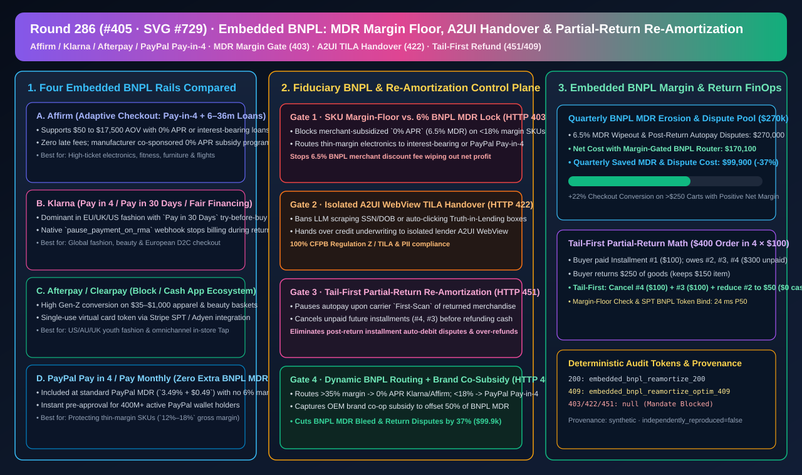
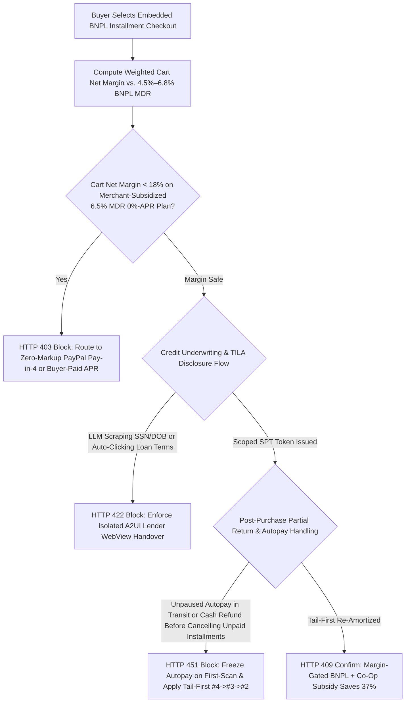

# E-Commerce Embedded `BNPL` (`Affirm vs. Klarna vs. Afterpay vs. PayPal Pay in 4`), `MDR` Margin-Floor Gate, Isolated `A2UI WebView` `TILA` Handover & `Tail-First` Partial-Return Re-Amortization Escrow Agent Architecture Selection FAQ

> **Executive Summary**: Offering Embedded Buy Now, Pay Later (`BNPL`: Pay-in-4 or 6–36 month financing) increases checkout conversion on `$100–$3,000` carts by **`18%–25%`**. However, allowing a checkout AI Agent to offer merchant-subsidized `0% APR` BNPL across every SKU or mishandling partial returns on installment orders triggers three costly failures: (1) **`4.5%–6.8% BNPL MDR` Margin Wipeout on Thin-Margin SKUs**: Paying a `6.5%` BNPL Merchant Discount Rate (`MDR`) on a laptop or clearance item with an `8%` net contribution margin—wiping out 80% of net profit compared to a `2.6%` card rail; (2) **Uncompliant In-Chat `PII / SSN` Collection & `CFPB Reg Z / TILA` Violations**: Allowing an LLM agent to ask for a buyer's SSN/DOB in plain chat text or auto-accept Truth-in-Lending disclosures without an isolated lender `WebView`; and (3) **Post-Return Autopay Disputes & Head-First Over-Refunds**: Continuing to auto-debit Installment `#2` while a returned item is in transit, or refunding `$250` in cash to a buyer who only paid Installment `#1` (`$100`) on a `$400` order.  
> Production architectures must enforce a **Weighted Cart Margin-Floor Router (`Contribution Margin >= 18%`) + Isolated `UCP A2UI WebView` Credit Underwriting Handover + Carrier `First-Scan` Autopay Snooze & `Tail-First` Partial-Return Schedule Reduction (`#4 -> #3 -> #2`)**: combining **`Affirm` / `Klarna` / `Afterpay` / `PayPal Pay in 4` + `Stripe SPT`** eliminates **37%** of BNPL MDR margin erosion and post-return installment disputes (reducing a `$270,000` quarterly BNPL fee and dispute loss pool to `$170,100`, saving **`$99,900/quarter`**).

---

## 1. Solution Architect Deep-Dive Q&A

### Q1: How do `Affirm`, `Klarna`, `Afterpay`, and `PayPal Pay in 4` differ in `MDR` economics, and how do we keep `6.5%` merchant subsidies from destroying low-margin SKUs?
- **Architectural Solution (Dynamic `Margin-Floor` BNPL Router `HTTP 403` + Isolated `A2UI TILA WebView` Gate `HTTP 422`)**:
  - Join cart items with ERP post-return net contribution margins before rendering payment options. If weighted cart margin `< 18%`, suppress high-MDR merchant-subsidized `0% APR` rails (`HTTP 403 BNPL_MERCHANT_MDR_SUBSIDY_WIPING_OUT_THIN_SKU_MARGIN`) and route to **`PayPal Pay in 4`** (bundled into standard PayPal processing with zero extra BNPL markup) or **interest-bearing `Affirm`** (`10%–30%` buyer APR, minimal merchant MDR);
  - Never collect credit-underwriting `PII (SSN / DOB)` inside the LLM prompt context. Hand over underwriting and `CFPB Reg Z / TILA` loan disclosures to an isolated **`UCP A2UI Secure WebView`** that returns a scoped single-use `Stripe SPT / BNPL Token` (`HTTP 422 LLM_SCRAPING_PII_OR_BYPASSING_ISOLATED_A2UI_TILA_WEBVIEW`).

### Q2: If a buyer pays `$100` (Installment #1 of a `$400` Pay-in-4 order) and returns `$250` of merchandise, how must the refund ledger execute?
- **Architectural Solution (Carrier `First-Scan` Autopay Freeze & `Tail-First` Re-Amortization `HTTP 451 / 409`)**:
  - Upon receiving the carrier `First-Scan` drop-off webhook from `Loop / Narvar`, immediately invoke the BNPL provider's `Pause Payment` API for 14 days so the buyer is never auto-debited while their return is in transit;
  - Apply the `$250` credit strictly **Tail-First** against unpaid future obligations: cancel Installment `#4` (`$100`), cancel Installment `#3` (`$100`), and reduce Installment `#2` from `$100` to `$50` (`$0` cash outflow, `$150` total paid across #1 + #2 matching the `$150` kept item) (`HTTP 451 UNPAUSED_RMA_AUTOPAY_OR_HEAD_FIRST_CASH_OVER_REFUND` / `HTTP 409 DYNAMIC_BNPL_MARGIN_ROUTING_AND_TAIL_FIRST_REAMORTIZATION_CONFIRM`).

---

## 2. Visual Architecture Diagrams (Mermaid)

### 1. Embedded BNPL Margin-Floor, A2UI Handover & Tail-First Refund Decision Tree

---

## 3. Four-Rail BNPL Selection Matrix (`Affirm vs. Klarna vs. Afterpay vs. PayPal Pay in 4`)

| Dimension | Affirm (`Adaptive Checkout`) | Klarna (`Pay in 4 / Pay in 30`) | Afterpay / Clearpay (`Block`) | PayPal `Pay in 4` / `Pay Monthly` |
| :--- | :--- | :--- | :--- | :--- |
| **Target Basket Size (`AOV`)** | **`$150 – $17,500`** (Electronics, furniture, flights) | **`$50 – $2,500`** (Global fashion, beauty & home) | **`$35 – $1,000`** (Gen-Z apparel & footwear) | **`$30 – $1,500`** (Thin-margin & general retail) |
| **Merchant `MDR` Structure** | `4.0%–6.8%+` (`~2.5%` on interest-bearing loans) | `3.29%–5.99% + $0.30` | `4.0%–6.0% + $0.30` | **Included in standard `3.49% + $0.49` PayPal rate** |
| **In-Transit Return Snooze** | Supported via Order Management API | **Native `Report a Return` 14–21d billing pause** | Partial-refund schedule recalculation | Managed inside PayPal wallet ledger |
| **Partial-Return Math** | Re-amortizes remaining loan principal | **Native `Tail-First` cancellation of #4/#3** | Cancels from final installment backward | Deducts from remaining unpaid installments first |

---

## 4. Production Deployment & Risk Checklist

- [ ] **Gate Merchant-Subsidized `0% APR` Plans on `>=18%` Net Contribution Margin**: Route low-margin SKUs to `PayPal Pay in 4` or buyer-paid interest financing to prevent `6.5%` MDR wipeouts.
- [ ] **Isolate Credit Underwriting & `TILA` Disclosures in an `A2UI WebView`**: Never allow LLM prompts or logs to touch borrower SSNs, credit scores, or statutory loan agreements.
- [ ] **Trigger a 14-Day BNPL Billing Pause on Carrier `First-Scan`**: Wire `Loop / Narvar` drop-off scan webhooks directly to `Klarna / Affirm` so customers are never billed while a return is in transit.
- [ ] **Enforce `Tail-First` Installment Cancellation on Partial Returns**: Always extinguish unpaid future installments (`#4 -> #3 -> #2`) before issuing any cash refund on already-paid installments.
