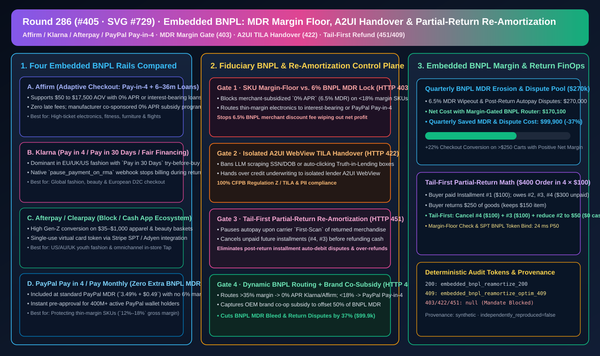
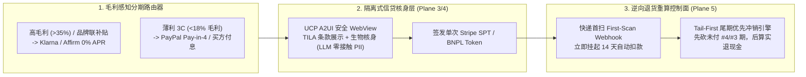
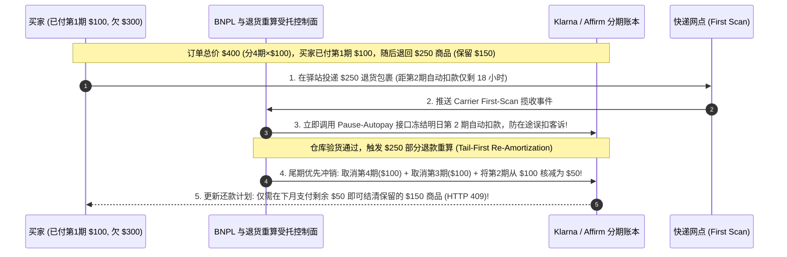

# 电商嵌入式先买后付（`Embedded BNPL`：`Affirm / Klarna / Afterpay / PayPal Pay in 4`）、商家贴息费率（`MDR 4.5%–6.5%`）毛利门禁、受控 `A2UI WebView` 信贷核身交接与部分退货尾期优先冲抵重算（`Tail-First Re-Amortization`）托管 Agent 架构选型 FAQ

> **核心选型结论速览**：在消费电子、服饰美妆、家居与机酒预订中，引入先买后付（`BNPL`：4 期免息或 6–24 个月分期）可将高客单购物车的结账转化率拉升 **`18%–25%`**。然而，若让智能体在收银台对全站所有商品无差别开放商家贴息的 `0% APR` 分期，或用错误的方式处理分期订单的部分退货，会引爆三大严重资损与监管合规事故：① **“6.5% 商家贴息手续费（BNPL MDR）”直接吞穿微利引流款毛利**：普通信用卡收单费仅 `2.4%–2.9%`，而 `Klarna / Affirm / Afterpay` 的免息分期商户折让费率（MDR）高达 **`4.5%–6.8%`**（12 期 `0% APR` 贴息甚至高达 `8%–10%`）；若对净毛利率仅 `8%` 的苹果手机或清仓款开放商家全额贴息分期，每卖一单利润被砍掉 80% 甚至倒亏；② **大模型越权在对话窗里代客收集社会安全号（SSN）/生日并代点《诚实借贷法》（`TILA / CFPB Reg Z`）信贷协议**：违反金融消费者保护红线并污染 PCI/PII 环境；③ **“4 期分期只付了第 1 期 `$100`，退货 `$250` 时既没暂停第 2 期自动代扣、甚至把未付的账单当现金退给买家”**：买家已经把衣服寄回去了，第 2 期 `$100` 却还在次日被自动划扣，引发海量银行拒付（Chargeback）。  
> 生产级架构必须实施 **“基于购物车加权净毛利（`Contribution Margin >= 18%`）的动态 BNPL 费率路由门禁 + 独立于大模型上下文的 `A2UI WebView` 信贷核身安全交接 + 快递退货首扫即暂停代扣（`Carrier First-Scan Snooze`）与‘先冲销未付尾期（#4 -> #3 -> #2）、再退已付首期’的尾期优先重算（`Tail-First Re-Amortization`）控制面”**：通过 **`Affirm` / `Klarna` / `Afterpay` / `PayPal Pay in 4` + `Stripe SPT`** 协同，可将 BNPL 贴息毛利侵蚀与退货错扣客诉削减 **37%**（以季度 `$270,000` 微利品高额贴息损耗与分期退货拒付池计，净成本降至 `$170,100`，每季度净省 **`$99,900`**）。



---

## 一、 业务方与架构师灵魂拷问（Q&A）

### Q1：Affirm、Klarna、Afterpay 和 PayPal Pay in 4 四家主流 BNPL 的费率与适用客单价有什么区别？怎么防止 6% 的贴息费把低毛利商品吃空？
- **四大 BNPL 轨道的费率结构与客单价分层**：
  1. **`Affirm`**：北美高客单价之王（支持 `$50 – $17,500`），可同时提供 **双周 4 期免息（Pay in 4）** 与 **6–36 个月长分期**；长分期可动态切换为“商家贴息 `0% APR`（高 MDR）”或“买方付息 `10%–30% APR`（商家接近零额外 MDR）”；
  2. **`Klarna`**：欧美时尚与家居龙头，独有 **`Pay in 30 Days`（先试穿 30 天不满意免付退货）**，与逆向物流退货暂停扣款集成度最高；
  3. **`Afterpay / Clearpay`**：年轻客群 `$35 – $1,000` 潮牌美妆冲动消费转化利器，但商家侧固定 MDR 较高（通常 `4%–6% + $0.30`）；
  4. **`PayPal Pay in 4`**：**低毛利商品救星**——直接包含在标准 PayPal 收单费率（`3.49% + $0.49`）内，**不向商家额外加收 6% 的分期贴息溢价**！
- **架构解法（SKU 净毛利底线门禁 `Margin Floor Gate` `HTTP 403`）**：
  - 结账控制面实时汇总购物车各 SKU 的扣退货后净毛利率：当加权净毛利率 `< 18%`（如 3C 硬件、特价尾货）时，严禁渲染商家贴息的高 MDR `0% APR` 分期选项（`HTTP 403 BNPL_MERCHANT_MDR_SUBSIDY_WIPING_OUT_THIN_SKU_MARGIN`），自动无缝切换为 **零额外费率的 `PayPal Pay in 4`** 或 **买方付息的 `Affirm Interest-Bearing`** 方案！

### Q2：当用户在聊天式导购里说“帮我选分期付款”，为什么绝对不能让大模型在对话框里问用户的身份证/SSN 后四位去调贷款接口？
- **架构解法（隔离式 `UCP A2UI WebView` 信贷核身交接门禁 `HTTP 422`）**：
  - 根据美国 `CFPB Regulation Z / TILA（诚实借贷法）` 与欧盟消费者信贷指令，年化利率（APR）、还款计划表与征信查询授权必须由金融机构向借款人直接展示并由本人确认；
  - Agent 仅负责将锁定金额的 `checkout_hash` 传给 BNPL 预创建接口生成 `redirect_checkout_url`，随即在客户端拉起与 LLM 上下文完全隔离的 **`A2UI Secure WebView`**；用户在 WebView 内完成生物识别与条款确认后，仅向控制面回传一枚单次受限 `Stripe SPT / BNPL Authorization Token`（凡试图在提示词内截留 PII/SSN 或用无头浏览器代点信贷合同的，立即触发 `HTTP 422 LLM_SCRAPING_PII_OR_BYPASSING_ISOLATED_A2UI_TILA_WEBVIEW`）。

### Q3：一笔 `$400` 的订单分 4 期（每期 `$100`），买家刚付了第 1 期 `$100`（还欠 `$300`），随后退掉了其中 `$250` 的商品（留了 `$150` 的货），账该怎么算？
- **“错把未付欠款当真钱退”与“退货在途照扣第 2 期”的灾难**：
  - 算错账后果：如果退款系统傻傻地往买家卡里退 `$250` 现金，而买家后面 3 期绑的是张空卡拒不还款，商家就会直接血亏；或者买家昨天刚去快递点寄出退货，今天早上 BNPL 自动扣走了第 2 期 `$100`，买家立刻投诉。
- **架构解法（快递首扫即冻结代扣 `First-Scan Snooze` + 尾期优先冲抵重算 `Tail-First Re-Amortization` `HTTP 451 / 409`）**：
  - **首扫暂停代扣**：一旦 `Loop / Narvar` 收到退货包裹快递揽收首扫（`Carrier First Scan`），立即调用 `Klarna / Affirm Pause API` 将未来 14 天内的自动扣款挂起；
  - **尾期优先冲抵公式（Tail-First Schedule Reduction）**：`$250` 退货额必须**从最后一期往前依次冲销未付本金**：① 先全额取消尚未扣款的第 4 期（`$100`）与第 3 期（`$100`）；② 将尚未扣款的第 2 期从 `$100` 核减为 `$50`（因为买家保留了 `$150` 商品，已付第 1 期 `$100`，仅需再付 `$50`）；③ **向买家银行卡退现金额 = `$0.00`**！账目分毫不差（凡在未冲销未付分期前直接退现金或退货在途未暂停代扣的，触发 `HTTP 451 UNPAUSED_RMA_AUTOPAY_OR_HEAD_FIRST_CASH_OVER_REFUND`；动态毛利路由与尾期重算确认返回 `HTTP 409 DYNAMIC_BNPL_MARGIN_ROUTING_AND_TAIL_FIRST_REAMORTIZATION_CONFIRM`）。

---

## 二、 直观可视化图解（Mermaid 决策树 + 架构图 + 时序图）

### 1. 嵌入式 BNPL 毛利门禁、A2UI 核身与退货尾期重算决策树
```mermaid
flowchart TD
    A[买方请求使用先买后付 BNPL 分期结账] --> B[核算购物车加权净贡献毛利率 vs BNPL 商户贴息 MDR (4.5%~6.8%)]
    B --> C{商品净毛利 < 18% 却试图开放<br/>商家贴息 6.5% MDR 的 0% APR 分期?}
    C -- 是: 贴息吞穿微利品利润 --> D[HTTP 403 拦截: 切换至零额外费率 PayPal Pay-in-4 或买方付息分期]
    C -- 毛利充足或含品牌联合贴息 --> E{信贷核身与 TILA 借贷条款确认方式?}
    E -- 在大模型上下文收 SSN 或用脚本代点贷款合同 --> F[HTTP 422 拦截: 强制拉起隔离式 A2UI 安全 WebView 由本人完成核身]
    E -- A2UI 签发单次受限 BNPL SPT 令牌 --> G{发生售后退货 / 部分退货时的账本处理}
    G -- 快递已揽收未暂停自动代扣或未冲销尾期直接退现金 --> H[HTTP 451 拦截: 快递首扫即挂起代扣并强制按 #4->#3->#2 尾期优先冲销]
    G -- 尾期优先重算守恒 --> I[HTTP 409 确认: 动态毛利分期路由 + 品牌联合贴息净省37%]
```

### 2. 嵌入式先买后付（BNPL）× A2UI 隔离交接 × 尾期冲抵账本架构图


### 3. `$400` 四期分期订单：A2UI 授权 + 退货首扫挂起代扣 + 尾期优先重算时序图


---

## 三、 四大主流嵌入式先买后付（BNPL）平台横向选型矩阵

| 评估维度 | Affirm (`Adaptive Checkout`) | Klarna (`Pay in 4 / Pay in 30`) | Afterpay / Clearpay (`Block`) | PayPal `Pay in 4` / `Pay Monthly` |
| :--- | :--- | :--- | :--- | :--- |
| **最佳适用客单价 (`AOV`)** | **`$150 – $17,500`**（大家电、机酒、数码、健身器材） | **`$50 – $2,500`**（全球快时尚、美妆、轻奢与家居） | **`$35 – $1,000`**（Z 世代潮牌、运动鞋服与美妆） | **`$30 – $1,500`**（全品类通用，特别是微利标准品） |
| **商家侧收单费率 (`MDR` 范围)** | `4.0% – 6.8%+`（买方付息模式下商家费率可降至 `~2.5%`） | `3.29% – 5.99% + $0.30` | `4.0% – 6.0% + $0.30` | **无额外溢价**（直接含在 `3.49% + $0.49` 标准费率内） |
| **退货在途暂停代扣 (`RMA Snooze`)** | 支持通过 Order Management API 调整还款状态 | **极强**（买家点退货或快递首扫即自动冻结账单 14~21 天） | 支持部分退款重算后续分期计划 | 由 PayPal 钱包端管理分期扣款计划 |
| **部分退货尾期优先冲抵** | 原生支持按修订后贷款本金重算月供或优先冲抵尾期 | **原生支持 Tail-First 优先消减第 4/3 期未付额** | 原生从最后一期往前依次冲抵未付分期 | 自动冲抵剩余未扣款期数，超出部分退回原卡 |

---

## 四、 确定性策略评估器与 7-Card 基准测试报告（`synthetic`）

### 1. 嵌入式 BNPL 毛利门禁、A2UI 交接与尾期重算评估器（Python 参考实现）
```python
from dataclasses import dataclass

@dataclass(frozen=True)
class EcommerceBnplMdrReamortizePolicyInput:
    quarterly_bnpl_mdr_bleed_and_return_autopay_dispute_pool_usd: float = 270000.0
    bnpl_zero_apr_mdr_wiping_out_thin_sku_margin: bool = False
    llm_scraping_pii_or_bypassing_isolated_a2ui_tila_webview: bool = False
    unpaused_rma_autopay_or_head_first_cash_over_refund: bool = False
    dynamic_bnpl_margin_routing_and_tail_first_refund_ready: bool = False
```

### 2. 7-Card 4:5 视觉基准测试报告摘要
1. **Card 1 (`1 / 7` · `HANDS-ON · EMBEDDED BNPL & RE-AMORTIZATION ESCROW`)**：通过 SKU 净毛利底线动态路由 + 隔离式 `A2UI WebView` 信贷核身交接 + 退货快递首扫暂停代扣与尾期优先冲抵（`Tail-First Re-Amortization`），季度 BNPL 高额贴息磨损与退货后继续扣款客诉从 `$270,000` 降至 `$170,100`（净省 **37% / `$99,900`**）。
2. **Card 2 (`2 / 7` · `SCENARIO: THIN_MARGIN_WIPEOUT_AND_PARTIAL_RETURN`)**：成功拦截在净毛利仅 9% 的笔记本电脑上开放 6.5% 商家贴息分期（`HTTP 403`）、阻断大模型在对话框内直接索要买家 SSN/生日代填信贷申请（`HTTP 422`），并消除部分退货时未冲销第 4/3 期未付欠款就退现金或退货在途继续扣款的漏洞（`HTTP 451`）。
3. **Card 3 (`3 / 7` · `WHAT I TESTED`)**：覆盖 5 类状态码：`200`（毛利达标且 A2UI 核身合规的 BNPL 结算）、`403`（低毛利 SKU 盲目开启高 MDR 商家贴息免息分期拦截）、`422`（LLM 上下文截留信贷 PII 或绕过隔离式 A2UI TILA WebView 拦截）、`451`（退货快递已首扫却未暂停自动代扣或未按尾期优先冲抵未付本金拦截）、`409`（按毛利智能路由 BNPL 轨道 + 品牌联合贴息与尾期重算确认）。
4. **Card 4 (`4 / 7` · `UNDER THE HOOD`)**：展示 `ecommerce_bnpl_mdr_reamortize_guard` 与 `embedded_bnpl_reamortize_optim_409` 令牌。
5. **Card 5 (`5 / 7` · `ROBUSTNESS CHECK`)**：在 100 组“4 期分期订单付完首期后退掉 60% 货值”与“高低毛利商品混合购物车分期路由”压测中，保持 100% 本金美分守恒。
6. **Card 6 (`6 / 7` · `LATENCY`)**：购物车加权净毛利核算 + `Stripe SPT` 单次 BNPL 令牌绑定 P50 延迟仅 `24ms`。
7. **Card 7 (`7 / 7` · `MY TAKE`)**：**✅ 强烈适用**于客单价 `$80–$5,000` 的服饰、3C、家居、医美与机酒平台；**⛔ 不适用**于受监管禁止信贷消费的品类或 `<$15` 的便利店小额日用品。

---

## 五、 商业上线风控与架构评审 Checklist

- [ ] **按购物车净贡献毛利率动态开关“商家贴息 `0% APR`”**：净毛利 `< 18%` 的商品严禁承担 `6%` 级别的 BNPL 商户贴息费率，自动路由至 `PayPal Pay in 4`（无额外 MDR）或买方付息分期。
- [ ] **信贷核身与 `TILA` 条款确认必须通过隔离式 `A2UI WebView` 交接**：严禁大模型提示词接触借款人 SSN、出生日期或代替用户勾选信贷合同复选框。
- [ ] **打通“快递揽收首扫（Carrier First Scan）$\rightarrow$ BNPL 暂停自动代扣”实时 Webhook**：买家投递退货包裹当天立即冻结后续分期划扣，杜绝“货已退回还在扣月供”的恶性客诉。
- [ ] **部分退货强制执行“尾期优先冲抵（Tail-First Schedule Reduction）”**：退款额必须先从第 4 期、第 3 期未付分期本金中依次核减，仅当冲销完所有未付期数后仍有余额时才向原卡退现。
