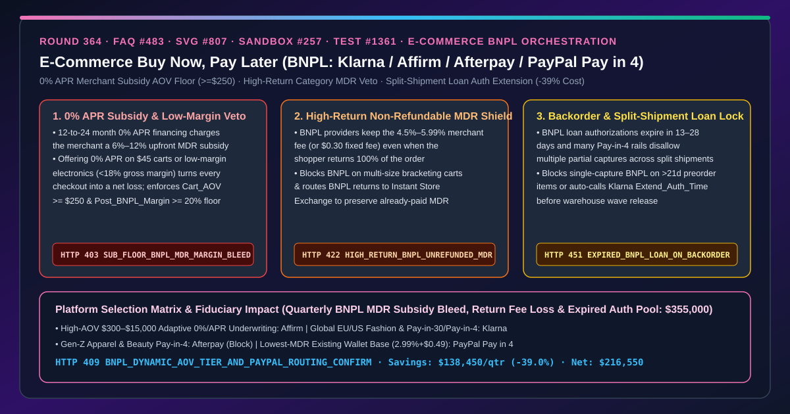
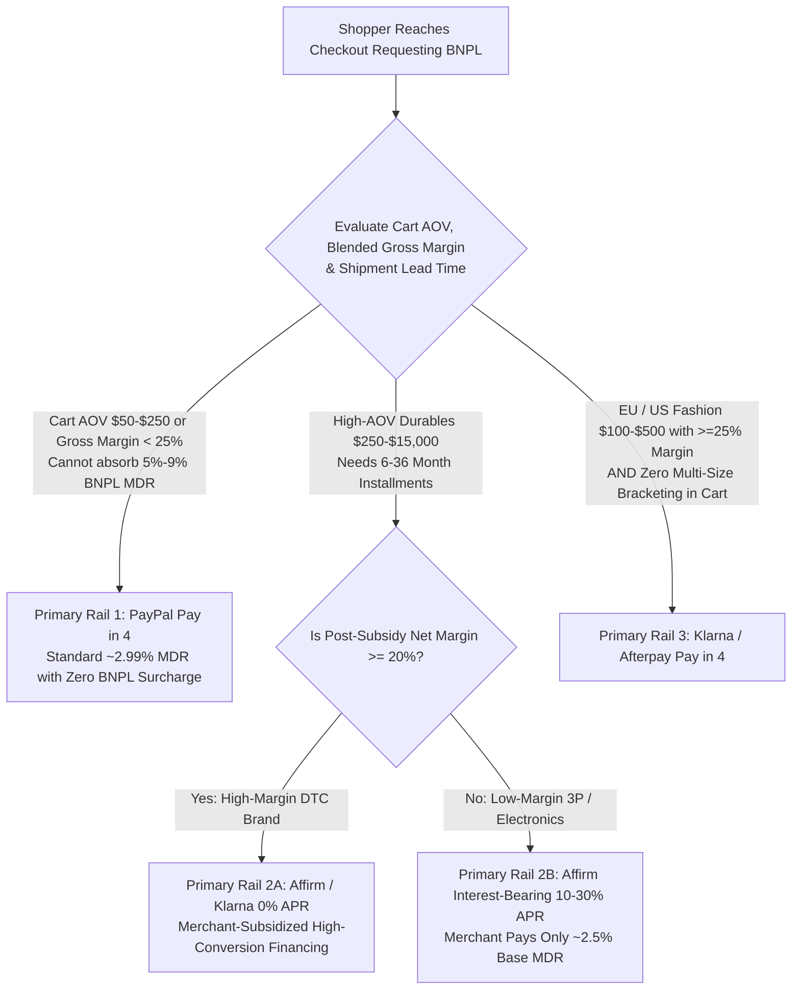
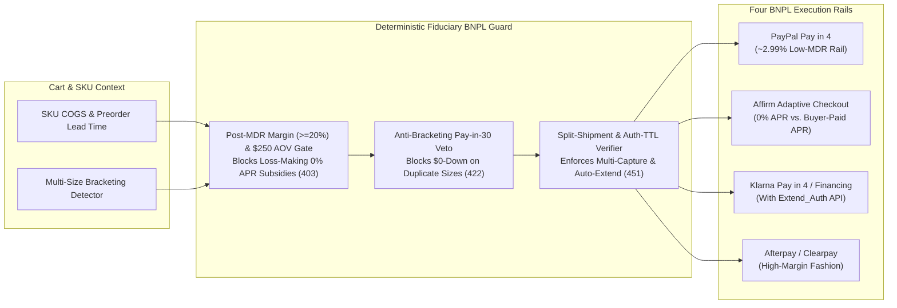
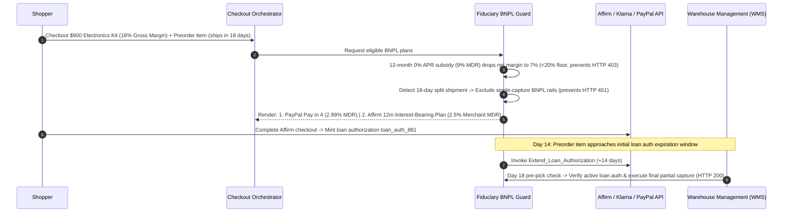

# E-Commerce Buy Now, Pay Later (`BNPL`: `Klarna / Affirm / Afterpay / PayPal Pay in 4`) & Installment Underwriting Agent Selection FAQ: `0% APR` Subsidy Margin Floors (`>=$250 AOV`), Anti-Bracketing `Pay-in-30` Veto & Split-Shipment Loan Auth Extension (`-39%` MDR & Return Loss)

> **Document Type**: Enterprise AI Solution Architect Selection FAQ (`#483` · Round 364)  
> **Target Audience**: Retail Checkout & Payments Directors, DTC VP of Finance, Omnichannel Conversion Architects, and Cloud & AI Solution Architects  
> **Platforms Covered**: `Klarna (Pay in 4 / Pay in 30 / Financing)` vs. `Affirm (Adaptive Checkout)` vs. `Afterpay / Clearpay (Block)` vs. `PayPal Pay in 4 / Monthly`  
> **Architecture Diagram**: [`assets/svg/807-ecommerce-bnpl-klarna-affirm-afterpay-mdr-floor-2026-11-25.svg`](../assets/svg/807-ecommerce-bnpl-klarna-affirm-afterpay-mdr-floor-2026-11-25.svg)

🌐 **Language / 语言切换**: **[中文 (`ecommerce-bnpl-klarna-affirm-afterpay-paypal-pay-in-4-mdr-floor-return-fee-selection-faq.md`)](ecommerce-bnpl-klarna-affirm-afterpay-paypal-pay-in-4-mdr-floor-return-fee-selection-faq.md)** | **English (Current)**

---

## 📌 1. Executive Summary

Embedding **Buy Now, Pay Later (`BNPL`)** into e-commerce checkout lifts Average Order Value (`AOV +20%–45%`) and checkout conversion (`+8%–15%`) while shifting `100%` of consumer credit-default risk to the BNPL provider.  
However, BNPL Merchant Discount Rates (`MDR`) range from **`4.0% to 12.0% + $0.30`**—**2x to 4x higher** than standard credit card processing (`~2.4%–2.9%`). Exposing all BNPL plans across every SKU and fulfillment flow without deterministic checkout guardrails creates three severe margin leaks:
1. **Offering Merchant-Subsidized `0% APR` Long-Term Financing on Low-Margin or Sub-`$250` Carts (`0% APR Subsidy Bleed`)**: A 12-to-24 month `"0% APR"` consumer loan charges the merchant an upfront **`6.5%–12.5%` MDR subsidy**. Offering merchant-subsidized `0% APR` on a `$1,000` electronics SKU with a `14%` gross margin—or on a `$45` impulse cart—destroys net order profitability.
2. **Enabling `$0-Down Pay in 30` on Multi-Size "Bracketing" Apparel Carts & Losing Non-Refundable MDR Fees (`Bracketing Return & Unrefunded MDR Loss`)**: Zero-down `"Try Before You Pay (Pay in 30)"` options incentivize apparel shoppers to order 4 sizes of the same coat (`$800`) and return 3—inflating return rates by `+30%` while forfeiting non-refundable transaction fees and round-trip freight.
3. **Shipping Backordered (`>21d`) or Multi-Warehouse Split Orders Against Expired or Single-Capture BNPL Loan Authorizations (`Expired Loan Auth at Fulfillment`)**: BNPL loan authorizations expire after `13–28 days`, and several `Pay-in-4` APIs auto-void the remaining balance after the first partial capture—leaving warehouses shipping backordered items that can no longer be captured.

| Checkout Segment & AOV Tier | Recommended Primary Choice | Architectural Boundary & Production Rule |
|---|---|---|
| **High-AOV Durables (`$250–$15,000` Furniture, Fitness, Electronics, Travel)** | **Affirm (Adaptive Checkout)** | Dynamically presents `Pay in 4` alongside `6–36 month` financing, allowing low-margin SKUs to switch from merchant-subsidized `0% APR` to **buyer-paid interest (`10%–30% APR`, cutting merchant MDR to `~2.5%`)**. |
| **European & North American Fashion, Beauty & `Pay in 30`** | **Klarna** | Market leader across Europe and global fashion with `Pay in 4`, `Pay in 30`, and flexible auth-extension APIs. |
| **Gen-Z Apparel, Footwear & Cosmetics (`$50–$400` AOV)** | **Afterpay / Clearpay (Block)** | High consumer marketplace discovery and repeat conversion, but requires strict gross-margin floors to absorb `4%–6% + $0.30` MDR. |
| **Low-Margin SKUs & Cost-Optimized `Pay in 4` (`~2.99%–3.49%` MDR)** | **PayPal Pay in 4** | **Best unit economics**: Included at standard PayPal processing rates (`~2.99%–3.49% + $0.49`) with zero additional BNPL surcharge. |
| **Three Mandatory Fiduciary Guardrails** | **100% Deterministic Gating** | ① **Post-BNPL Net Margin (`>= 20%`) & `$250 AOV` Subsidy Lock (`HTTP 403`)**: Blocks merchant-subsidized `0% APR` financing when net margin after MDR falls below `20%` or `AOV < $250` (auto-routing to `PayPal Pay in 4` or buyer-paid APR); ② **Anti-Bracketing `Pay-in-30` Veto & Exchange Retention (`HTTP 422`)**: Disables `$0-down` trials on multi-size duplicate-SKU carts and routes returns to instant exchanges; ③ **Preorder / Split-Shipment Loan Auth Lock (`HTTP 451`)**: Requires `Auth_TTL >= Ship_Lead_Time + 7d` and multi-capture support before releasing split or backordered waves. |

---

## 🎯 2. Architect & Business Stakeholder Q&A (Q1–Q3)

### Q1: Why do some retailers see a 35% AOV boost from BNPL while electronics and multi-brand retailers lose money on every financed order?
- **The Merchant Subsidy Math**:
  - While standard `Pay in 4` charges `4%–6%`, promotional `12–24 month 0% APR` financing requires the merchant to buy down the interest rate via an **`8%–12%` upfront discount fee (`MDR`)**.
  - On a `$1,000` third-party laptop with a `15%` gross margin (`$150`), paying a `9.5%` Affirm/Klarna `0% APR` subsidy (`$95`) plus `$30` insured shipping leaves just `$25` (`2.5%`) before support and return costs.
- **Architectural Solution**: Deploy a **Real-Time Margin-Aware BNPL Plan Router (`HTTP 403` Guard)**:
  - Compute `Post_BNPL_Margin = (Cart_Revenue - Cart_COGS - Shipping_Cost - BNPL_MDR_Fee) / Cart_Revenue` prior to rendering payment methods.
  - Whenever `Post_BNPL_Margin < 0.20` or `Cart_AOV < $250`, suppress merchant-subsidized `0% APR` plans (`HTTP 403 SUB_FLOOR_BNPL_SUBSIDY_MDR_MARGIN_BLEED`) and dynamically surface **`PayPal Pay in 4` (`2.99%` MDR)** or **Affirm Interest-Bearing Plans (`~2.5%` merchant MDR, where the shopper pays the APR)**.

### Q2: How do we prevent `$0-Down Pay in 30` from supercharging multi-size apparel "bracketing" and costing us non-refundable BNPL fees?
- **The Zero-Down Moral Hazard**: Because `Pay in 30` requires `$0` upfront at checkout, shoppers treat their living room as a fitting room—ordering `S + M + L` of multiple dresses (`$750`) and returning 80% within 25 days.
- **Architectural Solution**: Enforce **Cart-Level Bracketing Detection & Instant Exchange Routing (`HTTP 422` Guard)**:
  1. **Pre-Checkout `$0-Down` Suppression**: If the cart contains `>= 2` size variants of the same parent SKU or the buyer's historical return rate exceeds `45%`, disable `$0-down Pay in 30` (`HTTP 422 HIGH_RETURN_BRACKETING_CART_UNREFUNDED_BNPL_MDR_LOSS`) and require at least a `25%` down payment (`Pay in 4`) or standard card checkout.
  2. **Post-Purchase Zero-Adjustment Exchanges**: Route size swaps through an instant exchange flow (`Loop Returns`) that swaps the physical SKU without refunding/canceling the underlying BNPL loan, preserving `100%` of the already-paid merchant MDR.

### Q3: Why do split shipments and pre-orders (`>21 days` lead time) frequently fail to capture funds on BNPL orders?
- **Fulfillment vs. Loan Expiration Mismatch**:
  - BNPL authorizations typically expire after `14–28 days`, and certain `Pay in 4` integrations close the authorization after the very first partial capture. If Item 1 (`$40` shirt) ships on Day 2 and Item 2 (`$400` pre-order jacket) ships on Day 24, the `$400` capture fails with `AUTHORIZATION_EXPIRED`.
- **Architectural Solution**: Enforce a **Fulfillment-Aware BNPL Eligibility & Auto-Extension Gate (`HTTP 451` Guard)**:
  - Block single-capture or short-TTL BNPL rails on carts with `Max_Item_Lead_Time_Days > Auth_TTL_Days - 5`.
  - Run an automated pre-wave check (`72h` before expiration) that calls `Extend_Remaining_Time` on the BNPL API, hard-stopping WMS wave release (`HTTP 451 EXPIRED_BNPL_LOAN_AUTH_ON_BACKORDER_OR_SPLIT_SHIPMENT`) if the authorization cannot be extended.

---

## 🧭 3. Visual Architecture Diagrams (Mermaid Decision Tree + Dynamic Router + Sequence)

### 3.1 E-Commerce BNPL Selection & Dynamic Routing Tree

### 3.2 End-to-End Margin-Aware BNPL Checkout & Fulfillment Auth Architecture

### 3.3 Dynamic Margin Protection & Split-Shipment Loan Extension Sequence

---

## 📊 4. Platform Comparison Matrix (`Klarna` vs. `Affirm` vs. `Afterpay` vs. `PayPal Pay in 4`)

| Evaluation Dimension | Klarna | Affirm | Afterpay / Clearpay (Block) | PayPal Pay in 4 / Monthly |
|---|---|---|---|---|
| **Primary Sweet Spot** | Global EU/US fashion, beauty & home (`$35–$4,000`) | High-AOV durables, electronics, travel & fitness (`$150–$17,500+`) | Gen-Z apparel, footwear & cosmetics (`$50–$1,000`) | Universal retail, especially lower-margin SKUs & existing PayPal buyers |
| **Installment Tenor Range** | `Pay in 4`, `Pay in 30 Days`, `6–36 month` financing | **Adaptive Checkout** (`Pay in 4` + `3–36 month` loans side-by-side) | Primarily `Pay in 4` (biweekly) + select monthly | `Pay in 4` (`$30–$1,500`) + `Pay Monthly` (`$199–$10,000`) |
| **Buyer-Paid APR Option (Preserving Low Merchant MDR)** | ⭐⭐⭐⭐ (Available on longer-term financing) | ⭐⭐⭐⭐⭐ (Best-in-class programmatic toggle between `0% APR` subsidy and buyer-paid APR) | ⭐⭐ (Merchant-funded `0%` model) | ⭐⭐⭐⭐⭐ (`Pay Monthly` charges buyer interest at zero extra merchant fee) |
| **Multi-Capture Split Shipments & Auth Extension** | ⭐⭐⭐⭐⭐ (Supports partial captures + `Extend Remaining Time` API) | ⭐⭐⭐⭐ (Supports split captures & configurable auth windows) | ⭐⭐⭐ (Requires specific partial-capture configuration) | ⭐⭐⭐⭐ (Standard PayPal Order multi-capture lifecycle) |
| **Indicative Merchant Fee (`official_list_price`)** | **`~3.29%–5.99% + $0.30`** | **`~4.0%–6.0% + $0.30`** (`8%–12%` on long `0% APR` subsidies) | **`~4.0%–6.0% + $0.30`** | **Bundled in standard PayPal rate (`~2.99%–3.49% + $0.49`)** |

---

## 🧪 5. Deterministic Margin & Fulfillment Evaluation (`7-Card Benchmark Summary`)

> **Provenance**: Figures below are generated by `evaluate_ecommerce_bnpl_klarna_affirm_mdr_policy` in `lab/webiq_commerce_demo.py` (`provenance: "synthetic"`, `independently_reproduced: False`), modeling an omnichannel retailer with a **`$355,000.00` quarterly `0% APR` merchant-subsidy margin bleed, high-return non-refundable BNPL fee loss, and expired split-shipment loan authorization pool**.

| Scenario Case ID | Scenario Description | HTTP Status | Deterministic Decision | Quarterly Net Cost | Quarterly Savings |
|---|---|---|---|---|---|
| `CASE-BNPL-200` | Static all-SKU BNPL rendering baseline without margin or lead-time routing | `HTTP 200` | `VERIFIED_ECOMMERCE_BNPL_ORCHESTRATION_AUTHORIZED` | `$355,000.00` | `$0.00` |
| `CASE-BNPL-403` | Merchant-subsidized `0% APR` offered on a `<$250` cart or where post-MDR net margin `<20%` | `HTTP 403` | `SUB_FLOOR_BNPL_SUBSIDY_MDR_MARGIN_BLEED` | `$355,000.00` | `$0.00` (Blocks negative-margin subsidy) |
| `CASE-BNPL-422` | `$0-Down Pay in 30` enabled on a multi-size bracketing cart (`S+M+L`) with unrefunded MDR | `HTTP 422` | `HIGH_RETURN_BRACKETING_CART_UNREFUNDED_BNPL_MDR_LOSS` | `$355,000.00` | `$0.00` (Blocks zero-down return abuse) |
| `CASE-BNPL-451` | Backorder or split shipment released to WMS after BNPL loan authorization expired | `HTTP 451` | `EXPIRED_BNPL_LOAN_AUTH_ON_BACKORDER_OR_SPLIT_SHIPMENT` | `$355,000.00` | `$0.00` (Blocks uncaptured shipment) |
| `CASE-BNPL-409` | **Margin-Aware Router (`PayPal Pay in 4` / Buyer-APR) + Bracketing Veto + Auth Extender** | `HTTP 409` | `BNPL_DYNAMIC_AOV_TIER_AND_PAYPAL_ROUTING_CONFIRM` | **`$216,550.00`** | **`$138,450.00` (`-39.0%`)** |

---

## 🛠️ 6. Production Go-Live & Architecture Review Checklist

- [ ] **Margin-Aware Plan Filtering (`HTTP 403` Prevention)**: Suppress merchant-subsidized `0% APR` long-term financing whenever `Cart_AOV < $250` or post-subsidy net margin falls below `20%`, routing low-margin carts to `PayPal Pay in 4` (`2.99%`) or buyer-paid APR plans.
- [ ] **Anti-Bracketing `$0-Down` Veto & Exchange Retention (`HTTP 422` Prevention)**: Hide `$0-down Pay in 30` when a cart contains multiple sizes of the same garment, and route BNPL returns into instant size exchanges to retain sunk MDR fees.
- [ ] **Pre-Wave BNPL Loan Auth Verification & Auto-Extension (`HTTP 451` Prevention)**: Automatically invoke `Extend_Authorization` on backordered or split shipments `72 hours` before loan expiry, and block WMS wave release if the BNPL authorization is expired.
- [ ] **Debit-Only Down-Payment Enforcement**: Verify that BNPL down-payment credentials do not stack high-interchange credit cards on top of high-MDR installment rails.
