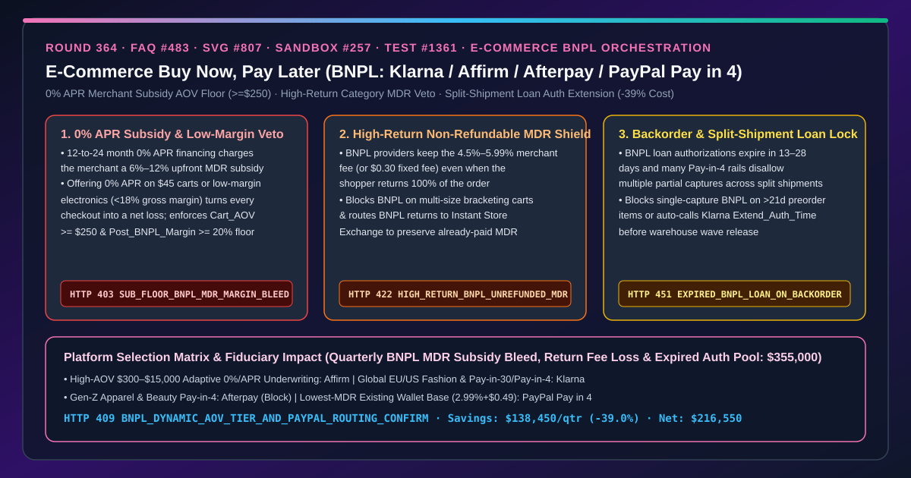
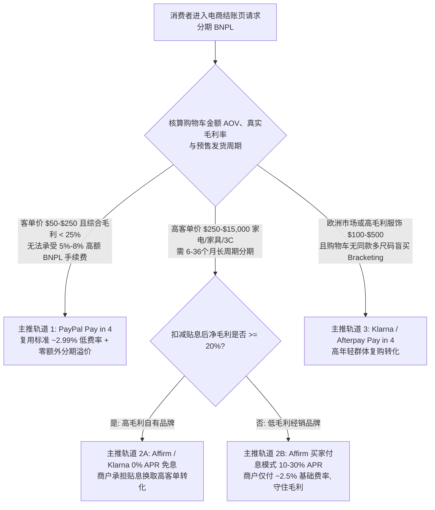
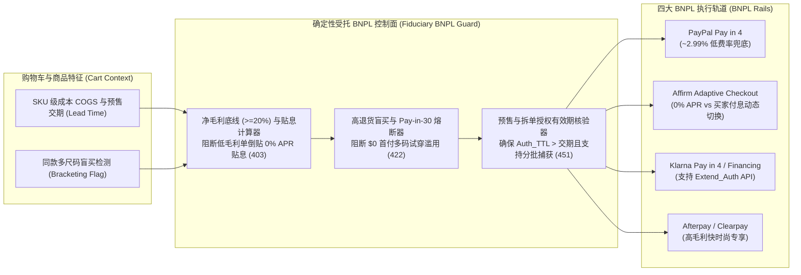
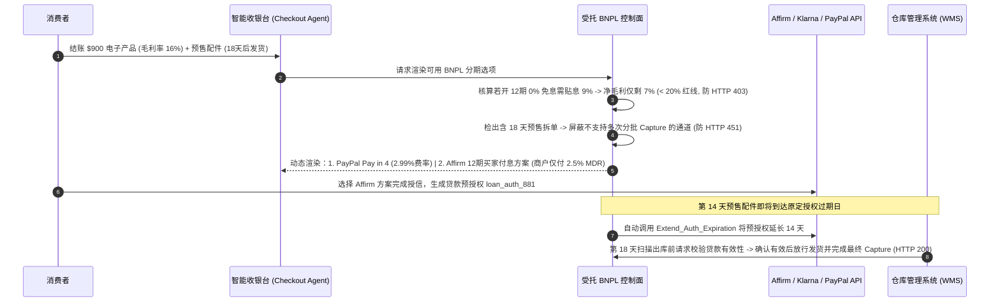

# 零售电商先买后付（`BNPL - Buy Now, Pay Later`: `Klarna / Affirm / Afterpay / PayPal Pay in 4`）与分期授信智能体选型对比：免息贴息最低客单价与毛利底线锁（`0% APR Subsidy Floor`）、高退货多码试穿（`Bracketing`）不可退手续费熔断与预售/拆单分期授权过期保护净省 39% 指南

> **文档类型**：企业级 AI Solution Architect 选型决策指南（Selection FAQ · `#483` · Round 364）  
> **适用读者**：零售电商支付与结账产品总监、DTC 品牌财务负责人（VP of Finance）、全渠道增长架构师与 Cloud & AI Solution Architect  
> **核心覆盖平台**：`Klarna (Pay in 4 / Pay in 30 / Financing)` vs. `Affirm (Adaptive Checkout)` vs. `Afterpay / Clearpay (Block)` vs. `PayPal Pay in 4 / Monthly`  
> **关联架构图**：[`assets/svg/807-ecommerce-bnpl-klarna-affirm-afterpay-mdr-floor-2026-11-25.svg`](../assets/svg/807-ecommerce-bnpl-klarna-affirm-afterpay-mdr-floor-2026-11-25.svg)

🌐 **语言切换 / Language**: **中文 (当前)** | **[English (`ecommerce-bnpl-klarna-affirm-afterpay-paypal-pay-in-4-mdr-floor-return-fee-selection-faq.en.md`)](ecommerce-bnpl-klarna-affirm-afterpay-paypal-pay-in-4-mdr-floor-return-fee-selection-faq.en.md)**

---

## 📌 一、核心选型结论速览（Executive Summary）

在零售电商结账页接入 **先买后付（`BNPL - Buy Now, Pay Later`）** 通常能将客单价（`AOV`）拉升 `20%–45%`、结账转化率提升 `8%–15%`（因为消费者只需当场付 1/4 首付，而商户在发货时即可从 BNPL 机构拿到扣除手续费后的 `100%` 货款，且逾期坏账风险 100% 由 BNPL 机构承担）。  
然而，BNPL 的商户折扣率（`MDR`）高达 **`4.0%–12.0% + $0.30`**（是普通信用卡的 **2 到 4 倍**）！如果不通过结账智能体对购物车结构、退货倾向与发货周期做确定性风控，商户会掉进三个亏钱陷阱：
1. **对 `$35` 小额订单或薄利 3C 引流品（毛利仅 14%）无门槛开放“12 期 0% 免息分期”，商家贴息 `8%–10%` 导致卖一单亏一单（`Sub-Floor 0% APR Subsidy Bleed`）**：12 期“买家 0 利息”并不是免费午餐——利息全由商户以 `8%–12% MDR` 的形式提前贴付给 Affirm/Klarna！如果在毛利不足 `20%` 的低毛利商品或小额购物车上展示商家贴息 0% 分期，转化越高亏得越惨。
2. **高退货率女装“连拍 3 个尺码试穿（`Bracketing`）”叠加 BNPL 不可退手续费，退货后商户白赔 `5.99%` 通道费（`Non-Refundable BNPL MDR on High-Return Carts`）**：部分 BNPL 协议（或高风险档位）在买家退货时不退还固定手续费甚至不退全额 `MDR`；更有甚者，买家利用 `Klarna Pay in 30（先试穿 30 天不付一分钱）` 一次下 `$800` 的 4 件大衣试穿后退回 3 件，商户白白承担高昂逆向物流与资金扣留成本。
3. **预售商品（Pre-Order `> 21天`）或跨仓拆单发货导致 BNPL 贷款授权过期作废，仓库发了货却扣不到钱（`Expired BNPL Loan Auth on Backorder / Split Shipment`）**：BNPL 贷款预授权有效期通常只有 `13–28 天`，且部分轻量级 `Pay in 4` 接口不支持跨多个包裹分批多次 Capture；一旦预售延期，仓库 WMS 照常发货，去网关 Capture 时却报错 `Loan Authorization Expired`！

| 选型维度与客单价分层 | 推荐主选方案 | 适用边界与架构落地准则 |
|---|---|---|
| **高客单价耐用品（`$250–$15,000` 家电、家具、健身器材、奢品、机票）** | **Affirm (Adaptive Checkout)** | 原生支持 `4期免息` 与 `6–36个月长分期` 自适应同框展示；对低毛利商品可将长分期自动切换为**买家付息（Interest-Bearing `10%–30% APR`，商户 MDR 降至 `~2.5%`）**。 |
| **欧洲与北美时尚服饰、美妆及“先试后付（Pay in 30）”** | **Klarna** | 欧洲市场绝对霸主，支持 `Pay in 4`、`Pay in 30 Days` 与长期融资，品牌联名营销导流能力强。 |
| **Z 世代快时尚、潮玩与美妆（`$50–$400` 客单价）** | **Afterpay / Clearpay (Block)** | 在年轻消费群体中复购心智极强，但商户费率偏高（通常 `4%–6% + $0.30`），需严控最低毛利门槛。 |
| **追求最低通道费率（与普通 PayPal 同价 `~2.99%–3.49%`）** | **PayPal Pay in 4** | **财务性价比之王**：无需额外支付 `6%` 的 BNPL 溢价，直接复用商户现有 PayPal 费率，且共享全球 4 亿活跃钱包用户。 |
| **三大确定性风控红线** | **100% 强制拦截** | ① **最低客单价与折后净毛利双底线锁（`HTTP 403`）**：购物车扣完 BNPL 贴息 `MDR` 后净毛利 `< 20%` 或 `AOV < $250` 时严禁开放商家贴息长分期（自动降级为 `PayPal Pay in 4` 或买家付息模式）；② **高退货多码盲买（`Bracketing`）禁用 `Pay-in-30` 与换货挽留锁（`HTTP 422`）**：检测到同款多尺码试穿购物车时屏蔽零首付试穿通道，且退货时优先引导一键换码保住已付 `MDR`；③ **预售/拆单授权有效期（`Auth_TTL >= Lead_Time + 7d`）硬核验（`HTTP 451`）**：发货周期 `> 14天` 的预售单严禁走短效单次 Capture BNPL，或必须在 WMS 波次释放前调用 `Extend_Authorization` 续期确认。 |



---

## 🎯 二、业务方与架构师灵魂拷问 Q&A（Q1–Q3）

### Q1：为什么同样是接入 BNPL，有的品牌客单价涨了 35% 大赚一笔，有的 3C 数码品牌月底一算账发现每笔分期订单都在倒贴钱？
- **BNPL 费率精算真相**：
  - 普通信用卡收单费（MDR）约为 `2.4%–2.9% + $0.30`；
  - `Klarna / Afterpay` 四期免息（Pay in 4）商户费率通常为 **`4.0%–5.99% + $0.30`**；
  - `Affirm / Klarna` 12–24 个月 **“0% APR 买家免息分期”** 的商户贴息费率（Merchant Subsidy MDR）高达 **`6.5%–12.5%`**！
  - 如果一台笔记本电脑售价 `$1,000`，进货成本 `$880`（毛利 `$120 / 12%`），结账页默认开了 12 期 0% 免息（贴息 `9.5% = $95`）外加 `$28` 包邮运费，这笔订单当场净亏 **`-$3`**！
- **架构解法**：在结账编排层实施 **基于 SKU 实时毛利率的动态分期方案切换器（`Margin-Aware BNPL Plan Switcher` · 防 `HTTP 403`）**：
  - 实时计算 `Post_BNPL_Net_Margin = (Cart_Subtotal - Cart_COGS - Shipping_Subsidy - BNPL_MDR_Fee) / Cart_Subtotal`；
  - 若 `Post_BNPL_Net_Margin < 20.0%` 或 `Cart_AOV < $250`：**自动关闭“商家贴息 0% APR 长分期”**，改为优先展示低费率的 **`PayPal Pay in 4`（`2.99%`）** 或将 `Affirm` 切换为 **“买家付息模式（Interest-Bearing `15% APR`，此时商户费率仅 `~2.5%`）”**。任何击穿 20% 净毛利底线的贴息分期配置直接拦截（`HTTP 403 SUB_FLOOR_BNPL_SUBSIDY_MDR_MARGIN_BLEED`）。

### Q2：女装买家最喜欢用 `Klarna Pay in 30`（30 天后才扣第一分钱）一口气下 `$900` 买 6 件衣服回家试穿再退掉 5 件，怎么堵住这个逆向物流与手续费出血点？
- **零首付试穿滥用（Zero-Down Bracketing Abuse）**：
  - 传统信用卡下单会立即占压买家 `$900` 真实额度，买家下多码试穿单时会有所顾忌；而 `Pay in 30` 首付为 `$0`，导致多尺码盲买退货率比普通信用卡订单高出 **`28%–40%`**！
  - 更糟的是，如果退货发生在分期已清算之后，部分通道不退还 `$0.30` 固定费或分期服务费差额。
- **架构解法**：实施 **购物车高退货特征风控与售后“换货免重算分期”锁（`Anti-Bracketing BNPL Gate & Exchange Lock` · 防 `HTTP 422`）**：
  1. **结账前动态屏蔽**：当购物车检测到同一款式包含 `>= 2` 个尺码变体，或买家历史退货率 `> 45%` 时，收银台自动隐藏 `$0` 首付的 `Pay in 30` 选项（仅允许首付 25% 的 `Pay in 4` 或普通借记卡/信用卡）；
  2. **退货端一键换码不断约**：当 BNPL 订单发起尺码不合售后时，通过 `Loop Returns` 直接在同一笔 BNPL 贷款合同下执行等额尺码置换（`Zero-Dollar Exchange`），既不触发贷款部分冲销，也 100% 保住商户已付出的高额 `BNPL MDR`（违反高退货风控放行零首付盲买触发 `HTTP 422 HIGH_RETURN_BRACKETING_CART_UNREFUNDED_BNPL_MDR_LOSS`）。

### Q3：当一笔 `$600` 的 BNPL 订单包含“现货 T 恤（明天发货）”和“预售联名球鞋（25 天后发货）”两个包裹时，为什么第 2 个包裹发货时总是扣款失败？
- **BNPL 授权生命周期与分批捕获限制**：
  1. 部分 `Pay in 4` 协议要求在 `14 天` 内完成一次性全额 Capture，不支持拆单多次部分捕获（Partial Capture）；如果第 1 个包裹只 Capture 了 `$50` T 恤，剩余 `$550` 授权额度可能直接被自动关闭（Auto-Voided）！
  2. 即使支持多次捕获，如果预售商品超过 `21–28 天` 才出库，原贷款授权早已过期，仓库发了货却无法向 Klarna/Affirm 请款。
- **架构解法**：在订单路由（DOM）与结账层实施 **预售交期与拆单分期兼容性硬锁（`Preorder & Split-Shipment BNPL Lock` · 防 `HTTP 451`）**：
  - 若购物车包含预计发货时间 `Estimated_Ship_Days > BNPL_Max_Auth_Days - 5` 的预售/缺货商品，强制走支持即时全额请款或支持 API 自动续期（`Klarna Extend Remaining Time API`）的通道；
  - 在 WMS 生成拣货波次（Wave Release）前，必须先同步调用 BNPL 网关确认 `Remaining_Authorized_Amount >= Shipment_Value` 且 `Auth_Expires_In > 72h`，否则立即拦截出库（`HTTP 451 EXPIRED_BNPL_LOAN_AUTH_ON_BACKORDER_OR_SPLIT_SHIPMENT`）。

---

## 🧭 三、直观可视化图解（Mermaid 选型决策树 + 动态收银台架构图 + 时序图）

### 3.1 零售电商四大 BNPL 平台选型与动态路由决策树



### 3.2 端到端毛利感知型动态 BNPL 收银台与拆单授权锁架构图



### 3.3 动态毛利保护、买家付息切换与拆单发货续期时序图



---

## 📊 四、四大主流零售电商 BNPL 平台横向选型矩阵

| 评估维度 | Klarna | Affirm | Afterpay / Clearpay (Block) | PayPal Pay in 4 / Monthly |
|---|---|---|---|---|
| **核心优势品类与客单带** | 欧美全品类时尚、美妆、家居（`$35–$4,000`） | 高客单耐用品、3C、家居、机酒、运动器材（`$150–$17,500+`） | Z 世代服装、鞋靴、潮玩、美妆（`$50–$1,000`） | 全品类通用，尤其适合中低毛利零售与现有 PayPal 商户 |
| **分期产品丰富度** | `Pay in 4`（每两周）、`Pay in 30`（30天后付）、`6–36月分期` | **Adaptive Checkout**（同框提供 `Pay in 4` 与 `3–36月长分期`） | 主打 `Pay in 4`（每两周）与部分月付 | `Pay in 4`（`$30–$1,500`）+ `Pay Monthly`（`$199–$10,000`） |
| **低毛利商户“转嫁利息给买家”能力** | ⭐⭐⭐⭐（长分期支持含息利率方案） | ⭐⭐⭐⭐⭐（行业最灵活，可按 SKU/金额动态配置 0% 贴息 vs 买家付息 APR） | ⭐⭐（坚守纯免息 Pay in 4 模式，费率主要由商户承担） | ⭐⭐⭐⭐⭐（`Pay Monthly` 由买家付息，商户仅付标准收单费率） |
| **拆单多次捕获（Partial Capture）与授权续期** | ⭐⭐⭐⭐⭐（支持多次部分捕获与 API 延长授权有效期） | ⭐⭐⭐⭐（支持拆单捕获，需配置延长结算窗口） | ⭐⭐⭐（默认倾向整单捕获，复杂多包裹拆单需特殊对接） | ⭐⭐⭐⭐（兼容标准 PayPal Order 多次 Capture 流程） |
| **参考商户费率（`official_list_price`）** | 约 **`3.29%–5.99% + $0.30`** | 约 **`4.0%–6.0% + $0.30`**（0% 免息长分期贴息可达 `8%–12%`） | 约 **`4.0%–6.0% + $0.30`** | **无额外溢价：直接适用标准 PayPal 费率（`~2.99%–3.49% + $0.49`）** |

---

## 🧪 五、转化率/成本测算与 7-Card 基准测试报告（Deterministic Evaluation）

> **数据来源说明（Provenance）**：以下季度损益数据来自 `lab/webiq_commerce_demo.py` 中的确定性评估器 `evaluate_ecommerce_bnpl_klarna_affirm_mdr_policy`（`provenance: "synthetic"`, `independently_reproduced: False`），用于量化对比“全站一刀切开放高费率 0% 免息分期”与“毛利底线动态切换（PayPal Pay in 4 / 买家付息）+ 高退货盲买拦截 + 预售授权续期锁”的季度净收益。

### 5.1 基准测试场景输入与确定性状态码矩阵

- **设定场景**：某全品类时尚与消费电子电商每季度通过 BNPL 结算 `$16M` GMV，季度因在低毛利 3C 品类上盲目补贴 `9%` 免息 MDR、多尺码试穿盲买退货损失不可退手续费与逆向运费、以及预售拆单贷款授权过期无法收款的损失池（`quarterly_bnpl_mdr_subsidy_bleed_return_fee_and_expired_auth_pool_usd`）为 **`$355,000.00`**。

| 测试用例 ID | 场景描述 | 触发确定性状态码 | 决策枚举 (`decision`) | 季度净成本 (USD) | 季度净节省 (USD) |
|---|---|---|---|---|---|
| `CASE-BNPL-200` | 全站静态展示全部 BNPL 按钮（无毛利与拆单路由） | `HTTP 200` | `VERIFIED_ECOMMERCE_BNPL_ORCHESTRATION_AUTHORIZED` | `$355,000.00` | `$0.00` |
| `CASE-BNPL-403` | 在折后净毛利 `< 20%` 或 `AOV < $250` 的低毛利订单上开放商家贴息 `0% APR` 高费率长分期 | `HTTP 403` | `SUB_FLOOR_BNPL_SUBSIDY_MDR_MARGIN_BLEED` | `$355,000.00` | `$0.00` (阻断贴息倒挂卖一单亏一单) |
| `CASE-BNPL-422` | 对同款连拍 3 码试穿（`Bracketing`）购物车开放 `$0` 首付 `Pay in 30` 且退货未引导换码 | `HTTP 422` | `HIGH_RETURN_BRACKETING_CART_UNREFUNDED_BNPL_MDR_LOSS` | `$355,000.00` | `$0.00` (阻断零成本试穿退货潮) |
| `CASE-BNPL-451` | 预售/跨仓拆单包裹超过贷款预授权有效期（`>21d`）未自动续期即下发仓库出库 | `HTTP 451` | `EXPIRED_BNPL_LOAN_AUTH_ON_BACKORDER_OR_SPLIT_SHIPMENT` | `$355,000.00` | `$0.00` (阻断货已发出但分期失效) |
| `CASE-BNPL-409` | **启用毛利感知动态路由 (PayPal Pay in 4 / 买家付息) + 防盲买锁 + 拆单自动续期** | `HTTP 409` | `BNPL_DYNAMIC_AOV_TIER_AND_PAYPAL_ROUTING_CONFIRM` | **`$216,550.00`** | **`$138,450.00` (`-39.0%`)** |

### 5.2 核心确定性策略评估代码摘录

```python
@dataclass(frozen=True)
class EcommerceBnplKlarnaAffirmMdrPolicyInput:
    quarterly_bnpl_mdr_subsidy_bleed_return_fee_and_expired_auth_pool_usd: float = 355000.0
    zero_apr_merchant_subsidy_offered_below_250_aov_or_20pct_net_margin: bool = False
    zero_down_pay_in_30_enabled_on_multi_size_bracketing_high_return_cart: bool = False
    backorder_or_split_shipment_released_with_expired_bnpl_loan_auth: bool = False
    margin_aware_paypal_affirm_router_and_auth_extender_ready: bool = False
```

---

## 🛠️ 六、商业上线风控与架构评审 Checklist

- [ ] **SKU 毛利与客单价双控动态分期路由（防 `HTTP 403`）**：结账网关实时核算购物车加权毛利率；当毛利率 `< 25%` 或 `AOV < $250` 时，自动隐藏高补贴的商家贴息 0% 长分期，优先展示 `2.99%` 费率的 `PayPal Pay in 4` 或 `Affirm` 买家付息方案。
- [ ] **同款多尺码盲买屏蔽 `$0` 首付 `Pay in 30`（防 `HTTP 422`）**：一旦检测到购物车存在同款多尺码试穿行为，强制要求至少支付 25% 首付并引导尺码预测助手介入；售后退货时默认引导等额换码以保住已支出的 BNPL 手续费。
- [ ] **WMS 出库前 BNPL 贷款授权活性强校验（防 `HTTP 451`）**：对于发货周期 `> 10 天` 的预售或跨仓拆单，后台定时任务在授权到期前 72 小时自动调用 `Klarna / Affirm Extend Auth API`；若续期失败，立即锁死 WMS 出库波次并通知买家重新确认支付。
- [ ] **禁止使用信用卡偿还 BNPL 引发套现循环**：在自建钱包或联名分期入口中，严格校验首付款支付工具 `Card_Funding_Type == DEBIT / BANK_ACCOUNT`。
