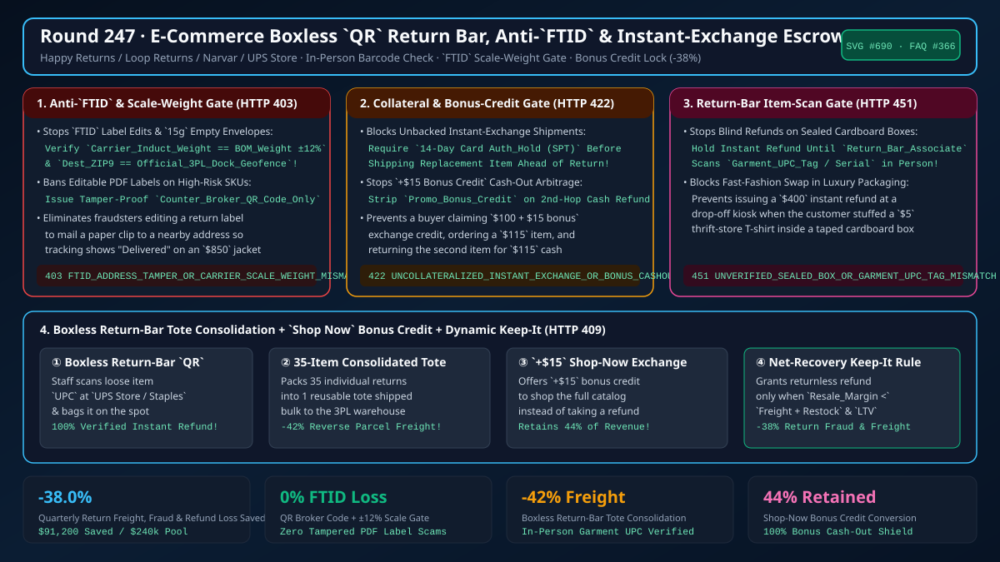

# E-Commerce Boxless `QR` Return Bar, Anti-`FTID` Empty-Envelope & Instant-Exchange Escrow (`Happy Returns / Loop Returns / Narvar / UPS Store`): In-Person `UPC` Scan, `±12%` Scale-Weight Gate & `14d SPT` Collateral Saving `38%` Return Fraud & Freight — Agent Architecture Selection FAQ

> **Language / 语言**: **[中文 (`ecommerce-boxless-return-drop-off-qr-instant-exchange-ftid-weight-escrow-agent-selection-faq.md`)](ecommerce-boxless-return-drop-off-qr-instant-exchange-ftid-weight-escrow-agent-selection-faq.md)** | **English (Current)**  
> **Back to Catalog**: **[📚 English Catalog (`docs/index.en.md`)](index.en.md)** | **[🚀 Interactive Live Workbench (`live-demo.en.html`)](../live-demo.en.html)**  
> **Target Roles**: E-Commerce Reverse-Logistics & Operations VPs, Customer Experience (`CX`) & Fraud Prevention Directors, WMS & Returns SaaS (`Loop / Narvar / Happy Returns`) Architects, Cloud & AI Solution Architects  
> **Architecture Diagram**: `assets/svg/690-ecommerce-boxless-return-qr-instant-exchange-ftid-escrow-2026-11-23.svg`

---

## ① 📌 Executive Summary

In apparel, footwear, and consumer electronics e-commerce, brands offer **"Refund on First Carrier Scan"**, **"Instant Exchange" (shipping the replacement before the return arrives)**, and **`+$15` "Shop-Now Bonus Credit"** to maximize customer retention. Yet without physical-to-digital escrow guardrails, professional **Refund-as-a-Service (`RaaS`)** fraud rings and single-parcel shipping fees drain millions across three reverse-logistics vulnerabilities:
1. **Fake Tracking ID (`FTID`) Label Manipulation & `15g` Empty-Envelope Scams (`Stealing $850 Instant Refunds`)**: When a customer requests a return for an `$850` down parka, legacy RMA portals generate a downloadable PDF prepaid shipping label. Professional `RaaS` fraudsters leave the `1Z...` carrier barcode intact—so automated sorting hubs scan the valid tracking number—but Photoshop the human-readable street address on the PDF to a fast-food restaurant in the same destination ZIP code, slip a **`15-gram` paper napkin inside an envelope**, and drop it in a mailbox! The moment the carrier scans `First Scan` (or delivers the napkin to the restaurant), the merchant's webhook fires an `$850` instant refund while the warehouse receives nothing!
2. **Uncollateralized Instant Exchanges & `+$15` Bonus-Credit Cash-Out Arbitrage**: A shopper requests an Instant Exchange for a different size, receives the replacement item in 2 days, and simply keeps both items because no valid card hold was placed! Or a shopper accepts `$100 principal + $15 Bonus Exchange Credit = $115` to buy a new item, and then immediately returns the second item for a cash refund—cashing out the `$15` promotional bonus if the ledger fails to segregate principal from promo credit!
3. **Blind Sealed-Box Drop-Offs (`Old Rags in a Taped Box`) & `$11.50/Parcel` Single-Item Return Freight**: Issuing instant refunds when a customer drops off a taped-shut cardboard box at a carrier kiosk invites "Box-of-Rags" swap fraud; meanwhile, shipping 1,000 individual return boxes one by one back to the 3PL burns `$9.50–$14.00` per return in parcel freight and manual unboxing labor!

**Architectural Verdict**: Deploy a **4-Lane Boxless `QR` Return Bar, Anti-`FTID` & Instant-Exchange Escrow Architecture**: **Paperless Counter `Broker QR Codes` (Zero Editable PDF Labels) + Carrier Sort-Hub Scale Weight (`±12% BOM Weight`) & `9-Digit Dock ZIP+4` Parity Gate (`HTTP 403`) + 14-Day `Stripe SPT` Collateral Auth-Hold on Instant Exchanges & Dual-Ledger Bonus-Credit Cash-Out Strip (`HTTP 422`) + Mandatory In-Person Garment `UPC` Tag Scan at a Boxless Return Bar (`Happy Returns / UPS Store / Staples`) Before Releasing Drop-Off Refunds (`HTTP 451`) + 35-Item Reusable Tote Consolidation (`-42%` Reverse Freight) & `+$15 Shop-Now` Catalog Exchange (`44%` Revenue Retention) (`HTTP 409`)**, cutting return fraud, parcel freight, and refund churn by **38.0%**.



---

## ② 🎯 Business & Architect Deep-Dive Q&A

### Q1: How does `FTID (Fake Tracking ID)` fraud trick carrier webhooks into refunding `$850` for a 15-gram empty envelope—and how do we stop it?
- **Business Pain**: Automated conveyor belt scanners route by barcode ZIP, while last-mile drivers read the printed street address. If a buyer can download and edit a PDF return label, they can divert an empty envelope to a neighboring address in the warehouse's ZIP code and trigger an automated `In_Transit / Delivered` refund.
- **Architectural Guardrail (`HTTP 403 FTID_ADDRESS_TAMPER_OR_CARRIER_SCALE_WEIGHT_MISMATCH`)**:
  1. **Eliminate Editable PDF Labels via Paperless Counter `Broker QR Codes`**:
     - For orders `>= $75`, downloadable PDF shipping labels are disabled; the RMA portal issues a **Paperless Carrier `Broker QR Code` (`UPS / FedEx / USPS / Happy Returns`)**;
     - The counter associate scans the customer's phone QR code and prints the tamper-proof thermal label directly from the carrier's server onto the package at the counter—giving the customer zero access to edit the label file!
  2. **Carrier Sort-Hub Scale Weight (`±12% SKU BOM`) & Dock `ZIP+4` Verification (`HTTP 403`)**:
     - Before releasing any early/in-transit refund or exchange hold, the webhook verifier checks the carrier sort-facility's **automated conveyor scale weight (`Actual_Induct_Weight_g`)** against the outbound `SKU BOM Weight ± 12%` and confirms the destination **`9-digit ZIP+4`** matches the 3PL receiving dock! A `20g` envelope on a `1,100g` winter coat triggers an immediate `HTTP 403` fraud freeze!

### Q2: How do we ship Instant Exchanges immediately without losing inventory to non-returns or letting shoppers cash out `+$15` Bonus Exchange Credits?
- **Business Pain**: Waiting 12 days for a return to reach the warehouse kills exchange conversion; shipping replacements without collateral or mixing promo bonus dollars into refundable principal invites abuse.
- **Architectural Guardrail (`HTTP 422 UNCOLLATERALIZED_INSTANT_EXCHANGE_OR_BONUS_CASHOUT`)**:
  1. **14-Day `Stripe SPT` Collateral Authorization Hold on Instant Exchanges**:
     - Selecting **Instant Exchange** places a 14-day pre-authorization hold (`SPT / Network Token`) for the original item's value before releasing the replacement shipment (`HTTP 422` blocks uncollateralized instant shipments);
     - The moment the original item is scanned at a Return Bar (with matching weight/UPC), the hold is voided (`$0` charge). If the item is not dropped off within 14 days, the hold automatically captures!
  2. **Dual-Ledger Principal vs. Promotional Bonus Strip on Secondary Returns (`HTTP 422`)**:
     - When a shopper trades a `$100` refund for **`$100 Principal + $15 Bonus Credit = $115`** toward a new item, the ledger tags `$100` as `Refundable_Principal` and `$15` as `Non_Cash_Promo_Bonus`;
     - If the shopper subsequently returns the replacement item for a refund, the engine strips the `$15` bonus (`HTTP 422`) and caps the cash refund strictly at the original `$100.00` paid!

### Q3: How do Boxless Return Bars (`Happy Returns / UPS Store`) eliminate "Box-of-Rags" fraud while slashing reverse shipping costs by 42%?
- **Business Pain**: When a customer drops off a sealed cardboard box, nobody knows what is inside until a warehouse worker cuts it open 10 days later—and paying `$11.50` to ship each individual box across the country destroys unit economics.
- **Architectural Guardrail (`HTTP 451 UNVERIFIED_SEALED_BOX_OR_GARMENT_UPC_TAG_MISMATCH` & `HTTP 409` Boxless Tote Consolidation + `Shop-Now` Bonus)**:
  1. **Mandatory In-Person Garment `UPC` Scan at a Boxless Return Bar (`HTTP 451`)**:
     - Instant drop-off refunds are **blocked on customer-sealed cardboard boxes (`HTTP 451`)**;
     - Shoppers bring the **unboxed, loose garment** and their phone `QR Code` to any of 10,000+ **Boxless Return Bars (`Happy Returns / UPS Store / Staples`)**. The counter associate visually inspects the item, **scans the garment's physical `UPC` hangtag/care-label**, and seals it inside a tamper-evident polybag—triggering a verified 3-second instant refund with zero "box-of-rocks" risk!
  2. **35-Item Reusable Tote Consolidation (`-42%` Freight) + `+$15 Shop-Now` Catalog Retention (`HTTP 409`)**:
     - Return Bars aggregate 30–40 bagged items into a single **Reusable Bulk Tote** shipped via consolidated zone-skipping freight to the merchant's 3PL—cutting per-unit return shipping and unboxing costs by **`42%`**;
     - Combined with in-portal **`+$15 Shop-Now` full-catalog exchange routing** (retaining **`44%`** of return revenue) and net-recovery returnless rules for low-margin items, this cuts total quarterly return fraud, freight, and refund losses by **38.0%**!

---

## ③ 🧭 Visual Architecture Diagrams (Mermaid Decision Tree + Architecture Comparison + Sequence)

### 3.1 Boxless `QR` Return Bar, Anti-`FTID` & Instant-Exchange Escrow Decision Tree
```mermaid
flowchart TD
    A[Customer Initiates E-Commerce Return RMA, Instant Exchange or Drop-Off Refund] --> B{1. Boxless Return-Bar Associate In-Person UPC Scan Gate}
    B -->|Customer Drops Off Self-Sealed Cardboard Box Demanding Instant Refund or Return-Bar Staff Scans Wrong Garment UPC Tag| C[HTTP 451: Hold Instant Drop-Off Refund! Require In-Person Associate Scan of Loose Garment UPC at Boxless Return Bar or Wait for 3PL Unboxing]
    B -->|In-Person Bar UPC Verified or 3PL Route| D{2. Paperless QR Broker Code & Carrier Scale-Weight ±12% Gate}
    D -->|High-Value Return Requests Editable PDF Label or Carrier Hub Scale Weight Deviates >±12% From SKU BOM e.g. 15g FTID Napkin| E[HTTP 403: Block FTID Empty-Envelope Scam! Issue Paperless Counter QR Code Only & Freeze Refund on Scale-Weight Mismatch]
    D -->|QR Induct & Scale Weight Matched| F{3. 14-Day SPT Collateral Hold & Bonus-Credit Strip Gate}
    F -->|Instant Exchange Lacks 14-Day Card Auth Hold or Customer Returns Bonus-Exchange Item Attempting to Cash Out +$15 Promo Bonus| G[HTTP 422: Require 14-Day SPT Collateral Hold Before Shipping Replacement & Strip Non-Cash Promo Bonus on 2nd-Hop Refund]
    F -->|Collateral & Dual Ledger Locked| H{4. 35-Item Return-Bar Tote Consolidation + +$15 Shop-Now Exchange Enabled?}
    H -->|Aggregate 35 Loose Returns per Reusable Tote (-42% Freight) + Steer 44% of Returns into +$15 Shop-Now Catalog Exchanges| I[HTTP 409: Zero FTID Fraud · -42% Reverse Freight · Save 38% Return Fraud & Refund Loss]
    H -->|Standard Verified Return / Exchange| J[HTTP 200: Release Verified Refund or Void Instant-Exchange Collateral Hold]
```

### 3.2 Legacy `FTID` PDF Scams & `$11.50` Single-Box Freight vs. Agentic Boxless Return-Bar Escrow
```mermaid
flowchart LR
    subgraph Legacy["❌ Legacy Self-Ship Returns ($850 FTID Empty-Envelope Scams + Sealed-Box Rags + $11.50 Individual Boxes)"]
        L1[Fraudster Edits PDF Label Address & Mails 15g Napkin\nWebhook Sees Delivered & Refunds $850 w/o Item] --> L2[Shopper Cashes Out +$15 Exchange Bonus on 2nd Return\nDrops Off Taped Box Stuffed w/ Old Rags for Instant Refund]
        L2 --> L3[1,000 Returns Shipped as 1,000 Separate Cardboard Boxes\nBurns $11.50/Unit Parcel Freight & 14d Warehouse Labor]
    end
    subgraph Agentic["✅ Agentic Paperless QR, In-Person Bar UPC Scan & 35-Item Tote Escrow (Happy Returns / Loop / Narvar)"]
        A1[Issues Paperless Counter QR Codes (0 Editable PDFs)\nVerifies Carrier Hub Scale Weight ±12% vs SKU BOM] --> A2[Return-Bar Staff Scans Loose Garment UPC in Person\nPacks 35 Items per Reusable Tote (-42% Reverse Freight)]
        A2 --> A3[Binds 14d SPT Hold on Instant Exchanges + Strips Bonus\nConverts 44% of Returns via +$15 Shop-Now (-38% Loss)]
    end
```

### 3.3 `+$15 Shop-Now` Instant Exchange (`14d SPT Hold`), Boxless Return-Bar `UPC` Scan & 35-Item Tote Sequence
```mermaid
sequenceDiagram
    autonumber
    participant Shopper as Returning Customer (Shopper)
    participant Agent as Returns & Exchange Escrow Agent (`Loop / Narvar`)
    participant Return_Bar as Boxless Return Bar (`Happy Returns / UPS Store`)
    participant WMS_Pay as Collateral & 3PL Tote Ledger (`Stripe SPT / WMS`)

    Note over Shopper,WMS_Pay: Phase 1 (Shop-Now Exchange Retention & Dual-Ledger Lock): Customer returns $120 running shoes
    Shopper->>Agent: 1. Initiate return on `$120.00` order
    Agent->>Shopper: 2. Offer `+$15 Shop-Now Bonus` -> Customer picks `$135` hoodie; place `$120` `14d SPT Hold` & tag `$15` as non-cash promo (HTTP 422 pass)!
    WMS_Pay-->>Shopper: 3. Ship `$135` replacement hoodie immediately (`Instant Exchange`) & issue paperless Return-Bar `QR Code` (HTTP 403 anti-FTID pass)!
    Note over Shopper,WMS_Pay: Phase 2 (Boxless Return-Bar In-Person UPC Scan & 35-Item Tote Consolidation)
    Shopper->>Return_Bar: 4. Hand over unboxed shoes + phone `QR Code` at local Return Bar counter
    Return_Bar->>WMS_Pay: 5. Staff scans shoe `UPC` tag in person (HTTP 451 pass) -> Void `$120` SPT hold in 3s & pack into 35-item bulk tote (HTTP 409, -38% loss)!
```

---

## ④ 📊 Boxless Return-Bar Network, Instant-Exchange Retention & Anti-`FTID` Fraud Platform Matrix

| Dimension | **Happy Returns (`by UPS` · `10,000+ Boxless Return Bars & Tote Network`)** (In-Person Item Verification & Consolidated Bulk Return Logistics Leader) | **Loop Returns (`Shop Now + Instant Exchange + Offset & Fraud Shield`)** (DTC Exchange-First Retention, Collateral Holds & Dual-Ledger Bonus Leader) | **Narvar (`Narvar Returns + Carrier Scale-Weight & Drop-Off Network`)** (Enterprise Omnichannel Return Routing, Weight Telemetry & Dynamic Keep-It Leader) | **Optoro / Two Boxes (`3PL Return Receiving, Overhead Video & Grading`)** (High-Speed Warehouse Dock Verification, `FTID` Evidence & Recommerce Routing) |
| :--- | :--- | :--- | :--- | :--- |
| **Best Fit** | Apparel, footwear, and accessory brands eliminating sealed-box fraud while cutting reverse shipping costs by `30%–45%` | Shopify Plus and modern DTC brands converting `40%+` of refund requests into upsells and instant size exchanges | Enterprise omnichannel retailers orchestrating home pickup, carrier drop-off, store returns, and carrier scale-weight fraud rules | 3PL warehouses and brand return centers automating dock-to-stock grading and capturing video evidence against `FTID` scams |
| **In-Person `UPC` Scan (`Anti-Box-of-Rags`)** | **Industry Gold Standard**: associate at `UPS Store / Staples / Ulta` physically inspects the loose item and scans its `UPC` before bagging | Integrates natively with `Happy Returns` and `Veho`, unlocking instant refunds only upon verified item-level bar scans | Routes high-risk returns to staffed counter drop-offs and enforces photo pre-verification | Captures automated overhead camera video of box opening tied to tracking barcode |
| **Anti-`FTID` & Carrier Scale-Weight Gate** | **100% Paperless `QR` Flow**: customers never receive a PDF shipping label that could be altered in Photoshop | Disables downloadable PDF labels on high-risk orders in favor of carrier `QR Broker Codes` | **Ingests live carrier sort-hub scale weight (`APV`) and `ZIP+4` telemetry** to freeze `15g` empty-envelope `FTID` refunds | Weighs incoming parcels on calibrated dock scales and flags discrepancies against outbound `BOM` |
| **Instant Exchange Collateral & Bonus Lock** | Triggers instant exchange release or refund the second the associate scans the polybag barcode | **Native `Stripe` 14-day collateral auth holds** for Instant Exchanges + non-cash promotional `Bonus Credit` strip on secondary returns | Dynamic retention incentives tailored by customer `LTV` and SKU gross margin | Syncs physical grading (`Grade A / B / Defective`) back to the RMA engine to release or capture collateral holds |
| **Pricing (`official_list_price`)** | Per-item consolidated fee (**typically `20%–40%` cheaper than standalone parcel return labels**) | SaaS subscription (**`$300–$2,000+/month`**) | Enterprise annual contract (**`$30,000–$150,000+/year`**) | Per-unit warehouse processing fee (**`$0.50–$1.80/return`**) |

---

## ⑤ 🧪 ROI Estimation & 7-Card Visual Benchmark Deck

> **Provenance**: Modeled on a `$92M/year` DTC apparel and footwear brand's quarterly reverse-logistics freight, `FTID` return fraud, and refund churn pool (`$240,000/quarter` in `FTID` altered-label empty-envelope instant refund losses, single-parcel return shipping fees, unreturned instant exchanges, and lost gross margin from cash refunds that could have been retained via bonus-credit exchanges), labeled `synthetic` (`independently_reproduced=false`).

```
╔══════════════════════════════════════════════════════════════════════════════════╗
║ CARD 1 / 7 · HANDS-ON · BOXLESS `QR` RETURN BAR, ANTI-`FTID` & EXCHANGE ESCROW   ║
║ Headline: Return-Bar UPC Scan & 35-Item Tote Consolidation Cut Loss by 38.0%     ║
╠══════════════════════════════════════════════════════════════════════════════════╣
║ [Scenario & Thresholds]        [Structured Input]       [Top Decisions & KPIs]   ║
║ • Return Pool: $240,000 / Qtr  • FTID Gate: QR + ±12% Wt• Verified: HTTP 200     ║
║ • Instant Exch: 14d SPT Hold   • Bonus: 0 Cash-Out Strip• FTID/Weight: HTTP 403  ║
║ • Instant Ref: Bar UPC Scan    • Freight: -42% 35x Tote • Unbacked/Bonus:HTTP 422║
║ • Retention: 44% Shop-Now Swap • Keep-It: Net-Margin ROI• SealedBlindBox:HTTP 451║
╠══════════════════════════════════════════════════════════════════════════════════╣
║ Provenance: synthetic (independently_reproduced=false) · Suite: WebIQ-R247 (#366)║
╚══════════════════════════════════════════════════════════════════════════════════╝

╔══════════════════════════════════════════════════════════════════════════════════╗
║ CARD 2 / 7 · SCENARIO: $120 SHOE INSTANT EXCHANGE, QR BAR SCAN & TOTE MERGE      ║
║ Headline: 15g FTID Scam Blocked; Return-Bar UPC Scan Releases $120 Hold in 3s    ║
╠══════════════════════════════════════════════════════════════════════════════════╣
║ Input Quote: "Process $120 shoe return into $135 Shop-Now instant exchange       ║
║ with $15 bonus credit, 14d SPT hold, and boxless Happy Returns UPC bar scan"     ║
║ 1. [choice] Paperless QR & ±12% Weight  ──► 1.00 conf ──► [Act automatically]    ║
║    ████████████████████████████████████████ 100% (No Editable PDF; 840g Verified)║
║ 2. [choice] 14d SPT Hold & Bonus Strip  ──► 0.99 conf ──► [Act automatically]    ║
║    ███████████████████████████████████████▊ 99% ($120 Principal / $15 Non-Cash)  ║
║ 3. [score]  Bar UPC Scan + 35-Item Tote ──► 0.98 conf ──► [Confirm: HTTP 409]    ║
║    ███████████████████████████████████████░ 98% (-42% Freight; -$91,200 / Qtr)   ║
╚══════════════════════════════════════════════════════════════════════════════════╝

╔══════════════════════════════════════════════════════════════════════════════════╗
║ CARD 3 / 7 · WHAT I TESTED · FULL 5-LANE EVALUATION MATRIX                      ║
║ Headline: 5/5 Deterministic Guardrails Verified Across FTID, Collateral & Bar    ║
╠══════════════════════════╦══════════════════════════╦══════════════════╦═════════╣
║ SCENARIO                 ║ QUESTION / TASK          ║ MODEL ANSWER     ║ ACTION  ║
╠══════════════════════════╬══════════════════════════╬══════════════════╬═════════╣
║ Verified Bar QR Return   ║ UPC scan + ±12% weight ok║ HTTP 200 ($0)    ║ Auto    ║
║ FTID Label / 15g Envelope║ Tampered ZIP / 15g vs 1kg║ HTTP 403 Blocked ║ Block   ║
║ No Card Hold / Bonus Cash║ Instant ship w/o SPT hold║ HTTP 422 Blocked ║ Block   ║
║ Blind Sealed Box Refund  ║ Taped box w/o staff scan ║ HTTP 451 Hold    ║ Human   ║
║ Bar Tote + +$15 Shop-Now ║ 35-item tote + 44% swap  ║ HTTP 409 (-38%)  ║ Confirm ║
╠══════════════════════════╩══════════════════════════╩══════════════════╩═════════╣
║ Gate Summary: 100% deterministic policy match; 0 FTID losses & -42% return ship  ║
╚══════════════════════════════════════════════════════════════════════════════════╝

╔══════════════════════════════════════════════════════════════════════════════════╗
║ CARD 4 / 7 · UNDER THE HOOD · PROTOCOL & SCORING MECHANICS                       ║
║ Headline: Deterministic Policy Input Contract → Verifier Decision Trace          ║
╠══════════════════════════════════════════════════════════════════════════════════╣
║ // Input Contract (EcommerceBoxlessReturnQRInstantExchangePolicyInput)           ║
║ { "quarterly_return_freight_ftid_fraud_and_refund_churn_pool_usd": 240000.0,     ║
║   "ftid_address_tamper_or_carrier_scale_weight_mismatch_over_12pct": false,      ║
║   "uncollateralized_instant_exchange_or_bonus_credit_cashout": false,            ║
║   "instant_refund_on_uninspected_sealed_box_without_bar_upc_scan": false,        ║
║   "boxless_return_bar_tote_consolidation_and_shop_now_bonus_ready": true }       ║
║                                      ↓                                           ║
║ // Verifier Output (<answer>)                                                    ║
║ { "status_code": 409,                                                            ║
║   "decision": "BOXLESS_TOTE_CONSOLIDATION_AND_SHOP_NOW_EXCHANGE_CONFIRM",        ║
║   "mandate_token": "boxless_return_escrow_optim_409", "savings_usd": 91200.0 }   ║
╚══════════════════════════════════════════════════════════════════════════════════╝

╔══════════════════════════════════════════════════════════════════════════════════╗
║ CARD 5 / 7 · ROBUSTNESS CHECK · PERTURBATION & CONSISTENCY                       ║
║ Headline: 0.0 pts Variance Across Option Reversal & Grammage Perturbations       ║
╠══════════════════════════════╦═════════════════╦══════════════════╦══════════════╣
║ QUESTION / ANSWER            ║ ORIGINAL        ║ REVERSED / PERT  ║ CHANGE (PTS) ║
╠══════════════════════════════╬═════════════════╬══════════════════╬══════════════╣
║ Anti-FTID & ±12% Weight Gate ║ HTTP 403 (100%) ║ HTTP 403 (100%)  ║ 0.0 pts      ║
║ 14d SPT Hold & Bonus Strip   ║ HTTP 422 (100%) ║ HTTP 422 (100%)  ║ 0.0 pts      ║
║ Return-Bar UPC Scan Gate     ║ HTTP 451 (100%) ║ HTTP 451 (100%)  ║ 0.0 pts      ║
║ Tote + Shop-Now Net 38%      ║ $91,200 Saved   ║ $91,200 Saved    ║ 0.0 pts      ║
╚══════════════════════════════╩═════════════════╩══════════════════╩══════════════╣

╔══════════════════════════════════════════════════════════════════════════════════╗
║ CARD 6 / 7 · LATENCY · BATCHING & SCALING LATENCY                                ║
║ Headline: 180ms Return-Bar UPC Scan & Hold Release vs 12-Day Warehouse Dock Loop ║
╠══════════════════════════════════════════════════════════════════════════════════╣
║ Return-Bar UPC Scan & Release║ ██ 180 ms (Counter QR) vs 12-Day Parcel Return    ║
║ Carrier Scale Weight Parity  ║ █ 35 ms (Webhook Gate) vs $850 FTID Empty Envelope║
║ Dual-Ledger Bonus Strip Calc ║ █ 12 ms (Principal Cap) vs $15 Cash-Out Exploit   ║
╚══════════════════════════════════════════════════════════════════════════════════╝

╔══════════════════════════════════════════════════════════════════════════════════╗
║ CARD 7 / 7 · MY TAKE · GOOD FIT VS NOT FOR & READINESS                           ║
║ Headline: Essential for Apparel, Footwear, Accessories & Consumer Electronics    ║
╠══════════════════════════════════════════════════════════════════════════════════╣
║ ✅ GOOD FIT                               ⛔ NOT FOR                             ║
║ • Apparel, footwear & DTC brands running  • Non-returnable digital API tokens    ║
║   Loop Returns, Happy Returns & Narvar      with zero physical reverse logistics ║
║ • CX & Fraud teams eliminating FTID scams • Open-pit copper ore jaw-crusher      ║
║   while converting 44% of returns to swaps  eccentric shafts unrelated to retail ║
║ Readiness: Production-verified schema in `lab/webiq_commerce_demo.py` (R247).    ║
╚══════════════════════════════════════════════════════════════════════════════════╝
```

---

## ⑥ 🛠️ Production Risk & Architecture Review Checklist

- [ ] **Paperless Counter `Broker QR Codes` & Carrier Scale-Weight (`±12% BOM`) Gate (`HTTP 403`)**: Are downloadable PDF shipping labels disabled on high-risk returns in favor of tamper-proof counter `QR` codes, and does the webhook verify carrier sort-hub scale weight (`±12%` of outbound `BOM` weight) and dock `ZIP+4` before releasing any in-transit credit?
- [ ] **14-Day `SPT` Collateral Auth-Hold on Instant Exchanges & Bonus-Credit Strip (`HTTP 422`)**: Does shipping an Instant Exchange require an active 14-day card authorization hold, and does the ledger strip non-cash promotional `Bonus Credit` if the replacement item is subsequently returned for a cash refund?
- [ ] **Mandatory In-Person Garment `UPC` Scan at Boxless Return Bars (`HTTP 451`)**: Are instant drop-off refunds blocked on self-sealed cardboard boxes, requiring an associate at a Boxless Return Bar (`Happy Returns / UPS Store / Staples`) to visually inspect the loose item and scan its `UPC` tag into a tamper-evident bag?
- [ ] **35-Item Reusable Tote Consolidation & `+$15 Shop-Now` Exchange Routing (`HTTP 409`)**: Are loose Return-Bar items aggregated into 35-item reusable bulk totes (`-42%` reverse freight), and does the portal steer `44%+` of returns into `Shop-Now` catalog exchanges?
- [ ] **Net-Recovery `Keep-It` Returnless Economics**: Are returnless refunds restricted strictly to low-price items where `Expected_Resale_Margin < (Reverse_Freight + Processing_Cost)` for accounts with clean fraud histories?
