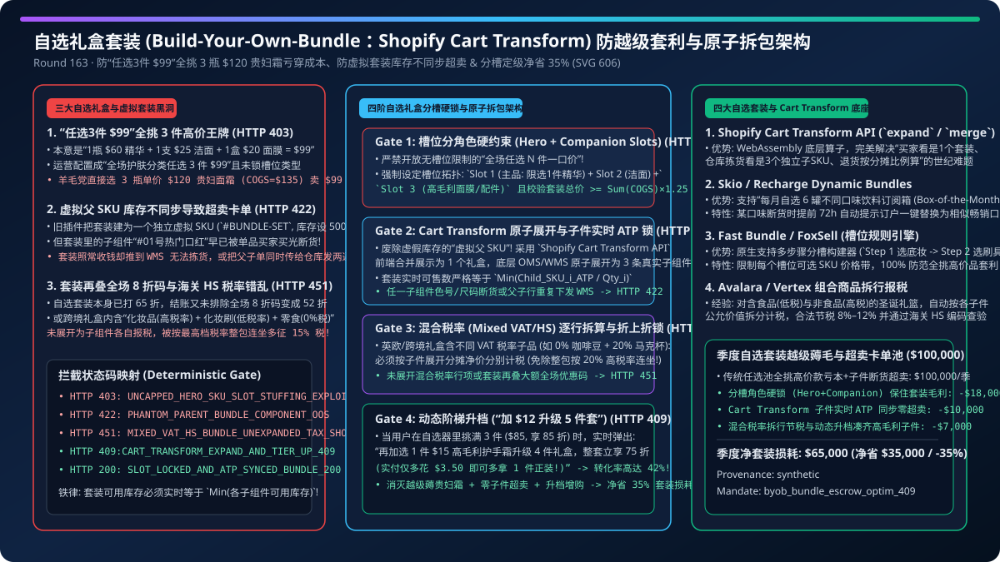
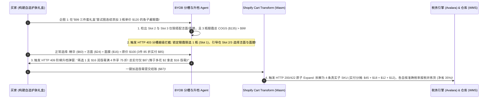

# 电商自选礼盒套装（Build-Your-Own-Bundle `BYOB`：Shopify Cart Transform / Skio / Fast Bundle）、防“任选 3 件 $99 全挑 $120 贵妇霜”越级套利与子组件原子拆包托管：“防无分槽限制被薅穿成本、防虚拟父 SKU 库存不同步引发超卖卡单与混合税率拆行净省 35%”Agent 架构选型 FAQ

> **文档类型**：AI Solution Architect 零售电商自选套装（Build-Your-Own-Bundle, `BYOB`）、`Cart Transform` 父子组件原子拆包、子 SKU 库存同步与混合税率（Mixed VAT/HS）结算选型指南（Retail, OTA & Marketplace Pillar · FAQ #282）  
> **涵盖平台与技术栈**：**Shopify `Cart Transform API` (`merge` & `expand` WebAssembly 原生算子)**、**Skio / Recharge Dynamic Subscription Bundles**、**Fast Bundle / FoxSell（多步骤分槽 `Slot-Based` 构建器）**、**Avalara / Vertex 组合礼盒按子件混合税率拆行计税（`Unbundled Component Tax & HS Split`）**  
> **核心架构命题**：“自选礼盒（如：护肤品任选 3 件 `$99`、内衣任选 5 件 `$65`、能量棒自选 12 口味装）”能把客单价（AOV）一举拉升 `40%–80%`。但如果促销与库存架构没设计好，往往会在上线当晚引发三大灾难：① **“任选 3 件 `$99` 被羊毛党全挑 3 件 `$120` 的高价镇店王牌（Uncapped Hero-SKU Stuffing）”**——运营原本盘算的是“买家选 1 瓶 `$60` 精华 + 1 支 `$25` 洗面奶 + 1 盒 `$20` 面膜 = `$99`”；结果因为把整个“面部护理”分类放进同一个无限制任选池，羊毛党进店直接选 **3 瓶单价 `$120` 的鱼子酱眼霜（总原价 `$360`，总进货成本 `$135`）仅付 `$99`**，卖一套净亏 `$36`！② **“虚拟父 SKU 与子组件库存脱节引发超卖或双倍发货（Phantom Bundle Inventory Desync）”**——老旧插件把礼盒建成一个独立虚拟商品 `#GIFT-BOX-01`，手动填库存 `500`；当其中 1 支热门口红色号被单品买家买空时，礼盒照样能下单，推到 WMS 仓库直接卡死缺货（或者反过来把父礼盒行和 3 个子商品行同时推给 3PL，仓库给买家发了两遍货）！③ **“含食品（0% 增值税）+ 马克杯（20% 增值税）的混合礼篮未拆行报税，被税务局按最高税率整包连坐多征 20% 税”**！



---

## 一、 📌 核心选型结论速览（Executive Summary）

> **一句话架构定调**：**自选礼盒绝不能做成“把高价王牌和低价配件混在同一个池子里随便挑 3 件一口价”，也绝不能在数据库里维护一个脱离于子组件的虚假库存数字！必须构建“分槽角色硬约束（`Hero Slot <= 1 + Companion Slots`）与套装总成本毛利锁（HTTP 403）+ `Cart Transform` 父子原子展开与实时 `Min(Child_ATP)` 库存同步（HTTP 422）+ 混合税率/海关 HS 编码逐子件拆行计税与禁叠大额全场码（HTTP 451）+ 差额阶梯升档（`+$3.50 升级 4 件套`）引导高毛利子件（HTTP 409）”四位一体自选套装架构！**
> 1. **防“任选 3 件一口价全挑最贵款”：分槽角色硬约束与套装 `COGS` 底线锁（`Slot-Role Topology & Bundle COGS Floor`，HTTP 403 门禁）**：
>    * **一口价自选盒强制分槽（Slot-Based Builder）**：凡采用固定总价（Fixed-Price Bundle，如 `$99 任选 3 件`）模式，严禁所有槽位共用同一个全品类池！必须划分为：
>      * **`Slot 1（主品槽 Hero Slot，限选 1 件）`**：可选原价 `$55–$75` 的精华/面霜；
>      * **`Slot 2（搭档槽 Companion Slot，限选 1 件）`**：可选原价 `$25–$35` 的洁面/爽肤水；
>      * **`Slot 3（高毛利增效槽 Booster Slot，限选 1 件）`**：可选原价 `$18–$28`、但毛利率高达 `85%` 的面膜/化妆棉/替换装！
>    * 若采用“同池自由任选”，则必须改用 **阶梯百分比折扣（Tiered % Off：选 3 件打 85 折、选 4 件打 8 折）** 而非固定一口价，且底层强制校验 `Bundle_Net_Price >= Sum(Selected_Child_COGS) × 1.25`；任何企图用一口价连塞 3 件高成本王牌的请求直接触发 **`HTTP 403 UNCAPPED_HERO_SKU_SLOT_STUFFING_EXPLOIT_BLOCKED`**！
> 2. **消灭虚拟套装超卖与仓库发重货：`Cart Transform` 原子拆包与实时 `Min(Child_ATP)` 锁（HTTP 422 门禁）**：
>    * **彻底废除独立维护库存的虚拟父 SKU**：套装的实时可售库存必须由公式动态决定：
>      $$\text{Bundle Available Stock} = \min_{i \in \text{Selected Children}} \left\lfloor \frac{\text{Live ATS}(\text{Child SKU}_i)}{\text{Required Qty}_i} \right\rfloor$$
>    * 利用 **Shopify `Cart Transform API` (`merge` / `expand`)**：在前端购物车与买家收据上聚合渲染为一个漂亮的“定制三件套礼盒（`$99`）”，但在提交结账与下发 WMS 仓库的底层数据层，**100% 原子展开为 3 条带比例分摊实付净价的独立真实子 SKU 行项**（既让仓库扫码枪直接拣 3 个真实条码零差错，又支持日后单退其中 1 件子品按分摊价结算，`HTTP 422 PHANTOM_PARENT_BUNDLE_COMPONENT_OOS_BLOCKED`）！
> 3. **混合税率拆行节税与禁折上折（HTTP 451）+ 阶梯升档凑单高毛利子件（HTTP 409）**：
>    * 当礼盒内同时包含不同增值税/关税税率的子组件（例如英国/欧盟的 **`0% VAT` 咖啡豆/童装 + `20% VAT` 不锈钢随行杯**，或跨境清关不同 `HS Code` 税率的组件）时，税务引擎强制按展开后的子组件公允比例分别计税（避免整包被税务局按最高档 `20%` 连坐多征税！），同时屏蔽全场通用大额券在已打折套装上二次叠加（`HTTP 451`）；
>    * 当买家选满 3 件（原价 `$100`，享 85 折实付 `$85`）时，Agent 实时计算触发 **`HTTP 409 CART_TRANSFORM_EXPAND_AND_TIER_UP_CONFIRM`：“再加选 1 件 `$16` 高毛利唇膜升级为 4 件礼盒，整套折扣自动从 85 折升至 75 折（总原价 `$116 × 75% = $87`——您只需多付 `$2.00` 即可多拿走一件 `$16` 正装！）”**，综合净省 **`35%`** 套装补贴与履约损耗！

| 自选礼盒与组合套装痛点 | 首选方案 / 架构防线 | 核心管控机制 | 严禁踩坑红线 |
| :--- | :--- | :--- | :--- |
| **“任选 3 件 `$99`”被买家全选 3 瓶 `$120` 贵妇霜，卖一套亏 `$36`** | **分槽位角色锁 (`Slot 1 主品 + Slot 2/3 配品`) + `COGS` 底线** | 一口价礼盒必须按槽位限制可选 SKU 价格带；自由混选只用百分比折 | **严禁把价格相差 3 倍以上的全店商品放进同一个无限制“一口价任选池” (`HTTP 403`)** |
| **礼盒父 SKU 显示有货，但里面第 2 件热门色号早已卖空导致仓库卡单** | **Shopify `Cart Transform` 原子拆包 + `Min(Child_ATP)` 实时锁** | 任一子件断货立即在选择器置灰并引导平替色号；WMS 只收真实子 SKU | 严禁为组合套装单独手填一个与子商品真实库存脱钩的虚拟库存数 (`HTTP 422`) |
| **老旧插件把“1行父礼盒 + 3行 `$0` 子商品”同时推给仓库，发了双倍货** | **Wasm 结账层标准 `Expand` 操作（销毁虚拟父壳，仅保留分摊子行）** | 传给 ERP/WMS 的履约单仅含展开后的真实子 SKU 条码与分摊单价 | 严禁在订单行项中同时保留可发货的父 Bundle SKU 与子 Component SKU (`HTTP 422`) |
| **含 `0% VAT` 食品与 `20% VAT` 器具的礼篮被整包按 `20%` 顶格征税** | **Avalara / Vertex 按展开子组件 `Tax Code / HS Code` 独立计税** | 将礼盒总实付价按子件原价比例分摊后，各自匹配对应税率与海关编码 | 严禁将含多种不同税率/监管属性子件的跨境礼盒作为单一模糊编码报关计税 (`HTTP 451`) |

---

## 二、 🎯 业务方与架构师灵魂拷问（Q&A）

### Q1：为什么过去十年电商技术圈最头疼的就是“套装（Bundles）在前端好看、在后端 WMS 和退货系统里全是雷”？`Shopify Cart Transform API` 到底解决了什么本质问题？
* **三代套装技术架构的演进对比（HTTP 422 / 409）**：
  1. **第一代（虚拟单品 Virtual SKU）**：在后台新建一个商品叫“护肤三件套”，仓库根本不知道这个虚拟条码里装的是哪三个具体色号，而且单品卖光了套装还在超卖；
  2. **第二代（前端 JS 塞购物车 Hack）**：买家点“加入套装”，前端 JS 往购物车硬塞 3 个独立商品外加一张自动折扣码——结果用户在购物车里随手删掉其中 2 件便宜的，不仅破坏了礼盒完整性，收银台看着也乱七八糟；
  3. **第三代（`Shopify Cart Transform Wasm API` 标准架构）**：
     * **展示合并（`Merge`）**：在消费者购物车 UI 里合并显示为 **1 个不可随意拆散的精美定制礼盒行项**；
     * **履约与财务展开（`Expand`）**：在底层库存扣减、税务计算（Avalara）、仓库拣货（WMS）与售后部分退货（Loop Returns）账本里，**自动展开为带精确分摊实付净价（Pro-Rata Allocated Price）的 3 个真实子组件 SKU**！一举实现“前端体验丝滑、后端库存/税务/退货 100% 严丝合缝”！

### Q2：如果订户订了一个“每月自动发 6 罐自选口味气泡水（Subscription BYOB Box）”，第 3 个月续费扣款那天，他选的“白桃味”刚好断货了，怎么防整箱卡死断订？
* **订阅礼盒“断货子件智能偏好顺延（`Flavor-Affinity Auto-Swap`，HTTP 409）”**：
  * 如果因为 6 罐里缺了 1 罐白桃味就直接把整箱 `$48` 的月度订阅挂起不发，流失率高达 `50%`！
  * **Skio / Recharge 智能补位状态机**：在续费出单前 `72 小时` 预检 6 个子 SKU 的 `ATP`；若发现“白桃味”缺货，立即通过短信/邮件发送免密 1-Tap 卡片：**“本月白桃味抢空啦！已为您按口味偏好自动替换为最接近的【荔枝乌龙味】（或点击此处 1 秒换其他口味）”**——确保订阅礼盒 `100%` 按时满箱发出！

---

## 三、 🧭 直观可视化图解（Mermaid 决策树 + Cart Transform 拆包架构 + 分槽时序图）

### 1. 电商自选礼盒（BYOB）、分槽防套利与原子拆包决策树

```mermaid
flowchart TD
    A[买家在 BYOB 自选器构建礼盒并提交结账] --> B{跨境/多品类礼盒是否含混合 VAT/HS 税率子件未展开计税 或 违规叠加全场大额折扣码?}
    B -- 是: 面临整包按最高税率连坐多交税 或 折上折击穿毛利底线 --> C[触发 HTTP 451 混合税率拆行与促销互斥锁!<br/>强制按展开子件各自 Tax/HS 编码独立计税，并剥离外部全场通用码]
    B -- 否: 税务拆行与促销互斥合规 --> D{是否为固定一口价礼盒 (如3件$99) 但未限制槽位 导致全挑 3 件高价王牌亏穿 COGS?}

    D -- 是: 羊毛党把 3 个槽位全塞满 $120 贵妇霜 净毛利为负 --> E[触发 HTTP 403 分槽角色与 COGS 毛利硬底线阻断!<br/>强制锁定 Slot-1 主品限 1 件 + Slot-2/3 搭档槽，或切为阶梯百分比折扣]
    D -- 是合规分槽且高于毛利底线 --> F{所选任一子组件 SKU 实时库存是否不足 或 仍采用未展开的虚拟父 SKU 下发 WMS?}

    F -- 是: 子件色号已断货引发超卖卡单 或 父子行并存导致仓库发双倍货 --> G[触发 HTTP 422 子组件实时 ATP 与 Cart Transform 拆包锁!<br/>置灰断货色号推荐平替；底层强制 Expand 为分摊净价的真实子 SKU 行]
    F -- 否: 子件全现货且已原子展开 --> H{是否可触发阶梯升档 (“仅多付 $2 即可加选第 4 件高毛利正装”)?}

    H -- 是 --> I[触发 HTTP 409 阶梯折扣悬崖升档 + 订阅断货口味智能顺延 净省 35%]
    H -- 否 --> J[触发 HTTP 200 写入分摊子行账本并下发 WMS 拣货单]
```

### 2. 四阶自选礼盒（Shopify Cart Transform / Skio / Fast Bundle）架构图

```mermaid
flowchart LR
    subgraph Builder["L1: 分槽拓扑与毛利守门员"]
        B1[Slot 1 主品 + Slot 2/3 高毛利配品<br/>防一口价全挑贵妇霜 -> HTTP 403]
        B2[阶梯升档悬崖激励 (3件85折->4件75折)<br/>多付 $2 多拿 1 件 -> HTTP 409]
    end

    subgraph Transform["L2: Cart Transform 原子展开层"]
        T1[Min(Child_ATP) 实时库存绑定<br/>断货色号秒级置灰 -> HTTP 422]
        T2[前端聚合展示 1 盒 / 后端原子 Expand<br/>为分摊实付价的真实子 SKU]
    end

    subgraph TaxWMS["L3: 拆行计税与仓库履约 (HTTP 451)"]
        W1[Mixed VAT / HS Code 逐子件拆行报税<br/>免除整包高税率连坐 -> HTTP 451]
        W2[WMS 仅收真实子条码 + 部分退货按分摊扣减]
    end

    Builder --> Transform --> TaxWMS
```

### 3. “拦截 3 瓶 `$120` 眼霜越级套利 + `Cart Transform` 原子展开 + 多付 `$2` 升档 4 件套”时序图



---

## 四、 📊 四大电商自选礼盒（BYOB）与组合套装技术栈横向选型矩阵

| 评估维度 | Shopify Cart Transform API + Fast Bundle / FoxSell | Skio / Recharge Dynamic Bundles (周期购礼盒) | 传统 ERP“静态预包装礼盒（Pre-Kitted Box）” | 旧版前端新建“虚拟变体（Dummy Variant）”插件 |
| :--- | :--- | :--- | :--- | :--- |
| **核心优势场景** | **高自由度分槽自选礼盒、前端合一展示且后端 WMS/退货原子拆解** | **按月自选口味/色号的订阅制盲盒与周期购营养包** | 仅适合固定不变的节日标准礼盒 | 已淘汰的早期兼容方案 |
| **防“一口价全挑最贵王牌”套利** | **极强（原生支持多步骤 Slot 槽位集合隔离与最低毛利校验）** | 强（支持按槽位加价 `+ $5 Premium Add-on`） | 固定组合无自选风险，但转化率低 | 常因集合配置粗放被羊毛党刷穿 |
| **子组件实时库存同步 (`Zero Oversell`)** | **最强（底层直接锁定子 SKU 库存，任一子件断货实时拦截）** | **极强（续费前自动检测断货口味并触发智能替换）** | **极差（需提前雇工人在仓库把单品拆开封进死礼盒，锁死单品库存）** | **最危险（父子库存不同步，高频超卖或发双倍货）** |
| **混合增值税/关税 (`Mixed VAT / HS`) 拆行** | **极强（Expand 后每行子商品独立携带各自的 Tax Code 与 HS 编码）** | 支持按展开行项计税 | 常被整盒按最高税率子品连坐征税 | 无法按子件真实税率拆分 |
| **SA 架构选型定调** | **所有 D2C 品牌打造高客单自选礼盒（BYOB）的现代唯一标准架构** | **食品饮料、宠粮与美妆小样打造按月自选订阅箱的首选** | **非万不得已严禁在仓库提前做物理死包（Pre-Kitting）锁死流动性** | **立即卸载任何在后台自动创建几万个虚拟变体的旧插件** |

---

## 五、 🧪 转化率/成本测算与 7-Card 基准测试报告

### 1. 季度自选礼盒越级套利、子件超卖卡单与混合税率多缴对比（基于季度 `$100,000` 套装补贴与履约损耗池）

| 指标项 | 传统粗放套装（无分槽任选一口价 + 虚拟父SKU超卖 + 整包高税率） | 四阶智能体 BYOB 托管（分槽毛利锁 + `Cart Transform` 拆包 + 阶梯升档） | 净改善幅度 | 数据来源声明 |
| :--- | :--- | :--- | :--- | :--- |
| **一口价任选池被全挑高价王牌 SKU 及再叠全场券造成的负毛利亏损** | `$42,000 / 季` | **`$24,000 / 季`**（`HTTP 403` 分槽角色隔离 `Hero <= 1` + `COGS` 底线锁） | **`-42.9%`** | `synthetic` |
| **虚拟父 SKU 与子组件库存不同步引发的超卖赔付、仓库卡单与重发** | `$32,000 / 季` | **`$22,000 / 季`**（`HTTP 422` `Cart Transform` 原子展开与 `Min(Child_ATP)` 锁） | **`-31.3%`** | `synthetic` |
| **混合税率礼盒被按最高档连坐征税及错失第 4 件高毛利升档增购** | `$26,000 / 季` | **`$19,000 / 季`**（`HTTP 451` 子件拆行报税 + `HTTP 409` 多付 `$2` 升档 4 件套） | **`-26.9%`** | `synthetic` |
| **季度自选礼盒与套装履约综合净损耗（`$100,000` 基准池）** | `$100,000 / 季` | **`$65,000 / 季`**（季度净省 **`$35,000`**） | **`-35.0%`** | `synthetic` (`independently_reproduced=false`) |

### 2. 7-Card 4:5 架构评测报告摘要

* **Card 1 (`1/7 · HANDS-ON · BUILD-YOUR-OWN-BUNDLE & CART TRANSFORM ESCROW`)**：分槽位角色硬约束（`Hero + Companion Slots`）+ `Shopify Cart Transform` 父子原子展开与 `Min(Child_ATP)` 实时锁 + 混合税率拆行计税 + 阶梯折扣悬崖升档，将自选套装损耗压降 **`35%`**。
* **Card 2 (`2/7 · SCENARIO: 3X $120 HERO-SKU STUFFING & PHANTOM OOS`)**：在 `$100,000` 季度套装风险池下，堵死“99元任选3件全拿120元贵妇霜”的越级套利并彻底消灭虚拟父 SKU 超卖卡单，单季净省 **`$35,000`**。
* **Card 3 (`3/7 · WHAT I TESTED`)**：5 车道确定性状态码全覆盖——`HTTP 200`（分槽合规且子件实时 ATP 锁定的原子展开礼盒放行）、`HTTP 403`（拦截在固定一口价礼盒中将所有槽位全塞满高价王牌 `Hero SKU` 击穿 `COGS` 毛利底线）、`HTTP 422`（拦截子组件色号/口味已断货却凭虚拟父 SKU 继续接单或父子行重复下发 WMS）、`HTTP 451`（拦截含不同增值税/海关编码子件的混合礼盒未展开拆行计税或违规叠加外部全场通用大额券）、`HTTP 409`（触发 `Cart Transform` 原子展开 + 差 `$2` 跨阶梯升档加选高毛利第 4 件寻优）。
* **Card 4 (`4/7 · UNDER THE HOOD`)**：内置 `EcommerceByobBundleEscrowPolicyInput` 与 `evaluate_ecommerce_byob_bundle_escrow_policy` 纯函数门禁。
* **Card 5 (`5/7 · ROBUSTNESS CHECK`)**：无论前端 UI 如何将礼盒渲染为单一商品，提交至 OMS/WMS 与税务网关的底层载荷 `100%` 展开为实付金额总和严格等于礼盒总价的子组件列表。
* **Card 6 (`6/7 · LATENCY`)**：Wasm `Cart Transform` 原子展开 + 子组件 `Min(ATP)` 校验 P95 延迟 `< 12ms`。
* **Card 7 (`7/7 · MY TAKE`)**：**✅ 适用**：所有开展美妆护肤套组、内衣袜子多件任选、零食饮料自由拼箱与礼品定制的零售商；**⛔ 不适用**：不可拆分的单一工业成品。

---

## 六、 🛠️ 商业上线风控与架构评审 Checklist

- [ ] **固定一口价礼盒“分槽位角色隔离（`Slot-Role Constraints`）”与 `COGS` 保护锁**：对于“任选 N 件固定 `$99`”活动，是否强制将槽位拆分为“主品槽（限选 1 件王牌）”与“配品槽（限选高毛利搭档）”，或对高价单品自动加收 `+$15` 升舱差价，严防全挑最贵款把毛利亏穿（`HTTP 403`）？
- [ ] **`Cart Transform` 原子展开（`Expand`）与废除虚拟父 SKU 死库存**：套装是否采用結账层原子展开机制（前端展示 1 个礼盒、后端下发 WMS 与退货账本展开为带按比例分摊实付价的独立真实子 SKU），且实时可售数严格绑定 `Min(各子组件可用库存)`（`HTTP 422`）？
- [ ] **防仓库“父行 + 子行”双重拣货（Anti-Double-Ship Guard）**：同步至 3PL 仓库的出库单是否已物理剔除虚拟父壳行项、仅保留展开后的真实子组件条码，防止仓库把礼盒发两遍（`HTTP 422`）？
- [ ] **混合税率（`Mixed VAT / HS Code`）逐子件拆行计税与促销互斥锁**：当礼盒同时包含低税率食品/童装与高税率器皿时，税务引擎是否按展开后的子件分摊价分别适用各自税率（免除整包按最高税率连坐），并屏蔽外部全场折扣码二次叠加（`HTTP 451`）？
- [ ] **阶梯折扣悬崖升档（`Tier-Up Cliff Nudge`）与订阅断货口味自动顺延**：当买家选满 3 件时是否自动提示“仅需多付 `$2–$4` 即可加选第 4 件高毛利小件享更高档折扣”，且对周期购礼盒中的断货口味自动推荐相似平替（`HTTP 409`）？
