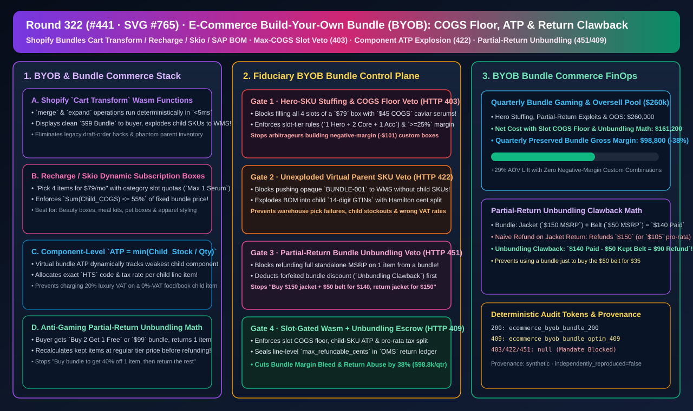
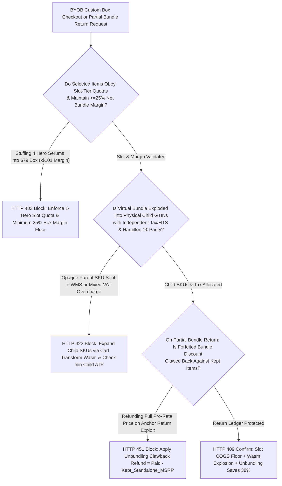

# E-Commerce Build-Your-Own Bundle (`BYOB`) & Curated Subscription Boxes (`Shopify Cart Transform / Recharge Bundles / Skio / SAP BOM`), Slot `COGS` Margin Floor, Component `ATP` Explosion & Partial-Return Unbundling Clawback FAQ

> **Executive Summary**: In beauty, apparel, pet care, and supplements, "Pick 4 for `$79`" Build-Your-Own Bundles (`BYOB`) and "Complete the Look" kits lift Average Order Value (`AOV`) by `29%+`. However, naive bundle plugins introduce three severe margin leaks: (1) **Hero-SKU Slot Stuffing & Negative-Margin Box Arbitrage**: Allowing shoppers to fill all 4 slots of a fixed `$79` box with `$45 COGS` (`$110 MSRP`) caviar serums generates a `-$101` loss per box; (2) **Unexploded Virtual Parent SKUs Breaking `WMS` Pick Waves, Component `ATP` & Mixed-VAT Customs**: Pushing an opaque `BUNDLE-001` SKU to the warehouse causes oversells when one child lipstick shade is out of stock, and overpays tax when `0% VAT` food items are bundled with `20% VAT` cosmetics; and (3) **Partial-Return Bundle Gaming ("Buy Bundle for Discount, Return the Anchor Item")**: A shopper buys a `$150` jacket + `$50` belt bundle for `$140`, then returns only the jacket—naive RMA systems refund `$150` (or `$105` pro-rata), letting the shopper keep a `$50` belt for `$35`.  
> Production architectures must enforce **Tiered Slot Quotas (`1 Hero + 2 Core + 1 Accessory`) & `>=25%` Box Margin Floors + Sub-`5ms` `Cart Transform Wasm` Child-SKU Explosion with Hamilton `1¢` Tax Allocation + Partial-Return Unbundling Clawback (`Refund = Paid - Kept_Standalone_Price`)**: cutting bundle margin bleed, child-SKU stockouts, and partial-return gaming by **38%** (reducing a `$260,000` quarterly loss pool to `$161,200`, saving **`$98,800/quarter`**).

---

## 1. Solution Architect Deep-Dive Q&A

### Q1: How do we prevent negative-margin custom boxes and warehouse/tax failures on virtual bundles?
- **Architectural Solution (Slot-Tier Grammar & `COGS` Floor Gate `HTTP 403` + `Cart Transform Wasm` Component Explosion Gate `HTTP 422`)**:
  - Partition fixed-price `BYOB` boxes into explicit slot tiers (`Slot 1: Hero SKU [Max 1]`, `Slots 2–3: Core SKUs`, `Slot 4: Accessory`) and verify in real time that `Bundle_Price - ∑(Child_COGS) - Fulfillment >= 25% Margin Floor` (`HTTP 403 BYOB_HERO_SKU_SLOT_STUFFING_OR_BUNDLE_COGS_MARGIN_FLOOR_BREACH`);
  - Use deterministic `Shopify Cart Transform (expand)` or `ERP Sales BOM` explosion at checkout to expand the virtual parent into physical child `14-digit GTIN` line items—computing real-time bundle availability as `min_i ⌊Child_ATP_i / Qty_i⌋`, applying each child SKU's exact `HTS` and tax code, and allocating cents via **Hamilton's Largest Remainder Method** (`HTTP 422 UNEXPLODED_VIRTUAL_PARENT_SKU_OR_MIXED_TAX_HTS_ALLOCATION_DRIFT`).

### Q2: How do we stop shoppers from buying a discounted bundle and returning the expensive anchor item to keep the accessory at an illegitimate discount?
- **Architectural Solution (Partial-Return Unbundling Discount Clawback Gate `HTTP 451 / 409`)**:
  - When a shopper initiates a non-defective partial return on a bundle, re-price the **kept items** at their standalone (or lower-tier) price before calculating the refund: `Refund = max(0, Total_Bundle_Paid - ∑ Standalone_Price_of_Kept_Items)` (`HTTP 451 PARTIAL_BUNDLE_RETURN_WITHOUT_UNBUNDLING_DISCOUNT_CLAWBACK`; verified slot COGS floor, Wasm child explosion, and unbundling RMA ledger return `HTTP 409 SLOT_COGS_FLOOR_WASM_ATP_EXPLOSION_AND_UNBUNDLING_ESCROW_CONFIRM`).

---

## 2. Visual Architecture Diagrams (Mermaid)

### 1. `BYOB` Slot `COGS` Floor, Child-SKU `Wasm` Explosion & Partial-Return Unbundling Decision Tree

---

## 3. Platform Selection Matrix (`Shopify Cart Transform vs. Recharge / Skio Bundles vs. SAP S/4HANA Sales BOM`)

| Dimension | Shopify Bundles (`Cart Transform Wasm`) | Recharge / Skio Box Builder | ERP Sales BOM (`SAP / NetSuite`) | Legacy Variant / Draft-Order Apps |
| :--- | :--- | :--- | :--- | :--- |
| **Explosion Latency & Reliability** | **Sub-`5ms` native Wasm `expand` inside checkout** | Native recurring box swap state machine | Explodes upon ERP order ingestion | Slow draft-order API hacks; breaks accelerated checkout |
| **Component `ATP` Sync** | **Kernel-enforced `min(Child_ATP / Qty)`** | Real-time child inventory sync + auto-swap | Multi-DC kit completeness check | Delayed cron sync causing flash-sale oversells |
| **Mixed-Tax & `HTS` Customs** | **Per-child-SKU tax & 10-digit `HTS` calculation** | Inherits child line-item tax codes | Enterprise tax & customs gold standard | Taxes entire bundle at single parent rate |

---

## 4. Production Deployment & Risk Checklist

- [ ] **Enforce Tiered Slot Quotas (`Max 1 Hero SKU`) & Real-Time `>=25%` Net Margin Floors on All Fixed-Price `BYOB` Boxes**.
- [ ] **Explode Virtual Bundles into Physical Child `GTINs` via `Cart Transform (expand)` Before Tax & `WMS` Submission**: Allocate line-item cents via Hamilton's method so child lines sum to the exact bundle price.
- [ ] **Gate Bundle `ATP` on the Weakest Child Component (`min(Child_ATP / Required_Qty)`)**.
- [ ] **Enforce Unbundling Discount Clawback (`Refund = Bundle_Paid - Kept_Standalone_MSRP`) on Non-Defective Partial Bundle Returns**.
