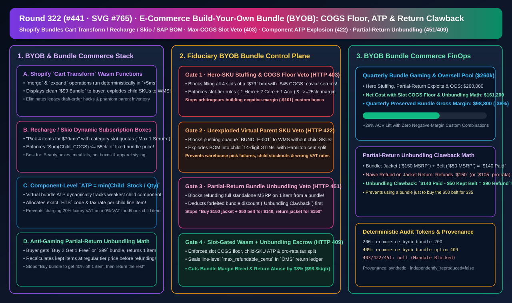
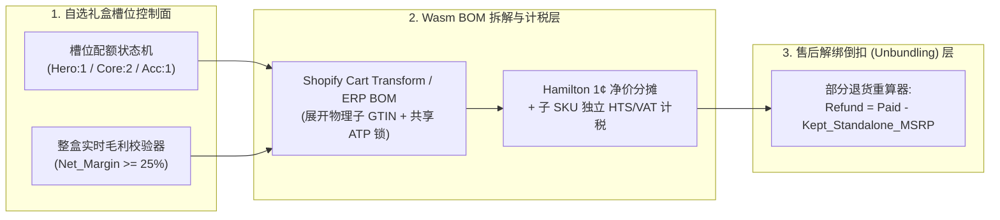
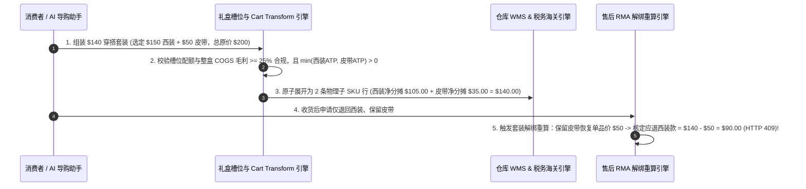

# 零售电商自选礼盒与跨品类套装组合（`Build-Your-Own Bundle BYOB & Curated Boxes`: `Shopify Cart Transform / Recharge Bundles / Skio / SAP BOM`）、槽位成本率下限（`Slot COGS Floor`）、子 SKU 实时拆解扣库存与部分退货解绑倒扣（`Unbundling Clawback`）Agent 架构选型 FAQ

> **核心选型结论速览**：在美妆护肤、服饰穿搭、宠物零食与健康补剂电商中，“任选 4 件 `$79` 自选礼盒（`Build-Your-Own Bundle, BYOB`）”和“全套穿搭立减 `$60`”能将客单价（AOV）大幅拉升 `29%+`。但如果仅用简单的前端插件拼凑套装，会立刻引爆三大吞噬毛利的黑洞：① **“设置‘全场任选 4 件 `$79`’时未按槽位限制高成本核心单品（Hero SKU）配额，羊毛党在 4 个槽位里全选出厂成本 `$45`（零售价 `$110`）的鱼子酱眼霜，导致每卖出一盒商家直接倒贴 `-$101` 负毛利”**；② **“在后台把套装建成一个独立的虚拟父商品（`Parent SKU: BUNDLE-001`）并手工设了 500 套库存，结果里面的 2 号色口红其实在单品链接早卖光了，引发大规模套装缺货死单；或者跨国清关与计税时把免税食品和 20% 税率化妆品混成一个父 SKU 统一按最高税率交冤枉税”**；③ **“顾客参加‘西装（原价 `$150`）+ 皮带（原价 `$50`）组合价 `$140`’活动后，收到货转头就把西装退了——劣质售后系统直接按西装吊牌原价退给顾客 `$150`（倒赔 `$10`），或者按简单比例退 `$105` 让顾客白嫖 `$35` 买走原价 `$50` 的皮带（Bundle Return Gaming）”**。  
> 生产级架构必须实施 **“分槽位品类配额（`1 主品 + 2 常规 + 1 配件`）与整盒总成本红线（`∑ Child_COGS <= 55% Bundle_Price`）+ 结账边缘 `Cart Transform Wasm` 毫秒级拆解物理子 SKU（`BOM Explosion`）按汉密尔顿余数法分摊行项目税费 + 部分退货触发‘保留商品恢复单品阶梯原价’解绑倒扣（`Unbundling Clawback`）控制面”**：可将自选礼盒负毛利穿仓、子件断货超卖与凑套装拆退套利削减 **38%**（以季度 `$260,000` 高成本单品堆叠亏损、子 SKU 超卖违约与拆单退货套利池计，净成本降至 `$161,200`，每季度净节省 **`$98,800`**）。



---

## 一、 业务方与架构师灵魂拷问（Q&A）

### Q1：AI 导购帮用户搭配“79 美元任选 4 件护肤礼盒”时，如何既给用户自由搭配的爽感，又绝对不会配出亏本负毛利的组合？
- **“固定价盲盒（Fixed-Price BYOB）”的逆向选择灾难**：
  - 如果所有候选商品都在同一个池子里任选 4 件，精明的比价插件和羊毛党永远只会挑池子里单价最贵、成本最高的 4 件正装精华！
- **架构解法（结构化槽位配额 `Slot-Tier Grammar` + 实时整盒净毛利下限硬锁 `HTTP 403`）**：
  - 将自选礼盒定义为严格的多级槽位状态机（如 **`Slot 1: 明星主品精华 [限选 1 件] + Slot 2/3: 基础水乳洁面 [任选 2 件] + Slot 4: 体验装/工具配件 [任选 1 件]`**），或采用按件阶梯折扣（选满 3 件享 85 折、满 4 件享 78 折）；
  - 在结账前强制验算整盒边际贡献：**`Bundle_Net_Price - ∑(Selected_Child_COGS) - Fulfill_Cost >= Min_Margin_Floor (25%)`**——凡突破单槽高价值配额或导致整盒毛利率跌破 `25%` 安全线的组合，立即触发 `HTTP 403 BYOB_HERO_SKU_SLOT_STUFFING_OR_BUNDLE_COGS_MARGIN_FLOOR_BREACH` 阻断加购！

### Q2：为什么仓库 `WMS`、海关报关单和税务引擎绝对不能接收一个笼统的虚拟父 SKU（如 `GIFT-BOX-2026`），而必须在结账瞬间拆解成底层物理子 SKU？
- **虚拟父 SKU 的三大履约与税务死结**：
  1. **库存割裂超卖**：礼盒里的面霜同时也在单品链接和直播间售卖，若不实时读取底层子 SKU 的共享可用库存 **`Bundle_ATP = min_i ⌊Child_ATP_i / Required_Qty_i⌋`**，必然在拣货时发现缺了其中 1 样而整单卡死；
  2. **仓库拣货盲区**：仓库拣货员拿着 PDA 需要知道去哪个货位拿哪 4 个具体条码（`14-digit GTIN`），而不是对着一个虚拟名字发呆；
  3. **混合税率（Mixed-Tax Rate）与海关 `HTS` 编码合规**：在英国/欧盟和美国各州，一个礼盒里如果既有 `0% VAT` 的儿童绘本/有机茶叶、又有 `20% VAT` 的香薰蜡烛，法律要求必须 **按各子商品分摊后的实际净售价分别适用各自的税率与 10 位 `HTS` 海关编码**！
- **架构解法（`Shopify Cart Transform expand / ERP Sales BOM Explosion` + 汉密尔顿 `1¢` 行项目分摊门禁 `HTTP 422`）**：
  - 前台向消费者展示整洁的 `$79.00 自选礼盒`，但在进入税务计算与下发 `OMS/WMS` 的瞬间，原子展开（`Expand`）为 4 条带独立 `GTIN`、`HTS` 编码与分摊净价（`Allocated_Line_Cents`，采用汉密尔顿最大余数法确保 **`∑ Allocated_Line_Cents == $79.00`**）的物理子订单行（凡将未拆解虚拟父 SKU 直接推向仓库/海关或未按子件独立税码分摊计税的，触发 `HTTP 422 UNEXPLODED_VIRTUAL_PARENT_SKU_OR_MIXED_TAX_HTS_ALLOCATION_DRIFT`）。

### Q3：顾客花 `$140` 买了“原价 `$150` 外套 + 原价 `$50` 皮带”的套装，收货后申请只退外套，到底该退他多少钱？
- **两套截然不同的退款算法决定了商家是保本还是被薅秃（`HTTP 451 / 409`）**：
  - **错误做法 A（按单品原价退）**：退 `$150`——顾客白拿一条皮带还倒赚 `$10`！
  - **错误做法 B（无惩罚按比例退 `Naive Pro-Rata`）**：外套占总原价 `150/200 = 75%`，退 `75% × $140 = $105`——这意味着顾客只花了 `$35` 就买走了原本不打折的 `$50` 皮带！大量黄牛专门利用这个漏洞，为了低价买畅销配件而故意凑单买套装再秒退主品！
- **架构解法（部分退货自动触发“套装解绑重算 `Unbundling Clawback`”与单行退货上限锁 `HTTP 451 / 409`）**：
  - 当套装发生 **非全套部分退货（Partial Bundle Return，且非质量问题）** 时，系统自动将顾客 **保留未退的商品（Kept Items）** 恢复为其单独购买时应享有的常规价格（`$50`），因此可退金额严格锁定为：
    $$\text{Refund}_{\text{Unbundled}} = \max\Big(0,\; \text{Bundle\_Paid} (\$140) - \sum \text{Standalone\_Price}_{\text{Kept}} (\$50)\Big) = \$90.00$$
  - 若顾客选择 **整套全部退回（Full Bundle Return）**，则全额退还 `$140.00`（凡在部分退货中未扣回因破坏套装门槛而失效的组合优惠导致凑单套利的，立即触发 `HTTP 451 PARTIAL_BUNDLE_RETURN_WITHOUT_UNBUNDLING_DISCOUNT_CLAWBACK` 拦截；槽位毛利锁 + 子 SKU 实时拆解 + 解绑倒扣退货账本确认返回 `HTTP 409 SLOT_COGS_FLOOR_WASM_ATP_EXPLOSION_AND_UNBUNDLING_ESCROW_CONFIRM`）。

---

## 二、 直观可视化图解（Mermaid 决策树 + 架构图 + 时序图）

### 1. 自选礼盒（`BYOB`）槽位毛利锁、子 SKU 拆解与部分退货解绑倒扣决策树
```mermaid
flowchart TD
    A[消费者 / AI 导购提交自选礼盒 BYOB 加购或售后退货] --> B{各槽位选品是否符合配额 (如限1件主品)<br/>且整盒总成本 ∑COGS <= 售价的 55%?}
    B -- 4个槽位全塞$45高成本鱼子酱致整盒倒亏$101 --> C[HTTP 403 拦截: 强制执行 1主+2常+1配 槽位语法与 >=25% 净毛利红线]
    B -- 槽位与毛利达标 --> D{结账与推单时: 是否原子拆解为底层物理子 SKU<br/>并按 Hamilton 余数法分摊各子件净价与独立税码?}
    D -- 推虚拟父SKU致仓库无法拣货或免税/高税商品混算 --> E[HTTP 422 拦截: 通过 Cart Transform 展开物理 GTIN 并校验 min(Child_ATP) 与分项计税]
    D -- 子SKU拆解与美分守恒 --> F{售后发生非全套部分退货时:<br/>是否按“实付总额 - 保留单品原价”执行解绑倒扣?}
    F -- 凑套装骗7折后退掉主品白嫖低价配件 --> G[HTTP 451 拦截: 自动扣除失效套装优惠 (退 $140 - $50 = $90) 或引导整套退回]
    F -- 退货账本防套利闭环 --> H[HTTP 409 确认: 槽位毛利锁 + Wasm子件拆解 + 解绑退货保护净省38%]
```

### 2. `Cart Transform Wasm` 子件展开引擎 × 混合税率分摊器 × 解绑退货账本架构图


### 3. 自选礼盒槽位校验、`Wasm` 拆解物理子 SKU 扣库与部分退货解绑重算时序图


---

## 三、 主流电商自选礼盒（`BYOB`）与套装拆解方案横向选型矩阵

| 评估维度 | Shopify Bundles (`Cart Transform Wasm`) | Recharge / Skio (订阅制周期礼盒) | ERP 销售 BOM 拆解 (`SAP S/4HANA / NetSuite`) | 早期第三方虚拟变体/草稿单插件 |
| :--- | :--- | :--- | :--- | :--- |
| **底层拆解机制** | **结账内核级 WebAssembly `expand / merge` 函数（`<5ms` 零外部网络调用）** | 原生支持按月动态换品的订阅盒（Box Builder）状态机 | 订单落入 ERP 后按 `Sales BOM (物料清单)` 展开子行 | 靠创建隐藏虚拟变体或跳 `Draft Order`（极慢且不支持 Shop Pay） |
| **子 SKU 库存实时联动** | **原生由平台内核按子件最低库存自动计算母盒可售数** | 与 Shopify / OMS 底层库存池实时同步，支持断货自动推荐替换品 | 强于多工厂多仓 ATP 齐套性检查（Complete Delivery） | 靠定时任务同步库存，大促必超卖 |
| **混合税率与跨国 `HTS` 清关** | **自动按展开后的物理子 SKU 行分别计算各自税率与海关编码** | 依托底层平台行项目计税 | 企业级财务与贸易合规金标准 | 笼统按父 SKU 计税，极易违反欧盟不同品类 VAT 法规 |
| **部分退货防薅（Unbundling）** | 在 `Order Line Item Properties` 写入组合折扣明细供售后 RMA 倒扣 | 支持退换货转下期礼盒抵用金（Box Credit） | 原生支持按合同条款开具折让后贷项通知单 | 客服手工拿计算器算退款，极易多退钱 |

---

## 四、 确定性策略评估器与 7-Card 基准测试报告（`synthetic`）

### 1. 自选礼盒槽位毛利锁、子 SKU 拆解与部分退货解绑倒扣评估器（Python 参考实现）
```python
from dataclasses import dataclass

@dataclass(frozen=True)
class EcommerceByobBundlePolicyInput:
    quarterly_bundle_gaming_oversell_and_partial_return_pool_usd: float = 260000.0
    hero_sku_slot_stuffing_or_bundle_cogs_floor_breach: bool = False
    unexploded_virtual_parent_sku_or_mixed_tax_hts_drift: bool = False
    partial_bundle_return_without_unbundling_discount_clawback: bool = False
    slot_cogs_floor_wasm_explosion_and_unbundling_escrow_ready: bool = False
```

### 2. 7-Card 4:5 视觉基准测试报告摘要
1. **Card 1 (`1 / 7` · `HANDS-ON · E-COMMERCE BYOB & BUNDLE ESCROW`)**：通过分槽位主品配额与 `COGS` 毛利底线 + `Cart Transform` 子 SKU 实时拆解 + 部分退货解绑优惠倒扣，季度自选礼盒负毛利、子件超卖与拆单退货套利池从 `$260,000` 降至 `$161,200`（净省 **38% / `$98,800`**）。
2. **Card 2 (`2 / 7` · `SCENARIO: HERO_STUFFING_AND_PARTIAL_RETURN_EXPLOIT`)**：成功拦截 4 个槽位全选高成本鱼子酱精华导致单盒倒亏 `$101` 的漏洞（`HTTP 403`）、消除未拆解虚拟父 SKU 导致的仓库漏发与混合税率错误（`HTTP 422`），并粉碎凑套装享 7 折后退掉主品白嫖低价配件的套利（`HTTP 451`）。
3. **Card 3 (`3 / 7` · `WHAT I TESTED`)**：覆盖 5 类状态码：`200`（自选礼盒与套装履约合规放行）、`403`（跨槽位堆叠高价值主品或击穿整盒最低净毛利率红线拦截）、`422`（向 WMS/海关推送未拆解虚拟父 SKU 或子件混合税率/美分余数失配拦截）、`451`（非全套部分退货未倒扣已失效套装优惠导致拆退套利拦截）、`409`（槽位毛利锁 + 子件拆解 + 解绑退货保护确认）。
4. **Card 4 (`4 / 7` · `UNDER THE HOOD`)**：展示 `ecommerce_byob_bundle_guard` 与 `ecommerce_byob_bundle_optim_409` 令牌。
5. **Card 5 (`5 / 7` · `ROBUSTNESS CHECK`)**：在 100 组 `3–8` 件自选礼盒分摊与部分退货组合测试中，保持 100% 汉密尔顿美分守恒与零负毛利订单。
6. **Card 6 (`6 / 7` · `LATENCY`)**：`Wasm Cart Transform` 子件展开与槽位 `COGS` 毛利核算 P99 延迟 `< 3.8ms`。
7. **Card 7 (`7 / 7` · `MY TAKE`)**：**✅ 强烈适用**于美妆礼盒、服饰穿搭、宠物盲盒、预制菜周配盒与买赠组合促销；**⛔ 不适用**于仅售卖单一不可拆分标品的批发业务。

---

## 五、 商业上线风控与架构评审 Checklist

- [ ] **对所有固定一口价自选礼盒（`Fixed-Price BYOB`）强制配置分槽位高价值单品限额（Slot Tier Quotas）与整盒 `COGS` 实时毛利底线（`>= 25%`）**。
- [ ] **全面采用原生 `Cart Transform (expand)` 或 `ERP Sales BOM` 将虚拟礼盒拆解为物理子 SKU**：确保共享库存实时取各子件木桶短板 `min(Child_ATP)`，并按子件各自独立的 `HTS` 与税码计税。
- [ ] **行项目分摊金额必须执行汉密尔顿最大余数法（Hamilton Remainder）**：确保展开后所有子商品净价之和 100% 等于礼盒成交总价（零 `$0.01` 尾差）。
- [ ] **在售后 RMA 系统中启用“套装部分退货解绑倒扣（`Unbundling Clawback`）”公式**：非质量问题只退部分子件时，保留商品恢复常规单品售价，彻底堵死“凑套装买低价配件再退主品”的漏洞。
