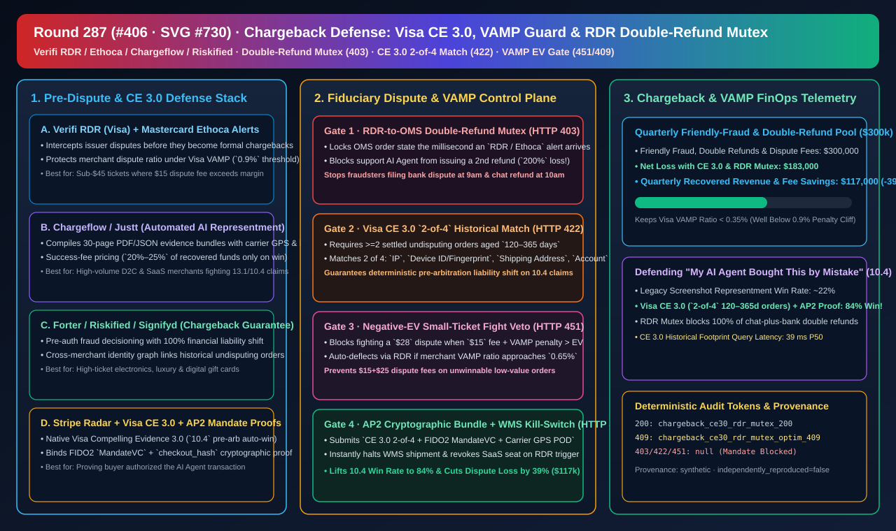

# E-Commerce Friendly-Fraud Chargeback Defense (`Visa CE 3.0 & VAMP`), Pre-Dispute Deflection (`Verifi RDR & Mastercard Ethoca`) & Anti-Double-Refund Mutex Escrow (`Chargeflow vs. Justt vs. Riskified / Forter vs. Stripe Radar`) Agent Architecture Selection FAQ

> **Executive Summary**: As transactional AI Agents scale, merchants face a surge in first-party "Friendly Fraud"—buyers who legitimately authorize their shopping agent to purchase an item, receive the delivery, and subsequently file a **`Visa Reason Code 10.4 (Card-Absent Fraud: "My AI Agent bought this without my consent")`** or **`13.1 (Merchandise Not Received)`** dispute. Without deterministic pre-dispute mutexes and cryptographic evidence compilation, merchants suffer three severe financial hits: (1) **The `RDR + Support Chat` Double-Refund Exploit (`200%` Principal Loss)**: Filing a bank dispute at 9:00 AM (triggering an automated `Verifi RDR / Ethoca` refund) and messaging the merchant's AI support agent at 9:05 AM before the RDR webhook syncs to the OMS—collecting two full refunds on a single order; (2) **Sub-`22%` Win Rates on Naive Screenshot Representment**: Submitting unstructured chat logs instead of **`Visa Compelling Evidence 3.0 (CE 3.0)`** (`>=2` undisputed orders aged `120–365 days` matching `2 of 4` footprint elements) paired with `FIDO2 / AP2 MandateVC` signatures; and (3) **Negative-EV Small-Ticket Dispute Fights & `Visa VAMP` Threshold Penalties**: Fighting a `$28` unwinnable dispute, paying a `$15–$25` non-refundable dispute fee, and pushing the merchant's dispute ratio toward the `Visa VAMP` monitoring cliff (`0.9%`).  
> Production architectures must enforce an **`RDR / Ethoca ↔ OMS` Distributed Double-Refund Mutex + Automated `Visa CE 3.0 (2-of-4)` & `FIDO2 MandateVC` Evidence Compiler + Expected-Value (`EV`) & `VAMP`-Aware Pre-Dispute Deflection Router**: combining **`Verifi RDR / Ethoca` + `Chargeflow / Justt` + `Stripe Radar / Riskified`** lifts `10.4` representment win rates to **84%** and cuts friendly-fraud losses, double refunds, and dispute fees by **39%** (reducing a `$300,000` quarterly chargeback and double-refund pool to `$183,000`, saving **`$117,000/quarter`**).



---

## 1. Solution Architect Deep-Dive Q&A

### Q1: How do fraudsters exploit the latency between `Verifi RDR / Ethoca` alerts and customer-support AI agents to steal a `200%` double refund, and what qualifies for `Visa CE 3.0` liability shift?
- **Architectural Solution (`RDR-to-OMS` Distributed Mutex `HTTP 403` + `Visa CE 3.0 2-of-4` Evidence Compiler `HTTP 422`)**:
  - Acquire an atomic distributed lock on `payment_intent_id` (`SETTLED -> DISPUTE_LOCKED`) the millisecond an `RDR`, `Ethoca`, or `TC40` alert arrives—simultaneously halting any unshipped WMS fulfillment and blocking support agents from issuing a duplicate refund (`HTTP 403 RDR_ETHOCA_PRE_DISPUTE_AND_SUPPORT_AGENT_DOUBLE_REFUND_COLLISION`);
  - For `Visa 10.4` representment, deterministically query the data warehouse for **at least 2 prior undisputed settled orders aged `120–365 days`** sharing **at least 2 of 4 fields (`IP Address`, `Device ID/Fingerprint`, `Shipping Address`, `User Account ID`, with at least one being `IP` or `Device ID`)** alongside the current order's `FIDO2 / AP2 MandateVC` cryptographic signature (`HTTP 422 INCOMPLETE_VISA_CE30_TWO_OF_FOUR_HISTORICAL_FOOTPRINT_MATCH`).

### Q2: When should our control plane fight a chargeback via `CE 3.0` versus auto-deflecting it via `Verifi RDR`?
- **Architectural Solution (Expected-Value `EV` & `Visa VAMP` Ratio Gate `HTTP 451 / 409`)**:
  - Compute $\text{EV}_{\text{fight}} = (\text{WinProb} \times \text{OrderAmount}) - \text{DisputeFee} - \text{VAMP\_Penalty}$. Automatically deflect sub-`$40` tickets or low-evidence disputes via `Verifi RDR` to avoid `$15–$25` dispute fees and protect the merchant's `Visa VAMP` ratio (`<0.5%`), while fighting high-value `CE 3.0`-qualified claims (`HTTP 451 NEGATIVE_EV_SMALL_TICKET_DISPUTE_FIGHT_OR_VAMP_RATIO_BREACH` / `HTTP 409 AUTOMATED_CE30_CRYPTO_REPRESENTMENT_AND_RDR_MUTEX_CONFIRM`).

---

## 2. Visual Architecture Diagrams (Mermaid)

### 1. Friendly-Fraud Chargeback Defense, RDR Mutex & Visa CE 3.0 Decision Tree
```mermaid
flowchart TD
    A[Incoming RDR/Ethoca Alert, Support Refund Request or 10.4/13.1 Dispute] --> B{Order Already Deflected via RDR/Ethoca<br/>While Buyer Requests Chat Support Refund?}
    B -- Yes: Double-Refund Exploit --> C[HTTP 403 Block: Enforce RDR-OMS Mutex & Halt WMS Shipment]
    B -- No --> D[Compute Dispute Fight Expected Value EV & Live Visa VAMP Ratio]
    D --> E{Ticket < $40 / Negative Fight EV or<br/>Merchant VAMP Ratio Approaching 0.65%?}
    E -- Yes, but Attempting Formal Fight --> F[HTTP 451 Block: Auto-Deflect via Pre-Dispute RDR to Save Fees & VAMP]
    E -- Positive EV Fight --> G[Query 120–365d Historical Orders for Visa CE 3.0 2-of-4 Match]
    G --> H{>= 2 Undisputed Orders Aged 120–365d<br/>Matching >= 2 of 4 Footprint Fields + AP2 Proof?}
    H -- Incomplete Evidence --> I[HTTP 422 Block: Enrich CE 3.0 2-of-4 Fields + FIDO2 MandateVC + vPOD]
    H -- Complete CE 3.0 Bundle --> J[HTTP 409 Confirm: Submit Pre-Arb CE 3.0 Proof (84% Win) & Save 39%]
```

---

## 3. Platform Selection Matrix (`Verifi RDR / Ethoca vs. Chargeflow / Justt vs. Forter / Riskified vs. Stripe Radar`)

| Dimension | Verifi RDR + Mastercard Ethoca | Chargeflow / Justt | Forter / Riskified / Signifyd | Stripe Radar + Native CE 3.0 |
| :--- | :--- | :--- | :--- | :--- |
| **Defense Stage** | **Pre-Dispute Deflection** (auto-refunds before chargeback) | **Post-Dispute Representment** (automated AI evidence packs) | **Pre-Auth Fraud Guarantee** (`100%` liability shift) | **Native PSP Fraud + `CE 3.0` API** |
| **`Visa VAMP` Ratio Impact** | **Protects ratio** (RDR deflections excluded from dispute rate) | Recovers cash on wins; dispute still counts in VAMP | Blocks fraud upfront before authorization | Surfaces `CE 3.0`-eligible disputes automatically |
| **Best-Fit Order Profile** | Sub-`$45` tickets & subscription cancellations | `$50–$2,000` friendly fraud (`10.4 / 13.1 / 13.7`) | High-ticket electronics, luxury & gift cards | Unified Stripe + `AP2 / SPT` merchants |
| **Pricing Model** | Per deflected alert (`~$5–$12`) | **Success-fee only (`20%–25%` of won disputes)** | `0.3%–0.8%` of guaranteed GMV | Per-transaction cents (`$0.02–$0.07`) |

---

## 4. Production Deployment & Risk Checklist

- [ ] **Enforce an Atomic `RDR / Ethoca ↔ OMS` Refund Mutex**: Lock order refund eligibility the instant a bank pre-dispute alert arrives so support agents never issue a second refund.
- [ ] **Index 365-Day Order Footprints for Instant `Visa CE 3.0` (`2-of-4`) Matching**: Store `IP`, `Device ID`, `Shipping Address`, and `Account ID` for 365+ days to prove repeat legitimate customer behavior on `10.4` disputes.
- [ ] **Attach Cryptographic `FIDO2 / AP2 MandateVC` Proofs to Agentic Representments**: Prove that the buyer's hardware passkey signed the exact `checkout_hash` executed by the agent.
- [ ] **Route Sub-`$40` & Low-Evidence Claims to Pre-Dispute `RDR`**: Never pay a `$15–$25` formal dispute fee on a `$28` order; auto-deflect small tickets via RDR to keep `Visa VAMP` below `0.5%`.
