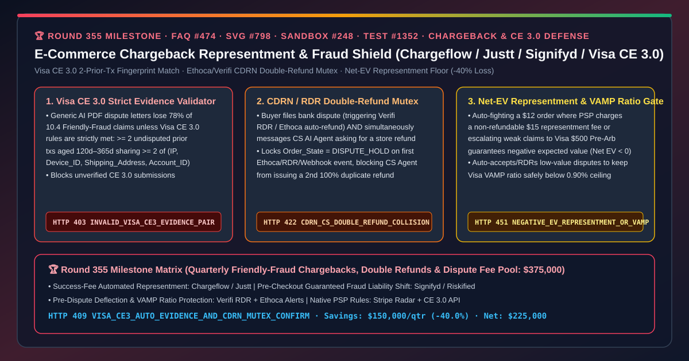
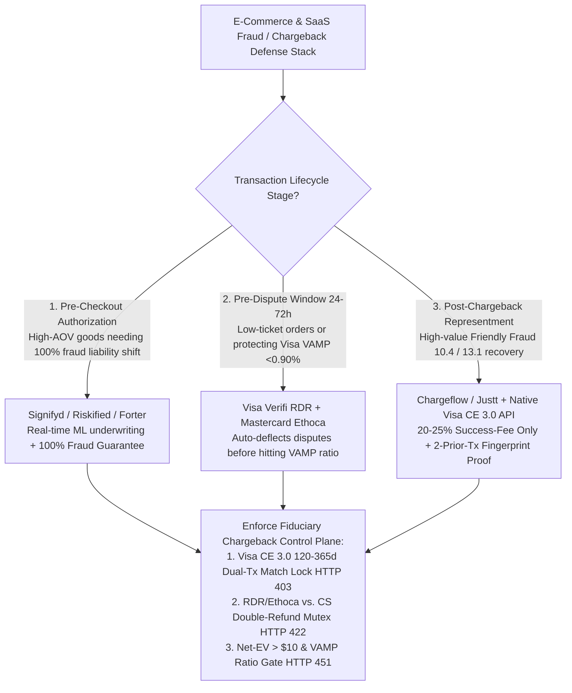
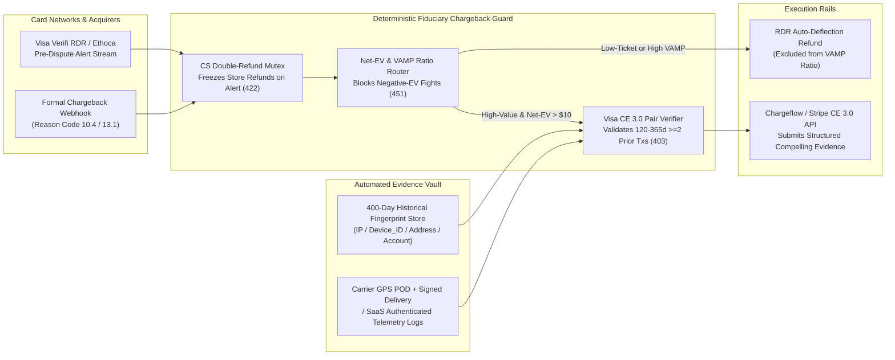
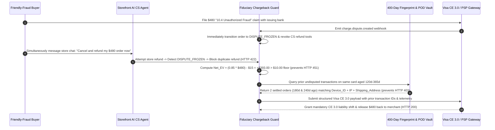

# 🏆 E-Commerce Chargeback Representment & Fraud Shield (`Chargeflow / Justt / Signifyd / Riskified / Stripe Radar + Visa CE 3.0` · 🏆 Round 355 Milestone): `Visa CE 3.0` Historical Fingerprint Matching, `Ethoca / Verifi RDR` Double-Refund Mutex & `Net-EV` Representment Gating (`-40%` Dispute Loss)

> **Document Type**: Enterprise AI Solution Architect Selection FAQ (`#474` · **🏆 Round 355 Milestone**)  
> **Target Audience**: Cross-Border E-Commerce Risk & Payments Directors, OTA Settlement Architects, SaaS FinOps Leaders, and Cloud & AI Solution Architects  
> **Platforms Covered**: **Automated Chargeback Representment (`Chargeflow / Justt / Midigator`)** vs. **Pre-Checkout Fraud Guarantee Engines (`Signifyd / Riskified / Forter`)** vs. **Card-Network Pre-Dispute Deflection (`Visa Verifi RDR & Compelling Evidence 3.0 / Mastercard Ethoca Alerts`)**  
> **Architecture Diagram**: [`assets/svg/798-ecommerce-chargeback-representment-visa-ce3-ethoca-cdrn-2026-11-25.svg`](../assets/svg/798-ecommerce-chargeback-representment-visa-ce3-ethoca-cdrn-2026-11-25.svg)

🌐 **Language / 语言切换**: **[中文 (`ecommerce-chargeback-representment-visa-ce3-ethoca-cdrn-signifyd-chargeflow-selection-faq.md`)](ecommerce-chargeback-representment-visa-ce3-ethoca-cdrn-signifyd-chargeflow-selection-faq.md)** | **English (Current)**

---

## 📌 1. Executive Summary

Across cross-border e-commerce, digital goods, OTA travel, and SaaS subscriptions, **over 70% of credit-card chargebacks are first-party "Friendly Fraud" (`Visa Reason Code 10.4` Card-Absent Fraud or `13.1` Merchandise Not Received)**—where the legitimate cardholder receives the product or uses the SaaS service and subsequently disputes the charge with their issuing bank.  
Using a generic LLM to write prose PDF rebuttal letters without integrating **structured `Visa Compelling Evidence 3.0 (CE 3.0)` historical transaction matching, `Verifi RDR / Ethoca` pre-dispute mutex locks, and Net Expected Value (`Net-EV`) representment math** causes three severe financial leaks:
1. **Losing 78% of `10.4` Friendly-Fraud Disputes due to Unstructured Non-`CE 3.0` Rebuttals (`Invalid CE 3.0 Evidence`)**: Issuing bank adjudicators ignore narrative essays on `10.4` fraud claims unless the merchant supplies structured **Visa CE 3.0** proof: **at least 2 prior undisputed transactions on the same card aged `120–365 days` before the disputed transaction that match `>= 2` core identifiers (`IP Address, Device Fingerprint, Shipping Address, User Account ID`)**.
2. **Paying `200%` via Simultaneous Bank Dispute + Customer-Support Agent Refund (`CDRN / CS Double-Refund Collision`)**: A buyer opens a bank dispute (triggering an automated `Verifi RDR / Ethoca` refund) while simultaneously messaging the merchant's AI customer-support bot to demand a store refund. Without a cross-system mutex, the merchant refunds the buyer twice and still eats the network fee.
3. **Fighting Negative-EV `$12` Disputes or Breaching the `Visa VAMP 0.90%` Ceiling (`Negative-EV Representment & VAMP Penalties`)**: Paying a non-refundable `$15` PSP representment fee to contest a `$12` order—or letting low-value disputes hit the formal chargeback ledger instead of deflecting them via `Verifi RDR`—drives the merchant's **Visa Acquirer Monitoring Program (`VAMP`)** ratio into penalty territory.

| Defense Layer & Workload | Recommended Primary Choice | Architectural Boundary & Production Rule |
|---|---|---|
| **Pre-Checkout Fraud Scoring & `100%` Chargeback Liability Shift** | **Signifyd / Riskified / Forter** | Best for high-AOV (`$150+`) electronics, luxury & footwear; charges `0.4%–0.8%` per order and reimburses `100%` of approved orders that incur fraud chargebacks. |
| **Pre-Dispute Deflection & `Visa VAMP (<0.90%)` Ratio Protection** | **Visa Verifi RDR + Mastercard Ethoca Alerts** | Auto-refunds low-value or unwinnable disputes inside the `24–72h` pre-dispute window so they **never count toward the merchant's formal chargeback ratio**. |
| **Post-Chargeback Automated Friendly-Fraud Representment** | **Chargeflow / Justt + Native `Visa CE 3.0` API** | Operates on a `20%–25%` success-fee-only model (zero fee on lost disputes), programmatically assembling carrier GPS PODs, SaaS usage logs, and `CE 3.0` pairs. |
| **Three Mandatory Fiduciary Guardrails** | **100% Deterministic Gating** | ① **`Visa CE 3.0` Historical Pair Verifier (`HTTP 403`)**: Requires `>= 2` undisputed prior transactions (`120d–365d` old) matching `>= 2` core identifiers (including IP or Device ID) before claiming `CE 3.0` liability shift; ② **Pre-Dispute / CS Double-Refund Mutex (`HTTP 422`)**: Freezes store refunds the millisecond an `RDR / Ethoca / Chargeback` webhook arrives; ③ **`Net-EV > $10` & `VAMP` Deflection Gate (`HTTP 451`)**: Blocks negative-EV representment and auto-routes low-ticket claims to `RDR`. |

---

## 🎯 2. Architect & Business Stakeholder Q&A (Q1–Q3)

### Q1: Why do merchants lose `Reason Code 10.4` friendly-fraud chargebacks even when they upload carrier delivery photos, and how does `Visa CE 3.0` guarantee a win?
- **The Adjudication Rule**: Under Visa rules, a delivery receipt (`POD`) on the disputed order proves the package arrived at an address, but does *not* prove the legitimate cardholder placed the order (`10.4 Card-Absent Fraud`).
- **The `Visa Compelling Evidence 3.0 (CE 3.0)` Standard**: Visa shifts 100% liability back to the issuer (guaranteed merchant win) when the merchant submits **two prior undisputed transactions** on the same payment credential that:
  1. Settled between **`120 days` and `365 days`** prior to the disputed transaction date; and
  2. Match the disputed transaction across **at least 2 of 4 core data elements** (`User Account ID`, `Shipping Address`, `IP Address`, `Device ID/Fingerprint`), where **at least one match is `IP Address` or `Device ID`**.
- **Architectural Solution**: Enforce a **Deterministic `CE 3.0` Eligibility SQL/Graph Validator (`HTTP 403` Guard)** that verifies the exact `120–365d` aging window and identifier parity before submitting structured `CE 3.0` payloads via Stripe/Adyen/Chargeflow APIs. Unqualified claims are blocked from `CE 3.0` submission (`HTTP 403 INVALID_VISA_CE3_HISTORICAL_TX_FINGERPRINT_MATCH`).

### Q2: How do we prevent "Double Refunding" when a buyer files a credit-card dispute with their bank and simultaneously asks our AI support agent for a refund?
- **The Race Condition**: A cardholder calls their issuer to dispute a `$320` charge (triggering a `Verifi RDR / Ethoca` alert or `charge.dispute.created` event) and immediately opens a chat with the merchant's AI customer service agent saying *"Please refund my order"*. If the CS agent calls `POST /refunds` on the original charge or issues a store credit while the bank pulls back the `$320` via the dispute rail, the merchant loses `$640` on a `$320` order.
- **Architectural Solution**: Implement an **Atomic `DISPUTE_HOLD` Order State Mutex (`HTTP 422` Guard)**:
  - Ingest `Verifi RDR`, `Ethoca`, and PSP `charge.dispute.*` webhooks into the central order state machine with sub-second priority, transitioning the order to `DISPUTE_HOLD`.
  - Any CS agent tool call to `refund_order`, `cancel_order`, or `issue_exchange_credit` must query live PSP dispute status and is hard-blocked (`HTTP 422 CDRN_ETHOCA_ALERT_AND_CS_AGENT_DOUBLE_REFUND_COLLISION`) whenever an active pre-dispute or chargeback exists.

### Q3: Should our AI agent automatically contest 100% of incoming chargebacks?
- **The Unit-Economics & `VAMP` Trap**:
  1. **Negative Expected Value (`Net-EV < 0`)**: If a disputed order is `$18`, the PSP charges a `$15` non-refundable representment fee, and the historical win probability for that reason code is `35%`, then `Net_EV = (0.35 * $18) - $15 = -$8.70`. Fighting that dispute loses more money than accepting it.
  2. **Visa `VAMP` Ratio Thresholds**: If a merchant's monthly fraud + dispute count divided by total settled Visa transactions approaches `0.90%` (`VAMP` threshold), Visa levies per-dispute fines and acquirers freeze merchant reserve funds.
- **Architectural Solution**: Enforce a **`Net-EV > $10.00` Representment Floor & Dynamic `RDR` Auto-Deflection Gate (`HTTP 451` Guard)**:
  - Automatically deflect disputes below `$25` (or whenever trailing 30-day `VAMP Ratio > 0.65%`) via `Verifi RDR / Ethoca` pre-dispute auto-refunds so they are excluded from the `VAMP` numerator.
  - Block negative-EV representment or low-probability `$500` pre-arbitration escalations (`HTTP 451 NEGATIVE_EV_REPRESENTMENT_OR_VAMP_RATIO_THRESHOLD_BREACH`).

---

## 🧭 3. Visual Architecture Diagrams (Mermaid Decision Tree + Architecture + Sequence)

### 3.1 Chargeback Defense & Fraud Orchestration Selection Tree

### 3.2 End-to-End Pre-Dispute Deflection, `Visa CE 3.0` Matching & Mutex Architecture

### 3.3 `Visa CE 3.0` Automated Representment & Double-Refund Prevention Sequence

---

## 📊 4. Platform Comparison Matrix (`Chargeflow` vs. `Justt` vs. `Signifyd / Riskified` vs. `Verifi RDR / Ethoca` vs. `Stripe Radar`)

| Evaluation Dimension | Chargeflow | Justt | Signifyd / Riskified | Visa Verifi RDR + Ethoca | Stripe Radar + Native Disputes API |
|---|---|---|---|---|---|
| **Primary Sweet Spot** | Fully automated success-fee-only chargeback representment | Enterprise tailored AI representment for high-volume merchants | Pre-checkout fraud underwriting + **100% Fraud Chargeback Guarantee** | Pre-dispute deflection to keep `Visa VAMP` ratios below `0.90%` | Native PSP fraud rules + structured `Visa CE 3.0` API fields |
| **`10.4 / 13.1` Friendly-Fraud Win Rate** | ⭐⭐⭐⭐⭐ (`60%–75%+` win rate with Shopify/ERP evidence sync) | ⭐⭐⭐⭐⭐ (Dynamic issuer-specific evidence optimization) | ⭐⭐⭐⭐ (Focuses on pre-auth filtering + financial reimbursement) | N/A (Auto-refunds to prevent formal chargeback creation) | ⭐⭐⭐⭐ (Supports structured `CE 3.0` prior-tx fields) |
| **CS / Helpdesk Double-Refund Lock** | ⭐⭐⭐⭐ (Syncs dispute tags to Gorgias / Zendesk) | ⭐⭐⭐⭐ (Enterprise webhook state sync) | ⭐⭐⭐⭐⭐ (Deep order lifecycle state ownership) | ⭐⭐⭐⭐⭐ (Network-level pre-dispute resolution) | ⭐⭐⭐⭐⭐ (Real-time `charge.dispute.*` webhooks) |
| **Pricing Model (`official_list_price`)** | **`25%` of recovered funds only** (`$0` on lost disputes, no monthly minimum) | Performance share or volume tier (`>$30k/mo` dispute volume) | **`0.4%–0.8%`** of guaranteed order GMV | **`~$15–$25 / deflected alert`** | `$0.05–$0.07/tx` Radar; `$15` dispute fee |

---

## 🧪 5. Deterministic Recovery & Cost Evaluation (`7-Card Benchmark Summary` · 🏆 Round 355)

> **Provenance**: Figures below are generated by `evaluate_ecommerce_chargeback_ce3_ethoca_policy` in `lab/webiq_commerce_demo.py` (`provenance: "synthetic"`, `independently_reproduced: False`), modeling a cross-border merchant with a **`$375,000.00` quarterly friendly-fraud chargeback loss, CS double-refund collision, and negative-EV dispute fee pool**.

| Scenario Case ID | Scenario Description | HTTP Status | Deterministic Decision | Quarterly Net Cost | Quarterly Savings |
|---|---|---|---|---|---|
| `CASE-CBK-200` | Manual unstructured PDF rebuttal baseline with low `10.4` recovery rate | `HTTP 200` | `VERIFIED_CHARGEBACK_REPRESENTMENT_AND_CE3_AUTHORIZED` | `$375,000.00` | `$0.00` |
| `CASE-CBK-403` | `Visa CE 3.0` claim submitted without `>=2` prior `120–365d` fingerprint-matched transactions | `HTTP 403` | `INVALID_VISA_CE3_HISTORICAL_TX_FINGERPRINT_MATCH` | `$375,000.00` | `$0.00` (Blocks invalid CE3 loss) |
| `CASE-CBK-422` | Store CS agent issues a refund while an `Ethoca / RDR` or bank dispute is already active | `HTTP 422` | `CDRN_ETHOCA_ALERT_AND_CS_AGENT_DOUBLE_REFUND_COLLISION` | `$375,000.00` | `$0.00` (Blocks 200% double refund) |
| `CASE-CBK-451` | Contesting negative-EV (`Net_EV <= 0`) micro-orders or breaching `Visa VAMP` threshold | `HTTP 451` | `NEGATIVE_EV_REPRESENTMENT_OR_VAMP_RATIO_THRESHOLD_BREACH` | `$375,000.00` | `$0.00` (Blocks fee burn & VAMP fines) |
| `CASE-CBK-409` | **Structured `Visa CE 3.0` Auto-Evidence + `CDRN` Double-Refund Mutex + `Net-EV` Router** | `HTTP 409` | `VISA_CE3_AUTO_EVIDENCE_AND_CDRN_MUTEX_CONFIRM` | **`$225,000.00`** | **`$150,000.00` (`-40.0%`)** |

---

## 🛠️ 6. Production Go-Live & Architecture Review Checklist

- [ ] **400-Day `Visa CE 3.0` Fingerprint Vault (`HTTP 403` Prevention)**: Persist `ip_address`, `device_fingerprint_id`, `shipping_address_hash`, and `user_account_id` for at least `400 days` on every settled transaction so the agent can deterministically query `120–365d` prior undisputed pairs on `10.4` claims.
- [ ] **Real-Time `DISPUTE_HOLD` CS Mutex (`HTTP 422` Prevention)**: Wire PSP `charge.dispute.created`, `Verifi RDR`, and `Ethoca` webhooks directly into the order state machine to hard-disable all AI and human customer-support refund tools on disputed orders.
- [ ] **`Net-EV > $10` & `VAMP` Auto-Deflection (`HTTP 451` Prevention)**: Auto-deflect low-value disputes (`< $25`) via `Verifi RDR` to keep `VAMP Ratio < 0.65%`, and only submit automated representment when `(Win_Prob * Disputed_Amount) - Dispute_Fee > $10.00`.
- [ ] **Immediate SaaS Entitlement Suspension on Active Dispute**: Automatically downgrade high-cost API/compute entitlements when a subscription invoice enters chargeback status.
