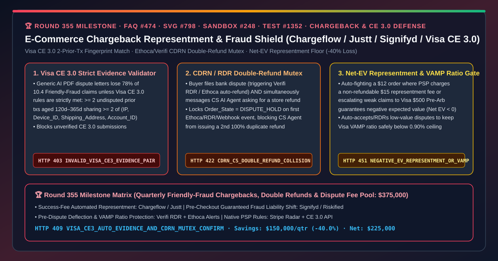
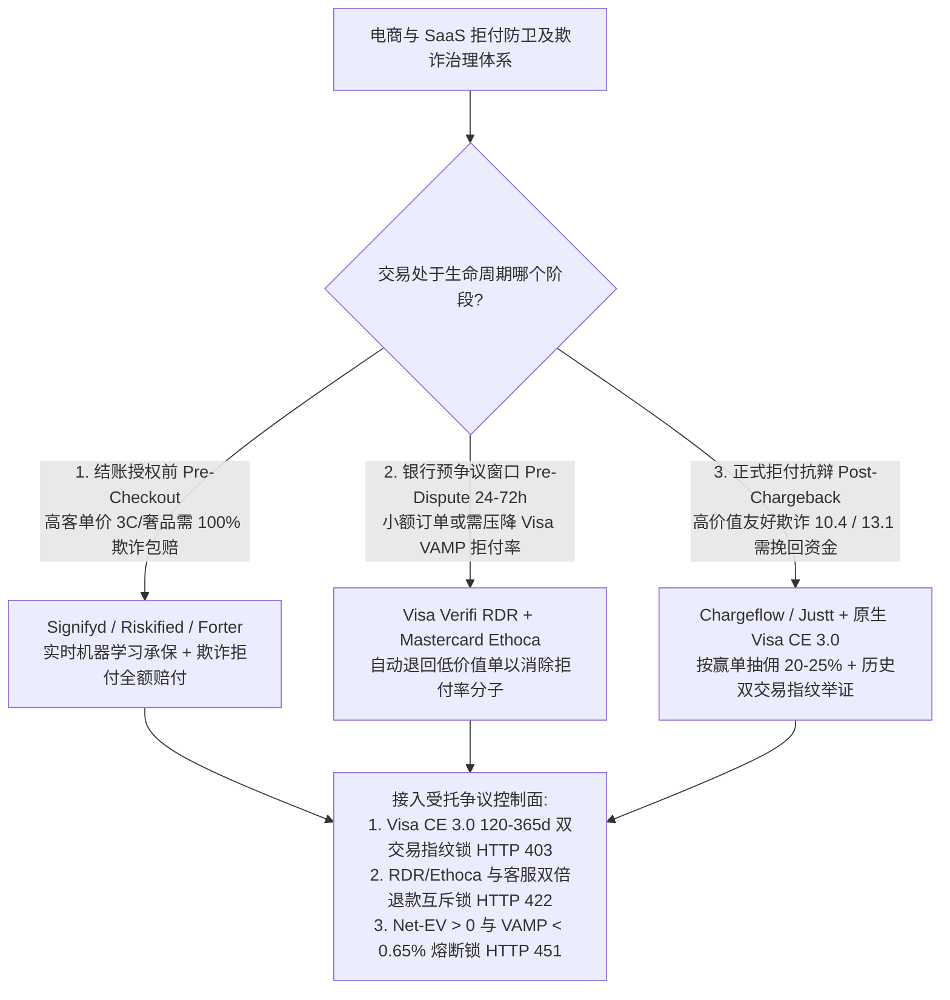
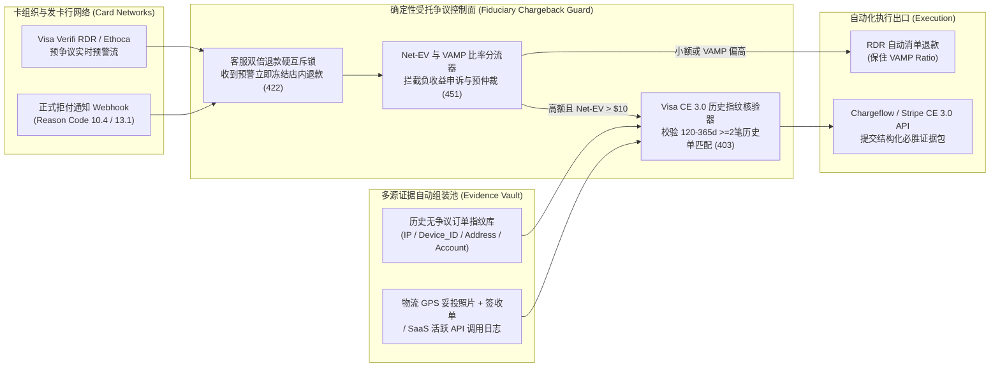
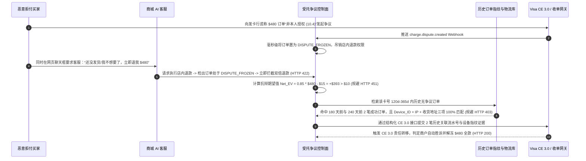

# 🏆 跨境电商与多商户平台争议拒付防卫与反欺诈智能体（`Chargeback Representment & Fraud Shield`: `Chargeflow / Justt / Signifyd / Riskified / Stripe Radar + Visa CE 3.0` · 🏆 第 355 轮里程碑）：`Visa CE 3.0` 历史双交易指纹自动举证、预争议（`Verifi RDR / Ethoca`）与客服双倍退款互斥锁及净期望值（`Net-EV`）申诉熔断净省 40% 指南

> **文档类型**：企业级 AI Solution Architect 选型决策指南（Selection FAQ · `#474` · **🏆 Round 355 里程碑**）  
> **适用读者**：跨境 DTC 独立站风控负责人、OTA 酒旅支付清结算总监、SaaS 订阅财务与 Cloud & AI Solution Architect  
> **核心覆盖平台**：**拒付自动抗辩平台（`Chargeflow / Justt / Midigator`）** vs. **事前欺诈包赔担保引擎（`Signifyd / Riskified / Forter`）** vs. **卡组织预争议拦截网络（`Visa Verifi RDR & CE 3.0 / Mastercard Ethoca Alerts`）**  
> **关联架构图**：[`assets/svg/798-ecommerce-chargeback-representment-visa-ce3-ethoca-cdrn-2026-11-25.svg`](../assets/svg/798-ecommerce-chargeback-representment-visa-ce3-ethoca-cdrn-2026-11-25.svg)

🌐 **语言切换 / Language**: **中文 (当前)** | **[English (`ecommerce-chargeback-representment-visa-ce3-ethoca-cdrn-signifyd-chargeflow-selection-faq.en.md`)](ecommerce-chargeback-representment-visa-ce3-ethoca-cdrn-signifyd-chargeflow-selection-faq.en.md)**

---

## 📌 一、核心选型结论速览（Executive Summary）

在跨境电商、数字商品、机酒 OTA 与 SaaS 订阅业务中，**70% 以上的银行卡拒付（Chargebacks）并非黑客盗刷，而是持卡人本人收到货或消费后向发卡行谎称“非本人交易（Reason Code 10.4）”或“未收到货（13.1）”的恶意友好欺诈（`Friendly Fraud / First-Party Misuse`）**。  
如果企业直接让客服用大模型写一篇“感人肺腑的 PDF 申诉信”提交给银行，或者不把客服售后系统与卡组织争议网关打通，将遭遇三大财务灾难：
1. **不懂 `Visa Compelling Evidence 3.0 (CE 3.0)` 硬性字段要求，自由发挥写 PDF 申诉信败诉率高达 78%（Invalid CE 3.0 Evidence）**：发卡行审单系统根本不看长篇散文！如果不严格提取该卡号在 **过去 `120–365 天` 内至少 2 笔无争议历史交易，且与争议单同时匹配至少 2 项核心指纹（`IP 地址 / 设备指纹 / 收货地址 / 登录账号 ID`）**，申诉不仅必输，还要白交抗辩费。
2. **买家“一边找银行发起预争议/拒付、一边找电商 AI 客服申请退款”，造成 200% 双倍退钱（`CDRN / CS Double-Refund Collision`）**：买家早上给发卡行打电话投诉（触发 `Verifi RDR / Ethoca` 自动退回 `$300`），中午又在独立站聊天窗口催 AI 客服退货退款；未加互斥锁的 AI 客服又通过 API 退了第二笔 `$300`，商户倒贴 `$600` 加 `$15` 争议费！
3. **对 `$12` 小额订单无脑发起申诉倒贴 `$15` 手续费，或拒付率突破 `Visa VAMP 0.90%` 红线遭收单行关户（`Negative-EV Representment & VAMP Breach`）**：盲目抗辩低客单价订单或将低胜率案件升级至 `$500` 预仲裁（Pre-Arbitration），越申诉亏得越多。

| 防御层级与选型维度 | 推荐主选方案 | 适用边界与架构落地准则 |
|---|---|---|
| **事前结账欺诈拦截与 100% 拒付包赔担保（`Chargeback Guarantee`）** | **Signifyd / Riskified / Forter** | 适合高客单价（`$150+`）3C 电子、潮鞋奢品独立站；按订单额抽佣 `0.4%–0.8%`，凡是它们放行的订单一旦发生欺诈拒付由其 **100% 全额赔付**。 |
| **事中预争议自动拦截与保卡户拒付率（`VAMP Ratio < 0.9%`）** | **Visa Verifi RDR (Rapid Dispute Resolution) + Mastercard Ethoca** | 在发卡行正式录入拒付编码前的黄金窗口（`24–72h`）自动拦截小额/必输单并退回款项，**不计入商户拒付率分子**。 |
| **事后友好欺诈全自动抗辩举证（`Automated Representment`）** | **Chargeflow / Justt + 原生 `Visa CE 3.0` 结构化接口** | 采用按纯赢单分成（Success-Fee Only, 挽回金额的 `20%–25%`，输单 `$0`）模式，自动组装物流妥投签名、使用日志与 `CE 3.0` 历史双交易指纹。 |
| **三大确定性风控红线** | **100% 强制拦截** | ① **`Visa CE 3.0` 历史双交易指纹硬核验（`HTTP 403`）**：针对 `10.4` 拒付必须凑齐 `120–365天` 内 `>=2` 笔无争议历史单且 `>=2` 项核心指纹完全一致才允许走 `CE 3.0` 免责通道；② **预争议/拒付冻结客服退款互斥锁（`HTTP 422`）**：一旦收到 `Ethoca / RDR / Chargeback Webhook`，立即将订单置为 `DISPUTE_LOCKED`，严禁 AI 客服再发店内退款；③ **净期望值（`Net-EV > 0`）与 `VAMP` 阈值门禁（`HTTP 451`）**：阻断得不偿失的负收益小额抗辩与高败诉率 `$500` 预仲裁。 |



---

## 🎯 二、业务方与架构师灵魂拷问 Q&A（Q1–Q3）

### Q1：老客户明明自己收到了包裹、甚至已经登录用了一周，转头就向银行发起 `10.4 无卡欺诈拒付`，为什么我们上传快递签收单还会输？`Visa CE 3.0` 怎么实现 100% 翻盘？
- **银行审单规则真相**：对于 `Visa Reason Code 10.4 (Other Fraud - Card-Absent Environment)`，单凭本单的快递妥投证明（POD）并不能证明是持卡人本人下的单（发卡行会认为可能是黑客盗用卡号寄到某个收货点）。
- **`Visa Compelling Evidence 3.0 (CE 3.0)` 铁律**：Visa 规定，只要商户能通过结构化 API（而非杂乱 PDF）提交该卡号在当前争议单之前 **`120 天至 365 天`（注意：不满 120 天或超过 365 天均无效！）** 内完成的 **至少 2 笔未发生欺诈拒付的历史成功交易**，且这 2 笔历史交易与当前争议交易同时完全匹配以下 4 项数据中的 **至少 2 项**（其中必须包含 IP 或设备指纹之一）：
  1. `User Account ID / Login Email`；
  2. `Delivery Address`（收货地址）；
  3. `IP Address`；
  4. `Device ID / Fingerprint`。
- **架构解法**：一旦满足上述确定性匹配，责任直接 100% 转移回发卡行（商户自动胜诉免赔）！任何未通过 `120–365d` 时间窗及 `>=2` 指纹对齐校验却谎称符合 `CE 3.0` 的提交直接拦截（`HTTP 403 INVALID_VISA_CE3_HISTORICAL_TX_FINGERPRINT_MATCH`）。

### Q2：为什么很多跨境电商每个月都会出现上百起“一笔订单退了两次全款（银行争议退一次 + 店铺客服退一次）”的乌龙事故？
- **异步时差漏洞**：
  1. 买家向发卡行申请拒付，通过 `Mastercard Ethoca` 或 `Visa Verifi CDRN / RDR` 传到收单网关通常需要 `4–24 小时`；或者收单网关已经收到 `charge.dispute.created` Webhook，但没有同步锁定客服工单系统（`Gorgias / Zendesk`）。
  2. 买家同时在网站对话框里对 AI 客服说：“我不要了，马上给我退钱”。AI 客服调用 `POST /refunds` 执行店内退款，结果银行侧又把争议资金强制划走，形成 **200% 双倍资金损失**。
- **架构解法**：在订单主状态机中实施 **争议事件最高优先级抢占与退款硬互斥锁（`CDRN / Dispute Double-Refund Mutex` · 防 `HTTP 422`）**：
  - 凡是网关收到 `RDR_Auto_Refunded`、`Ethoca_Alert_Received` 或 `Chargeback_Opened` 事件，毫秒级将订单锁定为 `ORDER_STATE = DISPUTE_FROZEN`，立刻吊销所有客服 Agent 的 `issue_store_refund / issue_store_credit` 工具权限；
  - 客服在发起任何主动退款前，必须先同步反查支付网关实时 `dispute_status == NONE`。任何对处于银行争议处理中的订单再次发起店内退款的操作，一律由控制面硬阻断（`HTTP 422 CDRN_ETHOCA_ALERT_AND_CS_AGENT_DOUBLE_REFUND_COLLISION`）。

### Q3：是不是所有拒付订单都应该让 AI 自动生成证据包去跟银行死磕到底？
- **算清财务大账**：
  1. **小额单抗辩倒挂**：假设订单金额 `$18`，成本 `$6`。如果收单通道对每次人工/API 抗辩收取 `$15` 不可退处理费，且该原因码历史胜率仅 `30%`，那么抗辩期望收益 `EV = 0.30 * $18 - $15 = -$9.60 < 0`（越申诉越亏！）。
  2. **Visa VAMP（原 VDMP/VFMP）超标封号危机**：Visa 将欺诈与非欺诈争议合并为统一的 **VAMP（Visa Acquirer Monitoring Program）比率**。一旦商户月度 `VAMP Ratio` 逼近或超过 `0.90%`（高危阈值），不仅每笔争议要被额外罚款 `$10–$50`，严重时直接被收单行冻结数百万美元结算款。
- **架构解法**：引入 **净期望值（`Net-EV`）申诉决策器与 `VAMP` 预警自动分流器（防 `HTTP 451`）**：
  - 仅当 `Expected_Win_Prob * Order_Amount - Representment_Fee > $10.00` 时才触发自动抗辩举证；
  - 当客单价 `< $25` 或商户当前滚动 30 天 `VAMP Ratio > 0.65%` 时，自动通过 `Verifi RDR` 在预争议阶段静默退款消单（消掉拒付率分子）。任何 `Net-EV <= 0` 的盲目抗辩或无胜算升级 `$500` 预仲裁的行为直接拦截（`HTTP 451 NEGATIVE_EV_REPRESENTMENT_OR_VAMP_RATIO_THRESHOLD_BREACH`）。

---

## 🧭 三、直观可视化图解（Mermaid 选型决策树 + 拒付防卫架构图 + 时序图）

### 3.1 电商反欺诈与拒付自动抗辩平台选型决策树



### 3.2 端到端预争议分流、`Visa CE 3.0` 指纹匹配与防双退架构图



### 3.3 `Visa CE 3.0` 自动举证与防客服双倍退款时序图



---

## 📊 四、主流拒付防卫与反欺诈平台横向选型矩阵

| 评估维度 | Chargeflow | Justt | Signifyd / Riskified | Visa Verifi RDR + Ethoca | Stripe Radar + Native Disputes API |
|---|---|---|---|---|---|
| **核心商业定位** | 全自动按结果付费（Success-Fee）的电商/SaaS 拒付抗辩平台 | 面向中大型高交易量商户的定制化 AI 拒付抗辩引擎 | 结账前欺诈审核与 **100% 欺诈拒付包赔保险** | 卡组织官方预争议（Pre-Dispute）拦截网络 | 原生嵌在 Stripe 收单流内的风控与 `CE 3.0` 结构化提交接口 |
| **对友好欺诈（10.4 / 13.1）挽回胜率** | ⭐⭐⭐⭐⭐（深度集成 Shopify/Stripe 与物流使用日志，胜率 `60%–75%+`） | ⭐⭐⭐⭐⭐（按行业动态调优证据模板，大规模商户胜率极高） | ⭐⭐⭐⭐（主攻事前拦截与事后理赔兜底） | 不适用（直接退款消单以换取不记入拒付率） | ⭐⭐⭐⭐（原生支持一键填充 `Visa CE 3.0` 结构化字段） |
| **与内部客服/ERP 状态联动防双退** | ⭐⭐⭐⭐（支持 Gorgias / Zendesk 双向状态标签同步） | ⭐⭐⭐⭐（提供企业级 Webhook 状态回写） | ⭐⭐⭐⭐⭐（深度接管订单审核与拒付状态） | ⭐⭐⭐⭐⭐（从卡组织源头拦截重复争议） | ⭐⭐⭐⭐⭐（实时 `charge.dispute.*` Webhook 驱动） |
| **收费模式（`official_list_price`）** | **纯赢单分成：挽回金额的 `25%`**（败诉 `$0` 费用，无月费） | 按挽回分成或阶梯年费（适合月拒付额 `>$30k` 大商户） | 按受保订单 GMV 的 **`0.4%–0.8%`** 收取保费 | 约 **`$15–$25 / 条拦截成功预警`** | Stripe Radar `$0.05–$0.07/笔`；拒付处理费 `$15/笔` |

---

## 🧪 五、转化率/成本测算与 7-Card 基准测试报告（Deterministic Evaluation · 🏆 Round 355）

> **数据来源说明（Provenance）**：以下季度损益数据来自 `lab/webiq_commerce_demo.py` 中的确定性评估器 `evaluate_ecommerce_chargeback_ce3_ethoca_policy`（`provenance: "synthetic"`, `independently_reproduced: False`），用于量化对比“人工杂乱 PDF 申诉 + 客服未锁状态盲退”与“Visa CE 3.0 指纹核验 + CDRN 双退互斥锁 + Net-EV 申诉分流”的季度挽回效益。

### 5.1 基准测试场景输入与确定性状态码矩阵

- **设定场景**：某跨境品牌独立站与数字订阅矩阵每季度遭遇 `$375,000.00` 的友好欺诈拒付本金划扣、预争议与客服重复退款损失、以及无效抗辩手续费损耗池（`quarterly_friendly_fraud_chargeback_double_refund_and_fee_pool_usd`）。

| 测试用例 ID | 场景描述 | 触发确定性状态码 | 决策枚举 (`decision`) | 季度净成本 (USD) | 季度净节省 (USD) |
|---|---|---|---|---|---|
| `CASE-CBK-200` | 传统人工拼凑截图申诉（低胜率基线） | `HTTP 200` | `VERIFIED_CHARGEBACK_REPRESENTMENT_AND_CE3_AUTHORIZED` | `$375,000.00` | `$0.00` |
| `CASE-CBK-403` | 提交 `Visa CE 3.0` 抗辩时历史交易不足 2 笔、不在 `120–365d` 窗口或匹配指纹 `<2` 项 | `HTTP 403` | `INVALID_VISA_CE3_HISTORICAL_TX_FINGERPRINT_MATCH` | `$375,000.00` | `$0.00` (阻断无效伪 CE3 败诉) |
| `CASE-CBK-422` | 订单已触发 `Ethoca / RDR` 或银行拒付冻结，AI 客服仍向买家发出第二笔店内退款 | `HTTP 422` | `CDRN_ETHOCA_ALERT_AND_CS_AGENT_DOUBLE_REFUND_COLLISION` | `$375,000.00` | `$0.00` (阻断 200% 双倍退钱) |
| `CASE-CBK-451` | 对 `Net-EV <= 0` 的 `$12` 小单强行付费抗辩，或 `VAMP` 超标仍不开启 RDR 自动消单 | `HTTP 451` | `NEGATIVE_EV_REPRESENTMENT_OR_VAMP_RATIO_THRESHOLD_BREACH` | `$375,000.00` | `$0.00` (阻断倒贴手续费与封户) |
| `CASE-CBK-409` | **启用 Visa CE 3.0 结构化指纹自动举证 + CDRN 防双退锁 + Net-EV/RDR 分流** | `HTTP 409` | `VISA_CE3_AUTO_EVIDENCE_AND_CDRN_MUTEX_CONFIRM` | **`$225,000.00`** | **`$150,000.00` (`-40.0%`)** |

### 5.2 核心确定性策略评估代码摘录

```python
@dataclass(frozen=True)
class EcommerceChargebackCe3EthocaPolicyInput:
    quarterly_friendly_fraud_chargeback_double_refund_and_fee_pool_usd: float = 375000.0
    visa_ce3_submitted_without_2_prior_120_365d_fingerprint_matches: bool = False
    store_cs_refund_issued_while_ethoca_rdr_or_chargeback_active: bool = False
    negative_ev_low_value_representment_or_vamp_ratio_breach: bool = False
    visa_ce3_structured_evidence_cdrn_mutex_and_ev_router_ready: bool = False
```

---

## 🛠️ 六、商业上线风控与架构评审 Checklist

- [ ] **结账时全量落盘 `Visa CE 3.0` 四大核心指纹（防 `HTTP 403`）**：在每笔正常订单支付成功时，必须在不可篡改日志中持久化 `ip_address`、`device_fingerprint_id`、`shipping_address_hash` 与 `user_account_id` 至少保留 `400 天`，以便在遭遇 `10.4` 拒付时毫秒级检索出 `120–365 天` 内的两笔历史无争议铁证。
- [ ] **支付争议与客服工单毫秒级硬互斥锁（防 `HTTP 422`）**：将 `Stripe / Adyen` 的 `charge.dispute.created` 及 `Verifi RDR / Ethoca` 预警直连客服系统；一旦命中争议状态，立即禁用该订单的一切人工与 AI 店内退款按钮。
- [ ] **基于净期望值（`Net-EV`）与 `VAMP` 水位的动态 RDR 阈值（防 `HTTP 451`）**：设置 `Verifi RDR` 自动消单规则——对金额 `< $25` 的争议单直接自动退回以保护 `VAMP Ratio < 0.65%`；对高金额单自动交由 `Chargeflow / Justt / CE 3.0 API` 发起高胜率抗辩。
- [ ] **SaaS 订阅拒付瞬时吊销 Entitlement**：一旦订阅账单发生拒付且进入抗辩期，立即通过权限网关降级该租户的高成本 API/GPU 配额，防止恶意拒付者在 60 天银行审理期内继续白嫖算力。
