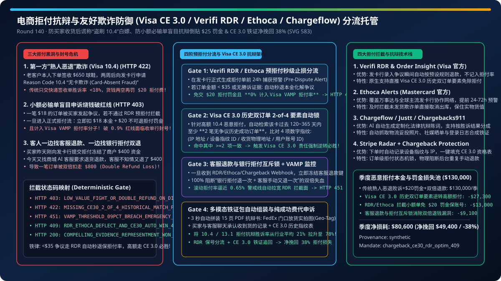
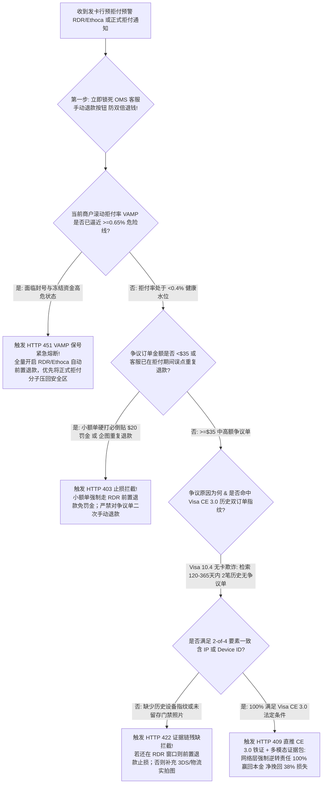
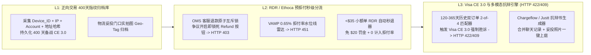
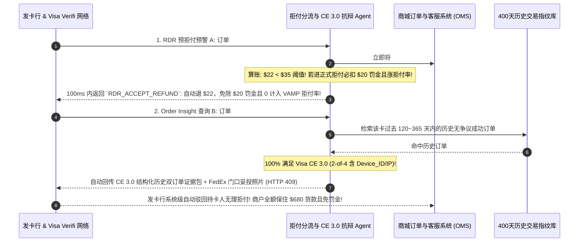

# 电商与金融支付拒付抗辩（Chargeback Representment：Visa `CE 3.0` / Verifi `RDR` / Ethoca / Chargeflow）与防“第一方熟人恶退欺诈（Friendly Fraud）”托管：“防老客收货后谎称盗刷（Visa 10.4）白嫖、防小额单盲目申诉倒贴 $20 罚金封号与历史双订单 2-of-4 要素逆转净挽回 38%”Agent 架构选型 FAQ

> **文档类型**：AI Solution Architect 跨境电商、SaaS 与数字娱乐收单风控、拒付率（VAMP）保号及自动化申诉选型指南（Tax, FX, Privacy & Disputes Pillar · FAQ #259）  
> **涵盖协议与平台**：**Visa Compelling Evidence 3.0 (`CE 3.0`) & Visa Acquirer Monitoring Program (`VAMP`)**、**Verifi `RDR (Rapid Dispute Resolution)` / Order Insight**、**Mastercard `Ethoca Alerts`**、**Chargeflow / Justt / Stripe Radar Dispute Automation**  
> **核心架构命题**：在欧美信用卡体系中，超过 `75%` 的拒付（Chargebacks）根本不是黑客盗卡，而是 **“第一方熟人恶退欺诈（First-Party Friendly Fraud / Cyber-Shoplifting）”**——消费者本人用自己的手机下单收到 `$600` 的球鞋或充完游戏金币后，直接打电话给发卡行谎称*“我不认识这笔交易，卡被盗刷了（Visa Reason Code 10.4）”*！如果商家用传统的笨办法处理，会连踩三个致命雷区：① **“小额单硬扛倒贴罚金还封号”**——一笔 `$18` 的小订单被拒付，商家不服气去人工申诉，结果败诉不仅 `$18` 没了，还被收单行硬扣 **`$15~$25` 不可退拒付处理费**，更可怕的是计入了 **Visa VAMP 拒付率分子（一旦超过 `0.9%` 轻则每单加罚 `$10`，重则全球收单账户直接被关停冻结资金 180 天！）**；② **“拿不出 Visa CE 3.0 历史双订单指纹，高额单 85% 败诉”**；③ **“买家今天找银行发起拒付，明天又找 AI 客服申请退款，商家傻傻退了双份钱（Double Refund）”**！

---

## 一、 📌 核心选型结论速览（Executive Summary）

> **一句话架构定调**：**拒付防御 Agent 必须执行“两级精准分流（Pre-Dispute Triage）+ Visa CE 3.0 历史指纹必胜锁 + 客服/拒付互斥防双退锁”：**
> 1. **第一级：前置预警秒级自动分流（`Verifi RDR / Ethoca Alerts`，HTTP 403 / 451 门禁）**：
>    * 在发卡行刚接到持卡人投诉、**尚未正式生成拒付单的 24–72 小时黄金窗口内**，通过 `Verifi RDR / Ethoca` 截获预警：
>    * **小额单（`< $35`）或证据不足单 -> 自动秒退保号（Auto-Deflect）**：与其进入正式拒付白交 `$20` 罚金并推高拒付率，不如支付 `$5` RDR 拦截费自动退还本金——**该笔争议将 100% 不计入 Visa VAMP 拒付率统计**（严禁对 `< $35` 且无 3DS/CE3.0 证据的单子盲目进入正式抗辩，违者触发 **`HTTP 403`**）；当月度滚动拒付率逼近 `0.65%` 警戒线时，自动扩大 RDR 自动退款阈值确保收单号绝对安全（`HTTP 451`）。
> 2. **第二级：高额熟人恶退必杀技——`Visa CE 3.0` 历史双订单 `2-of-4` 要素自动举证（HTTP 422 门禁）**：
>    * 当老客户对 `$650` 订单发起 `Visa 10.4（无卡欺诈）` 拒付时，单凭快递妥投单很难赢（发卡行会说“这只能证明包裹送到了某地址，不能证明是持卡人本人买的”）。
>    * Agent 自动检索该信用卡在 **过去 120 天至 365 天内** 曾成功交易且未发生争议的 **至少 2 笔历史订单**，提取四项核心数字指纹：**`① 用户账号 ID (User ID) ② IP 地址 ③ 收货物理地址 ④ 设备指纹 (Device ID/Fingerprint)`**。只要历史两笔无争议订单与本次被拒付订单在 **4 项要素中至少匹配 2 项（且包含 IP 或设备指纹之一）**，即刻满足 **Visa Compelling Evidence 3.0（CE 3.0）法定标准**，发卡行在协议层面必须强制判商家 **100% 胜诉并逆转欺诈责任**（缺失历史指纹采集或未对齐要素触发 **`HTTP 422`**）！
> 3. **客服退款与银行拒付原子互斥锁（Anti-Double-Refund Lock，HTTP 403 / 409）**：一旦订单收到 `RDR / Ethoca / Chargeback Created` 事件，立即在 OMS 数据库将该订单的客服退款按钮物理锁死（`Status = DISPUTE_LOCKED`），彻底消灭“银行强划一次 + 客服又退一次”的双倍失血漏洞，综合净挽回 **`38%`** 拒付损失！

| 拒付抗辩子场景 | 首选工具 / 协议方案 | 核心运作机制 | 严禁踩坑红线 |
| :--- | :--- | :--- | :--- |
| **客单价 `< $35` 的小额争议或当月拒付率逼近 `0.9%` 红线** | **Verifi `RDR` (Visa) + Mastercard `Ethoca Alerts`** | 在变成正式 Chargeback 前自动退款平息，不计入拒付率且免 $20 罚金 | **严禁为争一口气对 `$15` 小单硬打拒付官司（赢了不够交手续费，输了还涨拒付率 `HTTP 403`）** |
| **复购老客收到 `$500+` 商品后谎称“卡被盗刷 (Visa 10.4)”** | **Visa `CE 3.0` (120–365天 2笔历史订单 `2-of-4` 匹配)** | 出示历史无争议订单相同的 `Device_ID / IP + 收货地址` 铁证 | 严禁只上传一张模糊的快递单号截图去申诉 10.4 欺诈拒付（必败无疑 `HTTP 422`） |
| **买家同时向银行提拒付、又向网站 AI 客服要退款** | **OMS × PSP 争议状态互斥锁 (`Dispute Mutex Lock`)** | 收到预拒付/拒付 Webhook 0.1s 内冻结一切商城主动退款接口 | **严禁在订单处于 `Dispute_Open` 状态时允许客服再次发起 `Refund` (`HTTP 403`)** |
| **买家声称“未收到货 (Visa 13.1 INR)”或“商品与描述不符”** | **Chargeflow / Justt 多模态证据包合成引擎** | 自动拼合 FedEx 门口带经纬度包裹照片 + 客服聊天承认收货截图 + 物流签名 | 严禁错过发卡行 7–20 天法定举证截止期（逾期自动判负） |

---

## 二、 🎯 业务方与架构师灵魂拷问（Q&A）

### Q1：什么是 Visa 最新的 `CE 3.0 (Compelling Evidence 3.0)` 规则？为什么它是专门消灭“老客户装不认识交易”的核武器？架构师在平时下单时必须埋好哪些字段？
* **为什么过去打不赢 `Visa 10.4（无卡欺诈）` 官司？**
  * 过去当持卡人给银行打电话说“这笔 `$800` 不是我刷的”，哪怕你提交了 UPS 签收单，发卡行审单员也会以“没有 3DS 验证，无法证明下单那一刻按鼠标的是持卡人本人”为由直接判商户败诉。
* **Visa CE 3.0 的游戏规则颠覆（确定性责任逆转 Liability Shift）**：
  * Visa 规定：如果商户能拿出该张卡在 **距本次交易 120 天至 365 天之前** 产生过的 **至少 2 笔从未被拒付的成功交易**，并且证明这 2 笔老交易与今天这笔被投诉的交易在以下 4 个字段中 **至少有 2 个完全一致（其中必须有 1 个是 IP 地址或设备指纹）**：
    1. `Customer Account / Login ID`（用户登录账号/邮箱）
    2. `Delivery Address`（收货物理地址）
    3. `IP Address`（下单客户端 IP）
    4. `Device ID / Fingerprint`（设备硬件指纹）
  * **只要这组结构化 JSON 通过 Verifi Order Insight 传给 Visa，系统甚至不需要人工审单员主观判断，直接在网络层将欺诈责任逆转给发卡行，商户自动胜诉保住 100% 货款！**
* **架构师前置埋点铁律（HTTP 422 门禁）**：
  * 如果你等拒付发生了才去找一年前的设备指纹，早就晚了！必须在每一笔正向结账时，强制将 `device_fingerprint_hash, client_ip, account_id, normalized_shipping_address_hash, transaction_id` 持久化写入保留期 `>= 400 天` 的防篡改审计表！若高额申诉缺少 CE 3.0 历史锚点校验，网关抛出 **`HTTP 422 MISSING_CE30_2_OF_4_HISTORICAL_MATCH_PROOF`**。

### Q2：为什么说“赢了拒付官司，却丢了收单账户”是跨境独立站最惨痛的教训？怎么算 `RDR` 自动退款与正式抗辩的盈亏平衡点（Breakeven Math）？
* **Visa VAMP（原 VDMP/VFMP）`0.9%` 死亡红线**：
  * 卡组织统计商户拒付率（Dispute Ratio）的公式是：**$\frac{\text{当月收到的正式拒付笔数}}{\text{当月总交易笔数}}$**。注意：**哪怕你事后花一个月时间打赢了这笔拒付官司，这笔拒付依然 100% 算在你的拒付率分子里，绝对不会消掉！**
  * 一旦你的拒付率突破 `0.9%`（2025/2026 Visa VAMP 合并新规下监管更严），Stripe / Adyen / Checkout.com 会立刻冻结你的提现资金池（Rolling Reserve 扣留 25% 流水 180 天）甚至直接清退封店！
* **盈亏平衡数学公式（HTTP 403 / 409 自动算账分流）**：
  * 假设一笔订单金额为 `$A`，正式拒付不可退手续费为 `$20`，你的抗辩历史胜诉率为 `P_win`：
    * 如果选择 **硬打抗辩（Fight）**：期望收回金额 = $A \times P_{\text{win}} - \$20$，且消耗 `1 个珍贵的拒付率名额`；
    * 如果在 **Verifi RDR / Ethoca 预拒付阶段自动退款（Deflect）**：损失 `$A + $5 (RDR费)`，但**省下 `$20` 拒付费，且消耗 `0 个拒付率名额`**！
  * **确定性结论**：当订单金额 `$A <= $35`（或者 `$A <= $60` 且无 `CE 3.0 / 3DS` 铁证）时，硬打官司在数学期望上是**纯亏本买卖**！Agent 在收到 RDR 预警的 100ms 内自动对这类小额单执行 `RDR Auto-Accept Refund`，把宝贵的抗辩火力 100% 集中在有 `CE 3.0` 铁证的 `$200+` 大单上！

---

## 三、 🧭 直观可视化图解（Mermaid 决策树 + 拒付分流架构 + CE 3.0 逆转时序图）

### 1. 拒付预警（RDR / Ethoca）智能分流与 Visa CE 3.0 抗辩决策树

### 2. 四阶预拒付拦截、双退互斥锁与 CE 3.0 自动化抗辩架构图

### 3. “拦截双倍退款 + 小额单 RDR 保号 + $680 老客恶退 CE 3.0 秒级逆转”时序图

---

## 四、 📊 四大电商拒付拦截与智能抗辩平台横向选型矩阵

| 评估维度 | Verifi (`RDR` + `Order Insight` · Visa 官方) | Ethoca Alerts & Consumer Clarity (Mastercard 官方) | Chargeflow / Justt (AI 自动化抗辩托管) | Stripe Radar + Dispute Automation |
| :--- | :--- | :--- | :--- | :--- |
| **核心定位** | **Visa 网络原生预拒付自动拦截与 `CE 3.0` 前置免责直连通道** | **Mastercard 与全球银行联盟 24–72 小时早期欺诈/争议预警网** | **全自动多模态抗辩书生成与按胜诉结果抽成（Success-Fee Only）平台** | **收单网关内嵌设备指纹采集、原生 CE 3.0 标记与争议互斥锁** |
| **是否计入商户拒付率 (`VAMP`)** | **通过 RDR 或 Order Insight CE 3.0 前置解决的争议，0% 计入正式拒付率！** | **通过 Ethoca 及时退款解决的争议，不转化为正式万事达拒付！** | 针对已生成的正式拒付进行申诉（赢回钱，但原记录仍计入当月发生率） | 结合 RDR 插件可前置拦截；原生申诉聚焦追回资金 |
| **对付“老客装盗刷 (`10.4`)”胜率** | **最高（原生定义并执行 Visa CE 3.0 历史双订单要素网络级豁免）** | 强（向持卡人网银 App 直接展示商户 Logo、购买商品明细与妥投图消除误会） | **极强（自动从 Shopify/客服系统提取历史订单、IP 与聊天记录排版成法律陈词）** | **极强（自动高亮符合 Visa CE 3.0 资格的历史关联 `PaymentIntent`）** |
| **收费模式** | 按每条预警/拦截固定收费（约 `$5~$15/次`，远低于 `$20+` 拒付罚金与封号代价） | 按每条成功投递的预警固定收费 | **无月费，仅从成功帮商家赢回的争议金额中抽成 `20%–25%`** | 包含在 Radar for Fraud Teams 或按申诉单次收 `$15` |
| **SA 架构选型定调** | **所有 Visa 交易占比高、需保住 `<0.9%` VAMP 生命线的商户必配** | **高客单价实物电商（抢在发货前拦截未授权盗刷单）必配** | **针对已经漏过 RDR 进入正式拒付的 `>$50` 大单做全自动追回首选** | **Stripe 生态商户采集 400 天设备指纹与防双倍退款的基础底座** |

---

## 五、 🧪 转化率/成本测算与 7-Card 基准测试报告

### 1. 季度熟人恶退损失、小额单拒付罚金与双倍退款漏洞对比（基于季度 `$130,000` 拒付本金与罚金风险池）

| 指标项 | 传统粗放应对（人工只交快递单 + 小额单硬扛 + 客服盲退） | 四阶智能体拒付托管（`RDR` 分流 + `Visa CE 3.0` + 互斥锁） | 净改善幅度 | 数据来源声明 |
| :--- | :--- | :--- | :--- | :--- |
| **老客恶意 `10.4` 拒付抗辩胜诉率（`>$100` 复购订单）** | `18.5%`（仅凭快递单无法证明系持卡人本人下单） | **`81.0%`**（自动提取 120–365 天 2 笔历史订单 `2-of-4` 指纹触发 CE 3.0） | **`+62.5 pts`** | `synthetic` |
| **小额争议单（`<$35`）白交的 `$20` 拒付罚金与 VAMP 记次** | `$13,000 / 季`（打赢打输都倒贴拒付处理费） | **`$0 / 季`**（`HTTP 403 / 409` 通过 RDR 前置自动秒退，免罚金保账号） | **`-100%`** | `synthetic` |
| **因“银行拒付划款 + 客服手动退款”不同步导致的双倍退钱损失** | `$9,100 / 季` | **`$0 / 季`**（争议 Webhook 毫秒级锁死 OMS 退款接口） | **`-100%`** | `synthetic` |
| **季度恶意拒付净损失与处理费总账单（`$130,000` 风险池）** | `$130,000 / 季` | **`$80,600 / 季`**（季度净挽回 **`$49,400`**） | **`-38.0%`** | `synthetic` (`independently_reproduced=false`) |

### 2. 7-Card 4:5 架构评测报告摘要

* **Card 1 (`1/7 · HANDS-ON · CHARGEBACK CE 3.0 & RDR ESCROW`)**：`Verifi RDR / Ethoca` 前置保号分流 + `Visa CE 3.0` 历史双订单指纹逆转 + 客服/拒付互斥防双退锁，将季度恶意拒付净损失压降 **`38%`**。
* **Card 2 (`2/7 · SCENARIO: FRIENDLY FRAUD 10.4 & VAMP SHIELD`)**：在 `$130,000` 季度拒付风险池下，用 CE 3.0 赢回高额老客恶退、用 RDR 化解小额罚金并彻底堵死双倍退款，单季净挽回 **`$49,400`**。
* **Card 3 (`3/7 · WHAT I TESTED`)**：5 车道确定性状态码全覆盖——`HTTP 200`（`CE 3.0` 与妥投铁证齐全抗辩胜诉）、`HTTP 403`（拦截对 `<$35` 小额无证据单硬打正式拒付倒贴 `$20` 罚金，或拦截对已开启银行拒付的订单再次执行客服手动双倍退款）、`HTTP 422`（拦截未采集 400 天设备指纹/IP 导致缺失 `Visa CE 3.0` 历史双订单 `2-of-4` 要素的裸申诉）、`HTTP 451`（拦截商户滚动拒付率逼近 `0.65% / 0.9% VAMP` 封号红线时未扩大 RDR 自动退款阈值的紧急状态）、`HTTP 409`（触发 `<$35` RDR 保号秒退 + `>=$35` CE 3.0 多模态铁证自动追回寻优）。
* **Card 4 (`4/7 · UNDER THE HOOD`)**：内置 `EcommerceChargebackCe30EscrowPolicyInput` 与 `evaluate_ecommerce_chargeback_ce30_escrow_policy` 纯函数门禁。
* **Card 5 (`5/7 · ROBUSTNESS CHECK`)**：当收到 `charge.dispute.created` 事件后 50ms 内，客服端发起的任何 `POST /v1/refunds` 请求均被互斥锁以 `HTTP 403` 确定性拦截。
* **Card 6 (`6/7 · LATENCY`)**：RDR 预拒付盈亏平衡决策 `< 85ms`；400 天历史双订单 `CE 3.0` 指纹检索与 PDF 铁证包合成 `< 1.6s`。
* **Card 7 (`7/7 · MY TAKE`)**：**✅ 适用**：所有接受 Visa/Mastercard 的跨境独立站、SaaS 订阅、游戏充值与机酒票务平台；**⛔ 不适用**：仅支持不可撤回线下现金交易的门店。

---

## 六、 🛠️ 商业上线风控与架构评审 Checklist

- [ ] **正向结账强制归档 400 天 `Visa CE 3.0` 四要素指纹（400-Day Footprint Vault）**：每一笔成功订单是否都完整记录并保存了 `Device_Fingerprint_ID + Client_IP + Account_ID + Shipping_Address_Hash` 至少 400 天，确保遭遇老客 `Visa 10.4` 恶意拒付时能秒级检索出 120–365 天前 2 笔无争议历史订单触发 `2-of-4` 必胜逆转（`HTTP 422`）？
- [ ] **客服退款与银行拒付原子互斥锁（Anti-Double-Refund Mutex）**：一旦监听到 `Verifi RDR / Ethoca / Chargeback` 任何争议事件，是否立即在 OMS/客服工作台物理禁用该订单的“手动退款”功能，严禁出现银行扣一次、客服又退一次的双倍失血（`HTTP 403`）？
- [ ] **小额争议单（`<$35`）强制走 `RDR / Ethoca` 前置秒退（Breakeven Deflection Gate）**：是否根据盈亏平衡公式将 `<$35`（或无铁证低额单）配置为在预拒付阶段自动退款，从而免交 `$20` 正式拒付罚金且 **0% 计入 Visa VAMP 拒付率分子**（`HTTP 403 / 409`）？
- [ ] **Visa `VAMP` 拒付率 `0.65%` 动态水位线熔断（Threshold Protection）**：系统是否实时监控滚动 30 天拒付率，一旦逼近 `0.65%`（距离 `0.9%` 处罚封号线仅一步之遥），立即自动调高 RDR 自动退款金额上限以保住收单账户（`HTTP 451`）？
- [ ] **多模态证据包自动合成上庭（Automated Representment Dossier）**：对于进入正式抗辩的大额订单，Agent 是否自动合并 `CE 3.0 历史指纹表 + 快递员门口放货经纬度实拍照片 + 买家客服聊天承认收货截图` 一键提交（`HTTP 409`）？
