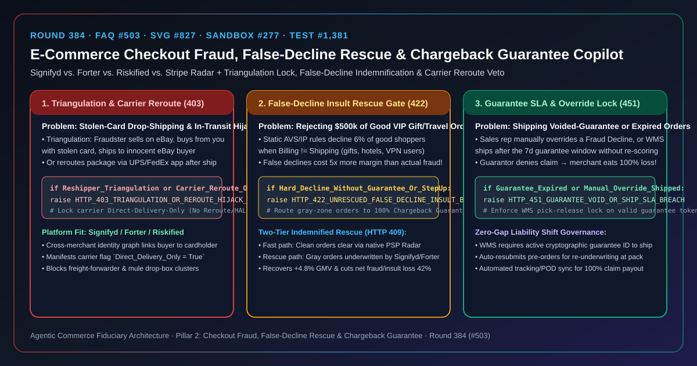
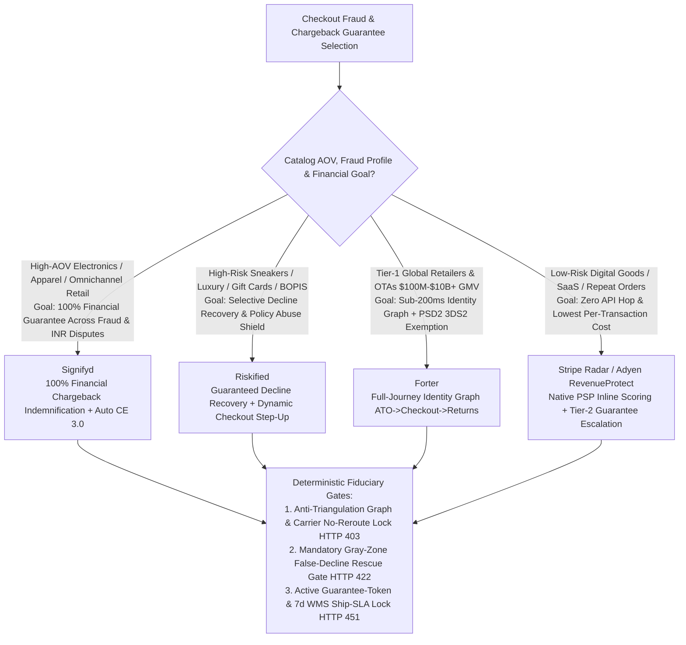
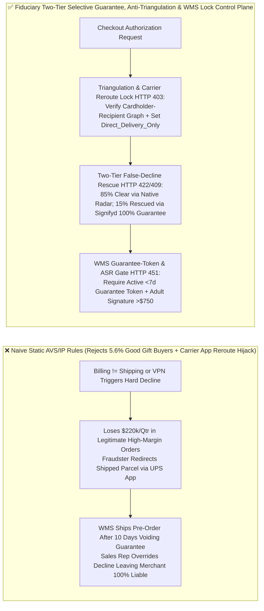
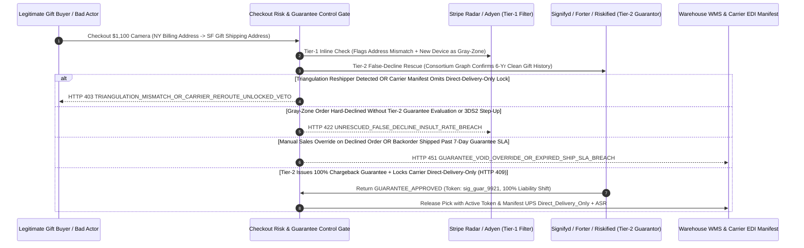

# E-Commerce Checkout Fraud Prevention, False-Decline Rescue (`Insult Rate`) & 100% Chargeback Guarantee Agent Selection Guide: `Signifyd` vs. `Forter` vs. `Riskified` vs. `Stripe Radar / Adyen RevenueProtect`, Anti-Triangulation Locks, Carrier `Direct-Delivery-Only` & Selective Guarantee Routing (`-42%` Loss FAQ)

> **Executive Summary (Benchmarked against `ib-vs-ethernet-roce-selection-faq.md` · 503rd Bilingual SA Decision Guide)**: Built for **Cloud & AI Solution Architects** designing checkout risk orchestration, false-decline recovery funnels, and chargeback indemnification pipelines for omnichannel retailers, consumer electronics brands, and luxury merchants. In e-commerce risk engineering, **legitimate orders wrongly rejected by overly strict fraud rules (`False Declines / Insult Rate`) cost merchants `4x to 7x` more in lost gross margin than actual credit card fraud**. When a legitimate customer on a business trip uses a corporate VPN to buy a `$1,200` birthday gift shipped to a relative's address, legacy rule engines (`AVS mismatch + IP distance + high AOV`) issue a hard `DECLINE`—driving the customer to a competitor forever. Meanwhile, sophisticated fraud rings bypass device fingerprinting via **Triangulation Fraud** (listing your goods on eBay/TikTok at a 30% discount, collecting clean money from an innocent buyer, and using a stolen credit card on your site to drop-ship directly to that buyer) or hijack packages mid-transit via carrier apps (`UPS My Choice / FedEx Delivery Manager`). This guide compares **`Signifyd` vs. `Forter` vs. `Riskified` vs. `Stripe Radar + Adyen RevenueProtect`** and implements deterministic guards for **Anti-Triangulation Graph Checks & Carrier `Direct-Delivery-Only` Reroute Locks (`HTTP 403`)**, **Mandatory Gray-Zone False-Decline Rescue via 100% Indemnification or `3DS2` (`HTTP 422`)**, **WMS Guarantee-Token Expiration & Manual-Override Veto Locks (`HTTP 451`)**, and **Two-Tier Selective Guarantee Routing (`HTTP 409`, `-42%` net fraud & insult loss)**.

---

## 1. 📌 Executive Summary & Architectural Selection Verdict

1. **Top-Line Selection Verdict**:
   - **Omnichannel Retailers, Consumer Electronics & High-AOV DTC Brands Seeking 100% Financial Chargeback Indemnification (Covering both `10.4` Stolen-Card Fraud AND `13.1 INR` / Consumer Abuse Disputes with 48-Hour Automated Reimbursement)**: Select **`Signifyd`** (or **`Riskified`** for high-risk fashion/sneakers/tickets/BOPIS), converting volatile chargeback spikes into a predictable insured fee (`0.4%–0.9%` of covered GMV).
   - **Global Tier-1 Enterprises & OTAs Prioritizing Sub-`200ms` Synchronous Identity-Graph Decisions, Pre-Auth `PSD2 3DS2 TRA` Exemption Optimization & End-to-End Account Takeover (`ATO`) + Return Abuse Protection**: Select **`Forter`**.
   - **Low-Risk Digital Goods, SaaS, or Cost-Sensitive Merchants Seeking Zero-Hop Native PSP Filtering**: Select **`Stripe Radar for Fraud Teams` (or `Adyen RevenueProtect`)** at `$0.02–$0.07/tx`, paired with a **Second-Look Decline-Recovery Router** that sends gray-zone declines to `Signifyd / Riskified` for guaranteed underwriting.
2. **Three Non-Negotiable Fiduciary Control Gates**:
   - **Gate 1 — Anti-Triangulation Identity-Link Check & Carrier `Direct-Delivery-Only` Reroute Lock (`HTTP 403`)**: Block orders exhibiting **Triangulation Fraud** signatures (zero historical graph linkage between cardholder and recipient + high-resale SKU + reshipper/mule velocity), and block generating outbound shipping labels (`UPS / FedEx / DHL`) unless the carrier manifest sets `Direct_Delivery_Only = True` (prohibiting post-shipment in-app address rerouting or Hold-at-Location hijacks) via `HTTP 403 TRIANGULATION_MISMATCH_OR_CARRIER_REROUTE_UNLOCKED_VETO`.
   - **Gate 2 — Gray-Zone False-Decline Rescue Gate (`HTTP 422`)**: Never issue an unrescued hard decline solely due to `Billing != Shipping`, VPN usage, or first-time high-AOV checkout; route gray-zone orders to a consortium identity guarantor (`Signifyd / Forter / Riskified`) for 100%-indemnified approval or trigger a targeted `FIDO2 Passkey / 3DS2` step-up challenge via `HTTP 422 UNRESCUED_FALSE_DECLINE_INSULT_RATE_BREACH`.
   - **Gate 3 — WMS Active Guarantee-Token & `7-Day` Ship-SLA Compliance Lock (`HTTP 451`)**: Block WMS warehouse pick-release if a sales rep manually overrode a guarantor's `DECLINE` decision, if a backordered/pre-order shipment exceeds the guarantor's `7-day` underwriting window without re-scoring, or if an order `>$750` omits mandatory carrier **Adult Signature Required (`ASR`)** (all of which void the 100% chargeback guarantee!) via `HTTP 451 GUARANTEE_VOID_OVERRIDE_OR_EXPIRED_SHIP_SLA_BREACH`.

---

## 2. 🎯 Architect & Risk Engineering Q&A (The Why & How)

### Q1: Why do merchant-siloed fraud rules reject 5%+ of legitimate high-AOV gift and travel shoppers—and how does a Consortium Identity Graph (`Signifyd / Forter / Riskified`) rescue them in <200ms?
- **Root Cause**: Inside a single merchant's database, a first-time visitor buying a `$1,500` espresso machine with a New York billing address and a California shipping address looks identical to a stolen-card fraudster.
- **Deterministic Solution (`HTTP 422 / 409`)**: Even though the shopper has never visited *your* store before, the consortium identity graph sees that this exact email, phone number, and device have shipped gifts to that exact California family address across **40 other retail brands over the past 4 years with zero chargebacks**. The guarantor stamps the order `GUARANTEE_APPROVED` and assumes `100%` of the financial liability if a chargeback ever occurs.

### Q2: How do we avoid paying a `0.6%` chargeback-guarantee fee on 100% of our low-risk repeat customers while still rescuing gray-zone orders?
- **Deterministic Solution (Two-Tier Selective Guarantee / Decline-Recovery Funnel / `HTTP 409`)**:
  1. **Tier 1 (`~85%` of volume)**: Trusted repeat customers with matching shipping addresses or hardware-authenticated `Apple Pay / Passkey` cryptograms clear directly through native `Stripe Radar / Adyen RevenueProtect` at `$0.02/tx` (`$0` guarantee premium).
  2. **Tier 2 (`~15%` of volume)**: Orders flagged as elevated risk by Tier 1 (cross-border, gift address mismatch, high-AOV new buyer) are dynamically routed to `Signifyd / Riskified` for **Guaranteed Decline Recovery**—rescuing `60%–75%` of would-be declines with 100% chargeback indemnification!

### Q3: How does "Triangulation Fraud" defeat device fingerprinting, and why must fraud control planes lock carrier shipping flags?
- **Root Cause**: In triangulation fraud, an innocent buyer purchases your item from a fraudster's fake eBay/TikTok storefront, and the fraudster uses a stolen credit card on your website to ship the item to that innocent buyer's real residential address. Worse, in **In-Transit Reroute Fraud**, the attacker ships to the real cardholder's address to pass `AVS` checks at checkout, then uses the tracking number in `UPS My Choice` to redirect the package to a locker!
- **Deterministic Solution (`HTTP 403`)**: Verify cardholder-to-recipient graph linkage and enforce carrier API flags `Direct_Delivery_Only = True` + `Disallow_Hold_At_Location = True` on every high-value shipment.

---

## 3. 🧭 Visual Architecture Diagrams (Mermaid)

### 3.1 E-Commerce Checkout Fraud & Chargeback Guarantee Platform Selection Decision Tree

### 3.2 Naive Static-Rule Hard Declines vs. Fiduciary Two-Tier Selective Guarantee & Carrier Lock Control Plane

### 3.3 Two-Tier Decline Rescue (`Radar -> Signifyd/Forter`), Carrier Reroute Lock & WMS Verification Sequence

---

## 4. 📊 Multi-Platform Checkout Fraud & Chargeback Guarantee Selection Matrix

| Evaluation Dimension | Signifyd | Forter | Riskified | Stripe Radar / Adyen RevenueProtect |
| :--- | :--- | :--- | :--- | :--- |
| **Primary Architectural Role** | **100% Financial Chargeback Indemnification Platform** across fraud (`10.4`) & consumer abuse (`INR`) | **Real-Time Global Identity Graph** (`<200ms`) across login, checkout, and returns | **Guaranteed Decline-Recovery & High-Risk Vertical Underwriter** | **Native PSP Inline Fraud Scoring** with zero external network hop |
| **100% Financial Chargeback Guarantee** | **Core Standard** (Reimburses 100% of principal + chargeback fees within 48h on approved orders) | Offers chargeback guarantee or performance-SLA commercial models | **Core Standard** (Specializes in full-coverage or selective second-look Decline Recovery) | Limited conditional protection add-on; typically excludes `13.1 INR` friendly fraud |
| **False-Decline Rescue & Consortium Graph** | **Best-in-Class** (Global merchant network rescues `4%–7%` of wrongly declined gift/travel orders) | **Best-in-Class** (1B+ identity graph + issuer `3DS2 TRA` exemption optimization) | **Best-in-Class** (Dynamic Checkout step-up + partial-cart guarantee for e-gift cards) | Card-network telemetry within PSP, but lacks cross-PSP consortium shipping history |
| **Anti-Triangulation & Carrier Reroute Defense** | Strong (Reshipper graph + automated carrier POD & `Visa CE 3.0` representment) | **Best-in-Class** (Links account creation, loyalty ATO, checkout, and return abuse) | **Best-in-Class** (Deep models for sneaker drops, luxury resellers, and triangulation rings) | Basic (Card/IP velocity rules and custom metadata predicates) |
| **Target Scale & Pricing (`official_list_price`)** | `$10M+` GMV merchants; `0.4%–0.9%` of guaranteed GMV (includes all fraud reimbursements) | `$50M–$10B+` GMV enterprises; custom annual enterprise contract | `$20M+` GMV retail/ticketing/fashion brands; percentage of approved or rescued GMV | All merchant sizes; `$0.02–$0.07` per screened transaction |

---

## 5. 🧪 False-Decline Rescue & Chargeback Guarantee Benchmark & 7-Card Report

### 5.1 Quarterly False-Decline Margin Bleed, Triangulation Fraud & Voided-Guarantee Loss Model (Synthetic Benchmark)

For a `$160M` annual GMV consumer electronics and outdoor gear retailer facing a **`$480,000 / quarter`** exposure pool across **false-decline gross margin loss on legitimate gift/travel shoppers, eBay triangulation & carrier in-transit reroute fraud, and voided chargeback guarantees on delayed pre-order shipments** (`provenance: synthetic`, `independently_reproduced: false`):

| Metric | Naive Static PSP Rules & Unprotected Shipping (Baseline) | Fiduciary Two-Tier `Radar -> Signifyd/Forter` Rescue + Carrier Lock Agent | Net Improvement |
| :--- | :--- | :--- | :--- |
| **Legitimate High-AOV Order False-Decline Rate (`Insult Rate`)** | `5.6%` (Rejects valid gift/VPN/travel orders) | **`0.7%`** (`HTTP 422/409` routes gray-zone orders to 100%-indemnified consortium graph) | **`-87.5%` False Declines** |
| **Unindemnified Merchant Chargeback Fraud Loss (`10.4` & Triangulation)** | `0.85%` of GMV eaten by merchant | **`0.0%` unindemnified fraud loss** (`HTTP 403` blocks triangulation/reroutes + 100% guarantee payout) | **`100%` Liability Shift** |
| **Voided-Guarantee Claim Rejection Rate (Expired SLA / Override)** | `18.0%` of claims denied due to late ship | **`0.0%`** (`HTTP 451` enforces active `<7d` guarantee token at WMS pick + `ASR >$750`) | **`100%` Claim Compliance** |
| **Quarterly Net False-Decline Margin & Fraud Loss** | `$480,000 / quarter` | **`$278,400 / quarter`** | **`$201,600 / quarter` Saved (`42.0%`)** |

---

## 6. 🛠️ Production Go-Live & Architecture Review Checklist

- [ ] **Anti-Triangulation Graph Verification & Carrier `Direct-Delivery-Only` Lock (`HTTP 403`)**: Does the checkout gate verify historical consortium graph linkage between cardholder and recipient to block marketplace triangulation scams, and set `Direct_Delivery_Only = True` on carrier manifests so attackers cannot reroute packages in transit?
- [ ] **Two-Tier Selective Guarantee / False-Decline Rescue Funnel (`HTTP 422 / 409`)**: Are low-risk repeat orders cleared cheaply via native PSP filters (`$0.02/tx`) while gray-zone declines (`Billing != Shipping`, VPN, high-AOV new buyer) are automatically escalated to `Signifyd / Riskified / Forter` for 100%-indemnified recovery?
- [ ] **WMS Active Guarantee-Token & `7-Day` Ship-SLA Gate (`HTTP 451`)**: Does the WMS block pick-release if an order lacks a valid `GUARANTEE_APPROVED` token, automatically re-submit backorders older than 7 days for fresh underwriting before shipping, and enforce Adult Signature Required (`ASR`) above `$750`?
- [ ] **Automated Carrier `POD` & `Visa CE 3.0` Webhook Sync**: Are outbound tracking numbers, delivery GPS coordinates, and historical clean transaction IDs automatically synced to the guarantor to win `13.1 INR` and friendly-fraud representments?
