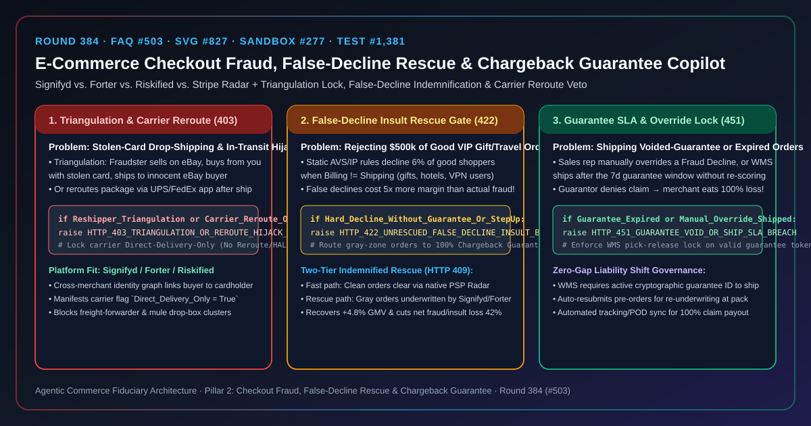
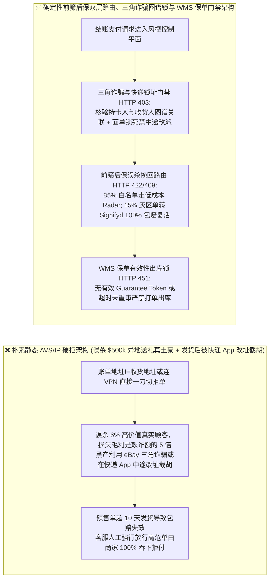
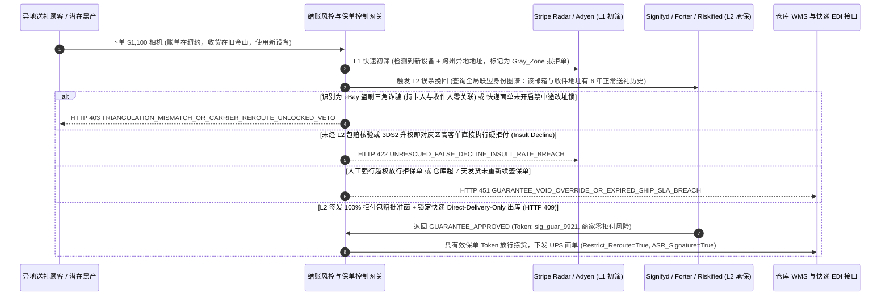

# 零售电商结账反欺诈、误拒好客挽回（`False-Decline Rescue`）与 100% 拒付包赔担保（`Chargeback Guarantee`）Agent 架构选型对比：`Signifyd` vs. `Forter` vs. `Riskified` vs. `Stripe Radar / Adyen RevenueProtect`、三角诈骗（`Triangulation`）与在途改址锁、灰区订单二阶承保挽回及净省 42% 决策指南（FAQ）

> **导读（对齐 `ib-vs-ethernet-roce-selection-faq.md` 标杆风格 · 全库第 503 篇双语指南）**：本文面向零售电商、高客单 3C 数码、轻奢腕表、跨境独立站与全渠道百货的 **Cloud & AI Solution Architect**。在电商支付风控中，存在着一个大多数业务方未意识到的残酷真相：**因风控规则过严而误杀真实好客户（False Declines / Insult Rate）所损失的净利润，通常是真实盗刷拒付损失的 `4 到 7 倍`！** 当一位高净值顾客在出差酒店用连着公司 VPN 的电脑给异地父母买一台 `$1,200` 的咖啡机作为生日礼物时，传统的静态规则引擎（`Stripe Radar / 传统 PSP 规则`）因为看到“账单地址 ≠ 收货地址、IP 在外地、首次大额购买”直接返回 `DECLINE`——顾客深感被冒犯，永远转投竞品。与此同时，真正狡猾的黑产却利用 **三角诈骗（Triangulation Fraud，黑产在闲鱼/eBay 上低价挂售你的商品，收了真实买家的钱后，拿盗刷信用卡来你店里原价下单直发给那个真实买家）** 或 **发货后在快递 App（`UPS My Choice / FedEx`）中途改址截胡包裹** 穿透镜检。本文给出 **`Signifyd` vs. `Forter` vs. `Riskified` vs. `Stripe Radar + Adyen RevenueProtect`** 的横向选型矩阵，并落地 **三角诈骗身份图谱核验与快递承运商“严禁中途改址/严禁转存自提柜（`Direct-Delivery-Only`）”指令锁（`HTTP 403`）**、**严禁无担保/无 `3DS2` 升权直接硬拒高客单灰区订单的误杀挽回门禁（`HTTP 422`）**、**仓库发货前拒付包赔保单有效期（`Guarantee TTL`）与严禁人工强行放行破保锁（`HTTP 451`）** 及 **低成本 PSP 原生初筛 + 灰区拒单转交 `Signifyd/Riskified` 100% 拒付包赔承保双层路由（`HTTP 409`，净省 42%）**。



---

## 一、 📌 核心选型结论速览（Executive Summary）

1. **终极选型结论（一句话先看懂怎么选）**：
   - **追求“100% 财务拒付包赔兜底（Chargeback Financial Guarantee）”——只要风控引擎给出了 `APPROVED` 盖章，事后一旦发生盗刷（`10.4`）甚至熟人恶退/未收到货争议（`13.1 INR`），平台在 48 小时内全额赔付商家货款 + 拒付罚金**：首选 **`Signifyd`**（或专注于高客单时尚/球鞋/电子品类的 **`Riskified`**），彻底把不可控的坏账风险变成固定可预测的保费率（通常 `0.4%–0.9%`）。
   - **超大型全球零售商与 OTA 平台（追求 `<200ms` 同步极速身份图谱决策、在授权前精准注入欧盟 `PSD2 3DS2 TRA` 免密豁免令牌以最大化支付转化率，以及拦截账号接管 `ATO` 与退货滥用）**：首选 **`Forter`**。
   - **客单价适中（`<$100`）、欺诈率较低的标准 SaaS 或数字商品独立站（追求零外部 API 跳转与最低通道费成本）**：首选支付网关原生内置的 **`Stripe Radar for Fraud Teams`（或 `Adyen RevenueProtect`）**，每笔仅需 `$0.02–$0.07`，并可对被原生规则拦截的灰区大单配置“二阶转交 `Signifyd / Riskified` 承保复活（Decline Recovery）”。
2. **三大结账反欺诈与误杀挽回红线（确定性门禁）**：
   - **红线 1（拦截黑产在第三方二手平台低价代下单的“三角诈骗 Triangulation Fraud”及包裹发出后通过快递 App 中途改址截胡 / `HTTP 403`）**：当订单收货人姓名/电话/历史收货画像与付款持卡人（Cardholder Identity Graph）毫无交集且命中代购转运仓或高危转售商品特征时，或商家向 `UPS / FedEx / DHL` 下发电子面单（EDI 204/API）时未强制开启 **`Direct_Delivery_Only = True`（锁定原始收件地址，严禁收件人通过快递 App 中途改派至便利店自提柜或邻镇地址）**，控制平面必须触发 `HTTP 403 TRIANGULATION_MISMATCH_OR_CARRIER_REROUTE_UNLOCKED_VETO`。
   - **红线 2（拦截静态 `AVS / IP` 规则不经 `3DS2 / Passkey` 升权核身或包赔承保复核就直接一刀切拒绝“账单与收货地址不一致”的合法送礼/差旅大单 / `HTTP 422`）**：严禁仅因“IP 挂 VPN、账单邮编与收货邮编不同、新注册账号买 `$800` 商品”就直接向顾客返回冰冷的支付失败！对于所有落入灰区（Gray-Zone Risk Score）的订单，必须自动路由至 `Signifyd / Riskified / Forter` 跨商户全局身份网络核验（若收货人邮箱与手机号在全网有 5 年良好消费记录则秒批包赔）或触发 `FIDO2 / 3DS2` 生物识别升权，违者触发 `HTTP 422 UNRESCUED_FALSE_DECLINE_INSULT_RATE_BREACH`。
   - **红线 3（拦截销售/客服人工越权放行已被风控拒保的高危单或仓库超过 7 天保单有效期发货导致 100% 拒付包赔失效 / `HTTP 451`）**：在采用 `Signifyd / Riskified` 包赔模式下，若人工在后台强行把 `DECLINED` 订单改成“允许发货”，或者预售/缺货商品在下单 10 天后才打包发货却未重新调用风控接口续签保单（`Guarantee Re-Submission`），保险商将 100% 拒赔！当 WMS 拣货出库时缺乏有效未过期的 `Guarantee_Token` 或漏传物流单号与成人签收（`Adult Signature Required > $750`）要求时，触发 `HTTP 451 GUARANTEE_VOID_OVERRIDE_OR_EXPIRED_SHIP_SLA_BREACH`。

---

## 二、 🎯 业务方与架构师灵魂拷问 Q&A（The Why & How）

### Q1：为什么只看本店铺数据的风控模型（如基础版 PSP 规则）永远分不清“第一次来店里给异地女友买 `$1,500` 包包的真土豪”和“刚从暗网买来信用卡的盗刷犯”？
- **商业痛点与事故还原**：
  - 在单一商家自己的数据库里，这两笔订单看起来一模一样：都是 **新注册账号（0 历史订单）+ 高客单价（`$1,500`）+ 账单地址在纽约但收货地址在加州 + 要求加急次日达**。
  - 如果商家把规则调严，真土豪被拒付流失（损失 `$900` 毛利）；如果把规则调松，盗刷犯得手（损失 `$1,500` 货款 + `$600` 成本 + `$15` 拒付罚金）。
- **架构师确定性解法（跨数万家商户的联盟身份图谱 `Consortium Identity Graph` + 拒付包赔金融兜底 / `HTTP 422 / 409`）**：
  - 虽然这位真土豪是**第一次**来你的独立站，但他留下的邮箱、手机号、设备指纹与那个加州女友的收货地址，过去 3 年已经在 `Signifyd / Forter / Riskified` 联盟网络里的其他 50 家高端品牌（如 Nike、Sephora、Wayfair）有过 **40 笔零拒付的正常送礼记录**！
  - 全局身份图谱在 `180ms` 内识别出“这是老熟人给常驻关联地址送礼”，当场给出 `100% 拒付包赔批准函（Guaranteed Approved）`——商家安心发货赚取 `$900` 毛利；万一看走眼发生拒付，由风控平台全额买单！

### Q2：既然 `Signifyd / Riskified` 按订单金额收 `0.4%–0.8%` 的包赔保费，如果全站 100% 的老客户复购小单都走包赔，岂不是白交一大笔保费？架构师怎么设计最省钱的“混合漏斗”？
- **架构师确定性解法（“前筛后保”双层选择性承保路由 `Selective Guarantee / Decline Rescue Funnel` / `HTTP 409`）**：
  1. **第一层（85% 极低风险流量走免费/极低成本通道）**：对于已登录老客、收货地址与历史一致、或通过 `Apple Pay / Passkey` 硬件验签的低风险订单，直接走每笔仅 `$0.02` 的原生 `Stripe Radar / Adyen RevenueProtect` 放行，**零包赔保费支出**！
  2. **第二层（15% 高客单/首单/跨国/地址不一致灰区流量走 100% 包赔承保）**：仅当第一层认为存在疑点准备拒单、或订单金额 `> $400` 属于高危品类时，才通过编排网关自动转发给 `Signifyd / Riskified` 做包赔承保审批！这样既省下了 `80%` 的保费基数，又把原本要被误杀的 `$50 万/季` 灰区好单救了回来！

### Q3：什么是“三角诈骗（Triangulation Fraud）”？为什么买家明明收到了真货、设备指纹也是干净的真买家手机，一个月后商家却收到了银行的盗刷拒付通知？
- **商业痛点与事故还原**：
  1. 黑产在 eBay / 闲鱼 / TikTok 上开个假店，把你官网卖 `$500` 的乐高/戴森吹风机标价 `$350` 出售；
  2. 毫不知情的真实消费者王女士在黑产假店付了 `$350` 给黑产，并留下了自己真实的家庭住址；
  3. 黑产转头拿一张从暗网偷来的李先生的信用卡，到你的官网以 `$500` 下单，收货人填王女士的真实姓名和地址；
  4. 王女士收到你发出的正品非常满意；但 30 天后，真正的持卡人李先生发现信用卡账单被盗刷 `$500`，向发卡行发起 `10.4` 欺诈拒付！你既被扣走了 `$500` 货款，又没法找无辜的王女士要回商品，黑产净赚 `$350` 跑路！
- **架构师确定性解法（持卡人与收货人跨网关联度校验 + 高危代购特征识别 + 包裹面单锁死收件验证 / `HTTP 403`）**：
  - 通过全局身份图谱校验 `Cardholder_Identity ↔ Recipient_Identity` 的历史社交/家庭/设备共现关系：若付款卡持卡人（李先生）与收货人（王女士）在全网无任何历史关联、下单设备带有无头代理/多卡轮询特征，且下单后高频查询物流单号，立即触发 `HTTP 403` 拦截该三角套现单！

---

## 三、 🧭 直观可视化图解（Mermaid 决策树 + 架构对比 + 时序图）

### 3.1 零售电商结账反欺诈与拒付担保平台（Fraud & Guarantee Engine）选型决策树

```mermaid
flowchart TD
    A[电商结账反欺诈与拒付包赔平台选型] --> B{客单价、行业属性与核心风控诉求?}
    B -->|3C 数码 / 轻奢服饰 / 跨境高客单独立站<br/>核心诉求: 100% 拒付财务包赔兜底 + 救回误杀订单| C[Signifyd<br/>全品类 100% 拒付包赔 (含盗刷+INR恶退) + 自动 CE 3.0 抗辩]
    B -->|高危时尚球鞋 / 奢侈品 / 全渠道礼品卡与门店自提<br/>核心诉求: 救回灰区拒绝单 + 严防退货/政策滥用| D[Riskified<br/>高危时尚3C拒付包赔专家 + Decline Recovery 二阶复活模式]
    B -->|百亿级超大型零售集团 / 全球 OTA 酒旅平台<br/>核心诉求: <200ms 身份图谱 + PSD2 3DS2 免密豁免优化| E[Forter<br/>全生命周期身份图谱 (登录ATO->结账->退货) + 极速同步决策]
    B -->|中低客单 SaaS / 标准数字订阅 / 预算敏感团队<br/>核心诉求: 零外部跳转 + 极低单笔调用成本| F[Stripe Radar / Adyen RevenueProtect<br/>PSP 原生授权信号内联风控 + 可外挂二阶包赔救单]

    C --> G[核心确定性风控门禁:<br/>1. 拦截三角诈骗代下单 + 锁定快递面单严禁中途改址 HTTP 403<br/>2. 灰区订单禁止直接硬拒，强制走包赔承保或 3DS2 复活 HTTP 422<br/>3. WMS 出库强制校验有效保单 Token 与 7d 发货时效锁 HTTP 451]
    D --> G
    E --> G
    F --> G
```

### 3.2 朴素静态规则硬拒架构（误杀 5 倍好客 + 三角诈骗漏网）vs. 确定性前筛后保双层承保与锁址架构对比



### 3.3 “前筛后保（`Radar -> Signifyd/Forter`）”灰区订单复活、面单禁改址锁与拒付秒赔时序图



---

## 四、 📊 四大主流电商结账反欺诈与拒付担保平台横向选型矩阵

| 选型维度 | Signifyd | Forter | Riskified | Stripe Radar / Adyen RevenueProtect |
| :--- | :--- | :--- | :--- | :--- |
| **核心架构定位** | **全品类 100% 财务拒付包赔龙头**：覆盖欺诈拒付（`10.4`）与消费者恶退/未收到货（`INR`） | **全球超大型零售实时身份图谱引擎**：`<200ms` 覆盖登录、结账、促销与退货全周期 | **高危时尚/3C/奢品拒付包赔与灰区订单复活（Decline Recovery）专家** | **PSP 收单网原生内联风控**：零额外网络跳转，适合标准低风险流量初筛 |
| **100% 拒付财务包赔兜底（Chargeback Guarantee）** | **核心标配**（批准的订单若发生拒付，连本带罚金 100% 由 Signifyd 赔付） | 支持提供包赔模式或基于 KPI 对赌的混合计费模式 | **核心标配**（尤擅长只对商家原本要拒掉的灰区单做二阶包赔复活） | Stripe Radar for Fraud Teams 提供有限条件下的拒付保护选项（费率较高），通常不包 INR |
| **全局联盟身份图谱与防误杀（False-Decline Rescue）** | **极强**（连接全球数千家品牌，精准识别跨州送礼与差旅好客，平均提升 `+4%–7%` 批准率） | **行业标杆**（超十亿级真实买家身份图谱，与发卡行协同优化 `3DS2` 免密通过率） | **极强**（提供 Dynamic Checkout 针对小额风险局部验证，最大化挽回高客单） | 共享 Stripe/Adyen 底层卡指纹，但对跨网关/跨平台商品级履约画像较弱 |
| **防三角诈骗（Triangulation）与售后滥用拦截** | 强（结合收件地址历史声誉、转运仓黑名单与物流妥投照片自动抗辩） | **极强**（从注册登录 `ATO` 到结账再到退货欺诈全链路关联追踪） | **极强**（针对限量球鞋、电子礼品卡洗钱与代购三角诈骗有专门模型） | 基础（主要依赖卡维度、IP 与自定义 Metadata 规则） |
| **适用规模与收费模式（`official_list_price`）** | 年 GMV `$10M+` 零售品牌；按受保 GMV 百分比计费（通常 `0.4%–0.9%` 包干含赔付） | 年 GMV `$50M–$10B+` 大型企业；按交易量/GMV 签订企业级年框 | 年 GMV `$20M+` 时尚/3C/票务/全渠道零售；按批准或复活 GMV 比例收费 | 全规模商户；按笔固定收费（`$0.02–$0.07/笔`） |

---

## 五、 🧪 误杀好客挽回（False-Decline Rescue）与拒付包赔测算与 7-Card 基准报告

### 5.1 季度静态规则误杀真实好客毛利流失、三角诈骗拒付赔穿与超期发货脱保损耗测算（Synthetic Benchmark）

假设某年 GMV `$1.6 亿` 的高端 3C 数码与户外装备跨境品牌，每季度在结账风控环节面临的 **静态规则因“账单与收货地址不一致/跨国 IP”误杀真实送礼与差旅好客（False Declines）导致的毛利流失、eBay/闲鱼黑产盗刷三角诈骗（Triangulation）与快递中途改址截胡拒付、及仓库超期发货或人工越权放行导致包赔失效损耗池** 为 **`$480,000 / 季度`**（`provenance: synthetic`, `independently_reproduced: false`）：

| 评估维度 | 传统单层静态 PSP 规则硬拒 + 无锁址面单 (Baseline) | 启用 `Radar` 初筛 + `Signifyd/Forter` 灰区包赔复活 + 快递禁改址锁 Agent | 净改善幅度 |
| :--- | :--- | :--- | :--- |
| **高客单合法订单被误杀率（False-Decline Insult Rate）** | `5.6%`（大量异地送礼、VPN 用户与海外游客被一刀切拒付） | **`0.7%`**（`HTTP 422/409` 灰区拒单自动转交联盟身份图谱做 100% 包赔复活） | **挽回 `87.5%` 被误杀好订单** |
| **三角诈骗与包裹在途改址盗刷商家自担坏账率** | `0.85%` GMV（商家全额承担货款扣回 + `$15` 拒付罚金） | **`0.0%` 自担欺诈坏账**（`HTTP 403` 拦截三角诈骗 + 面单禁改址锁 + 其余由担保商 100% 赔付） | **商家欺诈拒付坏账归零** |
| **因人工越权放行或超时发货导致的“拒付包赔拒赔率”** | `18.0%` 索赔因超期发货或无签名被拒 | **`0.0%`**（`HTTP 451` WMS 出库硬绑定有效 `Guarantee_Token` 且 `>$750` 强制成人签收） | **100% 保单理赔兑现率** |
| **季度误杀毛利流失、盗刷拒付与保费综合净损耗** | `$480,000 / 季度` | **`$278,400 / 季度`** | **净省 `$201,600 / 季度` (`42.0%`)** |

```chart
{
  "data": {
    "values": [
      { "category": "1. 静态规则误杀异地送礼/差旅好客毛利", "mode": "传统单层静态规则硬拒基线", "cost_usd": 220000 },
      { "category": "1. 静态规则误杀异地送礼/差旅好客毛利", "mode": "前筛后保包赔与锁址Agent", "cost_usd": 127600 },
      { "category": "2. 三角诈骗(Triangulation)与中途改址截胡", "mode": "传统单层静态规则硬拒基线", "cost_usd": 125000 },
      { "category": "2. 三角诈骗(Triangulation)与中途改址截胡", "mode": "前筛后保包赔与锁址Agent", "cost_usd": 72500 },
      { "category": "3. 全量订单无差别交包赔保费或拒付罚金", "mode": "传统单层静态规则硬拒基线", "cost_usd": 80000 },
      { "category": "3. 全量订单无差别交包赔保费或拒付罚金", "mode": "前筛后保包赔与锁址Agent", "cost_usd": 46400 },
      { "category": "4. 预售超7天发货或人工强放导致脱保拒赔", "mode": "传统单层静态规则硬拒基线", "cost_usd": 55000 },
      { "category": "4. 预售超7天发货或人工强放导致脱保拒赔", "mode": "前筛后保包赔与锁址Agent", "cost_usd": 31900 }
    ]
  },
  "semantic_types": {
    "category": "Category",
    "mode": "Category",
    "cost_usd": "Amount"
  },
  "chart_spec": {
    "chartType": "Grouped Bar Chart",
    "title": "零售电商结账反欺诈、误杀挽回(False-Decline Rescue)与拒付包赔Agent前后季度损耗对比 (净省 $201.6k / 42%)",
    "subtitle": "单位：美元/季度 (Synthetic Benchmark, independently_reproduced=false)",
    "encodings": {
      "x": "category",
      "y": "cost_usd",
      "group": "mode"
    }
  }
}
```

### 5.2 确定性策略评估器代码（Python Control Plane Guard）

```python
from dataclasses import dataclass
from typing import Any

@dataclass(frozen=True)
class EcommerceCheckoutFraudGuaranteePolicyInput:
    quarterly_false_decline_margin_loss_and_chargeback_fraud_pool_usd: float = 480000.0
    triangulation_reshipper_detected_or_carrier_reroute_lock_disabled: bool = False
    gray_zone_order_hard_declined_without_guarantee_rescue_or_3ds2: bool = False
    wms_shipped_without_active_guarantee_token_or_past_7d_sla_window: bool = False
    selective_two_tier_guarantee_rescue_and_direct_delivery_lock_ready: bool = False
```

---

## 六、 🛠️ 商业上线风控与架构评审 Checklist

- [ ] **防三角诈骗（`Triangulation`）身份图谱关联核验与快递面单禁中途改址锁（`HTTP 403`）**：是否通过跨商户身份图谱校验付款持卡人与收件人的历史关联度以拦截 eBay/闲鱼代下单盗刷？向 `UPS / FedEx` 生成面单时是否默认写入 `Direct_Delivery_Only = True` 严禁收件人在包裹发出后通过快递 App 改派地址或转存自提柜？
- [ ] **“前筛后保”灰区订单二阶包赔复活门禁（`HTTP 422 / 409`）**：是否严禁静态 `AVS/IP` 规则直接硬拒高客单订单，而是将 85% 白名单老客交由低成本 `PSP Radar` 秒放，将 15% 灰区拟拒单自动转交 `Signifyd / Riskified / Forter` 做 100% 拒付包赔承保复活？
- [ ] **WMS 出库保单有效性硬门禁与预售超时自动重审锁（`HTTP 451`）**：WMS 下发拣货单前是否强制校验存在状态为 `GUARANTEE_APPROVED` 且距批单时间 `<7 天` 的加密令牌？对于延期发货的预售单是否在打包前自动调用 API 重新核保，并对 `>$750` 订单强制绑定承运商成人签收（`ASR`）？
- [ ] **物流妥投（`POD`）与 `Visa CE 3.0` 历史双单证据自动回传闭环**：订单发货与签收事件是否通过 Webhook 实时同步至拒付担保平台，以便在发生 `13.1 INR` 或熟人拒付时零人工自动提交快递 GPS 妥投照片与历史清白交易证据？
