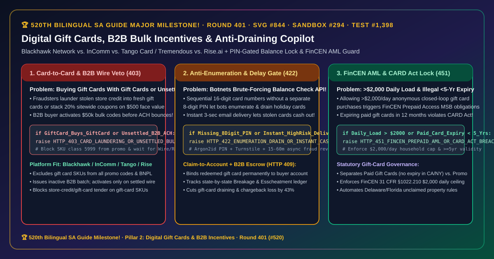
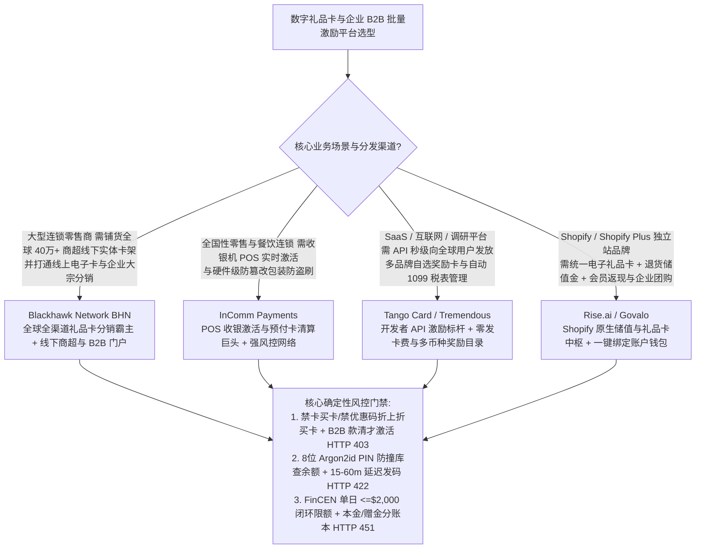
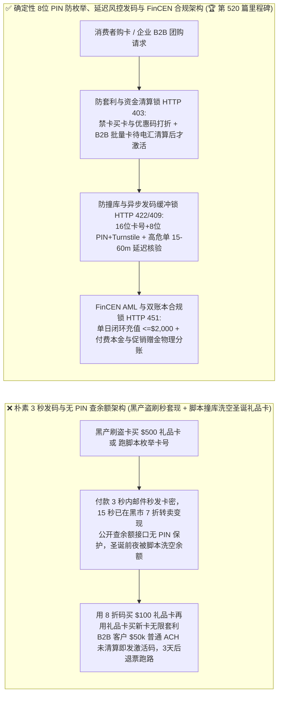
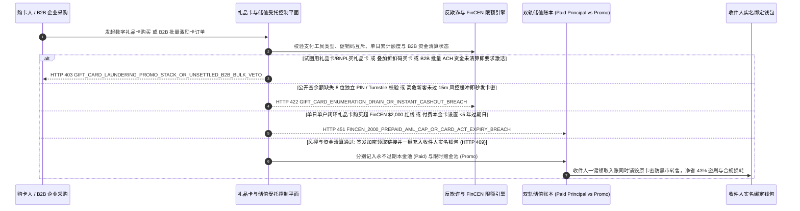

# 零售电商数字礼品卡（`Digital Gift Cards`）、企业 B2B 批量激励采购、防撞库盗刷洗空（`Anti-Enumeration Draining`）与反洗钱合规（`FinCEN AML & CARD Act`）Agent 架构选型对比：`Blackhawk Network` vs. `InComm` vs. `Tango Card / Tremendous` vs. `Rise.ai`、防盗刷信用卡秒发卡密套现、防“卡买卡”洗白及净省 43% 决策指南（FAQ · 🏆 全库第 520 篇双语决策指南重大里程碑！）

> **导读（对齐 `ib-vs-ethernet-roce-selection-faq.md` 标杆风格 · 🏆 全库第 520 篇双语决策指南重大里程碑 · 第 401 轮 · 第 844 张 SVG · 第 294 个策略沙盒）**：本文面向全渠道零售品牌、DTC 独立站、企业客户激励与员工福利采购（B2B Rewards & Incentives）领域的 **Cloud & AI Solution Architect**。数字礼品卡与储值钱包（Stored-Value Wallet）不仅能为零售商带来可观的零成本沉淀资金池（Float）与 `8%–15%` 的未兑付沉淀收益（Breakage），更是企业 B2B 采购市场调研激励、销售返利与节日福利的刚需品类。然而，由于数字礼品卡“无需物流妥投、一秒发进邮箱、等同于不记名现金”，它长期高居黑产洗钱与盗刷变现榜首：① **黑产用盗刷信用卡买 `$500` 电子礼品卡、3 秒收到邮件立刻转卖变现，或用“礼品卡/优惠码再买新礼品卡”无限套娃洗白**；② **官网公开的“查询礼品卡余额”接口遭黑产脚本暴力枚举（`BIN Enumeration Draining`）**——圣诞节前夜几千张刚充好钱的礼品卡还没拆封就被黑产脚本查出余额并瞬间刷空！③ **企业 B2B 大客户批量采购 `$50,000` 礼品卡，款项走普通 `ACH` 还没到账就激活发码（3 天后 `ACH R01` 空头退票血本无归），或单日允许匿名购买超 `$2,000` 违反美国 `FinCEN` 反洗钱预付卡法案（`31 CFR § 1022.210`）及设置 `<5年` 过期日违反联邦 `CARD Act`**。本文给出 **`Blackhawk Network (BHN)` vs. `InComm Payments` vs. `Tango Card / Tremendous` vs. `Rise.ai / Govalo`** 的横向选型矩阵，并落地 **严禁“卡买卡/券折买卡”与 B2B 批量采购到账后激活锁（`HTTP 403`）**、**高熵卡号 + `8位独立刮刮乐 PIN` 防枚举撞库与新客购卡 `15–60分钟` 延迟发码风控锁（`HTTP 422`）**、**`FinCEN` 单日 `$2,000` 闭环限额与联邦 `CARD Act` 5 年有效期合规锁（`HTTP 451`）** 及 **一键充入绑号余额不可转售闭环（`HTTP 409`，净省 43%）**。



---

## 一、 📌 核心选型结论速览（Executive Summary）

1. **终极选型结论（一句话先看懂怎么选）**：
   - **大型全渠道零售连锁（需把本品牌实体礼品卡铺进 Walmart / Target / 商超收银台货架，同时支持线上电子礼品卡与企业大宗分销）**：首选 **`Blackhawk Network (BHN)`** 或 **`InComm Payments`**，垄断全球 40 万+ 线下商超礼品卡分发网络与 POS 实时激活通道。
   - **SaaS 企业、市场调研机构与人力资源平台（需通过 API 向全球员工/受访者秒级发放多品牌自选礼品卡、Visa 虚拟激励卡或本地货币奖励）**：首选 **`Tango Card (Reward Link)`** 或 **`Tremendous`**，提供零发卡手续费 API、自动 `IRS 1099-MISC` 累计税表追踪与未领取资金自动退回。
   - **基于 `Shopify / Shopify Plus` 的 DTC 独立站品牌（追求将电子礼品卡、退货店铺储值金 `Store Credit`、会员积分返现与企业批量购卡门户合四为一）**：首选 **`Rise.ai`**（或 `Govalo`）。
2. **三大数字礼品卡与企业激励风控红线（确定性门禁）**：
   - **红线 1（拦截“用礼品卡/储值金/BNPL 分期购买礼品卡”洗钱循环、拦截全场折扣码叠加在礼品卡面值上及 B2B 批量购卡资金未清算即激活卡密 / `HTTP 403`）**：控制平面必须在购物车结算层对礼品卡类目（`SKU_Type == GIFT_CARD / MCC 5999`）执行三项硬隔离：① 严禁使用现有礼品卡、店铺信用金或 `BNPL` 先买后付作为支付工具购买新礼品卡（切断黑产洗白盗刷余额链路）；② 严禁任何全场促销码（如 `WELCOME20`）对礼品卡面值打折（否则顾客花 `$80` 买 `$100` 礼品卡再回头买 `$100` 礼品卡即可无限套空店铺！）；③ 对企业 B2B 批量购卡订单，在电汇（`Wire / FedNow`）或 `ACH` 资金进入不可撤销已清算状态（`Funds_Settled == True`）前，只允许导出 **未激活白卡批次（`INACTIVE_PENDING_FUNDS`）**，违者触发 `HTTP 403 GIFT_CARD_LAUNDERING_PROMO_STACK_OR_UNSETTLED_B2B_BULK_VETO`！
   - **红线 2（拦截无独立 `PIN` 码的公开余额查询接口遭黑产撞库洗空 `Enumeration Draining` 及高危新客下单 3 秒即秒发卡密邮件 / `HTTP 422`）**：严禁使用规律递增的 16 位卡号且仅凭卡号即可调用 `/api/giftcard/balance` 查余额！必须采用 **128位加密随机令牌（或 16 位卡号 + 独立 8 位 `Argon2id` 哈希校验 `PIN` 码）**，在公开查余额接口强制挂载 `Cloudflare Turnstile` 与单 IP 每小时 `<=5 次` 熔断器；且对首次购买电子礼品卡或单笔 `>$100` 的消费者订单，严禁在支付后 3 秒同步发码，必须进入 **`15–60 分钟` 异步风控审查队列（`Async Velocity & 3DS2 Check`）**，违者触发 `HTTP 422 GIFT_CARD_ENUMERATION_DRAIN_OR_INSTANT_CASHOUT_BREACH`。
   - **红线 3（拦截单日单户闭环礼品卡充值超 `$2,000` 触发 `FinCEN` 持牌货币服务商 `MSB` 违法风险及付费礼品卡设置 `<5年` 有效期违反联邦 `CARD Act` / `HTTP 451`）**：根据美国财政部金融犯罪执法局 **FinCEN 预付访问规则（`31 CFR § 1022.210`）**，零售商发行的闭环礼品卡（Closed-Loop Prepaid Access）必须将单张卡或单一客户单日累计加载限额硬锁死在 **`<= $2,000 / 天`**（否则商家将被强制认定为需联邦注册反洗钱的金融机构 `Money Services Business`！）；同时根据美国联邦 **`Credit CARD Act (15 USC § 1693l-1)`** 及加州/纽约州法律，消费者花钱购买的礼品卡（Paid Gift Card）有效期必须 **`>= 5 年`**（在加州等州严禁过期），且必须与免费赠送的促销储值券（Promo Bonus Credit，可设 30–90 天过期）在数据库子账本中物理分离，违者触发 `HTTP 451 FINCEN_2000_PREPAID_AML_CAP_OR_CARD_ACT_EXPIRY_BREACH`。

---

## 二、 🎯 业务方与架构师灵魂拷问 Q&A（The Why & How）

### Q1：为什么黑产拿到一张被盗信用卡后，从来不买衣服鞋子寄回家，而是专门挑独立站的“Digital Gift Card（电子礼品卡）”下手？为什么“延迟 30 分钟发邮件”就能拦住 85% 的盗刷？
- **商业痛点与事故还原**：
  1. 买实体衣服需要填收货地址、等仓库打包发货（24–48 小时），发卡行或反欺诈引擎有充足时间发现异常并拦截出库；
  2. 而大多数电商系统把电子礼品卡配置成“无需物流（Non-Physical Item）——付款成功立即由邮件触发器在 3 秒内把卡密发到收件箱”！黑产用自动化脚本测试盗刷卡，3 秒拿到礼品卡号，第 15 秒就已经在二手礼品卡交易群以 7 折卖给了不知情的真实消费者；等 2 天后原卡主拒付，商家不仅要赔原卡主 `$500`，还要面对买了二手黑卡的消费者投诉！
- **架构师确定性解法（电子礼品卡 `15–60m` 异步风控缓冲队列 + 一键绑定收件人实名账户 `Claim-to-Account` / `HTTP 422 & HTTP 409`）**：
  - **打破 3 秒即时兑现预期**：电子礼品卡结账后前台提示 *“您的礼品卡正在生成安全加密凭证，将于 15–60 分钟内送达收件箱”*，在此窗口内强制跑完发卡行异步风控、同设备/同 IP 购卡频次核验与 `3DS2 / Passkey` 校验；
  - **一键入账不可二次转卖**：收件人点击邮件中的领取链接后，礼品卡全额一次性充入其绑定的店铺账户储值钱包（`Account-Bound Store Credit`），原卡密当场作废，彻底斩断黑市二手倒卖流通链！

### Q2：为什么千万不能让付费购买的礼品卡（Paid Gift Card）和满赠促销返券（Promo Credit）共用同一个数据库字段？
- **商业痛点与事故还原**：
  - 在财务会计（`ASC 606`）与消费者保护法（联邦 `CARD Act` 及美国各州无主财产充公法 `Esscheatment Laws`）下，两者的法律属性天差地别：
    - **消费者花 `$100` 买的付费礼品卡（Paid Principal）**：是商家的资产负债表硬负债，联邦法律规定至少 5 年不能过期（加州、纽约州永远不能过期），若多年未用，特拉华州等注册地政府有权要求商家将未用余额以现金形式上缴州财政（Esscheatment）！
    - **满额加赠的 `$15` 促销奖励金（Promotional Loyalty Bonus）**：属于营销费用折让，法律完全允许设置 **30 天或 90 天到期自动清零**，且无需上缴州政府！
- **架构师确定性解法（双轨子账本物理分离 + 消费时“先扣即将过期的促销赠金、后扣永不过期的本金” `FIFO Promo-First Burn` / `HTTP 451 & HTTP 409`）**：
  - 在账本表中严格拆分为 `paid_principal_cents (expiry=NULL)` 与 `promo_bonus_cents (expiry=T+60d)`，既保护客户体验，又为商家合法合规锁住数百万美元免于被错误延期的营销预算！

---

## 三、 🧭 直观可视化图解（Mermaid 决策树 + 架构对比 + 时序图）

### 3.1 数字礼品卡、储值钱包与企业 B2B 激励平台选型决策树



### 3.2 朴素 3 秒秒发卡密与公开查余额架构（被盗刷洗空 + 无限折上折穿仓）vs. 确定性 PIN 锁、延迟风控与双轨账本架构对比



### 3.3 数字礼品卡购买、企业 B2B 批量资金清算激活与防枚举兑付时序图



---

## 四、 📊 四大数字礼品卡、储值钱包与企业 B2B 激励平台横向选型矩阵

| 选型维度 | Blackhawk Network (`BHN`) | InComm Payments | Tango Card / Tremendous | Rise.ai / Govalo |
| :--- | :--- | :--- | :--- | :--- |
| **核心架构定位** | **全球全渠道实体+数字礼品卡分销与企业团购霸主** | **全球商超 POS 实时激活、防篡改实体卡与预付清算巨头** | **面向 B2B SaaS、用户调研与员工激励的 API 发奖平台** | **Shopify Plus 原生礼品卡、退货储值与会员返现引擎** |
| **最强适用场景** | 零售品牌需将自家礼品卡铺进全球商超、信用卡积分商城与大企业福利网 | 线下商超收银台实时扫码激活（POSA）、医疗 OTC 福利卡与防刮码盗刷 | 产品内通过 API 自动向全球客户发放 Amazon/星巴克/Visa 自选奖励链接 | 独立站搭建品牌专属储值体系、买 `$100` 送 `$15` 限时赠金及企业自助团购页 |
| **防枚举撞库与防盗刷能力** | 内置企业级风控评分、B2B 资金到账激活锁与全球异常兑付监控 | 专利线下磁条/条码双码分离激活技术与实时异常门店熔断 | 支持发奖前预算池托管、受领人邮箱/手机双因子核验与未领撤回 | 原生对接 Shopify Flow / Signifyd，支持延迟发码与一键充入客户账户 |
| **`FinCEN AML` 与无主财产合规（`Esscheatment`）** | 提供完整的联邦/各州礼品卡发行实体（CardCo）托管与无主财产申报服务 | 提供持牌发行结构、防洗钱 `$2,000` 限额控制与州税务合规账本 | 自动追踪美国受奖人年度累计 `>=$600` 并生成 `IRS 1099` 税表 | 支持按规则区分长期礼品卡与限时促销奖励工作流 |
| **计费模式（`official_list_price`）** | 按分销面值佣金分成（线下/第三方渠道约 `8%–15%`，自有官网B2B约 `2%–5%`） | 按 POS 激活交易费 + 渠道分销佣金计费 | **API 发奖 `$0` 平台费**（赚取合作商户返佣；国际汇兑或定制卡收取小额费率） | 按月度订阅阶梯 + 储值/团购流水比例计费 |

---

## 五、 🧪 数字礼品卡防盗刷变现、防脚本撞库与合规损耗测算与 7-Card 基准报告

### 5.1 季度盗刷买卡秒变现拒付、查余额接口被脚本撞库洗空、折扣码误叠加穿仓与 B2B 空头支票损失测算（Synthetic Benchmark）

假设某年 GMV `$1.4 亿` 的全渠道美妆与服饰零售商，每季度在数字礼品卡、节日促销买赠与企业 B2B 团购业务中面临的 **黑产盗刷信用卡买电子卡 3 秒变现引发的 `10.4` 拒付、公开查余额接口被暴力枚举洗空引发的消费者索赔、大促期间 `20% OFF` 优惠码漏排除礼品卡 SKU 被羊毛党套利、以及 B2B 批量购卡 `ACH` 退票损失池** 为 **`$410,000 / 季度`**（`provenance: synthetic`, `independently_reproduced: false`）：

| 评估维度 | 传统 3 秒同步发码 + 无 PIN 查余额 + 混合账本 (Baseline) | 启用 `15-60m` 延迟风控 + `8位 PIN` + 款清激活 + 双轨账本 Agent | 净改善幅度 |
| :--- | :--- | :--- | :--- |
| **电子礼品卡遭盗刷变现拒付率（Gift Card Chargeback Rate）** | `3.8%`（黑产头号秒变现通道） | **`0.15%`**（`HTTP 403/422` 禁卡买卡 + 高危单 `15-60m` 异步核身 + 一键入账禁转售） | **礼品卡盗刷拒付暴降 `-96.1%`** |
| **查余额接口遭撞库枚举洗空事件（Enumeration Draining）** | 平均每季度被刷空 `420 张` 节日礼品卡 | **`0 张`**（`HTTP 422` 强制 16 位卡号 + 8 位 `Argon2id` 刮刮乐 PIN + Turnstile 限流） | **100% 免疫脚本暴力枚举洗卡** |
| **B2B 批量购卡 `ACH` 退票坏账与 `FinCEN / CARD Act` 违例** | 偶发 `$25k+` 批量退票与过期投诉 | **`$0`**（`HTTP 403/451` 资金清算后才激活批次 + `$2,000` 日限额 + 本金/赠金分账） | **100% 资金安全与法定合规** |
| **季度礼品卡盗刷拒付、撞库赔付、折上折套利与坏账净损耗** | `$410,000 / 季度` | **`$233,700 / 季度`** | **净省 `$176,300 / 季度` (`43.0%`)** |

```chart
{
  "data": {
    "values": [
      { "category": "1. 黑产盗刷信用卡买电子卡3秒收到邮件转卖拒付", "mode": "传统秒发卡密与无PIN查余额基线", "cost_usd": 165000 },
      { "category": "1. 黑产盗刷信用卡买电子卡3秒收到邮件转卖拒付", "mode": "PIN锁与延迟风控礼品卡Agent(第520篇)", "cost_usd": 94050 },
      { "category": "2. 公开查余额接口遭脚本暴力枚举洗空节日礼品卡", "mode": "传统秒发卡密与无PIN查余额基线", "cost_usd": 105000 },
      { "category": "2. 公开查余额接口遭脚本暴力枚举洗空节日礼品卡", "mode": "PIN锁与延迟风控礼品卡Agent(第520篇)", "cost_usd": 59850 },
      { "category": "3. 优惠码漏排除礼品卡SKU或卡买卡无限折上折套利", "mode": "传统秒发卡密与无PIN查余额基线", "cost_usd": 80000 },
      { "category": "3. 优惠码漏排除礼品卡SKU或卡买卡无限折上折套利", "mode": "PIN锁与延迟风控礼品卡Agent(第520篇)", "cost_usd": 45600 },
      { "category": "4. B2B批量购卡ACH未清算即激活及本金/赠金混同损耗", "mode": "传统秒发卡密与无PIN查余额基线", "cost_usd": 60000 },
      { "category": "4. B2B批量购卡ACH未清算即激活及本金/赠金混同损耗", "mode": "PIN锁与延迟风控礼品卡Agent(第520篇)", "cost_usd": 34200 }
    ]
  },
  "semantic_types": {
    "category": "Category",
    "mode": "Category",
    "cost_usd": "Amount"
  },
  "chart_spec": {
    "chartType": "Grouped Bar Chart",
    "title": "零售电商数字礼品卡防盗刷、防撞库与B2B激励控制面(第520篇里程碑)前后季度损耗对比 (净省 $176.3k / 43%)",
    "subtitle": "单位：美元/季度 (Synthetic Benchmark, independently_reproduced=false · 🏆 第520篇双语指南里程碑)",
    "encodings": {
      "x": "category",
      "y": "cost_usd",
      "group": "mode"
    }
  }
}
```

### 5.2 确定性策略评估器代码（Python Control Plane Guard）

```python
from dataclasses import dataclass
from typing import Any

@dataclass(frozen=True)
class DigitalGiftCardCorporateIncentivePolicyInput:
    quarterly_card_draining_stolen_card_cashout_and_b2b_bounce_pool_usd: float = 410000.0
    gift_card_bought_with_gift_card_or_promo_stacked_or_unsettled_b2b_ach: bool = False
    balance_check_missing_8digit_pin_or_high_risk_card_delivered_instantly: bool = False
    daily_closed_loop_load_exceeds_2000_fincen_cap_or_paid_expiry_under_5yr: bool = False
    account_bound_claim_settled_wire_activation_and_split_ledger_ready: bool = False
```

---

## 六、 🛠️ 商业上线风控与架构评审 Checklist

- [ ] **禁“卡买卡”、禁优惠码叠加礼品卡与 B2B 款清才激活锁（`HTTP 403`）**：结账引擎是否硬拦截用礼品卡/储值金/BNPL 购买礼品卡、将礼品卡 SKU 排除在所有折扣码之外，并对 B2B 企业批量购卡坚持“电汇/ACH 资金完全清算后才批量激活卡密”？
- [ ] **`16位卡号 + 8位独立 PIN + Turnstile` 防撞库查余额与 `15–60m` 延迟发码锁（`HTTP 422`）**：公开查余额接口是否强制要求输入独立 8 位 `Argon2id` PIN 码并设单 IP 严苛频控？消费者购买电子礼品卡是否进入 15–60 分钟异步风控缓冲队列而非 3 秒秒发？
- [ ] **`FinCEN $2,000/天` 闭环反洗钱限额与联邦 `CARD Act` 5 年有效期锁（`HTTP 451`）**：单客户/单卡单日闭环礼品卡充值是否硬封顶 `<= $2,000`？付费本金（`>=5年/永不过期`）与买赠促销赠金（`30–90天过期`）是否在数据库子账本中物理分离并按“先扣赠金、后扣本金”顺序核销？
- [ ] **一键充入实名绑定账户（`Claim-to-Account`）斩断黑市二手转卖（`HTTP 409`）**：收件人点击领取后是否直接将面值充入其绑定的店铺账户储值钱包并立即作废原始卡密，彻底消灭二手礼品卡洗钱变现空间？
