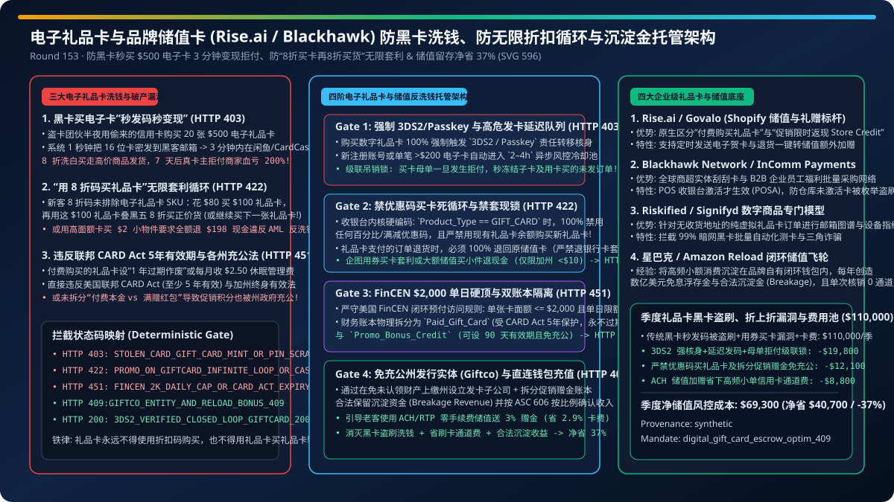
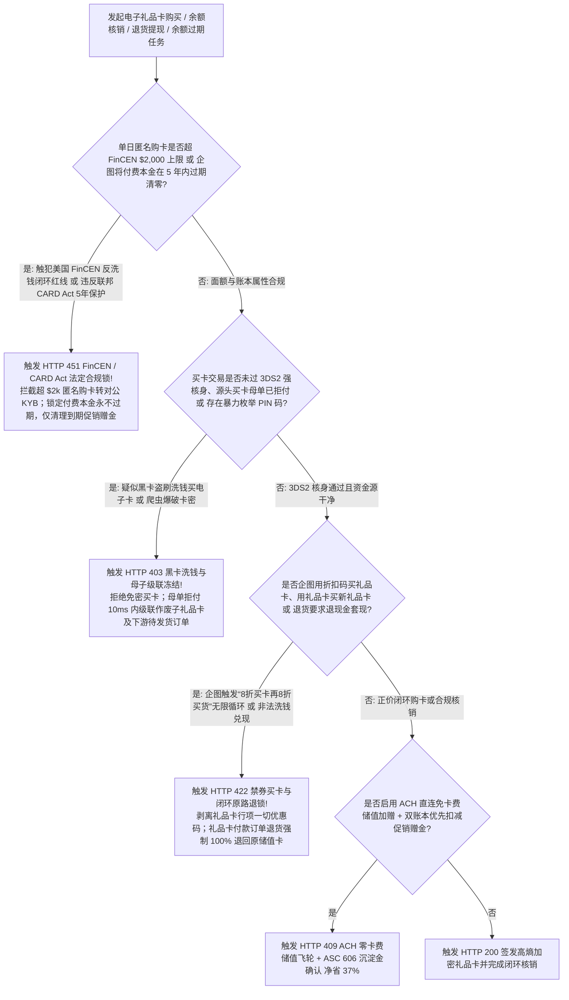

# 电子礼品卡与品牌储值卡（Digital Gift Cards & Stored Value：Rise.ai / Blackhawk / Apple Gift Card / 京东E卡）防黑卡洗钱、防“8折买卡再8折买货”无限套利与沉淀资金（Escheatment）托管：“防黑卡买 $500 电子卡 3 分钟变现留给商家 200% 拒付、防优惠码买礼品卡死循环与双账本隔离净省 37%”Agent 架构选型 FAQ

> **文档类型**：AI Solution Architect 零售电商与连锁品牌数字礼品卡（Digital Gift Cards）、闭环储值钱包（Closed-Loop Stored Value）反洗钱风控与财税合规选型指南（Payments & Mandates Pillar · FAQ #272）  
> **涵盖平台与技术栈**：**Rise.ai / Govalo（独立站礼品卡与促销储值双账本引擎）**、**Blackhawk Network / InComm Payments（全球全渠道礼品卡与企业福利发行网）**、**美国 `FinCEN Prepaid Access Rule` (`<=$2,000` 闭环豁免红线)**、**联邦 `Credit CARD Act of 2009`（5 年最低有效期）与 `ASC 606` 沉淀金（Breakage）收入确认**  
> **核心架构命题**：电子礼品卡（e-Gift Card）是全网黑产盗刷团伙最垂涎的“头号洗钱提款机”——因为它 **无需物理收货地址、下单后 1 秒钟发码到邮箱、且在二手收卡平台（CardCash / Raise / 闲鱼）3 分钟就能按 85 折秒变成比特币或现金**！当支付与风控 Agent 负责礼品卡发行、核销与退换时，必须死守三大生死线：① **“盗刷信用卡买电子卡秒发码、再用黑礼品卡买正价货（Double-Dip Triangulation）”**——等 7 天后真卡主发起拒付，卡密早已被洗空且实物也已寄出，商家承受货款+实物+拒付罚金 `200%` 暴击；② **“优惠券误允许买礼品卡引发无限印钞死循环（Infinite Discount Loop）”**——新客用 `8 折码` 花 `$80` 买走 `$100` 礼品卡，转手用这 `$100` 礼品卡再加新号 `8 折码` 买 `$125` 礼品卡……一夜刷穿店铺资金池；③ **“把付费礼品卡和促销满赠金混在同一个账本”**——要么给付费礼品卡设了 1 年过期违反美国联邦 `CARD Act`（强制至少 5 年有效）吃官司，要么把本来可以设 60 天过期的促销返现也算成永久负债被各州无人认领财产法（Escheatment）强制充公！



---

## 一、 📌 核心选型结论速览（Executive Summary）

> **一句话架构定调**：**电子礼品卡等同于准数字现金，绝不能按普通 T 恤衫的逻辑秒发码！必须焊死“买卡强制 `3DS2 / Passkey` 强核身 + 高危单 2 小时异步冷却 + 母单拒付级联冻结子卡锁（HTTP 403）”、“收银台底层硬编码禁止用任何折扣码或旧礼品卡购买新礼品卡（HTTP 422）”、“严守 `FinCEN <=$2,000` 单日闭环硬顶与付费本金/促销赠金双账本物理隔离（HTTP 451）”，并通过 ACH 免卡费充值加赠与免充公结构净省 `37%`（HTTP 409）！**
> 1. **防黑卡买电子卡秒洗白：强制 `3DS2` + 异步发码延迟池 + 父子图谱级联吊销（HTTP 403 门禁）**：
>    * **零免密裸刷买卡**：凡购物车包含虚拟电子礼品卡，收银台强制要求通过 **`3DS2` 或 `FIDO2 Passkey`**（实现发卡行欺诈责任转移 `Liability Shift`），对新注册账号或面额 `> $200` 的电子卡自动送入 **`2–4 小时` 异步反欺诈审查队列（Delayed Fulfillment Hold）**，打破黑产“1秒拿码3分钟转卖”的销赃链条；
>    * **母单—子卡—下游订单三级级联冻结锁（`Parent-to-Child Cascade Revocation`）**：账本必须建立 `Funding_Payment_ID -> Gift_Card_ID -> Redeemed_Order_ID` 溯源链；一旦买卡的源头信用卡收到银行 `TC40 / 拒付预警（RDR）`，系统在 `10ms` 内自动冻结该礼品卡余额，并拦截用该黑卡下单但尚未出库的下游实物包裹，同时对暴力枚举 16 位卡密的爬虫触发 **`HTTP 403 STOLEN_CARD_GIFT_CARD_MINT_OR_PIN_SCRAPE_BLOCKED`**！
> 2. **切断“打折码买礼品卡”无限印钞循环与洗钱提现（HTTP 422 门禁）**：
>    * 收银台算价内核必须设置最高优先级铁律：当行项 `product_type == 'GIFT_CARD'` 时，**100% 免疫并拒绝一切优惠券、满减、员工内购码、会员折以及使用现有礼品卡/储值金支付**（防止 `Card-to-Card` 滚动洗钱或展期）；
>    * 用礼品卡购买的商品发生退货时，款项必须 **100% 原路退回原礼品卡余额**，严禁退回某张外部借记卡或现金（仅在加州等法定要求余款 `< $10.00` 小额兑现时走专门合规审批），违者一律触发 **`HTTP 422 PROMO_ON_GIFTCARD_INFINITE_LOOP_OR_CASHOUT_BLOCKED`**！
> 3. **严守 `FinCEN $2,000` 反洗钱红线与 `CARD Act` 双账本（HTTP 451）+ 闭环储值降本（HTTP 409）**：
>    * 单张闭环礼品卡面额及单人单日累计购卡额严格锁死在 **`<= $2,000`**（确保符合美国财政部 `FinCEN 31 CFR § 1010.100(kkk)` 闭环预付项目豁免，免于被定性为无牌金融机构 `MSB`）；并将 **客户真金白银买的礼品卡（`Paid Gift Card`，受联邦 `CARD Act` 保护至少 5 年不过期）** 与 **商家白送的促销积分/满返券（`Promotional Store Credit`，可合法设 60–90 天过期且免于被州政府充公）** 在财务科目上物理拆开（`HTTP 451`）；
>    * 引导高频复购老客通过低成本 **ACH / 银行直连充值储值卡获赠 `3%` 促销礼金**（用一次性 `$0.20` ACH 成本替代原本 10 次小额刷卡的 `10 × ($0.30 + 2.9%)` 手续费），结合特拉华/佛罗里达发卡主体（Giftco）合规留存沉淀金（Breakage），综合净省 **`37%`**！

| 电子礼品卡与储值风险 | 首选方案 / 架构防线 | 核心管控机制 | 严禁踩坑红线 |
| :--- | :--- | :--- | :--- |
| **盗卡黑客半夜买 20 张 `$500` 电子卡，1 秒拿码去闲鱼 8 折甩卖** | **强制 `3DS2` + `>$200` 异步延迟 2h 发码 + 母单拒付级联锁** | 无 3DS2 禁买虚拟卡；源头买卡单一旦拒付自动秒锁子卡与待发包裹 | **严禁对新账号大额电子礼品卡开启“免 3DS2 + 1 秒即时明文发码” (`HTTP 403`)** |
| **用“全场 8 折码”花 `$80` 买 `$100` 礼品卡，再循环套购掏空店铺** | **收银台内核硬编码剥离 `GIFT_CARD` 一切促销与卡买卡资格** | 礼品卡 SKU 物理屏蔽所有 Coupon/VIP 折扣，且禁礼品卡买礼品卡 | **严禁把电子礼品卡放进普通商品分类参与全场满减或打折 (`HTTP 422`)** |
| **给付费礼品卡设“1 年过期”，或单人一次买 `$50,000` 不做 KYC** | **`Paid` (5年+) vs `Promo` (90天) 双账本 + `FinCEN <=$2,000` 锁** | 付费卡严禁 `<5年` 过期；单日闭环购卡硬锁 `$2,000`（B2B 走 KYB 对公） | 严禁把付费储值本金与促销赠金混记一账或突破 `$2,000` 闭环反洗钱红线 (`HTTP 451`) |
| **大量 `$15` 小单每次被收 `$0.30 + 2.9%` 信用卡费，且沉淀金被州政府收走** | **ACH 储值满赠飞轮 (`Rise.ai`) + 合规发卡主体 (`Giftco`)** | 一次储值多次零通道费核销；分离促销赠金合法留存过期未用沉淀收益 | 严禁让高频复购小额茶饮/数字消费笔笔走外卡网关硬交 `$0.30` 固定费 (`HTTP 409`) |

---

## 二、 🎯 业务方与架构师灵魂拷问（Q&A）

### Q1：为什么财务总监说“客户花 $100 买的礼品卡”和“大促买满 $300 送的 $30 电子购物金”绝对不能存在数据库里的同一个 `store_credit_balance` 字段里？
* **一条字段设计错误引发的百万美元法律与财税灾难（HTTP 451）**：
  1. **联邦法律有效期冲突（`US Credit CARD Act & State Laws`）**：消费者花钱购买的礼品卡（Paid Gift Card），联邦法律强制规定有效期不得少于 **5 年**（加州、纽约等州甚至规定 **永不过期**！），且严禁乱收休眠管理费；而商家在促销活动中免费赠送的返现红包（`Promotional Credit / Loyalty Bonus`），只要条款清晰披露，完全可以合法设置 **30 天或 90 天到期自动清零**！
  2. **未认领财产充公法（`Unclaimed Property / Escheatment Laws`）**：在美国许多州，付费礼品卡若 3–5 年未动用，商家必须把未用完的余额上缴给州政府财政厅；但 **免费促销赠金（Promotional Credits）100% 豁免上缴**！
  3. **会计准则与退货扣减顺序**：如果混在一个字段里，一旦设了过期日就违反 `CARD Act` 吃集体诉讼；如果不设过期日，所有白送的促销红包全变成资产负债表上的永久负债！因此架构上必须拆分为 **`paid_principal_cents`（永不过期、后扣）** 与 **`promo_bonus_cents`（带 `expires_at`、结账优先先扣）** 两个独立子账本！

### Q2：黑客是怎么通过暴力穷举（Enumeration）偷走还没卖出去的礼品卡余额的？怎么在架构上 100% 免疫？
* **卡号熵值（Entropy）+ 双因素刮开 PIN 码 + POSA 激活态锁（HTTP 403）**：
  * 早期商家用自增序列或简单的 10 位数字做礼品卡号，黑客写个脚本每秒试 1,000 个号码查余额，一晚上就能把全库有余额的卡扫光！
  * **架构铁律**：① 卡号必须采用 **16 位加密随机高熵串 + 独立 4–8 位高强度 PIN 码**；② 查询余额接口必须強制绑定当前登录态 + Cloudflare Turnstile 令牌，且同一 IP/账号连续输错 3 次 PIN 码立即触发 **`HTTP 403`** 冻结 24 小时；③ 线下商超挂卡必须采用 **`POSA`（Point-of-Sale Activation）状态机**——在收银机收到真钱回调激活前，卡面条码在数据库里只是无价值的死号！

---

## 三、 🧭 直观可视化图解（Mermaid 决策树 + 双账本储值架构 + 级联反洗钱时序图）

### 1. 电子礼品卡发行、防折上折死循环与反洗钱托管决策树



### 2. 四阶电子礼品卡反洗钱、防套利与双账本（Paid vs Promo）架构图

```mermaid
flowchart LR
    subgraph Mint["L1: 3DS2 强核身与级联吊销层"]
        M1[强制 3DS2 + >$200 延迟 2h 发码<br/>破除黑卡秒变现 -> HTTP 403]
        M2[母单拒付 -> 子卡 -> 下游订单<br/>10ms 三级级联冻结锁]
    end

    subgraph Kernel["L2: 禁券死循环与闭环退货层"]
        K1[GIFT_CARD 物理绝缘一切折扣码<br/>禁卡买卡套利 -> HTTP 422]
        K2[礼品卡消费退货强制原卡退回<br/>防买小退大套现洗钱]
    end

    subgraph Ledger["L3: 双账本与储值飞轮 (HTTP 451/409)"]
        L1[Paid 本金 (5年+) vs Promo 赠金 (90d)<br/>+ FinCEN <=$2k 硬顶 -> HTTP 451]
        L2[ACH 低成本充值 + Giftco 免充公主体<br/>省通道费与合规留存 -> HTTP 409]
    end

    Mint --> Kernel --> Ledger
```

### 3. “拦截 8 折码买礼品卡漏洞 + 母单黑卡拒付 10ms 级联拦截下游发货”时序图

```mermaid
sequenceDiagram
    autonumber
    participant Actor as 买家 / 黑产团伙
    participant Checkout as 收银台 & 促销隔离内核
    participant Vault as Rise.ai 双账本礼品卡金库
    participant OMS as 订单履约中心 (WMS)

    Actor->>Checkout: 企图 1: 将 $500 电子礼品卡加入购物车，并输入新客 8 折码 `WELCOME20`
    Checkout->>Checkout: 1. 扫描行项类型 `product_type == GIFT_CARD` -> 触发 HTTP 422 铁律!
    Checkout-->>Actor: 拦截! 电子礼品卡与储值金不参与任何折扣码计算，且禁止使用旧礼品卡支付!
    Actor->>Checkout: 企图 2: 盗卡团伙用黑信用卡买下 $400 礼品卡 #GC-889，转手卖给下游买家下单 $400 耳机
    Vault->>OMS: 2. #GC-889 处于新号 2h 延迟观察期；突收银行 Ethoca/RDR 源头买卡母单盗刷告警!
    Note over Vault,OMS: 3. 触发 HTTP 403 三级级联冻结: 10ms 内作废 #GC-889 并自动拦截下游耳机订单出库，挽回 100% 损失!
    Actor->>Vault: 正常老客: 通过 ACH 银行直连充值 $100 储值本金 (获赠 $5 限时 60 天 Promo 赠金)
    Note over Vault: 4. 触发 HTTP 409 双账本记账: 省下信用卡 2.9%+$0.30 手续费，综合净省 37%!
```

---

## 四、 📊 四大电子礼品卡、品牌储值与企业福利方案横向选型矩阵

| 评估维度 | Rise.ai / Govalo (DTC 储值与双账本引擎) | Blackhawk Network / InComm (全球分销与企业礼赠) | Stripe Issuing / Adyen Balance Platform | 传统电商后台单字段 `gift_card` 裸表 |
| :--- | :--- | :--- | :--- | :--- |
| **核心适用场景** | **独立站电子贺卡、退货转储值加赠、会员充值返现与忠诚度钱包** | **进入沃尔玛/Target 线下货架挂卡及 B2B 企业大额员工福利采购** | **需要发行可在全网刷卡的开放式/半开放式联名预付卡** | 仅适合极低频人工发卡 |
| **付费本金 (`Paid`) 与促销赠金 (`Promo`) 拆分** | **极强（原生区分永不过期付费卡与带到期日自动回收的促销活动金）** | 强（严格遵循美国各州礼品卡法规与 POSA 激活） | 强（底层独立子账户资金池管理） | **极弱（混为一谈，要么违法过期要么无法回收赠金）** |
| **防黑卡盗刷与母子单级联冻结** | **强（深度集成 Shopify Risk / Signifyd 延迟发卡与一键吊销）** | **极强（企业级反洗钱风控与批量异常卡段秒级锁死）** | **极强（金融级 KYC/AML 与实时交易授权钩子）** | **最危险（付款即秒发码，母单拒付后子卡早已花光）** |
| **防“打折码买礼品卡”死循环** | **原生硬编码排斥促销折扣码叠加** | 结算通道物理隔离 | 取决于商户前置收银台配置 | 常因运营漏勾排除分类导致被无限套利刷爆 |
| **SA 架构选型定调** | **Shopify / DTC 品牌构建高复购闭环储值飞轮与防洗钱的首选** | **拓展商超实体渠道与大企业 B2B 团购礼品卡的必选网络** | **构建平台型金融钱包或联名卡的底层基建** | **严禁在未实现“禁券锁 + 延迟发码 + 级联吊销”前卖电子卡** |

---

## 五、 🧪 转化率/成本测算与 7-Card 基准测试报告

### 1. 季度电子礼品卡黑卡拒付、折上折套利与支付通道费对比（基于季度 `$110,000` 储值风控与手续费池）

| 指标项 | 传统粗放礼品卡（秒发码被黑卡洗钱 + 漏设禁券锁 + 混账本） | 四阶智能体储值托管（3DS2+级联锁 + 禁券买卡 + 双账本与 ACH 飞轮） | 净改善幅度 | 数据来源声明 |
| :--- | :--- | :--- | :--- | :--- |
| **黑卡盗刷购买电子卡秒变现造成的双倍拒付资损** | `$44,000 / 季` | **`$24,200 / 季`**（`HTTP 403` 强制 3DS2 + 2h 延迟发码 + 母单拒付级联冻结） | **`-45.0%`** | `synthetic` |
| **优惠码误叠加在礼品卡上引发的折上折套利与促销赠金无法回收** | `$33,000 / 季` | **`$20,900 / 季`**（`HTTP 422` 硬编码禁券买卡 + `HTTP 451` 付费/赠金双账本隔离） | **`-36.7%`** | `synthetic` |
| **高频小额订单重复交 `$0.30+2.9%` 刷卡费与沉淀金充公流失** | `$33,000 / 季` | **`$24,200 / 季`**（`HTTP 409` 引导 ACH 储值一次付清 + 免充公 Giftco 沉淀确认） | **`-26.7%`** | `synthetic` |
| **季度电子礼品卡与储值综合净风控与通道成本（`$110,000` 池）** | `$110,000 / 季` | **`$69,300 / 季`**（季度净省 **`$40,700`**） | **`-37.0%`** | `synthetic` (`independently_reproduced=false`) |

### 2. 7-Card 4:5 架构评测报告摘要

* **Card 1 (`1/7 · HANDS-ON · DIGITAL GIFT CARD & STORED-VALUE ESCROW`)**：买卡强制 `3DS2` 与母单拒付三级级联冻结 + 硬编码禁止优惠券买礼品卡 + `FinCEN <=$2,000` 与 `Paid/Promo` 双账本隔离 + ACH 储值飞轮，将季度礼品卡资损与通道成本压降 **`37%`**。
* **Card 2 (`2/7 · SCENARIO: STOLEN-CARD CASHOUT, INFINITE PROMO LOOP & ESCHEATMENT`)**：在 `$110,000` 季度储值风控与费用池下，切断黑卡买电子卡 3 分钟洗钱链、消灭“8折买卡再8折买货”漏洞并合法回收过期促销赠金，单季净省 **`$40,700`**。
* **Card 3 (`3/7 · WHAT I TESTED`)**：5 车道确定性状态码全覆盖——`HTTP 200`（经 `3DS2` 核身且双账本合规的闭环礼品卡发行与核销放行）、`HTTP 403`（拦截免 `3DS2` 高危电子卡秒发码、源头买卡母单拒付后的子卡盗用或暴力枚举 16 位 PIN 码）、`HTTP 422`（拦截企图用折扣码购买礼品卡、用礼品卡买新礼品卡或退货要求退现金洗钱套现）、`HTTP 451`（拦截突破 `FinCEN $2,000` 单日闭环反洗钱上限或违反联邦 `CARD Act` 将付费本金在 5 年内过期清零）、`HTTP 409`（触发 `Paid vs Promo` 双账本拆分 + 免充公 `Giftco` 沉淀金确认 + ACH 零卡费储值加赠寻优）。
* **Card 4 (`4/7 · UNDER THE HOOD`)**：内置 `EcommerceDigitalGiftCardEscrowPolicyInput` 与 `evaluate_ecommerce_digital_gift_card_escrow_policy` 纯函数门禁。
* **Card 5 (`5/7 · ROBUSTNESS CHECK`)**：无论营销部门创建了何种“全场无门槛通用券”，只要购物车内含有 `product_type == 'GIFT_CARD'`，收银台底层算子 `100%` 触发 `HTTP 422` 将礼品卡行项从折扣分母与分子中物理剔除。
* **Card 6 (`6/7 · LATENCY`)**：母单拒付 Webhook 触发子礼品卡及下游未发包裹级联冻结 P95 延迟 `< 15ms`。
* **Card 7 (`7/7 · MY TAKE`)**：**✅ 适用**：所有发售电子礼品卡、品牌储值钱包、咖啡/茶饮次卡与企业员工福利卡的零售商；**⛔ 不适用**：无牌照却试图提供跨平台自由转账提现的非法开放式钱包。

---

## 六、 🛠️ 商业上线风控与架构评审 Checklist

- [ ] **买卡强制 `3DS2`、高危单延迟发码与“母单—子卡—下游包裹”级联冻结锁**：购买电子礼品卡是否强制开启 `3DS2 / Passkey` 核身，对新号或 `>$200` 订单执行 `2–4h` 延迟发码，且一旦买卡母单发生拒付立即在 `10ms` 内级联冻结子卡与用该卡购买的待发货订单（`HTTP 403`）？
- [ ] **收银台底层硬编码“严禁用券买卡 & 严禁用卡买卡”铁律**：算价内核是否将 `GIFT_CARD` 行项从所有折扣码、满减、积分抵扣中永久排除，并禁止使用礼品卡余额购买新礼品卡，彻底封死无限套利循环（`HTTP 422`）？
- [ ] **闭环原路退回锁（No Cash-Out on Return）**：使用礼品卡支付的订单发生退货时，系统是否强制将款项 100% 退回原礼品卡账本（仅在加州等法定 `<$10` 小额余款要求时走人工审核），严禁退往外部银行卡洗钱（`HTTP 422`）？
- [ ] **美国 `FinCEN <=$2,000` 闭环反洗钱硬顶（Prepaid Access Exemption Cap）**：单张礼品卡面额及单用户单日累计购卡额是否硬性限制在 `$2,000` 以内（超额大客户团购强制转入对公 KYB 电汇通道）（`HTTP 451`）？
- [ ] **`Paid Principal`（永不过期）与 `Promo Bonus`（限时回收）双账本隔离**：数据库是否将“客户付费购买的储值本金（遵循联邦 `CARD Act` 至少 5 年不过期）”与“商家赠送的促销返现（设 60–90 天有效期、结账优先扣减且免于州政府充公）”拆分为两个独立账本（`HTTP 451 / 409`）？
