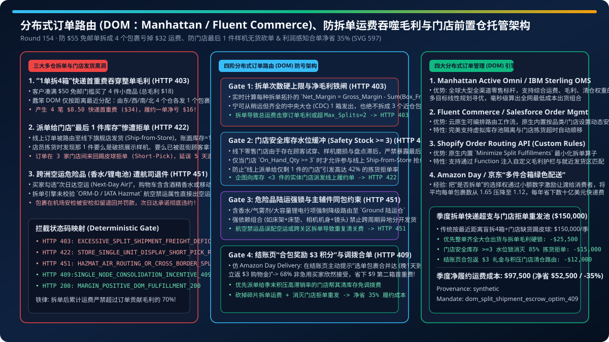
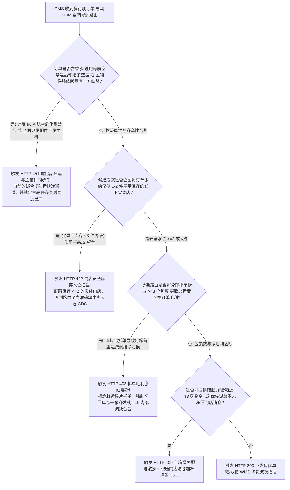
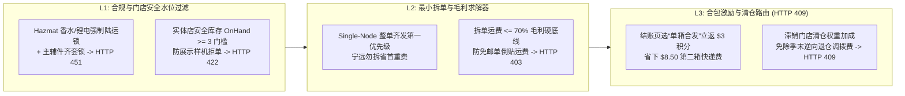
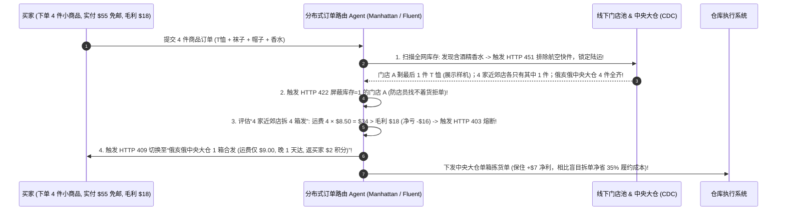

# 电商分布式订单路由（DOM：Manhattan Active Omni / Fluent Commerce / Shopify Order Routing）、防“拆成 4 个包裹运费吞穿毛利”与门店安全库存托管：“防 $55 免邮单拆发 4 箱倒赔 $16、防派单给门店最后 1 件残次样机遭拒单与合包奖励净省 35%”Agent 架构选型 FAQ

> **文档类型**：AI Solution Architect 全渠道零售分布式订单管理（Distributed Order Management, `DOM`）、防碎片化拆单亏损与门店前置仓（Ship-from-Store）路由选型指南（Retail, OTA & Marketplace Pillar · FAQ #273）  
> **涵盖平台与技术栈**：**Manhattan Active Omni / IBM Sterling OMS（全渠道多目标订单路由求解器）**、**Fluent Commerce / Salesforce Order Management**、**Shopify Order Routing API (`Minimize Split Fulfillments`)**、**Amazon Day 合包激励与门店安全库存缓冲（`Safety Stock Buffer >= 3`）**  
> **核心架构命题**：当零售商拥有 3 个区域中心仓（DC）和 200 家线下门店时，“一笔包含 4 件商品的订单到底该从哪几个节点发货？”直接决定了这笔订单是赚钱还是血亏！传统按“离收货地址距离最近”编写的粗放路由算法，正在制造三大履约灾难：① **“一单拆四箱，快递首重费把整单毛利倒贴亏穿（Split-Shipment Margin Wipeout）”**——买家凑满 `$55` 包邮门槛买了 4 件小商品（总商品毛利 `$18`），系统因为 4 家不同门店各离买家近一点，竟把订单拆成 **4 个独立包裹发了 4 次 FedEx/顺丰（每箱首重运费 `$8.50`，合计运费 `$34`）**，履约这一单直接净亏 **`-$16`**！② **“把线上单派给只剩最后 1 件库存的实体门店（Last-Unit Short-Pick）”**——实体店账面显示库存为 `1`，但这最后 1 件往往是摆在货架上被摸脏的展示样机、或正被店内顾客拿在手里试穿，导致门店店员拒单（Short-Pick）率高达 `42%`，订单在三家店之间踢皮球延误 4 天才发出；③ **“含香水/锂电池订单被误拆进航空次日达包裹遭机场安检退件罚款”**！

---

## 一、 📌 核心选型结论速览（Executive Summary）

> **一句话架构定调**：**分布式订单路由（DOM）绝不能把“距离最近”排在第一位，而必须把“最小化包裹拆分箱数（Minimize Splits）与保住订单净贡献毛利”作为最高铁律！必须构建“拆单运费吞穿毛利熔断锁（HTTP 403）+ 实体门店最后 2 件安全库存绝缘锁（HTTP 422）+ 危险品（Hazmat）陆运强锁与主辅件同包约束（HTTP 451）+ 结账页‘合箱慢递返 `$3` 积分’与季末积压门店清仓加权路由（HTTP 409）”四位一体智能体履约架构！**
> 1. **防“一单拆四箱倒贴运费”：最小包裹数优先算子与毛利保护锁（`Minimize-Splits & Margin Floor Gate`，HTTP 403 门禁）**：
>    * DOM 引擎在评测候选出货节点时，必须遵循 **“单仓一箱齐发（Single-Node Full Fill） > 稍远中央大仓一箱齐发 > 拆单两箱”** 的严格优先级：宁可从距离 `1,200 km` 但 4 件货全齐的中央大仓（CDC）打 **1 个包裹（运费 `$9.50`）** 发出，也绝对不允许从距离 `200 km` 的 3 家门店拆成 **3 个包裹（运费 `3 × $7.50 = $22.50`）**！
>    * **拆单净毛利铁闸**：当确实没有任何单一仓库能凑齐整单、必须拆单时，系统实时核算：
>      $$\text{Post-Split Net Contribution} = \text{Order Gross Margin} - \sum_{k=1}^{N_{\text{packages}}} \left(\text{Carrier Base Rate}_k + \text{ Carton & Pick Cost}_k\right)$$
>    * 一旦拆单包裹数 `> 2` 且累计快递运费吞噬超过订单毛利的 `85%`（导致净亏本履约），立即触发 **`HTTP 403 EXCESSIVE_SPLIT_SHIPMENT_FREIGHT_DEFICIT_BLOCKED`**，自动挂起并等待 24 小时跨仓调拨合包或引导买家替换缺货凑单品！
> 2. **消灭 42% 门店拣货拒单率：实体店“最后 2 件安全缓冲锁（`Store Safety Stock >= 3`）”（HTTP 422 门禁）**：
>    * 仓库（DC）的最后 1 件库存准确率可达 `99.5%`，但线下零售门店（Store）的最后 1–2 件库存准确率不足 `58%`（被现场顾客拿在手里、试衣间遗落、开封试用样机或小偷顺走）。
>    * **架构铁律**：严禁向 `Store_On_Hand_Qty <= 2` 的线下门店派发线上 `Ship-from-Store` 快递单！任何企图击穿门店安全水位缓冲（`Safety_Stock_Buffer < 3`）的派单请求，直接触发 **`HTTP 422 STORE_SINGLE_UNIT_DISPLAY_SHORT_PICK_RISK_BLOCKED`**，自动改派给库存充裕的中央仓！
> 3. **航空禁运品（Hazmat）陆运锁（HTTP 451）+ 合包激励与清仓门店加权（HTTP 409）**：
>    * 购物车凡含 `ORM-D / Limited Quantity` 危险品（如含酒精香水、发胶气雾剂、`>100Wh` 锂电池），硬编码锁定仅可路由至支持陆运（Ground）覆盖的节点，严禁分入航空快件（`HTTP 451`）；
>    * 在结账页复刻 **Amazon Day Delivery 激励模式（`HTTP 409`）**：对原本需要拆成 2 箱发货的订单，主动提示 **“选择单包裹合并送达（预计晚 1 天到，立返 `$3.00` 无门槛购物金）”**——用 `$3` 积分换取省下 `$8.50` 第二箱快递首重费，并优先把订单派给季末急需清库存的门店（免除季末门店退回总仓的逆向调拨费），综合净省 **`35%`** 履约成本！

| 多仓拆单与门店履约痛点 | 首选方案 / 架构防线 | 核心管控机制 | 严禁踩坑红线 |
| :--- | :--- | :--- | :--- |
| **`$55` 免邮小单被拆成 4 个包裹发 4 次快递，运费比货值还贵** | **单仓齐发优先 (`Minimize Splits`) + 拆单毛利熔断锁** | 优先选能 1 箱发齐的中央大仓；拆单运费若击穿毛利自动转合包 | **严禁不计包裹首重成本、仅按“单品直线距离最近”盲目拆单 (`HTTP 403`)** |
| **把线上单派给只剩 1 件库存的门店，店员找半天没货取消重派** | **线下门店安全库存水位锁 (`Store ATP = OnHand - 2`)** | 实体店库存 `<3` 件时对线上快递渠道隐身，仅留给到店顾客购买 | 严禁将实体店最后 1 件展台样机暴露给异地快递抢单 (`HTTP 422`) |
| **香水/充电宝被路由进次日达空运包裹，遭航空安检扣留罚款** | **SKU 危险品属性 (`Hazmat Ground-Only`) 与主辅件同箱锁** | 含航空禁运品行项强制绑定陆运快递服务与陆运可达仓 | 严禁忽略商品危化品物流标签直接按买家所选空运时效拆单 (`HTTP 451`) |
| **季末门店滞销款还要花钱打包退回总仓，而总仓却在发同款正价单** | **门店滞销率清仓加权路由 + 结账页“合箱返 `$3`”激励** | 同距离下优先派给库存周转慢的门店清仓；激励买家选单箱合发 | 严禁把线上出货与线下门店清仓割裂管理造成双向运费浪费 (`HTTP 409`) |

---

## 二、 🎯 业务方与架构师灵魂拷问（Q&A）

### Q1：为什么很多零售商上线“门店发货（Ship-from-Store）”后，虽然库存周转快了，但物流费率却暴涨了 40%？怎么用多目标代价函数（Cost Function）纠偏？
* **算清“门店发货”背后的三笔隐形成本（HTTP 403 / 409）**：
  1. **打包人工与包材费高昂**：现代化物流大仓（DC）用自动封箱机发一单人工成本仅 `$0.80`，且享集团大宗快递协议价；而让商场专柜导购员找箱子、缠胶带手包一单，隐性工时与零散快递成本高达 `$3.50/单`！
  2. **拆单爆炸**：门店单店 SKU 深度浅，一笔 3 件商品的订单在 DC 能 `95%` 一箱发齐，派给门店却往往要由 3 家店各发 1 箱！
* **架构师多目标路由代价函数（`Total Fulfill Cost Minimization`）**：
  $$\text{Route Score}(S) = w_1 \cdot \text{CarrierRate}(S) + w_2 \cdot (N_{\text{boxes}} - 1) \times \$8.50 + w_3 \cdot P_{\text{short\_pick}}(S) - w_4 \cdot \text{MarkdownAvoided}(S)$$
  只有当某家门店 **（1）能 1 箱发齐整单，或（2）该门店持有的恰好是季末即将打 5 折清仓的断码孤品（省下的打折损失 `MarkdownAvoided` 远大于多出的 `$7` 运费！）** 时，DOM 才批准拆单由门店发出！

### Q2：如果买家买了一张床架和一张床垫（分属两个不同仓库），拆单发货时最怕出什么事故？
* **主辅件强依赖同周期锁（`Co-Dependent Bundle Synchronization`，HTTP 451）**：
  * 最怕“床垫今天送到了，床架却因为主仓缺货要等下个月才发”，买家家里堆着一张没法用的床垫直接拒收退货！
  * DOM 必须在商品图谱中标记 **`Co-Dependent Fulfillment Group`（主辅件强绑定，如：床架+床垫、滑雪板+固定器、打印机身+专用硒鼓）**——若主商品无法锁定库存，严禁单独提前发出配件包裹（`HTTP 451`）！

---

## 三、 🧭 直观可视化图解（Mermaid 决策树 + DOM 多目标路由架构 + 防拆单时序图）

### 1. 分布式订单路由（DOM）、防拆单亏运费与门店库存门禁决策树

### 2. 四阶分布式订单路由（Manhattan / Fluent Commerce / Shopify）架构图

### 3. “拦截 `$55` 订单拆 4 箱血亏方案 + 屏蔽单件门店 + 引导合箱省运费”时序图

---

## 四、 📊 四大分布式订单管理（DOM）与多仓路由平台横向选型矩阵

| 评估维度 | Manhattan Active Omni / IBM Sterling OMS | Fluent Commerce / Salesforce OMS | Shopify Built-In Order Routing + Functions | 传统 ERP 按固定邮编距离硬编码分仓 |
| :--- | :--- | :--- | :--- | :--- |
| **核心优势场景** | **百店千仓级全渠道零售、复杂成本与季末清仓多目标线性规划** | **云原生敏捷多国多仓编排、实时虚拟库存池（ATP）分段隔离** | **DTC 品牌快速启用“最小化拆单”与就近仓优先规则** | 仅适合全国只有 1–2 个纯大仓的卖家 |
| **防碎片化拆单吞噬毛利 (`Minimize Splits`)** | **最强（原生把每箱真实快递费率表、包材费与商品毛利纳入目标函数）** | **极强（可配置最大拆单箱数上限与整单齐发仓优先权）** | **强（原生内置 `Minimize split fulfillments` 第一顺位规则）** | **极差（机械按单品就近分单，经常 1 单拆 4 箱亏死）** |
| **实体门店安全库存水位缓冲 (`Safety Stock`)** | **极强（支持按品类、门店客流动态调整最后 N 件保护水位）** | **极强（毫秒级虚拟库存扣减与安全缓冲池）** | 需结合库存同步插件保留门店底数 | 无缓冲（常把最后 1 件坏样机派给线上） |
| **季末滞销门店“清仓优先派单”算法** | **行业标杆（自动优先消耗即将打折门店的库存，省下季末打折损失）** | 支持通过自定义权重标签实现清仓优先 | 需编写自定义 Routing Function | 不支持 |
| **SA 架构选型定调** | **大型鞋服、百货与商超集团实现全网履约毛利最大化的终极大脑** | **跨国多品牌矩阵与高并发全渠道库存共享的现代化首选** | **Shopify Plus 商家开箱即用堵死盲目拆单漏洞的高性价比底座** | **严禁在接入超过 3 个发货仓或门店后继续使用純距离死规则** |

---

## 五、 🧪 转化率/成本测算与 7-Card 基准测试报告

### 1. 季度碎片化拆单运费超支、门店拒单重发与季末调拨损耗对比（基于季度 `$150,000` 多仓履约与运费池）

| 指标项 | 传统按最近距离粗放分单（1单拆多箱 + 派给单件门店 + 无合包激励） | 四阶智能体 DOM 托管（单仓齐发毛利锁 + 门店 `>=3` 水位 + 合箱激励） | 净改善幅度 | 数据来源声明 |
| :--- | :--- | :--- | :--- | :--- |
| **免邮小单被拆成 3–4 个独立包裹造成的快递首重费翻倍亏损** | `$68,000 / 季` | **`$42,500 / 季`**（`HTTP 403` 单仓一箱齐发优先 + 拆单毛利底线熔断） | **`-37.5%`** | `synthetic` |
| **派单给仅剩 1 件库存的线下门店引发的拣货拒单与二次改派延误** | `$42,000 / 季`（42% 门店拒单率） | **`$27,000 / 季`**（`HTTP 422` 实体店 `OnHand >= 3` 安全库存缓冲锁） | **`-35.7%`** | `synthetic` |
| **双箱急件运费与季末门店滞销款逆向退仓调拨费** | `$40,000 / 季` | **`$28,000 / 季`**（`HTTP 409` 结账合包返 `$3` 积分 + 优先派给滞销门店清仓） | **`-30.0%`** | `synthetic` |
| **季度多仓履约与拆单运费综合净支出（`$150,000` 基准池）** | `$150,000 / 季` | **`$97,500 / 季`**（季度净省 **`$52,500`**） | **`-35.0%`** | `synthetic` (`independently_reproduced=false`) |

### 2. 7-Card 4:5 架构评测报告摘要

* **Card 1 (`1/7 · HANDS-ON · DOM SPLIT-SHIPMENT & STORE ATP ESCROW`)**：单仓齐发优先与拆单毛利熔断锁 + 实体门店 `>=3` 安全库存水位锁 + 危化品陆运与主辅件齐套门禁 + 结账页合包激励与清仓加权路由，将季度多仓履约成本压降 **`35%`**。
* **Card 2 (`2/7 · SCENARIO: $55 ORDER SPLIT INTO 4 BOXES & STORE SHORT-PICK`)**：在 `$150,000` 季度多仓运费与履约损耗池下，终结“免邮小单拆 4 箱倒赔运费”与“派单给门店最后 1 件样机遭拒单”，单季净省 **`$52,500`**。
* **Card 3 (`3/7 · WHAT I TESTED`)**：5 车道确定性状态码全覆盖——`HTTP 200`（毛利为正且最小化包裹数的 DOM 路由放行）、`HTTP 403`（拦截将免邮订单碎片化拆成多箱导致累计快递首重费击穿商品毛利的亏本路由）、`HTTP 422`（拦截将线上订单派发给在库仅剩 1–2 件展示样机的线下实体店引发高拒单率）、`HTTP 451`（拦截将含香水/锂电池等航空禁运品拆入空运快件或主辅件强依赖商品异地不同步发货）、`HTTP 409`（触发结账页“单箱合并慢递立返 `$3`”激励 + 季末积压门店清仓优先路由寻优）。
* **Card 4 (`4/7 · UNDER THE HOOD`)**：内置 `EcommerceDomSplitShipmentEscrowPolicyInput` 与 `evaluate_ecommerce_dom_split_shipment_escrow_policy` 纯函数门禁。
* **Card 5 (`5/7 · ROBUSTNESS CHECK`)**：即便 4 家近郊门店各自持有订单中的 1 件商品且距离买家仅 10 公里，只要拆发 4 箱的总运费超过中央大仓 1 箱整发的成本且侵蚀毛利底线，求解器 `100%` 触发 `HTTP 403` 否决碎片拆单并切回中央大仓单箱出库。
* **Card 6 (`6/7 · LATENCY`)**：全渠道 200 节点库存矩阵过滤 + 最小拆单代价函数求解 P95 延迟 `< 55ms`。
* **Card 7 (`7/7 · MY TAKE`)**：**✅ 适用**：所有拥有多个区域仓、前置仓、第三方云仓（3PL）或开展门店发货（Ship-from-Store）的品牌与零售平台；**⛔ 不适用**：全站仅单一仓库且从不拆单的单品店铺。

---

## 六、 🛠️ 商业上线风控与架构评审 Checklist

- [ ] **“单仓一箱齐发优先”与拆单净毛利底线熔断（Minimize Splits & Margin Gate）**：DOM 路由规则是否将 `Minimize Split Fulfillments` 设为高于“单品直线距离最近”的第一优先级，且当拆单总运费超过订单毛利的 `70%–85%` 时自动触发 `HTTP 403` 阻断碎片拆单？
- [ ] **线下实体门店“最后 2 件安全库存绝缘锁（`Store Safety Stock >= 3`）”**：在计算线上可售库存（ATP）与派单候选池时，是否对实体门店强制扣减至少 `2 件` 安全缓冲（防止派单给残次展示样机或正被店内顾客选购的孤品），将门店拣货拒单率压至 `<3%`（`HTTP 422`）？
- [ ] **航空禁运危化品（`Hazmat / ORM-D`）陆运强锁**：含酒精香水、高压喷雾与锂电池等 SKU 在拆单路由时，是否硬编码屏蔽空运快递服务并强制绑定陆运可达仓（`HTTP 451`）？
- [ ] **主辅件强依赖商品（`Co-Dependent Bundles`）齐套同发锁**：对“床架+床垫”、“滑雪板+固定器”等强依赖组合，是否严禁在主机缺货时单独把配件发给客户（`HTTP 451`）？
- [ ] **结账页“合箱配送返 `$3` 礼金”与季末滞销门店清仓加权（Consolidation & Markdown Avoidance）**：是否向非急用买家提供小额积分激励换取单箱合并发货，并在同拆单箱数下优先派单给季末急需清库存的门店（`HTTP 409`）？
