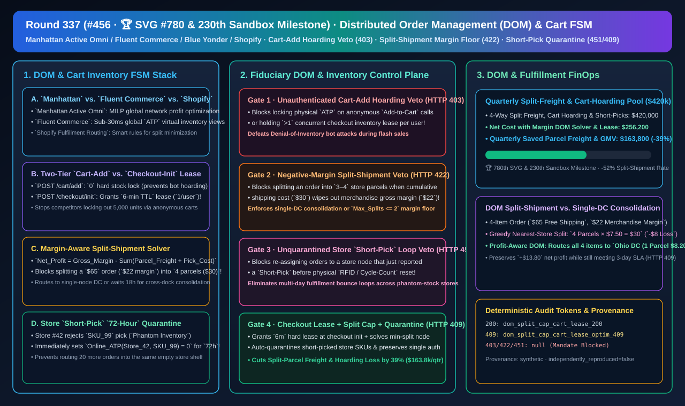
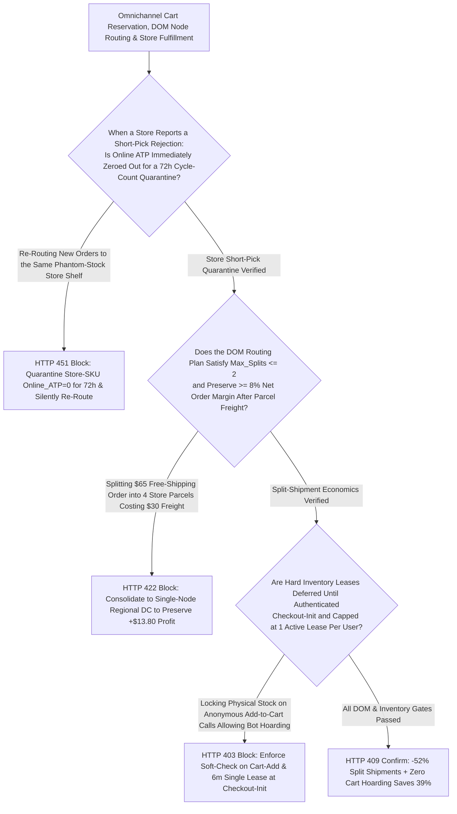

# 🏆 E-Commerce Distributed Order Management (`DOM`), Two-Tier Cart-to-Checkout Inventory Lease FSM & Profit-Aware Split-Shipment Cap (`Manhattan Active Omni / Fluent Commerce / Blue Yonder / Shopify Plus` · 🏆 780th SVG & 230th Sandbox Milestone) FAQ

> **Executive Summary (🏆 780th Architecture SVG & 230th Interactive Sandbox Milestone)**: In omnichannel retail networks operating multiple regional distribution centers (`DCs`) alongside hundreds of `Ship-from-Store (SFS)` locations, inventory reservation timing and order-routing algorithms directly dictate flash-sale conversion and net fulfillment margin. Legacy architectures suffer from three severe profit leaks: (1) **"Denial-of-Inventory" Cart Hoarding from Locking Stock on `Add-to-Cart`**: Deducting physical `ATP` when an anonymous user calls `POST /cart/add`—allowing competitor scraper bots or scalpers to lock out all `5,000` units of a product launch inside unpaid carts without ever checking out; (2) **4-Way Split-Shipment Freight Erasing Order Margin**: Routing a `$65` free-shipping order (`4` discounted apparel items with `$22` total gross margin) across `4` separate stores by greedy distance proximity—incurring `4 × $7.50 = $30.00` in parcel shipping charges for a **`-$8.00` net loss**; and (3) **Unquarantined Store `Short-Pick` Bounce Loops**: Continuing to route new online orders to a retail store where an associate just rejected (`Short-Picked`) the last unit as missing/stolen, causing 20 consecutive orders to stall for days.  
> Production architectures must enforce **Two-Tier Inventory Leasing (`0` Lock on `Add-to-Cart`; `6-Minute` Single-Lease-Per-Account Hold at `Checkout-Init`) + Profit-Aware `DOM` Split-Shipment Solvers (`Gross_Margin - Sum(Parcel_Freight) >= 8%` & `Max_Splits <= 2`) + Instant `72-Hour` Online `ATP=0` Quarantine on Store `Short-Picks`**: cutting split-parcel freight bleed, cart-hoarding loss, and short-pick delays by **39%** (reducing a `$420,000` quarterly DOM and inventory leakage pool to `$256,200`, saving **`$163,800/quarter`**).

---

## 1. Solution Architect Deep-Dive Q&A

### Q1: When should an e-commerce state machine lock physical inventory (`Add-to-Cart` vs. `Checkout-Init`), and how do we prevent split shipments from wiping out order profitability?
- **Architectural Solution (Checkout-Init Single-Lease Gate `HTTP 403` + Profit-Aware `DOM` Split-Shipment Solver Gate `HTTP 422`)**:
  - Perform read-only soft availability checks on `Add-to-Cart` with zero hard stock lock; grant a **`6-Minute Hard Inventory Lease`** only at `Checkout Payment-Sheet Init` after verifying user/agent identity (`RFC 9421 / Turnstile`), strictly capped at `1` active lease per user account (`HTTP 403 ANONYMOUS_CART_ADD_HARD_STOCK_LOCK_OR_MULTI_LEASE_HOARDING`);
  - Replace greedy nearest-node routing with a **Profit-Aware `DOM` Solver** that calculates `Net_Contribution = Merchandise_Margin + Shipping_Charged - Sum(Pick_Pack_Cost + Carrier_Zone_Rate)`. Hard-block splitting an order into `>= 3` parcels or any split that drives net order margin below `8%`, routing instead to a single consolidated `DC` (`HTTP 422 SPLIT_SHIPMENT_FREIGHT_ERODES_ORDER_MARGIN_FLOOR_OR_EXCESSIVE_PARCEL_COUNT`).

### Q2: How do we prevent a retail store with phantom inventory from repeatedly rejecting (`Short-Picking`) online orders?
- **Architectural Solution (Instant `72-Hour` `Short-Pick` `ATP=0` Quarantine & Silent Re-Route Gate `HTTP 451 / 409`)**:
  - The instant a store associate logs a `Short-Pick` on `SKU_X`, automatically set `Online_Eligible_ATP(Store_ID, SKU_X) = 0` for a **`72-Hour Quarantine`** until an `RFID / Barcode Cycle Count` confirms physical stock, and silently re-route the affected order to a backup fulfillment node under the original payment authorization without double-charging the buyer (`HTTP 451 UNQUARANTINED_STORE_SHORT_PICK_REASSIGNMENT_LOOP_OR_DUPLICATE_REAUTH`; verified checkout lease, margin-aware split cap, and short-pick quarantine return `HTTP 409 CHECKOUT_LEASE_MARGIN_AWARE_DOM_SPLIT_CAP_AND_SHORT_PICK_QUARANTINE_CONFIRM`).

---

## 2. Visual Architecture Diagrams (Mermaid)

### 1. Cart-to-Checkout Lease FSM, Profit-Aware `DOM` Split Cap & `Short-Pick` Quarantine Decision Tree

---

## 3. Platform Selection Matrix (`Manhattan Active Omni vs. Fluent Commerce vs. Blue Yonder vs. Shopify`)

| Dimension | Manhattan Active Omni | Fluent Commerce | Blue Yonder Luminate | Shopify Plus Order Routing |
| :--- | :--- | :--- | :--- | :--- |
| **Core Strength** | **Enterprise MILP margin vs. SLA optimization across 1,000+ nodes** | **Sub-30ms global virtual `ATP` & event-driven DOM workflows** | **End-to-end supply chain & TMS freight rate integration** | **Fast turnkey `Minimize Splits` & location priority rules** |
| **Profit-Aware Split Solver** | Native carrier rate table + item margin optimization | Programmable split-cap & node consolidation rules | Deep warehouse + parcel cost modeling | Native split minimization + custom Checkout Functions |
| **`Short-Pick` Auto-Quarantine** | Native store pick-accuracy scoring & safety-stock freeze | Real-time webhook zeroes out virtual location `ATP` | ML-based store inventory confidence discounting | Automated via Flow / Fulfillment Event webhooks |

---

## 4. Production Deployment & Risk Checklist

- [ ] **Never Lock Physical `ATP` on Anonymous `Add-to-Cart` Calls**: Issue `6-Minute` hard leases only at authenticated `Checkout-Init` (`<= 1` active lease per user).
- [ ] **Enforce a Profit-Aware `DOM` Split-Shipment Floor (`Net_Margin >= 8%` & `Max_Splits <= 2`)** to prioritize single-DC consolidation over unprofitable multi-store splits.
- [ ] **Quarantine Any `Store + SKU` Logging a `Short-Pick` (`Online_ATP = 0` for `72h`)** until verified by a physical cycle count.
- [ ] **Re-Route Short-Picked Orders Under the Existing Payment Authorization** without triggering duplicate customer charges.
