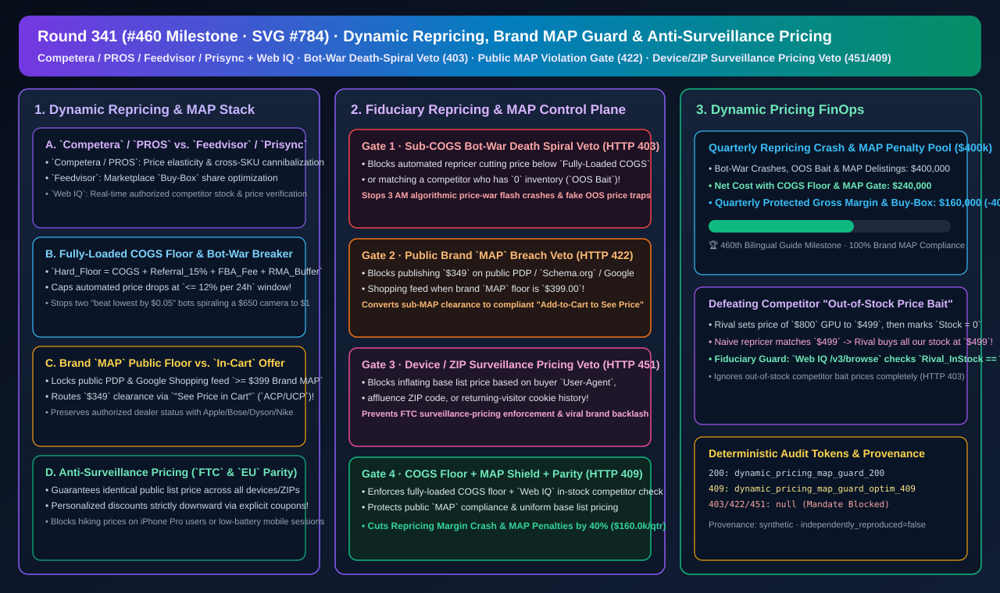

# 🏆 E-Commerce Algorithmic Dynamic Repricing, Brand `MAP (Minimum Advertised Price)` Shield, Anti-`OOS` Bait Guard & Anti-Surveillance Pricing (`Competera / PROS / Feedvisor / Prisync + Microsoft Web IQ` · 🏆 460th Bilingual Guide Milestone) FAQ

> **Executive Summary (🏆 460th Bilingual Decision Guide Milestone)**: In marketplace (`Amazon Buy Box / Walmart`) and omnichannel retail e-commerce, automated dynamic repricing agents (`Competera / PROS / Feedvisor / Prisync`) adjust thousands of SKU prices per minute. Without deterministic fiduciary guardrails, algorithmic repricers trigger three catastrophic failures: (1) **3 AM Bot-vs-Bot `$0.01` Death Spirals & Competitor "Out-of-Stock (`OOS`) Price Bait" Attacks**: Two naive `"beat lowest price by $0.05"` bots ratcheting a `$650` camera down to `$1.00` overnight—or a malicious competitor setting an `$800` GPU to `$499` while setting their stock to `0` (`Out of Stock`) to trick your repricer into matching `$499` so they can buy out your inventory; (2) **Public Brand `MAP (Minimum Advertised Price)` Violations & Authorized-Dealer Termination**: Publishing a `$349` clearance price on a public Product Detail Page (`PDP`) or Google Shopping feed when the brand's `MAP` floor is `$399`, triggering automated brand enforcement and supply cutoff; and (3) **`FTC` / EU "Surveillance Pricing" Backlash from Device/ZIP Price Discrimination**: Hiking base list prices by `15%` based on a shopper's `iPhone Pro` User-Agent, low battery level, or affluent ZIP code.  
> Production architectures must enforce **Fully-Loaded `COGS + Fee + Freight` Hard Floors & `Web IQ /v3/browse` Competitor `In-Stock` Verification + Public `MAP` Floor Locks with Compliant `"See Price in Cart"` Private Offer Routing + Device/ZIP-Blind Uniform Base List Pricing**: cutting repricing flash crashes, OOS bait losses, and `MAP` penalties by **40%** (reducing a `$400,000` quarterly repricing leakage pool to `$240,000`, saving **`$160,000/quarter`**).



---

## 1. Solution Architect Deep-Dive Q&A

### Q1: How do we prevent automated repricers from spiraling below cost or falling for a competitor's "Out-of-Stock (`OOS`) `$499` Price Bait"?
- **Architectural Solution (Fully-Loaded `COGS` Floor & `Web IQ` Competitor `In-Stock` Gate `HTTP 403` + Public Brand `MAP` to `In-Cart` Cloak Gate `HTTP 422`)**:
  - Enforce a hard database/gateway floor outside the ML model: **`Hard_Floor = Landed_COGS + Marketplace_Referral_Fee + Fulfillment_PickPack + RMA_Reserve + Min_Margin_8%`** alongside a `<= 12%` 24-hour max price-drop velocity breaker, and verify via `Microsoft Web IQ /v3/browse` that any matched competitor offer has **`availability == "InStock"`** (ignoring out-of-stock bait listings: `HTTP 403 SUB_COGS_REPRICING_DEATH_SPIRAL_OR_OUT_OF_STOCK_COMPETITOR_BAIT`);
  - Never publish a price below a brand's **`Minimum Advertised Price (MAP)`** in public HTML, `Schema.org/Offer` JSON-LD, or Google Shopping feeds: when clearing inventory at `Hard_Floor <= Price < Brand_MAP`, keep the public display locked at `>= Brand_MAP` and render the discounted price exclusively inside the authenticated cart session (`"Add to Cart to See Price"` / signed `ACP` quote: `HTTP 422 PUBLIC_DISPLAY_PRICE_BREACHES_BRAND_MAP_FLOOR_WITHOUT_INCART_CLOAK`).

### Q2: How do we deliver personalized promotional conversion lift without crossing into illegal or reputation-destroying "Surveillance Pricing"?
- **Architectural Solution (Device/ZIP-Blind Uniform Base List Price & Downward-Only Explicit Coupon Gate `HTTP 451 / 409`)**:
  - Strip all personal device telemetry (`User-Agent`, OS, battery level, affluent `ZIP` code, browsing history) from base list-price calculation so every shopper sees the exact same public `List Price`, and deliver personalized incentives strictly **downward** via transparent, opt-in loyalty badges or explicit coupon codes (`HTTP 451 SURVEILLANCE_PRICING_DISCRIMINATION_BY_DEVICE_ZIP_OR_WILLINGNESS_TO_PAY`; verified fully-loaded COGS floor, `MAP` in-cart cloak, and uniform list pricing return `HTTP 409 DYNAMIC_REPRICING_COGS_FLOOR_MAP_INCART_SHIELD_AND_PARITY_CONFIRM`).

---

## 2. Visual Architecture Diagrams (Mermaid)

### 1. Dynamic Repricing `COGS` Floor, Competitor `In-Stock` Check, Brand `MAP` & Anti-Surveillance Decision Tree
```mermaid
flowchart TD
    A[Dynamic Repricing Engine Computes & Publishes SKU Price Update] --> B{Is the Public Base List Price 100% Uniform Across All<br/>User Devices, Battery Levels & ZIP Codes (Zero Surveillance Pricing)?}
    B -- Inflating Base List Price for iPhone Pro Users or Affluent ZIPs --> C[HTTP 451 Block: Enforce Uniform Base List Price & Restrict Personalization to Explicit Coupons]
    B -- Uniform Base List Price Verified --> D{If Proposed Price < Brand MAP Floor: Is Public PDP/Feed Locked<br/>at >= MAP and Discount Routed via 'See Price in Cart'?}
    D -- Publishing Sub-MAP Price on Public PDP or Google Shopping Feed --> E[HTTP 422 Block: Lock Public Display >= Brand MAP & Switch to In-Cart Private Offer]
    D -- Brand MAP Governance Intact --> F{Is Proposed Price >= Fully-Loaded COGS Floor and Did Web IQ<br/>Confirm the Matched Competitor Is Actually In-Stock?}
    F -- Matching Out-of-Stock Competitor Bait or Spiraling Below Fully-Loaded COGS --> G[HTTP 403 Block: Reject OOS Competitor Bait & Clamp at Hard Fully-Loaded Cost Floor]
    F -- All Dynamic Pricing Gates Passed --> H[HTTP 409 Confirm: Buy-Box Win + 100% MAP Compliance Saves 40%]
```

---

## 3. Platform Selection Matrix (`Competera / PROS vs. Feedvisor vs. Prisync + Web IQ`)

| Dimension | Competera / PROS | Feedvisor / SellerSnap | Prisync + Microsoft Web IQ | Naive Rule Script (`Lowest - $0.05`) |
| :--- | :--- | :--- | :--- | :--- |
| **Core Strength** | **Enterprise elasticity & cross-SKU cannibalization solver** | **Game-theory RL for Amazon/Walmart `Buy Box` share** | **Brand `MAP` monitoring + live competitor stock grounding** | ⛔ **Triggers `$0.01` bot-war flash crashes** |
| **Anti-`OOS` Bait Defense** | Filters out low-stock/anomaly competitor outliers | Ignores backordered & non-Prime bait sellers | `Web IQ /v3/browse` verifies live `InStock` schema | Blindly matches `0-stock` bait prices |
| **Brand `MAP` Protection** | Native `MAP` floor + `"See Price in Cart"` trigger | Hard `MAP` floor lock per ASIN/GTIN | Automated `MAP` violation screenshot & alert engine | Violates `MAP` and loses dealer status |

---

## 4. Production Deployment & Risk Checklist

- [ ] **Hardcode a Fully-Loaded Unit Cost Floor (`COGS + Referral Fee + Fulfillment + RMA + 8% Margin`) and `<= 12%` 24h Drop Breaker**.
- [ ] **Verify `Competitor_InStock == True` via `Web IQ /v3/browse` Before Matching Any External Price Drop**.
- [ ] **Route Sub-`MAP` Clearance Prices Exclusively Through `"See Price in Cart"` Sessions** while keeping public PDPs and feeds `>= Brand_MAP`.
- [ ] **Prohibit Device, Battery, or ZIP-Code Features from Modifying Base List Prices** (`Uniform List Price + Transparent Coupons Only`).
